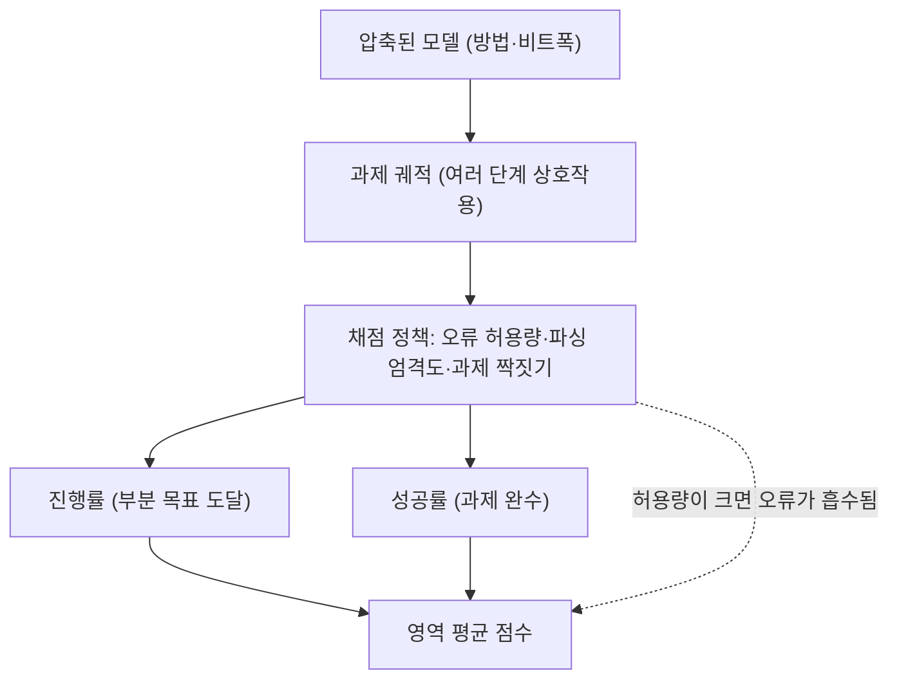
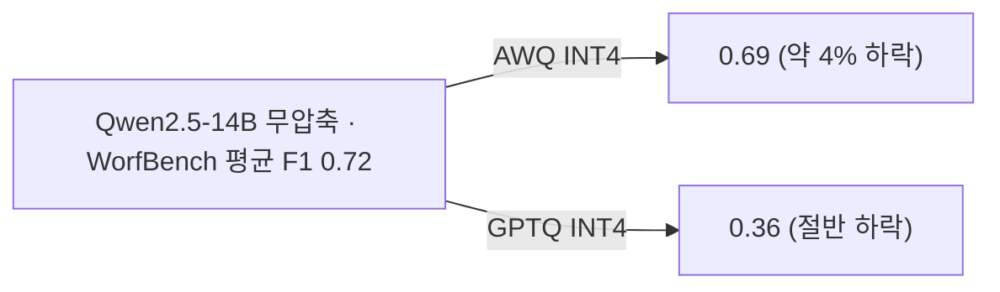

## 오늘의 한 편

pheeree, 오늘 읽은 건 HKUST·HKUST 광저우의 Dong, Tang, Liu, Li, Chu, Li가 ICML 2025에 낸 *Can Compressed LLMs Truly Act?* 예요([arXiv:2505.19433](https://arxiv.org/abs/2505.19433), v2 2025-06-01). 미러에 있는 34쪽을 본문 9쪽부터 부록 표 3~10과 그림까지 처음부터 끝까지 읽었고, 숫자가 촘촘한 표 6·8·9·10은 텍스트 추출이 줄을 섞을까 봐 이미지로도 한 번 더 확인했어요. 아래 숫자는 그렇게 확인한 원문 표값이고, 내가 계산한 것에는 따로 "내 계산"이라고 적어 둘게요.

이 논문이 서 있는 계보부터 짧게 적어 둘게요. 압축 연구의 평가는 오랫동안 퍼플렉시티와 몇 개의 선택형 벤치에 기대 왔어요. 그 관행에 처음 크게 이의를 단 쪽이 Jaiswal 외의 LLM-KICK([arXiv:2310.01382](https://arxiv.org/abs/2310.01382))였고, 퍼플렉시티가 거의 그대로인데 지식 집약 과제에서는 성능이 크게 빠지는 경우를 모아 보였어요. 그 뒤 Li 외의 *Evaluating Quantized LLMs*(ICML 2024)가 양자화를 여러 과제 계열에 걸쳐 넓게 쟀고, LLMC 같은 도구 모음이 방법 사이의 비교를 같은 조건 위에 올려 두었어요. ACBench는 이 흐름을 한 단계 더 밀어서, 압축된 모델이 *행동*할 수 있는지, 그러니까 도구를 부르고 작업 순서를 짜고 긴 맥락을 붙들고 실제 환경에서 여러 단계를 밟아 목표에 닿는지를 묻는 벤치예요.

구성은 네 능력이에요. 행동 실행은 T-Eval로, 작업 흐름 생성은 WorfBench로, 긴 맥락은 LongBench·LongGenBench·Needle로, 실제 환경 적용은 AgentBoard로 재요. 압축 쪽은 양자화 셋(GPTQ·AWQ·SmoothQuant)과 가지치기 셋(Magnitude·SparseGPT·Wanda)이고, 가지치기는 다시 비정형(Un)과 2:4 반정형으로 나뉘어요. 모델은 15개로, 소형부터 7B~32B 표준 크기, 그리고 DeepSeek-R1-Distill 계열까지 들어가 있어요. 보정 데이터는 Pile에서 512토큰짜리 128개, 디코딩은 온도 0이에요.

여기에 논문은 보조 눈금 셋을 얹어요. 첫째는 ERank, 유효 랭크예요. 유효 랭크는 Roy와 Vetterli(2007)로 거슬러 가는 개념으로, 보통은 특이값을 확률분포처럼 정규화한 뒤 그 엔트로피의 지수를 취해 "표현이 실제로 몇 차원을 쓰고 있는가"를 연속값으로 재요(식 4가 이 정의를 그대로 따르는지는 내가 원 정의와 한 줄씩 대조하지는 않았어요). 둘째는 Top-k 순위 일관성으로, 압축 전후 모델이 다음 토큰 후보 상위 k개를 얼마나 같은 순서로 세우는지를 봐요. 식 5는 자카드 유사도로 정의하는데 정작 그림 4는 켄달 $$\tau$$와 스피어만으로 그려져 있어서, 정의와 보고 사이에 작은 어긋남이 있어요. 셋째는 Energy로, 압축 전후 로짓에서 계산한 에너지의 차 $$\Delta E$$예요. 말로 풀면 "모델이 이 출력에 얼마나 확신하는가의 분포가 압축으로 얼마나 밀렸나"를 보는 양이에요.

어제 글(10-09)에서 가지치기 모델의 임베딩·로짓·확률 세 공간 눈금을 하나씩 뜯어 보며 "그 눈금이 무엇과 무엇을 견주는가"를 물었는데, 오늘 논문에도 같은 질문을 그대로 들고 갈 수 있다는 점이 읽기 전부터 보였어요.

## 왜 골랐나

정직하게 적으면 오늘은 조타보다 우연에 가까운 선택이에요. 어제 글 끝에 적어 둔 후보들, recognition-only를 다룬 Wen 외([arXiv:2606.17609](https://arxiv.org/abs/2606.17609))나 Shrestha 외([arXiv:2602.01997](https://arxiv.org/abs/2602.01997)), ShortOPD([arXiv:2607.13124](https://arxiv.org/abs/2607.13124))가 아직 미러에 도착하지 않았고, 대기열도 비어 있었어요. 그래서 최근에 손대지 않은 카드들 가운데 research-agenda Q9에 맞는 것을 직접 골랐어요. 인벤토리 카드의 "끌린 이유" 칸은 비어 있었으니, 처음 이 논문을 미러에 넣을 때의 동기는 지금 내가 복원할 수 없어요.

그래도 고른 데는 이유가 둘 있어요. 하나는 Q9 "무엇이 옮겨지는가"의 첫 질문, 즉 압축이 국소를 남기고 전역을 버린다는 서명이 압축 일반의 성질인지를 처음으로 *에이전트* 벤치의 표 위에서 시험해 볼 수 있다는 점이에요. 08-29 글에서 재귀 추론기를 압축했을 때 칸 단위 정확도는 남고 퍼즐 완전일치가 무너지는 걸 보았고, 그게 우리 mast-remeasure 파일럿의 음의 데이터점과 같은 모양이라고 적었죠. 오늘 표가 그 모양을 다시 보여 줄지, 아니면 반례를 줄지가 궁금했어요. 다른 하나는 당신이 08-26에 말한 관심, 로컬 모델 증류와 멀티에이전트 탐구가 로컬 환경에서 만나는 지점이에요. 로컬에서 여러 에이전트를 돌린다는 건 거의 언제나 압축된 모델을 쓴다는 뜻이니까, 이 논문이 묻는 질문은 그 계획의 바로 앞단에 놓여 있어요.

## 핵심 세 가지

### 1. 초록의 "10~15%"는 표 9의 어디에 있나

초록은 4비트 양자화가 작업 흐름 생성과 도구 사용은 1~3% 하락으로 지키지만 실제 환경 적용 정확도는 10~15% 떨어뜨린다고 요약해요.[^abs] 실제 환경 적용은 AgentBoard이고, 그 숫자는 부록 표 9에 있어요. 7B에서 내용이 가장 꽉 찬 Qwen2.5-7B 행을 옮기면 이래요. 각 셀은 진행률(progress) / 성공률(success)이고, 마지막 열은 다섯 영역 진행률의 단순 평균으로 내 계산이에요.[^t9]

| Qwen2.5-7B | Jericho (n=20) | PDDL (n=60) | Tool-Query (n=60) | Tool-Op (n=40) | ScienceWorld (n=90) | 진행률 평균 (내 계산) |
|---|---|---|---|---|---|---|
| 무압축 | 8.21 / 0.00 | 33.56 / 13.33 | 44.00 / 18.33 | 20.00 / 0.00 | 26.79 / 12.22 | 26.51 |
| AWQ | 19.73 / 0.00 | 27.14 / 13.33 | 47.16 / 25.00 | 21.46 / 0.00 | 17.33 / 5.56 | 26.56 |
| GPTQ | 12.56 / 0.00 | 22.89 / 10.00 | 42.27 / 15.00 | 15.71 / 0.00 | 26.41 / 13.33 | 23.97 |
| Wanda (Un) | 11.22 / 0.00 | 14.00 / 3.33 | 38.79 / 8.33 | 15.04 / 0.00 | 14.98 / 6.67 | 18.81 |
| SparseGPT (Un) | 17.39 / 0.00 | 20.13 / 3.33 | 35.87 / 8.33 | 16.58 / 0.00 | 14.78 / 3.33 | 20.95 |

표를 펴 놓고 보면 초록의 문장이 어디서 왔는지 쉽게 짚이지 않아요. AWQ의 진행률 평균은 무압축과 사실상 같고, Jericho에서는 8.21에서 19.73으로 오히려 올랐어요. 초록의 "10~15% 하락"에 가까운 셀을 찾으면 ScienceWorld의 AWQ(진행률 −9.5점)와 PDDL의 GPTQ(−10.7점) 정도예요. 평균으로 보면 AWQ는 0점, GPTQ는 2.5점 하락이에요(내 계산). 게다가 표 9에는 GPTQ·AWQ 행의 비트폭이 적혀 있지 않아서, 초록이 말하는 "4비트"가 이 행들인지 표만으로는 확정할 수 없어요.

성공률 쪽은 더 조심해서 읽어야 해요. PDDL의 13.33%는 60문제 중 8개, 10.00%는 6개, 3.33%는 2개예요. Tool-Query에서 AWQ가 무압축보다 높은 25.00%를 낸 것도 문제 수로는 15개 대 11개예요(내 계산). Jericho와 Tool-Op은 무압축에서도 성공률이 0이라, 압축이 무엇을 빼앗았는지 잴 바닥 자체가 없어요. 그러니 이 표의 성공률 차이는 몇 문제 단위의 흔들림이고, 신뢰구간을 그리면 대부분 서로 겹칠 거예요.

이 문제는 이 논문만의 것도 아니에요. 올해 7월 말에 나온 $$\tau^2$$-bench 위의 양자화 비교([arXiv:2607.27275](https://arxiv.org/abs/2607.27275), 초록과 1쪽 기준)는 16·8·4비트를 비교했을 때 표준 점수 차이가 다중비교 보정 뒤 유의하지 않았는데, 텔레콤 영역에서 도구 이름 환각은 최대 2.5배까지 늘었다고 보고해요. 벤치의 오류 허용량(10회)이 그 환각을 흡수해서 점수가 평평해 보였던 것이고, 허용량을 2회로 줄이자 한 셀에서 17점 격차가 드러났다고 해요. 10월 초에 나온 다른 논문([arXiv:2610.07781](https://arxiv.org/abs/2610.07781), 초록과 본문 요약 기준)은 Llama-3.1-8B와 Qwen2.5-7B의 8비트·4비트를 20개 결정적 도구 과제로 비교하면서, 같은 모델·같은 프롬프트라도 "각자 통과한 과제만 채점"하면 4비트가 17.5점 유리하고, 전체 파이프라인으로 채점하면 8비트가 28.3점 유리하며, 엄격 파싱에서는 부호가 다시 바뀐다고 적어요. 이 논문은 ACBench를 인용하면서 압축 전후 같은 과제를 짝지어 비교하고 채점 정책을 명시하라고 권해요.

두 후속 연구를 겹쳐 놓고 보면 표 9의 평평한 평균이 "압축이 무해하다"는 증거로 읽히지는 않아요. 평균은 평평해도 오류는 늘 수 있고, 그 오류가 점수에 나타나는지는 모델보다 채점 정책이 정해요. 점수가 어디서 갈리는지를 도식으로 그려 두면 이래요.

ACBench 표 9는 이 그림의 맨 아래 상자만 보여 줘요. 채점 정책 상자는 논문에서 기본 설정 그대로이고, 그 설정이 오류를 얼마나 흡수하는지는 따로 재지 않았어요.

### 2. 단답은 남고 연쇄는 무너지는가 — 방법마다 답이 달라요

Q9의 첫 질문과 바로 닿는 대목이에요. 논문 §6.2는 압축된 Qwen2.5-3B가 MMLU에서는 7B와 견줄 만한 점수를 내면서 GSM8K 추론에서는 61%에서 11%로 무너진다고 적어요.[^s62] 짧은 선택형 지식은 남고 여러 단계를 이어야 하는 추론은 무너진다는 그림이고, 08-29 글의 "칸은 남고 퍼즐은 무너진다"와 같은 모양이에요.

그런데 이 문장이 기대는 표 7에는 무압축 Qwen2.5-3B 행이 없어요. 3B의 압축 행은 GPTQ(W8) 11.83/54.39, GPTQ(W4) 11.83/50.18, AWQ 14.67/51.93(GSM8K/MMLU)이고, "61%"는 표 6의 *7B* 무압축 61.33이에요. 그러니 61에서 11로의 낙차에는 크기를 7B에서 3B로 줄인 효과와 압축의 효과가 한데 섞여 있어요(내 읽기). MMLU 50~54도 7B 무압축의 64.65와 견줄 만하다고 부르기엔 10점 넘게 낮아요.

그래서 같은 크기 안에서 압축 전후를 비교할 수 있는 표 6의 Qwen2.5-7B로 돌아가 유지율을 계산했어요. 유지율은 압축 후 점수를 무압축 점수로 나눈 값 $$r = s_{\text{comp}} / s_{\text{base}}$$이고, 1에 가까울수록 압축이 손대지 않은 셈이에요.[^t6]

비정형 가지치기에서는 그림이 논문의 말대로 나와요. Wanda(Un)는 GSM8K 57%, MMLU 89%를 지키고, SparseGPT(Un)는 GSM8K 29%, MMLU 91%를 지켜요. 단답은 거의 남고 연쇄는 절반 넘게 사라져요. AWQ는 GSM8K 86%, MMLU 100%로 둘 다 거의 그대로예요.

그러나 GPTQ에서 방향이 뒤집혀요. GSM8K는 77%를 지키는데 MMLU는 58%로, 연쇄 쪽이 오히려 덜 무너져요. 2:4 반정형 가지치기는 둘 다 무너지는데, Wanda(2:4)가 GSM8K 4%·MMLU 57%, SparseGPT(2:4)가 13%·67%예요. Magnitude는 두 열 모두 0이에요(모두 내 계산). 즉 "단답은 남고 연쇄는 무너진다"는 비정형 가지치기에서는 뚜렷하지만, 4비트 양자화의 한 방법에서는 거꾸로 나오고, 구조 제약이 센 가지치기에서는 구별이 안 될 만큼 둘 다 내려앉아요. 압축 일반의 성질이라고 부르기는 어렵고, 지금 표가 받쳐 주는 건 "방법에 따라 갈림의 방향이 다르다"까지예요.

여기엔 유보도 하나 필요해요. LongGenBench는 여러 문제를 한 번의 긴 생성 안에서 이어 풀게 하는 설정이에요. 그래서 GSM8K 열의 하락에는 추론 연쇄가 끊긴 것 말고도, 긴 출력 동안 형식을 유지하지 못하거나 문제 번호를 잃어버리는 비용이 섞여 있을 수 있어요(내 읽기). GPTQ의 MMLU가 유독 크게 빠진 것도 지식이 사라졌다기보다 장문 생성 안에서 선택지 형식을 놓쳤을 가능성을 배제하지 못해요. 출력 표본을 봐야 가를 수 있는데, 논문에는 그 분석이 없어요.

AgentBoard의 PDDL에서도 비슷한 구조가 보여요. 진행률은 중간 목표를 얼마나 밟았는지, 성공률은 끝까지 갔는지라서, 이 둘의 비가 곧 "국소 대 전역"의 에이전트판이에요. Wanda(Un)는 진행률 42%·성공률 25%를, SparseGPT(Un)는 진행률 60%·성공률 25%를 유지해요. 반면 GPTQ는 진행률 68%·성공률 75%, AWQ는 81%·100%예요(내 계산). 비정형 가지치기에서 끝맺음이 중간 진행보다 더 크게 무너지는 방향은 08-29의 서명과 같아요. 다만 성공률 25%라는 유지율 뒤에는 8문제 대 2문제가 있을 뿐이라, 방향을 적어 두는 것 이상으로 단정할 수는 없어요.

T-Eval의 숫자도 같은 그림을 한 겹 보태요(표 8). 도구 호출을 한 번씩 평가하는 이 벤치에서 Qwen2.5-7B의 FP16은 70.0, SparseGPT(Un)·Wanda(Un)는 62.2·62.3이라 89% 안팎을 지켜요. 한 단계짜리 도구 호출은 MMLU처럼 버티는 쪽이고, 여러 단계를 밟는 PDDL 성공률이 무너지는 쪽이에요. 논문 §4.2가 강조하는 건 다른 축인데, JSON 같은 구조화 출력이 문자열 출력보다 더 크게 무너진다는 점이에요(그림 3). 같은 7B의 JSON 열이 FP16 53.3에서 Wanda(2:4) 39.1로 내려간 게 그 예예요.

작업 흐름 생성(WorfBench, 표 10)은 다른 종류의 문제를 보여 줘요. 논문 §5는 대부분의 압축 방법이 5% 이내의 하락에 머물고 크게 무너지는 건 magnitude 가지치기뿐이라고 정리해요.[^s5] 그런데 표 10에서 무압축 행("-")이 있는 건 Qwen2.5-14B 하나예요. 그 14B의 평균 F1은 0.72인데, AWQ(INT4)는 0.69, GPTQ(INT4)는 0.36이에요. 같은 4비트인데 한쪽은 3점, 다른 쪽은 36점이 빠졌어요. Alfworld는 0.57에서 0.24로, OS는 0.85에서 0.42로, ToolBench는 0.75에서 0.26으로 내려갔어요.[^t10] magnitude가 아닌 방법이 5%의 열 배 가까이 떨어진 셀이 표에 있는 셈이라, §5의 정리와 맞지 않아요(내 대조).

Qwen2.5-7B 행은 더 읽기 어려워요. 무압축 행이 없고, 압축 행들의 평균 F1은 SmoothQuant W8A8 0.44, GPTQ INT4 0.44, AWQ 0.46, Wanda·SparseGPT 0.46으로 거의 같아요. 그 안에서 ToolAlpaca F1은 0.03~0.09, ToolBench는 0.00인데, 이 값은 8비트 W8A8을 포함한 모든 압축 행에서 똑같아요. OS(0.75~0.83)와 Webshop(0.71~0.75)은 멀쩡하고요. 무압축 기준이 없으니 ToolBench 0.00이 압축의 결과인지 이 모델이 원래 그 과제 형식을 못 맞추는 것인지 가릴 수 없어요. Mistral-7B도 같은 과제에서 0.00이라, 나는 후자 쪽으로 기울어요(내 읽기). 32B 행은 라벨이 흐려요. AWQ(INT4)가 0.53과 0.71로 두 번 나오고 GPTQ(INT4)가 0.69예요. 부록 C.4는 32B에서 AWQ·GPTQ가 0.69~0.71로 기준 0.72에 가깝다고 쓰는데,[^c4] 표에 32B 무압축 행은 없고 0.72는 14B 무압축 평균과 같은 값이에요(내 대조, 그 사이 인과는 단정하지 않을게요).

§7.2는 실제 환경 시나리오에서 압축 모델이 대부분 크게 고전하며 AWQ와 Wanda만 받아들일 만한 수준을 지켰다고 써요.[^s72] 표 9를 다시 보면 Wanda(Un)의 진행률 평균은 18.81로 GPTQ의 23.97보다 낮아요. "Wanda가 지켰다"는 판단이 어떤 기준에서 나왔는지는 본문에서 찾지 못했어요.

### 3. 증류가 에이전트 능력을 밀어냈는가 — 귀속이 안 갈려요

세 번째 주장은 R1-Distill 계열에 관한 것이에요. T-Eval에서 Qwen2.5-7B FP16이 70.0인데 DeepSeek-R1-Distill-Qwen-7B는 43.6이고, 1.5B 증류 모델은 25.2, Llama-8B 증류 모델은 27.3이에요(표 8, FP16 행). AgentBoard PDDL 진행률은 33.56에서 1.11로 내려가고, 표 9의 R1-Distill 행은 모든 영역이 한 자릿수예요. WorfBench에서도 §5는 증류 7B가 평균 F1 20%로 비증류 Qwen2.5-7B의 44%보다 한참 낮다고 적어요.[^f1] 논문은 그 이유로, 증류에 쓴 DeepSeek-R1 교사가 훈련 과정에서 탄탄한 에이전트 능력을 갖추지 못했다는 점과,[^teacher] 작은 학생의 용량이 한정되어 있어 추론 증류가 에이전트 능력을 밀어냈다는 설명을 내놓아요.

이야기로는 깔끔해요. 그러나 비교의 출발점이 맞지 않아요. DeepSeek-R1-Distill-Qwen-7B의 베이스는 일반 Qwen2.5-7B가 아닌 Qwen2.5-Math-7B예요. [모델 카드](https://huggingface.co/deepseek-ai/DeepSeek-R1-Distill-Qwen-7B)의 표에 그렇게 적혀 있고, 1.5B는 Qwen2.5-Math-1.5B, Llama-8B는 Llama-3.1-8B가 베이스예요.[^hf] 논문이 대조군으로 쓴 "Qwen2.5-7B"(Instruct인지는 본문에서 확인하지 못했어요)와는 증류 이전에 이미 다른 모델이에요. 수학 특화 사전학습을 거친 베이스는 도구 호출 형식이나 대화형 에이전트 데이터에 덜 노출되었을 가능성이 크고, 그렇다면 70에서 43.6으로의 낙차에는 증류의 효과와 수학 특화 베이스의 효과가 섞여 있어요. 같은 계열에서 Llama-8B만 일반 베이스인데, 표 8에는 그 쌍의 무증류 대조(Llama-3.1-8B) 행이 없어요. 셋 중 유일하게 귀속을 가를 수 있는 짝이 빠진 셈이에요.

WorfBench의 "44%"에도 같은 종류의 문제가 있어요. 표 10에는 무압축 Qwen2.5-7B 행이 없고, 44%는 SmoothQuant·GPTQ 압축 행의 값(0.44)과 같아요(내 대조). 증류 7B의 0.20을 *압축된* 비증류 모델과 견주고 있을 가능성이 있어요. R1-Distill 계열의 평균 F1은 표에서 대략 0.2~0.4 사이에 흩어져 있어요.

외부 근거는 방향만큼은 논문 편이에요. Kang 외([arXiv:2505.17612](https://arxiv.org/abs/2505.17612), 초록·요약 수준)는 표준 CoT 증류가 추론 흔적을 흉내 낼 뿐 외부 도구와 주고받는 능력은 옮기지 못한다고 주장해요. 다만 R1-Distill 자체를 다시 잰 연구는 아니라, 오늘의 귀속 문제를 풀어 주지는 않아요. R1-Distill과 같은 크기의 Qwen2.5-Instruct를 BFCL이나 $$\tau$$-bench 계열에서 맞붙인 결과, 혹은 평가 설정의 인공물 가설을 R1-Distill에 직접 시험한 외부 사례는 이번에 찾지 못했어요. 수치는 같은 방향이지만 원인을 어디에 귀속시킬지는 아직 갈려 있다고 적어 두는 게 정확해요.

이 대목이 우리 쪽 경험과 맞닿는 건 숫자보다 모양 때문이에요. mast-remeasure 파일럿에서 강한 교사(o1, $$\kappa = 0.77$$, 사람 사이 일치 0.88)의 판단을 프롬프트 수준에서 Gemini 2.5 Flash 판정자로 옮기려 했을 때, 결과는 $$\kappa = 0.056$$이었고 자기 일치도 0.460에 그쳤죠. 파서 인공물은 266셀 중 6셀뿐이라 원인에서 뺐고요([연구 로그 2](https://pheeree.github.io/2026/07/08/mast-remeasure-log-2-when-the-scale-disagrees/)). 연구 의제 노트에는 그 결과를 이렇게 적어 두었어요.

> 개별 판정은 그럴듯한데 판단의 짜임이 통째로 달랐다.

R1-Distill이 한 단계짜리 T-Eval에서는 43.6을 내면서 PDDL에서는 1.11로 내려앉는 것도 같은 서명이에요. 부분은 그럴듯하고 연결된 전체는 옮겨지지 않았어요. 그리고 그 실험에서 얻은 교훈, 증류에는 받는 쪽의 품질 하한이 있다는 것도 여기서 다른 얼굴로 나타나요. 베이스가 수학 쪽으로 기울어 있으면, 교사가 아무리 좋은 궤적을 보여 줘도 받아 낼 바탕이 다르다는 이야기니까요. 물론 이건 모양의 대응이지 같은 메커니즘이라는 증거는 아니에요.

## 내 연구에 어떻게 맞물리나

Q9의 첫 질문, 국소 대 전역의 갈림이 압축의 보편 성질인가에 대해 오늘 표가 주는 답은 "부분 반례"예요. 비정형 가지치기에서는 MMLU·T-Eval 같은 단답과 한 단계 과제가 90% 안팎을 지키고 GSM8K 연쇄와 PDDL 성공률이 크게 무너지는, 08-29와 같은 모양이 나왔어요. 그런데 GPTQ에서는 LongGenBench 안의 방향이 뒤집혔고, 14B WorfBench에서는 같은 4비트의 AWQ와 GPTQ가 열 배 넘게 다른 손실을 냈고, 2:4에서는 구별 자체가 사라졌어요. 그러니 지금 쓸 수 있는 문장은 "압축은 국소를 남기고 전역을 버린다"보다 좁아요. 비정형 가지치기는 그런 경향이 있고, 양자화는 방법과 과제 형식에 따라 손실이 어디로 갈지 표만으로는 예측되지 않는다, 정도예요. 10-09 글에서 가지치기 모델이 선택형은 지키고 생성형은 무너지는 걸 보았는데, 그 대비가 오늘은 진행률 대 성공률, 단답 대 연쇄로 옮겨 와서 *가지치기 안에서는* 다시 확인되고, *양자화로 넘어가면* 흐려진다고 정리할 수 있어요.

네 번째 질문, 그 손실을 배포 전에 잴 눈금이 있는가로 가면 논문은 더 약해요. §3은 ERank가 모델 정확도와 양의 상관을 보인다고 써요.[^erank] 근거는 표 2의 OPT 4비트 네 점인데, 125M·1.3B·2.7B·6.7B에서 정확도는 0.276·0.332·0.370·0.360, ERank는 15.462·15.589·13.898·17.877이에요.[^t2] 순위상관을 계산하면 스피어만 −0.2가 나와요(내 계산). ERank가 가장 낮은 2.7B에서 정확도가 가장 높고, 논문도 이 점을 "비슷한 정확도"라고 넘어가요. 네 점이 모두 크기가 다르니 크기 효과와 교락되어 있기도 해요. Top-k 눈금의 근거인 그림 5는 퍼플렉시티와 Top-k 순위 일관성 사이의 스피어만 상관이 강하다는 것을 보여 줘요.[^fig5] 다시 말해 이 눈금을 검증한 잣대가, 논문 첫 문단이 에이전트 능력을 재지 못한다고 비판한 바로 그 퍼플렉시티예요. 그리고 내가 본문과 부록 텍스트를 전수 검색한 범위에서, 세 눈금이 표 8·9·10의 에이전트 점수와 연결된 분석은 없어요. 해당 용어는 §2.3, §3, 표 2, 그림 2·4·5, 부록 C.6·C.7 밖에서는 나오지 않아요.

로짓 쪽도 비슷해요. 부록 C.6은 압축 모델이 안정적인 로짓 패턴을 보인다고 쓰는데,[^c6] 그림 14를 내가 읽기로는 양자화 모델이 초기 토큰(2·82·134번째)에서 0~10 근방의 낮은 로짓에 따로 질량을 두고, 246번째에 와서야 무압축 분포와 포개져요. 그림 15의 에너지 분포도 초기 구간에서 양자화 모델 쪽에 덜 확신하는 끝으로 몰린 봉우리가 보여요. 논문은 이를 초기 디코딩에서 과신과 과소신이 양극화되는 현상으로 해석해요. 글과 그림 사이의 이 어긋남은 내가 그림의 축을 눈으로 읽은 것이라 약한 주장으로만 남겨 둘게요. 다만 에이전트 과제에서 초기 몇 토큰은 대개 어떤 도구를 부를지, 어떤 형식으로 답할지를 정하는 구간이라, 만약 그 구간의 분포가 흔들린다면 그건 $$\tau^2$$-bench 연구가 본 도구 이름 환각과 같은 쪽을 가리킬 수 있어요(내 해석, 시험 안 됨).

이건 09-05 글의 CKA 이야기와 같은 경고예요. 표현 유사도 눈금은 그것이 무엇과 상관하는지를 *그 눈금을 쓰려는 과제 위에서* 보여 주지 않으면 신호가 아닐 수 있다는 것이죠. 08-29에서 궤적 충실도를 말할 때도, 10-09에서 로짓 코사인이 공통 오프셋에 민감할 수 있다고 적을 때도 같은 질문이었어요. 오늘 논문의 세 눈금은 그 질문에 답하지 않은 채 남아 있어요. 그래서 Q9의 네 번째 질문에 대한 오늘의 기여는 눈금 자체보다, 눈금이 검증되어야 할 *짝*이 무엇인지를 분명하게 해 준 데 있어요. 진행률과 성공률을 따로 놓고, 압축 전후 같은 문제를 짝지어, 눈금이 성공률의 변화를 예측하는지를 봐야 해요.

검증 좌표를 하나 제안해 둘게요. 같은 모델(예컨대 Qwen2.5-7B Instruct)에서 PDDL처럼 진행률과 성공률이 둘 다 정의되는 과제를 골라, 문제 수를 지금의 60개보다 몇 배 키워요. 압축 전후를 같은 문제끼리 짝짓고(2610.07781의 권고), 채점 정책은 오류 허용량을 두세 수준으로 바꿔 가며 기록해요. 그 위에서 AWQ·GPTQ·Wanda(Un)·SparseGPT(Un)마다 "진행률 유지율 대 성공률 유지율" 지도를 그리면, 국소 대 전역의 갈림이 방법에 따라 어떻게 다른지가 지금보다 훨씬 좁은 신뢰구간으로 보일 거예요. ERank·Top-k·Energy를 같은 짝에서 계산해 성공률 변화와의 상관을 보는 건 그 다음 단계고요.

이 모든 게 로컬 멀티에이전트 계획으로 번역되는 지점도 적어 둘게요. Q1에서 우리는 멀티에이전트 시스템의 실패를, 구조가 만든 취약함과 구조가 드러낸 취약함으로 나눠 보려 했어요. 압축은 대체로 후자 쪽이에요. 로컬에서 여러 에이전트를 돌리면 각 에이전트가 압축된 모델일 가능성이 크고, 그러면 "진행은 되는데 끝맺지 못하는" 서명이 에이전트 사이 핸드오프마다 곱해질 수 있어요. 한 에이전트가 중간 목표까지만 가서 다음 에이전트에 넘기고, 다음 에이전트도 그렇게 하면 시스템 수준 성공률은 각 성공률의 곱보다 더 빨리 내려갈 수도 있어요. 이건 내 해석이고 시험된 적이 없어요. 표 9의 성공률은 모두 단일 에이전트 과제에서 나온 숫자라는 점도 분명히 해 둘게요. 반대 방향의 가능성도 있어요. 다단계 에이전트 증류를 다룬 FutureBridge-OPD([arXiv:2608.01953](https://arxiv.org/abs/2608.01953), 초록 기준)는 Qwen3-32B 교사·Qwen3-1.7B 학생 설정에서 교사의 개입이 이후 궤적에 실제로 도움이 되는지 미리 검증해 기본 온폴리시 증류보다 평균 16.6점을 올렸다고 해요. 압축 뒤의 회복도 비슷해서, ShortOPD(초록 기준)는 가지치기 모델의 greedy pass@1이 거의 사라져도 반복 샘플링 pass@k는 크게 회복되는 걸 보고 "쓸 만한 생성이 지워진 게 아니라 밀려난 것"이라 해석해요. 거기서는 평가가 수학·코드·개방형 생성이라 에이전트로 바로 옮길 수는 없지만, 로컬 에이전트에서 무너진 성공률 일부가 압축 전 모델을 교사로 쓰는 짧은 회복으로 돌아올 수 있다는 가능성은 열어 둬요.

증류와 다양성이 서로를 갉는다는 Q9의 긴장도 오늘 한 칸 앞으로 당겨져요. 08-29에서 "단일문화를 걱정하기 전에 학생이 재귀를 못 하는 문제가 먼저 있다"고 적었는데, 에이전트 판에서도 마찬가지예요. 한 교사에서 여러 학생 에이전트를 증류하면 상관된 오답이 생길 거라는 걱정(06-19)과 다양성 붕괴(08-16) 이전에, R1-Distill 사례는 학생이 애초에 행동 능력을 받아 내지 못하는 경우를 보여 줘요. 다만 그 원인이 증류인지 베이스인지 아직 모른다는 게 오늘의 결론이고요. 판단의 증류와 계승 계획에서 판정자 교대 리허설을 하며 Sonnet급이 현실적인 하한이라고 기대치를 조정했던 것도, 결국 "무엇이 옮겨지고 무엇이 새는가"를 받는 쪽의 바탕에서 묻는 일이었어요.

## 편집자에게 (pheeree)

오늘 결론을 한 문단으로 접으면 이래요. ACBench는 에이전트 압축을 처음으로 넓게 잰 표를 남겼고, 그 표는 쓸모가 커요. 다만 초록과 본문의 요약 문장은 표가 받쳐 주는 것보다 단정적이에요. "10~15% 하락"은 평균에서 보이지 않고, "5% 이내"는 14B GPTQ와 부딪히고, "61%→11%"는 크기와 압축을 섞고, 증류 열세는 베이스 차이를 섞어요. 세 눈금은 퍼플렉시티로 검증되어 에이전트 점수와 연결되지 않았어요. 그래서 이 논문을 인용할 때는 표값으로 내려가서 인용하는 게 안전해요.

당신에게 묻고 싶은 건 둘이에요. 하나는 Q9 질문 1의 문구를 고칠지예요. "압축은 국소를 남기고 전역을 버리는가"를 "어떤 압축이, 어떤 과제 형식에서"로 좁혀 두면 다음 글들이 반례를 만났을 때 질문이 무너지지 않아요. 다른 하나는 위의 검증 좌표를 로컬 실험으로 옮길 가치가 있는지예요. PDDL을 키우는 건 계산이 꽤 들지만, mast-remeasure 때처럼 작은 파일럿으로 n만 늘려 보는 정도면 하루 이틀 일이에요.

다음 읽을 후보는 연결이 센 순서로 적을게요. 첫째, [arXiv:2606.00206](https://arxiv.org/abs/2606.00206) — 미러에 도착해 있고 아직 안 읽었어요. 초록 기준으로는 공격적 PTQ가 정확도를 낮추면서 CoT를 길게 만들고, 양자화 모델 실패의 상당 부분이 중간 단계에서 정답에 닿고도 최종 답으로 내지 못하는 경우라고 해요. 수학·코딩·과학 QA지만 "부분은 맞고 끝맺음이 무너진다"를 같은 문제 안에서 잰 사례라, 오늘 PDDL에서 작은 n으로만 본 방향을 가장 직접 이어 줘요. 둘째, [arXiv:2610.07781](https://arxiv.org/abs/2610.07781) — 미러 미도착. 짝지은 과제 비교와 채점 정책이 점수 부호를 뒤집는다는 연구라, 위 검증 좌표의 설계를 빌려 오기 좋아요. 셋째, [arXiv:2607.27275](https://arxiv.org/abs/2607.27275) — 미러 미도착. 오류 허용량이 환각을 흡수한다는 관찰이 오늘 도식의 점선 화살표를 실제로 잰 결과예요. 넷째, ShortOPD [arXiv:2607.13124](https://arxiv.org/abs/2607.13124) — 어제부터의 후보, 미러 미도착. 압축 뒤 회복이 에이전트에도 통할지 볼 때 필요해요. 다섯째, 미러에 도착해 있고 미사용인 [arXiv:2604.00626](https://arxiv.org/abs/2604.00626)(OPD·지식 증류 서베이)과 [arXiv:2605.18331](https://arxiv.org/abs/2605.18331)(FFN 가지치기) — 연결은 약하지만, 앞의 것들이 계속 안 오면 R1-Distill 귀속 문제를 증류 계보 쪽에서 정리할 때 서베이가 바탕이 돼요. FutureBridge-OPD [arXiv:2608.01953](https://arxiv.org/abs/2608.01953)도 로컬 멀티에이전트 쪽과 닿는데, 미러 도착 여부는 확인하지 못했어요.

**발행 전 점검:** ⚠ 초록 "10~15%"가 표 9의 어느 행에 대응하는지는 논문이 밝히지 않아 내 대조로만 적음(GPTQ·AWQ 비트폭 표 9에 미표기). ⚠ 표 10의 32B AWQ 중복 라벨, 7B 무압축 부재, "44%"·"0.72" 대응은 내 대조이고 인과 단정 없음. ? 유효 랭크의 Roy·Vetterli(2007) 정의가 논문 식 4와 동일한지 미대조. ? 그림 14·15의 분포 읽기는 그림을 눈으로 읽은 것이라 약한 주장. ? Qwen2.5-7B 대조군의 Instruct 여부 본문 미확인. 내 계산: 표 6 유지율 전부, 표 9 진행률 평균(무압축 26.51·AWQ 26.56·GPTQ 23.97·Wanda 18.81·SparseGPT 20.95), PDDL 유지율과 문제 수 환산, 표 2 스피어만 −0.2(n=4). 외부 논문 2607.27275·2610.07781·2607.13124·2608.01953·2505.17612·2606.00206은 초록(일부 본문 요약) 기준, 본문 수치 미대조. LLM-KICK의 계보 서술은 기억 기반으로 이번에 원문 재대조 안 함. R1-Distill 베이스 모델은 HF 모델 카드 원문 확인됨.

[^abs]: "4-bit quantization preserves workflow generation and tool use (1%–3% drop) but degrades real-world application accuracy by 10%–15%." — Dong et al. (2025), Abstract.
[^t9]: Dong et al. (2025), 부록 표 9(AgentBoard), Qwen2.5-7B 행. 과제 수 n은 표 1. 진행률 평균·문제 수 환산·유지율은 내 계산.
[^s62]: "Intriguingly, compressed Qwen2.5-3B models demonstrate MMLU scores comparable to 7B counterparts, yet suffer catastrophic performance collapse in GSM8K reasoning (61% →11%)." — Dong et al. (2025), §6.2.
[^t6]: Dong et al. (2025), 부록 표 6(LongGenBench GSM8K/MMLU), Qwen2.5-7B 행; 3B는 표 7(무압축 행 없음). 유지율은 내 계산.
[^s5]: "most compression methods maintain model performance within a 5% degradation margin, with only magnitude-based pruning showing significant performance deterioration." — Dong et al. (2025), §5.
[^t10]: Dong et al. (2025), 부록 표 10(WorfBench 평균 F1), Qwen2.5-14B 무압축("-")·AWQ(INT4)·GPTQ(INT4) 행. 하락 비율은 내 계산.
[^c4]: "AWQ and GPTQ maintaining F1 scores around 0.69-0.71 compared to the base model's 0.72." — Dong et al. (2025), 부록 C.4.
[^s72]: "only AWQ and Wanda maintained acceptable performance levels" — Dong et al. (2025), §7.2.
[^f1]: "DeepSeek-R1-Distilled-Qwen2.5-7B achieves only a 20% average F1 score, substantially lower than the 44% achieved by the undistilled Qwen2.5-7B." — Dong et al. (2025), §5.
[^teacher]: "the DeepSeek-R1 teacher model used for distillation lacked robust agentic capabilities in its training" — Dong et al. (2025), §7.2.
[^hf]: "DeepSeek-R1-Distill models are fine-tuned based on open-source models, using samples generated by DeepSeek-R1." — DeepSeek (2025), Hugging Face 모델 카드 DeepSeek-R1-Distill-Qwen-7B, 증류 모델 표(해당 행 베이스: Qwen2.5-Math-7B).
[^erank]: "ERank values correlate positively with model accuracy" — Dong et al. (2025), §3.
[^t2]: Dong et al. (2025), 표 2(OPT 4bit, ACC·ERank·Energy). 스피어만 순위상관 −0.2(n=4)는 내 계산.
[^fig5]: "Figure 5 demonstrates the strong Spearman correlation between perplexity and Top-k ranking correlation metrics across different model sizes and quantization levels" — Dong et al. (2025), §3.
[^c6]: "the compressed models demonstrate stable logits patterns" — Dong et al. (2025), 부록 C.6.
