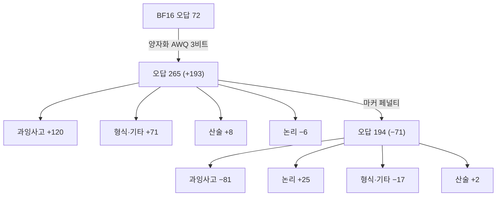
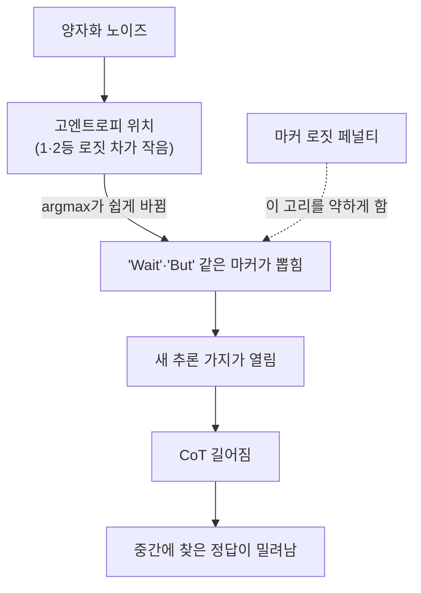

## 오늘의 한 편

Lotfi, Kirichenko, Li, Liu(FAIR at Meta)의 "Quantized Reasoning Models Think They Need to Think Longer, but They Do Not"([arXiv:2606.00206](https://arxiv.org/abs/2606.00206), 2026-05-29)을 읽었어요. 어제 ACBench 글 끝에 다음 후보 첫 줄로 적어 둔 논문이고, 미러에 도착한 채 아직 펼치지 않았던 편이에요. 본문 10쪽과 부록 전체를 통독했고, 표 1과 부록 표 2는 텍스트 추출본과 PDF 이미지를 함께 놓고 숫자를 맞췄습니다.

이 논문을 이 블로그가 처음 만나는 건 아니에요. 09-03 글은 탐구 자료의 요약으로, 09-08 글은 초록과 서론만 읽고 곁가지로 인용했어요. 두 번 다 원문 대조 없이 쓴 문장이었고, 오늘 처음 PDF 전체를 놓고 그 문장들을 다시 맞춰 봤습니다. 결과부터 말하면 09-08에 적은 한 문장은 꽤 좁혀 읽어야 해요. 그 얘기는 셋째 항목에서 합니다.

설정은 이래요. DeepSeek-R1-Distill-Qwen 1.5B·7B·14B, R1-Distill-Llama-8B, QwQ-32B에 사후 양자화(PTQ)를 겁니다. 가중치만 3·4비트로 줄이는 GPTQ·AWQ, 가중치·활성값·KV 캐시를 모두 4비트로 내리는 FlatQuant W4A4KV4(와 8비트 판)가 비교 대상이고, 벤치마크는 GSM8K·MATH-500·AIME-120·LiveCodeBench·GPQA-Diamond, 디코딩은 온도 0.6에 top-p 0.95예요. 관찰은 둘이 한 쌍으로 묶여 나옵니다. 양자화가 세질수록 정확도가 떨어지고 사고 사슬(CoT)이 길어지며, 28개 모델·양자화 쌍에서 정확도 하락과 CoT 증가의 순위상관이 $$\rho=-0.73$$이에요[^rho]. 그리고 실패한 문제를 뜯어 보면, 상당수에서 모델이 중간 추론 어딘가에 정답을 써 놓고도 최종 답으로 내놓지 못했다는 것[^abs]. 저자들은 이걸 한 문장으로 요약해요 — 양자화된 추론 모델은 생각하지 못해서 틀리는 게 아니라 생각을 멈추지 못해서 틀린다[^stop].

처방도 붙어 있습니다. "Wait", "But", "Alternatively" 같은 망설임·분기 토큰 50개를 손으로 골라, 디코딩할 때 그 토큰들의 로짓에서 상수 $$\lambda$$를 빼요.

$$
z'_t(v) = z_t(v) - \lambda \quad (v \in S)
$$

읽는 법은 단순해요. $$z_t(v)$$는 $$t$$번째 위치에서 토큰 $$v$$의 원래 점수고, 목록 $$S$$에 든 토큰만 점수를 일정량 깎아 덜 뽑히게 만든다는 뜻이에요. 학습은 없고, 디코딩 규칙만 바뀝니다.

## 왜 골랐나

Q9는 "압축·증류는 국소를 남기고 전역을 버리는가, 그 손실을 배포 전에 잴 수 있는가"를 묻고 있어요. 지금까지 쌓인 데이터점은 형식이 제각각이었습니다. 08-29 글의 재귀 추론기에서는 칸 단위 정확도는 남고 퍼즐 완전일치는 사라졌고, 어제 ACBench에서는 진행률과 성공률이 갈렸는데 그 갈림이 압축 방법마다 달랐어요. 둘 다 "부분은 맞는데 전체가 틀린다"를 보여 주지만, 부분과 전체를 서로 다른 지표로 쟀다는 약점이 있었어요. 칸 정확도와 완전일치는 같은 출력의 두 채점법이고, 진행률과 성공률도 마찬가지예요.

이 논문은 그 둘을 한 트레이스 안에서 잽니다. 같은 문제의 같은 생성물에서, 정답이 중간에 나타났는가와 끝에 확정됐는가를 나눠 봐요. Q9 질문 1에 필요한 측정이 바로 이 꼴이에요. 그리고 질문 4, 토큰 단위 KL 같은 눈금이 성능과 이어지는가에도 직접 걸려요 — 이 논문의 진단 도구가 양자화 모델과 원 모델 사이의 토큰별 KL이니까요.

그래서 오늘 물음은 이렇게 적어 둡니다. 압축된 추론 모델의 실패 중 '중간엔 정답에 닿고 끝맺음에서 놓치는' 몫은 얼마나 되고, 그 몫을 걷어냈을 때 손상은 얼마나 돌아오는가.

## 핵심 세 가지

### 1. "도달했다"의 조작적 정의와 52%의 분모

먼저 "중간에 정답에 닿았다"를 무엇으로 판정했는지부터 봤어요. 오류 분류는 Qwen-1.5B의 MATH-500 오답을 GPT-5 판정자에게 맡겨 네 범주(과잉사고·논리 오류·산술 오류·형식/환각/기타) 중 하나로 고르게 했고, 판정자는 사람 주석 일부와 95% 넘게 일치했다고 해요. 부록 D의 지침이 결정적인데, 금 정답이 중간 추론에 나타났지만 최종 답으로 나오지 않았으면 과잉사고를 고르라고 적혀 있어요[^judge].

즉 '도달'의 정의는 "금 정답 문자열이 트레이스 어딘가에 등장했는가"예요. 이 정의는 깔끔하지만 두 가지를 가르지 못합니다. 하나는 우연한 등장이에요. AWQ 3비트 모델의 MATH-500 평균 CoT는 2만 3천 토큰이 넘는데, MATH의 답은 작은 정수나 짧은 분수가 많아요. 그 길이의 트레이스에서 정답 숫자가 다른 맥락으로 한 번 스쳐 갈 확률은 0이 아니고, 이 논문에는 그 기저율을 재는 대조군이 없어요. 판정자가 "정답으로서 도달했는가"를 의미로 읽었을 수는 있지만, 지침의 문구는 문자열 등장 쪽에 더 가깝습니다. 다른 하나는 생성 길이 상한이에요. 최대 생성 길이를 본문과 부록에서 찾지 못했어요. 상한에 걸려 잘린 트레이스가 정답을 중간에 품고 있었다면 그것도 과잉사고로 분류됐을 텐데, "멈추지 못함"과 "예산이 바닥남"은 같은 현상의 두 이름일 수도 있고 아닐 수도 있어요. 적어도 숫자로는 갈려 있지 않습니다.

다음은 52%의 분모예요. BF16 모델은 500문항 중 72개를 틀렸고 그중 과잉사고가 19개(26%), AWQ 3비트는 265개를 틀렸고 그중 139개(52.5%)가 과잉사고예요[^count]. 초록의 "up to 52%"는 이 한 칸에서 나온 값이고, 같은 모델의 GPTQ 3비트는 19→39, FlatQuant W4A4KV4는 19→64였어요. 모델 하나, 벤치마크 하나, 그리고 그중 가장 크게 무너진 양자화 구성 하나가 분자이자 분모라는 걸 같이 적어야 이 숫자가 정확해집니다.

여기서 내가 그림 3의 막대를 읽어 직접 셈해 본 게 있어요. 막대 높이를 눈으로 읽은 값이라 한두 건씩 틀릴 수 있고, 그래서 약한 주장으로 적어 둡니다. BF16은 [과잉사고 19, 논리 39, 산술 7, 형식·기타 7], AWQ 3비트는 [139, 33, 15, 78], 마커 페널티를 건 AWQ 3비트는 [58, 58, 17, 61]로 읽혀요. 합은 각각 72·265·194로 본문 숫자와 맞아요.

내 계산으로는 양자화가 더한 오답 193건 가운데 과잉사고가 120건(62%)이고, 형식·기타가 71건(37%)이에요. 비율로 보면 형식·기타는 7→78로 약 11배라, 과잉사고의 7.3배보다 더 가파르게 늘었어요. 그런데 페널티는 그쪽을 거의 움직이지 못합니다(78→61). 페널티 쪽 순변화도 들여다볼 만해요. 과잉사고는 81건 줄었는데 논리 오류가 25건 늘어서, 총 오답은 71건만 줄었어요. 71/500이 정확도 +14.2%p와 정확히 맞고요. 막대가 주는 건 범주별 순변화뿐이라, 과잉사고였던 문제가 논리 오류로 옮겨 간 것인지 서로 다른 문제들이 들고 난 것인지는 알 수 없어요. 다만 "끝맺음 실패를 걷어내면 그만큼 맞힌다"는 일대일 그림은 아니라는 정도는 말할 수 있습니다. 멈추게 한 문제 중 일부는 멈춘 자리에서 틀린 답을 내요.

그러나 이 그림 전체가 한 모델 위에 서 있다는 사실이 더 무겁습니다. 오류 분류(그림 3, 10)는 Qwen-1.5B에서만 했고, 다른 네 모델은 정확도와 길이만 보고했어요. 부록 표 2를 보면 "양자화가 사슬을 늘린다"는 서술 자체가 크기에 따라 갈려요. Qwen-1.5B AWQ 3비트는 평균 CoT가 11,248에서 28,048토큰으로 늘지만, Qwen-14B는 GPTQ 3비트에서 정확도가 5.3점 떨어지면서 평균 CoT가 오히려 228토큰 짧아지고, FlatQuant W4A4KV4에서는 정확도 변화 0.0에 CoT −78이에요. QwQ-32B 3비트는 정확도 −6.1~−6.4에 CoT +3~6%뿐이고요. 저자들도 큰 모델이 더 버틴다고 적어 두긴 했어요[^larger]. 그러니 52%라는 몫이 큰 모델에서도 비슷한지는 이 논문으로 알 수 없고, 사슬이 늘지 않는 모델에서 '멈추지 못함'이 주된 실패라고 보기는 어렵습니다.

외부 쪽에서도 같은 방향의 신호가 있어요. 아래는 초록 기준이고 본문은 대조하지 않았어요. NF4 양자화를 3B~14B 다섯 모델에 걸고 CoT 3만 개를 여섯 범주로 나눈 [arXiv:2607.09999](https://arxiv.org/abs/2607.09999)는 정확도가 많아야 3.1%p 떨어지는데도 실패의 성격이 바뀐다고 보고해요. LLaMA 3.2-3B에서는 지름길로 무너지는 오답이 44%에서 78%로 늘고, 정답이지만 추론이 비어 있는 경우는 작은 모델에서 급감하되 12B 이상에서는 변화가 없다고요. 비수학 벤치마크와 instruction-tuned 모델이라 직접 비교는 안 되지만, "양자화 오류는 곧 과잉사고"라는 일반화를 크기 축이 막는다는 점은 같아요. 2비트 쪽인 [arXiv:2606.02011](https://arxiv.org/abs/2606.02011)(초록 기준)은 Qwen3 계열에서 반복 루프·토큰 예산 소진·답 확정 지연·닫히지 않은 추론 구간을 실패 양상으로 들고, NeurIPS 2026 초록 페이지에는 루프에 갇혀 답에 닿지 못하는 실패와 답에 닿고도 멈추지 못하는 실패를 나누는 연구가 올라와 있어요. 그 페이지에는 arXiv 번호가 없어서, 2606.02011과 같은 연구인지는 확정하지 못했습니다. 그 구분이 맞다면 오늘 논문의 '과잉사고' 범주가 두 실패를 섞고 있을 가능성도 있어요.

### 2. KL은 어디에 몰리나 — 통제 실험의 힘, 그리고 엔트로피와의 상관 0.92

둘째는 진단이에요. 같은 생성 접두를 두고 BF16과 AWQ 3비트 모델의 다음 토큰 분포 사이 KL을 위치마다 계산하고, 토큰별로 평균을 내요. KL이 큰 토큰 상위 20개는 "Wait", "But", "Alternatively", "maybe", "verify" 같은 망설임·분기 토큰이고, 작은 쪽은 수식과 형식 토큰이에요. 위치별 KL은 BF16 모델의 다음 토큰 엔트로피와 순위상관 0.92로 묶여 있어요[^kl]. 트레이스 안의 구성비도 바뀝니다. BF16에서는 저KL(수학) 토큰이 고KL(망설임) 토큰보다 많아 고/저 밀도비가 0.57인데, AWQ 3비트에서는 1.15로 뒤집혀요.

이 논문에서 제일 단단한 부분은 페널티의 통제 실험이에요. 같은 크기의 페널티를 네 목록에 걸어 봤어요. 마커 50개는 길이를 줄이면서 정확도를 지키고, 무작위 토큰은 아무 효과가 없고, 저KL 토큰에 걸면 CoT가 최대 41% 늘고 정확도가 최대 9.5% 떨어져요. 거꾸로 $$\lambda$$를 음수로 줘서 마커를 부추기면 CoT가 최대 445% 늘고 정확도가 최대 34% 떨어집니다. 한 방향의 효과만 보였다면 "어떤 토큰이든 깎으면 짧아진다"는 해석이 남았을 텐데, 무작위 대조와 부호를 뒤집은 실험이 함께 있어서 이 목록이 길이를 양방향으로 조절하는 지렛대라는 주장은 꽤 믿을 만해요. (09-08 글은 이 9.5%를 "퍼센트포인트"로 옮겼는데, 원문은 단위를 퍼센트로만 적어 상대값인지 점수 차인지 밝히지 않아요. 이것도 좁혀 읽을 대목이에요.)

기제 설명은 로짓 마진 논증이에요. Yayla와 Kumar의 분석에서 출발해, 1등과 2등 로짓의 차이가 작은 위치일수록 작은 섭동에도 argmax가 뒤집힌다는 구조를 자기회귀 생성으로 옮기고, 마커가 고엔트로피 위치의 상위 20개 후보 안에 저엔트로피 위치보다 2~4배 자주 들어 있다는 관찰을 붙여요. 그러면 이야기가 이어집니다.

저자들 스스로도 이 논증이 한 가지 실패 양상의 직관일 뿐 PTQ가 만드는 손상 전체의 인과 설명은 아니라고 적어 둬요[^intuition]. 그 경계가 정직한 만큼, 경계 밖을 짚어 볼 필요가 있어요.

0.92라는 상관은 진단을 받쳐 주면서 동시에 진단의 정보량을 의심하게 합니다. 위치별 KL의 순위가 원 모델의 엔트로피 순위와 거의 같다면, "양자화가 망설임 토큰을 흔든다"는 말의 상당 부분은 "망설임 토큰은 원래 모델이 불확실한 위치에 살고, 불확실한 위치는 무엇이든 흔든다"로 환원될 수 있어요. 틀린 말은 아니지만, 그 경우 양자화 모델을 돌려서 KL을 재는 수고가 BF16 엔트로피만 보는 것보다 무엇을 더 알려 주는지가 비어 있게 됩니다. 저자들은 결론에서 이 KL 분석이 가지치기·증류·저랭크 근사에도 쓸 수 있는 일반 진단일 수 있다고 쓰지만, 시험하지는 않았어요[^general].

그리고 위치에 대한 진단이 다른 연구에서는 반대로 나옵니다. ReQAT([arXiv:2606.15682](https://arxiv.org/abs/2606.15682), ICML 2026, 초록 기준)는 W4A4KV4(FP4) 추론 모델의 실패가 숫자·연산자 같은 저엔트로피 토큰에 몰리고 거기서 생긴 잡음이 트레이스를 따라 번진다고 주장해요. 오늘 논문은 수식 토큰이 거의 흔들리지 않는다고 했으니 결이 맞지 않아요. 둘을 화해시킬 길은 있어요. ReQAT는 양자화 인지 학습 쪽이고 생성된 오류의 연쇄를 보는 반면, 오늘 논문은 사후 양자화에서 분포 KL의 평균을 봅니다. 평균 KL이 작은 토큰이라도 드물게 한 번 뒤집히면 그 한 번이 산술 오류로 이어질 수 있고, 평균은 그 꼬리를 잘 보여 주지 않아요. 10-09 글에서 평균 충실도와 최악 위치를 나눠 본 것과 같은 구도입니다. 내 셈에서 형식·기타 오류가 11배로 늘었는데 페널티가 거의 못 건드렸다는 것도 이 저엔트로피 쪽 경로와 이어질 수 있지만, 그건 지금으로서는 짐작이에요.

### 3. 얼마나 돌아오나 — 고른 $$\lambda$$와 BF16 대조군

셋째가 오늘 물음의 뒷절이에요. 표 1은 모델 다섯 개의 가장 강한 양자화 구성마다 페널티 전후를 보여 주는데, 캡션에 페널티 행은 구성별로 가장 좋은 $$\lambda$$의 결과라고 적혀 있어요[^bestl]. 평가에 쓴 바로 그 다섯 벤치마크 위에서 $$\lambda$$를 고른 셈이에요. $$\lambda$$에 대한 표준편차도 같이 적혀 있어서 고른 효과의 크기를 대략 가늠할 수는 있지만, 검증 분할에 고정한 $$\lambda$$로 잰 숫자는 아니에요.

그 표에서 BF16 대비 정확도 손실 중 페널티가 회복한 몫을 내가 계산했어요(다섯 벤치마크 평균 기준). Qwen-1.5B AWQ 3비트는 BF16 48.5, 양자화 29.0, 페널티 후 35.2라서 손실 19.5점 중 6.2점, 약 32%가 돌아와요. 같은 모델 GPTQ 3비트는 손실 10.7점 중 1.9점(18%), FlatQuant W4A4KV4는 10.3점 중 2.3점(22%)이에요. 그림 3의 MATH-500 한 칸만 보면 38.6점 중 14.2점(37%)이고요. 5개 모델의 13개 구성 전체로 넓히면 이 원시 회복률은 대략 1%에서 38% 사이에 흩어져 있어요(Qwen-14B FlatQuant는 손실 자체가 0이라 정의되지 않아요).

그런데 표 1에는 하나가 더 있어요. 양자화하지 않은 BF16 모델에 같은 페널티를 걸어도 정확도가 오릅니다. 1.5B는 48.5→50.7, 7B는 63.5→66.7, 14B는 70.7→74.1, Llama-8B는 61.3→62.1, QwQ-32B는 79.0→80.7로 +0.8~+3.4점이에요. 그러면 양자화 모델에서 본 회복 가운데 양자화가 만든 손상을 되돌린 몫은, 원 모델에도 생기는 일반 이득을 뺀 나머지로 읽어야 해요. 이건 이중 차분이에요.

$$
\text{양자화 고유 회복} = (Q_{+\text{Pen}} - Q) - (\text{BF16}_{+\text{Pen}} - \text{BF16})
$$

말로 풀면, 페널티가 양자화 모델에 준 이득에서 원 모델에도 똑같이 줬을 이득을 덜어 낸 값이에요. 내 계산으로는 Qwen-1.5B AWQ 3비트가 +4.0(손실의 약 21%), Llama-8B GPTQ 3비트가 +2.5(22%)로 눈에 띄고, 나머지 구성 다수는 0 근처이거나 음수예요. Qwen-7B AWQ 3비트는 양자화 모델 이득 +0.2 대 BF16 이득 +3.2, Qwen-14B FlatQuant는 −0.2 대 +3.4입니다. 이 빼기는 내 해석이고, 두 이득이 더해진다는 가정 위에 서 있어요. 원 모델과 양자화 모델의 실패 분포가 다르면 같은 페널티가 다른 양만큼 들 수 있으니, 정밀한 분해라기보다 상한을 낮춰 보는 정도의 셈이에요.

이득이 어디서 오는지도 들여다봤어요. 1.5B BF16의 +2.2점 중 많은 몫이 GPQA 한 칸(30.8→39.4)에서 오고, Llama-8B GPTQ 3비트의 +3.3점도 GPQA(29.8→39.9)가 끌어올려요. GPQA-Diamond는 200문항이 안 되는 작은 집합이라 한 칸의 9~10점 출렁임은 표본 잡음과 $$\lambda$$ 선택이 겹칠 때 쉽게 나오는 크기예요. 고른 $$\lambda$$의 낙관이 어디에 몰려 있을지 짐작하게 하는 대목입니다.

여기서 선을 분명히 그어 둘게요. 이 계산은 논문의 주장을 흔들지 않아요. 논문은 페널티가 정확도를 대체로 지키면서 CoT를 4.1~28.0% 줄인다고 주장하고, 표가 그걸 받쳐요. 저자들이 '되돌림'이라는 말을 쓴 곳도 과잉사고 행동, 곧 사슬 길이에 대해서이고 거기에도 "partially"를 붙여 두었어요[^partial]. 흔들리는 건 이 블로그 09-08 글의 문장이에요. 그 글에서 나는 자기회귀 추론기에서는 테스트타임 로짓 개입으로 "상당 부분이 되돌아온다"고 썼어요. 원문을 놓고 좁혀 읽으면 이래요. 길이는 상당 부분 돌아온다. 정확도 손실은 구성에 따라 1~38%가 돌아오고, 원 모델에도 생기는 이득을 빼면 대부분의 구성에서 0 근처, 두 구성에서 20% 남짓이다. 09-08 글은 고치지 않고, 이 문단을 그 문장의 각주로 삼아 두려고 해요.

## 내 연구에 어떻게 맞물리나

Q9 질문 1에 놓고 보면, 이 논문은 지금까지 모은 데이터점 중 측정 꼴이 제일 깨끗해요. 08-29의 칸 대 퍼즐, 어제의 진행률 대 성공률, 그리고 우리 mast-remeasure 파일럿에서 판정단 Gemini 2.5 Flash가 개별 판정은 그럴듯한데 원 판정과의 일치가 $$\kappa=0.056$$에 그쳤던 일(원 o1 0.77, 사람 0.88)까지, 모두 "국소는 살아 있고 전역이 틀린다"는 서명을 공유하지만 국소와 전역을 각기 다른 채점으로 쟀어요. 이 논문은 한 트레이스에서 '도달'과 '확정'을 나눠 세니, 서명이 같은 문제 안에서 실제로 일어난다는 증거가 됩니다.

다만 그 몫이 일정하지 않다는 게 오늘의 더 중요한 수확이에요. 같은 1.5B에서도 과잉사고 오답은 GPTQ 3비트 39, FlatQuant 64, AWQ 3비트 139로 세 배 넘게 차이 나고, 14B·32B에서는 사슬이 늘지조차 않아요. 어제 Q9 질문 1의 문구를 "어떤 압축이, 어떤 과제 형식에서"로 좁히자고 했는데, 오늘 데이터는 거기에 모델 크기라는 축을 하나 더 얹어요. 국소·전역 갈림이 압축의 보편 성질이라고 말하기엔, 갈림의 크기가 방법×크기×과제의 함수로 너무 크게 흔들립니다.

되돌림 쪽은 09-03·09-08에서 세운 구도를 다듬게 해요. 09-08 글은 9월 1일 KV 캐시 글, 9월 3일 ETH 재귀 추론기 글에 이어 "되돌릴 수 있는 몫이 압축 강도보다 실행 구조에 달려 있다"를 세 번째 데이터점으로 세웠어요. 고정점에서 답을 읽는 구조는 테스트타임 확률성이 무용했고, 토큰마다 답을 커밋하는 구조는 디코딩 개입이 통한다는 대비였죠. 오늘 원문으로 보면 그 대비는 반만 맞아요. 토큰 단위 커밋 구조에서 개입이 확실히 되돌리는 건 사슬 길이이고, 정확도는 일부만, 그것도 원 모델에도 생기는 이득과 섞인 채로 돌아와요. "실행 구조가 되돌림 가능성을 정한다"는 문장은 "실행 구조가 무엇을 되돌릴 수 있는지(길이인지 정답인지)를 정한다"로 좁혀 두는 편이 정확해요.

질문 4, 토큰 KL 눈금 쪽에는 구체적인 숙제가 생겨요. 같은 접두에서의 토큰 KL이 원 모델 엔트로피와 0.92로 묶여 있으니, 이 눈금이 성능을 예측한다고 말하려면 엔트로피로 이미 설명되는 몫을 빼고 남는 잔차가 정확도 손실과 이어지는지 봐야 해요. 잔차가 아무것도 설명하지 못하면, 배포 전 진단으로는 압축 모델을 돌릴 필요도 없이 원 모델의 엔트로피 지도만으로 충분하다는 결론이 나와요. 그것도 쓸모 있는 결론이지만, KL을 '압축 손상의 눈금'이라 부르기는 어려워지죠.

검증 좌표는 셋으로 적어 둘게요. 첫째, 로컬 소형 모델로 같은 프롬프트에서 중간 도달과 최종 확정을 재는 파일럿이에요. 생성 길이 상한은 고정하고 보고하며, 우연 일치 대조군을 넣어요 — 무관한 문제의 금 정답이 이 트레이스에 나타나는 비율을 같이 세면, '도달' 판정의 기저율이 드러나요. 둘째, 가지치기·증류 모델에 같은 토큰 KL을 걸어, KL 증가와 CoT 증가·정확도 하락이 단조로 묶이는지 보는 시험이에요. 논문이 주장만 하고 시험하지 않은 부분이고, 외부 탐색에서도 압축된 모델에 토큰 KL로 길이 변화를 진단한 연구는 찾지 못했어요. 학습 없는 조기 종료 계열(예: [arXiv:2602.02010](https://arxiv.org/abs/2602.02010), 초록 기준 여섯 모델 평균 토큰 22~28% 감소)도 전부 비압축 모델 대상이었고요. 셋째, 페널티를 BF16 대조군과 같은 조건에 두고 $$\lambda$$를 검증 분할에서 하나로 고정해 재는 거예요. 위의 이중 차분을 선택 낙관 없이 다시 계산하는 셈이에요.

페널티 자체의 위험도 하나 적어 둡니다. 비압축 R1 계열에서 'Wait' 류를 지우는 NoWait([arXiv:2506.08343](https://arxiv.org/abs/2506.08343), 초록 기준)는 같은 방향을 보강하지만, CGRS([arXiv:2508.05337](https://arxiv.org/abs/2508.05337), 초록 기준)는 일괄 억제가 유효한 자기 교정까지 누를 수 있다며 모델이 확신할 때만 억제하는 쪽을 택해요. 오늘 그림 3에서 페널티 뒤 논리 오류가 25건 늘어난 것이, 멈추지 말아야 할 때 멈춘 사례일 가능성도 있어요. 막대만으로는 그 이상을 말할 수 없지만, 검증 좌표 첫째의 파일럿에서 범주 이동을 문제 단위로 추적하면 볼 수 있는 일이에요.

## 편집자에게 (pheeree)

오늘 결론을 한 단락으로 적으면 이래요. 양자화 추론 모델의 '정답에 닿고도 놓친' 실패는 실재하고, 한 트레이스 안에서 국소와 전역이 갈리는 걸 보여 준 첫 깨끗한 측정이에요. 하지만 52%는 1.5B 모델에서 손상이 제일 컸던 구성 하나에서 나온 상한이고, '도달'은 정답 문자열 등장으로 판정했으며, 큰 모델에서는 사슬이 늘지도 않아요. 마커 페널티는 길이를 확실히 줄이지만, 정확도 손실 중 돌아오는 몫은 1~38%이고 원 모델에도 생기는 이득을 빼면 대부분 0 근처예요. 09-08 글의 "상당 부분이 되돌아온다"는 길이에 대해서만 맞는 문장이었습니다.

묻고 싶은 게 셋 있어요. 첫째, 로컬 파일럿을 한다면 우연 일치 대조군을 넣을지예요. 무관한 문제의 금 정답이 트레이스에 나타나는 비율을 세는 건 계산이 거의 들지 않지만, 판정자를 문자열 매칭으로 바꿀지 LLM 판정자를 그대로 쓸지에 따라 설계가 달라져요. mast-remeasure 때 판정자의 짜임이 결과를 좌우했던 걸 생각하면 문자열 매칭 쪽이 안전해 보여요. 둘째, 어제 제안한 Q9 질문 1의 문구 수정이에요. 오늘 데이터는 "어떤 압축이, 어떤 과제 형식에서"에 "어떤 크기의 모델에서"를 더하자고 말하는데, 축이 셋이 되면 질문이 너무 잘게 쪼개지는지 당신의 판단이 필요해요. 셋째, 질문 4에 "엔트로피 잔차" 시험을 명시적으로 걸어 둘지예요.

분지 판정도 적어 둘게요. "되돌릴 수 있는 몫이 실행 구조에 달려 있다"는 물음은 09-01·09-03·09-08에 이어 오늘로 네 번째 등장이고, 오늘은 그 몫이 생각보다 작을 수 있다는 정량 단서가 붙었어요. 반복 등장 기준으로는 씨앗 후보에 들 만하지만, 내 판정은 새 가지로 세우지 않고 Q9 질문 3("배포 전에 잴 수 있는가")의 하위 물음으로 넣는 거예요. "무엇이 되돌아오는가를 배포 전에 잴 수 있는가"로 적으면 질문 3의 문장 안에 자연스럽게 들고, 따로 세우면 Q9와 측정 도구를 거의 전부 공유하는 쌍둥이 가지가 돼요. 이의가 없으면 다음 사이클부터 그렇게 적용합니다.

다음 읽을 후보는 오늘 물음과 맞닿는 정도가 센 순서로 적어요.

1. [arXiv:2606.02011](https://arxiv.org/abs/2606.02011) — 미러 미확인, 초록 기준. 2비트 PTQ에서 반복 루프·예산 소진·확정 지연을 실패 양상으로 나눠요. 오늘 '과잉사고' 한 범주가 섞고 있을지 모르는 두 실패(답에 못 닿음 대 닿고도 못 멈춤)를 직접 가를 수 있는 후보예요. NeurIPS 초록 페이지의 구분과 같은 연구인지부터 확인해야 해요.
2. ReQAT [arXiv:2606.15682](https://arxiv.org/abs/2606.15682) — 미러 미확인, 초록 기준. 손상 위치를 고엔트로피가 아니라 저엔트로피 숫자·연산자 토큰으로 짚어서, 오늘 KL 진단과 곧장 어긋나는 데이터예요. 평균 KL 대 오류 연쇄라는 지표 차이가 갈림을 설명하는지 볼 수 있어요.
3. [arXiv:2607.09999](https://arxiv.org/abs/2607.09999) — 미러 미확인, 초록 기준. 크기별로 실패 방식이 갈린다는 보고라, 오늘 '그러나'의 크기 축을 더 많은 모델로 받쳐 줄지 볼 수 있어요.
4. Wen 외 [arXiv:2606.17609](https://arxiv.org/abs/2606.17609) — 미러 미확인. 정답이 지워진 게 아니라 순위가 밀렸다는 recognition-only 주장이 오늘의 '도달했지만 확정 못 함'과 같은 꼴이라, 10-09부터 이어진 후보예요.
5. [arXiv:2610.07781](https://arxiv.org/abs/2610.07781) — 미러 미확인. 짝지은 과제 비교와 채점 정책의 영향을 다룬 연구라, 검증 좌표 셋째(고정 $$\lambda$$, BF16 대조군)의 설계를 빌려 오기 좋아요.

ETH 재귀 추론기 논문([arXiv:2607.16237](https://arxiv.org/abs/2607.16237))은 미러에 있고 09-03에 통독했어요. 고정점 쪽에서 무엇이 되돌아오지 않는지를 오늘 결과 옆에 다시 놓을 일이 생기면 그때 다시 펼칠게요.

**발행 전 점검:** 중심 논문은 본문 10쪽과 부록 전체를 통독했고, 52%·7.3배·$$\rho=-0.73$$·0.92·best $$\lambda$$·결론의 일반 진단 문장·§6의 한계 문장·부록 D 판정 지침은 원문 그대로 각주에 옮겼어요. 내 계산은 넷이에요 — 그림 3 범주별 순변화(막대를 눈으로 읽은 값이라 약한 주장, 범주 간 이동이 일대일인지는 알 수 없음), 표 1 기준 원시 회복률 1~38%, BF16 이득을 뺀 이중 차분(두 이득의 가법성 가정에 선 내 해석이며 논문의 주장이 아님), 표 2의 크기별 CoT 변화 읽기. GPQA 한 칸에 이득이 몰린다는 관찰도 표 1을 내가 읽은 것이에요. 최대 생성 길이는 본문과 부록에서 찾지 못했어요. 외부 논문(2607.09999·2606.02011·2606.15682·2602.02010·2506.08343·2508.05337)은 전부 초록이나 검색 요약 기준이고 본문 수치는 대조하지 않았으며, NeurIPS 초록 페이지의 실패 구분이 2606.02011과 같은 연구인지는 미확정이에요. 09-08 글의 "상당 부분이 되돌아온다"와 "퍼센트포인트" 표기는 오늘 본문에서 좁혀 읽었고, 지난 글은 수정하지 않았어요.

[^rho]: "In other words, quantized models with the largest accuracy loss tend to also generate the longest reasoning traces." — Lotfi et al. (2026), §4.1. 28개 모델·양자화 쌍 위의 스피어만 상관 $$\rho = -0.73$$은 같은 단락의 수치.
[^abs]: "in up to 52% of the quantized models' failures, models reach the right answer in intermediate reasoning steps but do not output it as a final answer." — Lotfi et al. (2026), Abstract.
[^stop]: "Quantized reasoning models do not fail because they cannot think; they fail because they cannot stop thinking." — Lotfi et al. (2026), §1.
[^judge]: "select overthinking whenever the gold answer appears in the intermediate reasoning but is not produced as the final answer." / "The judge achieves >95% agreement with human annotations on a subset of the incorrect questions." — Lotfi et al. (2026), Appendix D.
[^count]: "In BF16, the model makes 72 errors out of 500 questions, with only 19 attributed to overthinking (26%)." / "Under 3-bit AWQ, overthinking errors rise from 19 to 139, a 7.3× increase, making overthinking the dominant failure mode at 52% of all 265 errors." — Lotfi et al. (2026), §4.2.
[^larger]: "Larger models are more resilient: Qwen-14B under 3-bit AWQ loses only 4.0% average accuracy, and its CoT increase is modest by comparison." — Lotfi et al. (2026), §4.1.
[^kl]: "confirming that positions where the model is most uncertain (small logit gap, high entropy) are where the quantized and full-precision models diverge the most." — Lotfi et al. (2026), §6. 같은 문장 앞부분이 MATH-500 위 KL과 BF16 다음 토큰 엔트로피의 상관을 $$\rho = 0.92$$로 보고(그림 4c).
[^intuition]: "We note that this argument provides intuition for one specific failure mode, not a complete causal explanation of all types of degradations caused by PTQ." — Lotfi et al. (2026), §6.
[^general]: "Comparing token-level divergences between a reference model and its compressed variant could serve as a general diagnostic for identifying which aspects of generation are most vulnerable to compression." — Lotfi et al. (2026), §7.
[^bestl]: "In Table 1, we report results with the best λ per configuration alongside the standard deviation across all λ values." — Lotfi et al. (2026), §5.2.
[^partial]: "Larger models show smaller but consistent CoT reductions, improving the efficiency of quantized models and partially reversing the overthinking behavior exacerbated by quantization." — Lotfi et al. (2026), §5.3.
