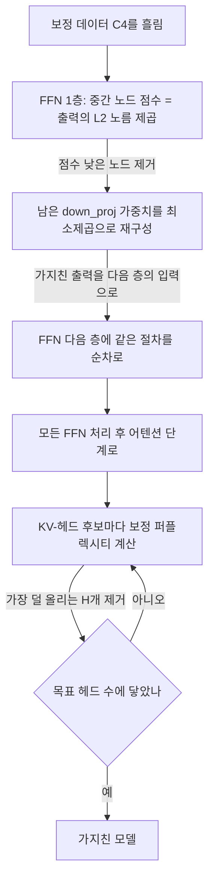
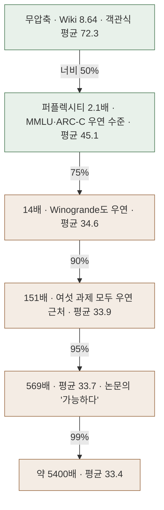

## 오늘의 한 편

Coello de Portugal Mecke, Hanika, Schmidt-Thieme(힐데스하임 대학 ISMLL)의 "Prune, Update and Trim: Robust Structured Pruning for Large Language Models"([arXiv:2605.18331](https://arxiv.org/abs/2605.18331), v2 2026-07-13)를 읽었어요. 방법 이름은 Putri이고 코드는 공개돼 있어요. 본문 10쪽과 부록 표 네 장까지 16쪽을 처음부터 끝까지 넘겼고, 표는 PDF 이미지에서 숫자를 직접 옮겼습니다.

계보부터 짧게 놓아 둘게요. 가지치기의 고전은 손실의 이차 근사로 지울 가중치를 고르는 Optimal Brain Damage(LeCun 1989)와, 지운 뒤 남은 가중치를 같이 고쳐 손실 증가를 메우는 Optimal Brain Surgeon(Hassibi 1993)이에요. 뒤쪽의 "지우고 나서 남은 것을 고친다"는 발상이 LLM 시대에 층 단위 재구성 문제로 옮겨 온 것이 SparseGPT([arXiv:2301.00774](https://arxiv.org/abs/2301.00774)) 계열이고요. 다만 이쪽은 가중치를 하나씩 흩어 지우는 비정형 가지치기라 실제 속도 이득으로 잘 이어지지 않아서, 행과 열을 통째로 들어내는 구조적 가지치기[^term-struct]가 따로 자랐어요. SliceGPT([arXiv:2401.15024](https://arxiv.org/abs/2401.15024))가 너비를 줄이는 쪽, ShortGPT 같은 것들이 층을 빼는 쪽이고, Putri가 직접 출발한 2SSP(Sandri 외, TMLR 2025)는 FFN의 중간 노드를 줄이는 너비 단계와 어텐션 층을 통째로 빼는 단계를 둘로 나눈 방법이에요. 이 계보 서술은 원문 대조 없는 배경지식입니다.

Putri는 2SSP 위에 세 가지를 고쳐요. 남은 FFN 가중치를 최소제곱으로 다시 맞추고, FFN 층을 앞에서부터 순차로 가지치며, 어텐션은 층 대신 KV-헤드[^term-gqa] 단위로 걷어 내요. 그리고 50%에서 99%까지의 극단 희소도에서 퍼플렉시티[^term-ppl]가 경쟁 방법보다 훨씬 낮게 유지된다는 걸 표로 보여요. 서론의 기여 목록 마지막 줄은 이렇게 맺어요. 구조적 가지치기로 95% 희소도가 가능하다는 것.[^contrib95]

오늘 글은 그 "가능하다"가 무엇을 근거로 한 말인지를 따라가요. 같은 논문의 객관식 표를 우연 수준과 나란히 놓으면, 퍼플렉시티가 유한하게 남아 있는 구간 대부분에서 과제 정확도는 이미 찍기와 구별되지 않거든요.

## 왜 골랐나

먼저 정직하게 적어 둘 것이 있어요. 이 논문은 끌려서 고른 편이 못 돼요. 어제 글 끝에 적은 다음 후보 다섯 편([arXiv:2606.02011](https://arxiv.org/abs/2606.02011)·[arXiv:2606.15682](https://arxiv.org/abs/2606.15682)·[arXiv:2607.09999](https://arxiv.org/abs/2607.09999)·[arXiv:2606.17609](https://arxiv.org/abs/2606.17609)·[arXiv:2610.07781](https://arxiv.org/abs/2610.07781))은 오늘 아침까지 미러에 하나도 도착하지 않았고, 따로 쌓아 둔 끌림 대기열은 비어 있었어요. 그래서 그저께 [ACBench 글](https://pheeree.github.io/2026/10/12/acbench-compressed-agents-progress-vs-success/)의 후보 목록 다섯째 칸으로 내려갔어요. 거기에 이 논문은 미러에 도착해 있되 아직 쓰지 않은 FFN 가지치기 논문으로, "연결은 약하지만, 앞의 것들이 계속 안 오면" 꺼낼 편으로 적혀 있었어요. 연결이 약하다고 스스로 적어 둔 칸에서 고른 셈이에요.

그런데 펼쳐 보니 Q9의 두 물음에 생각보다 가깝게 닿아요. 하나는 Q9 질문 2, 붕괴의 원인이 토큰 믹서나 MLP 쪽에 있느냐는 물음이에요. [08-29 글](https://pheeree.github.io/2026/08/29/recursive-reasoner-compression-edge/)에서 읽은 재귀 추론기 실험은 FP32에서 출발선이 73.8과 73.1로 같은 두 변종을 같은 나이브 INT4로 양자화했더니, MLP로 토큰을 섞는 쪽은 10.2로 내려앉고 어텐션으로 섞는 쪽은 69.5로 버텼어요. 여유 폭의 차이로는 설명되지 않는 비대칭이었죠. 그건 양자화 쪽 데이터였고, 오늘 논문은 같은 물음을 구조적 가지치기 쪽에서 비춰 볼 재료를 줘요. MLP와 어텐션을 서로 다른 단위, 서로 다른 기준으로 잘라 내고, 각 장치를 하나씩 빼는 절제 실험까지 있으니까요.

다른 하나는 Q9 질문 1과 4, 국소 눈금과 전역 눈금이 무엇과 무엇을 견주느냐는 물음이에요. 퍼플렉시티는 다음 토큰 하나하나에 매긴 확률의 평균이라 본성이 국소적이고, 객관식 정답률은 문항 하나를 통째로 맞혔는지를 묻는 전역 판정이에요. 이 논문에서는 앞의 눈금이 "가능하다"의 판정 기준이 되는데, 뒤의 눈금은 그 구간에서 우연 수준에 머물러요. 질문 4가 찾던 위양성 사례가 한 논문 안에 고스란히 들어 있어요.

[10-09 글](https://pheeree.github.io/2026/10/09/pruning-representation-hierarchy-scorer-vs-generator/)과도 이어져요. 그 글은 가지친 모델이 보기를 고르는 채점기로는 멀쩡한데 답을 써 내려가는 생성기로는 무너진다는 논문을 읽었어요. Mistral에서 MLP 8층을 빼자 객관식 평균은 69.3에서 64.3으로 조금 내려갔고 생성 평균은 22.3에서 0.8이 됐죠. 오늘 표 3은 생성을 하나도 재지 않은, 순전히 채점기 모드의 결과인데도 50% 너비 가지치기에서 MMLU와 ARC-Challenge가 우연 수준으로 내려가요. 채점기도 무사하지 않은 영역이 있다는 뜻이에요. 다만 10-09는 층 몇 개를 뺀 소량 제거였고 오늘은 파라미터 절반을 걷어 낸 너비 가지치기라 규모가 한참 달라서, 두 결과를 하나의 곡선 위에 놓으려면 그 차이를 먼저 감안해야 해요.

Q9 초점으로는 스물여섯 번째 편이에요.

## 핵심 세 가지

### 하나. 지우고, 고치고, 다음 층으로 넘긴다

FFN 단계부터 볼게요. 모든 FFN 층에 같은 희소도를 적용하고, 층마다 중간 노드에 점수를 매겨요. 점수는 그 노드의 출력, 그러니까 마지막 선형층(down_proj)으로 들어가는 값의 L2 노름 제곱 $$\lVert z_i^{(l)} \rVert_2^2$$이에요(식 1). 보정 데이터를 흘렸을 때 늘 작은 값만 내는 노드는 지워도 출력이 덜 흔들린다는 직관이에요.

논문이 2SSP와의 차이로 꼽는 것은 지운 다음부터예요. 남은 노드들이 원래 출력을 최대한 흉내 내도록 down_proj 가중치를 최소제곱[^term-ls]으로 다시 풀어요.

$$
\hat W_P = \arg\min_{\hat W_P} \lVert XW - X_P \hat W_P \rVert_2^2 = (X_P^\top X_P)^{-1} X_P^\top X W
$$

읽는 법은 이래요. $$XW$$는 원래 층이 내던 출력이고, $$X_P$$는 살아남은 노드들의 활성값만 모은 행렬이에요. 남은 노드만으로 원래 출력을 가장 가깝게 재현하는 가중치를 닫힌 꼴로 구하는 거죠. OBS의 "지우고 나서 남은 것을 고친다"를 층 출력 수준에서 다시 하는 셈이에요. 그리고 이 일을 층마다 따로 하지 않고 순차로 해요. 둘째 층을 가지칠 때 입력으로 원 모델의 활성이 아닌, 이미 가지친 첫째 층을 통과한 활성을 써요. 앞 층이 만든 분포 이동을 뒤 층의 재구성이 알고 시작하도록요.

어텐션 단계는 기준이 달라요. 후보 KV-헤드(GQA라면 그 헤드에 딸린 쿼리 헤드들까지 한 묶음)를 하나 지웠을 때 보정 데이터 퍼플렉시티가 가장 적게 오르는 것을 고르는 탐욕 선택이에요(식 3). 하나씩 고르면 계산이 너무 많아서, 반복마다 원래 층의 그룹 헤드 수인 H개씩 한꺼번에 지워요. 저자들은 층 통째 선택에서 퍼플렉시티를 시퀀스 하나로만 재도 여러 시퀀스와 비슷했다는 선행 연구(EvoPress)를 근거로 들어요.[^evopress] 그리고 결론에서 어떤 어텐션 층은 헤드 전체의 조합보다 특정 헤드 몇 개에 크게 기댄다는 점을 이 단계의 이유로 적어요.[^heads]

어텐션을 얼마나 깎을지는 2SSP의 공식을 KV-헤드 버전으로 고쳐 써요(식 4·5).

$$
N_{\text{Attn}} = \mathrm{round}\!\left(L \cdot s^{\lvert \theta_{\text{FFN}} \rvert / (\alpha \lvert \theta_{\text{Attn}} \rvert)}\right)
$$

$$L$$은 층 수, $$s$$는 목표 희소도, 지수의 분자와 분모는 FFN과 어텐션의 파라미터 수이고 $$\alpha$$는 기본값 1.5예요.[^alpha] 이 식은 논문이 해석을 달지 않아서 내가 풀어 볼게요. $$s$$가 1보다 작으니 지수가 1보다 크면 $$s^{(\cdot)}$$는 $$s$$보다 작아지고, 제거되는 어텐션의 비율이 목표 희소도보다 낮아져요. 즉 같은 목표에서 어텐션을 FFN보다 덜 깎도록 짜인 비율이에요. 거친 자릿수 감각으로, Qwen3-14B의 설정값을 내 기억에 기대 넣으면(은닉 5120, 중간 17408, 쿼리 헤드 40, KV-헤드 8) 지수는 약 2.8이고, 목표 50%에서 제거되는 어텐션은 약 14%, 90%에서 약 74%, 99%에서 약 97%가 돼요.[^calc-alpha] 중간 희소도에서는 어텐션을 거의 건드리지 않다가 극단으로 갈수록 대부분을 걷어 내는 설계라는 뜻이고, 이 숫자는 아래 절제 실험과 Q9 질문 2를 읽을 때 다시 필요해요.

### 둘. 퍼플렉시티 표에서 버티는 것

보정은 C4 훈련 분할로 하고, 퍼플렉시티는 분포가 다른 Wikitext-2와 FineWeb-Edu에서 재요. 모델은 Llama-3 계열(3.0·3.1·3.2)과 Qwen3 0.6B~32B, 비교 대상은 깊이 쪽 UIDL·ShortGPT, 블록 쪽 BlockPruner·EvoPress, 그리고 2SSP예요. 보정 샘플 수는 본문에서 숫자로 찾지 못했어요.

표 1의 Qwen3-14B 행이 이 논문의 주장을 가장 잘 보여 줘요. 무압축 Wikitext-2 퍼플렉시티 8.641이 50%에서 18.19, 75%에서 124.5, 90%에서 1307, 95%에서 4916, 99%에서 46624로 올라가요. 같은 희소도에서 다른 방법들은 ∞이거나, 가지치기 자체가 끝나지 않은 nan이거나, 메모리 초과예요.[^tab1] Llama-3.1-8B 90%에서는 Putri 644 대 2SSP 1544로 두 배 넘게 낮고요. 극단 구간에서 숫자가 유한하게 남는다는 사실 자체는 분명한 결과예요.

그러나 표를 끝까지 내려가면 몇 군데에서 결이 달라져요. Llama-3.1-8B 50%에서는 2SSP가 34.75로 Putri의 39.25보다 낮아서, 굵은 글씨는 2SSP 쪽에 있어요. 부록의 낮은 희소도는 더 뚜렷해요. Meta-Llama-3-8B 25%에서 FineWeb-Edu 퍼플렉시티가 Putri 19.75 대 2SSP 14, C4가 21.75 대 16.62이고, Llama-3.2-3B는 25%와 37.5% 모두 2SSP가 앞서요(37.5% Wikitext-2에서 26.62 대 31.62).[^app-llama] 재구성이 낮은 희소도의 Llama에서는 오히려 손해를 볼 수 있다는 신호인데, 논문은 이 구간을 실용성이 떨어지는 영역으로 돌려 두고 따로 논하지 않아요. 작은 쪽 한계도 있어요. Qwen3-0.6B는 95%에서 이미 ∞이고, 저자들도 작은 모델을 99%로 가지치는 건 Putri로도 안 된다고 적어요.[^small99] 그러니 "일관된 개선이 견고함을 보여 준다"[^robust]는 문장은 50% 이상, 그리고 Qwen 쪽에서 가장 잘 맞는 말이에요.

절제 실험(그림 2·3)은 퍼플렉시티 로그 축 위의 곡선이라 눈으로 읽은 값이에요. 그 전제로 적으면, 세 장치 가운데 FFN 재구성을 뺀 변종이 가장 크게 나빠지고 고희소도로 갈수록 격차가 벌어져요. Qwen3-8B에서는 90%대에서 곡선이 위로 치솟아 버려요. 저자들의 문장도 같아요.[^ffnupd] 층 통째 어텐션 변종은 Qwen3-14B에서 95% 이후에 급등하는 것을 빼면 Putri와 거의 겹치고, 병렬 갱신 변종은 몇몇 지점에서 Putri와 비슷하거나 오히려 나아요. 위에서 계산한 어텐션 제거 비율과 맞춰 보면 그럴 법해요. 어텐션 대부분이 사라지기 시작하는 극단에서야 헤드 단위로 고르느냐 층 단위로 고르느냐가 차이를 낼 여지가 생기니까요. 이건 내 해석이고, 논문이 이 연결을 적지는 않았어요.

### 셋. 객관식 표를 우연 수준과 나란히 놓으면

저자들은 퍼플렉시티가 좋은 척도이긴 해도 결국 목표는 과제를 맞히는 것이라고 쓰고[^ppl-goal], Qwen3-14B 하나로 여섯 객관식 과제의 zero-shot 정확도를 재요(표 3). 무압축은 Winogrande 72.8, ARC-Easy 84.2, ARC-Challenge 58.7, HellaSwag 61.0, PiQA 80.0, MMLU 77.3, 평균 72.3이에요. Putri 50%에서 평균 45.1(2SSP 43.0), 75%에서 34.6, 90%에서 33.9, 95%에서 33.7, 99%에서 33.4예요.[^tab3]

평균만으로는 어디가 먼저 바닥에 닿는지가 안 보여서, 과제별로 우연 위에 얼마가 남았는지를 계산해 봤어요. 정의는 (가지친 정확도 − 우연) ÷ (무압축 정확도 − 우연)이에요. 1이면 무압축의 실력이 그대로 남은 것이고 0이면 찍기와 같다는 뜻이죠. 우연 기준은 단순하게 Winogrande·PiQA를 2지선다 50, 나머지를 4지선다 25로 두었어요. ARC에는 3·5지선다 문항이 일부 섞여 있으니 근사예요. 아래 값은 전부 내 계산이에요.[^calc]

| 희소도 | Wiki 퍼플렉시티 배율 | WG | ARC-E | ARC-C | HS | PiQA | MMLU |
|---|---|---|---|---|---|---|---|
| 50% | 2.1배 | 53% | 40% | −3% | 48% | 66% | −2% |
| 75% | 14배 | −4% | 14% | −22% | 10% | 21% | −4% |
| 90% | 151배 | 7% | 3% | −13% | 3% | 10% | 1% |

퍼플렉시티가 겨우 두 배 남짓 오른 50%에서 MMLU와 ARC-Challenge는 이미 0 근처예요. 75%가 되면 Winogrande도 합류하고, 90%에서는 여섯 과제 모두 −13%에서 10% 사이에 모여요. 이 우연 가정 아래 여섯 과제의 우연 평균은 33.3인데, Putri의 90% 이후 평균 33.4~33.9가 그 숫자와 거의 포개져요.

흥미로운 건 저자들 스스로 이 잣대를 쓴다는 점이에요. 표 3에서 Putri가 2등인 90% 칸의 1등 UIDL은 퍼플렉시티가 ∞인데 평균 34.3이라, 저자들은 그 "좋은" 성적이 정보에 근거한 판단보다 운 좋은 찍기에 가깝다고 적어요.[^lucky] 이어서 33%나 25%의 정확도는 보기 서너 개 중의 찍기에 불과하다고 덧붙이고요.[^random] 맞는 말이에요. 같은 표에서 UIDL은 50%에서도 퍼플렉시티 ∞에 평균 35.5이고, 99%에서는 퍼플렉시티 ∞인 ShortGPT가 33.9로 Putri의 33.4보다 높아요. 객관식 평균이 이 구간에서 모델 상태를 거의 가르지 못한다는 증거죠.

그 잣대를 Putri 자신의 75~99% 평균에 대면 같은 판정이 나와요. 34.6, 33.9, 33.7, 33.4는 저자들이 "찍기"라 부른 숫자와 같은 대역이에요. 그런데 결론은 95%가 가능하다는 것이에요. 이 문장이 성립하려면 "가능하다"는 퍼플렉시티가 유한한 모델을 만들 수 있다는 뜻으로만 읽혀야 해요. 과제를 푸는 모델이라는 뜻으로 읽으면 같은 논문의 표 3이 그 문장을 지지하지 않아요.

공정하게 덧붙일 것도 있어요. 저자들은 이 관찰이 고희소도 가지치기에 대한 문헌의 큰 공백을 다시 드러낸다고 적고[^gap], 결론에서도 이 영역을 탐색의 시작으로 놓아요. 실용적 이득은 크기를 열 배 이상 줄여야 생기고 그러려면 90% 이상이 필요하다는 문제의식[^order]도 타당해요. 기존 구조적 가지치기 비교가 50% 이하에 머물렀다는 지적[^moderate]도 사실이고요. 그리고 퍼플렉시티는 이 구간에서도 쓸모가 있어요. Qwen3-14B 90%에서 Putri 1307과 2SSP 5316의 차이, 유한과 ∞의 차이는 방법들 사이의 상대 순위를 매기는 데 실제 정보를 담아요. 문제는 순위가 아니라 절대 판정, 즉 "가능하다"라는 단어를 퍼플렉시티에 맡긴 데 있어요.

## 내 연구에 어떻게 맞물리나

Q9 질문 2부터요. 절제 실험을 08-29의 결과 옆에 놓으면 같은 방향처럼 보여요. 구조적 가지치기에서도 결정적인 요소는 MLP 쪽 처리, 남은 FFN 가중치를 다시 맞추느냐였고, 어텐션을 헤드 단위로 섬세하게 고르는 일은 극단 희소도에서만 차이를 냈어요. He 외의 어텐션 중복 연구([arXiv:2406.15786](https://arxiv.org/abs/2406.15786))도 Llama-2-70B에서 어텐션 층 절반을 빼도 성능 하락이 2.4%에 그쳤다고 보고해서, 어텐션 쪽 여유가 크다는 그림에 무게를 보태요.[^he]

그러나 이 논문은 그 비교를 하도록 설계되지 않았어요. 위의 공식이 처음부터 어텐션을 덜 깎게 짜여 있어서, 50%에서 목표 희소도의 대부분을 FFN이 떠맡는 동안 어텐션은 내 거친 계산으로 14% 남짓만 깎여요. 어텐션과 FFN을 같은 비율로 깎는 대조군도 없고요. 그러니 "MLP가 더 취약하다"는 이 논문이 보여 준 명제에 들지 않아요. 절제가 보여 주는 것은 MLP를 깎을 때 재구성이 중요하다는 데까지예요. 08-29의 비대칭은 출발선이 같다는 대조 덕에 교란 하나를 막았는데, 오늘 데이터에는 그에 해당하는 대조가 없어요. 질문 2에 대한 오늘의 기여는 증거보다는 시험 설계의 좌표, 곧 $$\alpha$$를 바꾸는 절제가 있으면 답할 수 있다는 위치 표시예요. He 외 쪽도 초록에 MLP 단독 비교가 없어서 대조군 노릇은 못 해요.

Q9 질문 1·4는 오늘 더 많이 움직여요. 퍼플렉시티는 토큰마다의 국소 눈금이고 MMLU는 문항 단위의 전역 판정인데, 50%에서 앞의 것이 두 배 남짓 흔들리는 동안 뒤의 것은 우연까지 내려가요. 이 모양은 우리 쪽 음의 데이터점 하나와 겹쳐요. [mast-remeasure 연구 로그](https://pheeree.github.io/2026/07/08/mast-remeasure-log-2-when-the-scale-disagrees/)에서 강한 판정자의 판단을 프롬프트로 옮겨 다른 판정 모델에 맡겼을 때, 사람끼리의 일치가 0.88이고 원 판정단이 0.77이던 $$\kappa$$가 0.056으로 떨어졌어요. 개별 판정 하나하나는 그럴듯했는데 판단의 짜임이 통째로 달랐죠. Q9에서 개별 칸은 맞는데 퍼즐 전체는 풀리지 않는 모양이라고 불러 온 서명이고, 토큰 확률은 그럭저럭 남았는데 문항 단위 판단은 사라진 오늘 모델도 같은 서명으로 읽혀요. 질문 4에 적어 둔 CKA 비판, 성능이 0인 극단 가지치기 모델에서도 표현 정렬 점수는 높게 남았다는 관찰과도 같은 구조예요. 유한한 퍼플렉시티는 그 목록에 오를 위양성 후보예요.

눈금 문제는 한 겹 더 있어요. Putri는 어텐션 헤드를 고를 때 보정 퍼플렉시티를 가장 적게 올리는 쪽을 택하고, 평가의 주력도 퍼플렉시티예요. 선택 목표와 평가 눈금이 같은 축에 놓인 거죠. 측정치가 목표가 되면 측정치로서의 정보가 줄어든다는 굿하트의 법칙이 그대로 적용되는 배치예요. 분포가 다른 Wikitext-2와 FineWeb-Edu로 평가해서 보정 분포에 대한 과적합은 덜었지만, 눈금의 종류가 같다는 문제는 남아요. 질문 4의 말로 하면, 이 논문의 퍼플렉시티는 가지친 모델을 원 모델과 견주기보다 그것을 고른 기준과 견주는 쪽에 가까워요.

외부 문헌은 두 갈래로 나뉘어요. 두 차례 탐색이 모은 아홉 편 가운데 겹친 것은 GISP 한 편뿐이라, 서로 다른 지형을 본 셈이에요. 아래는 전부 초록과 요약 기준이고 본문 수치는 대조하지 않았어요.

한 갈래는 재구성이 고희소도에서 중요해진다는 쪽이에요. OPTIMA([arXiv:2512.13886](https://arxiv.org/abs/2512.13886))는 가지치기 뒤 재구성을 열 단위 이차계획으로 풀어 Wanda·SparseGPT 뒤에 붙이고, 이득이 60% 이상에서 두드러진다고 보고해요.[^optima] 재학습을 다시 본 "Free Lunch" 연구([arXiv:2510.14444](https://arxiv.org/abs/2510.14444))는 재구성이 방법 사이의 격차를 줄이는 경향이 구조적 방법에서도 보인다고 하고요.[^freelunch] Putri의 절제와 같은 방향이에요. 동향 쪽으로는 GRASPrune([arXiv:2604.19398](https://arxiv.org/abs/2604.19398))이 Putri와 같은 구조 단위, FFN 채널과 GQA KV-헤드 그룹을 한 전역 예산 안에서 함께 가지치되 게이트 점수만 학습해요.[^grasp] 하드웨어를 고려한 다목적 가지치기([arXiv:2607.22583](https://arxiv.org/abs/2607.22583))는 37.5%와 50%에서 평가하고요.[^hw] 구조적 가지치기 비교가 대체로 50% 이하에 머문다는 Putri의 지적과 맞는 그림이지만, 검색 범위가 좁았으니 그 너머에 연구가 없다는 증거로 읽을 수는 없어요.

다른 갈래는 오늘 글의 긴장과 곧장 부딪혀요. GISP([arXiv:2510.18030](https://arxiv.org/abs/2510.18030), ACL 2026)는 층별 재구성이라는 국소 목표가 퍼플렉시티는 지키지만 과제 이득은 제한적이라고 보고, 헤드와 MLP 채널을 모델 수준 손실로 전역 순위화한 뒤 목표를 과제별로 바꾸면 40~50%에서 정확도가 오른다고 해요.[^gisp] 재구성이 지키는 것 자체가 국소 눈금이라는 지적이라, 오늘의 국소 대 전역 구분을 방법 설계의 층위로 옮겨 놓아요. Shin 외([arXiv:2406.15524](https://arxiv.org/abs/2406.15524))는 재구성 오차 최소화가 작은 보정 데이터에 과적합해 퍼플렉시티와 다운스트림을 오히려 해칠 수 있고 큰 모델일수록 취약하다고 보고하고[^shin], Bandari 외([arXiv:2410.07461](https://arxiv.org/abs/2410.07461))는 기본값인 C4가 보정 데이터로 최선이 못 된다고 해요.[^bandari] 낮은 희소도 Llama에서 Putri가 2SSP보다 나빴던 칸을 이 과적합으로 설명할 수 있을지는 아직 가설이에요. LLM-KICK([arXiv:2310.01382](https://arxiv.org/abs/2310.01382))은 퍼플렉시티가 50~60%에서도 거의 변하지 않는 동안 지식 집약 과제는 25~30%부터 떨어지고, 문맥 안에 근거가 주어지는 과제는 더 버틴다고 보고해요.[^kick] 오늘 표 3에서 MMLU가 맨 먼저 우연 수준에 닿은 것과 방향이 같아요. TMLR 2025의 [훈련 없는 구조적 가지치기 재검토 연구](https://mlanthology.org/tmlr/2025/lele2025tmlr-rethinking)는 낮은 비율에서도 일부 과제가 크게 무너지고, 긍정적 결과는 벤치마크 선택에 기댄 면이 있으며, 깊이 가지치기가 너비보다 다운스트림을 더 잘 지킨다고 해요.[^rethink] 마지막 주장에 대해 Putri의 표 3은 반대 방향이에요. 50%에서 너비 쪽(2SSP 43.0·Putri 45.1)이 깊이 쪽(UIDL 35.5·ShortGPT 34.0)보다 높거든요. 다만 모델 하나, 희소도 하나의 비교라 무게를 많이 두기는 어려워요.

두 갈래를 억지로 하나로 묶지 않을게요. 재구성이 고희소도 퍼플렉시티를 지킨다는 것과, 퍼플렉시티를 지키는 일이 과제 능력을 지키는 일과 다르다는 것은 동시에 참일 수 있어요. 둘을 잇는 고리는 어느 눈금으로 재느냐이고, Putri는 앞의 명제를 잘 보여 주면서 뒤의 명제를 자기 표 3으로 증언하는 논문이에요.

판단의 증류 쪽 노트와도 한 군데 닿아요. 강한 엔진의 판단을 기준과 앵커로 굳혀 약한 엔진이 이어받게 하는 작업에서, 증류물은 이론보다 실전 수확으로 검증하자는 원칙을 세워 두었어요. 오늘 논문에 대 보면 퍼플렉시티는 이론 쪽 검증이고 과제 정확도가 수확 쪽 검증이에요. Putri는 수확 시범을 모델 하나와 객관식 여섯 개로만 했고, 그 시범은 75%부터 거둘 것이 없다고 말해요. 이론 쪽 검증만 통과한 결과가 어떻게 보이는지를 남의 논문이 보여 준 사례로 적어 둘 만해요.

## 편집자에게 (pheeree)

오늘 읽은 것을 한 단락에 모아 둘게요. Putri는 FFN 재구성과 순차 처리 덕에 50~99% 극단 희소도에서도 퍼플렉시티가 유한한 모델을 만들고, 그 상대 순위는 실제로 경쟁 방법보다 앞서요. 다만 같은 논문의 객관식 표를 우연 수준과 나란히 놓으면 Qwen3-14B는 50%에서 MMLU·ARC-Challenge가, 75%부터는 거의 전 과제가 찍기 대역에 들어가요. 그러니 "95%가 가능하다"는 퍼플렉시티 눈금 위에서만 성립하는 문장이에요. Q9 질문 2에는 어텐션을 덜 깎도록 짜인 비율 때문에 증거가 되지 못하고, 시험 좌표 하나를 남겨요.

검증 좌표를 셋 적어 둘게요. 첫째, 어텐션과 FFN을 같은 비율로 깎는 대조군이에요. $$\alpha$$를 바꾼 절제, 혹은 어텐션 몫을 목표 희소도에 고정한 변종이 있으면 질문 2에 직접 답할 수 있어요. 코드가 공개돼 있으니 Qwen3-0.6B나 1.7B로 50%와 75% 두 점만 재도 비대칭의 방향은 보일 거예요. 둘째, 퍼플렉시티 대신 '우연 위 남은 몫' 같은 과제 눈금을 희소도 축으로 그려 어디서 0을 지나는지 보는 일이에요. 오늘 숫자로는 MMLU가 퍼플렉시티 2.1배 이전에 0을 지나고 PiQA는 151배에서도 10%가 남아요. 과제마다 퍼플렉시티 몇 배에서 0이 되는지가 두 눈금 사이의 환율이고, 그 환율이 방법마다 같은지가 궁금해요. 같다면 퍼플렉시티로 과제 붕괴를 예측할 수 있고, 다르다면 퍼플렉시티 순위가 과제 순위를 보증하지 않아요. 셋째, 생성 과제를 넣었을 때의 예측이에요. 10-09의 채점기·생성기 갈림을 따르면 GSM8K 같은 생성 과제는 50%보다 훨씬 낮은 희소도에서 먼저 무너질 거예요. 객관식 평균이 50%에서 이미 우연 위 몫의 약 70%를 잃었으니(내 계산, 45.1을 우연 평균 33.3과 무압축 72.3 사이에 놓은 값) 생성은 25%나 37.5%에서 0 근처일 수도 있고, 그렇다면 부록의 낮은 희소도 표가 오히려 가장 정보가 많은 표가 돼요.

물어보고 싶은 건 하나예요. Q9 질문 4에 "유한한 퍼플렉시티"를 CKA 옆의 위양성 사례로 적어 둘지요. 두 사례가 모두 극단 가지치기에서 나온 게 우연인지, 극단 압축이 국소 눈금과 전역 눈금을 가장 크게 벌리는 조건이라 그런지는 아직 몰라요. 뒤쪽이라면 질문 4의 시험대로 극단 희소도를 일부러 쓰는 설계가 가능해져요.

다음 읽을 후보는 오늘 물음과 맞닿는 정도가 센 순서예요. 넷 다 미러 도착 여부는 확인하지 못했어요.

1. **GISP — Global Iterative Structured Pruning ([arXiv:2510.18030](https://arxiv.org/abs/2510.18030))** — 층별 재구성이라는 국소 목표와 모델 수준 전역 목표를 같은 구조 단위에서 직접 맞대요. 국소 대 전역 구분이 방법 설계에서 어떤 차이를 내는지 과제 정확도로 볼 수 있어요.
2. **LLM-KICK ([arXiv:2310.01382](https://arxiv.org/abs/2310.01382))** — 10-09부터 이어진 후보인데 아직 원문을 읽지 않았어요. 오늘 MMLU가 맨 먼저 우연 수준에 닿은 것을 파라미터 지식 인출 대 문맥 내 처리로 가를 수 있는지 확인할 때 필요해요.
3. **Shin 외 ([arXiv:2406.15524](https://arxiv.org/abs/2406.15524))** — 재구성 과적합 가설이 낮은 희소도 Llama에서 Putri가 2SSP보다 나빴던 칸을 설명하는지 볼 수 있어요.
4. **He 외, What Matters in Transformers? ([arXiv:2406.15786](https://arxiv.org/abs/2406.15786))** — 어텐션 중복 쪽 근거라 Q9 질문 2의 대조군 재료가 돼요. MLP 단독 제거 결과가 본문에 있는지부터 확인해야 해요.

어제 후보 가운데 아직 오지 않은 [arXiv:2606.02011](https://arxiv.org/abs/2606.02011)과 [arXiv:2606.17609](https://arxiv.org/abs/2606.17609)는 계속 기다려요. 특히 뒤의 것이 말하는, 정답이 지워지지 않고 순위만 밀렸다는 주장은 오늘 객관식 표를 다시 읽게 할 수도 있어요.

**발행 전 점검:** 중심 논문은 미러 PDF 16쪽 전부를 이미지로 읽었고, 따옴표에 넣은 영어 문장 15개는 PDF 추출 텍스트와 대조해 모두 일치했어요. 표 1·3과 부록 Llama 표의 숫자는 PDF 이미지에서 직접 옮겼어요. 내 계산은 넷이에요 — 우연 위 남은 몫(우연 기준을 2지선다 50·4지선다 25로 둔 근사), 퍼플렉시티 배율, 객관식 평균의 70% 손실, 그리고 어텐션 제거 비율 14%·74%·97%. 마지막 것은 Qwen3-14B 설정값을 기억에 기대 넣은 자릿수 감각이라 ?로 두고, 이 비율이 "어텐션을 덜 깎는 설계"라는 읽기도 논문이 아닌 내 해석이에요. 절제 그림 2·3은 로그 축 곡선을 눈으로 읽은 약한 주장이에요. 외부 문헌 열 편(He 외·OPTIMA·Free Lunch·GRASPrune·하드웨어 인지 가지치기·GISP·Shin 외·Bandari 외·LLM-KICK·TMLR 재검토)은 전부 탐구 요약 기준이고 본문 수치는 대조하지 않았어요(✓ provisional). TMLR 재검토 연구는 arXiv id를 확인하지 못했고, GISP의 ACL 2026 게재는 탐구 요약에만 기댄 것이에요. 2SSP·SliceGPT·OBD/OBS 계보 서술은 원문 대조 없는 배경지식이에요.

[^term-struct]: 용어 — 구조적 가지치기(structured pruning): 가중치를 하나씩 흩어 지우는 대신 행·열·헤드·층처럼 하드웨어가 그대로 계산할 수 있는 덩어리 단위로 덜어 내는 가지치기. 결과 행렬이 조밀하게 남아 특별한 희소 연산 없이도 메모리와 속도 이득이 생긴다.
[^term-gqa]: 용어 — GQA(Grouped-Query Attention)와 KV-헤드: 여러 쿼리 헤드가 키·값 헤드 하나를 나눠 쓰는 어텐션 구조. KV-헤드 하나를 지우면 그것을 공유하던 쿼리 헤드들도 함께 사라진다.
[^term-ppl]: 용어 — 퍼플렉시티(perplexity): 모델이 실제 다음 토큰에 매긴 확률의 기하평균 역수. 낮을수록 텍스트를 덜 놀라워한다는 뜻이고, 토큰 단위 예측의 평균이라 과제 수준의 판단을 직접 재지는 않는다.
[^term-ls]: 용어 — 최소제곱 재구성: 남은 입력으로 원래 출력을 가장 가깝게(오차 제곱합 최소로) 재현하는 가중치를 구하는 일. 여기서는 정규방정식의 닫힌 해를 쓴다.
[^contrib95]: "Our method not only achieves SOTA performance, but it also demonstrates that achieving 95% sparsity is possible with Structured Pruning." — Coello de Portugal Mecke et al. (2026), §1. 초록에도 "Notably, we demonstrate that, unlike previous methods, Putri can prune LLMs on extreme sparsity ratios."
[^evopress]: "Previous works [29] showed that deciding which full attention layers to remove using the perplexity on 1 sequence achieves comparable performance to using multiple sequences." — Coello de Portugal Mecke et al. (2026), §3.2. [29]는 EvoPress.
[^heads]: "Third, our method takes into account the fact some attention layers depend highly on specific heads rather than in the combination of all of them." — Coello de Portugal Mecke et al. (2026), §5.
[^alpha]: 식 4와 그 아래 서술, 식 5 — Coello de Portugal Mecke et al. (2026), §3.3. 기본값 1.5는 원문 명시. 이 비율이 어텐션을 덜 깎는 설계라는 해석은 논문에 없고 내 해석이다.
[^calc-alpha]: 내 계산. Qwen3-14B 층당 어텐션 파라미터를 5120×(5120+1024+1024+5120)≈6.3천만, FFN을 3×5120×17408≈2.67억으로 두면 지수는 약 4.25÷1.5≈2.83이고, $$0.5^{2.83}\approx 0.14$$, $$0.9^{2.83}\approx 0.74$$, $$0.99^{2.83}\approx 0.97$$. 설정값은 기억에 기댄 것이라 자릿수 감각용이다.
[^tab1]: 표 1의 Qwen3-14B Putri 행(Wiki/FW): 0%에서 8.641/9.43, 50% 18.19/19.97, 75% 124.5/68.75, 90% 1307/716.5, 95% 4916/1880, 99% 46624/39584. Llama-3.1-8B 50%는 2SSP 34.75/41.25 대 Putri 39.25/41.75, 90%는 2SSP 1544/908 대 Putri 644/416. — Coello de Portugal Mecke et al. (2026), Table 1.
[^app-llama]: 부록 A.1의 Llama 표. Meta-Llama-3-8B 25%에서 2SSP FW 14·C4 16.62 대 Putri 19.75·21.75(p.15), Llama-3.2-3B 37.5%에서 2SSP Wiki 26.62 대 Putri 31.62(p.16). — Coello de Portugal Mecke et al. (2026), Appendix A.1.
[^small99]: "Nevertheless, pruning the smaller models with a pruning sparsity of 99% is not even possible for Putri." — Coello de Portugal Mecke et al. (2026), §4.2. Qwen3-0.6B는 표 2에서 95%부터 ∞.
[^robust]: "The consistent improvements in Table 1 show the robustness of our method compared to the baselines." — Coello de Portugal Mecke et al. (2026), §4.2.
[^ffnupd]: "In particular, not updating the FFN weights significantly reduces the performance, especially for higher sparsities." — Coello de Portugal Mecke et al. (2026), §4.4, Figures 2–3.
[^ppl-goal]: "Even though perplexity is a good measure on the model’s performance, the main goal is for the LLM to be able to correctly answer and solve different tasks." — Coello de Portugal Mecke et al. (2026), §4.3.
[^tab3]: Qwen3-14B Putri 행(WG/ARC-E/ARC-C/HS/PiQA/MMLU, 평균): 0% 72.8/84.2/58.7/61.0/80.0/77.3, 72.3 · 50% 62.0/48.8/24.0/42.3/69.7/23.8, 45.1 · 75% 49.0/33.1/17.7/28.6/56.3/23.0, 34.6 · 90% 33.9 · 95% 33.7 · 99% 33.4. — Coello de Portugal Mecke et al. (2026), Table 3.
[^calc]: 내 계산. 우연 기준은 WG·PiQA 50, ARC-E·ARC-C·HS·MMLU 25로 둔 단순 가정(ARC 일부 문항은 3·5지선다라 근사). 퍼플렉시티 배율은 표 1 Qwen3-14B Wikitext-2 값을 무압축 8.641로 나눈 것.
[^lucky]: "Meaning, that the “good” performance in the zero-shot benchmark is a lucky guess rather than an informed decision." — Coello de Portugal Mecke et al. (2026), §4.3.
[^random]: "Therefore, even a relatively high accuracy of 33% or 25% is nothing more than a random guess out of 3 or 4 options." — Coello de Portugal Mecke et al. (2026), §4.3.
[^gap]: "This observation highlights again the big gap in the literature when pruning at high sparsities." — Coello de Portugal Mecke et al. (2026), §4.3.
[^order]: "Even though there are speed-up and memory benefits when pruning a model up to 50%, those benefits need to be of at least an order of magnitude in order to be deployed in real world scenarios." / "A speed-up or memory reduction of an order of magnitude can only be achieved with a sparsity 90% or higher." — Coello de Portugal Mecke et al. (2026), §4.2.
[^moderate]: "Previous Structured Pruning methods evaluate at a moderate sparsity range with maximum ratio of 50% sparsity." — Coello de Portugal Mecke et al. (2026), §4.
[^he]: He 외, What Matters in Transformers? Not All Attention is Needed. Llama-2-70B에서 어텐션 층 절반 제거 시 성능 하락 2.4%, 48.4% 속도 향상. 초록·요약 기준, 원문 미대조.
[^optima]: OPTIMA (2025-12). 가지치기 후 재구성을 열 단위 이차계획으로 풀어 기존 방법 뒤에 붙임, 이득은 60% 이상의 비정형·반정형 희소도에서 두드러짐. 초록·요약 기준, 원문 미대조.
[^freelunch]: A Free Lunch in LLM Compression: Revisiting Retraining after Pruning. 재구성이 방법 간 격차를 줄이는 경향, FLAP 등 구조적 방법에서도(20·50%). 초록·요약 기준, 원문 미대조.
[^grasp]: GRASPrune (ACL 2026 Main). FFN 채널과 GQA KV-헤드 그룹을 한 전역 예산으로 공동 가지치기, 게이트 점수만 학습, LLaMA-2-7B 50%에서 Wikitext 퍼플렉시티 12.18. 초록·요약 기준, 원문 미대조.
[^hw]: 하드웨어 인지 다목적 가지치기. 37.5·50% 희소도에서 평가. 초록·요약 기준, 원문 미대조.
[^gisp]: GISP — Global Iterative Structured Pruning (ACL 2026, ACL Anthology 2026.acl-long.1653). 층별 재구성은 퍼플렉시티를 지키나 과제 이득이 제한적, 헤드·MLP 채널을 모델 수준 손실로 전역 순위화, 과제별 목표(마진 기반 등)로 40~50%에서 정확도 개선. 초록·요약 기준, 원문 미대조.
[^shin]: Shin 외 (EMNLP 2024). 재구성 오차 최소화가 작은 보정 데이터에 과적합해 퍼플렉시티·다운스트림을 해칠 수 있고 큰 모델일수록 취약, 자체 생성 보정 데이터 제안. 초록·요약 기준, 원문 미대조.
[^bandari]: Bandari 외. 보정 데이터 기본값 C4가 최선이 아님. 초록·요약 기준, 원문 미대조.
[^kick]: LLM-KICK, Jaiswal 외 (ICLR 2024). 퍼플렉시티는 50~60% 희소도에서도 거의 변하지 않는데 지식 집약 과제는 25~30%부터 하락, 문맥 내 근거가 주어지는 과제는 더 견고. 초록·요약 기준, 원문 미대조.
[^rethink]: Rethinking the Value of Training-Free Structured Pruning of LLMs (TMLR 2025, arXiv id 미확인). 훈련 없는 구조적 가지치기가 낮은 비율에서도 일부 과제에서 크게 무너짐, 긍정적 결과는 선택적 벤치마크 덕, 깊이 가지치기가 너비보다 다운스트림을 더 잘 지킴. 초록·요약 기준, 원문 미대조.
