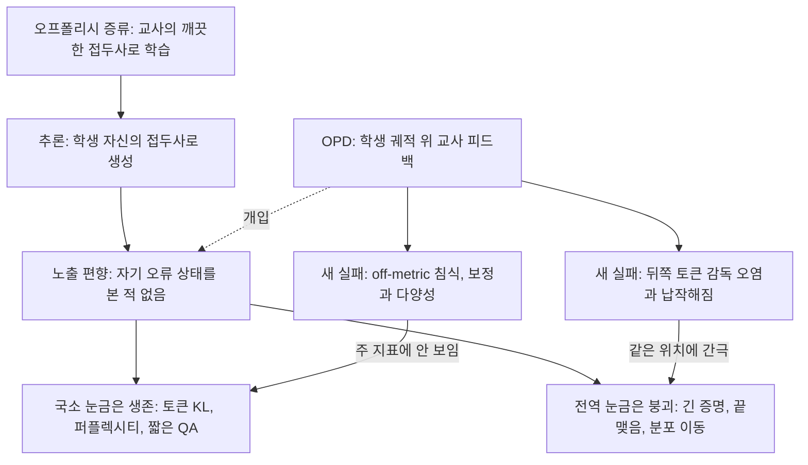
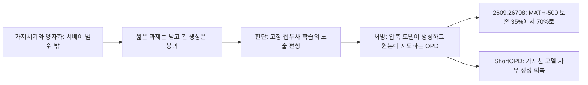

## 오늘의 한 편

Mingyang Song과 Mao Zheng(텐센트)의 "A Survey of On-Policy Distillation for Large Language Models"([arXiv:2604.00626](https://arxiv.org/abs/2604.00626), v4 2026-06-18)를 읽었어요. 본문과 표, 참고문헌까지 70쪽이 넘는 서베이이고, 오늘은 처음부터 끝까지 텍스트 추출본으로 통독했어요. 9월에 이 논문을 한 번 언급한 적은 있지만 그때는 탐구 요약에 기댄 곁가지였으니, 원문을 펼친 건 오늘이 처음이에요.

서베이의 뼈대는 한 식이에요. 온폴리시 증류[^term-opd]를 학생이 스스로 뽑은 궤적 위에서 교사와 학생의 다음 토큰 분포 사이 f-발산[^term-fdiv]을 줄이는 문제로 놓아요.

$$\mathcal{L}_{\text{OPD}} = \mathbb{E}_{y \sim \pi_{\text{mix}}}\Big[\sum_t D_f\big(p_T(\cdot \mid x, y_{<t}),\, p_\theta(\cdot \mid x, y_{<t})\big)\Big]$$

기호를 하나씩 풀면, $$\pi_{\text{mix}}$$는 궤적을 누가 쓰느냐를 정하는 샘플링 분포이고, 학생 비중이 클수록 온폴리시에 가까워져요. $$D_f$$는 어떤 거리로 두 분포를 견줄지, 그리고 괄호 안 두 인자의 순서는 정KL과 역KL[^term-kl] 가운데 무엇을 쓰느냐를 정해요. 서베이는 이 세 선택(궤적 샘플링, 발산의 종류, 인자 순서)을 설계 축으로 삼고, 그 위에 신호원(누가 피드백을 주나)과 학습 동역학(교사가 고정인가 함께 움직이나)을 얹어 200편이 넘는 방법을 분류해요. 뒤쪽 절에서는 성공 조건, 반복되는 실패 모드, KL 제약 강화학습과의 형식적 연결, 열린 문제를 정리하고요.

계보로 보면 출발점은 Hinton 외(2015)의 지식 증류예요. 교사의 부드러운 확률을 학생이 따라가게 하는 발상이죠. Kim & Rush(2016)의 시퀀스 수준 증류(Seq-KD)는 이를 교사가 생성한 문장 전체를 학생이 모방하는 형태로 바꿨고, 오늘날 LLM 증류의 기본 처방인 "교사 출력으로 SFT"가 그 후손이에요. 온폴리시 쪽 줄기는 서베이 기준으로 2023년 중반의 GKD(Agarwal 외)와 동시기 MiniLLM(Gu 외)에서 시작해 세 해 만에 200편을 넘었어요. GKD는 $$\pi_{\text{mix}}$$를 학생 분포와 데이터 분포의 보간으로 두고 그 비율 $$\lambda$$를 다이얼처럼 돌리는데, $$\lambda = 0$$이면 오프폴리시 KD, $$\lambda \to 1$$이면 순수 온폴리시예요. 이 다이얼은 낯설지 않아요. 순환 신경망 시절 Bengio 외(2015)의 scheduled sampling이 학습 중 정답 토큰과 모델 자신의 토큰을 섞는 비율을 점점 옮겼고, Ranzato 외(2016)가 그 문제에 노출 편향이라는 이름을 붙였어요. OPD는 그 오래된 질문을 교사 분포라는 더 조밀한 신호로 다시 묻는 셈이에요. 서베이는 고전 KD에서 OPD로 오는 길을 네 가정(공유 어휘, i.i.d. 데이터, 정적 교사, 오프폴리시 데이터)을 하나씩 푸는 과정으로 정리하는데, 그중 넷째에 대해 노출 편향[^term-eb]이 짧은 시퀀스에선 무시할 만하지만 다단계 추론에선 심각하다고 적어요.[^relax4] 오늘 글은 이 한 문장이 Q9과 어떻게 만나는지를 따라가요.

## 왜 골랐나

이 논문은 [10-12 ACBench 글](https://pheeree.github.io/2026/10/12/acbench-compressed-agents-progress-vs-success/)의 다음 읽을 후보 다섯째로 적혀 있었어요. 그때 적은 말은 미러에 도착해 있되 아직 쓰지 않은 서베이이고, 연결은 약하지만 앞의 것들이 계속 안 오면 R1-Distill 귀속 문제를 증류 계보 쪽에서 정리할 때 바탕이 된다는 것이었어요. 10-13과 10-14 글이 남긴 후보들은 오늘 아침까지 하나도 미러에 오지 않았고, 그래서 연결이 약하다고 스스로 적어 둔 그 다섯째 줄이 오늘의 픽이 됐어요. 고른 경위는 그만큼 소극적이었어요.

그런데 통독해 보니 약하다는 판정은 반쯤 틀렸어요. 서베이 2.2절은 오프폴리시 증류의 실패를 DAgger(Ross 외, 2011)[^term-dagger]의 복합 오류 정리로 설명하는데, 그 논리가 [08-29 글](https://pheeree.github.io/2026/08/29/recursive-reasoner-compression-edge/)에서 Q9을 시작하게 만든 관찰과 같은 꼴이에요. 그 글의 재귀 추론기 실험에서 학생 모델은 칸 정확도를 50~87% 남기고 퍼즐 완전일치는 0%로 잃었고, 저자들은 이를 토큰 수준 패턴은 배웠으나 퍼즐 수준 추론에는 완전히 실패했다고 요약했어요.[^distill0829] 그때는 이 현상을 압축 일반의 서명으로 읽었는데, 오늘 서베이는 증류 쪽에서 그것이 왜 생기는지에 대한 표준 설명을 가지고 있어요.

[09-20 글](https://pheeree.github.io/2026/09/20/opd-formula-driven-taxonomy-orthogonality/)은 이 서베이를 다른 OPD 서베이의 대조군으로, 같은 분야를 다른 틀로 정리한 지도라 겹쳐 보기에 좋다고 적어 두었어요. 오늘 나란히 놓아 본 결과 하나는 미리 말해 둘게요. 이 서베이는 범위를 정하면서 가지치기와 양자화를 "훈련 체제와 직교하는 압축 기법"이라며 명시적으로 뺐어요.[^scope] 우리 Q9은 정확히 그 둘을 증류와 같은 실패 서명 아래 묶어 온 의제예요. 이 선이 실제 문헌에서 버티고 있는지가 오늘 글의 한 축이에요.

Q9 초점으로는 스물일곱 번째 편이에요.

## 핵심 세 가지

### 하나. 제곱으로 불어나는 오차, 그리고 그 정리가 기대는 가정

서베이의 2.2절 논리를 천천히 따라가 볼게요. 오프폴리시 증류에서 학생은 교사가 쓴 깨끗한 접두사를 조건으로 다음 토큰을 배워요. 기계번역에서 교사 강제(teacher forcing)라 부르던 것과 같은 구조예요. 그런데 추론 때 학생은 자기가 방금 쓴 불완전한 접두사를 조건으로 다음 토큰을 내요. 학습 때 본 상태 분포와 실제로 방문하는 상태 분포가 달라지는 거죠.

DAgger 정리는 이 어긋남의 값을 매겨요. 학습 분포에서 단계당 오류가 $$\epsilon$$인 정책이 길이 $$T$$의 궤적을 자기 방문 분포로 굴리면 총 오차가 $$O(\epsilon T^2)$$로 자라요.[^dagger] 직관은 이래요. 한 번 틀리면 학생은 학습 때 본 적 없는 상태로 들어가고, 그 상태에서는 다음 단계의 정확도도 더 떨어져요. 실수가 다음 실수의 확률을 높이니까 오차가 길이에 비례하는 대신 길이의 제곱으로 불어나요. 서베이는 독립 오류라는 가장 너그러운 가정에서도 단계당 95% 정확도로 10단계 증명을 하면 궤적 수준 정답률이 60%에 그친다고 계산해 두고, DAgger 경계는 그보다 엄격히 나쁘다고 덧붙여요.[^point95] 온폴리시 학습은 학생을 자기 오류 상태에 노출시켜 회복을 배우게 하니 이 경계를 $$O(\epsilon T)$$로 낮출 수 있다는 것이 OPD의 이론적 동기예요.

상수를 떼고 대어 보면 두 경계의 비는 언제나 $$T$$예요. 열 걸음 증명이면 열 배, 수천 토큰짜리 추론이면 수천 배요.

Q9의 언어로 옮기면 이렇게 읽혀요. 단계당 오류 $$\epsilon$$는 국소 눈금이에요. 토큰 단위 KL이나 퍼플렉시티처럼 한 걸음씩 재는 값이죠. 궤적 수준 정답률은 전역 눈금이고요. $$\epsilon$$이 작게 유지돼도 $$T$$가 길면 전역 눈금은 $$T^2$$의 속도로 무너질 수 있어요. 08-29의 칸 정확도 87%와 퍼즐 완전일치 0%의 간극이 바로 이런 모양이에요. 칸 하나를 맞힐 확률이 높아도 수십 칸을 모두 맞혀야 하는 퍼즐에서는 남는 게 없으니까요. 다만 08-29의 결과는 독립 오류의 곱셈만으로도 상당 부분 설명될 수 있어서, 그것이 노출 편향 때문인지 단순한 곱셈 때문인지는 그 데이터로 가를 수 없어요. 이 구분은 뒤에서 다시 필요해져요.

그러나 이 정리를 LLM에 그대로 옮기는 데에는 서베이 스스로 단서를 달아요. DAgger의 원래 가정은 어떤 상태에서든 최적 행동을 알려 주는 대화형 전문가예요. LLM 교사는 학생이 만든 접두사를 조건으로 다음 토큰 분포를 내는데, 학생이 분포 밖으로 크게 벗어난 접두사를 만들면 교사 자신도 그런 입력을 거의 본 적이 없어서 조건부 분포가 제대로 보정돼 있지 않을 수 있어요. 그 잡음 섞인 분포를 따라가라고 학생을 밀면 $$O(\epsilon T)$$를 회복하기는커녕 학습을 흔들 수 있다는 것이 서베이의 말이에요.[^remark] 실제로 Jeong(2026)의 실험에서는 주기적으로 교사를 학생 사본으로 갈아 끼우는 설정에서 KL이 한 번의 리셋에 2.637에서 0.343으로 급락하며 출력이 붕괴했다고 해요.[^jeong]

탐구 요약에서 본 이론 쪽 단서도 같은 방향이에요. 전이 함수를 모르는 경우 대화형 질의를 써도 지평에 대한 이차 증가를 일반적으로는 피할 수 없고, 전문가가 실수에서 회복하는 법을 안다는 가정이 있을 때만 선형이 된다는 결과가 있다고 해요. 이건 2차 요약으로만 확인한 것이라 정리의 정확한 조건은 대조하지 못했어요. 그래도 방향은 분명해요. OPD가 $$O(\epsilon T)$$를 준다는 서술에는 "교사가 학생의 오류 상태에서도 믿을 만하다면"이라는 조건이 붙어야 하고, 그 조건은 궤적이 길어질수록 약해져요.

### 둘. 온폴리시로 옮겨도 뒤쪽은 먼저 무너진다

그 조건이 실제로 어디서 깨지는지를 서베이 7장이 모아 두었어요. 7.1절의 성공 조건은 [09-16 글](https://pheeree.github.io/2026/09/16/opd-thinking-pattern-consistency-new-knowledge/)에서 읽은 Li 외(2026j)를 그대로 받아요. 학생과 교사의 사고 패턴이 호환되고, 교사가 학생에게 없는 새 능력을 가지고 있어야 한다는 것이죠. 서베이는 이를 "교사와 학생 사이의 활용 가능한 간극"에 비례해 이득이 커진다는 원리로 일반화해요.[^gap] 간극이 너무 작으면 줄 정보가 없고, 너무 크면 학생이 받아먹지 못해요.

같은 단락 바로 앞에 오늘 가장 무거운 문장이 있어요.

> "A persistent challenge is that the quality of OPD’s dense supervision degrades systematically with trajectory depth, with instability originating at later tokens and propagating backward, raising open questions about OPD’s applicability to long-horizon reasoning."[^depth]

OPD의 조밀한 토큰 감독은 궤적이 깊어질수록 체계적으로 나빠지고, 불안정은 뒤쪽 토큰에서 시작해 앞으로 번진다는 얘기예요. 7.2절의 실패 모드 목록이 이 현상을 여러 각도에서 보여 줘요. [09-18 글](https://pheeree.github.io/2026/09/18/opd-local-support-matching-failure-modes/)의 Fu 외(2026b)가 짚은 flawed prefix trap은 학생 접두사가 분포 밖으로 나가 교사 분포가 오염되는 경우예요. Liu 외(2026b)의 local teachability collapse는 더 미묘해요. 교사가 잘 보정돼 있어도 궤적 뒤쪽 구간에서는 학생의 상위 후보들에 대한 교사의 마진이 좁아져서, 토큰 단위 KL 그래디언트가 변별력 있는 정보를 거의 싣지 못하게 된다는 거예요.[^ltc] 교사가 틀린 신호를 주는 대신, 신호가 납작해지는 실패예요. 저자들의 처방은 문장 구간별 교사 마진을 모아 BIC식 변화점에서 감독을 끊는 것이고요.

이 두 실패를 나란히 놓으면 Q9에 새로 하나가 보여요. 오프폴리시 증류에서 국소·전역 간극은 학생이 자기 오류 상태를 본 적 없다는 데서 생겼어요. OPD는 그 원인을 다루지만, 이번엔 교사의 감독이 궤적 뒤쪽에서 오염되거나 납작해지면서 같은 위치에 새 간극이 생겨요. 그렇다면 OPD는 국소·전역 간극을 닫는다기보다 간극이 생기는 원인을 학생 쪽에서 교사 쪽으로 옮기는 개입일 수 있어요. 긴 궤적의 끝이 약하다는 결과는 그대로이고, 약한 이유만 바뀌는 거죠. 이건 서베이의 주장이 아니고 내 읽기예요.

멀티턴 에이전트 쪽 수치도 같은 모양이에요. TT-OPD 계열 사례로 서베이가 옮긴 숫자를 보면, 주기적 교사 리셋 아래에서 에피소드당 도구 사용 턴 수가 7.65에서 5.52로 줄고, 보상 힌트가 폭주한 설정에서는 정확도가 54.5%에서 49.0%로 떨어져요.[^agent] 10-12 ACBench 글에서 본 "진행은 되는데 끝맺지 못하는" 압축 에이전트와 같은 방향이에요. 다만 이 수치들은 서베이가 개별 논문에서 옮긴 것이고 원 논문의 실험 조건을 나는 대조하지 않았어요.

그러나 이 목록만 보고 증류 일반이 비관적이라고 읽으면 균형을 잃어요. 서베이는 반대 방향의 증거도 함께 적어 두었고, 둘 다 무게가 있어요. 하나는 7.4절의 DeepSeek-R1 이례예요. 약 80만 개 궤적으로 순수 오프폴리시 SFT를 했을 뿐인데 AIME 2024 pass@1에서 R1-Distill-Qwen-7B가 55.5%, 32B가 72.6%로, 같은 규모에서 직접 RL(Qwen2.5-32B-Base에 GRPO, 47.0%)을 앞섰어요. 서베이는 거대한 교사가 충분히 다양한 흔적을 생성하면 비교적 작은 학생에게는 오프폴리시 증류로 충분한 경우가 많다고 결론 내려요.[^r1] 그리고 실무 결정 규칙으로, 교사·학생 용량비가 10배를 넘고 추론 깊이가 제한된 과제면 오프폴리시 SFT만, 학생이 7B를 넘거나 다단계 추론이거나 오프폴리시 손실이 정체하면 OPD로 바꾸라고 적어요.[^rule] 이 규칙에 "추론 깊이"가 변수로 들어 있다는 점이 Q9에는 중요해요. 노출 편향의 비용이 $$T$$에 달려 있다는 걸 실무 규칙도 인정하는 셈이니까요.

다른 하나는 증폭이에요. G-OPD의 보상 외삽에서 같은 기반 모델을 공유하는 여러 도메인 교사로부터 증류한 학생(ExOPD)이 같은 크기의 도메인 교사 모두를 넘었고, 서베이는 이를 OPD를 손실 압축 단계보다 잠재적 증폭 장치로 보게 하는 결과라고 적어요.[^amp] Q9은 "무엇이 옮겨지는가"를 묻고 그 밑에 "옮기는 과정은 잃는 과정"이라는 전제를 깔고 있었어요. ExOPD는 그 전제에 대한 반례예요. 다만 이 증폭은 교사와 학생이 같은 크기라는 조건에서 나온 것이라, 작은 학생으로 압축하는 Q9의 상황과는 거리가 있어요. 반례로 적어 두되 전제를 버릴 근거로는 아직 약해요.

### 셋. 남긴 것만 재는 평가

7.2절 끝에 서베이가 앞의 실패 모드 전부를 가로지르는 렌즈로 소개하는 항목이 있어요. Wang(2026, [arXiv:2604.25110](https://arxiv.org/abs/2604.25110))의 off-metric 능력 침식[^term-offmetric]이에요. 현재의 증류 평가는 학생이 남긴 것(과제 점수)만 보고하고, 그 점수를 믿을 만하게 만드는 교사의 능력 가운데 잃은 것은 회계하지 않는다는 지적이에요. 서베이는 Wang이 증류를 손실 투영으로 다시 놓고 off-metric 손실을 분류한다고 요약해요. 보정 저하(점수는 좋은데 언제 틀렸는지 모름), 추론 흔적 품질 침식(중간 검증 단계를 잃은 짧은 흔적), 분포 협소화(pass@1에는 보이지 않는 모드 붕괴)가 그 셋이에요.[^offmetric] 처방은 Distillation Loss Statement라는 보고 양식으로, 주 지표, 핵심 off-metric 능력, 보존 목표, 스트레스 분포, 관측된 침식을 함께 적게 해요.

이 분류는 7.2절의 다른 항목들과 촘촘히 이어져요. Kim(2026b)의 epistemic suppression은 자기증류가 hedging과 불확실성 표지를 불균형하게 지워서 짧지만 덜 보정된 추론을 만든다는 관찰이고, 이는 보정 저하의 구체 사례예요. Cha & Cho(2025)의 정밀도·재현율 틀은 분포 협소화의 형식화예요. 공격적인 역KL 증류는 Pass@1은 높은데 Pass@k[^term-passk]는 파국적으로 낮은 학생을 만든다고 해요. 프롬프트마다 추론 전략 하나로 쏠렸기 때문이죠.[^pr] 그리고 9장의 평가 방법론 항목은 Fu 외(2026b)를 다시 불러서, 토큰 수준 OPD가 표준 벤치마크에서는 성공한 것처럼 보이면서 분포가 이동한 프롬프트에서는 실패할 수 있다고 적어요.[^fu-eval]

여기에는 대조할 만한 흥미로운 사례가 하나 있어요. Jiang 외(2026b)의 Rock Tokens은 OPD가 포화에 이른 뒤에도 최대 18%의 토큰이 높은 손실을 유지하는데, 인과 개입으로 보면 이들이 실제 추론 성능에 기여하는 바가 미미하다는 결과예요. 접속사, 서식, hedging 같은 담화 잔재라는 거죠.[^rock] 손실이 높게 남는 토큰이 전부 문제는 아니라는 뜻이에요. 그런데 epistemic suppression은 바로 그 hedging을 지우는 것이 보정을 해친다고 말해요. 같은 hedging 토큰이 한쪽에서는 성능에 무관한 잔재로, 다른 쪽에서는 보정의 담지자로 읽혀요. 두 결과가 같은 토큰을 보는지 나는 확인하지 못했지만, 둘이 같은 대상을 보는 것이라면 차이는 재는 눈금에서 나와요. Rock Tokens은 정확도를 기준으로 재서 무관하다고 했고, epistemic suppression은 보정을 기준으로 재서 중요하다고 한 거죠. 이건 off-metric의 축소판이에요. 주 지표로 재면 버려도 되는 것이 다른 지표에서는 잃어서는 안 되는 것이 돼요.

9장이 꼽은 열린 문제 가운데 실패 모드 진단 도구의 부재가 있어요. 서베이 자체는 7.1절에 진단 체크리스트(토큰 겹침 비율, 목표 프롬프트 통과율, 교사 보정, 길이 안정성)를 두고, Armandpour 외의 gradient alignment score가 학습 없이 교사 설정을 고를 수 있다고 소개해요. 탐구 요약 기준으로 이 진단은 Qwen3-0.6B·1.7B와 BoolQ·MMLU 정도의 소규모 실험에서 나왔고, 최종 정확도를 예측하는 지표보다는 교사 설정 선택 도구에 가까워요. 배포 전에 국소·전역 갈림을 재는 눈금으로 쓰기에는 아직 거리가 있어요.

## 내 연구에 어떻게 맞물리나

먼저 핵심 질문 1, 국소·전역 갈림이 압축의 보편 성질인가에 대해서요. 서베이의 2.2절은 증류 쪽에서 이 갈림의 표준 설명을 줘요. 오프폴리시 토큰 모방은 단계당 오류를 작게 유지하면서도 궤적 길이의 제곱으로 전역 오차를 키울 수 있다는 것이죠. 08-29에서 본 증류 학생의 "칸은 살고 퍼즐은 죽는다"는 이 설명의 한 사례로 읽을 수 있어요. 단, 앞에서 적었듯 08-29의 데이터만으로는 노출 편향의 제곱 효과와 독립 오류의 곱셈 효과를 가를 수 없어요. 가르려면 같은 학생을 교사 강제로 평가했을 때와 자기 생성으로 평가했을 때의 퍼즐 정답률을 비교해야 해요. 교사 강제에서도 무너지면 곱셈이고, 자기 생성에서만 무너지면 노출 편향이에요.

이 갈림이 압축 일반의 성질이라는 Q9의 가설은 서베이가 그은 선과 부딪혀요. 서베이는 가지치기와 양자화를 훈련 체제와 직교한다며 범위 밖에 두었어요. 증류는 훈련 방식이고 가지치기·양자화는 모델 구조의 변형이니, 분류 기준으로는 타당한 선이에요. 그런데 2026년 7~9월의 문헌은 이 선을 이미 넘고 있어요. 탐구 요약 기준이지만 둘을 적어 둘게요.

Chen 외([arXiv:2609.26708](https://arxiv.org/abs/2609.26708))는 서브3비트 양자화에서 양자화 인지 증류가 짧은 QA는 거의 회복하는데 수학·코드 추론은 약하고 긴 생성이 반복 루프에 갇힌다고 보고해요. 저자들의 진단이 노출 편향이에요. 고정 코퍼스 접두사로 학습했으니 양자화 오차가 자기 생성을 따라 누적된다는 거죠. 양자화된 경로로 학생이 생성하고 정밀도를 유지한 교사가 토큰을 지도하는 OPD 단계를 더하자, 네 모델과 두 유효 비트폭 평균에서 BF16 대비 보존율이 MATH-500 35%에서 70%로, HumanEval 66%에서 91%로 올랐고 짧은 과제 성능은 유지됐다고 해요.[^qopd] 구조적 가지치기 쪽에서는 ShortOPD([arXiv:2607.13124](https://arxiv.org/abs/2607.13124))가 비슷한 이야기를 해요. 가지친 모델은 객관식으로만 평가되는 경향이 있고 자유 생성에서는 무너지는데, 탐욕 pass@1은 거의 사라져도 반복 샘플링의 pass@k는 크게 회복된다는 거예요. 좋은 출력이 지워진 대신 순위가 밀렸다는 진단이죠. 원본 모델을 고정 교사로 삼은 OPD로 이를 되돌린다고 해요.[^shortopd]

두 논문이 같은 진단과 같은 처방에 도달했다는 건 Q9에 꽤 큰 의미가 있어요. 압축이 국소를 남기고 전역을 버리는 원인 가운데 적어도 일부가 압축 기법 자체보다 압축 후 복구 방식, 곧 오프폴리시 복구의 노출 편향에 있다는 뜻이니까요. 10-13 글의 양자화 추론 모델이 정답에 닿고도 놓친 52%와 10-14 글의 Putri가 퍼플렉시티 눈금 위에서만 "95%가 가능하다"고 한 것도 이 틀에서 다시 볼 수 있어요. 둘 다 국소 눈금으로는 살아 있고, 둘 다 긴 생성의 끝맺음에서 무너져요. 서베이가 직교로 뺀 축은 압축 기법의 종류 축이고, Q9이 보는 축은 국소 눈금이 남고 전역 눈금이 무너지는 조건 축이에요. 두 축은 실제로 직교하지만, 서베이의 범위 결정은 뒤 축에서 증류와 압축이 만나는 지점까지 함께 빼 버렸어요.

여기서 탐구가 모아 온 반대 시각을 함께 놓아야 해요. He 외([arXiv:1905.10617](https://arxiv.org/abs/1905.10617), EMNLP 2021)는 오픈엔드 생성에서 모델 자기 접두사를 넣었을 때 왜곡이 제한적이고 누적되지 않는다고 보고하며 자기회복 능력을 가설로 내놨어요.[^he] 이건 $$O(\epsilon T^2)$$의 예측과 곧바로 어긋나요. 다른 한편 Wang & Sennrich([arXiv:2005.03642](https://arxiv.org/abs/2005.03642), ACL 2020)는 기계번역에서 노출 편향이 환각에 부분적으로 책임이 있고 도메인 이동에서 더 해롭다고, 그리고 최소 위험 학습이 도메인 내 점수는 올리지 못해도 이동 강건성은 올린다고 보고했어요.[^ws] 둘을 짝지으면 노출 편향이 늘 치명적이지는 않고 분포가 어긋날 때 드러난다는 조건부 결론이 나와요. Fu 외의 "표준 벤치마크에서는 성공처럼 보이나 분포 이동 프롬프트에서 실패한다"와 같은 모양이에요.

두 시각을 화해시킬 축이 국소·전역이라는 것이 내 가설이에요. He 외가 본 것은 오픈엔드 생성의 토큰 분포 왜곡, 곧 국소 눈금이에요. 정답이 정해져 있지 않으니 한 번 빗나간 궤적도 "그럴듯한 다른 글"로 이어질 수 있고, 국소 눈금은 그 빗나감을 오류로 세지 않아요. 2609.26708과 ShortOPD가 본 것은 MATH 정답률과 긴 생성의 끝맺음, 곧 전역 눈금이에요. 한 번 빗나간 궤적은 정답에서 멀어지고 반복 루프에 갇혀요. 그렇다면 "노출 편향은 과대평가됐다"와 "압축은 전역을 버린다"는 같은 현상을 서로 다른 눈금으로 본 결과일 수 있어요. 이건 가설일 뿐 확인은 하지 못했어요. 확인하려면 같은 압축 모델에서 오픈엔드 생성의 분포 왜곡과 검증 가능한 장기 추론의 정답률을 함께 재서, 앞은 평평하고 뒤만 무너지는지를 봐야 해요.

핵심 질문 3, 레이블 없이 손상을 미리 잴 수 있는가에 대해서는 이번에 쓸 만한 후보가 하나 생겼어요. pass@1과 pass@k의 간극이에요. 앞의 두 결과를 견주어 보면 흥미롭게도 방향이 반대예요. Cha & Cho의 역KL 증류 학생은 pass@1이 높고 pass@k가 낮아요. 분포가 한 모드로 쏠렸기 때문이에요. ShortOPD의 가지친 모델은 pass@1이 거의 사라졌는데 pass@k는 회복돼요. 좋은 출력이 분포 안에 남아 있지만 맨 위에 오지 못하기 때문이죠. 간극의 부호가 실패의 종류를 알려 줄 수 있다는 뜻이에요. 앞은 협소화, 뒤는 순위 교란이에요. 그리고 pass@k 자체는 정답 검증기가 필요하지만, 샘플 간 다양성과 탐욕 출력의 반복률은 레이블 없이 잴 수 있으니 그 대리 지표가 될 여지가 있어요. 이건 내 해석이고, 두 결과의 실험 설정이 전혀 다르다는 점에서 약한 주장이에요.

핵심 질문 4, 눈금이 어떻게 낡는가에 대해서는 Wang의 off-metric이 증류판 답을 줘요. 10-14 글에서 퍼플렉시티가 유한하게 남아 있는 것이 과제 능력의 생존으로 오독되는 위양성을 봤는데, Wang의 틀에서는 그것이 주 지표만 보고하는 관행의 특수한 경우예요. 국소 눈금은 남긴 것을 재고, 전역 눈금은 잃은 것의 일부를 재요. 그리고 Rock Tokens과 epistemic suppression의 대비가 보여 주듯, 어떤 눈금을 주 지표로 삼느냐에 따라 같은 토큰이 버려도 되는 잔재가 되기도 하고 지켜야 할 보정의 담지자가 되기도 해요. 눈금은 시간이 지나 낡기도 하지만, 처음부터 무엇을 잃을지 정해 버린 채로 고르는 것이기도 해요.

마지막으로 우리 자신의 데이터점 둘을 이 틀에 대어 볼게요. 하나는 MAST 재측정 연구 로그의 결과예요. 강한 판정자의 판단을 프롬프트 수준으로 다른 모델에 옮기려 했을 때 $$\kappa$$가 0.056이었어요(원 o1 0.77, 사람 평가자 간 일치 0.88). 개별 판정은 그럴듯한데 판단의 짜임이 통째로 달랐죠. 국소는 살고 전역은 죽는다는 서명이에요.

다른 하나는 지난여름 우리가 판단을 문서화된 기준과 앵커(판례 같은 사례)로 굳혀 다른 엔진이 이어받게 하고, 그 결과를 실전 시범으로 검증했던 시도예요. 그 기록에 두 문장이 남아 있어요. 하나는 "앵커 없인, 그리고 판정자 품질 하한 아래에선 판단이 이식되지 않는다"이고, 다른 하나는 "진짜 교사는 사용자의 교정"이에요. 그리고 교대 리허설의 기대치는 마찰 0이 아니라 갭 발견으로 적혀 있어요. 오늘 읽은 틀로 다시 보면 이 대응은 비유에 그치지 않고 구조적으로 맞아요. 문서로 굳힌 기준과 앵커는 교사가 깨끗한 상태에서 써 둔 접두사, 곧 오프폴리시 데이터예요. 새 엔진이 실제로 판정을 내리고 사람이 그 자리에서 고치는 리허설은 학생 자신의 궤적 위에서 교사가 피드백을 주는 온폴리시 학습이고요. 판정자 품질 하한은 서베이의 "활용 가능한 간극"이 너무 커서 학생이 받아먹지 못하는 경우에 해당해요. 그리고 그 기록이 미시험으로 남겨 둔 앵커 없는 판단, 앵커가 닿지 않는 모호한 사례는 학생이 교사가 가 본 적 없는 상태로 굴러 들어간 경우, 곧 flawed prefix trap이 일어나는 곳이에요. 서베이의 경고를 그대로 옮기면, 그곳에서는 교정하는 사람 자신의 판단도 보정이 덜 돼 있을 수 있어요.

덧붙여 가볍게 하나만요. 우리가 발행 전에 쓰는 신뢰 장부는 인용이 출처와 맞는지, 곧 남긴 것을 재요. 무엇을 다루지 않았는지는 재지 않아요. Wang의 Distillation Loss Statement를 이 장부에 대어 보면, "이 글이 다루지 않은 반대 증거" 같은 항목이 하나쯤 있어도 좋겠다는 생각이 들어요. 오늘 글의 He 외처럼, 탐구가 가져다준 반대 시각이 본문에 들어갔는지를 확인하는 정도로요.

## 편집자에게 (pheeree)

오늘 글은 서베이 한 편을 Q9의 틀로 다시 읽은 것이라, 새 실측은 없고 연결과 가설이 대부분이에요. 그 가운데 검증할 수 있는 형태로 정리되는 것이 하나 있어서 적어 둘게요. 증류된 학생 하나에 대해 국소 눈금(토큰 단위 KL, 퍼플렉시티, 객관식)과 전역 눈금(긴 생성 완전일치, pass@1 대 pass@k 간극, 끝맺음률)을 같은 표에 놓고, 오프폴리시 SFT와 OPD 두 조건에서 그 간극이 어떻게 달라지는지를 보는 표예요. 노출 편향이 국소·전역 갈림의 주된 원인이라면 OPD 조건에서 전역 눈금만 선택적으로 회복되고 국소 눈금은 거의 그대로여야 해요. 2609.26708과 ShortOPD가 이 표의 반쯤을 이미 채웠을 수 있어서, 두 논문이 미러에 오면 먼저 그 표부터 옮겨 보려고 해요. 여기에 교사 강제 평가와 자기 생성 평가를 함께 넣으면 노출 편향과 독립 오류의 곱셈도 가를 수 있고요.

질문이 하나 있어요. 서베이가 가지치기·양자화를 직교로 뺀 선을 Q9 정의에서 지워도 될까요. 지금 Q9은 "압축·증류는 국소를 남기고 전역을 버리는가"로 적혀 있어서 압축 기법의 종류를 나열하는 꼴이에요. 오늘 읽기대로라면 "어떤 조건에서 국소 눈금이 남고 전역 눈금이 무너지는가, 그리고 그 조건을 배포 전에 잴 수 있는가"로 다시 적는 편이 문헌의 실제 움직임에 더 맞아요. 다만 그렇게 적으면 Q9이 노출 편향 일반론으로 넓어질 위험이 있어서, 압축이라는 출발점을 버릴지는 pheeree의 판단을 듣고 싶어요.

다음 읽을 후보는 연결 강도 순으로 다섯이에요. 모두 미러 미도착이에요.

1. ShortOPD([arXiv:2607.13124](https://arxiv.org/abs/2607.13124)) — 가지친 모델 위의 OPD. pass@1이 사라지고 pass@k가 회복된다는 진단이 10-14 글에서 본 정답이 지워지지 않고 순위만 밀렸다는 읽기와 바로 이어지고, 위의 검증 표에서 가지치기 줄을 채워 줄 논문이에요. 10-12·10-13 글부터 기다리는 중이에요.
2. Chen 외([arXiv:2609.26708](https://arxiv.org/abs/2609.26708)) — 양자화 위의 OPD. MATH-500 보존율 35%에서 70%로의 회복이 10-13 글의 양자화 추론 모델과 직결되고, 노출 편향이라는 진단을 저자들이 직접 내렸다는 점에서 오늘 가설을 처음 대조할 수 있는 논문이에요.
3. Wang([arXiv:2604.25110](https://arxiv.org/abs/2604.25110)) — off-metric 손실의 원 논문. Q9 질문 4의 증류판이고, Distillation Loss Statement의 실제 항목을 원문으로 확인해서 우리 신뢰 장부에 무엇을 더할지 정할 수 있어요.
4. Liu 외([arXiv:2605.13643](https://arxiv.org/abs/2605.13643)) — local teachability collapse. 뒤쪽 구간에서 신호가 납작해진다는 결과가 OPD 내부에서 국소·전역 갈림이 다시 생기는 메커니즘이라, BIC식 절단점이 궤적의 어디쯤에 오는지가 궁금해요.
5. He 외([arXiv:1905.10617](https://arxiv.org/abs/1905.10617)) — 반대편 고전. 자기회복 가설의 실험 설정을 원문으로 보고, 그 결과가 국소 눈금에서 나온 것인지 확인하면 오늘 화해 가설의 절반을 시험할 수 있어요.

10-14 글이 남긴 후보들(GISP [arXiv:2510.18030](https://arxiv.org/abs/2510.18030), LLM-KICK [arXiv:2310.01382](https://arxiv.org/abs/2310.01382), [arXiv:2606.02011](https://arxiv.org/abs/2606.02011), [arXiv:2606.17609](https://arxiv.org/abs/2606.17609))도 계속 기다려요.

**발행 전 점검:** 중심 논문은 미러 PDF(v4, 70여 쪽)를 텍스트로 통독했고, 각주의 영어 따옴표 인용 19건은 추출 텍스트와 기계 대조해 모두 일치했어요. 08-29 논문 인용 1건도 그 PDF 부록에서 확인했어요. 본문의 서베이 수치(KL 2.637→0.343, Rock Tokens 18%, 턴 7.65→5.52·7.82→6.23, 정확도 54.5→49.0%, R1-Distill 28.9·55.5·69.7·72.6%와 GRPO 47.0%)는 원문에 있는 숫자예요. 외부 논문은 2609.26708만 초록 원문까지 올라가 확인했고, 나머지는 탐구 요약 기준이에요. 아래 장부에서 ⚠·△ 행이 24시간 안에 볼 곳이에요.

| 주장 | 출처 | 상태 |
|---|---|---|
| 서베이 인용 19건·본문 수치 | 2604.00626 원문 | ✓ |
| 양자화 위 OPD로 MATH-500 보존 35→70%, HumanEval 66→91%, 노출 편향 진단 | 2609.26708 초록 원문 | ✓ |
| 그 회복을 노출 편향 교정의 몫으로 읽음 — 초록상 OPD 단계는 FP 교사 토큰 피드백에 과제 검증기 보상을 함께 써서, 회복분 일부는 보상 몫일 수 있음 | 2609.26708 초록 원문 | ⚠ |
| ShortOPD의 pass@1 소멸·pass@k 회복, 약 9배·1.6~4.4배, 8.5h 대 35.9h | 2607.13124 탐구 요약 | △ |
| He 외 자기회복 가설, Wang & Sennrich 도메인 이동 | 1905.10617·2005.03642 탐구 요약 | △ |
| Thinking Machines AIME'24 60→70%, FLOPs 9~30배(외삽), IF-eval 45→83% | 블로그 탐구 요약 | △ |
| Wang의 off-metric 손실 범주 상세 | 2604.25110 탐구 요약(서베이 §7.2 서술은 ✓) | △ |
| DAgger의 선형 경계에 회복 가능성 가정이 필요하다는 이론 단서 | 탐구 메모, 원문 미대조 | ? |
| Bengio 외 2015 scheduled sampling·Ranzato 외 2016 계보 | 일반 지식, 이번에 원문 재대조 안 함 | ? |

국소·전역 축으로 두 시각을 화해시키는 읽기와, 서베이의 직교선이 실제 문헌에서 가로질러지고 있다는 읽기는 내 해석이에요.

[^term-opd]: 용어 — 온폴리시 증류(On-Policy Distillation, OPD): 학생 모델이 스스로 생성한 궤적 위에서 교사가 토큰마다 분포나 점수로 피드백을 주는 증류. 교사가 미리 만든 텍스트를 따라 하는 오프폴리시 증류와 달리, 학생이 실제로 방문하는 상태에서 배운다.
[^term-fdiv]: 용어 — f-발산(f-divergence): 두 확률분포의 차이를 볼록함수 f로 재는 거리의 가족. KL 발산, 젠슨-섀넌 발산(JSD), 알파 발산이 모두 여기에 속한다.
[^term-kl]: 용어 — 정KL과 역KL(forward/reverse KL): KL 발산은 비대칭이라 어느 분포를 기준에 두느냐에 따라 성질이 달라진다. 교사를 기준에 둔 정KL은 교사의 모든 모드를 덮으려 하고(mode-covering), 학생을 기준에 둔 역KL은 교사의 한 모드에 집중하려 한다(mode-seeking).
[^term-eb]: 용어 — 노출 편향(exposure bias): 학습 때는 정답(또는 교사) 접두사를 조건으로 다음 토큰을 배우고, 추론 때는 자기가 생성한 접두사를 조건으로 다음 토큰을 내는 데서 생기는 분포 불일치. 기계번역의 교사 강제(teacher forcing) 논쟁에서 이름이 붙었다.
[^term-dagger]: 용어 — DAgger(Dataset Aggregation): Ross, Gordon, Bagnell(2011)의 모방학습 알고리즘. 학습자가 자기 정책으로 방문한 상태에서 전문가에게 정답 행동을 물어 데이터를 모으고 반복 학습한다. 행동 복제의 복합 오류를 줄이는 이론적 근거로 쓰인다.
[^term-offmetric]: 용어 — off-metric 능력: 평가의 주 지표(정확도 등)에는 잡히지 않지만 그 지표의 신뢰성을 떠받치는 능력. 보정, 추론 흔적의 중간 검증, 출력 다양성 같은 것.
[^term-passk]: 용어 — pass@k: 한 문항에 k개 샘플을 뽑았을 때 적어도 하나가 정답일 확률. pass@1은 단일 샘플(또는 탐욕 출력)의 정답률이고, pass@k와 pass@1의 차이는 정답이 분포 안에 있되 맨 위에 오지 않는 정도를 보여 준다.
[^relax4]: "exposure bias is negligible for short sequences but highly problematic for multi-step reasoning (relaxation 4)." — Song & Zheng (2026), §2.1.
[^distill0829]: "Student models learn token-level patterns but fail entirely at puzzle-level reasoning, suggesting the recursive structure is functionally necessary." — 08-29 글이 읽은 재귀 추론기 논문, Table 14 서술. 칸 정확도 50~87%·퍼즐 완전일치 0% 범위는 08-29 글 기준.
[^scope]: "We exclude generic off-policy KD, compression techniques orthogonal to the training regime such as pruning and quantization, and inference-time methods that leave model weights unchanged." — Song & Zheng (2026), §1.
[^dagger]: "the expected total discrepancy over a trajectory of length T under the learner’s own state visitation scales as" — Song & Zheng (2026), §2.2. 그 앞 조건은 DAgger 정리(Ross et al., 2011)에서 학습 분포 위 단계당 오류가 $$\epsilon$$인 경우이고, 결과는 $$O(\epsilon T^2)$$이다(추출본의 수식 표기를 수식으로 옮김).
[^point95]: "Even under the simplest independent-error assumption, a mathematical proof requiring 10 reasoning steps with per-step accuracy 95% yields only (0.95)10 ≈ 60% trajectory-level correctness." / "The DAgger bound predicts something strictly worse." — Song & Zheng (2026), §2.2. 내 계산으로 $$0.95^{10} \approx 0.599$$.
[^remark]: "If the student hallucinates a severely out-of-distribution prefix, the teacher’s conditional distribution may itself become poorly calibrated, because the teacher was rarely trained on such inputs." — Song & Zheng (2026), §2.2, Remark on the DAgger bound in LLMs.
[^jeong]: "Unconditional token-level matching with periodic hard-copy teacher resets leads to abrupt output collapse (KL divergence dropping from 2.637 to 0.343 at a single teacher-reset event)" — Song & Zheng (2026), §2.2.
[^gap]: "OPD’s benefit scales with the exploitable gap between teacher and student." — Song & Zheng (2026), §7.1.
[^depth]: Song & Zheng (2026), §7.1. 같은 현상을 9장 에이전트 증류 항목에서도 "the systematic degradation of teacher supervision with trajectory depth (Li et al., 2026j) remains a challenging open problem"으로 다시 적는다.
[^ltc]: "The teacher’s margin over the student’s top-K candidate set narrows to the point where token-level KL gradients carry negligible discriminative information, a condition the authors term local teachability collapse." — Song & Zheng (2026), §7.2, Liu et al. (2026b) 요약.
[^agent]: "turns collapse from 7.65 to 5.52 per episode under" / "accuracy collapses from 54.5% to 49.0%" — Song & Zheng (2026), §7.2 멀티턴 에이전트 항목. EMA 교사 조건의 7.82→6.23은 서베이 서술 기준이며 원 논문 미대조.
[^r1]: "The implication is that off-policy distillation often suffices when a massively capable teacher generates sufficiently diverse traces for a relatively small student." — Song & Zheng (2026), §7.4. 7B 55.5%·32B 72.6%·GRPO 47.0%는 같은 절, 1.5B→7B→14B→32B의 28.9→55.5→69.7→72.6%는 §9.
[^rule]: "Use off-policy SFT alone when the teacher-student capacity ratio exceeds 10× and the task admits bounded reasoning depth (factual QA, translation, summarization)." — Song & Zheng (2026), §7.4, Summary decision rule.
[^amp]: "a result that positions OPD as a potential amplification mechanism rather than a lossy compression step." — Song & Zheng (2026), §4.3 부근, ExOPD.
[^offmetric]: "Current practice reports what students retain (task scores) without accounting for what they lose (off-metric teacher capabilities that make those scores reliable). Reframing distillation as a lossy projection, they synthesize existing evidence into a taxonomy of off-metric losses" — Song & Zheng (2026), §7.2, Wang (2026) 요약. Wang 원문은 미대조.
[^pr]: "Aggressive Reverse KL distillation produces a student that scores highly on Pass@1 (precision) but catastrophically on Pass@k (recall), because the student has collapsed onto a single reasoning strategy per prompt." — Song & Zheng (2026), §7.2, Cha & Cho (2025) 요약.
[^fu-eval]: "Fu et al. (2026b) demonstrate that token-level OPD can appear successful on standard benchmarks while failing on distribution-shifted prompts" — Song & Zheng (2026), §9.
[^rock]: "Causal intervention shows that Rock Tokens provide negligible functional contribution to actual reasoning performance, suggesting they represent structural and discourse residuals (connectives, formatting, hedging)" — Song & Zheng (2026), §7.2, Jiang et al. (2026b) 요약. 최대 18%도 같은 단락. epistemic suppression과 같은 토큰을 보는지는 내 추측이고 미확인.
[^qopd]: Chen 외 (2026-09-22), arXiv:2609.26708. 서브3비트 QAD의 긴 생성 반복 루프, 노출 편향 진단, OPD 단계 추가로 네 모델·유효 2.79/1.88비트 평균 BF16 대비 보존율 MATH-500 35%→70%, HumanEval 66%→91%. 초록 요약 기준, 본문 수치 미대조.
[^shortopd]: Zhang 외 (2026-07-14), arXiv:2607.13124. 가지친 모델의 탐욕 pass@1 소멸과 pass@k 회복, 주 장애 경로는 접미사 반복, 원본 고정 교사 OPD·반복 접미사 절단·롤아웃 길이 점증, 미회복 대비 약 9배·SFT·KD·SeqKD 대비 1.6~4.4배. 초록 요약 기준, 본문 수치 미대조.
[^he]: He 외, arXiv:1905.10617 (EMNLP 2021). 오픈엔드 생성에서 자기 접두사 주입 시 왜곡이 제한적이고 누적되지 않음, 자기회복 능력 가설. 초록 요약 기준, 원문 미대조.
[^ws]: Wang & Sennrich, arXiv:2005.03642 (ACL 2020). 노출 편향이 환각에 부분 책임, 도메인 이동에서 더 해로움, MRT가 이동 강건성 개선. 초록 요약 기준, 원문 미대조.
