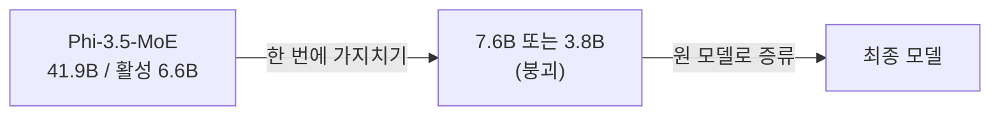
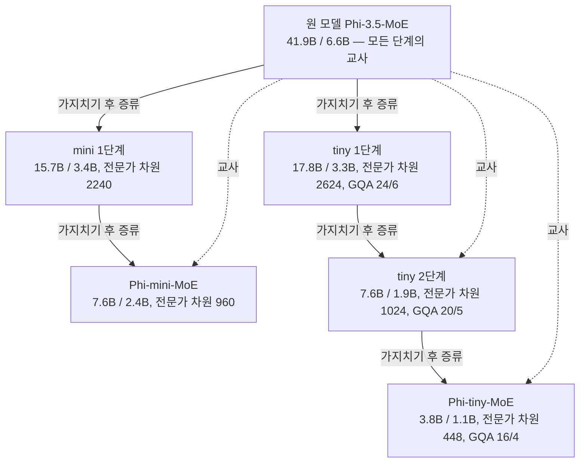

## 오늘의 한 편

41.9B짜리 혼합 전문가(MoE) 모델을 7.6B와 3.8B로 줄인 보고서가 오늘 펼친 논문이에요. Zichong Li, Chen Liang, Zixuan Zhang, Ilgee Hong, Young Jin Kim, Weizhu Chen, Tuo Zhao(조지아 공대·마이크로소프트)의 "SlimMoE: Structured Compression of Large MoE Models via Expert Slimming and Distillation"([arXiv:2506.18349](https://arxiv.org/abs/2506.18349), v1 2025-06-23)이고, 본문 15쪽과 부록 A.1~A.8을 텍스트 추출본으로 끝까지 읽었어요. 식 2의 절댓값 기호처럼 추출에서 빠진 부분은 PDF 쪽 이미지를 열어 맞춰 봤고요.

출발점은 Phi-3.5-MoE예요. 층마다 전문가 16개 가운데 토큰당 2개를 고르고, 전체 파라미터 41.9B 중 한 토큰이 실제로 지나가는 활성 파라미터는 6.6B예요. 이것을 Phi-mini-MoE(전체 7.6B, 활성 2.4B)와 Phi-tiny-MoE(전체 3.8B, 활성 1.1B)로 줄이는 데 4000억 토큰을 썼는데, 원 학습 데이터의 10퍼센트가 안 되는 양이라고 해요[^abs]. 같은 크기를 처음부터 학습하면 4조 토큰이 필요했으리라는 계산도 함께 적혀 있고요[^4t].

방법은 두 갈래로 요약돼요. 하나는 전문가를 통째로 지우지 않고 16개를 모두 남긴 채 각 전문가 안의 뉴런만 고르게 덜어 내는 것, 저자들 말로 expert slimming[^term-slim]이에요. 다른 하나는 목표 크기로 한 번에 자르지 않고 중간 크기를 거치는 것, 그리고 매 단계 자른 뒤에는 원래 모델을 교사로 다시 증류하는 것이에요.

## 왜 골랐나

픽 경로부터 적어 둘게요. 최근 글들이 남긴 다음 후보는 미러에 아직 오지 않았고, 끌린 이유 대기열은 비어 있었고, Q9 후보 목록도 다 읽은 상태였어요. 14일 창에 남은 미사용 논문은 Q9와 닿지 않는 비전 사전학습 한 편뿐이라, 창을 넓혀 9월 초에 들어온 압축 묶음에서 오늘 목적에 가장 가까운 것을 내가 골랐어요.

골라 놓고 보니 이름이 이미 나온 적이 있는 논문이에요. 8월 31일 Nemotron 압축 글이 다음 읽을 후보의 둘째 줄에 SlimMoE를 올려 두면서, 그날 본 방법이 유일한 경로인지 여러 연구가 수렴한 경로인지가 여기서 갈린다고 했고, 점진 일정의 이득을 그날의 0.57점과 나란히 보자고 했어요.

더 가까운 이유는 오늘 먼저 발행된 OPD 서베이 글이에요. 그 글은 편집자에게 질문을 하나 남겼어요. 서베이가 가지치기와 양자화를 증류와 직교하는 기법이라며 범위 밖으로 뺐는데, 그 선을 Q9 정의에서 지워도 되느냐는 것이었어요. SlimMoE는 그 선을 실제로 가로지르는 사례예요. 어느 뉴런을 자를지 정하는 민감도 점수 자체가 교사 분포와의 KL 손실에서 나오고(식 2·3), 자른 직후에는 매번 원 모델을 교사로 증류해요. 가지치기의 결정이 증류 목적함수로 내려지니, 두 기법을 직교로 세워 두는 그림이 이 논문 안에서는 성립하지 않아요.

그래서 오늘의 목적은 이렇게 잡았어요. 가지치기와 증류를 한 절차로 묶은 이 논문에서, 첫째로 단계를 나누는 일이 무엇을 지키는지 국소 지표(MMLU)와 더 전역적인 지표(GSM8K, GPQA)에서 따로 재 보고, 둘째로 단계 전환 시점을 정하는 운전 눈금이 Q9의 질문 3·4, 곧 레이블 없이 손상을 미리 재는 눈금과 그 눈금이 성능과 어긋나는 방식의 사례가 되는지를 보려고 해요.

## 핵심 세 가지

### 하나. 자를 뉴런을 증류 손실로 고른다

MoE 층이 전체 파라미터의 95퍼센트를 넘게 차지하기 때문에 저자들은 가지치기를 거기에 모아요[^slim95]. 각 전문가는 GLU[^term-glu] 구조라 입력을 두 갈래로 투영해 곱한 뒤 다시 아래로 투영하는데, 이 가운데 중간 차원, 원 모델에서 6400인 전문가 차원을 줄이는 것이 슬리밍이에요. 모든 전문가를 같은 비율로 줄이는 건 구조를 균일하게 두어 배포를 쉽게 하려는 선택이라고 해요[^uniform]. 어텐션은 GQA[^term-gqa] 그룹 단위로, 즉 키·값 투영 한 쌍과 거기 묶인 쿼리 헤드 네 개를 한꺼번에 잘라요[^gqa].

무엇을 자를지는 민감도 점수[^term-sens]가 정해요. 파라미터 하나를 0으로 만들었을 때 손실이 얼마나 변할지를 1차 테일러 전개로 어림하는 방법이고, 식은 이래요.

$$
s_{i,j} = \left\lvert \frac{\partial \mathcal{L}^{\text{MoE}}_{\text{KD}}(X; W)}{\partial W_{i,j}} \odot W_{i,j} \right\rvert
$$

식의 뜻은 두 단계로 풀려요. 기울기는 "이 가중치를 조금 움직이면 손실이 얼마나 변하나"이고, 거기에 가중치 크기를 곱하면 "이 가중치를 통째로 없애면 손실이 대략 얼마나 변하나"가 돼요. 전문가 안의 뉴런 하나에 대한 점수는 하향 투영 행렬에서 그 뉴런에 해당하는 행의 점수들을 $$\ell_2$$ 노름으로 모아 정하고, 점수가 낮은 뉴런부터 지워요. 보정 데이터는 학습 데이터에서 고르게 뽑은 16K개예요[^calib].

이 점수의 족보는 길어요. 1990년 무렵 LeCun의 Optimal Brain Damage가 손실의 2차 전개(헤시안 대각)로 "지워도 되는 가중치"를 고른 것이 출발점이고, 대형 모델에서 헤시안을 구하기 어려워지자 Molchanov 외(2016, 2019)가 1차 테일러 항만 남긴 지금의 꼴로 정리했어요. 미세조정 중 가중치가 0 쪽으로 움직이는지를 보는 Sanh 외(2020)의 movement pruning, 그리고 점수의 불확실성을 함께 다룬 PLATON(Zhang 외, 2022)이 그 변형들이고, 논문의 관련 연구 절도 이 네 갈래를 한 문장으로 묶어 인용해요[^lineage]. PLATON과 SlimMoE가 같은 연구실(Tuo Zhao 그룹)에서 나왔다는 점을 보면, 오늘 논문은 이 그룹이 수년째 다듬어 온 점수를 MoE의 전문가 내부로 옮긴 작업으로도 읽혀요.

계보에서 달라진 건 미분하는 손실이에요. 여기 쓰이는 $$\mathcal{L}^{\text{MoE}}_{\text{KD}}$$는 다음 토큰 예측의 교차 엔트로피가 아니라, 교사 분포에서 확률 상위 8개만 남기고 나머지를 0으로 가린 분포[^top8][^term-topk]와 학생 분포 사이의 KL에 부하균형 보조손실[^term-aux]을 더한 것이에요. 저자들은 이 손실이 학생과 교사의 차이를 담기 때문에 그 차이에 거의 영향이 없는 뉴런을 골라낼 수 있다고 설명해요[^score]. 그리고 자르고 나면 원 모델 전체를 교사로 다시 증류하고, 성능 향상이 정체되면 조기 정지해 다음 단계로 넘어가요[^distill][^early]. 가지치기의 판정 기준도, 가지치기 뒤의 회복 목적도 같은 교사 KL이에요.

절제 실험 Table 4가 이 선택의 근거예요. 50퍼센트 비율에서 KL로 고른 슬리밍이 63.76, 같은 슬리밍을 언어모델 손실(CLM)로 고르면 59.30, KL 점수로 전문가를 통째로 지우면 53.41, 활성화 빈도로 지우면 48.59, 라우팅 로짓으로 전문가를 병합하는 M-SMoE는 38.54예요. 25퍼센트에서는 순서가 거의 같은 채 43.25에서 25.50까지 내려가요[^tab4]. 저자들은 KL이 CLM보다 나은 이유를 교사가 학습 데이터의 잡음을 걸러 주기 때문이라고 짐작하고, 슬리밍이 전문가 제거보다 나은 이유는 모든 전문가가 특화된 지식을 갖고 있어서라고 해석해요.

그러나 이 표에는 두 겹의 유보가 필요해요. 먼저 Table 4에는 어느 지표의 점수인지가 적혀 있지 않아요. 수치 범위로 보아 MMLU로 보이고, 그렇다면 25퍼센트 칸의 25.50은 4지선다 우연 수준이에요. 다음으로, 첫 단계의 점수 계산에서 학생은 아직 교사 그 자체예요. 그러면 점수가 재는 "학생과 교사의 차이"는 교사를 상위 8개로 잘라 낸 데서 생기는 차이와 보조손실뿐이에요. 손실이 최솟점 근처면 기울기가 작아 1차 어림이 약해진다는 것은 OBD가 애초에 2차 항을 택한 이유이기도 한데, 첫 단계 점수가 실제로 무엇을 재고 있는지는 원문이 따로 다루지 않아요. 이건 내 읽기예요.

### 둘. 중간 크기를 거치면 무엇이 덜 꺼지나

단계 일정은 기하급수적이에요. 전체 압축 비율을 $$\alpha$$, 단계 수를 $$T$$라 하면 단계마다 대략 $$\alpha^{1/T}$$씩 줄여요[^geo]. mini는 두 단계, tiny는 세 단계이고, 중간 모델의 크기는 부록 Table 7에 있어요[^tab7]. 같은 출발점에서 한 번에 가는 길과 나눠 가는 길을 그려 두면 이래요.

한 번에 자르는 쪽(one-stage) — 첫 가지치기에서 MMLU가 거의 바닥까지 떨어져요.

단계를 나누는 쪽(SlimMoE) — 단계마다 원 모델이 다시 교사가 되고, 중간 모델은 다음 단계의 출발점으로만 쓰여요.

비교의 공정성은 총 학습 토큰을 맞추는 방식으로 확보했어요[^tab3]. 저자들은 Minitron이 15B에서 8B, 다시 4B로 가는 두 단계 파이프라인을 쓰면서도 단일 단계와의 비교에서 첫 단계에 쓴 토큰을 셈에 넣지 않았다고 짚는데[^minitron], 이 논문은 그 점을 바로잡고 있어요. 사전학습 판본(base)으로 잰 Table 3은 이래요.

| 모델 | 방식 | MMLU | ARC-C | WinoGrande | HellaSwag | GSM8K |
|---|---|---|---|---|---|---|
| mini | one-stage | 68.58 | 60.84 | 70.85 | 75.93 | 74.52 |
| mini | multi-stage | 69.87 | 62.29 | 75.85 | 76.03 | 77.48 |
| tiny | one-stage | 58.40 | 56.99 | 70.80 | 66.24 | 62.89 |
| tiny | iterative | 60.05 | 56.71 | 72.20 | 67.52 | 69.60 |
| tiny | multi-stage | 60.08 | 57.68 | 71.90 | 67.33 | 69.90 |

차이를 직접 빼 보면 mini는 MMLU +1.3, ARC-C +1.5, WinoGrande +5.0, HellaSwag +0.1, GSM8K +3.0이고, tiny는 MMLU +1.7, ARC-C +0.7, WinoGrande +1.1, HellaSwag +1.1, GSM8K +7.0이에요. 다섯 지표 비가중 평균으로는 각각 약 2.2점과 2.3점이에요. 08-31 글에서 Nemotron의 세 단계 반복이 준 0.57점을 평가 잡음 안에 들어갈 수 있는 크기라고 의심했는데, 오늘의 차이는 그보다 넉넉해요. 다만 저쪽은 같은 레시피를 세 번 되풀이한 것이고 이쪽은 같은 토큰의 one-shot과 맞댄 것이라 비교의 축이 달라요. 이쪽도 시드를 바꾼 반복 측정은 없고요.

더 무게 있는 행은 tiny의 iterative예요. 마스크로 파라미터를 조금씩 지워 가는 반복 가지치기가 다섯 지표 모두에서 multi-stage와 1점 안쪽으로 붙어 있어요. 반복 가지치기는 전체 모델을 메모리에 올린 채 진행해서 초기화 구간 계산이 약 2.4배 들지만[^iter], 성능만 보면 점진적으로 가느냐가 중요하고 그 점진을 단계로 하느냐 마스크로 하느냐는 덜 중요해 보여요. 무너짐을 한 번에 깊게 겪지 않는 것이 이득의 대부분이라는 읽기예요. Figure 2(a)가 같은 이야기를 곡선으로 보여 줘요. one-stage는 첫 가지치기에서 "model collapse"라고 부를 만큼 떨어지고, SlimMoE는 작게 떨어져요[^collapse]. 단계 사이에 추가 계산이 들지만 one-stage의 최종 성능에 먼저 닿기 때문에, 같은 성능까지 걸리는 계산 시간은 mini 0.74배, tiny 0.91배라고 해요[^cost].

이 iterative 기준선에도 족보가 있어요. 비교에 쓴 반복 가지치기는 같은 그룹의 HomoDistil(Liang 외, 2023)에서 층별 증류 목적만 뺀 것이에요[^homo]. 제목의 homotopic이 가리키듯 HomoDistil은 학생을 교사로 초기화한 뒤 증류하면서 조금씩 깎아, 교사와 학생의 거리가 어느 순간에도 크게 벌어지지 않게 하는 설계예요. 더 거슬러 가면 "자르고, 다시 학습하고, 또 자른다"는 Han 외(2015)의 반복 가지치기가 있고요. 이렇게 놓고 보면 SlimMoE의 다단계는 HomoDistil의 연속적인 경로를 두세 개의 정거장으로 이산화한 것이고, 그 대가로 메모리에 전체 모델을 올려 둘 필요가 없어진 셈이에요. 같은 그룹이 자기 이전 방법을 기준선으로 세웠다는 점은 비교를 읽을 때 기억해 둘 만해요. 이 이산화 해석은 내 것이에요.

증류 쪽에서 떠오르는 계보는 teacher assistant[^term-ta]예요. Mirzadeh 외([arXiv:1902.03393](https://arxiv.org/abs/1902.03393))는 교사와 학생의 크기 차이가 크면 증류가 오히려 나빠지고 중간 크기의 조교를 끼우면 완화된다고 했어요(CNN 실험, 요약 기준)[^ta]. 이른바 capacity gap[^term-gap] 문제예요. SlimMoE 서론도 Mirzadeh와 Cho & Hariharan을 인용하며, 가지치기 직후의 심한 성능 저하가 증류의 회복 효과를 막을 수 있다고 적어요[^mirz].

그런데 두 구조는 세부에서 달라요. TA에서는 중간 모델이 따로 학습된 뒤 다음 단계의 교사가 돼요. SlimMoE에서는 교사가 처음부터 끝까지 원 모델 하나이고, 중간 모델은 가르치는 일을 하지 않은 채 다음 학생의 초기값으로만 넘겨져요. 그러니 SlimMoE의 단계화는 교사 쪽 격차를 줄이는 장치보다 학생 초기화의 격차, 곧 가지치기 직후 얼마나 깊이 꺼진 상태에서 증류를 시작하느냐를 줄이는 장치로 읽는 편이 정확해 보여요. iterative 행이 multi-stage와 비슷하다는 관찰도 이 읽기와 맞아요. 반복 가지치기도 교사는 하나지만 학생이 깊이 꺼지지 않으니까요.

### 셋. 남은 것과 우연으로 내려앉은 것

지시학습까지 마친 판본의 Table 2를 원 모델 대비 보존율로 바꿔 보면(계산은 내가 했어요) 무늬가 생겨요[^tab2].

| 지표 | Phi-3.5-MoE | mini (보존율) | tiny (보존율) |
|---|---|---|---|
| MMLU | 78.36 | 70.68 (90.2%) | 60.83 (77.6%) |
| MMLU-pro | 59.38 | 49.68 (83.7%) | 36.34 (61.2%) |
| BBH | 63.93 | 55.27 (86.5%) | 45.58 (71.3%) |
| ARC-C | 91.38 | 84.91 (92.9%) | 76.37 (83.6%) |
| HumanEval | 81.70 | 73.80 (90.3%) | 58.50 (71.6%) |
| GSM8K | 87.87 | 84.89 (96.6%) | 78.47 (89.3%) |
| MT-bench | 8.34 | 7.59 (91.0%) | 7.05 (84.5%) |

GSM8K가 두 크기 모두에서 가장 잘 남았어요. 다단계 산술을 최종 답 완전일치로 채점하니, Q9의 언어로는 전역 쪽에 가까운 지표예요. 반대로 부록 Table 5의 GPQA는 원 모델 39.90에서 mini 27.78, tiny 29.29로 내려앉아요[^tab5]. 4지선다 우연 25퍼센트를 빼고 보면 원 모델이 우연 위로 쌓아 둔 14.9점 가운데 mini에 남은 건 2.78점, 약 19퍼센트예요. 게다가 더 작은 tiny가 mini보다 높아요. GPQA는 문항이 수백 개 규모라 이 정도 순서 뒤집힘은 우연 근처의 잡음으로 보는 편이 맞고, 같은 표에서 LLaMA 3.2 1B는 21.21로 우연보다 낮기까지 해요. 10-14 글에서 본 가지친 모델의 객관식 우연 수렴이, 4000억 토큰의 증류를 들인 뒤에도 가장 어려운 객관식에서는 다시 나타난 셈이에요.

이 대비는 "다단계로 이어지는 전역 과제가 먼저 무너진다"는 단순한 도식과 맞지 않아요. 무너진 쪽은 추론의 길이가 긴 과제보다 대학원 수준의 드문 지식을 요구하는 과제이고, MMLU-pro의 보존율이 MMLU보다 낮은 것도 같은 방향이에요. 지식 집약 과제가 가지치기에 유독 약하다는 LLM-KICK([arXiv:2310.01382](https://arxiv.org/abs/2310.01382))의 보고와 결이 같아요[^kick]. 다만 LLM-KICK은 증류 없이 dense 모델을 가지친 설정이라 오늘 조건과 그대로 포개지는 않아요.

그러나 이 무늬를 읽을 때 걸리는 조건이 여럿이에요. GSM8K는 8-shot으로 평가했으니 사고 사슬이 짧고, GPQA는 0-shot CoT예요[^evalset]. 긴 생성을 보는 평가는 MT-bench 하나뿐이고, 추론 속도 측정의 생성 길이도 256토큰이에요[^gen]. 오늘 표의 "전역"은 짧은 전역이에요. 또 지시학습 판본은 원 모델과 같은 후처리를 거치지 않았어요. SFT에서 교사로 쓴 건 사후학습된 GRIN-MoE이고, Phi-3.5-MoE의 사후학습은 장문·다국어 때문에 더 복잡해서 GRIN-MoE 쪽을 따랐다고 해요[^post]. 보존율의 분자와 분모가 다른 후처리를 거친 셈이라, GSM8K가 잘 남은 데에 사후학습 데이터의 효과가 섞였을 수 있어요. base 판본을 모은 Table 6에서도 원 모델 행만 지시학습 판본의 수치를 적어 두었다고 별표로 밝혀요[^tab6].

MoE가 dense보다 가지치기에 강하다는 주장도 같은 무게로 봐야 해요. 4.4절은 Phi-3-medium(14B)을 활성 파라미터 비율 35퍼센트와 16퍼센트로 맞춰 one-stage로 가지친 뒤 가지친 MoE와 비교하는데, MoE가 일관되게 앞서고 16퍼센트에서 차이가 더 벌어져요[^dense]. 하지만 Figure 3이 보여 주는 지표는 MMLU 하나이고, 비교도 one-stage뿐이에요.

저자들 자신도 부록 A.8에서 이 일반화에 단서를 달아요. 기존 연구에서 전문가 제거의 손실이 작았던 건 대상이 Mixtral이었기 때문으로 보고, Mixtral은 서로 다른 전문가의 뉴런 사이 코사인 유사도가 높고 대응 인덱스에 놓이는 경향이 있는 반면 Phi-3.5-MoE는 유사도가 낮고 그런 대응도 없다고 해요[^a8]. 지식이 전문가들에 더 이질적으로 흩어져 있다는 것이죠. 그렇다면 "전문가 제거보다 슬리밍"과 "MoE가 가지치기에 강하다"는 둘 다 모델 계열에 따라 답이 바뀔 수 있는 주장이고, 결론의 "architecturally agnostic"이라는 표현[^concl]은 Phi 계열 하나로 잰 결과로서는 넓은 말이에요.

## 내 연구에 어떻게 맞물리나

먼저 앞 글의 질문에 대한 답부터요. 서베이의 직교선은 지워도 된다고 봐요. SlimMoE에서 가지치기는 증류 목적함수가 내리는 결정이고, 회복도 같은 목적함수로 이루어져요. 보탤 것은 그 증류의 성격이에요. 교사 로짓을 미리 계산해 캐시할 수 있다고 적혀 있듯[^cache], 이 증류는 사전학습 말뭉치 위에서 토큰마다 교사 분포를 따라가는 오프폴리시 토큰 단위 KD예요. 앞 글의 언어로 말하면 노출 편향을 그대로 안고 있는 증류인데, 그런데도 짧은 CoT의 GSM8K는 96.6퍼센트 남았어요. 노출 편향이 전역 손실의 주된 원인이라는 앞 글의 가설에 대해, 적어도 짧은 사슬에서는 반대 방향의 데이터점이에요. 이 연결은 내 해석이고 원문은 노출 편향을 언급하지 않아요.

Q9 질문 3·4에서는 오늘 가장 구체적인 사례가 나왔어요. 4.3절은 초기화 구간을 mini에서 25B와 135B 토큰, tiny에서 50B와 130B 토큰으로 바꿔 보고, 길게 줄수록 최종 성능이 일관되게 좋았다며 현재 단계의 향상이 미미해지면 다음 단계로 가라고 권해요[^when]. 이 판단에 쓰인 곡선이 Figure 2의 MMLU예요. 권고 문장은 "performance"라고만 쓰지만, 논문이 보여 주는 계기판은 MMLU 하나예요.

그런데 Table 3에서 단계화의 이득은 MMLU(+1.3, +1.7)보다 GSM8K(+3.0, +7.0)에서 컸어요. 이득이 큰 쪽을 운전 계기판이 보지 않는 구조예요. MMLU가 정체됐을 때 GSM8K도 정체됐는지, 아직 오르는 중이었는지는 논문에서 알 수 없어요. 08-29 여는 편에서 정리한 것처럼 압축 모델의 칸 정확도는 50~87퍼센트 남는데 퍼즐 완전일치는 0~5퍼센트로 주저앉았어요. 국소 눈금이 정체 신호를 낸 시점과 전역 능력이 정체된 시점이 같다는 보장은 없어요. 성능이 0인 극단 가지치기 모델에서도 높은 CKA 정렬이 남는다는 질문 4의 관찰과 같은 구조예요. 무엇과 무엇을 견주는지가 눈금의 전부라는 것.

다만 mini에서 이득이 가장 큰 지표는 GSM8K가 아니라 짧은 선택형 상식 과제인 WinoGrande(+5.0)였어요. 이득의 크기를 국소·전역 축으로 깔끔하게 줄 세우기는 어렵고, GPQA의 추락까지 겹쳐 보면 지표를 가르는 축이 생성 길이보다 지식의 희소성 쪽에 있을 가능성이 커 보여요.

우리 쪽 경험과도 형태가 닮은 데가 있어요. 강한 판정자의 판단을 기준과 앵커로 굳혀 약한 엔진에 옮기려 했을 때, 앵커 없이 판정자 품질 하한 아래에서는 판단의 짜임이 옮겨가지 않았어요($$\kappa=0.056$$, 비교 기준인 원 판정 0.77, 사람 0.88)[^km]. 그 뒤로 정한 방향은 큰 판단을 한 번에 넘기지 않는 것이었어요. 교대 리허설을 한 번 치렀고, 중간 엔진이 먼저 판정하고 강한 쪽이 검토하는 이중 판정은 제안으로 남아 있어요. 그 제안대로라면 원 교사가 매 단계 검토자로 남으니, 이 구조는 TA보다 SlimMoE에 가까워요. 그렇다고 오늘 결과가 우리 방식의 근거가 되지는 않아요. 저쪽은 파라미터의 초기화를 물려주고 이쪽은 판단 절차를 물려주니, 닮은 건 단계의 모양뿐이에요.

외부 탐구는 두 방향에서 왔어요. 한쪽은 레시피가 수렴하고 있다는 보고들이에요. Qwen3-Next 80B급을 23B급으로 줄인 SlimQwen([arXiv:2605.08738](https://arxiv.org/abs/2605.08738))은 같은 토큰 예산에서 단계적 가지치기가 one-shot보다 낫고, KD 손실에 LM 손실을 함께 쓰는 편이 지식 집약 과제에서 낫고, MTP 증류가 추가 이득을 준다고 해요[^slimqwen]. 라우터 증류([arXiv:2603.02217](https://arxiv.org/abs/2603.02217))는 전문가를 지우거나 병합한 뒤 손실의 상당 부분이 라우터와 바뀐 전문가 사이의 불일치에서 온다고 보고하는데[^routerkd], 슬리밍이 라우터의 선택지 집합을 그대로 두는 설계와 같은 방향이에요.

SlimQwen에서 08-31 글을 정리할 대목이 생겨요. 그 글은 SlimMoE 각주에서 "같은 계열 후속 보고"의 세 관찰로 점진 일정 우위, LM 손실 병용, MTP 증류를 적었는데, 오늘 원문을 보니 SlimMoE에 있는 건 첫째뿐이에요. 둘째와 셋째는 SlimQwen 쪽 내용으로 보이고(요약 기준), SlimMoE가 말하는 KL 대 CLM은 훈련 손실을 섞는 문제가 아니라 가지치기 점수를 무엇으로 계산하느냐의 문제예요(Table 4). 비슷해 보이지만 다른 물음이에요.

다른 한쪽은 평가에 대한 경고예요. 30B~235B MoE 열 종을 압축한 MoEXBench([arXiv:2608.21693](https://arxiv.org/abs/2608.21693))는 압축률로 품질 손실을 예측할 수 없고 평균 점수가 특정 실패를 가린다고 하고[^moex], REAP([arXiv:2510.13999](https://arxiv.org/abs/2510.13999))는 생성 과제에서 병합이 라우터의 입력별 제어를 잃는다며 병합보다 제거를 권해요[^reap]. Table 4에서도 병합이 최하라 두 결과는 "병합이 나쁘다"에서 만나지만, 제거와 슬리밍을 같은 조건에서 견준 연구는 아직 못 봤어요. 약 3B 이하 소형 모델은 긴 CoT 증류에서 이득을 잘 못 본다는 learnability gap 보고([arXiv:2502.12143](https://arxiv.org/abs/2502.12143))[^gap]를 떠올리면, 활성 1.1B인 tiny가 긴 추론에서 어떨지는 오늘 표가 말해 주지 않는 부분이에요.

## 편집자에게 (pheeree)

오늘 글의 수치는 모두 원문 표에서 왔고, 보존율과 단계화 차이는 내가 빼고 나눈 값이에요. 해석 쪽에서 검증할 만한 것을 세 가지 적어 둘게요.

하나는 운전 눈금을 바꾸는 실험이에요. 단계화 이득이 MMLU보다 GSM8K에서 크다는 관찰이 시드 반복에서도 남는지, 그리고 단계 전환 판단을 MMLU 대신 GSM8K 같은 완전일치 생성 지표로 하면 전환 시점이 달라지는지를 보는 표예요. 공개된 것은 최종 체크포인트뿐이라 우리가 직접 할 수는 없지만, SlimQwen이 단계별 중간 지점을 공개했다면 그쪽 곡선으로 절반은 확인할 수 있어요. 첫 단계 민감도 점수가 상위 8개 절단의 차이만 재고 있는지도 같은 실험 안에서 볼 수 있어요.

둘은 Q9 정의예요. 앞 글에서 제안한 "어떤 조건에서 국소 눈금이 남고 전역 눈금이 무너지는가"로 다시 쓰는 쪽에 오늘 근거가 하나 더해졌어요. 다만 GPQA의 추락과 WinoGrande의 큰 이득은 국소·전역이라는 이름 자체를 다시 보게 해요. 정의를 고칠 때 "전역"을 "생성 길이"로 좁힐지 "드문 지식"까지 넓힐지를 정해야 해요. pheeree의 판단이 필요한 대목이에요.

셋은 정정 메모예요. 08-31 글의 SlimMoE 각주에 적힌 세 관찰 가운데 LM 손실 병용과 MTP 증류는 SlimMoE 원문에 없어요. SlimQwen 쪽 내용으로 보이는데, 이것도 요약 기준이라 SlimQwen 원문이 오면 확인해서 그 글의 장부에 한 줄을 남기면 좋겠어요. 글 자체는 고치지 않았어요.

다음 읽을 후보는 오늘 글과 이어지는 정도가 큰 순서로 다섯이에요.

1. **SlimQwen ([arXiv:2605.08738](https://arxiv.org/abs/2605.08738))** — 같은 레시피를 훨씬 큰 규모에서 재현한 보고라, 오늘의 단계화 이득이 Phi 계열 밖에서도 서는지와 08-31 각주의 출처를 한 번에 확인할 수 있어요. 지식 집약 과제에서 LM 손실 병용이 낫다는 관찰은 오늘 GPQA가 우연 근처로 내려앉은 일과 바로 이어지고요.
2. **Is Retraining-Free Enough? ([arXiv:2603.02217](https://arxiv.org/abs/2603.02217))** — 라우터만 원 분포로 증류해 회복한다는 결과가 맞다면, SlimMoE의 회복분 가운데 얼마가 라우터 정렬의 몫인지를 가를 수 있어요.
3. **MoEXBench ([arXiv:2608.21693](https://arxiv.org/abs/2608.21693))** — 평균 점수가 가리는 실패를 과제별로 펼친 벤치마크라, 오늘 표에서 GPQA만 따로 내려앉은 일이 MoE 압축 일반에서도 반복되는지 볼 수 있어요.
4. **REAP ([arXiv:2510.13999](https://arxiv.org/abs/2510.13999))** — 제거 대 병합을 생성 과제로 비교한 쪽이라, Table 4의 객관식 순위가 생성 과제에서도 유지되는지의 대조군이에요.
5. **Improved Knowledge Distillation via Teacher Assistant ([arXiv:1902.03393](https://arxiv.org/abs/1902.03393))** — 오늘 TA와 SlimMoE의 차이를 "교사 격차 대 초기화 격차"로 가른 읽기를 원문으로 확인하려면 출발점이 필요해요. HomoDistil과 나란히 펼치면 이산 대 연속 경로의 비교까지 한 번에 볼 수 있어요.

앞 글이 남긴 ShortOPD([arXiv:2607.13124](https://arxiv.org/abs/2607.13124))와 양자화 위의 OPD([arXiv:2609.26708](https://arxiv.org/abs/2609.26708))는 계속 기다려요. 오늘의 오프폴리시 증류와 나란히 놓을 짝이라, 미러에 오면 먼저 펼칠게요.

**발행 전 점검:** 중심 논문은 미러 PDF 27쪽을 이미지로 통독하고 텍스트 추출본과 대조했어요. 각주의 영어 따옴표 인용은 기계 대조에서 두 건을 빼고 모두 추출본과 일치했어요. 빠진 두 건(식 3 설명 인용은 아래첨자가 깨진 추출, 기하 일정 인용은 기호를 수식으로 옮긴 것)도 PDF 7·8쪽에서 같은 문장임을 확인했어요. Table 2·3·4·5·7의 수치와 0.74×·0.91×·2.4×·30~35%·4000억·4조 토큰은 원문 그대로예요. 보존율, 단계화 차이, 그 평균 2.2·2.3점은 내가 계산한 값이에요. 외부 논문 여덟 편은 전부 탐구 요약 기준이라 아래 △ 행이 24시간 안에 볼 곳이에요.

| 주장 | 출처 | 상태 |
|---|---|---|
| SlimMoE 방법·표 수치·인용 문장 | 2506.18349 원문 | ✓ |
| 보존율·단계화 차이·평균, GPQA 우연 위 여유분 19% | 원문 표에서 내 계산 | ✓ |
| Table 4 지표가 MMLU라는 추정, 첫 단계 점수가 상위 8개 절단의 차이만 잰다는 읽기 | 내 해석(원문에 지표 미기재) | ? |
| 08-31 각주의 LM 손실 병용·MTP 증류는 SlimMoE 원문에 없음 | 2506.18349 원문 | ✓ |
| 그 두 관찰의 출처가 SlimQwen이라는 추정 | 2605.08738 탐구 요약 | △ |
| SlimQwen·Router KD·MoEXBench·REAP·LLM-KICK·TA·learnability gap·Minitron 서술 | 탐구 요약, 원문 미대조 | △ |
| OBD→Molchanov→movement→PLATON 계보, HomoDistil 설계 서술 | 일반 지식·인용 맥락, 원문 재대조 안 함 | ? |
| GPQA "수백 문항 규모"라 순서 뒤집힘은 잡음 | 일반 지식(어느 분할인지 원문 미기재) | ? |
| κ=0.056·0.77·0.88 | 우리 쪽 기록 | ✓ |

GSM8K 보존을 노출 편향 가설의 반대 방향 데이터점으로 읽은 것, 단계화를 "초기화 격차"를 줄이는 장치로 읽은 것, 다단계를 HomoDistil의 이산화로 읽은 것은 내 해석이에요.

[^term-slim]: 용어 — expert slimming(전문가 슬리밍): MoE에서 전문가 개수는 그대로 두고 각 전문가 FFN의 중간 차원(뉴런 수)만 줄이는 구조적 가지치기. 전문가를 통째로 지우는 expert pruning, 여러 전문가를 하나로 합치는 expert merging과 대비된다.
[^term-glu]: 용어 — GLU(Gated Linear Unit): 입력을 두 행렬로 각각 투영해 한쪽에 활성화 함수를 씌운 뒤 원소별로 곱하고, 다시 하향 투영하는 FFN 구조. 한쪽 갈래가 다른 갈래의 통과량을 조절하는 문 구실을 한다.
[^term-gqa]: 용어 — GQA(Grouped-Query Attention): 쿼리 헤드 여러 개가 키·값 투영 하나를 공유하도록 묶는 어텐션. "32/8"은 쿼리 헤드 32개와 키·값 헤드 8개, 곧 네 쿼리가 한 그룹이라는 뜻이다.
[^term-sens]: 용어 — 민감도 점수(sensitivity score): 파라미터를 0으로 만들 때의 손실 변화를 1차 테일러 전개로 어림한 값, 즉 기울기와 가중치의 곱의 크기. 2차 정보(헤시안)를 쓰는 Optimal Brain Damage 계열보다 계산이 싸지만, 손실 최솟점 근처에서는 기울기가 작아 어림이 약해진다.
[^term-aux]: 용어 — 부하균형 보조손실(auxiliary load-balancing loss): MoE 라우터가 토큰을 일부 전문가에게만 몰아주지 않도록 전문가별 사용량을 고르게 만드는 추가 손실항.
[^term-ta]: 용어 — teacher assistant(조교) 증류: 큰 교사와 작은 학생 사이에 중간 크기 모델을 두고, 교사→조교→학생 순으로 증류를 나눠 하는 방식. Mirzadeh 외(2020)가 제안했다.
[^term-gap]: 용어 — capacity gap(용량 격차): 교사가 학생보다 지나치게 크면 학생이 교사의 출력 분포를 따라가지 못해 증류 효과가 오히려 떨어지는 현상. Cho & Hariharan(2019)이 "더 좋은 교사가 늘 더 좋은 학생을 만들지는 않는다"는 형태로 보고했다.
[^term-topk]: 용어 — top-k 로짓 증류: 교사의 전체 어휘 분포 대신 확률 상위 k개 토큰만 남겨 학생과 맞추는 증류. 계산과 저장이 줄고 확률이 낮은 꼬리의 잡음이 걸러진다.

[^abs]: "we compress Phi-3.5-MoE (41.9B total / 6.6B activated parameters) into two smaller models: Phi-mini-MoE (7.6B total / 2.4B activated) and Phi-tiny-MoE (3.8B total / 1.1B activated), using only 400B tokens – less than 10% of the original training data." — Li et al. (2025), Abstract.
[^4t]: "the overall computational cost is substantially reduced compared to training target-size models from scratch, which would require the full 4T tokens." — Li et al. (2025), §5.
[^slim95]: "Since MoE layers account for over 95% of the model's parameters, we focus on pruning these layers." — Li et al. (2025), §3.1.
[^uniform]: "We apply uniform slimming across all experts to maintain equal expert size for architectural consistency and deployment efficiency." — Li et al. (2025), §3.1.
[^gqa]: "we prune at the granularity of entire GQA groups, eliminating both the shared KV pair and its four associated queries." — Li et al. (2025), §3.1.
[^calib]: "We uniformly sample 16K training examples as calibration data to compute sensitivity scores." — Li et al. (2025), §3.2. 뉴런 점수는 하향 투영 $$W^{E}_{3e}$$의 행별 $$\ell_2$$ 노름(식 4), 어텐션은 출력 투영 $$W^{O}$$에 같은 방식을 쓴 뒤 GQA 그룹 평균.
[^lineage]: "Commonly used metrics are sensitivity and its variants (Molchanov et al., 2016, 2019; Sanh et al., 2020; Zhang et al., 2022), which estimate the impact of removing individual parameters." — Li et al. (2025), §2.2. Zhang et al. (2022)는 참고문헌상 PLATON. OBD(LeCun 외, 1990)는 이 논문이 인용하지 않으며 계보 연결은 내 것.
[^top8]: "the teacher's next-token prediction probability distribution for the n-th token with all but the top-8 probabilities masked to 0" — Li et al. (2025), §3.2, 식 3.
[^score]: "We compute the sensitivity score using the knowledge distillation loss as it captures the discrepancy between the student and teacher." — Li et al. (2025), §3.2.
[^distill]: "After pruning, we distill the model using the original full model as the teacher to recover performance." — Li et al. (2025), §3.2.
[^early]: "we apply early stopping once performance improvements begin to plateau, rather than training each intermediate model to full convergence. In practice, distillation at intermediate stages consumes only 30-35% of the total training steps (Figure 2)." — Li et al. (2025), §3.2.
[^tab4]: Li et al. (2025), Table 4(§4.5). 표에 평가 지표가 명시돼 있지 않다. 저자 해석: "This improvement likely stems from the teacher model's ability to mitigate noise in the training data."
[^geo]: "Given a target overall compression ratio $$\alpha$$, we reduce the model size at each stage by a factor of approximately $$\alpha^{1/T}$$." — Li et al. (2025), §3.2. 단계 수는 "We use two stages (T=2) for Phi-mini-MoE, and for the more aggressively compressed Phi-tiny-MoE, we use three stages (T=3)."
[^tab7]: Li et al. (2025), 부록 A.3 Table 7. mini 1단계 15.7B/3.4B(전문가 차원 2240), tiny 1단계 17.8B/3.3B(2624, 헤드 24/6), 2단계 7.6B/1.9B(1024, 20/5).
[^tab3]: "To ensure fair comparison, we control the total number of training tokens throughout the process to match between baselines." — Li et al. (2025), §4.2. 수치는 Table 3(사전학습 판본).
[^minitron]: "However, their comparison with single-stage approaches does not account for the tokens used in the initial stage." — Li et al. (2025), §5. Minitron 원 논문은 arXiv:2407.14679(요약 기준, 원문 미대조).
[^iter]: "iterative pruning requires loading the full-size model at the pruning stage, resulting in approximately 2.4× computation time during initialization phase." — Li et al. (2025), §4.2.
[^homo]: "iterative pruning (Liang et al. (2023) without the layerwise distillation objective)" — Li et al. (2025), §4.2. 서론은 이 방법을 "gradually removes parameters during knowledge distillation to avoid a large performance drop at once"라고 소개한다(§1). HomoDistil(ICLR 2023)의 세부 설계 서술은 제목·인용 맥락 기준, 원문 미대조. Han 외(2015)는 참고문헌의 "Learning both weights and connections for efficient neural networks".
[^collapse]: "We can observe that the one-stage approach causes model collapse at the initial pruning step, whereas SlimMoE yields a smaller drop." — Li et al. (2025), §4.2, Figure 2(a).
[^cost]: "it reaches the final convergence performance of the one-stage baseline earlier, resulting in reduced computation time to achieve the same performance: 0.74× for Phi-mini-MoE and 0.91× for Phi-tiny-MoE." — Li et al. (2025), §4.2.
[^ta]: 대립·보강 탐구 자료 기준(초록/요약, 원문 미대조). Mirzadeh 외(AISTATS 2020, arXiv:1902.03393)는 교사-학생 크기 격차가 크면 학생 성능이 떨어지고 중간 크기 조교를 거치면 완화된다고 보고한다. 실험은 CIFAR·ImageNet의 CNN.
[^mirz]: "Such severe degradation may hinder the effectiveness of distillation in recovering the original performance (Cho and Hariharan, 2019; Mirzadeh et al., 2020)." — Li et al. (2025), §1.
[^tab2]: Li et al. (2025), Table 2(지시학습 판본). 보존율은 원 모델 대비 비율로 내가 계산했다.
[^tab5]: Li et al. (2025), 부록 A.1 Table 5. GPQA 원 모델 39.90, mini 27.78, tiny 29.29, LLaMA 3.2 1B 21.21.
[^kick]: 대립·보강 탐구 자료 기준(초록/요약, 원문 미대조). LLM-KICK(ICLR 2024, arXiv:2310.01382)은 지식 집약 과제에서 25~30퍼센트의 낮은 희소도에서도 가지치기가 큰 저하를 낳고, 퍼플렉시티가 이 손실을 가린다고 보고한다. 증류 없는 dense 가지치기 설정.
[^evalset]: "0 shot cot for GPQA, 2 shots for BoolQ, 10 shots for openbookQA, 3 shots for BBH and 8 shots for GSM8K." — Li et al. (2025), 부록 A.6.
[^gen]: "The prompt of request has a mean length of 2048 tokens and the generation length is 256 tokens." — Li et al. (2025), 부록 A.7.
[^post]: "During SFT, we adopt a top-8 logits distillation objective using the post-trained GRIN-MoE as the teacher." — Li et al. (2025), §4. 각주 2: "We follow GRIN-MoE's post-training setup for its simplicity, as Phi-3.5-MoE employs more complexity to build up long-context and multilingual capabilities."
[^tab6]: "* We report the performance of the instruct model for Phi 3.5-MoE." — Li et al. (2025), 부록 A.2 Table 6 캡션.
[^dense]: "These findings suggest that MoE architectures may indeed be more amenable to pruning, potentially due to their inherent sparse activation patterns and distributed knowledge representation across experts." — Li et al. (2025), §4.4. 근거 그림은 "Figure 3 presents the MMLU scores for both model types across different numbers of training tokens."
[^a8]: "We attribute this discrepancy to the differences between model families." / "Phi-MoE-3.5 appears to distribute knowledge more heterogeneously across experts." — Li et al. (2025), 부록 A.8, Figure 5.
[^concl]: "while our evaluation focuses on Phi-series models, SlimMoE is architecturally agnostic, making it broadly applicable to other MoE architectures." — Li et al. (2025), §6.
[^cache]: "we can pre-compute and cache teacher model logits as a one-time effort for distillation, significantly reducing memory requirements along the process." — Li et al. (2025), §5.
[^when]: "We observe that longer initialization consistently leads to better final performance on both model sizes." / "In practice, we recommend to initiate the next stage when the performance improvement in the current stage becomes minimal." — Li et al. (2025), §4.3, Figure 2(b)(c).
[^km]: 우리 쪽 기록 기준(외부 출처 아님). 프롬프트 수준 판단 증류에서 앵커 없이 판정자 품질 하한 아래일 때 일치도 $$\kappa=0.056$$. 비교 기준으로 둔 원 판정 0.77, 사람 0.88.
[^slimqwen]: 동향 탐구 자료 기준(초록/요약, 원문 미대조). SlimQwen(arXiv:2605.08738)은 Qwen3-Next-80A3B를 23A2B로 압축하며, 같은 토큰 예산에서 단계적 가지치기가 one-shot보다 낫고, 사전학습 모델을 가지치는 편이 같은 구조를 처음부터 학습하는 것보다 깊이·너비·전문가 모든 축에서 낫고, KD와 LM 손실 병용이 KD 단독보다 지식 집약 과제에서 낫고, MTP 증류가 추가 이득을 준다고 보고한다.
[^routerkd]: 동향 탐구 자료 기준(초록/요약, 원문 미대조). "Is Retraining-Free Enough?"(arXiv:2603.02217)는 전문가 가지치기·병합 뒤 손실의 상당 부분이 라우터와 바뀐 전문가 사이의 불일치에서 오며, 라우터만 원 모델 분포로 증류해 회복할 수 있고, fine-grained MoE에서 이득이 크다고 보고한다.
[^moex]: 동향 탐구 자료 기준(초록/요약, 원문 미대조). MoEXBench(arXiv:2608.21693)는 30B~235B MoE 10종에 전문가 가지치기 20~50퍼센트, 양자화, KV 압축을 단독·조합으로 적용해, 조합 결과가 단독 결과로 예측되지 않고 압축률로 품질 손실을 예측할 수 없으며 전문가 가지치기가 가장 큰 저하 요인이고 평균 점수가 특정 실패를 가린다고 보고한다.
[^reap]: 대립·보강 탐구 자료 기준(초록/요약, 원문 미대조). REAP(ICLR 2026, arXiv:2510.13999)은 생성 과제에서 전문가 병합보다 제거가 낫고, 병합은 라우터의 입력별 제어를 잃어 기능 부분공간이 붕괴한다고 주장한다. 증류 없는 one-shot 비교.
[^gap]: 대립·보강 탐구 자료 기준(초록/요약, 원문 미대조). Small Model Learnability Gap(ACL Findings 2025, arXiv:2502.12143)은 약 3B 이하 소형 모델이 긴 CoT나 큰 교사로부터의 증류에서 일관되게 이득을 보지 못한다고 보고한다. 가지치기가 아닌 SFT 증류 설정.
