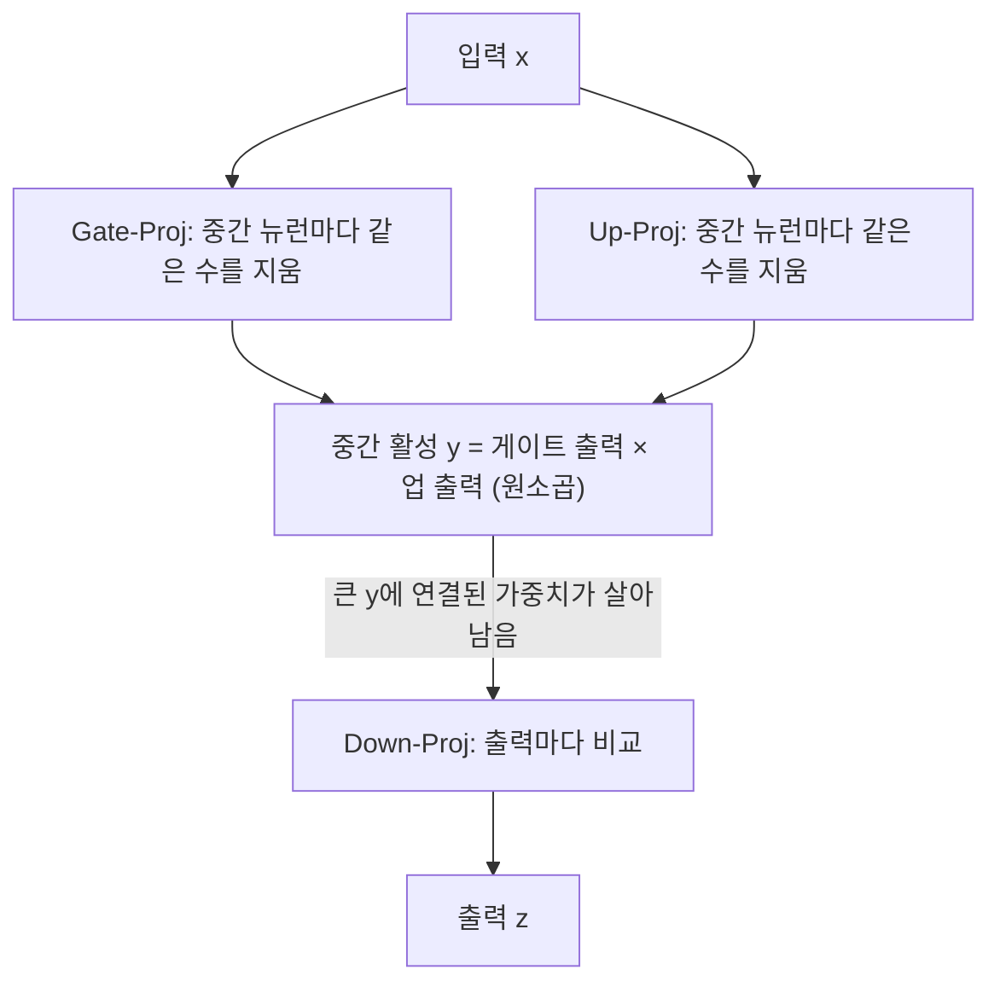
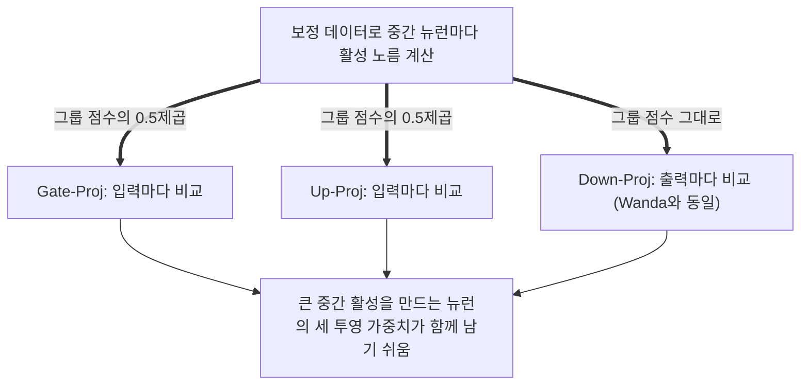

## 오늘의 한 편

NAIST의 Zhiyu Guo, Hidetaka Kamigaito, Taro Watanabe가 쓴 "Dependency-Aware Semi-Structured Sparsity of GLU Variants in Large Language Models"([arXiv:2405.01943](https://arxiv.org/abs/2405.01943), v3 2024-10-20, TMLR 2025 게재)를 읽었어요. 방법 이름은 DaSS예요. 본문 9쪽과 부록 A.1~A.3까지 처음부터 끝까지 넘겼어요.

계보부터 짧게 놓을게요. 지울 가중치를 손실의 이차 근사로 고르는 Optimal Brain Damage와, 지운 뒤 남은 가중치를 같이 고치는 Optimal Brain Surgeon이 출발점이고, 그 계산을 버리고 크기만 보는 magnitude pruning(Han 외 2015)이 실용의 기본값이 됐어요. LLM으로 오면서 이 두 줄기가 다시 갈라져요. SparseGPT는 OBS의 후예라 헤시안 역행렬로 남은 가중치를 갱신하고, Wanda는 갱신 없이 가중치 크기에 입력 활성의 노름을 곱한 점수 하나로 버텨요. 한편 GLU[^term-glu]는 Dauphin 외(2017)의 게이트 합성곱에서 나와 Shazeer(2020)가 Transformer MLP에 SwiGLU로 이식했고, 지금 오픈 LLM 대부분의 MLP가 이 꼴이에요. 하드웨어 쪽에서는 NVIDIA Ampere 세대가 2:4 희소[^term-nm]를 텐서 코어에서 직접 가속하면서, 비정형 가지치기를 N:M 틀에 맞추는 일이 실용 과제가 됐고요. 이 계보 서술 중 논문이 직접 인용하는 것은 Han 외·SparseGPT·Wanda·Dauphin·Shazeer·Mishra 외까지이고, OBD·OBS는 내 배경지식이에요.

DaSS가 끼어드는 틈은 하나예요. GLU MLP는 Gate·Up·Down 세 투영이 같은 중간 뉴런을 공유하는 결합 구조인데, Wanda와 SparseGPT는 각 행렬을 따로따로 채점해요. 저자들은 그 결과 세 투영 사이에 "structural mismatch"가 생긴다고 보고, 중간 활성의 노름을 세 투영 공통의 그룹 점수로 쓰는 채점을 제안해요.

## 왜 골랐나

오늘 픽은 조타를 받아 고른 게 아니고 본 세션이 고른 편이에요. 경로를 그대로 적어 둘게요. 최근 세 편(10-16 SlimMoE, 10-16 OPD 서베이, 10-14 Putri)이 남긴 다음 읽을 후보는 오늘 아침까지 미러에 하나도 오지 않았고, 끌린 이유를 쌓아 두는 대기열은 0건이었어요. Q9 다음 후보로 적어 둔 일곱 편은 모두 이미 썼고, 최근 14일 안에 받아 두고 쓰지 않은 항목은 Q9와 무관한 한 편뿐이었어요. 그래서 창을 9월 초로 넓혀, 9월 6일에 받아 둔 압축 묶음에서 이 논문을 꺼냈어요. 끌린 이유 칸은 비어 있어요.

다만 연결은 실제로 있어요. [10-14 Putri 글](https://pheeree.github.io/2026/10/14/putri-structured-pruning-perplexity-vs-chance/)은 Q9 질문 2, 곧 압축의 붕괴가 MLP 쪽에서 오느냐 어텐션 쪽에서 오느냐를 두고 FFN 재구성을 뺀 변종이 크게 나빠진다는 절제를 읽었어요. 그러면서 동시에, 그 논문은 처음부터 어텐션을 덜 깎게 짜여 있어서 MLP 취약성을 비교할 수 없다고 유보했죠. 오늘 논문은 그 질문을 한 겹 쪼갤 재료를 줘요. MLP가 정말 약한 것인지, 아니면 MLP 안의 gate·up·down 결합을 채점 방식이 무시해서 약해 보이는 것인지요. 덤으로 부록 A.3에는 층 민감도가 눈금에 따라 뒤집히는 대목이 있어서, Q9 질문 4(눈금이 무엇을 재는가)의 사례로 쓸 수 있어요.

## 핵심 세 가지

### 하나. 출력마다 비교하는 채점이 GLU 안에서 어긋나는 방식

GLU MLP의 계산은 이래요.

$$
y = \sigma(xW^{(1)}) \otimes xW^{(2)}, \qquad z = yW^{(3)}
$$

$$W^{(1)}$$이 Gate-Proj, $$W^{(2)}$$가 Up-Proj, $$W^{(3)}$$이 Down-Proj예요. 말로 풀면, 입력을 두 갈래로 투영해서 한쪽에 활성함수를 씌운 뒤 원소끼리 곱해 중간 활성 $$y$$를 만들고, 그것을 다시 은닉 차원으로 내려요. 중간 뉴런 $$i$$ 하나는 Gate의 $$i$$번째 출력, Up의 $$i$$번째 출력, Down의 $$i$$번째 입력을 한꺼번에 쥐고 있어요. 그래서 구조적 가지치기에서는 이 셋을 한 의존성 그룹으로 묶어 함께 지우는 게 상식이에요(LLM-Pruner·DepGraph). LLaMA2-70B처럼 GQA[^term-gqa]를 쓰는 모델에서는 이 MLP가 파라미터의 80% 이상을 차지하니[^mlp80], 압축의 성패가 거의 여기서 갈려요.

Wanda의 점수는 다음과 같아요.

$$
I_{ij} = \lvert W_{ij} \rvert \cdot \lVert X_j \rVert_2
$$

가중치 크기에 그 가중치로 들어오는 입력 특성 $$j$$의 노름(보정 토큰 전체에 걸친 L2)을 곱한 값이에요. 중요한 건 비교 단위예요. Wanda는 출력 하나, 곧 행렬의 한 행 안에서만 점수를 줄 세워요. 저자들은 이걸 output-balanced라고 불러요.[^outbal] N:M으로 바꾸면 SparseGPT도 행마다 정확히 N개를 지우게 되니 같은 성질을 갖고요.

이 규칙을 GLU 세 투영에 그대로 적용하면 어떻게 되는지 따라가 볼게요. Gate·Up에서 출력은 중간 뉴런이에요. 그러니 중간 뉴런마다 같은 개수의 가중치가 지워져요. 그 뉴런의 활성이 평소 크든 작든 상관없이요. Down에서 입력은 중간 활성 $$y$$이니, Wanda 점수에 $$\lVert y_j \rVert$$가 들어가서 큰 중간 활성에 연결된 가중치가 살아남아요. 한 그룹의 세 투영이 서로 다른 원칙으로 깎이는 셈이에요. Down은 "이 뉴런은 중요하다"고 판정해 가중치를 지켰는데, 그 뉴런의 값을 만들어 내는 Gate·Up 쪽 가중치는 다른 뉴런과 똑같은 비율로 잘려 나가요. 저자들은 이 어긋남이 고희소도에서 커져 망가진 네트워크로 이어진다고 써요.[^magnify]

그러니 손볼 곳은 비교 단위예요.

위가 Wanda식 채점이에요. 세 행렬이 각자의 행 안에서만 경쟁하고, 그룹 단위의 정보는 Down 하나에만 흘러들어요. 아래가 DaSS예요.

DaSS의 점수는 이래요.

$$
I^{(k)}_{ij} = \lvert W^{(k)\top}_{ij} \rvert \cdot \lVert y_i \rVert_2^{\alpha} \quad (k=1,2), \qquad I^{(3)}_{ij} = \lvert W^{(3)\top}_{ij} \rvert \cdot \lVert y_j \rVert_2
$$

전치한 행렬에서 $$i$$는 중간 뉴런이에요. Gate·Up에서는 가중치 크기에 그 가중치가 속한 중간 뉴런의 활성 노름을 곱하고, 비교 단위를 입력 쪽으로 돌려요. 입력 하나에 연결된 가중치들을 서로 견주어 그중 s%를 지우는 input-balanced 방식이에요.[^inbal] 같은 입력에 매달린 가중치들은 저마다 다른 중간 뉴런으로 가니, 이렇게 해야 중간 활성의 크기가 비교에 실제로 끼어들 수 있어요. 결과적으로 활성이 큰 뉴런은 Gate·Up에서도 가중치를 더 많이 지켜요. Down은 Wanda 점수와 똑같고요. $$\alpha$$는 기본 0.5예요.

계보 위에 다시 놓으면 위치가 또렷해져요. 구조적 가지치기는 의존성 그룹을 지키는 대신 행·열을 통째로 지워 LLM에서는 낮은 희소도에서도 성능을 잃고, 비정형 가지치기는 유연하지만 그룹을 모른 채 가중치를 하나씩 골라요. 저자들은 DaSS를 그 둘 사이의 중간 지점으로 소개해요. 구조적 가지치기가 그룹째 지우던 발상을, 지우는 단위는 가중치 하나로 둔 채 점수 안으로만 옮겨 온 셈이에요.

두 가지가 눈에 띄어요. 하나는 DaSS가 Gate·Up을 채점할 때 입력 활성 $$\lVert X_j \rVert$$를 아예 쓰지 않는다는 점이에요.[^onlyint] Wanda 이후의 통념은 입력 이상치가 가중치 중요도의 핵심 신호라는 것이었는데, 저자들은 GLU 입력 투영에서는 그 중요도가 생각만큼 두드러지지 않는다고 결론에 적어요.[^inportance] 다른 하나는 가중치 갱신이 전혀 없다는 점이에요. 채점 규칙만 바꿨어요. 그러니 DaSS와 Wanda의 차이는 같은 희소도, 같은 층별 균일 배분, 같은 무갱신 조건에서 채점의 결합 인지 여부만 다른 비교에 가까워요. 오늘 Q9 질문에 이 논문이 쓸모 있는 이유가 바로 그거예요.

### 둘. 표가 실제로 보여 주는 크기 — Wanda 대비는 크고, SparseGPT 대비는 작다

표 1은 MLP만 가지친 WikiText 퍼플렉시티예요.[^mlponly] 눈에 띄는 행은 Gemma-7B예요. GeGLU를 쓰고 중간 차원이 모델 차원의 8배라 MLP가 유난히 넓은 모델이에요.[^gemma8x] dense 7.00에서 2:4로 가지치면 SparseGPT 13.93, Wanda 32.50, DaSS 13.69가 돼요. dense 대비 배율로 바꾸면(내 계산) Wanda 4.6배, SparseGPT 1.99배, DaSS 1.96배예요. 같은 희소도, 같은 무갱신 조건에서 채점만 바꿨는데 퍼플렉시티가 절반 아래로 내려간 거예요. 4:8에서도 10.86/14.41/10.86으로 같은 모양이고요.[^tab1]

다른 모델에서는 격차가 훨씬 작아요. LLaMA2-70B 2:4에서 5.32/5.35/4.91, Mistral-7B 2:4에서 8.86/9.24/8.39예요. 그리고 비정형 50%로 오면 SparseGPT가 이기는 곳도 생겨요. LLaMA2-7B 50%는 SparseGPT 6.38, Wanda 6.50, DaSS 6.44예요. MLP가 넓을수록, 희소 패턴이 경직될수록 결합 인지의 값어치가 커진다고 읽는 게 이 표에 대한 정직한 요약이에요.

표 3은 LLaMA2-70B의 MLP 희소도를 40%에서 80%까지 올리며 다섯 과제 zero-shot 평균을 잰 거예요. 40%에서 SparseGPT 72.28, Wanda 72.35, DaSS 72.51로 셋이 0.25점 안에 모여 있다가, 70%에서 65.53/62.75/66.38, 80%에서 52.14/40.76/53.00으로 벌어져요.[^tab3] 저자들은 Wanda만 희소도가 오를수록 급락하는 것을 구조적 불일치의 증거로 읽어요.[^wandadecline]

평균 정확도의 차이만 보면 크기가 잘 와닿지 않아서, 우연 수준을 깔고 다시 계산해 봤어요. PIQA와 Winogrande는 2지선다(50), HellaSwag·ARC-e·ARC-c는 4지선다(25)로 두면 다섯 과제의 우연 평균은 35.0이에요. dense 72.62는 우연 위로 37.62점의 여유를 가진 셈이죠. 아래는 그 여유가 얼마나 남았는지를 비율로 적은 것이고, 전부 내 계산이에요.[^calc]

| MLP 희소도 | SparseGPT | Wanda | DaSS |
|---|---|---|---|
| 70% | 81.2% | 73.8% | 83.4% |
| 80% | 45.6% | 15.3% | 47.8% |

80%의 Wanda는 우연 위 여유의 15% 남짓만 남아요. 저자들 말대로 고장 난 모델에 가까워요. Wanda와 DaSS의 차이는 70%에서 3.6점, 80%에서 12.2점으로 희소도와 함께 확실히 벌어져요.

그러나 이 표에서 똑같이 분명한 것이 하나 더 있어요. DaSS와 SparseGPT의 차이는 어느 희소도에서도 1점 안팎이고, 60%에서는 SparseGPT가 0.03점 앞서요. 어텐션까지 함께 가지친 표 2에서도 4:8 평균 70.39 대 69.80, 2:4 68.66 대 68.20으로 DaSS가 근소하게 앞서지만, 비정형 50%에서는 SparseGPT가 71.76으로 DaSS 71.35보다 높아요.[^tab2] 같은 표에서 50% SparseGPT의 Winogrande 78.45가 dense 77.98을 넘는데, 저자들은 이를 단일 과제의 잡음으로 보고 평균을 믿자고 해요.[^noisy] 그 기준을 적용하면 평균의 0.4점 차이도 잡음 대역을 크게 벗어난다고 하기는 어려워요. 그러니 "DaSS가 SparseGPT를 이긴다"는 강한 형태로 읽기보다, 갱신 없이 SparseGPT 수준에 도달한다는 저자들 자신의 약한 형태[^nowu]가 표와 맞는 문장이에요. 그 약한 형태도 비용을 생각하면 가볍지 않아요. 70B에서 SparseGPT는 1092.76초, DaSS는 20.70초가 걸려요(Table 5).

표 3에는 확인해 둘 점이 하나 남아요. 표 제목은 "MLP sparsity ratios"라고만 하고, 어텐션도 함께 가지쳤는지는 본문에 적혀 있지 않아요. 다만 표 3의 50% 값(71.97/71.49/71.89)이 어텐션까지 가지친 표 2의 50% 값(71.76/71.13/71.35)보다 모두 높아서, 표 3은 MLP만 가지쳤을 가능성이 커 보여요. 이건 내 추론이고, 단정할 근거는 원문에 없어요.

### 셋. 어디가 민감한가에 대한 답이 눈금을 따라 뒤집힌다

부록 A.3이 오늘 Q9에 가장 직접 닿는 대목이에요. LLaMA2-70B의 MMLU 5-shot은 dense 69.10인데, 4:8에서 SparseGPT 60.24, Wanda 59.69, DaSS 60.86으로 8점 넘게 떨어져요. 2:4는 56.99/56.41/57.53이고, 비정형 50%는 64.52/62.72/63.27로 여기서도 SparseGPT가 가장 높아요.[^tab9] 저자들은 Jaiswal 외(2023), 곧 LLM-KICK을 인용하며 지식 집약 과제에서 상당한 열화가 보인다고 쓰고, dense LLaMA2-34B를 넘는 것은 비정형 50% 모델뿐이라고 덧붙여요.[^mmlu34b] 상식 추론 평균에서 2점 남짓이던 손실이 MMLU에서는 8~12점이 되니, 눈금을 바꾸자 손상의 크기가 몇 배로 달라진 거예요. 4지선다 우연 25를 깔면(내 계산) dense의 여유 44.1점 가운데 2:4 DaSS는 73.8%, Wanda는 71.2%를 남겨요.

여기서 저자들은 N:M을 유지하면서 손실을 줄이려고 연속한 20층(전체의 1/4)을 가지치기에서 빼는 실험을 해요. 그러면 전체 희소도는 37.5%가 돼요.[^skip] 어느 20층을 뺄지 고르려고 MMLU 앞 10과제를 부분집합으로 써서 시작 인덱스별로 잰 것이 표 10이에요. 4:8 기준으로 0번부터 빼면 60.12, 10번 61.72, 20번 59.75, 40번 56.54, 60번 56.83이고 같은 부분집합의 dense는 64.86이에요. 앞쪽 층을 보호할 때 점수가 높으니, 앞층이 더 민감하다는 뜻이죠. 저자들의 문장은 이래요.

> the earlier layers are more sensitive than the later ones in knowledge-intensitive tasks, which is contradictory to the findings in Frantar & Alistarh (2023) using perplexity, and align with the findings of Gromov et al. (2024).[^layers]

정확히 해 둘 것이 있어요. 이 뒤집힘은 같은 실험 안에서 두 눈금을 나란히 잰 결과가 아니에요. DaSS는 MMLU로만 쟀고, 퍼플렉시티 쪽 결론은 SparseGPT 논문이 자기 실험에서 얻은 것을 인용한 거예요. 모델도 설정도 다를 수 있어요. 그러니 "같은 모델에서 눈금만 바꾸니 뒤집혔다"보다는 "퍼플렉시티로 찾은 민감 위치와 MMLU로 찾은 민감 위치가 문헌 사이에서 반대로 나왔다"가 원문이 허락하는 문장이에요. 그래도 방향은 분명하고, 이 차이를 같은 모델 위에서 직접 재 보는 일은 우리가 해 볼 수 있어요.

이어서 저자들은 시작 인덱스를 0~20 범위에서 더 촘촘히 찾아 10번이 부분집합에서 최고임을 확인하고, 그 설정을 전체 MMLU로 보고해요.[^search] 그렇게 얻은 DaSS+skip 1/4가 4:8에서 65.82, 2:4에서 64.36이에요. 2:4 기준으로 우연 위 여유의 89.3%를 되찾은 값이에요(내 계산).

그러나 두 가지를 감안해야 해요. 첫째, 이 변종의 희소도는 37.5%라 50% 행들과 같은 예산의 비교가 못 돼요. 둘째, 건너뛸 위치를 MMLU 부분집합으로 고르고 그 부분집합을 포함한 전체 MMLU로 평가했어요. 57과제 중 10과제가 선택과 평가에 함께 쓰인 거예요. 10-14 글에서 Putri가 보정 퍼플렉시티로 어텐션 헤드를 고르고 퍼플렉시티로 평가하던 배치를 굿하트의 법칙에 비춰 짚었는데, 여기도 선택 눈금과 평가 눈금이 같은 계열이에요. 위치 선택의 이득 중 얼마가 MMLU 특유의 성질에 맞춘 몫인지는 이 실험만으로는 갈라지지 않아요.

하나 더 적어 둘게요. 4.1절은 퍼플렉시티를 압축 모델을 재는 일관되고 믿을 만한 척도로 소개하고, 하위 과제는 잡음이 있지만 해석하기 쉽다고 대비시켜요. 바로 아래 문장에서는 퍼플렉시티 평가를 "less interpretable"이라고 부르며 그 평가에서는 MLP만 가지쳤다고 하고요. 저자들 스스로 퍼플렉시티를 안정적이되 해석이 어려운 눈금으로 다루는 셈인데, 부록은 그 해석하기 어려운 눈금이 민감 위치에 대해 MMLU와 다른 답을 낼 수 있음을 보여 줘요.

## 내 연구에 어떻게 맞물리나

질문 2에서 시작할게요. 오늘 논문이 주는 것은 "MLP 취약성"이라는 관찰을 두 몫으로 나눌 수 있다는 가능성이에요. 하나는 MLP라는 구조 자체의 몫, 다른 하나는 MLP 내부 결합을 무시한 채점의 몫이에요. Gemma 2:4의 Wanda 32.50 대 DaSS 13.69는 뒤쪽 몫이 넓은 MLP에서는 손상의 절반 이상일 수 있다는 걸 보여 줘요. Wanda로 MLP를 가지쳐 놓고 "MLP가 어텐션보다 약하다"고 결론 내렸다면, 그 결론의 상당 부분은 채점 설계가 만든 그림이었을 수 있어요.

그러나 이 분해를 곧바로 이전 데이터점에 적용할 수는 없어요. 결합 무시라는 원인이 성립하려면 가중치마다 따로 매기는 점수가 있어야 해요. [08-29 글](https://pheeree.github.io/2026/08/29/recursive-reasoner-compression-edge/)의 비대칭은 나이브 INT4 양자화에서 나왔는데, 나이브 양자화에는 중요도 점수가 없어요. Putri의 FFN 단계는 중간 노드를 통째로 지우는 구조적 가지치기라 애초에 의존성 그룹을 지키고요. 그러니 두 데이터점에서의 MLP 취약성은 오늘 논문이 말하는 불일치로 설명되지 않아요.

남는 연결은 더 약한 가설 하나예요. Ashkboos 외(2023)는 SwiGLU 중간 활성의 높은 분산이 두 출력의 원소곱에서 온다고 봤고, 그 때문에 4-bit 활성 양자화에서 정확도가 떨어진다고 했어요.[^ashkboos] 08-29의 MLP 믹서가 게이트 곱을 가진 구조였다면, 결합 채점과는 별개로 원소곱이 오차를 키우는 경로가 있었을 수 있어요. 그 모델의 MLP가 GLU 꼴이었는지는 오늘 확인하지 않았으니 가설로만 둘게요.

반대 방향의 유보도 있어요. DaSS가 고친 몫은 Wanda와 견준 몫이에요. SparseGPT는 결합을 전혀 고려하지 않는데도 재구성 덕에 거의 같은 지점에 있어요. 결합 인지 채점과 가중치 재구성이 같은 손상을 메우는지 서로 다른 손상을 메우는지는, DaSS 위에 재구성을 얹거나 SparseGPT를 그룹 단위로 돌리는 조건이 있어야 갈리는데 논문에는 그 조건이 없어요.

고희소도 붕괴의 큰 몫이 층별 균일 배분에서 온다는 대안도 있어요. 저자들은 비교 방법들이 균일 층별 희소도를 쓴다고 명시하는데[^uniform], OWL([arXiv:2310.05175](https://arxiv.org/abs/2310.05175))은 LLaMA-1 7B 70%에서 Wanda 균일 배분의 퍼플렉시티 85.77을 비균일 배분만으로 24.55까지 내렸다고 보고해요(dense 5.68, 요약 기준). ALPS([arXiv:2406.07831](https://arxiv.org/abs/2406.07831))는 남은 가중치의 최적화 갱신으로 LLaMA3-8B 70%에서 퍼플렉시티를 29% 줄였다고 하고요(요약 기준). 균일 배분, 재구성 부재, 결합 무시 세 원인이 70~80% 구간에 함께 얽혀 있어요. OWL과 DaSS를 함께 쓴 결과는 탐구에서 찾지 못했어요.

오늘 논문은 그 셋 중 하나만 움직였어요.

결합 점수라는 발상 자체는 다른 곳에서 다시 나타나요. QK-Wanda([arXiv:2610.01554](https://arxiv.org/abs/2610.01554), 2026-10-01)는 어텐션의 query·key 투영을 서로의 정보로 채점하는 비정형 가지치기로, Llama 2 70B 80%에서 WikiText-2 퍼플렉시티를 20.3% 낮추고 zero-shot 평균을 5.94%p 올렸다고 해요(초록 기준). 같은 저자들이 Llama-3.1-70B에서 국소 재구성 오차는 낮아졌는데 퍼플렉시티는 오른 사례를 들며, 국소 재구성이 모델 품질을 불완전하게 예측한다고 쓴 점이 더 흥미로워요. Q9 질문 3의 말로 하면, 층 하나의 출력이 원본과 얼마나 같은가는 모델 전체의 손상을 미리 재는 눈금으로 부족하다는 증언이에요. GLU 세 투영을 한 그룹으로 묶는 비정형·N:M 후속은 2026년 안에서 찾지 못했고, 구조적 가지치기 쪽에서는 gate·up 열과 down 행을 함께 지우는 것이 이미 표준이에요(CFSP, AMP [arXiv:2504.21174](https://arxiv.org/abs/2504.21174), 검색 요약).

2:4 격차를 재학습으로 메우는 흐름도 있어요. SparseForge([arXiv:2605.06402](https://arxiv.org/abs/2605.06402))는 헤시안 안내 소프트 마스크로 LLaMA-2-7B 2:4를 5B 토큰 재학습해 평균 57.27%를 얻었고, 같은 표 dense는 56.43%라고 해요(초록 기준). 무갱신 채점의 개선과 재학습 회복은 비용 축에서 서로 다른 지점에 서 있어요.

Q9 질문 4로 넘어가면, 오늘 부록은 "눈금이 민감 위치를 뒤집는다"는 사례 후보예요. 지금까지 질문 4에는 손상의 크기를 눈금이 잘못 재는 사례가 쌓여 있었어요. 성능이 0인 극단 가지치기 모델에서도 높게 남은 CKA 정렬, 10-14 글의 유한한 퍼플렉시티가 그랬죠. 오늘 것은 결이 조금 달라요. 크기를 넘어 위치, 곧 어느 층을 지켜야 하느냐의 순위가 눈금에 따라 달라져요. 이건 실무적으로 더 위험할 수 있어요. 크기가 틀리면 숫자가 나쁘게 보이는 데서 그치지만, 위치가 틀리면 퍼플렉시티로 고른 보호 층이 지식 과제에는 엉뚱한 층이 되니까요.

원문을 대조하지 않은 요약 기준이라 방향을 가늠하는 정도로만 적으면, 바깥에도 비슷한 보고가 있어요. LLM-KICK([arXiv:2310.01382](https://arxiv.org/abs/2310.01382))은 25~30% 같은 낮은 희소도에서도 지식 집약 과제 손실이 크고 N:M에 특히 약한 반면, 문맥 안에서 찾아 쓰는 과제는 50% 안팎에서도 버틴다고 보고해요(요약 기준). 층 가지치기 쪽의 "Calibration Matters More Than Search"([arXiv:2604.24938](https://arxiv.org/abs/2604.24938))는 보정 설정이 가지치기 패턴과 보정 퍼플렉시티를 크게 좌우한다고 하고, LLM-Streamline([arXiv:2403.19135](https://arxiv.org/abs/2403.19135))은 퍼플렉시티로 고른 층이 데이터셋마다 달라진다고 해요(둘 다 요약 기준). 민감 위치가 눈금뿐 아니라 보정 데이터에도 흔들린다는 얘기예요.

앞층이 민감하다는 관찰에 대해서는 기제 쪽 가설이 하나 있어요. Massive Activations([arXiv:2402.17762](https://arxiv.org/abs/2402.17762))는 극단적으로 큰 활성이 고정된 소수 차원에 나타난다고 했고, House of Cards([arXiv:2410.01866](https://arxiv.org/abs/2410.01866))는 그 기원을 초기 층 FFN의 중간 상태로 추적해, 대응하는 큰 가중치를 0으로 만들면 기능이 무너진다고 보고해요(검색 요약, 원문 미확인). 이 그림이 맞다면 두 가지가 한꺼번에 설명돼요. 중간 활성 노름이 좋은 그룹 신호라는 DaSS의 전제와, 앞층을 보호할 때 MMLU가 덜 무너진다는 부록의 관찰이요. 아직은 서로 다른 논문의 관찰을 이어 붙인 가설이라 원문을 대조하기 전까지는 연결선을 점선으로 둘게요. He 외([arXiv:2406.15786](https://arxiv.org/abs/2406.15786))의 MLP 층 제거는 크게 떨어지고 어텐션 층은 상당 부분 빼도 된다는 결과도 같은 방향이지만, 층을 통째로 빼는 설정이라 가중치 단위 채점과 직접 견주기는 어려워요(요약 기준).

우리 쪽 음의 데이터점과도 짚어 볼게요. [mast-remeasure 로그](https://pheeree.github.io/2026/07/08/mast-remeasure-log-2-when-the-scale-disagrees/)에서 판단을 프롬프트로 옮긴 판정자의 일치도 $$\kappa$$는 0.056이었어요(원 o1 판정 0.77, 사람끼리 0.88). 개별 판정은 그럴듯한데 판단의 짜임이 통째로 달랐던 경우죠. 오늘 논문의 구조적 불일치는 그 현상의 작은 모형처럼 읽혀요. 세 행렬 각각은 자기 기준으로 합리적인 가중치를 남겼는데, 셋을 이어 보면 한 뉴런에 대해 서로 다른 판정을 내려 회로가 어긋나요. 부품마다 따로 매긴 점수가 부품 사이의 관계를 보존하지 않는다는 점에서 같은 모양이에요. 다만 이건 구조의 유비이고, 판정자 증류의 실패 원인이 같은 기제라는 증거는 아니에요.

지난 글들이 반복해 제안한 Q9 재정의, "어떤 조건에서 국소 눈금이 남고 전역 눈금이 무너지는가"에 오늘 관찰 하나를 보탤 수 있어요. 조건의 후보로 희소도와 압축 종류만 있었는데, 오늘은 "채점이 구조의 결합을 보는가"가 들어와요. Wanda 80%의 상식 추론이 우연 위 15%로 내려앉고 DaSS는 48%를 지키는 차이는, 같은 압축률 안에서도 무엇을 함께 남기느냐가 전역 기능의 존속을 가른다는 뜻이니까요.

## 편집자에게 (pheeree)

오늘 읽은 것을 모아 두면 이래요. DaSS는 GLU의 세 투영을 중간 활성 노름이라는 공통 점수로 묶어, Wanda식 출력 균형 채점이 만드는 불일치를 갱신 없이 고쳐요. 그 이득은 넓은 MLP(Gemma 2:4 퍼플렉시티 배율 4.6배→1.96배)와 고희소도(80%에서 우연 위 여유 15%→48%)에서 크고, SparseGPT와 견주면 어느 설정에서나 1점 안팎이라 비정형 50%에서는 SparseGPT가 앞서는 경우도 있어요. 부록은 지식 집약 MMLU에서 손상이 몇 배로 커지고, 민감한 층이 퍼플렉시티 문헌과 반대로 앞쪽에 있다고 보고해요. 다만 그 반대는 같은 실험 안의 비교가 아니고, 건너뛸 층을 MMLU로 골라 MMLU로 평가했어요.

직접 잴 수 있는 것이 세 가지 있어요.

첫째, Putri 글에서 제안한 같은 비율 대조군과 오늘을 합친 작은 실험이에요. Qwen3 소형 모델(0.6B나 1.7B)에서 어텐션 희소도를 고정하고, MLP만 세 조건으로 깎아요. 결합 무시 채점(Wanda), 결합 인지 채점(DaSS), 그리고 중간 뉴런 단위로 통째로 지우는 구조적 조건이에요. 앞의 둘의 차이가 "MLP 취약성" 중 채점 설계의 몫이고, 세 번째가 그 몫을 이미 없앤 상태의 기준선이에요. 여기에 SparseGPT를 넣으면 재구성 몫도 따로 떼어 볼 수 있고요. 50%와 2:4 두 점만으로도 방향은 보일 거예요.

둘째, 층 민감도를 같은 모델 위에서 세 눈금으로 그려 보는 일이에요. 퍼플렉시티, MMLU, 생성 완전일치(GSM8K 같은)로 각 층 구간을 보호했을 때의 점수를 재고, 세 순위 사이의 상관을 봐요. 오늘 부록이 문헌 사이에서 보여 준 뒤집힘이 한 모델 안에서도 재현되는지, 그리고 생성 눈금이 어느 쪽 편을 드는지가 궁금해요. 보정 데이터를 C4와 다른 분포로 바꾼 조건을 하나 넣으면 위치가 보정에도 흔들린다는 외부 보고까지 같은 표에서 확인돼요.

셋째, 08-29 모델의 MLP 믹서가 게이트 곱 구조였는지 확인하는 일이에요. 그렇다면 원소곱이 오차를 키운다는 Ashkboos 쪽 기제가 나이브 INT4 비대칭의 후보 설명이 되고, 아니라면 그 설명은 지워도 돼요.

물어볼 것은 하나예요. Q9 질문 4에 "눈금이 손상의 크기만 틀리는 게 아니라 민감 위치의 순위를 뒤집을 수 있다"를 별도 사례로 적을지요. 기존 사례(CKA, 유한한 퍼플렉시티)는 크기의 위양성이었고, 오늘 것은 위치의 불일치라 범주가 하나 늘어나요. 그리고 Q9 재정의 제안은 여전히 답을 기다리고 있어요. 오늘 덕에 조건 목록에 "채점이 구조 결합을 보는가"를 넣을 수 있게 됐어요.

다음 읽을 후보는 오늘 질문에 가까운 것부터 늘어놓았어요. 다섯 편 모두 미러에 아직 오지 않았어요.

1. **Compressing LLMs: The Truth is Rarely Pure and Never Simple, LLM-KICK ([arXiv:2310.01382](https://arxiv.org/abs/2310.01382))** — 10-09부터 기다리는 후보이고, 오늘 부록 A.3이 MMLU 열화의 근거로 직접 인용해요. N:M이 지식 과제에 특히 약하다는 주장을 원문 수치로 확인하면, 오늘 2:4 MMLU 손실을 어디에 놓을지 정해져요.
2. **OWL: Outlier Weighed Layerwise Sparsity ([arXiv:2310.05175](https://arxiv.org/abs/2310.05175))** — 균일 배분이라는 대안 원인을 분리하는 데 필요해요. 이상치 비율로 층별 희소도를 정하는 방식이 중간 활성 노름이라는 DaSS의 신호와 같은 정보를 쓰는지도 함께 볼 수 있어요.
3. **QK-Wanda ([arXiv:2610.01554](https://arxiv.org/abs/2610.01554))** — 투영 간 결합 채점을 어텐션 쪽에서 다시 한 연구예요. 국소 재구성 오차가 내려가는데 퍼플렉시티가 오른 사례가 Q9 질문 3의 직접 재료가 돼요.
4. **The Unreasonable Ineffectiveness of the Deeper Layers ([arXiv:2403.17887](https://arxiv.org/abs/2403.17887))** — 부록이 앞층 민감도의 근거로 기댄 논문이에요. MMLU에서 LLM이 보이는 특이한 행동이 무엇인지 원문으로 확인해야 오늘의 뒤집힘이 MMLU 고유의 성질인지 가를 수 있어요.
5. **House of Cards: Massive Weights in LLMs ([arXiv:2410.01866](https://arxiv.org/abs/2410.01866))** — 큰 활성의 기원이 초기 층 FFN이라는 주장이 맞으면, 중간 활성 노름 신호와 앞층 민감도가 한 기제로 이어져요. 점선으로 둔 연결을 실선으로 바꿀 수 있는지가 여기서 갈려요.

이전 글들이 남긴 후보들(ShortOPD [arXiv:2607.13124](https://arxiv.org/abs/2607.13124)·[arXiv:2609.26708](https://arxiv.org/abs/2609.26708), SlimQwen, GISP 등)도 미러 도착을 계속 기다리고 있어요.

**발행 전 점검:** 중심 논문은 미러 PDF 본문 10쪽을 이미지로 읽고 부록(A.1~A.3)은 텍스트 추출본으로 읽었어요. 각주의 영어 따옴표 인용은 추출본과 기계 대조해 모두 일치했고, 쪽이 넘어가며 줄이 끊긴 한 건(입력 이상치 문장)은 PDF 9·10쪽 이미지에서 같은 문장임을 확인했어요. 표 1·2·3·5·9·10의 수치는 원문 그대로예요. 우연 위 여유 비율, 퍼플렉시티 배율, 70%·80% 격차는 내가 계산한 값이에요. 외부 논문은 전부 탐구 요약이나 초록 기준이라 원문 대조를 하지 않았어요.

| 주장 | 출처 | 상태 |
|---|---|---|
| DaSS 방법·식·표 1·2·3·5·9·10 수치·각주 인용 | 2405.01943 원문 | ✓ |
| 우연 위 여유 보존율(80%: 47.8·45.6·15.3%), Gemma 배율 4.6·1.99·1.96배, MMLU 여유 비율 | 원문 표에서 내 계산(우연 기준 근사) | ✓ |
| 표 3이 MLP만 가지쳤을 가능성 | 표 2·3 값 비교로 낸 내 추론, 원문 미기재 | ? |
| 층 민감도 뒤집힘은 같은 실험 안 비교가 아니라 문헌 간 대비 | 원문 A.3 문장 구조 | ✓ |
| 08-29 모델의 MLP 믹서가 게이트 곱 구조였는지 | 미확인, 가설로만 씀 | ? |
| OWL 85.77→24.55, ALPS 29%, LLM-KICK 25~30% | 탐구 요약, 원문 미대조 | △ |
| QK-Wanda 20.3%·+5.94%p·국소 재구성 반례, SparseForge 57.27% 대 56.43% | 초록 기준 탐구 요약 | △ |
| Massive Activations·House of Cards의 초기 층 FFN 기원, He 외 어텐션 층 제거 수치 | 검색 요약, 원문 미확인 | △ |
| CFSP·AMP의 그룹 단위 구조적 가지치기 표준, 2604.24938·LLM-Streamline 서술 | 검색 요약 | △ |
| OBD·OBS 계보, Ampere 2:4 가속 | 일반 지식 | ? |
| κ=0.056·0.77·0.88 | 우리 쪽 연구 로그 | ✓ |

"MLP 취약성"을 구조의 몫과 채점 설계의 몫으로 나누는 읽기, 구조적 불일치를 판정자 증류의 실패와 같은 모양으로 본 유비는 내 해석이에요. 외부 △ 항목은 본문 논증의 전제로 쓰지 않고 대안 원인·인접 사례로만 놓았어요.

[^term-glu]: GLU(Gated Linear Unit) — 입력을 두 갈래로 선형 투영한 뒤 한쪽에 활성함수를 씌워 원소끼리 곱하는 구조. 활성함수가 Swish면 SwiGLU, GeLU면 GeGLU, ReLU면 ReGLU라 부른다.

[^term-nm]: N:M 희소 — 연속한 가중치 M개마다 정확히 N개를 0으로 만드는 반정형 희소 패턴. 2:4는 NVIDIA Ampere 이후 GPU가 하드웨어로 가속한다.

[^term-gqa]: GQA(Grouped-Query Attention) — 여러 쿼리 헤드가 키·값 헤드 하나를 나눠 쓰게 해 어텐션 파라미터와 KV 캐시를 줄이는 방식. 그만큼 MLP의 파라미터 비중이 커진다.

[^mlp80]: "the GLU-based MLP module accounts for more than 80% of the parameters in LLMs that use GQA" — Guo, Kamigaito & Watanabe (2024), §1.

[^outbal]: "In Wanda pruning, importance scores for weights are compared for each output individually, corresponding to each row in the matrix W. We call this as output-balanced granularity." — Guo, Kamigaito & Watanabe (2024), §2.1.

[^magnify]: "At high sparsity, this problem gets magnified in Wanda causing significant drops in performance by the broken network." — Guo, Kamigaito & Watanabe (2024), §1. 불일치의 정의는 §2.3: "However, for output projection based on SparseGPT and Wanda pruning metrics, the weights connecting to intermediate neurons with larger activations are more likely to be reserved, leading to a structural mismatch."

[^inbal]: "In input-balanced pruning, we remove s% of the weights linked to each input for a predetermined sparsity ratio of s% based on weight importance scores." — Guo, Kamigaito & Watanabe (2024), §3.

[^onlyint]: "Unlike SparseGPT and Wanda that use input + intermediate activations for MLP pruning, DaSS only uses intermediate activations." — Guo, Kamigaito & Watanabe (2024), §3 Discussion.

[^inportance]: "in the context of GLU-based MLP input projections, the inportance of input activation outliers is not as pronounced as previously assumed" — Guo, Kamigaito & Watanabe (2024), §5. (원문 철자 그대로.)

[^mlponly]: "In the less interpretable perplexity evaluation, we only prune the MLP layers." — Guo, Kamigaito & Watanabe (2024), §4.1.

[^gemma8x]: "It is worth noting that the MLP intermediate dimension of Gemma-7B is 8× model dimension, making the MLP module much larger." — Guo, Kamigaito & Watanabe (2024), §4.1.

[^tab1]: Table 1 수치. 저자 문장: "Impressively, for the Gemma-7B with much larger MLP layers, DaSS outperforms Wanda in N:M sparsity significantly." — Guo, Kamigaito & Watanabe (2024), §4.2. 배율은 내 계산.

[^tab3]: Table 3, LLaMA2-70B 평균 zero-shot 정확도 — Guo, Kamigaito & Watanabe (2024), §4.4.

[^wandadecline]: "On the other hand, output-balanced Wanda pruning shows a significant decline in accuracy as the sparsity ratio increases." — Guo, Kamigaito & Watanabe (2024), §4.4.

[^calc]: 내 계산. 우연 기준은 PIQA·Winogrande 50, HellaSwag·ARC-e·ARC-c 25로 둔 근사(평균 35.0). 남은 비율은 (가지친 평균 − 35.0) ÷ (72.62 − 35.0).

[^tab2]: Table 2. 어텐션 처리: "Since DaSS is not applicable to attention module pruning, we employ the Wanda method to prune the attention module, ensuring overall efficiency remains consistent with Wanda." — Guo, Kamigaito & Watanabe (2024), §4.1.

[^noisy]: "50% unstructured SparseGPT pruned model even outperforms the dense model." 이어서 "single task results can be noisy and the mean accuracy provides stable and reliable results." — Guo, Kamigaito & Watanabe (2024), §4.3.

[^nowu]: "Without weight updating, it still matches the performance of SparseGPT even at high sparsity as demonstrated in Section 4.4." — Guo, Kamigaito & Watanabe (2024), §3 Discussion.

[^tab9]: Table 9, LLaMA2-70B MMLU 5-shot — Guo, Kamigaito & Watanabe (2024), Appendix A.3.

[^mmlu34b]: "we see a considerable performance degradation in knowledge-intensive MMLU task, in which only unstructured 50% sparsity models outperform the dense LLaMA2-34B model." — Guo, Kamigaito & Watanabe (2024), Appendix A.3. 34B의 MMLU 수치 자체는 논문 표에 없다.

[^skip]: "Here we skip pruning 1/4 consecutive layers (20 layers) and result in a final 37.5% sparsity ratio." 부분집합: "We use the first 10 tasks of MMLU to study pruning sensitivity." — Guo, Kamigaito & Watanabe (2024), Appendix A.3.

[^layers]: Guo, Kamigaito & Watanabe (2024), Appendix A.3, Table 10. (원문 철자 "knowledge-intensitive" 그대로.)

[^search]: "We found that starting skipping from layer 10 can achieve the best performance in the subset. Then we test its results in the full MMLU tasks." — Guo, Kamigaito & Watanabe (2024), Appendix A.3.

[^ashkboos]: "Ashkboos et al. (2023) observes that the intermediate activations of SwiGLU-based MLP layers exhibit high variance, primarily caused by the Hadamard product of the preceding two outputs." — Guo, Kamigaito & Watanabe (2024), §4.4.

[^uniform]: "Those baseline methods utilize uniform layerwise sparsity that can be easily converted into hardware-friendly N:M sparsity pattern." — Guo, Kamigaito & Watanabe (2024), §4.1.
