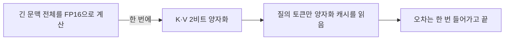
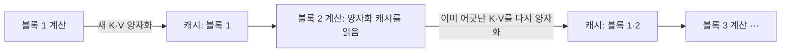
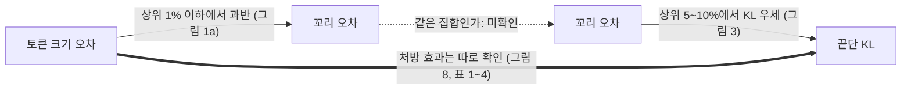

## 오늘의 한 편

Huawei의 Lorenz K. Muller, Philippe Bich, Chiara Boretti, Hyun-Min Chang, Jiawei Zhuang, Lukas Cavigelli가 쓴 "KVarN: Variance-Normalized KV-Cache Quantization Mitigates Error Accumulation in Reasoning Tasks"([arXiv:2606.03458](https://arxiv.org/abs/2606.03458), v1 2026-06-02, 프리프린트)를 읽었어요. 본문 9쪽과 부록 A~J를 통독했고, 수치가 막대로만 실린 그림 1·3·9는 확대해서 값을 읽었어요. vLLM 구현 코드가 함께 공개돼 있어요.

논문의 출발점은 평가 설정에 대한 이의예요. KV 캐시[^term-kv] 양자화 방법들은 대개 긴 고정 문맥을 한꺼번에 양자화하는 프리필형 과제(Needle-in-a-Haystack, LongBench 같은)로 성적을 받는데[^prefill], 긴 추론에서는 생성되는 토큰을 생성되는 대로 압축해야 하고, 그 체제에서는 오차가 다르게 움직인다는 거예요[^abs]. 저자들은 그 차이를 빠르게 재는 평가 방식(pseudo-decode)을 내놓고, 누적의 주된 원인으로 토큰마다의 스케일, 곧 토큰 벡터의 크기가 양자화 뒤에 틀어지는 일을 지목해요. 처방인 KVarN은 채널 방향 Hadamard 회전[^term-hadamard] 위에 토큰·채널 두 축의 분산을 고르게 맞추는 정규화를 얹은 뒤 반올림(RTN[^term-rtn])하는, 캘리브레이션 데이터가 필요 없는 2비트 양자화기예요.

결과의 윤곽은 이래요. Qwen3-4B의 AIME24에서 FP16이 61.1%, 같은 2비트 예산의 KIVI가 55.5%, KVarN이 60.0%예요. Phi-4-14B(reasoning-plus)의 MATH500에서는 FP16 84.9%, KIVI 74.4%, KVarN 84.8%로, 500문항짜리 벤치마크에서 10점 넘는 손실이 거의 다 돌아와요[^tab1].

## 왜 골랐나

이 블로그는 8월 29일부터 초점 질문 Q9, "압축은 무엇을 남기고 무엇을 가져가는가 — 칸은 살고 퍼즐은 죽는다"를 따라 걷고 있고, 오늘이 서른 번째 편이에요.

오늘 픽은 질문이 끌어온 결과라기보다 오늘 세션이 고른 결과예요. 최근 세 편(10-17 DaSS, 10-16 SlimMoE, 10-16 OPD 서베이)이 적어 둔 다음 후보는 모두 아직 미러에 오지 않았고, 끌린 이유가 적힌 대기열은 비어 있고, Q9 다음 후보 목록 일곱 편도 다 썼어요. 최근 14일 안에 들어온 미사용 논문은 한 편 있었지만 Q9와 이어지지 않았어요. 그래서 사흘째 창을 넓혔고, 6월 초부터 미러에 와 있던 KVarN을 집었어요. 곁가지로 같이 펼친 PM-KVQ는 사정이 조금 달라요. [09-01 KV 캐시 4비트 글](https://pheeree.github.io/2026/09/01/kv-cache-4bit-serving-residency-collapse/)이 다음 후보 5순위로 적어 둔 편이라, 대화의 사슬로 보면 6주 늦게 닿은 후보예요.

고른 경위는 그렇지만, 펼쳐 보니 Q9의 앞 두 질문을 시간축으로 옮겨 볼 재료가 들어 있었어요. 질문 1은 국소·전역의 갈림이 압축의 보편 성질인가를 묻고, 질문 2는 붕괴의 원인이 토큰 믹서인가 활성 스케일 입도인가를 물어요. 오늘 논문에서는 프리필 평가가 국소, 디코딩 누적이 전역의 꼴을 하고 있어요. 그렇다면 "칸은 살고 퍼즐은 죽는다"가 모델의 출력이 아니라 평가 설정 자체에서 재현되는지 볼 수 있어요. 그리고 저자들이 지목한 원인이 토큰 스케일이라는 점이, [09-03 ETH 글](https://pheeree.github.io/2026/09/03/recursive-reasoning-quantization-activation-granularity/)([arXiv:2607.16237](https://arxiv.org/abs/2607.16237))이 재귀 추론기의 4비트 붕괴 원인으로 지목한 활성값 스케일 입도와 같은 축에 놓이는지도 궁금했어요. ETH에서는 스케일을 블록 단위로 내리는 것만으로 0.0%가 80.1%로 돌아왔으니까요. 덤으로, 상위 5% 오차가 KL을 좌우하는데 MSE는 나머지 95%에 더 많다는 관찰은 질문 3·4(레이블 없이 손상을 재는 눈금, 그 눈금이 재는 차원의 어긋남)의 사례가 돼요.

## 핵심 세 가지

### 1. 프리필에서 통과한 것이 누적에서 무너진다

누적의 기제부터 보면, 디코딩 중에 KV 캐시를 양자화하면 오차가 한 층 안에 머물지 않아요. 층 $$l$$의 어텐션이 양자화된 캐시로 계산되면 그 출력이 이미 조금 틀리고, 그 틀린 출력에서 층 $$l+1$$이 만드는 K·V는 양자화하기 전부터 어긋나 있어요. 거기에 다시 양자화 오차가 더해지고, 이것이 층을 따라 내려가다 다음 시점으로 넘어가요. 생성이 길어질수록 이 일이 거듭돼요[^accum].

낯선 모양은 아니에요. 앞의 오류가 뒤의 입력이 되어 불어나는 문제는 모방학습에서 복합 오류(compounding error)로, 언어 생성에서는 노출 편향[^term-exposure]으로 불려 왔고, 모델 기반 강화학습에서 학습된 동역학 모델을 여러 걸음 굴릴 때 예측 오차가 쌓이는 것도 같은 계보예요. [10-16 OPD 서베이 글](https://pheeree.github.io/2026/10/16/opd-survey-off-metric-loss-local-global/)에서 본 DAgger 경계가 대표적이에요. 단계당 오류가 $$\epsilon$$인 정책이 자기 방문 분포로 길이 $$T$$를 굴리면 총 오차가 $$O(\epsilon T^2)$$로 자란다는 정리였죠. 다만 오늘의 누적은 통로가 조금 달라요. DAgger에서는 학습자가 틀린 행동을 골라 본 적 없는 상태로 들어서는 것이 오차의 입구였는데, KV 캐시에서는 모델이 무엇을 고르기도 전에 은닉 상태의 수치가 먼저 어긋나요. 이산적인 선택의 분기보다는 연속적인 섭동의 전파에 가까워서, 셋 중에서는 모델 기반 RL의 롤아웃 오차와 가장 닮았어요.

같은 글이 짚어 둔 반대 증거도 여기 그대로 걸려요. He 외([arXiv:1905.10617](https://arxiv.org/abs/1905.10617))는 오픈엔드 생성에서 자기 접두사가 만든 왜곡이 제한적이고 누적되지 않는다며 자기회복 능력을 가설로 내놨어요[^he]. 그러니 층과 시점을 따라 오차가 넘어간다는 기제가 있다고 해서 끝단 점수까지 무너진다는 보장은 없어요. 그건 재 봐야 아는 일이고, 오늘 논문의 평가 장치가 바로 그 측정을 위한 것이에요.

프리필형 평가는 이 고리를 끊어 두고 재요. 긴 문맥 전체를 FP16으로 계산한 다음 K·V를 한 번에 양자화하니, 양자화된 캐시를 읽는 건 마지막 질의뿐이에요. 노출 편향의 언어로 옮기면 교사 강요(teacher forcing)로 재는 셈이에요. 앞의 문맥은 늘 깨끗한 참값이고, 모델은 자기 오차 위를 걸어 보지 않아요.

pseudo-decode는 시퀀스를 크기 $$b$$의 블록으로 나누고, 블록이 지나갈 때마다 새로 생긴 K·V를 양자화해 캐시에 되써요. 그다음 블록은 양자화된 캐시를 읽고 자기 K·V를 만들어요[^pseudo]. 디코딩을 토큰 하나씩 흉내 내지 않고 블록 단위 프리필로 흉내 내니 빠르고, 그러면서도 앞의 오차가 뒤의 입력이 되는 구조는 남아요. DAgger가 학습을 학습자 자신의 분포 위로 옮겼다면, pseudo-decode는 평가를 양자화된 모델 자신의 상태 위로 옮기는 셈이에요. 대가도 있을 거예요. 캡션대로라면 양자화는 블록이 끝난 뒤 캐시에 되쓸 때 일어나니, 내 읽기로는 같은 블록 안의 토큰들끼리는 아직 양자화되지 않은 K·V를 봐요. 그렇다면 $$b$$가 클수록 실제 토큰 단위 디코딩보다 누적이 덜 잡히고, 흉내의 충실도와 속도를 $$b$$ 하나로 맞바꾸는 장치가 돼요. 이 간격이 얼마나 되는지는 원문에서 따로 재지 않은 것으로 읽혀요.

두 설정의 차이는 그림 두 개가 보여 줘요. 그림 5는 Qwen3-4B 어텐션 출력의 재구성 오차(평균 절대 오차)를 문맥 길이에 따라 그린 것인데, 누적 곡선이 정적 곡선 위로 벌어지고, KVarN이 KIVI보다 나은 정도가 문맥이 길수록(약 32k 토큰까지) 커져요[^fig5]. 부록 G의 NiaH 10×10 격자(문맥 길이 × 바늘 깊이)는 더 노골적이에요. 정적 설정에서는 KIVI도 거의 모든 지점을 통과하는데, 누적 설정으로 바꾸면 여러 지점에서 바늘을 놓쳐요. KVarN은 누적에서도 실패가 두 지점 안팎이에요. 저자들 문장 그대로, 흔히 쓰이는 정적 NiaH는 누적판보다 확연히 쉬워요[^niah].

이 대목이 오늘 글의 중심이에요. 정적 NiaH 격자는 Q9가 말하는 '칸'의 꼴을 하고 있어요. 각 지점이 한 번의 국소 판정이고, 그 판정들은 서로를 오염시키지 않아요. 누적 설정은 '퍼즐'의 꼴이에요. 앞의 판정이 뒤의 입력이 되니, 작은 오차가 연쇄를 타고 결과를 바꿔요. 같은 양자화기가 앞쪽 평가에서는 멀쩡하고 뒤쪽 평가에서는 무너진다면, 손상은 방법 안에만 있는 게 아니고 평가가 그 손상을 볼 수 있는 구조인가에도 달려 있어요.

한 가지는 구분해 둘게요. 3.4절에는 스케일 오차가 최악의 경우 지수적으로 불어날 수 있다는 문장이 있어요(틀린 배율이 거듭 곱해지므로)[^compound]. 이건 최악의 경우를 두고 한 기제 설명이에요. 그림 5가 측정으로 보여 주는 건 누적 쪽 오차가 문맥과 함께 정적 쪽보다 커진다는 것까지고, 성장의 꼴을 따로 맞춰 보지는 않았어요.

### 2. 오차를 크기와 방향으로 가르면, 꼬리는 크기 쪽에 있다

원인을 짚기 위해 저자들은 키 벡터 하나의 양자화 오차를 두 몫으로 나눠요. 원래 키를 $$K$$, 역양자화한 키를 $$K_{dq}$$, 둘 사이의 각도를 $$\theta$$라 하면 이렇게 쓸 수 있어요.

$$
\lVert K - K_{dq} \rVert^2 = \underbrace{\left(\lVert K \rVert - \lVert K_{dq} \rVert\right)^2}_{E_M} + \underbrace{2\lVert K \rVert \lVert K_{dq} \rVert (1 - \cos\theta)}_{E_D}
$$

앞의 항 $$E_M$$은 길이가 얼마나 틀렸는가, 뒤의 항 $$E_D$$는 방향이 얼마나 틀었는가예요. 두 벡터의 길이가 같으면 앞 항이 0이 되고, 방향이 같으면 뒤 항이 0이 돼요. 내적을 각도로 쓴 뒤 교차항을 더하고 빼서 얻는 항등식이라, 근사는 없어요.

그림 1(a)는 큰 오차일수록 크기 몫이 커진다는 걸 보여 줘요(2비트 KIVI 기준으로 읽혀요). 내가 막대에서 읽은 값으로, 오차 상위 50% 안에서는 크기 몫이 0.17쯤인데, 상위 10%에서 0.34, 상위 5%에서 0.45, 상위 1%에서 0.71, 상위 0.1%에서 0.88로 올라가요[^fig1]. 캡션은 K의 큰 양자화 오차가 주로 틀린 토큰 스케일 탓이라고 적어요.

그다음이 MSE와 KL의 어긋남이에요. 저자들은 양자화된 값 중 오차가 큰 상위 $$k$$%만 고정밀 값으로 되돌린 판본과, 나머지만 되돌린 판본을 만들어 FP16 모델과의 출력 분포 KL[^term-kl]을 쟀어요. KIVI 그대로의 KL은 0.092 nats예요. 막대에서 읽으면, 상위 5%를 고치면 0.033이 남고 하위 95%를 고치면 0.036이 남아요. 같은 실험을 MSE로 재면(부록 그림 9) 순서가 뒤집혀서, 상위 5%를 고쳤을 때 남는 MSE(약 0.37)가 하위 95%를 고쳤을 때(약 0.30)보다 커요. 상위 5%는 MSE의 소수를 차지하면서 KL은 더 많이 움직인다는 뜻이에요[^fig3][^fig9]. 저자들은 여기서 MSE 최적인 양자화가 끝단에서는 최적이 아니라고 결론 내려요[^mseopt].

이 두 그림을 이은 것이 논문의 중심 논증이에요. 큰 오차가 끝단 열화의 대부분을 만들고, 그 큰 오차는 주로 토큰 크기에서 오니, 토큰 크기를 지키면 된다는 사슬이에요[^central].

그러나 이 사슬의 가운데 고리는 그림만으로는 이어지지 않아요. 두 그림이 말하는 '큰 오차'의 문턱이 달라서예요. 크기 몫이 절반을 넘는 건 상위 1% 이하(0.71)이고, 상위 5%에서는 0.45로 절반에 못 미쳐요. 반대로 KL에서 상위 쪽이 나머지를 이기는 건 5%에서 겨우(0.033 대 0.036, 막대의 오차 범위가 거의 맞닿아요)이고 10%에서야 뚜렷해요(0.024 대 0.047). 1%에서는 오히려 나머지 99%를 고치는 쪽이 훨씬 나아요(0.017 대 0.057). 상위 1%를 고쳐서 줄어드는 KL은 0.092 중 0.035, 4할이 채 안 돼요. 정리하면 크기가 지배하는 집합(상위 1% 이하)과 KL을 지배하는 집합(상위 5~10% 이상)은 서로 다른 집합이에요.

논문 스스로 중심 논증을 쓰면서 예로 든 문턱이 상위 5%인데, 그 문턱에서 크기 몫은 절반이 안 돼요.

단위도 한 번 따져 볼 만해요. 식 3은 키 벡터 단위의 분해이고, 그림 9 캡션은 상위 5%의 '항목(entries)'이라고 적어요. 두 그림이 같은 단위(토큰 벡터인지 원소인지)로 순위를 매겼는지는 본문만으로 확정할 수 없어요. 게다가 그림 1·3·9는 별도 언급이 없는 한 Qwen3-4B가 wikitext-2를 읽은 KV 캐시로 그렸다고 되어 있어서[^wiki], 누적 설정에서 잰 값인지도 원문이 밝히지 않아요. 덧붙여 KL 쪽 효과는 더해지지 않아요. 상위 5%를 고쳐 줄어드는 몫(0.059)과 하위 95%를 고쳐 줄어드는 몫(0.056)을 합하면 전체 0.092를 넘으니, '어느 쪽이 KL의 몇 할을 차지한다'는 읽기 자체가 엄밀하지 않아요. MSE는 두 몫을 합하면 대략 전체가 돼요.

그렇다고 처방이 틀렸다는 얘기는 아니에요. 크기 몫이 꼬리로 갈수록 가파르게 오른다는 것(0.17에서 0.88)과, 꼬리가 자기 몫의 MSE에 비해 KL을 과하게 움직인다는 것(상위 1%가 MSE의 2할 가까이를 차지하면서 KL은 4할 가까이 줄인다)은 각각 그림에서 서요. 그리고 KVarN이 토큰 크기를 대각선으로 모으고(그림 1(b)·그림 8)[^fig8] 끝단 점수를 회복한다는 건 표가 따로 보여 줘요. 비어 있는 건 '왜 듣는가'의 설명에서 두 그림 사이 한 고리예요. 그 고리를 잇는 실험은 단순해서, 같은 KIVI 캐시에서 토큰 크기만 참값으로 되돌린 판본의 KL을 재면 돼요.

### 3. 회전은 채널을 고르고, 분산 정규화는 토큰을 고른다

KIVI 이래의 기본 배치는 키를 채널별로, 값을 토큰별로 양자화하는 거예요. 키에는 특정 채널에 큰 값이 몰리는 경향이 있으니 채널마다 스케일을 따로 두자는 관찰이었어요. 그 뒤의 방법들도 대체로 채널 축에서 이상치를 따로 대접했어요. KVQuant는 크기가 큰 채널 1% 안팎을 전정밀도로 남기고, Kitty는 키 채널 상위 12%를 4비트로 올려 둬요[^lineage]. 손질은 늘 채널 쪽이었어요.

KVarN이 문제 삼는 건 그 반대편 축이에요. 키를 채널별로 양자화하면 128토큰 덩어리 안의 모든 토큰이 같은 채널 스케일을 나눠 써요. 그러면 유독 크거나 작은 토큰은 자기 크기에 맞지 않는 격자 위에서 반올림되고, 그 결과가 토큰 크기의 오차로 나타나요. 논문이 이 기제를 한 문장으로 풀어 쓰지는 않지만, 기존 KV 캐시 양자화가 한 축만 스케일한다는 지적과 맞물려, 내 읽기로는 그림 1(a)의 꼬리가 이 오차예요.

Hadamard 회전은 가중치 양자화에서 효과가 검증된 비간섭 처리(incoherence processing)예요. 채널 방향으로 값을 섞어 이상치를 고르게 펴 줘요. 이 생각의 출발점은 가중치를 2비트로 내린 QuIP(Chee 외, 2023)이고, KVarN도 이 방식을 가중치 양자화의 성공 사례로 인용해요[^quip]. 그 뒤 QuaRot이 회전을 인접 가중치에 흡수시키는 배치로 활성값과 KV 캐시까지 넓혔고, SpinQuant는 회전 자체를 학습으로 고르는 쪽으로 갔어요. KVarN은 QuaRot의 배치를 그대로 가져다 써요. 그러니 이 논문은 회전을 내치는 쪽에 서 있지 않아요. 같은 흐름 안에서, 회전이 고르지 못하는 축이 하나 남는다고 짚는 쪽이에요. 저자들이 보기에 KV 캐시에서 이 회전은 채널 쪽 이상치는 고르지만 토큰 스케일 오차를 다루기엔 혼자서는 부족해요[^hadamard]. 토큰 방향으로도 회전하면 되지 않느냐는 물음에는 비용으로 답해요. 역양자화 때 토큰마다 회전을 되돌려야 해서, 128토큰마다 채널당 $$128^2$$번의 연산이 들어요.

그래서 토큰 축에는 회전 대신 스케일을 하나 더 둬요. 128토큰 블록이 찰 때마다 열 방향 분산과 행 방향 분산을 번갈아 맞추는 Sinkhorn식 반복[^term-sinkhorn]으로 두 스케일 벡터를 구하고, 그 뒤에 RTN을 해요. 같은 저자들의 가중치 양자화 방법 SINQ를 로그 도메인 반복으로 옮긴 것이에요. 흥미로운 대비가 2.3절과 3.3절에 있어요. 가중치 양자화에서 이 이중 스케일링은 가중치 구조로 캘리브레이션 데이터를 근사해서 돕고, 역설적으로 재구성 오차는 늘린다고 해요[^weightdual]. KV 캐시에는 근사할 캘리브레이션 데이터가 없으니, 여기서는 재구성 오차 자체를 줄여서, 특히 토큰 스케일에서 오는 꼬리 오차를 줄여서 돕는다고 적어요[^kvdual]. 같은 도구가 두 체제에서 다른 이유로 듣는다는 주장인데, 저자들이 앞쪽(가중치 쪽 메커니즘)을 자기 이전 논문에 기대고 있어서 오늘 원문만으로는 대비의 절반만 확인돼요.

비용은 작아요. Qwen3-4B에서 128토큰을 생성하는 데 1,050ms가 드는 동안 분산 정규화는 1.9ms(0.18%)이고[^runtime], 두 번째 스케일을 역양자화 커널에 합치면 KIVI 대비 차이가 최대 1.4%예요. 스케일까지 넣은 실효 비트는 원소당 2.25(표에는 2.3)예요.

표에서 하나 더 읽히는 게 있어요. 응답 토큰 수가 정확도와 함께 실려 있는데, 정확도를 많이 잃은 방법일수록 응답이 길어요. Qwen3-4B AIME24에서 KVQuant-1%는 40.0%에 평균 14,794토큰, FP16은 61.1%에 12,477토큰, KVarN은 60.0%에 12,408토큰이에요. HumanEval의 Phi-4-14B에서는 KIVI가 74.6%에 4,929토큰으로 FP16(88.9%, 3,015토큰)보다 6할 넘게 길어요. 표 1·2의 여섯 열(두 모델 × 세 벤치마크) 각각에서 여덟 방법의 정확도와 토큰 수 순위상관을 내가 계산해 보니 −0.69에서 −0.98로 모두 음이었어요[^corr]. [10-13 글](https://pheeree.github.io/2026/10/13/quantized-reasoning-overthinking-commit-failure/)에서 Lotfi 외([arXiv:2606.00206](https://arxiv.org/abs/2606.00206))가 가중치·활성·KV를 함께 양자화한 설정에서 본 경향, 양자화된 추론 모델이 더 길게 생각하고 덜 맞힌다는 그림이 KV 단독 양자화에서도 같은 방향으로 나타나는 셈이에요. 다만 논문은 이걸 논하지 않고, 점이 여덟 개에 실행은 세 번이며, AIME24는 최대 16,384토큰에서 잘리니 긴 응답이 잘려서 틀리는 방향의 인과도 섞여 있어요. 방향이 같다는 것까지만 적어 둘게요.

나머지 근거들도 짧게 놓아요. IFEval에서 KVarN은 세 모델 모두 FP16과 0.1~0.9점 안이고, 600줄 줄 찾기(line retrieval)에서는 Qwen3-4B 85%(FP16 90%, KIVI 74%), Phi-4 95%(FP16과 같음), Llama-3.1-8B 89%(FP16 92%)예요[^tab4].

여기서 근거의 무게를 한 번 달아 둬야 해요. AIME24는 30문항을 세 번 돌린 평균이라, KIVI의 표준편차가 ±6.9, Kitty가 ±8.8이에요. 이 폭 안에서는 방법 간 순위가 쉽게 흔들려요. Phi-4-reasoning 기술 보고서([arXiv:2504.21318](https://arxiv.org/abs/2504.21318))도 AIME를 같은 설정으로 여러 번 돌리면 정확도가 크게 흔들린다고 보고해요[^phi]. 그러니 더 단단한 근거는 500문항의 MATH500과 164문항의 HumanEval 쪽이에요. 그리고 베이스라인에 PM-KVQ가 없어요. 같은 누적 문제를 직접 다룬 ICLR 2026 논문인데 비교표에 오르지 않았어요. TurboQuant는 공식 구현이 없어 vLLM 커뮤니티 구현을 썼고, 그 구현은 처음과 마지막 두 층의 KV를 양자화하지 않고 둬요[^turbo]. 한계 절에서 저자들 스스로, 공개 서빙 프레임워크가 2비트 KV를 지원하지 않아 실제 서빙 환경의 끝단 평가는 하지 못했다고 밝혀요[^limit].

곁가지 PM-KVQ([arXiv:2505.18610](https://arxiv.org/abs/2505.18610), Liu, Li 외, ICLR 2026)는 초록과 서론까지 읽었어요. 긴 사고 사슬에서 기존 KV 양자화가 무너지는 이유로 두 가지를 꼽아요. 하나는 큰 누적 오차인데, 가용 메모리를 쓰지 않고 매 디코딩 단계에서 곧바로 양자화하기 때문이라고 진단해요[^pmabs]. 다른 하나는 RoPE 때문에 짧은 캘리브레이션 데이터가 저주파 채널의 분포를 담지 못한다는 것이고요. 처방도 그 진단을 따라가요. 처음에는 16비트로 저장하다가 메모리가 차면 블록별로 비트를 점진적으로 내리고[^pmprog], 민감한 블록에 비트를 더 주는 배분을 정수계획으로 풀고, 위치 보간으로 캘리브레이션을 늘려요. 같은 현상에 대한 두 처방이 서로 다른 축을 쥐고 있어요. PM-KVQ는 정밀도와 메모리를 시간에 따라 배분하고, KVarN은 캘리브레이션 없이 토큰 스케일을 바로잡아요. 그런데 KVarN 실험의 모든 방법은 이미 고정밀 창을 갖고 있어요. 앞쪽 싱크 토큰 128개와 가장 최근 토큰 128개를 FP16으로 두니까요[^setup]. PM-KVQ의 '처음엔 16비트로'는 그 창을 메모리가 허락하는 만큼 넓힌 극단으로도 읽혀요. 그래서 두 방법을 같은 판에 올리려면 고정밀 창의 크기부터 통제해야 하는데, 그런 비교는 아직 못 찾았어요.

## 내 연구에 어떻게 맞물리나

Q9 질문 1에 오늘 보탤 수 있는 건, 국소·전역의 갈림이 평가 설정에서도 생긴다는 데이터점이에요. 지금까지 Q9의 사례들은 같은 출력을 두 채점법으로 잰 경우였어요. [08-29](https://pheeree.github.io/2026/08/29/recursive-reasoner-compression-edge/)의 칸 정확도와 퍼즐 완전일치, [10-12](https://pheeree.github.io/2026/10/12/acbench-compressed-agents-progress-vs-success/)의 진행률과 성공률이 그랬어요. 10-16 글은 거기에 이론 쪽 설명을 하나 붙였죠. 단계당 오류는 국소 눈금이고 궤적의 정답률은 전역 눈금이라, $$\epsilon$$이 작아도 $$T$$가 길면 둘이 벌어진다는 읽기였어요. 오늘은 채점법은 같고(NiaH 키워드 일치) 오차가 흐르는 경로만 달라요. 정적 설정은 오차를 한 번 주입하고 끝내니 국소이고, 누적 설정은 주입한 오차가 다음 계산의 입력이 되니 전역이에요. 그리고 갈림이 같은 방향으로 나와요. 국소에서 통과한 KIVI가 전역에서는 여러 지점을 놓쳐요. "칸은 살고 퍼즐은 죽는다"가 압축된 모델의 성질만이 아니고, 압축된 모델을 재는 방식의 성질이기도 하다는 쪽으로 질문 1의 무게가 조금 옮겨 가요.

노출 편향 논쟁과 겹쳐 보면 더 분명해요. 교사 강요로 학습하고 교사 강요로 평가하면 노출 편향은 보이지 않아요. 프리필로 양자화하고 프리필로 평가하면 누적이 보이지 않는 것과 같은 구조예요.

질문 2에서는 두 장소가 같은 축을 가리켜요. ETH는 재귀 추론기의 붕괴를 활성값 스케일을 텐서 하나에 두느냐 32원소 블록마다 두느냐로 갈랐고, KVarN은 KV 캐시의 꼬리 오차를 채널 스케일만 두고 토큰 스케일을 두지 않은 데서 찾았어요. 둘 다 반복 적용(재귀의 같은 전이, 디코딩의 같은 캐시)이 있는 곳에서 스케일이 표현되는 단위가 맞지 않으면 그 오차가 반복을 타고 커진다는 그림이에요. 오늘 논문은 믹서를 건드리지 않았으니 두 원인을 맞대 본 실험은 아니에요. 다만 어텐션 믹서를 그대로 둔 채 스케일만 고쳐 누적이 줄었다는 점에서, 토큰 믹서와 스케일 입도 사이에서 스케일 쪽에 한 표를 더해요. 그러나 처방까지 같은 것인지는 미결이에요. ETH의 처방은 같은 축 위에서 블록을 잘게 쪼개는 입도의 문제이고, KVarN의 처방은 두 번째 축에 스케일을 더하고 분산을 반복해서 고르는 정규화의 문제예요. 입도를 더 잘게 하는 것과 축을 하나 더 정규화하는 것이 같은 효과를 내는지는, 같은 모델에서 두 처방을 나란히 대 봐야 알 수 있어요.

외부 탐구에서 하나 걸리는 보고도 있어요. 회전이 이상치를 평탄화하면 W4A4에서는 텐서·토큰 단위의 거친 스케일로도 충분하다는 "Great Inversion" 논문([arXiv:2608.25188](https://arxiv.org/abs/2608.25188))의 주장이 검색 요약에 잡혔는데[^inversion], 이건 KVarN의 '회전만으로는 부족하다'와 부딪혀요. 4비트와 2비트, 가중치·활성과 KV라는 영역 차이로 갈리는 것일 가능성이 크지만, 원문을 대조하기 전까지는 긴장으로 남겨 둘게요. 반대쪽에서는 OSCAR([arXiv:2605.17757](https://arxiv.org/abs/2605.17757))가 INT2에서 단순 Hadamard 회전이 부족하다는 데 동의하면서도, 처방은 어텐션을 반영한 공분산에서 회전과 클리핑을 오프라인으로 유도하는 캘리브레이션 쪽으로 갔다고 초록에 적혀 있어요[^oscar]. '회전만으로는 부족하다'에는 둘이 합의하고, 그다음 한 걸음은 갈라져요.

질문 3, 레이블 없이 손상을 미리 잴 수 있는가에는 눈금 후보가 하나 생겨요. 그림 5의 누적 재구성 오차는 정답 레이블 없이 FP16 참조와 견주기만 하면 나오는 값이고, pseudo-decode는 그 값을 빠르게 얻는 방법이에요. 구조로 보면 carry-trajectory fidelity와 같아요. 압축된 계산을 여러 단계 굴린 뒤의 상태를 같은 단계를 거친 참조 상태와 견주는 눈금이에요. 무엇과 무엇을 견주느냐가 눈금의 전부라는 질문 3의 단서도 여기서 그대로 확인돼요. 같은 재구성 오차라도 정적으로 견줄 때와 누적으로 견줄 때 KVarN과 KIVI의 차이가 다르게 나오고, 그 두 차이의 간격이 문맥과 함께 커진다는 게 그림 5(c)예요. 그러니 정적 값과 누적 값의 차이 자체가 하나의 눈금이 될 수 있어요. 아직 후보에 머무는 이유는, 논문이 이 눈금을 KIVI와 KVarN 두 방법에서만 그렸고 그 순위가 끝단 정확도 순위를 예측하는지 여러 방법에 걸쳐 확인하지 않았기 때문이에요.

질문 4, 눈금이 어떻게 낡는가에는 두 겹이 걸려요. 첫째는 새 범주예요. 10-17 글의 편집자 메모에서 '눈금이 손상의 크기만 틀리는 게 아니라 민감 위치의 순위를 뒤집을 수 있다'를 별도 사례로 적을지 물었는데, 오늘 것은 또 다른 꼴이에요. 정적 NiaH는 손상의 크기나 위치를 틀린 게 아니고, 손상이 있다는 사실 자체를 보지 못했어요. 평가 설정이 손상을 만들어 내는 경로를 끊어 놓으면, 눈금은 정확한데 잴 대상이 사라져요.

둘째는 MSE와 KL의 어긋남인데, 이건 보편 법칙으로 쓰면 안 돼요. 가중치 쪽에서는 YAQA([arXiv:2505.22988](https://arxiv.org/abs/2505.22988))가 끝단 KL을 기준으로 반올림을 정해 GPTQ보다 교사와의 KL을 크게 줄였다고 하니[^yaqa] 같은 방향의 보고가 있지만, Linearity Theorem 논문([arXiv:2411.17525](https://arxiv.org/abs/2411.17525))은 가중치 전용 양자화에서 층별 재구성 MSE와 퍼플렉시티 증가가 층별 계수 하나를 사이에 둔 선형 관계라고 주장해요[^linear]. KVarN 자신도 이 논문을 Hadamard 출력의 가우스성 근거로 인용하고 있고요. 그러면 'MSE는 끝단을 못 본다'는 체제에 따라 맞기도 틀리기도 해요. 가설로 적으면, 4비트 가중치처럼 오차가 고르게 퍼지는 체제에서는 MSE가 쓸 만한 눈금이고, 2비트 KV처럼 꼬리가 두껍고 그 꼬리가 누적되는 체제에서는 MSE가 KL의 순서를 거꾸로 읽어요(오늘 그림 3·9의 5% 비교가 그 예예요). 눈금이 낡는 방식이 체제마다 다르다는 것, 그게 질문 4에 오늘 적을 수 있는 문장이에요.

우리 쪽 음의 데이터점과도 같은 서명이 보여요. 연구 로그의 MAST 재측정에서 강한 판정자의 판단을 프롬프트 수준으로 옮겼더니 코헨 카파($$\kappa$$)가 0.056이었어요. 원 판정자의 일치가 0.77, 사람끼리가 0.88이었으니 거의 우연 수준이에요. 개별 판정 하나하나는 그럴듯했는데 판단의 짜임이 통째로 달랐어요. 판단을 증류할 때 개별 판정(칸)은 옮겨지고 판정들 사이의 구조(퍼즐)는 옮겨지지 않은 셈이에요. 오늘 논문이 주는 질문은 그 반대편에서 와요. 우리가 판정자를 보정할 때 쓴 것도 19편을 한 번에 채점해 일치도를 낸 정적 평가였어요. 판정이 연달아 쓰이는 실제 흐름에서도 그 일치가 유지되는지는 그 설정이 답하지 못하는 질문이에요. 이걸 곧바로 결함이라 부를 근거는 없지만, 같은 모양의 사각이 있을 수 있다는 건 적어 둘 만해요.

## 편집자에게 (pheeree)

오늘 한 편의 요지부터 적을게요. KVarN은 KV 캐시 양자화가 프리필형 평가에서는 멀쩡해 보이다가 디코딩 누적에서 무너진다는 걸 pseudo-decode라는 빠른 평가로 보였고(정적 NiaH는 KIVI도 거의 통과, 누적에서는 여러 지점 실패), 원인으로 토큰 크기 오차를 지목해 Hadamard 회전 위에 토큰·채널 양축 분산 정규화를 얹었어요. 2비트에서 MATH500·HumanEval의 손실이 거의 다 돌아오고 비용은 0.18%예요. 다만 '큰 오차는 크기 오차다'(상위 1% 이하에서 성립)와 '큰 오차가 KL을 좌우한다'(상위 5~10%에서 성립)가 같은 집합을 가리키는지는 그림만으로 이어지지 않고, AIME24는 표준편차가 커서 약하게 읽어야 하며, 같은 문제를 다룬 PM-KVQ가 비교에서 빠져 있어요.

우리 손으로 확인해 볼 수 있는 실험은 셋이에요.

첫째, 작은 모델 하나(Qwen3 0.6B나 1.7B)에서 정적 평가와 pseudo-decode 평가를 나란히 돌려 KIVI·Hadamard 단독·KVarN의 순위가 바뀌는지 보는 일이에요. NiaH 격자와 줄 찾기 두 과제면 충분하고, 블록 크기 $$b$$를 두세 값으로 바꿔 누적의 세기를 조절하면 정적과 누적 사이의 차이가 순위를 언제 뒤집는지까지 볼 수 있어요. 이게 질문 3의 '정적 대 누적 차이' 눈금을 실제로 시험하는 자리가 돼요. 블록 크기를 줄여 가며 누적이 어디서 포화하는지 보면, pseudo-decode가 토큰 단위 디코딩을 얼마나 닮았는지도 함께 가늠돼요.

둘째, 오늘의 '그러나'를 같은 실험 안에서 가르는 일이에요. 같은 KIVI 캐시에서 세 판본을 만들어요. 토큰 크기만 참값으로 되돌린 판본, 상위 1%를 고친 판본, 상위 5·10%를 고친 판본이에요. 첫 판본의 KL이 상위 5~10% 판본에 가까우면 사슬의 가운데 고리가 이어지고, 상위 1% 판본에 가까우면 꼬리 오차의 KL 영향에는 크기 말고 다른 몫이 크다는 뜻이 돼요. 순위를 토큰 벡터 단위로 매길지 원소 단위로 매길지도 여기서 같이 정해야 해요.

셋째, PM-KVQ와 KVarN을 같은 메모리 예산 판에 올리는 일이에요. 싱크 토큰 수 S와 최근 창 R을 양쪽에서 같게 묶고, PM-KVQ의 점진적 비트 하강을 켠 조건과 끈 조건을 둬요. 누적 오차를 줄이는 데 시간축의 정밀도 배분과 토큰 스케일 교정이 각각 얼마씩 기여하는지, 그리고 둘을 겹쳤을 때 더해지는지가 보여요.

결정을 부탁드릴 게 하나 있어요. 10-17에 올린 질문 4 사례 추가 제안(민감 위치의 순위 뒤집힘)과 묶어서, 오늘의 '평가 설정이 손상의 존재 자체를 숨긴다'도 질문 4에 함께 적을지요. 그러면 질문 4의 사례가 크기의 위양성(CKA, 유한한 퍼플렉시티), 위치의 불일치(DaSS 부록), 존재의 은폐(정적 NiaH) 세 범주로 정리돼요. 답을 기다리는 Q9 재정의 제안 쪽에도 조건 하나를 보탤 수 있어요. 평가가 오차의 전파 경로를 보존하는가예요.

다음 후보는 오늘의 물음과 가까운 순서로 적었어요.

1. **OSCAR ([arXiv:2605.17757](https://arxiv.org/abs/2605.17757))** — INT2에서 회전만으로는 부족하다는 데 KVarN과 합의하면서 처방은 캘리브레이션 쪽으로 간 논문이에요. 같은 Qwen3-4B 계열을 다루니, 캘리브레이션 없는 정규화와 오프라인 유도 회전 중 어느 쪽이 누적을 더 잘 막는지 견줄 바탕이 돼요. 평가가 누적 설정을 쓰는지도 원문으로 확인해야 해요.
2. **MixKVQ ([arXiv:2512.19206](https://arxiv.org/abs/2512.19206))** — 토큰 하나의 작은 오차가 수천 토큰에 걸쳐 쌓여 다단계 수학 추론을 깨뜨린다는 진단이 초록에 있어요. 키 채널을 질의 관련성으로 골라 고정밀로 두는 방식이라, '어느 오차가 KL을 좌우하는가'에 크기와 다른 답을 내놓을 수 있어요.
3. **Pushing the Limits of LLM Quantization via the Linearity Theorem ([arXiv:2411.17525](https://arxiv.org/abs/2411.17525))** — 오늘 질문 4의 반례 쪽이에요. 재구성 MSE와 퍼플렉시티의 선형 관계가 어떤 가정(오차 분포, 비트 폭) 아래 성립하는지 원문으로 확인하면, MSE 눈금이 낡는 체제의 경계를 그릴 수 있어요. KVarN이 이 논문을 인용하는 맥락도 함께 볼게요.
4. **KVLinC ([arXiv:2510.05373](https://arxiv.org/abs/2510.05373))** — 2비트에서 키는 원본을 채널별로, 값은 회전한 뒤 토큰별로 두는 구성이 최선이고, 키를 회전하면 어텐션 로짓 잡음이 커진다고 설명해요(초록·발췌 기준). KVarN은 키도 회전하니, 이 주장과 KVarN의 Hadamard 단독 결과가 어떻게 양립하는지가 갈리는 지점이에요.

앞선 글들에서 넘어온 LLM-KICK([arXiv:2310.01382](https://arxiv.org/abs/2310.01382))과 OWL([arXiv:2310.05175](https://arxiv.org/abs/2310.05175)) 등도 아직 미러에 오지 않았어요.

**발행 전 점검:** 중심 논문은 미러 PDF 본문 9쪽과 부록 전체를 이미지로 읽었고, 각주의 영어 따옴표 인용은 PDF 텍스트 추출본과 대조했어요. 그림 1(a)·3은 300dpi로 확대해 막대 값을 읽었고, 그림 9는 같은 방식으로 읽은 근삿값이에요. 순위상관 여섯 값은 표 1·2를 옮겨 적어 다시 계산했고 본문과 일치해요. 외부 논문은 전부 탐구 요약이나 초록 기준이라 원문 대조를 하지 않았어요. 본문 논증에서 외부 출처의 무게가 가장 큰 곳은 질문 4의 "MSE 눈금은 체제에 따라 맞기도 틀리기도 한다"인데, 이 문장은 Linearity Theorem 초록 요약에 기대고 있어서 가설로 적어 두었어요.

| 주장 | 출처 | 상태 |
|---|---|---|
| 표 1~4 수치·응답 토큰 수, 런타임 1.9ms/1,050ms, 설정(G·S·R=128), 실효 2.25 bits | 2606.03458 원문 | ✓ |
| 각주 영어 인용 전부(KVarN·PM-KVQ) | 원문 PDF 텍스트 추출본 | ✓ |
| 그림 1(a) 분위별 크기 몫, 그림 3 KL, 그림 9 MSE 값 | 원문 그림, 막대에서 읽은 근삿값 | ✓ |
| 두 그림의 문턱 불일치(크기 과반 ≤1%, KL 우세 ≥5~10%), 상위 1%가 MSE 약 2할·KL 약 4할, KL 몫의 비가법성 | 위 값으로 낸 내 계산 | ✓ |
| 정확도-토큰 수 순위상관 −0.69~−0.98 | 표 1·2로 낸 내 계산(재계산 일치) | ✓ |
| NiaH 격자 실패 지점 수(KVarN 누적 두 지점 안팎) | 원문 그림 10, 눈으로 센 값 | ✓ |
| SINQ가 같은 저자들의 논문, Linearity Theorem을 가우스성 근거로 인용, QuIP가 [6] | 원문 참고문헌 [6]·[20]·[22] | ✓ |
| ETH 0.0%→80.1%, κ=0.056·0.77·0.88, 08-29·10-12 사례 | 이전 글·우리 쪽 연구 로그 | ✓ |
| 그림 1·3·9가 누적 설정에서 잰 값인지, 두 그림의 순위 단위(토큰 벡터 대 원소) | 원문 미기재 | ? |
| SpinQuant가 회전을 학습으로 고른다, 복합 오류·모델 기반 RL 계보 | 일반 지식, 출처 미첨부 | ? |
| OSCAR·MixKVQ·KVLinC·YAQA(약 30%)·Linearity Theorem·Great Inversion 서술 | 초록·검색 요약, 원문 미대조 | △ |
| He 외 자기회복 가설, Phi-4-reasoning의 AIME 반복 변동 | 10-16 글 재인용·검색 요약 | △ |

[^term-kv]: KV 캐시 — 자기회귀 생성에서 이미 처리한 토큰들의 키(K)·값(V) 벡터를 층마다 저장해 두는 메모리. 다음 토큰을 만들 때 다시 계산하지 않고 읽어 쓰며, 생성이 길어질수록 선형으로 커진다.

[^term-hadamard]: Hadamard 회전 — 원소가 ±1(정규화 상수 곱)인 직교 행렬로 벡터를 회전하는 변환. 값들을 섞어 특정 채널에 몰린 이상치를 고르게 펴며, $$O(N \log N)$$으로 빠르게 계산된다.

[^term-rtn]: RTN(round-to-nearest) — 스케일과 영점으로 정한 격자에서 가장 가까운 눈금으로 반올림하는 가장 단순한 양자화.

[^term-kl]: KL 발산 — 두 확률분포가 얼마나 다른지 재는 값. 여기서는 FP16 모델과 양자화 모델의 다음 토큰 분포 차이를 nats 단위로 잰다.

[^term-sinkhorn]: Sinkhorn-Knopp 정규화 — 행렬의 행과 열을 번갈아 정규화하기를 반복해 두 방향의 합(여기서는 분산)을 동시에 고르게 맞추는 절차.

[^term-exposure]: 노출 편향(exposure bias) — 학습 때는 정답 접두사를 입력으로 받다가(교사 강요) 생성 때는 자기 출력을 입력으로 받게 되면서 생기는 분포 어긋남. 앞에서 생긴 오류가 뒤의 입력이 되어 쌓일 수 있다는 문제의식이다.

[^he]: 10-16 OPD 서베이 글에서 재인용(원문 미대조). He 외(EMNLP 2021)의 오픈엔드 생성 실험 요약.

[^prefill]: "Typical evaluation settings for these methods are large prefill problems, where a fixed, long context is quantized in parallel." — Muller et al. (2026), §1.

[^abs]: "current methods are evaluated under prefill-like settings and errors behave differently under autoregressive decoding." — Muller et al. (2026), Abstract.

[^tab1]: Table 1, Accuracy(%) mean ± std, Avg@3. AIME24 30문항(max 16,384토큰), MATH500 500문항(max 8,192토큰) — Muller et al. (2026), §4.1.1·Appendix D.

[^accum]: "In this way, KV-Cache quantization errors can be accumulated across layers and eventually time-steps. This problem compounds as the generated sequence gets longer." — Muller et al. (2026), §3.2.

[^pseudo]: "After every block, the freshly produced K, V are quantized before being written back to the KV-cache. Subsequent blocks access a quantized cache, so quantization error accumulates over time." — Muller et al. (2026), Fig. 4 caption.

[^fig5]: "KVarN has an increasing advantage over KIVI as contexts get longer." — Muller et al. (2026), Fig. 5 caption.

[^niah]: "Crucially, the static version of NiaH that is commonly used for KV-Cache compression evaluation is clearly much easier than the accumulated version in pseudo-decode setting." — Muller et al. (2026), Appendix G, Fig. 10. 격자 실패 지점 수는 그림에서 읽은 근삿값.

[^compound]: "in the worst case, such scale errors can compound exponentially (repeated application of incorrect multipliers)" — Muller et al. (2026), §3.4.

[^fig1]: "Large quantization errors in K are mostly due to incorrect token scaling." — Muller et al. (2026), Fig. 1(a) caption. 분위별 값(0.17·0.34·0.45·0.71·0.88)은 막대에서 읽은 근삿값.

[^fig3]: "Replacing the 5% worst outlier errors with high precision values improves end-to-end KL-divergence more than fixing the other 95%, even though more MSE lies there (see Fig. 9)." — Muller et al. (2026), Fig. 3 caption. KIVI 0.092는 그림에 적힌 값, 나머지 KL 값은 막대에서 읽은 근삿값.

[^fig9]: "Note that the top 5% of entries contribute less to MSE than the bottom 95%, but their end-to-end KL-divergence impact is greater than that of those bottom 95%." — Muller et al. (2026), Appendix C, Fig. 9. KIVI 0.6650은 그림에 적힌 값, 나머지 MSE 값은 막대에서 읽은 근삿값.

[^mseopt]: "We find that MSE-optimal quantization is not optimal end-to-end, because outliers are of disproportionate importance." — Muller et al. (2026), §5.1.

[^central]: "The central argument of this paper is: The largest, e.g. top 5%, errors in the KV-Cache cause most of the end-to-end degradation, smaller errors (even if they are many) are less important (see Fig. 3). The magnitude per token is the main driver of such outlying errors (see Fig. 1a)." — Muller et al. (2026), §2.4.

[^wiki]: "Unless otherwise mentioned, illustrative figures use the KV-Cache of Qwen3-4B [32] ingesting wikitext-2 subsets as underlying data." — Muller et al. (2026), §2.

[^fig8]: "KVarN tightly controls token scales, while the baseline KIVI and ablations of our method have substantial off-diagonals." — Muller et al. (2026), Appendix B, Fig. 8.

[^lineage]: "KVQuant [9] introduces non-uniform quantization combined with outlier-aware handling, retaining a small fraction of high-magnitude channels (around 1%) in full precision" · "a subset of key channels (e.g., the top 12%) is stored at higher precision (4-bit)" — Muller et al. (2026), §5.1. 각각 KVQuant와 Kitty에 대한 서술.

[^quip]: "One highly successful approach in weight quantization in recent years has been incoherence processing [6], e.g., by Hadamard rotation." — Muller et al. (2026), §1. [6]은 QuIP(Chee et al.). 배치는 "We follow the same layout as QuaRot [2], see Fig. 7 in the Appendix." — §2.2.

[^hadamard]: "incoherence processing is helpful to equalize channel-space outliers, but insufficient on its own to manage token-wise scaling errors" — Muller et al. (2026), §2.2.

[^weightdual]: "Thereby, it improves end-to-end output quality while it paradoxically causes weight-matrix reconstruction errors to increase" — Muller et al. (2026), §2.3. 근거로 같은 저자들의 SINQ([arXiv:2509.22944](https://arxiv.org/abs/2509.22944))를 인용.

[^kvdual]: "In our setting, this normalization is useful because it reduces directly the matrix reconstruction error (not because of a fortuitous alignment of rounding errors and typical input data)." — Muller et al. (2026), §3.3.

[^runtime]: "the optimized vLLM token generation takes 1050 ms, while the proposed normalization takes 1.9 ms" — Muller et al. (2026), §4.2. 역양자화 1.4%는 Appendix I.

[^corr]: 내 계산. Table 1·2의 FP16 포함 여덟 행으로 낸 스피어만 순위상관: Qwen3-4B AIME24 −0.98, MATH500 −0.69, HumanEval −0.88 / Phi-4-14B AIME24 −0.73, MATH500 −0.98, HumanEval −0.86. 논문은 이 관계를 다루지 않는다.

[^tab4]: Table 3(IFEval Prompt-Level Strict·Loose)과 Table 4(600줄 열) — Muller et al. (2026), §4.1.

[^phi]: 검색 요약 기준(원문 미대조). Phi-4-reasoning 기술 보고서가 AIME 2025 반복 실행 간 정확도 변동이 크다고 보고했다는 요약.

[^turbo]: "in which the KV cache of the first and last two layers is left unquantized." 공식 구현이 없어 vLLM 커뮤니티 구현을 썼다는 맥락의 문장 — Muller et al. (2026), Appendix D.

[^limit]: "End-to-end evaluation on a publicly available serving framework is hindered by the fact that currently such frameworks do not support 2-bit KV-Caches." — Muller et al. (2026), Appendix E.

[^pmabs]: "(1) Large cumulative error: Existing methods fail to adequately leverage available memory, and they directly quantize the KV Cache during each decoding step, leading to large cumulative quantization error." — Liu, Li et al. (2025), Abstract.

[^pmprog]: "we initially store KV Cache in 16-bit format and then gradually reduce the bit-width to 2-bit through shifting operations once the memory resource is fully occupied." — Liu, Li et al. (2025), §1.

[^setup]: "We use a classical setting with G=128, S=128, R=128 throughout, except for IFEval where S=32." — Muller et al. (2026), Appendix D. S는 FP16 싱크 토큰, R은 FP16 최근 토큰.

[^inversion]: 검색 요약 기준(원문 미대조). 회전으로 이상치를 평탄화하면 W4A4에서 텐서·토큰 단위의 거친 스케일로 충분하다는 취지.

[^oscar]: 초록 기준(원문 미대조). 단순 Hadamard 회전은 INT2에서 부족하고 Qwen3 계열에서 정확도가 거의 0으로 무너진다고 주장하며, 어텐션 반영 공분산에서 회전·클리핑을 오프라인 유도한다.

[^yaqa]: 초록 기준(원문 미대조). 끝단 KL의 Kronecker 분해 헤시안으로 반올림을 정해 GPTQ 대비 교사와의 KL을 약 30% 줄였다는 보고.

[^linear]: 초록·검색 요약 기준(원문 미대조). 가중치 전용 양자화에서 층별 재구성 MSE와 퍼플렉시티 증가 사이의 선형 관계를 주장.
