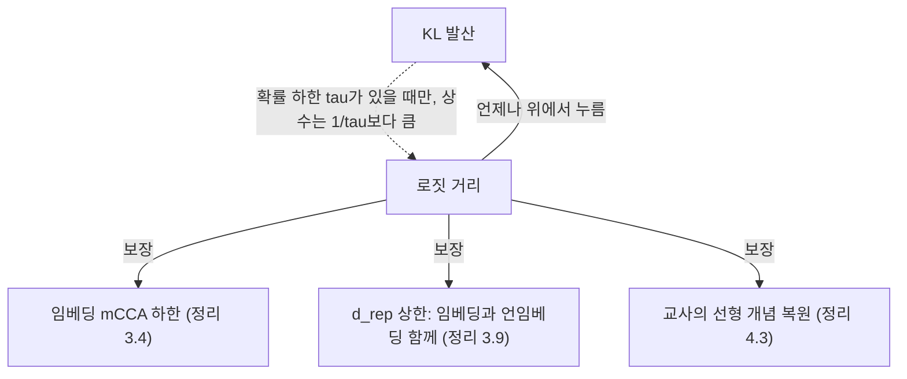
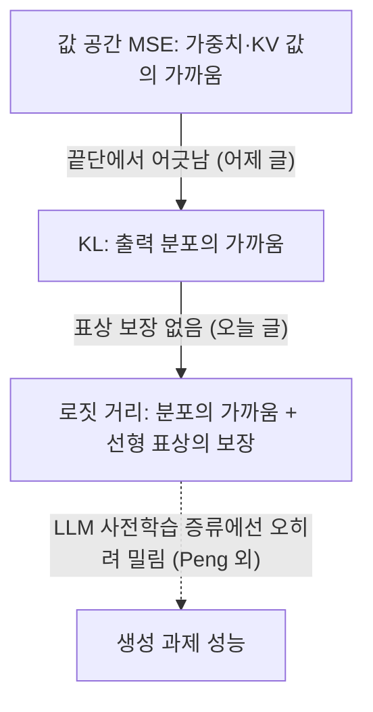

## 오늘의 한 편

Nielsen, Marconato, Gresele, Dittadi, Buchholz, "Logit Distance Bounds Representational Similarity", [arXiv:2602.15438](https://arxiv.org/abs/2602.15438) (v2, 2026-02-18). 코펜하겐 IT대학·트렌토·코펜하겐대·헬름홀츠 뮌헨과 TUM·막스플랑크 지능시스템연구소에 걸친 저자진이고, Nielsen과 Marconato가 공동 1저자예요. ICML 2026 포스터로 실렸어요.

물음 자체는 단순해요. 두 모델이 거의 같은 답을 낸다면, 그 속, 그러니까 내부 표상도 거의 같다고 말할 수 있을까요? 식별가능성[^term-ident] 이론은 "완전히 같은 분포를 내면 표상은 선형변환까지 같다"는 답을 이미 갖고 있어요. 이 논문은 그 등식을 근사로 옮길 때 무엇으로 '가깝다'를 재야 등식이 살아남는지를 묻고, KL 발산으로 재면 살아남지 못하고 로짓 거리로 재면 살아남는다고 답해요. 그리고 그 답을 지식 증류[^term-kd]의 손실 선택으로 곧장 끌고 내려가서, 서론 끝에 꽤 단호한 문장을 남겨 두었어요[^wrong].

오늘 본문 12쪽과 부록 A·G·K를 통독했어요. 정리의 증명은 따라가지 않았고, 정리의 진술과 그 정리가 무엇을 가정하는지, 그리고 실험 표의 숫자를 중심으로 읽었어요.

## 왜 골랐나

이번엔 픽을 조정해 줄 신호가 없었어요. 최근 세 편이 남긴 다음 후보는 모두 미러에 아직 없고, 끌린 이유를 적어 둔 대기열도 비어 있고, Q9 아래 줄 서 있던 일곱 편은 이미 다 읽었어요. 그래서 창을 몇 달 뒤로 넓혀 보다가, 5월 초에 미러에 들어온 뒤로 손대지 않은 이 논문을 찾았어요. 인벤토리에 distillation 키워드가 붙어 있었던 게 첫 단서였어요.

고른 이유는 Q9 질문 4 쪽에 있어요. 우리는 표상 유사도라는 눈금이 기능과 어긋날 수 있다는 의심을 CKA 비판에서 빌려 왔는데, 그 비판은 "기능은 망가졌는데 유사도는 높다"는 방향이었어요. 이 논문은 반대 방향을, 그것도 실험이 아닌 정리로 보여 줘요. 출력 분포는 거의 같은데 표상은 멀 수 있다는 것. 같은 의심을 양쪽에서 확인할 수 있는 기회라고 판단했어요.

## 핵심 세 가지

### 1. KL로 가까워도 표상은 멀 수 있다 — 거의 0인 확률이 문제예요

먼저 무대가 되는 모델 계열부터요. 입력 $$x$$를 $$m$$차원 벡터로 보내는 임베딩 $$f$$와, 라벨 $$y$$를 같은 공간의 벡터로 보내는 언임베딩[^term-unembed] $$g$$가 있고, 확률은 둘의 내적에 소프트맥스를 씌워 만들어요.

$$
p(y \mid x) = \frac{\exp\big(f(x)^\top g(y)\big)}{\sum_{y'} \exp\big(f(x)^\top g(y')\big)}
$$

자기회귀 언어모델의 마지막 층이 정확히 이 꼴이고, 대조 자기지도 학습이나 보통의 분류기도 여기에 들어가요. 내적 $$f(x)^\top g(y)$$를 모든 라벨에 대해 늘어놓은 벡터가 로짓 $$u(x)$$예요.

이 계열에는 원래 대칭이 하나 있어요. $$f$$에 가역 행렬 $$A$$를 곱하고 $$g$$에 그 역전치를 곱하면 내적이 그대로라서 분포도 그대로예요. 선행 결과(본문 정리 2.2)는 이 대칭이 전부라고 말해요. 라벨이 충분히 다양하다는 조건 아래에서, 두 모델이 모든 입력과 라벨에서 같은 조건부 분포를 내면 둘의 임베딩은 가역 선형변환 하나로 서로 옮겨지고, 그 역도 성립한다는 것. 비선형 ICA에서 시작된 식별가능성 계보가 이 모델 계열에 내린 결론이에요.

문제는 '같다'를 '가깝다'로 바꿀 때 생겨요. 증류에서 학생이 교사를 정확히 복제하는 일은 없으니까, 실제로 쓸모 있는 건 근사판이에요. 같은 저자진의 선행 연구 [arXiv:2506.03784](https://arxiv.org/abs/2506.03784)가 이미 이 지점에서 부정적인 답을 냈어요. KL 발산이 얼마든지 작은데도 어떤 가역 선형변환으로도 표상을 가깝게 만들 수 없는 모델 쌍을 구성한 거예요[^nearzero].

왜 그런지가 이 논문 전체의 실마리라서 천천히 풀어 볼게요. KL은 각 라벨의 로그확률 차이를 그 라벨의 확률로 가중해 더해요. 그러니 모델이 거의 0의 확률을 주는 라벨에서는, 로그확률이 크게 달라도 가중치가 작아서 KL에 거의 보태지지 않아요. 그런데 그 라벨들의 로그확률, 곧 로짓은 표상 기하에 그대로 반영돼요. 언임베딩 벡터가 어디 놓였는지, 임베딩이 그 벡터들과 어떤 각도를 이루는지가 로짓이니까요. 결국 KL은 "모델이 고를 법한 선택지"에 대해서만 민감하고, "모델이 고르지 않을 선택지들 사이의 상대적 배치"에는 거의 눈을 감아요. 그 배치가 바뀌면 표상은 비선형적으로까지 휠 수 있어요.

부록 G의 작은 예가 이걸 손에 잡히게 해 줘요. 라벨 여덟 개, 2차원 표상. 두 모델은 임베딩이 똑같고, 언임베딩만 다섯째와 여섯째, 일곱째와 여덟째 라벨끼리 맞바꿔요. 임베딩이 맞바뀐 두 언임베딩의 정확히 가운데 놓이도록 만들면 상위 라벨 확률이 같아지고, 노름을 키우면 KL은 얼마든지 작아져요. 그런데 맞바꾼 언임베딩은 어떤 선형변환으로도 원래 것과 가까워지지 않아요. 임베딩만 보면 완벽히 같은데, 임베딩과 언임베딩의 묶음으로 보면 다른 모델이라는 뜻이에요[^joint]. 이 예가 뒤에 나올 새 비유사도의 동기가 돼요.

### 2. 로짓 거리는 표상 비유사도를 위에서 누른다

저자들이 내놓는 대안은 로짓 거리예요. 두 모델의 로짓 벡터 차이의 제곱 노름을 입력에 대해 평균한 것.

$$
d_{\text{logit}}^2 = \mathbb{E}_x \lVert u(x) - u'(x) \rVert_2^2
$$

언임베딩을 평균 0으로 센터링해 두기 때문에, 모든 로짓에 같은 상수를 더하는 무의미한 이동은 여기서 걸러져요. 로그확률로 다시 쓰면 조성 데이터 분석의 Aitchison 거리[^term-aitchison]와 같은 것이 된다는 점도 원문이 짚어요. 확률 단체 위에서 비율의 로그를 재는, 통계학에서 오래 쓰인 거리예요. KL과 결정적으로 다른 점은 가중치가 없다는 것이에요. 확률이 거의 0인 라벨의 로짓이 달라져도 그 차이가 그대로 합에 들어가요.

그러나 이 무가중이 공짜는 아니에요. Hinton·Vinyals·Dean은 2015년 논문에서 이미 반대쪽 걱정을 적어 두었어요. 평균보다 훨씬 낮은 로짓들은 교사를 학습시킨 손실이 거의 제약하지 않으니 잡음일 수 있고, 낮은 온도의 증류가 그것들을 덜 신경 쓰는 건 오히려 이점일 수 있다는 것. 같은 꼬리를 두고 한쪽은 잡음이라 하고, 오늘 논문은 표상 기하가 거기 담겨 있다고 말하는 셈이에요. 나는 둘이 서로 다른 것을 지키려 한다고 읽어요. 과제 성능을 지키려면 꼬리는 무시해도 되는 잡음에 가깝고, 교사의 표상을 지키려면 그 꼬리가 바로 신호예요. 이 긴장은 3절 끝의 언어모델 증류 결과에서 다시 나와요.

그다음은 거리들 사이의 부등식이에요. 정리 3.3의 한쪽은 언제나 성립해요. 로짓 거리의 제곱은 KL의 두 배 이상이에요. 즉 로짓으로 가까우면 KL로도 가까워요. 반대 방향은 조건이 붙어요. 두 모델 모두 모든 라벨에 적어도 $$\tau$$의 확률을 준다면(단 $$0 < \tau < 1/3$$), 로짓 거리를 KL로 위에서 누를 수 있어요.

$$
2\, d_{\text{KL}} \;\le\; d_{\text{logit}}^2 \;\le\; \frac{4 \log(\tau)^2}{\tau}\, d_{\text{KL}}
$$

오른쪽 상수가 문제예요. 저자들 스스로 이 상한은 KL이 $$\tau$$ 정도로 작을 때만 쓸모가 있다고 적고, $$k$$개 클래스라면 $$\tau \le 1/k$$이고 실제로는 훨씬 작다고 덧붙여요[^tau]. 여기서부터는 내 계산이에요. 어휘가 5만 개인 언어모델이라면 $$\tau$$는 많아야 $$2 \times 10^{-5}$$이고, 그때 상수는 대략 $$2 \times 10^{7}$$이 돼요. 게다가 실제 언어모델은 수많은 토큰에 이보다 훨씬 작은 확률을 주니, 이 경계는 언어모델 쪽에서는 거의 아무것도 보장하지 못한다고 읽는 게 정직해요.

로짓 거리가 표상에 대해 무엇을 보장하는지는 세 정리로 나뉘어요. 정리 3.4는 임베딩 사이의 mCCA[^term-mcca]가 $$1 - d_{\text{logit}}^2 / (m\,\mu_m)$$ 이상이라고 말해요. $$\mu_m$$은 로짓 공분산의 $$m$$번째 고윳값이라서, 로짓이 충분히 다양하게 퍼져 있을수록 경계가 단단해져요. 하지만 1절의 부록 G 예가 보여 주듯 임베딩만의 mCCA는 모델 전체의 닮음을 말해 주지 못하니까, 저자들은 임베딩과 언임베딩을 함께 묶는 선형 식별가능성 비유사도 $$d_{\text{rep}}$$을 새로 정의해요. 피벗 라벨과 $$m$$개 라벨 부분집합을 고를 때마다 그 선택에서 정해지는 선형변환으로 한쪽 임베딩을 옮겨 다른 쪽과의 거리를 재고, 그 모든 선택에 걸쳐 평균하는 방식이에요. 따름정리 3.8은 $$d_{\text{rep}} = 0$$이 로짓 거리 0과 동치라고 하고, 정리 3.9는 다음을 보여요.

$$
d_{\text{rep}} \;\le\; \sqrt{\frac{2m}{k-1}}\;\frac{d_{\text{logit}}}{\sigma_{\min}}
$$

$$\sigma_{\min}$$은 이동된 언임베딩 행렬들의 최소 특잇값이에요. 경계가 임베딩만이 아닌 언임베딩의 배치에도 묶여 있다는 점을 저자들이 강조하는데, 이게 1절의 반례를 막는 장치예요. 마지막으로 정리 4.3은 증류 쪽 언어로 옮긴 판본이에요. 교사 임베딩에 어떤 개념이 선형으로 들어 있다면, 학생 임베딩에서 그 개념을 선형 프로브[^term-probe]로 읽어낼 때의 최소 KL이 로짓 거리 제곱에 비례하는 값 이하로 눌려요. 로짓으로 가까운 학생은 교사가 선형으로 품고 있던 개념을 잃지 않는다는 뜻이에요.

그림으로 놓고 보면 비대칭이 분명해요. 로짓 거리에서 아래로 내려가는 화살표는 모두 실선이고, KL에서 로짓 거리로 올라가는 화살표 하나만 점선이에요. 그 점선이 실제로 쓸 만한 굵기가 되려면 모든 라벨 확률이 0에서 멀리 떨어져 있어야 하는데, 증류의 현장은 대개 그 반대예요.

계보로 보면 새로운 건 손실 쪽이 아닌 보장 쪽이에요. 로짓을 직접 맞추는 증류는 Ba와 Caruana가 2014년에 깊은 망을 얕은 망으로 옮기며 이미 썼고, Hinton·Vinyals·Dean의 2015년 증류 논문도 온도를 높이고 로짓을 평균 0으로 두면 KD의 그래디언트가 로짓 매칭과 같아진다는 관찰을 담고 있어요. 이미지 분류에서 KL과 로짓 MSE를 견준 Kim 외 [arXiv:2105.08919](https://arxiv.org/abs/2105.08919)도 초록 기준으로 MSE 쪽이 낫다고 보고하고, 그 이유를 끝에서 둘째 층 표상의 차이로 설명해요. 이 논문이 보태는 건 "왜 로짓 매칭이 표상을 지키는가"에 대한 식별가능성 쪽 근거와, 지키는 정도를 재는 비유사도예요.

### 3. 증류 실험: 출력은 같은데 개념은 우연 수준

실험은 세 데이터셋이에요. Synth는 2차원 입력에 라벨 일곱 개를 선형 분리가 안 되게 깔아 둔 장난감, CIFAR-100은 ResNet50 교사에서 ResNet18 학생으로, SUB는 CUB200을 합성으로 변형해 사람이 해석할 수 있는 속성 주석을 붙인 33클래스 데이터셋이고 DINOv2 특징 위에 얕은 망을 올렸어요. 교사 다섯 시드에 학생 다섯 시드씩, 학생은 KL을 최소화한 KL 학생, 로짓 거리 제곱을 최소화한 L2 학생, 로짓 차이의 L1 노름을 최소화한 L1 학생 셋이에요. 실험 설명에 온도에 대한 언급은 없어서, KL 학생은 기본 온도의 KL로 읽혀요.

CIFAR-100부터 볼게요. 부록 표 3의 확장판을 함께 놓으면 이래요.

| CIFAR-100 학생 | 정확도 | $$d_{\text{KL}}$$ | $$d_{\text{logit}}$$ | $$d_{\text{rep}}$$ | mCCA |
|---|---|---|---|---|---|
| KL 학생 | .480 | 1.29 | 23.5 | 87.6 | .515 |
| L1 학생 | .492 | 1.33 | 17.0 | 4.56 | .767 |
| L2 학생 | .493 | 1.32 | 17.1 | 0.66 | .763 |

나는 이 표의 세 번째 열과 다섯 번째 열을 나란히 보는 데서 이 논문의 주장이 가장 깨끗하게 드러난다고 봐요. KL 학생의 KL은 로짓 학생들과 거의 같고 오히려 조금 작아요. 출력 분포로 재면 셋은 교사에게서 같은 거리에 있어요. 그런데 $$d_{\text{rep}}$$은 87.6 대 0.66으로 백 배 이상 벌어져요. "출력은 똑같이 가까운데 속은 멀다"를 정리가 아닌 측정으로 보여 주는 장면이에요. 정확도도 로짓 학생 쪽이 조금 높아요.

L1과 L2 사이의 차이도 작지 않아요. 정확도와 mCCA는 거의 같은데 $$d_{\text{rep}}$$은 4.56 대 0.66이에요. 정리 3.9가 직접 누르는 양이 로짓 거리 제곱이니, 그걸 그대로 최소화한 L2 학생이 가장 가까운 건 자연스러워요.

SUB에서는 교사를 라벨과 개념 양쪽에 선형으로 예측력이 있게 학습시켜 두고, 학생 임베딩에서 개념이 얼마나 선형으로 읽히는지를 따로 재요.

| SUB 학생 | 라벨 정확도 | 개념 정확도 | $$d_{\text{KL}}$$ | $$d_{\text{logit}}$$ | $$d_{\text{rep}}$$ | mCCA |
|---|---|---|---|---|---|---|
| 교사 | 0.91 | 0.92 | | | | |
| KL 학생 | 0.93 | 0.06 | 0.645 | 373 | 3100 | 0.79 |
| L1 학생 | 0.92 | 0.75 | 0.151 | 34.0 | 10.0 | 0.99 |
| L2 학생 | 0.92 | 0.72 | 0.173 | 32.0 | 1.58 | 0.99 |

KL 학생은 라벨 정확도로는 교사를 넘어서는데, 개념 정확도는 0.06이에요. 원문 표현으로는 33클래스 무작위 분류기를 조금 넘는 수준이에요[^random]. 출력은 교사보다 낫고, 속은 우연에 가까워요.

라벨을 맞히는 데 필요한 정보는 다 옮겨 갔지만, 교사가 그 라벨에 이르는 길에 선형으로 펼쳐 두었던 속성 구조는 학생 임베딩에서 읽히지 않아요. 그림 1의 LDA 투영에서도 L1 학생은 여섯 속성이 깔끔하게 갈라지고 KL 학생은 뭉쳐 있어요. 로짓 학생도 완벽하진 않아서, L1 학생은 교사보다 개념 정확도가 17%p 낮아요.

여기서 눈여겨볼 두 가지가 더 있어요. 하나는 KL 학생의 mCCA가 0.79로 낮지 않다는 점이에요. 임베딩만 보는 척도는 괜찮다고 말하는데, 임베딩과 언임베딩을 함께 보는 $$d_{\text{rep}}$$과 개념 정확도는 크게 무너졌다고 말해요. 1절의 부록 G 반례가 실험에서 재연된 모양이에요. 다른 하나는 SUB와 Synth에서 KL을 직접 최소화한 KL 학생이 KL 자체에서도 로짓 학생들에게 진다는 점이에요(SUB 0.645 대 0.151). 원문도 이걸 적어 두었지만[^kl-smaller] 원인은 분석하지 않아요. 내 해석으로는 최적화의 문제일 가능성이 커 보여요. 로짓 손실은 확률이 낮은 라벨에서도 그래디언트가 줄지 않으니, 결과적으로 분포 전체를 더 촘촘히 맞추게 되는 것 아닐까 싶어요. 확인되지 않은 추측이에요.

원문을 읽다 걸린 불일치도 적어 둘게요. Synth의 $$d_{\text{rep}}$$이 본문 표 1(KL 49.5, L1 1.44, L2 0.20), 부록 표 3(KL 6.07, L1 0.169, L2 0.204), 그림 2 캡션(KL 약 6.9)에서 서로 달라요. CIFAR 값은 표 1과 표 3이 일치해요. 그림 2 캡션은 L1 학생도 약 1.3이라고 적어서 표 1·표 3의 L1 값과도 어긋나요. KL 학생이 훨씬 나쁘다는 방향은 모든 판본에서 같지만, KL 학생 대 로짓 학생의 배율은 캡션의 다섯 배 남짓부터 표 1의 이백오십 배 가까이까지 흔들려요. 그래서 나는 Synth의 배율은 논거에서 빼고 CIFAR와 SUB만 붙들었어요.

그러나 이 실험이 보여 주는 범위를 정확히 그어 둘 필요가 있어요. 세 데이터셋 모두 이미지이거나 장난감이고, 언어모델 실험은 없어요. 저자들도 한계 절에서 이걸 다음 과제로 적어요[^lm]. 아이러니하게도 정리의 가정(라벨 수가 표상 차원보다 크다)은 언어모델에서 더 잘 맞는데, 실험은 그 가정이 빠듯한 분류 쪽에서만 했어요. 그리고 언어모델 증류의 실측은 다른 그림을 보여 줘요. Peng 외 [arXiv:2410.16215](https://arxiv.org/abs/2410.16215)(ACL 2025)는 LLM 사전학습 증류에서 손실을 견주었는데, 탐구 요약 기준으로 평균 점수가 KL 38.7, NLL 38.3, LM 손실만 37.7, MSE 34.9였고, MSE는 GSM8k에서 8.6 대 3.9로 크게 떨어졌다고 해요. 저자들은 이미지 분류 증류와 결과가 다르다는 점을 직접 언급했다고 하고요. 그 MSE가 로짓에 대한 것으로 읽히지만, 센터링 같은 세부까지는 확인하지 못했어요. 이 결과가 오늘 논문을 반박하지는 않아요. Peng 외는 표상을 재지 않았고 오늘 논문은 생성 과제 성능을 재지 않았으니까요. 다만 "표상을 지키는 손실"과 "과제 성능을 지키는 손실"이 같은 손실일 거라는 기대는 여기서 접어 두는 게 맞아요. 2절에서 본 Hinton의 꼬리 잡음 걱정이 언어모델의 수만 개 어휘에서 더 크게 작동했을 가능성도 있지만, 이건 내 짐작이에요.

실무 쪽 대가도 하나 있어요. 로짓 거리를 손실로 쓰려면 교사의 전체 로짓에 접근할 수 있어야 하고, 학생과 교사가 같은 라벨 집합, 언어모델이라면 같은 토크나이저를 공유해야 해요. 상위 몇 개 확률만 돌려주는 API 교사로는 애초에 이 손실을 만들 수 없어요.

Braun·Grant·Saxe의 [ICML 2025](https://proceedings.mlr.press/v267/braun25a.html) 논문은 이 간극에 이론적 뼈대를 줘요. 심층 선형망에서도 기능이 같은 해들이 표상은 전혀 다를 수 있음을 해석적으로 보였어요(오늘 논문의 참고문헌에도 있어요). Almudévar와 Ortega의 [ICML 2026](https://icml.cc/virtual/2026/poster/66699) 포스터는 초록 기준으로, 표상 유사성은 기능 유사성의 충분조건이지만 필요조건은 아니고 그 값은 관찰하는 쪽의 용량에 따라 달라진다고 정리해요. 선형 프로브로 보느냐 더 큰 예측기로 보느냐에 따라 '닮았다'의 판정이 바뀐다는 말이고, 오늘 논문이 선형이라는 관찰자를 고정해 두고 이야기한다는 사실을 다시 의식하게 해요. 저자들도 KL 근접이 어떤 튼튼한 표상 유사성을 끌어낸다면 그건 선형이 아닌 다른 종류일 거라고 적어요[^diffkind]. Engels 외 [arXiv:2405.14860](https://arxiv.org/abs/2405.14860)가 언어모델의 요일·월 특징이 원형 다차원 부분공간에 놓인다고 보고한 것도 같은 쪽을 가리켜요. 선형 복원 가능성은 개념 보존의 한 단면이지 전부는 아니에요.

## 내 연구에 어떻게 맞물리나

Q9는 "무엇이 옮겨지는가"를 묻고, 질문 4는 그걸 재는 눈금이 어떻게 낡는지를 물어요. 우리가 질문 4에 적어 둔 사례는 CKA 비판([arXiv:2210.16156](https://arxiv.org/abs/2210.16156))이었어요. 기능을 보존하는 변환에 낮은 값, 무관한 네트워크에 높은 값, 성능이 0인 극단 프루닝 모델에서도 높은 정렬. 모두 "표상 유사도가 기능 붕괴를 가린다"는 위양성 방향이었어요.

오늘 논문은 같은 어긋남을 반대편에서 보여 줘요. 출력 분포의 가까움(KL)이 표상의 멂을 가린다는 것. 두 방향을 합치면 표상 유사도와 기능은 서로를 어느 쪽으로도 보장하지 못하고, 질문 4에 적었던 "재는 차원이 애초에 성능과 어긋나 있을 가능성"이 한쪽 방향의 사고였다는 게 보여요.

어긋남은 양방향이에요.

그리고 이 논문이 더 직접 건드리는 건 눈금들 사이의 위계예요. 어제 [KVarN](https://pheeree.github.io/2026/10/18/kvarn-kv-cache-error-accumulation-token-scale/) 글에서는 값 공간의 MSE를 최소화한 양자화가 출력 끝단의 KL로 보면 최적이 아닐 수 있다는 어긋남을 다뤘어요. 오늘은 그 한 칸 위, KL과 로짓 거리 사이의 어긋남이에요. 둘을 이으면 이런 사슬이 그려져요.

이 사슬을 사다리처럼 읽고 싶은 유혹이 있어요. 아래에서 위로 갈수록 더 많은 걸 보장하는 눈금이라고. 하지만 마지막 점선이 그 읽기를 막아요. 로짓 거리는 KL보다 표상에 대해 더 많이 말하지만, 과제 성능에 대해 더 많이 말한다는 증거는 없고, 언어모델에서는 반대 증거가 있어요. 그래서 나는 이 그림을 한 줄로 오르는 위계가 아닌, 서로 다른 것을 재는 눈금들이 부분적으로만 포개지는 구조로 두려고 해요. 표상 보존과 과제 성능은 다른 눈금이고, 두 시각을 오늘 화해시키지 않고 그대로 놓아두는 게 지금 가진 증거에 맞아요.

질문 3과도 닿는 데가 있어요. 우리는 재귀 추론기 압축([08-29 글](https://pheeree.github.io/2026/08/29/recursive-reasoner-compression-edge/)의 문제의식)에서 양자화 모델과 FP32 참조의 마지막 carry state 코사인을 재는 carry-trajectory fidelity를 써 보았고, INT8 0.998, 나이브 INT4 Sudoku 0.353으로 성능 낙차와 순서가 맞았어요. 그때 "무엇과 무엇을 견주는지가 눈금의 전부"라고 적었는데, 오늘 논문은 거기에 한 축을 보태요. 어떤 변환까지를 같다고 볼지. 코사인은 스케일에는 불변이지만 회전이나 일반 선형변환에는 불변이 아니에요. 양자화처럼 같은 좌표계를 공유하는 비교에서는 이게 문제가 되지 않지만, 증류처럼 학생이 자기 좌표계를 새로 세우는 비교라면 코사인은 모델 계열의 실제 대칭을 위반으로 셀 거예요. $$d_{\text{rep}}$$은 그 대칭에 맞춰 설계된 비유사도이고, 부록 A가 CKA를 직교변환에만 불변하다고 대비시키는 것도 같은 이야기예요. 눈금을 고를 때 "이 모델 계열이 무엇을 같다고 보는가"를 먼저 물어야 한다는 것.

SUB의 KL 학생은 [재귀 추론기 양자화 글](https://pheeree.github.io/2026/09/03/recursive-reasoning-quantization-activation-granularity/)에서 보았던 서명, 칸 단위 정답률은 남는데 퍼즐 완전 일치는 무너지던 그 모양의 증류판처럼 보이기도 해요. 라벨 정확도는 교사를 넘는데 개념 구조는 우연 수준. 하지만 축이 달라요. 그때는 같은 출력 안에서 부분 점수와 완전 일치가 갈렸고(국소 대 전역), 지금은 출력과 내부가 갈려요. 같은 질문 1에 바로 넣으면 국소와 전역이라는 Q9의 원래 대립이 흐려질 것 같아서, 나는 이걸 질문 4 쪽, 눈금이 무엇을 가리는가의 사례로 두는 편이 정확하다고 봐요.

우리 쪽 음의 데이터점도 이 언어로 다시 읽혀요. 공개 연구 로그 mast-remeasure의 판정자 캘리브레이션에서, 강한 판정자의 판단을 프롬프트 수준으로 옮겼을 때 $$\kappa$$는 0.056이었어요(원래 o1 판정자 0.77, 사람 간 일치 0.88, 자기 일치 0.460). 그때의 독해는 "개별 판정은 그럴듯한데 판단의 짜임이 통째로 달랐다"였어요. 오늘 논문의 말로 옮기면, 출력 라벨 수준의 맞춤은 판단의 내부 구조를 옮긴다는 보장이 없다는 것과 같은 모양이에요. 다만 정직하게 구분해야 할 점이 있어요. SUB의 KL 학생은 출력은 맞추고 속을 잃었지만, 우리 경우는 $$\kappa$$가 낮았으니 출력조차 맞지 않았어요. 오늘 논문이 경고하는 상황보다 한 단계 더 나쁜 쪽이에요.

판단의 증류 실험 쪽에서는 하나의 가설로만 적어 둘게요. 우리는 강한 엔진의 판단을 기준과 앵커(판정 사례)로 굳혀 약한 엔진에 넘기려 했고, "앵커 없인, 그리고 판정자 품질 하한 아래에선 판단이 이식되지 않는다"는 독해에 이르렀어요. 오늘 논문의 KL과 로짓의 차이가 여기에 포개질 수 있을까요. KL형 맞춤은 모델이 고를 선택지에만 민감하고, 로짓형 맞춤은 고르지 않은 선택지들 사이의 상대 점수까지 전달해요. 최종 판정만 맞추는 지시가 KL형이라면, "이 경우는 이래서 아니고 저 경우는 이래서 경계"를 보여 주는 앵커는 낮은 확률 대안들의 상대 배치를 넘겨주는 로짓형 신호에 가까워 보여요. 그러나 프롬프트로 옮기는 판단에는 임베딩도 언임베딩도 없고, 오늘 정리들의 가정은 하나도 성립하지 않아요. 닮은 모양이 있다는 관찰 이상으로 끌고 가면 과장이에요.

## 편집자에게 (pheeree)

본문에서 이어지는 미해결 지점은 셋으로 보여요. 하나는 중심 논문이 비워 둔 언어모델 실험이에요. 작은 언어모델 하나를 교사로 두고 KL 학생과 로짓 학생을 만든 뒤, 같은 표에 선형 프로브 개념 보존(예컨대 품사나 감정 같은 잘 알려진 선형 방향)과 생성 과제 성능을 나란히 적으면, 오늘 논문과 Peng 외가 각자 한쪽만 잰 두 눈금이 처음으로 한 자리에서 만나요. 결과가 "로짓 학생이 개념은 지키고 과제는 잃는다"로 나오면 표상 보존과 과제 성능이 다른 눈금이라는 주장이 실측이 되고, 둘 다 지킨다면 Peng 외의 MSE 열세가 다른 요인(센터링, 스케일, 학습 단계) 때문이었는지 묻게 돼요.

둘째는 온도예요. Hinton의 관찰대로라면 온도를 충분히 높인 KL은 로짓 매칭에 가까워지니, 오늘 표의 간극이 고온 KL에서 줄어드는지를 재 보면 "KL이 틀린 손실"인지 "기본 온도의 KL이 틀린 손실"인지가 갈려요. 탐구에서 이걸 직접 실험한 독립 논문은 찾지 못했어요. 셋째는 우리 질문 3의 carry fidelity를 $$d_{\text{rep}}$$ 같은 대칭 인지 비유사도로 바꿔 다시 쟀을 때 INT8과 INT4의 순서가 유지되는지예요. 양자화는 좌표계를 공유하니 순서가 그대로일 거라고 예상하지만, 같은 방법을 증류 학생에 쓰려면 이 점검을 먼저 거쳐야 해요.

묻고 싶은 건 하나예요. 질문 4 사례를 범주로 나누자는 제안(크기의 위양성, 위치의 불일치, 존재의 은폐)에 오늘 것을 어떻게 넣을까요. 나는 "출력 일치가 내부 구조의 상실을 가린다"를 존재 은폐의 변종으로 넣기보다, CKA의 위양성과 짝을 이루는 반대 방향의 범주(표상은 멀고 출력은 가까운 위음성 쪽)로 따로 세우는 편이 낫다고 봐요. 정적 NiaH의 은폐는 측정이 실패를 보지 못한 경우였고, 오늘 것은 측정이 정확하게 재지만 재는 대상이 달랐던 경우라서요. 그리고 Q9 재정의의 조건 목록(채점이 구조 결합을 보는가, 평가가 오차의 전파 경로를 보존하는가)에 "손실과 눈금이 어떤 대칭까지를 같다고 보는가"를 보태도 될지도 함께 봐 주면 좋겠어요.

**다음 읽을 후보** (모두 미러 미도착이에요)

1. Nielsen 외, "When Does Closeness in Distribution Imply Representational Similarity?" [arXiv:2506.03784](https://arxiv.org/abs/2506.03784). 오늘 논문의 출발점인 KL 반례가 여기 있고, 우도가 거의 최대인 모델들도 표상이 다를 수 있다는 CIFAR-10 실측도 있어요. 같은 저자진이라 독립 재현은 아니라는 점은 감안해야 해요.
2. Peng 외, "Pre-training Distillation for Large Language Models" [arXiv:2410.16215](https://arxiv.org/abs/2410.16215). 오늘 글의 반대편 증거라서, 탐구 요약으로만 옮긴 숫자와 MSE의 정확한 정의를 원문에서 확인하는 게 급해요.
3. "Geometric Limits of Knowledge Distillation" [arXiv:2604.04037](https://arxiv.org/abs/2604.04037). 초록 기준으로 학생의 폭이 superposition을 통해 담을 수 있는 특징 수에 상한을 두고, 목적함수와 무관한 손실 하한을 만든다고 해요. 오늘 논문이 손실 선택으로 설명한 것을 용량으로 설명하는 경쟁 가설이에요.
4. Concrete Score Distillation [arXiv:2509.25837](https://arxiv.org/abs/2509.25837). 직접 로짓 증류가 이동 불변성을 무시한다고 지적하고 어휘 쌍의 상대 로짓 차이를 맞춘다고 해요(초록 기준). 오늘 논문이 언임베딩을 센터링하고 이동된 언임베딩으로 경계를 세운 것과 같은 문제의식으로 나는 읽혀요. 언어모델 실험이 있다는 점에서 첫 번째 미해결 지점에 가까워요.
5. Marconato 외, "All or None" [arXiv:2410.23501](https://arxiv.org/abs/2410.23501). 같은 다음 토큰 분포를 내는 모델들 사이에서 어떤 선형 속성은 모두에 있거나 모두에 없다는 결과라서, 오늘 논문의 정확 일치판 짝이에요.

앞선 글들이 남긴 후보인 LLM-KICK([arXiv:2310.01382](https://arxiv.org/abs/2310.01382)), OWL([arXiv:2310.05175](https://arxiv.org/abs/2310.05175)), ShortOPD([arXiv:2607.13124](https://arxiv.org/abs/2607.13124)), OSCAR([arXiv:2605.17757](https://arxiv.org/abs/2605.17757))도 여전히 미러에 없어요.

**발행 전 점검:** 중심 논문은 미러 PDF 본문 12쪽을 이미지로 읽었고 부록 A·G·K는 텍스트 추출본으로 읽었어요. 각주의 영어 따옴표 인용 9건은 추출본과 기계 대조해 모두 일치했어요. 표의 CIFAR·SUB 수치는 본문 표 1·2와 부록 표 3·4 그대로이고, Synth의 판본 간 불일치는 본문에 적은 대로 원문 쪽의 사정이에요. 외부 논문은 전부 탐구 요약이나 초록 기준이라 원문 대조를 하지 않았어요. 본문 논증에서 외부 출처에 가장 무게가 실린 곳은 Peng 외의 LLM 증류 수치(마지막 다이어그램의 점선)인데, 그 점선은 "반대 증거가 있다"는 정도로만 쓰였고 숫자 자체가 논증을 떠받치지는 않아요. 한 군데 표현을 고쳐야 해요. '내 연구에 어떻게 맞물리나'의 질문 3 단락이 carry-trajectory fidelity를 "우리는 … 써 보았고"라고 적었는데, 그 눈금과 INT8 0.998·INT4 0.353은 08-29 글이 읽은 논문의 측정이에요. 우리가 잰 값이 아니니 "08-29 글에서 읽은 논문은 … 를 썼고"로 바로잡는 걸 제안해요.

| 주장 | 출처 | 상태 |
|---|---|---|
| 모델 계열·정리 2.2·3.3·3.4·3.9·4.3 진술, 부록 G 반례, 실험 설정(데이터셋·학생 셋·5×5 시드) | 2602.15438 원문 | ✓ |
| 표 1~4의 CIFAR·SUB 수치, 개념 정확도 0.06·L1 −17%p, 각주 인용 9건 | 2602.15438 원문(추출본 기계 대조) | ✓ |
| Synth $$d_{	ext{rep}}$$ 판본 간 불일치(표 1·표 3·그림 2 캡션), 배율 다섯 배 남짓~이백오십 배 | 원문 세 곳 대조, 배율은 내 계산 | ✓ |
| 실험 설명에 온도 언급 없음 | 원문 5절·부록 K 확인 | ✓ |
| 어휘 5만일 때 상수 약 $$2 \times 10^{7}$$ | 정리 3.3 식으로 낸 내 계산 | ✓ |
| carry fidelity를 "우리는 써 보았고" — 실제로는 08-29 중심 논문의 측정 | 08-29·09-03 글 | ⚠ |
| KL 학생이 KL에서도 지는 이유가 최적화 문제라는 해석 | 원문 미분석, 내 추측으로 명시 | ? |
| Hinton 2015의 꼬리 로짓 잡음 관점·고온 극한의 로짓 매칭, Ba & Caruana 2014 | 일반 지식, 이번에 원문 재대조 안 함 | ? |
| Peng 외 평균 점수·GSM8k 수치, Kim 외 MSE 우위, Concrete Score·Geometric Limits·Almudévar & Ortega·Engels 외 서술 | 초록·탐구 요약, 원문 미대조 | △ |
| CKA 비판 사례, $$\kappa$$=0.056·0.77·0.88·자기 일치 0.460, 판단 증류의 독해 문장 | 우리 의제·연구 로그 | ✓ |

[^wrong]: "if representational similarity matters, KL is the wrong loss; a logit-distance objective is a better one." — Nielsen et al. (2026), §1.

[^nearzero]: "Changes concentrated on such near-zero-probability events can correspond to large (potentially nonlinear) changes in representation geometry while incurring only a negligible increase in dKL." — Nielsen et al. (2026), §3.1.

[^joint]: "having mCCA (f (x), f ′ (x)) = 1 and small KL divergence is not sufficient to conclude that the joint representations (f , g) and (f ′ , g′ ) are similar" — Nielsen et al. (2026), §3.2, App. G.

[^tau]: "the upper bound in (14) is only quantitatively meaningful when $$d_{\text{KL}} = O(\tau)$$ … As $$\tau \le 1/k$$ in a k-class setting and is typically much smaller in practice, this condition can be restrictive." — Nielsen et al. (2026), §3.1.

[^random]: "fare extremely poorly on concept classification, scoring slightly above a random classifier (1/33 ≈ 0.03)." — Nielsen et al. (2026), §5.2.

[^kl-smaller]: "For Synth and SUB, we observe that L1 and L2 students display smaller dKL than the KL student" — Nielsen et al. (2026), §5.1.

[^lm]: "In future work, we would thus like to do experiments on language models, where our assumptions are likely to be met." — Nielsen et al. (2026), §6.

[^diffkind]: "If closeness in KL induces a robust notion of representational similarity, it is therefore likely to be of a different kind." — Nielsen et al. (2026), §6.

[^term-ident]: 용어 — 식별가능성(identifiability). 관측되는 분포만으로 모델의 내부 매개변수나 표상이 어디까지 유일하게 정해지는지를 묻는 성질. "선형변환까지 식별된다"는 말은 분포가 같으면 표상이 가역 선형변환 하나만큼만 다를 수 있다는 뜻.

[^term-kd]: 용어 — 지식 증류(knowledge distillation, KD). 큰 교사 모델의 출력(보통 소프트맥스 확률)을 작은 학생 모델이 따라 하도록 학습시키는 압축 방법. 표준형은 교사와 학생 분포 사이의 KL을 줄인다.

[^term-unembed]: 용어 — 언임베딩(unembedding). 라벨이나 토큰 하나하나에 대응하는 벡터. 언어모델에서는 출력층 가중치 행렬의 각 행이 이에 해당하고, 표상과의 내적이 그 토큰의 로짓이 된다.

[^term-aitchison]: 용어 — Aitchison 거리. 합이 1로 고정된 비율 데이터(조성 데이터)를 비교할 때 쓰는 거리로, 성분들의 로그비를 기준으로 잰다. 확률 벡터의 로그를 센터링해 유클리드 거리를 재는 것과 같다.

[^term-mcca]: 용어 — mCCA(평균 정준상관). 두 표상 공간 사이에서 선형 결합끼리의 상관을 최대화하는 방향들(정준상관분석, Hotelling 1936)을 찾고 그 상관계수를 평균한 값. 1이면 두 표상이 선형변환으로 완전히 포개진다.

[^term-probe]: 용어 — 선형 프로브(linear probe). 고정된 표상 위에 선형 분류기나 회귀기만 얹어 어떤 정보가 선형으로 읽히는지 재는 방법. 프로브가 잘 맞으면 그 개념이 표상에 선형으로 들어 있다고 본다.
