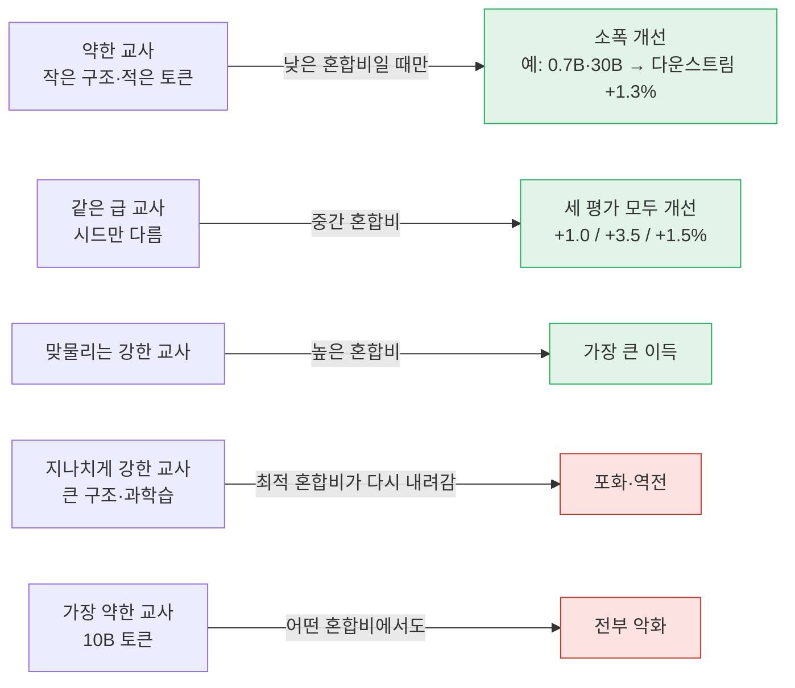
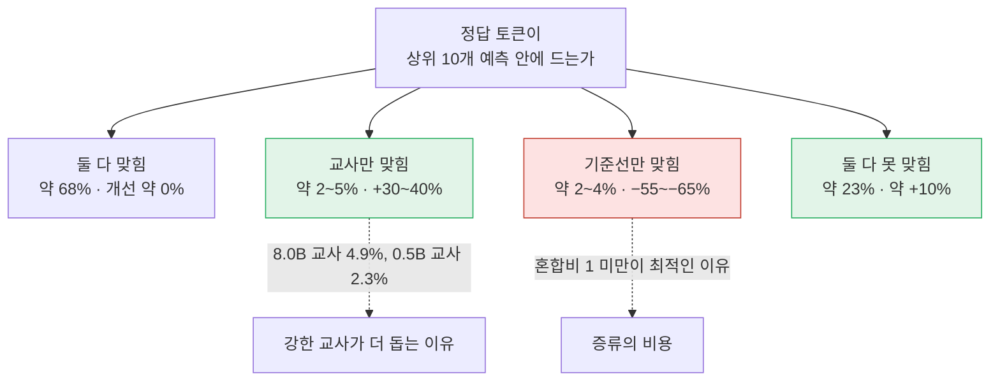
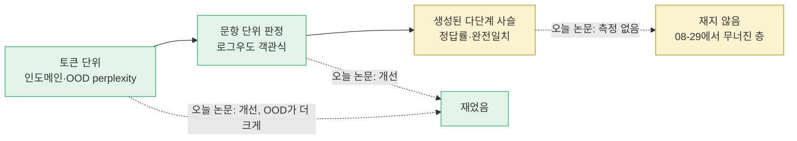

## 오늘의 한 편

Taiming Lu, Zhuang Liu, "Strong Teacher Not Needed? On Distillation in LLM Pretraining", [arXiv:2605.23857](https://arxiv.org/abs/2605.23857) (v1, 2026-05-22). 두 저자 모두 Princeton 소속이에요.

이 논문이 시험하는 건 지식 증류에서 거의 의심받지 않던 전제 하나예요. 교사가 강할수록 학생이 좋아진다는 것. Buciluǎ 외(2006)의 모델 압축과 Hinton 외의 증류([arXiv:1503.02531](https://arxiv.org/abs/1503.02531))가 모두 큰 모델의 출력을 작은 모델에 옮기는 그림에서 출발했으니, 교사를 고를 때 "크고 오래 학습한 쪽이 낫다"는 규칙은 거의 자동으로 따라 나왔죠. 저자들은 이 규칙을 대규모 언어모델 사전학습에서 정면으로 흔들어 봐요.

실험 설계는 단순하고 넓어요. Llama3 구조로 0.7B, 1.7B, 3.8B, 8.0B 네 크기를 만들고, 각각을 10B, 30B, 50B, 80B, 100B, 300B 토큰으로 학습시켜 교사 24개를 얻어요. 주 실험의 학생은 1.7B 하나로 고정하고 50B 토큰을 보게 해요. 데이터는 전부 FineWeb-Edu, 문맥 길이는 8192, 증류 온도는 $$\tau = 1$$이에요. 학생의 손실은 정답 토큰에 대한 언어모델 손실과 교사 분포를 따라가는 증류 손실의 혼합이에요.

$$
\mathcal{L} = (1-\alpha)\,\mathcal{L}_{\text{LM}} + \alpha\,\mathcal{L}_{\text{KD}}, \qquad \mathcal{L}_{\text{KD}} = \mathrm{KL}(q_t \,\Vert\, p_t)
$$

식을 말로 풀면 이래요. $$q_t$$는 교사가 그 위치에서 내놓는 다음 토큰 분포이고 $$p_t$$는 학생의 분포예요. 증류 항은 교사 분포를 기준으로 잰 forward KL이라[^term-fkl], 교사가 확률을 준 토큰에 학생도 확률을 주도록 끌어요. $$\alpha$$는 두 신호 사이의 저울추예요. $$\alpha = 0$$이면 평범한 사전학습이고 $$\alpha = 1$$이면 정답 토큰 없이 교사만 보는 순수 증류예요. 저자들은 교사마다 $$\alpha$$를 0.2부터 1.0까지 여섯 값으로 훑고, 비교 기준은 같은 데이터 순서와 시드에서 $$\alpha = 0$$으로 학습한 학생이에요.

평가는 세 갈래예요. 학습에 안 쓴 FineWeb-Edu 분할의 인도메인 perplexity[^term-ppl], 위키·C4·수학·코드·법률·의학·다국어를 아우르는 코퍼스 11개의 OOD perplexity 평균[^term-ood], 그리고 MMLU, HellaSwag, ARC-Easy 같은 객관식 벤치마크 15개의 정확도 평균이에요. 기준선 학생의 값은 각각 12.2, 15.7, 40.1%이고, 개선은 벤치마크별 백분율 변화를 평균해서 보고해요. 객관식 채점 방식은 부록에 한 줄로 적혀 있는데, 오늘 글의 물음은 거의 이 한 줄에서 나와요. 모델이 글을 생성하지 않고, 선택지마다 로그우도를 더해 가장 높은 것을 고른다는 문장이에요[^nogen].

초록이 내세우는 주장은 셋이에요. 약한 교사도 학생을 돕는다, 더 강한 교사가 늘 낫지는 않다, 그리고 증류는 인도메인 적합보다 일반화를 더 쉽게 끌어올린다[^abs].

## 왜 골랐나

먼저 사정을 정직하게 적어 둘게요. 오늘 픽은 이 세션이 내린 선택이고, 의제가 끌어온 편은 아니에요. 최근 세 편(10-20 할당 비용, 10-19 로짓 거리, 10-18 KVarN)이 남긴 다음 후보가 모두 미러에 도착하지 않았고, 끌린 이유가 적힌 대기열은 비어 있었고, Q9 쪽 다음 후보 일곱 편은 이미 다 읽었어요. 최근 14일 안에 들어와 아직 안 쓴 논문이 한 편 있었지만 Q9와 닿지 않았어요. 그래서 후보 창을 더 키웠는데, 창을 넓힌 게 오늘로 엿새째예요. 그렇게 펼친 창에서 5월 말에 도착해 쓰이지 않은 채 있던 이 논문을 골랐어요.

우연만은 아니라고 말할 근거는 하나 있어요. 10-19 글의 다음 후보 2순위였던 Peng 외 "Pre-training Distillation for Large Language Models"([arXiv:2410.16215](https://arxiv.org/abs/2410.16215))는 아직 미러에 없는데, 이 논문이 그 연구를 직접 인용하면서 자기 위치를 그 옆에 놓아요. Peng 외는 학생 크기가 결과에 어떻게 작용하는지를 보되 더 강한 사전학습 교사가 있다는 걸 전제했고[^peng], 오늘 논문은 바로 그 전제를 풀어서 설계 공간을 교사 쪽으로 넓혀요. 기다리던 편 대신 그 줄기에 가장 가까이 도착한 편인 셈이에요.

내용으로는 최근 두 글과 이어져요. [10-16 SlimMoE 글](https://pheeree.github.io/2026/10/16/slimmoe-staged-pruning-distillation/)은 교사와 학생의 격차가 너무 크면 중간 조교(teacher assistant)를 두는 계보를 다뤘어요. 오늘 논문의 "강한 교사의 이득이 포화하거나 뒤집힌다"는 관찰은 같은 계열의 현상을 사전학습 규모에서 다시 본 것이에요. 다만 저자들이 내놓는 설명은 조금 달라서, 그 차이는 아래에서 다시 짚을게요. [10-19 글](https://pheeree.github.io/2026/10/19/logit-distance-representational-similarity-distillation/)은 KL로 증류한 학생이 라벨 정확도는 지키면서 선형으로 읽히는 개념을 잃는 사례를 다뤘고요. 오늘 논문도 forward KL을 쓰고, 평가도 출력 쪽 눈금만 봐요. 10-19의 교훈을 그대로 들고 오면, 오늘의 이득이 학생 안에서 어떤 구조로 자리 잡았는지는 이 논문의 표가 말해 주지 않는다는 데서 출발해야 해요.

## 핵심 세 가지

### 하나 — 약한 교사도, 같은 급 교사도 돕는다. 혼합비가 받쳐 줄 때

가장 눈에 띄는 칸은 0.7B 구조에 30B 토큰을 학습한 교사예요. 학생(1.7B, 50B)보다 크기도 작고 본 토큰도 적어서, 교사 자신의 인도메인 perplexity가 16.3으로 학생 기준선 12.2보다 확연히 나빠요. 그런데도 이 교사를 붙인 학생은 다운스트림 정확도가 1.3% 올라요[^weak]. 더 미묘한 건 같은 급 교사예요. 학생과 구조도 토큰도 같고 시드만 다른 1.7B·50B 교사가 인도메인 +1.0%, OOD +3.5%, 다운스트림 +1.5%를 줘요[^same].

저자들은 이 결과를 Born-Again Networks([arXiv:1805.04770](https://arxiv.org/abs/1805.04770))에 기대어 해석해요. 비전에서 같은 구조의 학생이 교사를 넘어섰던 관찰이죠. 나는 여기에 Hinton의 dark knowledge를 한 겹 더 놓고 싶어요. 정답 토큰 하나만 주는 원-핫 신호에는 "이 문맥에서 두 번째로 그럴듯한 말이 무엇인가"가 없고, 교사의 부드러운 분포에는 그게 있어요. 교사가 학생보다 약해도 그 상대적 선호 안에 학생이 혼자서는 얻지 못하는 정보가 있을 수 있다는 거예요. 같은 급 교사의 이득은, 크기나 데이터의 우위가 없어도 다른 시드로 한 번 학습된 모델의 시각만으로 그런 정보가 생긴다는 뜻이고요.

조건이 붙어요.

가장 약한 교사들, 즉 10B 토큰만 본 0.7B와 1.7B는 세 평가 모두를 악화시켜요. 그리고 약한 교사가 도움이 되는 건 낮은 $$\alpha$$로 정답 신호를 충분히 남겨 둘 때뿐이에요. 순수 증류($$\alpha = 1$$)로 가장 약한 교사(0.7B, 10B)를 따라가게 하면 인도메인 perplexity가 68.7%, OOD가 146.5% 나빠져요[^pure]. 같은 순수 증류라도 8.0B·80B 교사라면 인도메인 +3.7%, OOD +7.0%, 다운스트림 +3.9%로 이득이에요. 그래서 저자들의 정리는 교사마다 최적 $$\alpha$$가 있고, 강한 교사일수록 그 값이 높다는 것이에요.

Burns 외의 weak-to-strong generalization([arXiv:2312.09390](https://arxiv.org/abs/2312.09390))과 이름이 닮아 같은 현상처럼 들리지만, 설정이 달라요. Burns 외는 약한 감독자의 라벨만으로 강한 모델을 미세조정해 강한 모델이 감독자를 넘는지 봤어요. 여기서는 정답 토큰이 $$1-\alpha$$의 무게로 늘 함께 있어요. 약한 교사의 신호는 정답이라는 바닥 위에 얹힌 보조 신호이고, 그 바닥을 걷어낸 순수 증류에서 약한 교사가 학생을 크게 망친다는 게 오히려 이 논문의 결과예요.

### 둘 — 더 강한 교사가 늘 더 나은 건 아니다

300B 토큰 줄을 보면 다운스트림 개선이 교사 크기와 반대로 줄을 서요. 1.7B 교사 +4.3%, 3.8B +3.5%, 8.0B +2.8%[^row300]. OOD도 7.6%, 7.4%, 7.2%로 같은 순서예요. 구조를 고정하고 토큰을 늘려도 비슷한 꼴이 나와요. 8.0B 교사의 다운스트림 이득은 30B 토큰에서 +4.3%로 정점을 찍고 80B에서 +3.9%, 100B에서 +3.2%, 300B에서 +2.8%로 내려가요[^peak8b]. 3.8B는 80B에서 정점(+3.6%)이고요. 반면 학생과 같은 구조이거나 더 작은 교사는 토큰이 늘수록 단조롭게 나아져요.

혼합비에서도 같은 흔적이 보여요. 8.0B 교사의 다운스트림 최적 $$\alpha$$는 토큰 예산 순서대로 0.4, 0.6, 0.8, 1.0, 1.0, 0.8이에요[^alpha8b]. 교사가 강해지면서 학생이 교사를 더 믿는 게 낫다가, 어느 지점을 지나면 다시 덜 믿는 게 나아진다는 뜻이죠. 저자들은 이를 구조 불일치와 큰 교사의 과학습으로 설명하고, 교사의 절대 규모보다 맞물림(compatibility)이 중요하다고 정리해요[^compat].

이 관찰은 계보가 길어요. Cho & Hariharan([arXiv:1910.01348](https://arxiv.org/abs/1910.01348))은 비전 CNN에서 더 큰 모델이 꼭 더 나은 교사는 아니며, 교사 학습을 일찍 멈추면 이 문제가 줄어든다고 보고했어요(초록·요약 기준, 원문 미대조). 8.0B 교사가 30B 토큰에서 정점을 찍는 오늘의 결과와 독립적으로 맞물리는 관찰이에요. Mirzadeh 외의 조교 증류([arXiv:1902.03393](https://arxiv.org/abs/1902.03393))는 10-16 글에서 이미 다룬 대로 격차를 단계로 나눠 건너는 해법이었고요.

그러나 여기서 설명 둘이 경쟁해요. Busbridge 외의 증류 스케일링 법칙([arXiv:2502.08606](https://arxiv.org/abs/2502.08606))은 교사를 키울수록 학생의 cross-entropy가 최적점까지 내려갔다가 다시 오르는 모양을 보고하고, 학생 성능을 정하는 건 교사 크기보다 교사의 cross-entropy이며 그 격차는 학생이 따라 배울 수 있는 능력의 격차로 봐요(탐구 요약 기준, 원문 일부만 대조). 이 capacity gap 설명[^term-gap]과 저자들의 "구조 불일치·교사 과학습" 설명은 300B 줄의 역전을 둘 다 설명할 수 있어요. 둘을 가르려면 학생 크기를 함께 움직여야 하는데, 주 실험은 학생을 1.7B로 묶어 두었어요. 학생 크기를 바꾼 6절의 표 3은 교사와 학생을 모두 50B 토큰에 고정하니, 이번엔 과학습 축이 빠져요. 그 표에서도 강한 교사→약한 학생은 모든 칸이 양수이고 같은 급(대각선)도 모두 양수지만, 약한 교사→강한 학생은 인도메인에서 힘을 못 써서 8.0B 학생은 더 작은 교사 셋 모두와 인도메인이 음수(−3.2%, −1.9%, −0.6%)예요[^tab3].

비용도 한 줄 짚어 둘게요. Busbridge 외는 학생 하나를 위해 교사까지 새로 학습해야 한다면 대개 지도 사전학습이 낫다고 보고해요(탐구 요약 기준). 오늘 논문의 개선률에는 교사를 만드는 데 든 계산이 들어 있지 않아요. 300B 토큰을 본 1.7B 교사가 50B 학생에게 주는 +4.3%는 학생보다 여섯 배 많은 토큰을 교사에게 쓴 결과예요. 저자들이 그리는 상황이 "이전 세대 모델이 이미 있다"는 산업 현장이라면 그 비용은 이미 치른 것이니 공정한 비교이기도 해요. 어느 쪽 셈법을 쓰는지에 따라 같은 표가 다르게 읽힌다는 정도로 적어 두면 충분해 보여요.

### 셋 — 일반화가 인도메인 적합보다 쉽게 는다. 그리고 토큰 단위의 해부

세 번째 발견은 평가 갈래끼리의 비대칭이에요. 0.7B·50B 교사는 인도메인 perplexity를 0.3% 나쁘게 하면서도 OOD는 1.6%, 다운스트림은 0.7% 올려요[^f3]. 크기도 달라서 OOD 개선은 최대 +8.9%(8.0B·100B 교사)인 반면 인도메인과 다운스트림의 최대치는 각각 +4.3%예요. 저자들 스스로 지적하듯 인도메인과 OOD는 둘 다 perplexity 과제인데도, 학습 분포에서 먼 쪽이 더 크게 나아져요.

이 비대칭이 어디서 오는지를 보려고 부록 I가 토큰 하나하나를 들여다봐요. 먼저 주의할 점이 있어요. 이 분석의 교사는 0.5B, 1.7B, 3.8B, 8.0B이고 모두 50B 토큰이에요[^appI]. 본문 격자의 가장 작은 교사는 0.7B였으니, 부록의 "약한 교사" 0.5B는 본문 표에 없는 모델이에요. 모델당 약 50만 토큰을 FineWeb-Edu, C4, WikiText에서 모아 분석했어요.

첫 분석은 난이도예요. 기준선 학생의 엔트로피로 토큰을 네 구간으로 나누면, 쉬운 토큰(엔트로피 2 미만)의 개선은 0~1%이고 가장 어려운 토큰(8 이상)은 4~12%예요[^hard]. 개선이 기준선이 가장 헷갈려하던 곳에 몰려 있어요.

둘째 분석이 오늘 가장 쓸모 있는 그림이에요. 정답 토큰이 기준선의 상위 10개 예측과 교사의 상위 10개 예측에 각각 드는지로 토큰을 네 범주로 나눠요.

교사만 맞힌 토큰에서 학생은 크게 나아지고, 그 범주의 비율이 강한 교사에서 더 커요(8.0B 4.9%, 0.5B 2.3%)[^novel]. 둘 다 못 맞힌 토큰에서도 약 10% 나아지는데, 교사의 상위 예측이 틀려도 분포의 모양 자체에 정보가 있다는 뜻으로 읽혀요. 그리고 기준선만 맞힌 토큰, 학생이 혼자서는 맞혔을 토큰에서 교사가 학생을 잘못된 쪽으로 끌어 55~65% 나빠져요. 저자들은 이걸 증류의 비용이라고 부르고, $$\alpha < 1$$이 최적인 이유를 여기서 찾아요[^cost].

셋째는 라벨 스무딩[^term-ls]과의 비교예요. Müller 외([arXiv:1906.02629](https://arxiv.org/abs/1906.02629)) 이후 증류를 라벨 스무딩 같은 정규화로 보는 해석이 꾸준히 있었는데, 저자들은 라벨 스무딩의 이득이 $$\log V - H$$에 비례해 쉬운 토큰에서 크고 증류의 이득은 어려운 토큰에서 크니, 두 프로파일이 교차한다는 점을 들어 정규화 가설을 확정적으로 반박했다고 써요[^ls].

그러나 이 반박은 말한 만큼 넓지 않아요. 첫째, 비교 대상인 라벨 스무딩 쪽은 실제로 학습시킨 학생이 아니라 해석적으로 그린 곡선이에요[^lsanalytic]. 측정값과 이론 곡선을 맞대 놓은 비교라서, 같은 조건에서 라벨 스무딩 학생을 학습시켜 토큰별로 잰 결과와는 무게가 달라요. 둘째, 반박된 건 "토큰 난이도에 고르게 작용하는 정규화"라는 특정한 꼴이에요. Mobahi 외([arXiv:2002.05715](https://arxiv.org/abs/2002.05715))가 보인 자기증류의 정규화 효과는 데이터에 따라 형태가 정해지는 것이어서, 어려운 토큰에 몰리는 정규화가 원리상 막혀 있지 않아요. 그러니 이 부록이 보인 것은 "증류가 라벨 스무딩과 같은 꼴은 아니다"까지이고, 같은 급 교사의 이득에 정규화 성분이 섞여 있을 가능성은 열려 있어요.

나머지 두 분석은 짧게요. 성공한 학생 대부분은 엔트로피가 오르면서 perplexity가 나아져요. 예측이 날카로워지는 대신, 확신했지만 틀렸던 토큰에서 확률을 덜어 더 나은 후보로 옮긴다는 해석이에요[^redis]. 약한 교사(0.5B)를 높은 $$\alpha$$로 따르게 하면 학생의 상위 예측이 교사를 점점 닮아 가요. 학생-교사 겹침을 학생-기준선 겹침으로 나눈 수렴 비율이 0.96에서 1.12로 올라요[^conv]. 마지막으로 문맥 위치별 개선은 평평하고, 저자들은 이를 근거로 증류가 옮기는 것은 문맥이 주어졌을 때 무엇을 예측할지에 관한 토큰 수준의 지식이지 위치에 의존하는 구조적 지식은 아니라고 해석해요[^pos].

## 내 연구에 어떻게 맞물리나

연구 의제 Q9는 "무엇이 옮겨지는가"를 묻고 있어요. 압축이나 증류가 국소를 남기고 전역을 버리는지, 그리고 그 손실을 배포 전에 잴 수 있는지. 줄기는 [08-29 글](https://pheeree.github.io/2026/08/29/recursive-reasoner-compression-edge/)이었어요. 재귀 추론기를 나이브 INT4, 25% 구조적 가지치기, 지식 증류, 선형 어텐션 중 어느 쪽으로 압축해도 칸 정확도는 50~87%로 살아 있었고 퍼즐 완전일치는 0~5%로 떨어졌죠. 우리 쪽 음의 데이터점도 있어요. 공개 연구 로그의 MAST 재측정에서 원 o1 판정자가 사람 라벨과 $$\kappa = 0.77$$로 일치하던(사람끼리는 0.88) 프롬프트와 정의를 그대로 다른 판정 모델에 옮겼더니, 사람 라벨과의 일치가 $$\kappa = 0.056$$이었어요. 판정 하나하나는 그럴듯했는데 판단의 짜임이 통째로 달랐어요.

그래서 오늘의 물음은 이거예요. "증류는 인도메인 적합보다 일반화를 더 쉽게 올린다"는 관찰이 Q9의 국소·전역 갈림에 대한 반례인가, 아니면 이 논문이 전역을 애초에 재지 않은 것인가.

내 판단은 둘로 갈라서 말하는 게 정확하다는 쪽이에요.

먼저 이 논문의 눈금이 무엇을 재는지부터 보면, 세 갈래 모두 토큰마다의 로그확률을 더하는 데서 출발해요. 인도메인과 OOD는 말 그대로 perplexity이고, OOD 코퍼스에 GSM8K와 HumanEval이 들어 있지만 질문과 정답 풀이를 이어 붙인 텍스트의 perplexity로 재요[^gsm]. 수학 문제를 푸는 능력이 아니라, 이미 쓰인 풀이를 얼마나 덜 놀라며 읽는지를 보는 거예요. 다운스트림 객관식은 문항마다 하나를 고르니 판정의 단위가 문항이라는 점에서 perplexity보다 한 걸음 전역 쪽이지만, 생성이 없어서 앞 단계의 실수가 뒤로 번지는 사슬은 끝내 등장하지 않아요.

반례로 읽을 수 있는 몫은 이래요. Q9를 느슨하게 말하면 "증류는 학습 분포에 맞추는 법은 옮기지만 그 밖으로 뻗는 힘은 잃는다"로 들리기 쉬운데, 오늘 결과는 토큰 수준에서 정확히 그 반대예요. 학습 분포에서 먼 코퍼스일수록 더 많이 나아지니까요. 증류가 학생을 좁힌다는 읽기에는 이 논문이 분명한 반대 증거예요. 다만 이건 국소·전역 갈림의 반례가 아니라 국소 안에서의 폭에 관한 결과예요. 그리고 이 논문의 증류는 압축이 아니에요. 주 격자의 절반은 학생이 교사와 같거나 더 크고, 정답 토큰이 늘 곁에 있어요. 08-29의 증류는 큰 추론기를 작은 학생으로 줄이는 일이었으니, 같은 단어 아래 다른 조작이 놓여 있어요.

측정 범위 밖이라는 몫은 저자들의 해석에서 이미 드러나요. 위치별 개선이 평평하다는 걸 근거로 저자들 스스로 증류가 옮기는 것을 "토큰 수준의 예측 지식"이라고 불렀어요. Q9의 언어로 옮기면 이 논문의 일반화는 칸의 넓이, 즉 여러 분포를 가로지르는 다음 토큰 예측이고, 퍼즐에 해당하는 다단계 합성은 아니라는 읽기가 유력해요. 그렇다고 단정할 수는 없어요. 위치가 평평하다는 건 구조적 지식이 없다는 증명이 못 되고(위치 구간도 8192 문맥 중 앞의 2048까지만 재었어요[^bins]), 합성 능력을 잴 과제를 하나도 돌리지 않았다는 사실이 "옮겨졌다"와 "안 옮겨졌다" 둘 다를 막고 있어요.

그래서 이 물음을 검증 좌표로 돌려 두면 이렇게 돼요. 같은 교사 격자에서 GSM8K를 생성으로 풀게 하고 최종 정답률을 재는 거예요. 08-29식 퍼즐 완전일치를 하나 더 두면 더 좋고요. 그때 OOD perplexity 개선의 순서와 생성 정답률의 순서가 같이 가면 오늘 관찰은 칸에서 퍼즐까지 이어지는 결과가 되고, 생성 쪽에서 개선이 사라지거나 뒤집히면 Q9의 갈림이 사전학습 증류에서도 나타난 셈이에요. 부록 I의 네 범주는 여기서 해석의 도구가 돼요. 기준선만 맞힌 토큰은 전체의 2~4%에 불과해서 평균 perplexity에는 작은 흔적만 남기지만, 다단계 풀이에서는 단 하나의 결정적 토큰이 그 범주에 떨어지는 것만으로 답 전체가 틀려요. 전부-아니면-전무 채점은 평균에 묻히는 토큰 수준의 비용을 증폭하는 구조라서, 틀린 풀이가 처음 갈라지는 토큰이 네 범주 중 어디에 속하는지를 세어 보면 갈림이 어디서 생기는지가 보일 거예요.

질문 4, 눈금이 낡는 방식에도 오늘 논문이 깨끗한 사례를 줘요. 5.2절에서 $$\alpha$$를 키울수록 인도메인 이득은 구조와 상관없이 교사 손실 하나로 예측되는 단일 곡선에 모이는데[^single], OOD 이득은 구조마다 따로 곡선을 그려요. 작은 교사가 손실은 더 높으면서 OOD 이득은 더 크게 주기도 하고, 저자들은 이를 작은 교사가 학습 중에 더 많은 토큰을 보아 분포를 넓게 덮었기 때문이라고 설명해요[^cover]. 결론은 교사 학습 손실만으로 교사를 고르면 오도된다는 거예요[^gauge]. 눈금은 한 차원(학습 분포에서의 적합)을 정확히 재는데, 결정(어느 교사를 쓸지)이 기대는 차원은 다른 데 있는 구조예요. 같은 논리를 한 층 위로 올리면 이 논문의 "일반화" 눈금인 OOD perplexity도 생성형 합성과의 관계가 아직 확인되지 않은 눈금이에요. 교사 손실이 OOD 이득과 어긋났듯이, OOD perplexity가 퍼즐과 어긋날 가능성을 이 논문의 데이터로는 배제하지 못해요.

마지막으로 판단을 물려주는 일과의 관계예요. 우리 쪽에는 판단을 기준과 앵커로 굳혀 두고 다른 엔진이 이어받게 한다는 계획이 있었고, 거기서 남은 교훈은 앵커 없이는, 그리고 판정자 품질이 어떤 하한 아래면 판단이 이식되지 않는다는 것이었어요. 오늘 논문의 $$\alpha$$는 그 교훈의 사전학습판처럼 읽혀요. 앵커는 정답 토큰이고, 앵커를 걷어낸 순수 증류에서 약한 교사는 학생을 크게 망치며, 10B 토큰짜리 가장 약한 교사는 탐색한 가장 낮은 혼합비에서도 이득을 주지 못해요. 저자들이 서론에서 말하듯 최전선 모델의 교사는 흔히 더 작거나 덜 학습된 이전 세대 모델이에요[^prevgen]. 그렇게 보면 우리가 남기는 기준 문서도 다음 엔진에게는 약한 교사일 수 있고, 그때 지켜볼 것은 기준선만 맞힌 범주, 새 엔진이 혼자였다면 옳게 판단했을 사례를 기준이 틀린 쪽으로 끄는 경우예요. 기준이 약할수록 그 무게를 낮추고 새 엔진 자신의 근거를 더 남겨 두라는 게 $$\alpha$$의 교훈을 옮긴 형태일 거예요. 다만 닮은 건 모양까지예요. $$\kappa = 0.056$$은 경사 없는 프롬프트 수준의 이전에서 나온 숫자이고, 오늘 논문은 수십억 토큰에 걸친 로짓 학습이에요.

## 편집자에게 (pheeree)

본문이 남긴 확인거리는 넷이에요. 가장 앞에 둘 것은 생성형 평가예요. 오늘 논문이 공개한 교사 격자 중 몇 칸(예컨대 같은 급 1.7B·50B, 맞물리는 1.7B·300B, 과학습 쪽 8.0B·300B)만 골라 GSM8K 생성 정답률과 짧은 퍼즐 완전일치를 재면, "일반화가 쉽게 는다"가 칸 쪽에서만 성립하는지가 갈려요. 둘째는 학생 크기를 토큰 예산과 함께 움직이는 실험이에요. 지금 설계로는 300B 줄의 역전이 capacity gap 때문인지 교사 과학습 때문인지 가를 수 없어서, 학생을 0.7B와 3.8B로 바꿔 8.0B 교사의 토큰 정점이 이동하는지 보면 두 설명이 다른 예측을 내요. 셋째는 교사 비용을 셈에 넣은 비교예요. 같은 총 계산량에서 "교사 학습 + 증류"와 "학생만 더 오래 학습"을 나란히 두면, 이전 세대 모델이 이미 있는 경우와 없는 경우의 결론이 따로 나와요. 넷째는 판단 이식 쪽 질문이에요. 기준선만 맞힌 토큰에 해당하는 것이 판단 이전에서는 무엇인지, 즉 새 판정자가 혼자 옳았을 사례 가운데 기준이 오히려 틀리게 만든 비율을 따로 셀 수 있는지예요. MAST 재측정의 판정 기록에 그 셈을 해 볼 수 있을지는 기록의 형태를 다시 봐야 알 수 있어요.

판단을 구하고 싶은 건 하나예요. Q9 기록에 오늘 논문을 어떻게 올릴까요. 나는 반례 칸에 넣기보다 "증류는 칸의 넓이를 넓힌다"는 별도의 긍정 데이터점으로 적고, 생성형 평가에서 개선이 유지되면 그때 반례로 옮긴다는 조건을 함께 적는 편이 정확하다고 봐요. 이렇게 하면 Q9가 "압축은 전역을 잃는다"에서 "토큰 수준 눈금으로 잰 이득은 전역에 대해 아무것도 보증하지 않는다"로 한 단계 더 조심스러워지는데, 그 방향이 맞는지 봐 주면 좋겠어요.

**다음 읽을 후보**

1. **Distilled Pretraining ([arXiv:2509.01649](https://arxiv.org/abs/2509.01649))** — 초록 기준으로 증류 사전학습 모델이 test-time scaling은 좋아지는 대신 in-context learning, 특히 induction head와 관련된 능력이 약해진다고 보고해요. 오늘 논문이 재지 않은 구조적 비용을 바로 그 사전학습 증류에서 짚은 연구라서, 오늘 물음에 가장 직접 답할 수 있는 편이에요.
2. **Distillation Scaling Laws ([arXiv:2502.08606](https://arxiv.org/abs/2502.08606))** — 강한 교사의 역전을 학습 능력의 격차로 설명하는 경쟁 가설이고, 교사 비용을 셈에 넣은 비교가 있어요. 둘째·셋째 검증 지점의 기준선이 될 거예요.
3. **On the Generalization vs Fidelity Paradox in Knowledge Distillation ([arXiv:2505.15442](https://arxiv.org/abs/2505.15442))** — 요약 기준으로 증류가 작은 모델의 정확도는 올려도 교사의 추론 과정에 대한 충실도는 늘 보존하지 않는다고 해요. 사후학습이라 직접 비교는 어렵지만, 정확도와 짜임이 갈리는 모양이 Q9와 같아요.
4. **TSD-KD ([arXiv:2603.13260](https://arxiv.org/abs/2603.13260))** — 확신도 비교로 고른 토큰에서만 분포를 맞추는 추론 사후학습 증류예요. 오늘의 "이득은 어려운 토큰에, 비용은 기준선만 맞힌 토큰에" 그림을 학습 신호의 선별로 바꾼 셈이라, 네 범주 분석을 생성 과제로 넘길 때 참고가 돼요.
5. **On the Efficacy of Knowledge Distillation ([arXiv:1910.01348](https://arxiv.org/abs/1910.01348))** — 큰 교사가 꼭 낫지 않고 교사를 일찍 멈추면 완화된다는 비전 쪽 원형이에요. 8.0B 교사의 30B 정점을 같은 원인으로 설명할 수 있는지 원문 실험 조건을 확인하고 싶어요.

10-19 글이 남긴 Peng 외([arXiv:2410.16215](https://arxiv.org/abs/2410.16215))는 여전히 미러에 없어요. 오늘 논문이 그 연구의 전제를 풀어 둔 만큼, 도착하면 학생 크기 축의 결과를 오늘의 교사 축과 맞대어 읽을 수 있을 거예요.

**발행 전 점검:** 중심 논문은 미러 PDF의 텍스트 추출본으로 본문 10쪽과 부록 A~I를 통독했고, 각주의 영어 따옴표 27개는 모두 추출본과 문자 단위로 대조했어요. 본문의 숫자(표 1·2·3, 부록 D·I)도 같은 추출본의 표 값과 맞춰 봤어요. 그림에서만 읽을 수 있는 값은 쓰지 않았어요. 남는 것은 아래 표의 △·? 줄이고, 본문 논증은 그 줄들에 기대지 않도록 했어요 — Busbridge 외와 Cho & Hariharan은 경쟁 설명·계보로만 썼고, 결론은 중심 논문 원문 수치에서 나와요.

| 주장 | 출처 | 상태 |
|---|---|---|
| 실험 설정(4크기 × 6토큰, 학생 1.7B·50B, $$\tau = 1$$, $$\alpha$$ 여섯 값), 기준선 12.2·15.7·40.1% | 2605.23857 §3, 표 1 | ✓ |
| Finding 1~3 수치(+1.3%, +1.0/+3.5/+1.5%, 300B 줄, 8.0B 토큰 정점, 최적 $$\alpha$$ 수열, 0.7B·50B 교사의 −0.3/+1.6/+0.7%) | §4·§5, 표 2 | ✓ |
| 표 3 약→강 인도메인 음수(−3.2/−1.9/−0.6%), 순수 증류 −68.7%·−146.5%, 8.0B·80B +3.7/+7.0/+3.9% | §6 표 3, 부록 D | ✓ |
| 부록 I 난이도·4범주·수렴 비율·위치 구간, 교사가 0.5B로 바뀐 점 | 부록 I.2~I.7 | ✓ |
| 객관식이 생성 없이 로그우도로 채점, GSM8K가 질문-답 이어 붙인 텍스트의 perplexity | 부록 C.2·C.3 | ✓ |
| 1.7B·300B 교사가 학생보다 토큰 6배, 주 격자 절반이 학생과 같거나 작은 교사 | 위 설정으로 낸 내 계산 | ✓ |
| MAST 재측정 $$\kappa$$ 0.77·0.88·0.056, 08-29 칸·퍼즐 수치 | 이전 글·공개 연구 로그 | ✓ |
| Busbridge 외의 최적점 후 상승·학습 능력 격차·교사 비용 셈법 | 탐구 요약(초록·본문 일부) | △ |
| Cho & Hariharan의 "큰 교사가 늘 낫지 않음·조기 종료로 완화" | 초록 기준, 원문 미대조 | △ |
| 다음 후보 서술(Distilled Pretraining의 ICL 약화, Ramesh 외 충실도, TSD-KD) | 초록·검색 요약 | △ |
| Müller 외 이후 증류를 라벨 스무딩식 정규화로 보는 해석의 계보 — 그 해석을 직접 편 쪽은 Yuan 외(2020)에 더 가까움 | 중심 논문 참고문헌·일반 지식 | ⚠ |
| Mobahi 외의 정규화가 데이터 의존적이라 어려운 토큰에 몰릴 수 있다는 읽기, Burns 외 설정 요약 | 내 해석·일반 지식, 원문 미대조 | ? |

[^nogen]: "For multiple-choice tasks, the model does not generate text. Instead, we use log-likelihood scoring" — Lu & Liu (2026), App. C.3.

[^abs]: "We further observe that distillation improves generalization (out-of-distribution and downstream performance) more readily than in-domain fitting." — Lu & Liu (2026), Abstract.

[^peng]: "Peng et al. (2025) studies how student size affects outcome but assumes access to a stronger pretrained teacher." — Lu & Liu (2026), App. A.

[^weak]: "the 0.7B teacher at 30B tokens still achieves 1.3% downstream accuracy improvement." — Lu & Liu (2026), §4.1. 교사 자신의 인도메인 ppl 16.3, 학생 기준선 12.2는 Table 1.

[^same]: "(+1.0% in-domain ppl, +3.5% out-of-distribution ppl, +1.5% downstream acc), suggesting that distillation transfers knowledge beyond what architecture and data alone capture." — Lu & Liu (2026), §4.1.

[^pure]: "The 0.7B teacher at 10B tokens yields -68.7% in-domain perplexity and -146.5% out-of-distribution perplexity" — Lu & Liu (2026), App. D. perplexity는 위로 상한이 없어 변화율이 −100%를 넘을 수 있다.

[^row300]: "1.7B (+4.3%) > 3.8B (+3.5%) > 8.0B (+2.8%), with the same-architecture teacher outperforming larger ones." — Lu & Liu (2026), §4.2.

[^peak8b]: "For the 8.0B teacher, downstream accuracy peaks at 30B tokens (+4.3%) and declines with further training: +3.9% at 80B, +3.2% at 100B, and +2.8% at 300B." — Lu & Liu (2026), §4.2.

[^alpha8b]: "across token budgets (10B, 30B, 50B, 80B, 100B, 300B) is 0.4, 0.6, 0.8, 1.0, 1.0, 0.8" (8.0B 교사, 다운스트림 기준) — Lu & Liu (2026), §5.1.

[^compat]: "Thus, compatibility matters more than absolute teacher scale." — Lu & Liu (2026), §4.2.

[^tab3]: "the 8.0B student shows negative in-domain improvement with all smaller teachers." — Lu & Liu (2026), §6, Table 3.

[^f3]: "the 0.7B teacher at 50B tokens degrades in-domain perplexity (-0.3%) but improves out-of-distribution perplexity (+1.6%) and downstream accuracy (+0.7%)." — Lu & Liu (2026), §4.3.

[^appI]: "4 teachers (0.5B, 1.7B, 3.8B, 8.0B, all trained on 50B tokens)" — Lu & Liu (2026), App. I. 본문 격자의 가장 작은 교사는 0.7B다.

[^hard]: "Easy tokens see ∼0–1% improvement while difficult tokens see ∼4–12% improvement." — Lu & Liu (2026), App. I.2.

[^novel]: "stronger teachers help more because they have more “teacher only” tokens (8.0B: 4.9% vs. 0.5B: 2.3%)." — Lu & Liu (2026), App. I.3.

[^cost]: "On “baseline only” tokens, the teacher actively misleads the student (−55% to −65%) — this is the cost of distillation." — Lu & Liu (2026), App. I.3.

[^ls]: "This definitively refutes the hypothesis that distillation is merely a form of regularization similar to label smoothing" — Lu & Liu (2026), App. I.4.

[^lsanalytic]: "Purple bars show the analytical label smoothing benefit profile" — Lu & Liu (2026), Fig. 14 캡션.

[^redis]: "distillation redistributes probability mass from wrong confident predictions to better-calibrated ones, rather than simply sharpening." — Lu & Liu (2026), App. I.6.

[^conv]: "the ratio rises from 0.96 to 1.12 as alpha increases, meaning the student’s predictions increasingly resemble the weaker teacher’s." — Lu & Liu (2026), App. I.5.

[^pos]: "The uniformity supports that distillation transfers token-level knowledge about what to predict given the context, rather than position-dependent structural knowledge." — Lu & Liu (2026), App. I.7.

[^gsm]: "For QA datasets (GSM8K, PubMedQA), question-answer pairs are concatenated." — Lu & Liu (2026), App. C.2.

[^bins]: "PPL improvement is computed in four position bins (0–128, 128–512, 512–1024, 1024–2048 tokens)." — Lu & Liu (2026), App. I.7. 학습 문맥 길이는 8192(§3.2).

[^single]: "For in-domain perplexity (top row), all architectures converge to a single trend: teacher loss alone predicts improvement regardless of architecture." — Lu & Liu (2026), Fig. 5 캡션.

[^cover]: "This arises from the additional tokens the smaller teacher has seen during pretraining" — Lu & Liu (2026), §5.2.

[^gauge]: "Teacher train loss alone is a misleading metric for teacher quality." — Lu & Liu (2026), §5.2.

[^prevgen]: "the best available teacher is often drawn from the previous generation, trained with a smaller architecture or less compute than the target student" — Lu & Liu (2026), §1.

[^term-fkl]: 용어 — forward KL. 교사 분포 $$q$$를 기준으로 $$\mathrm{KL}(q \,\Vert\, p)$$를 줄이는 방식. 교사가 확률을 준 토큰에 학생이 확률을 주지 않으면 크게 벌을 받으므로, 학생이 교사 분포 전체를 넓게 덮도록 끈다.

[^term-ppl]: 용어 — perplexity(당혹도). 정답 토큰에 모델이 준 확률의 음의 로그를 평균해 지수로 되돌린 값. 낮을수록 모델이 텍스트를 덜 놀라며 읽는다는 뜻이고, 토큰마다의 예측을 모은 눈금이다.

[^term-ood]: 용어 — OOD(out-of-distribution). 학습 데이터와 다른 분포에서 온 평가 데이터. 이 논문에서는 FineWeb-Edu 밖의 코퍼스 11개를 가리킨다.

[^term-gap]: 용어 — capacity gap(용량 격차). 교사와 학생의 능력 차이가 너무 크면 학생이 교사 분포를 따라가지 못해 증류 효과가 줄거나 뒤집히는 현상. 중간 크기 조교를 두는 teacher assistant 증류가 이 문제에 대한 고전적 대응이다.

[^term-ls]: 용어 — 라벨 스무딩(label smoothing). 원-핫 정답에 작은 확률을 덜어 전체 어휘에 고르게 나눠 주는 정규화. 모델이 지나치게 확신하는 것을 막는다.
