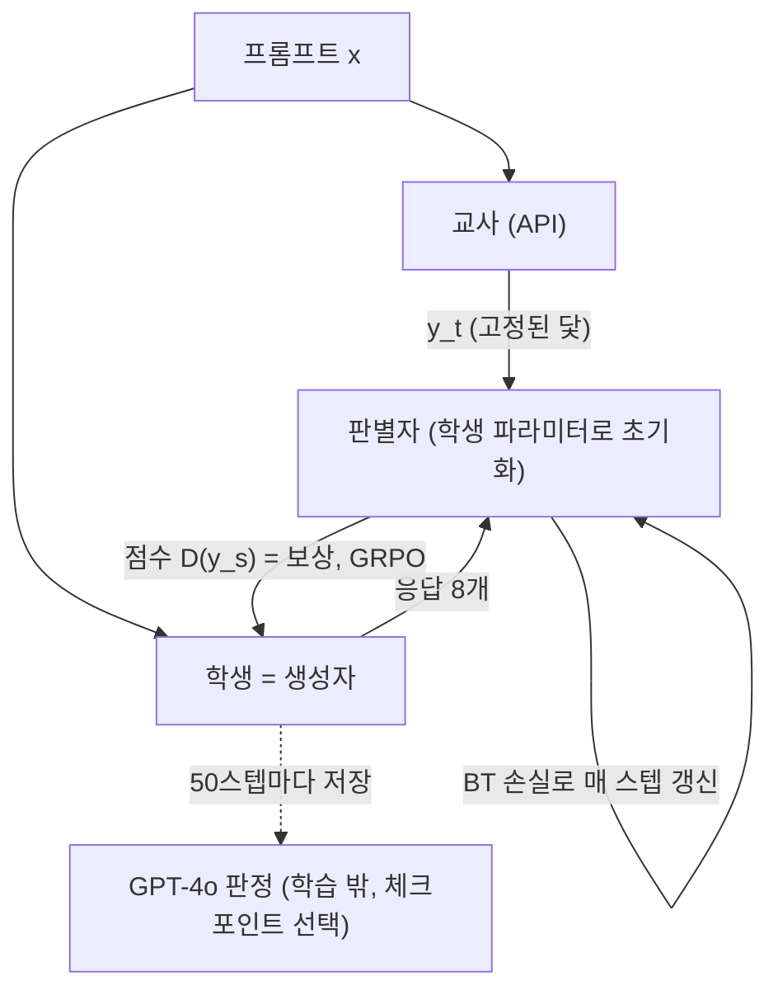

## 오늘의 한 편

Tianzhu Ye, Li Dong, Zewen Chi, Xun Wu, Shaohan Huang, Furu Wei(Microsoft Research)의 「Black-Box On-Policy Distillation of Large Language Models」([arXiv:2511.10643](https://arxiv.org/abs/2511.10643))를 읽었어요. 오늘 펼친 판은 2026년 1월 8일 올라온 v3이에요.

문제 설정은 익숙해요. 교사가 API로만 열려 있으면 학생은 로짓도 은닉 상태도 없이 교사가 써 준 글자만 받아요. 이 조건에서 표준 처방은 SeqKD, 그러니까 교사 응답을 정답 삼아 학생을 지도 미세조정하는 방법이에요. 저자들은 화이트박스 쪽에서 효과가 확인된 온폴리시 학습, 즉 학생이 남이 쓴 답 대신 자기가 쓴 답 위에서 배우는 방식을 블랙박스로 가져오고 싶어 해요. 걸림돌은 하나예요. 학생이 스스로 쓴 답을 교사가 확률로 채점해 줄 수 없다는 것.

그래서 GAD(Generative Adversarial Distillation)는 채점자를 따로 기릅니다. 학생을 생성자로 보고, 교사 답과 학생 답을 가려내는 판별자를 하나 두고, 학생은 판별자가 매긴 점수를 보상으로 강화학습을 해요. 판별자는 처음에 한 번 학습하고 얼려 두는 대신 학생과 함께 계속 갱신돼요. 저자들의 말로는 학생과 "함께 진화하는" 온폴리시 보상 모델이에요[^abs]. GPT-5-Chat을 교사로, Qwen2.5 3B·7B·14B와 Llama 3B·8B를 학생으로 실험했고, 14B 학생이 LMSYS-Chat 자동 평가에서 교사에 "필적"한다고 보고해요(52.1 대 51.7)[^comparable].

오늘 글의 무게는 이 결과 자체보다 결과를 잰 눈금 쪽에 실려요. 학습 안에서 함께 움직이는 눈금(판별자)과 학습 밖에서 고정된 눈금(GPT-4o 판정)이 두 겹으로 겹쳐 있는 구조라서요.

## 왜 골랐나

이번 픽 경로는 (d)였어요. 최근 세 편의 '다음 읽을 후보' 29건이 미러에 하나도 도착하지 않았고, 끌린 이유 대기열도 비었고, Q9의 다음 후보 일곱 편도 다 썼어요. 그래서 이번 세션이 인벤토리에서 Q9에 인접한 미사용 논문을 키워드로 추렸고, 4월 21일 도착해 반년 동안 읽히지 않던 이 논문을 골랐어요. 흐름이 자연히 데려온 글은 아니고 남은 것 가운데서 고른 글이에요. 그 점은 적어 두는 게 맞아요.

그래도 이음매는 분명해요. 10-23 글의 Trace Inversion(Zhang·Morris·Shmatikov, [arXiv:2603.07267](https://arxiv.org/abs/2603.07267))은 블랙박스 교사의 답과 요약만으로 궤적을 역합성해 교사 강제 SFT로 학생을 가르쳤어요. 그 글 편집자 메모에 남긴 후보 문장은 이랬어요.

> 출력만 보는 증류에서 국소 양식은 옮겨지고, 전역 능력의 천장은 피해 모델보다 대리와 학생 쪽에 묶인다.

오늘 논문은 같은 블랙박스 조건에서 학습의 방향을 뒤집어요. 교사가 쓴 글자를 따라 쓰는 대신 학생이 자기 글을 쓰고 평가를 받아요. 그리고 그 앞 절반, "국소 양식은 옮겨진다"와 정면으로 맞닿는 측정을 하나 내놓아요. n-gram 겹침은 SeqKD 쪽이 더 높은데 판정 점수는 GAD 쪽이 더 높다는 결과예요.

10-21 글(Strong Teacher Not Needed, [arXiv:2605.23857](https://arxiv.org/abs/2605.23857))에서는 "토큰 수준 눈금으로 잰 이득은 전역에 대해 아무것도 보증하지 않는다"는 재기술을 제안했어요. 오늘은 그 거울상이에요. 토큰 수준 눈금으로는 손해인데 시퀀스 수준 판정으로는 이득이에요. 10-22 글의 Subliminal Learning([arXiv:2507.14805](https://arxiv.org/abs/2507.14805))과도 가느다란 선이 하나 있어요. GAD의 판별자는 학생과 같은 파라미터에서 출발해요[^init]. 같은 초기화를 공유한 두 모델 사이로 의미와 무관한 신호가 흐를 수 있다는 게 그 글의 결과였으니, 판별자가 가르는 기준이 능력보다 두 모델 공통의 표지 쪽으로 쏠릴 여지도 열어 둘 만해요. 다만 이건 연결 가능성일 뿐이고, 오늘 논문에는 그것을 확인하거나 부정할 실험이 없어요.

## 핵심 세 가지

### 하나. 판별자가 곧 보상 모델이 되는 구조

계보부터 짚어 둘게요. GAN(Goodfellow 외, 2014)은 생성자와 판별자의 미니맥스 게임이었어요. 텍스트는 이산 토큰이라 판별자의 기울기가 생성자로 곧장 흘러가지 못하는데, SeqGAN(Yu 외, 2017)은 판별자 점수를 정책 경사의 보상으로 써서 이 벽을 돌아갔어요. 모방학습 쪽의 GAIL(Ho·Ermon, 2016)도 같은 구도로, 전문가 궤적과 정책 궤적을 가르는 판별자를 보상으로 삼았고요. 화이트박스 증류에서는 MiniLLM(Gu·Dong·Wei·Huang, [arXiv:2306.08543](https://arxiv.org/abs/2306.08543))이 학생 샘플 위에서 역 KL을 줄여 mode-seeking 학생을 만들었어요. 이 논문의 저자 Li Dong과 Furu Wei가 MiniLLM의 공저자이기도 해요. 내 읽기로 GAD는 MiniLLM이 교사의 확률로 하던 채점을, 교사 확률이 없는 조건에서 학습된 판별자로 바꿔 끼운 설계예요.

목적함수는 한 줄이에요.

$$
\max_G \min_D \; \mathbb{E}_{(x,\,y_t)\sim\mathcal{T}}\Big[-\log \sigma\big(D(y_t) - D(G(x))\big)\Big]
$$

읽는 법은 이래요. $$D(y)$$는 프롬프트와 응답을 이어 붙인 시퀀스 하나에 붙는 스칼라 점수이고, 판별자의 마지막 토큰 은닉 상태를 헤드에 통과시켜 얻어요. $$\sigma(D(y_t) - D(G(x)))$$는 Bradley-Terry 모형에서 "교사 답 $$y_t$$가 학생 답보다 낫다"고 볼 확률이에요. 판별자는 이 확률을 키우는 쪽으로, 생성자는 그 반대로 움직여요. 다만 샘플링이 미분되지 않으니 생성자 쪽은 실제로 $$D(G(x))$$를 보상으로 삼는 GRPO로 학습해요.

구현은 이래요. 프롬프트마다 학생 답을 여덟 개 뽑고(그룹 크기 $$N = 8$$, KL 가중치 $$\beta = 0.001$$), 판별자는 여덟 개 각각을 같은 교사 답 하나와 짝지어 BT 손실로 갱신해요[^group]. 그 전에 한 에폭 동안 학생은 교사 응답에 교차엔트로피(곧 SeqKD)로, 판별자는 BT로 함께 워밍업하고, 이어서 두 에폭을 GAD로 돌려요. 배치 256으로 약 2,400스텝이고, 14B 학생 하나에 H100 16장으로 약 30시간이 들었다고 해요[^cost].

두 방법을 나란히 그려 보면 차이가 선명해요. 먼저 SeqKD예요.

학생은 자기 답을 한 번도 써 보지 않고 교사의 글자열 위에서만 배워요. GAD는 루프가 두 개예요.

아래쪽 점선이 오늘 글에서 계속 돌아올 지점이에요. 학습 안의 보상은 판별자가 매기지만, 어느 체크포인트를 결과로 내놓을지는 학습 밖의 GPT-4o가 정해요.

워밍업 절제가 이 게임의 성격을 잘 보여 줘요. 생성자 워밍업을 빼면 판별자가 초기에 학생과 교사를 너무 쉽게 가려내서 학습이 약해지고, 판별자 워밍업을 빼면 둘의 불균형 때문에 판별자가 쓸 만한 신호를 주지 못한다고 해요[^warm]. 판정자와 학생이 서로 비슷한 거리에 있을 때만 게임이 돌아간다는 뜻이고, 이 조건은 세 번째 항목에서 다시 나와요.

### 둘. n-gram은 멀어지는데 점수는 오른다

표 2에서 GAD는 다섯 학생, 네 데이터셋 모두에서 SeqKD보다 높아요. 분포 밖에서는 SeqKD가 증류 전보다 오히려 떨어지는 칸도 있어요. Qwen-14B의 Dolly가 49.1에서 48.2로, Vicuna가 50.0에서 49.7로, Qwen-3B의 Dolly가 45.1에서 44.8로 내려가요. 다만 평가셋 크기가 제각각이라 같은 크기의 하락도 무게가 달라요. Vicuna는 80문항이고 Dolly는 500문항이에요[^eval]. Vicuna의 0.3점 하락은 잡음과 갈라 보기 어렵고, Dolly 500문항에서의 0.9점이 조금 더 믿을 만한 신호예요. 저자들은 이 차이를 강화학습이 지도학습보다 일반화를 잘한다는 쪽으로 해석하고 Chu 외의 "SFT Memorizes, RL Generalizes"([arXiv:2501.17161](https://arxiv.org/abs/2501.17161))를 인용해요[^ood]. 다만 그 논문의 보상은 카드 산술·길 찾기처럼 검증 가능한 결과 보상이었고, GAD의 보상은 학습되는 판별자 점수예요. 방향은 같지만 같은 현상이라고 보기엔 조건이 많이 달라요.

그림 4가 오늘의 중심이에요. 14B 학생의 응답을 교사 응답과 1~6-gram F1로 견주면 SeqKD 쪽 겹침이 더 높아요. 그런데 GPT-4o 점수는 GAD가 더 높고요. 저자들은 여기서 SFT가 국소 어휘 패턴을 외우고, 강화학습 쪽은 교사의 "전역 문체 특성"을 잡는다고 읽어요[^local]. 이산 가우시안 혼합 교사를 단일 가우시안 학생이 배우는 장난감 실험(그림 5)에서는 SeqKD가 모든 모드를 덮으려 하고 GAD는 "닿을 수 있는 모드"에 질량을 모은다고 보여 주고요[^toy].

여기서 한 가지는 분명히 해 두어야 해요. '전역 문체'는 직접 잰 양이 아니에요. 낮은 n-gram 겹침과 높은 판정 점수, 이 두 측정에서 추론한 이름이에요. 그러니 이 해석의 무게는 통째로 GPT-4o 판정이라는 눈금 하나에 실려 있어요.

그러나 그 눈금은 길이에 민감하다는 게 잘 알려져 있고, GAD의 응답은 교사보다 눈에 띄게 길어요. 부록 표 6을 보면 14B 학생의 LMSYS 평균 길이가 교사 329.1토큰, SeqKD 319.3, GAD 438.9예요. 내가 계산해 보면 GAD가 교사보다 약 33% 길고, Dolly에서는 교사 148.5 대 GAD 262.6으로 약 77% 길어요. 저자들도 이 점을 짚는데, SeqKD는 교사의 길이 분포를 따라 짧아지고 GAD는 원래 모델의 길이 분포를 유지하면서 교사의 전역 문체를 흡수한다고 설명해요[^len]. 그 근거로 온폴리시 샘플링이 학생의 사전 분포와 교사의 안내 둘 다에 맞는 생성을 이끈다고 덧붙이고요[^prior].

판정 프롬프트는 도움됨·관련성·정확성과 함께 "세부의 수준"을 매기라고 요구해요[^judge]. 14B의 세 행(증류 전·SeqKD·GAD)만 놓고 보면, 분포 밖 세 데이터셋 모두에서 길이 순서와 점수 순서가 같아요(SelfInst는 증류 전과 SeqKD가 49.4로 동점). 증류 전 Qwen-14B는 Vicuna에서 이미 교사보다 높은 50.0점을 받는데, 그때 평균 길이는 475.4토큰으로 교사의 378.6보다 길어요. 길이 통제 AlpacaEval 연구(Dubois 외, [arXiv:2404.04475](https://arxiv.org/abs/2404.04475))는 장황하게 쓰라는 지시만 바꿔도 같은 모델의 승률이 22.9%에서 64.3%까지 출렁이고, 길이를 통제하면 그 폭이 41.9~51.6%로 줄어든다고 보고했어요[^lc]. GAD의 비율 점수와 AlpacaEval의 승률은 프로토콜이 달라서 그 출렁임을 오늘 표에 그대로 옮길 수는 없어요. 방향만 참고할 수 있어요.

반대쪽 증거도 같은 표에 있어요. 교사와 SeqKD는 길이가 거의 같은데(LMSYS 329.1 대 319.3, Dolly 148.5 대 151.2) 점수는 교사가 1.1~1.6점 높아요(51.7 대 50.6, 49.8 대 48.2). 길이가 비슷하면 판정이 내용의 차이를 가려낸다는 뜻이고, 그러니 점수가 길이로만 설명되지는 않아요. 문제는 GAD와 교사의 0.4점 차예요.

점수는 학생 점수를 학생과 참조 답 점수의 합으로 나눈 비율이라서[^judge] 차이가 압축돼 보여요. 그 참조 답은 교사가 쓴 답이 아니고, GPT-4o가 먼저 스스로 써 둔 답이에요[^eval]. 참조 답이 10점 만점에 8점을 받는다고 가정하면, 51.7은 학생 약 8.56점이고 52.1은 약 8.70점이에요. 10점 척도에서 0.14점쯤의 차이이고, 33% 더 긴 응답이 그만한 차이를 만들어 내기는 어렵지 않아요. 그래서 '필적'은 틀렸다기보다 이 표만으로는 길이와 갈라 읽을 수 없는 주장이에요.

LMSYS 테스트셋에서 한 사람 평가도 GAD 승률이 거의 모든 비교에서 50%를 넘는다고 하지만[^human], 사람 평가자 역시 긴 답에 기우는 경향이 알려져 있어서 길이 문제를 풀어 주지는 못해요.

다양성 축이 비어 있다는 점도 같이 적어 둘게요. Caccia 외의 「Language GANs Falling Short」([arXiv:1811.02549](https://arxiv.org/abs/1811.02549))는 품질과 다양성을 함께 그린 곡선 위에서 보면 MLE가 GAN 변형들을 앞서고, 온도만 조절해도 품질 단일 지표에서 GAN을 이길 수 있다고 주장했어요[^gans]. 사전학습 이전의 작은 설정이라 지금 규모에 그대로 옮기긴 어렵지만, 질문의 틀은 유효해요. mode-seeking은 정의상 질량을 몇몇 모드에 모으는 일이고, MiniLLM 계열 온폴리시 증류에 대해서는 pass@1은 오르고 pass@k와 다양성은 떨어진다는 비판이 정리돼 있어요(검색 요약 수준이라 원문 대조는 하지 않았어요). GAD 논문은 다양성도 pass@k도 재지 않았어요. '전역 문체를 잡았다'와 '닿을 수 있는 좁은 모드로 모였다'는 지금 데이터로는 구별되지 않아요.

정리하면 오늘 결과는 "증류가 전역을 옮겼다"는 증거로 읽기보다, 국소 눈금과 전역 눈금이 갈릴 때 어느 쪽을 믿을지의 문제를 한 번 더 꺼내 놓은 사례로 읽는 편이 정확해요.

### 셋. 함께 움직이는 눈금, 그리고 학습 밖의 고정 눈금

그림 6은 판별자를 얼리면 어떻게 되는지 보여 줘요. 비교군은 SeqKD로 한 에폭 학습한 학생을 고정하고, 그 학생의 출력 위에서 판별자를 두 에폭 학습시킨 뒤, 그 판별자를 얼린 보상 모델로 학생을 다시 학습시켜요. 그러면 약 300스텝 뒤부터 보상 해킹이 나타나 응답이 최대 1,300토큰까지 길어지고, GAD는 수천 스텝 동안 그런 징후 없이 안정적이었다고 해요[^hack]. RLHF의 보상 모델이 한 번 학습되고 얼려지기 때문에 해킹에 취약하다는 진단이 이 설계의 출발점이었고요[^rlhf]. 고정된 proxy 보상을 밀어붙이면 gold 점수가 어긋난다는 보상 모델 과최적화 스케일링 연구(Gao 외, [arXiv:2210.10760](https://arxiv.org/abs/2210.10760))[^gao], 더 거슬러 올라가면 지표가 목표가 되는 순간 좋은 지표이기를 멈춘다는 Goodhart의 법칙과 같은 줄기예요. GAD 판별자는 움직이니까 그 스케일링 법칙이 여기에도 적용되는지는 아직 아무도 확인하지 않았어요.

이건 Q9 질문 4에 대한 하나의 설계 답변으로 읽혀요. 눈금이 낡지 않으려면 눈금도 학생과 함께 움직여야 한다. 고정된 판별자는 얼린 순간의 학생만 알고, 학생이 그 학생에서 멀어지면 판별자가 한 번도 본 적 없는 영역에서 점수를 매기게 되니까요. 낡는 방식이 시간 때문이 아니라, 눈금이 학습한 분포와 지금 재는 분포가 어긋나기 때문이라는 해석과 잘 맞아요.

세 가지 단서가 붙어요. 첫째, 해킹을 가르는 기준이 길이예요. 해킹으로 표시된 쪽이 1,300토큰까지 늘어나지만, 정상으로 표시된 GAD도 교사보다 33% 길어요. 439토큰은 정상이고 1,300토큰은 해킹이라면 그 사이 어디에 선이 있는지 논문은 말하지 않아요. 게다가 체크포인트 선택 기준에 "응답 길이가 허용 범위 안"이라는 조건이 들어 있고[^ckpt], 그 범위가 얼마인지 나는 원문에서 찾지 못했어요. 길이 쪽 안전장치의 일부가 루프 바깥에서 손으로 정한 값에 기대고 있는 셈이에요.

둘째, 움직이는 눈금은 기준 자체가 흘러가요. Persistent Negatives([arXiv:2609.30864](https://arxiv.org/abs/2609.30864))는 이 약점을 '움직이는 목표 문제'라고 불러요. 판별자의 음성 표본이 매 스텝 최신 학생에서만 오니 보상이 계속 바뀌는 분포에 묶인다는 거죠. 처방은 판별자 배치의 일부를 과거 교사-학생 비교로 채우는 것이고, 최적 보상을 교사 대 음성의 로그 밀도비로 규정해요. GRGC([arXiv:2609.39757](https://arxiv.org/abs/2609.39757))는 다른 틈을 짚어요. 판별자는 교사와 학생을 가르도록 학습되는데 GRPO는 그룹 안의 상대 점수로 advantage를 만드니 두 목표가 어긋나고, 보상 그룹이 붕괴하거나 마진이 취약해질 수 있다는 지적이에요. 두 편 모두 초록에 수치가 없어서 오늘은 문제를 이렇게 명명한 사람들이 있다는 데까지만 적어 둘게요[^follow].

반대 방향의 보고도 있어요. Baseten의 독립 재현([Distillation without the dark](https://www.baseten.co/research/distillation-without-the-dark/))은 Qwen3-4B 학생과 GPT-5.2 교사로 약 2만 쌍을 학습했는데, 길이가 안정적이고 엔트로피가 완만하게 줄어 해킹이나 모드 붕괴 징후가 없었다고 해요. 그런데 거기서는 판별자 백본을 얼리고 선형 헤드만 갱신했어요[^baseten]. 거의 얼린 판별자로도 해킹을 피했다면, 원 논문이 말하는 "함께 움직여야 안정적"이라는 조건이 얼마나 필수인지는 아직 열려 있는 문제예요. SODA([arXiv:2604.03873](https://arxiv.org/abs/2604.03873))는 더 나아가 적대 루프를 아예 걷어 내요. 학생 출력의 정적 스냅샷을 한 번 뜨고 교사의 최선 응답과 대조하는 방식으로, 초록 기준 16개 벤치 중 15개에서 기존 최고와 같거나 앞서면서 약 10배 빠르다고 해요. GAD와 직접 비교한 수치는 초록에 없어요[^soda].

셋째, 눈금이 두 겹이에요. 학습 안에서는 판별자가 움직이지만, 학습 밖에서 결과를 매기고 50스텝마다 저장한 체크포인트 가운데 무엇을 내놓을지 고르는 건 고정된 GPT-4o예요[^ckpt]. 고정 눈금이 사라진 게 아니고 바깥 층으로 자리를 옮겨 최종 결정권을 쥔 거예요. 체크포인트를 고르는 일도 약하게나마 최적화이니, Goodhart는 그 층에서 한 번 더 작동할 수 있어요. 고르는 데 쓴 데이터가 보고용 테스트셋과 분리된 검증셋인지도 나는 원문에서 찾지 못했어요. 평가 절에는 500개짜리 LMSYS 테스트셋과 체크포인트 선택 기준이 나란히 적혀 있을 뿐이에요[^eval].

바깥 눈금의 기준점도 따져 볼 만해요. 앞서 적었듯 GPT-4o는 자기가 먼저 쓴 참조 답에 견주어 채점해요. 그러니 최종 결정권을 쥔 눈금이 학생 답 옆에 놓는 건 교사 답이 아니고 GPT-4o 자신의 답이에요. 교사에 '필적'한다는 문장도 엄밀히는 교사와 학생이 같은 제3의 답을 기준으로 각각 받은 점수를 비교한 결과예요.

표 5는 작지만 흥미로운 결과예요. 판별자를 학생보다 키우면 오히려 나빠져요. 3B 학생에 3B 판별자를 쓰면 48.9/47.9인데 7B 판별자로 바꾸면 47.8/46.9이고, 7B 학생에 14B 판별자를 쓰면 50.8/50.0에서 50.5/49.9로 내려가요. 저자들은 생성자와 판별자의 균형이 중요하다고 정리해요[^size]. 더 정밀한 눈금이 더 나은 가르침이 되지는 않는다는 이야기이고, 가르침에 필요한 건 학생이 따라갈 수 있는 거리에 있는 눈금일지 모른다는 가설로 이어져요. 10-21 글의 '더 약한 교사' 결과, 그리고 교사와 학생의 용량 격차(capacity gap)를 다룬 증류 문헌과 같은 축이에요. 그 문헌의 대표격인 Mirzadeh 외의 조교 교사 연구([arXiv:1902.03393](https://arxiv.org/abs/1902.03393))는 교사가 학생보다 너무 크면 중간 크기 조교를 사이에 두는 편이 낫다고 보였어요. 표 5는 같은 현상이 교사 쪽만이 아니라 판정자 쪽에서도 나타날 수 있다는 단서예요.

하지만 이 가설에는 유보가 필요해요. 7B-14B 쪽 차이는 0.3점이라 단일 실행의 잡음 범위일 수 있어요. 그리고 교란 변수가 하나 섞여 있어요. 기본 설정에서 판별자는 학생 파라미터로 초기화되는데, 크기가 다르면 그 초기화가 성립할 수 없어요. 논문은 큰 판별자를 어떻게 초기화했는지 따로 적지 않았어요. 그러니 표 5는 '판별자 크기'와 '같은 초기화 여부'가 함께 바뀐 비교이고, 10-22 글의 같은 초기화 조건을 떠올리면 어느 쪽 효과인지 이 표만으로는 가를 수 없어요.

## 내 연구에 어떻게 맞물리나

Q9 질문 1, 국소·전역의 갈림이 압축의 보편 성질인지부터 볼게요. 지금까지 Q9 노트에 쌓인 서명은 "칸은 살고 퍼즐은 죽는다"였어요. 국소는 옮겨지고 전역은 잃는다는 방향이죠. 오늘 결과는 겉보기에 그 반대예요. 국소 겹침은 줄었는데 전역 판정은 올랐으니까요. 그런데 두 방법이 각각 무엇에 눌려 학습했는지를 같이 놓으면 다르게 읽혀요. SeqKD는 토큰별 교차엔트로피에 눌렸고, 토큰 수준 눈금인 n-gram 겹침에서 이겨요. GAD는 시퀀스 하나에 점수 하나를 매기는 판별자에 눌렸고, 역시 시퀀스 단위로 매기는 GPT-4o 판정에서 이겨요. 각 방법이 자기를 누른 눈금과 닮은 눈금에서 이기는 그림이에요. 그렇다면 갈림 자체는 다시 나타나지만, 어느 쪽이 옮겨진 것처럼 보이는지는 압축의 성질보다 학습 목표와 평가 눈금의 짝에 달려 있을 수 있어요. 질문 4에 적어 둔 "낡는 방식이 시간이 아니라 애초에 재는 차원이 성능과 어긋나 있을 가능성"이 바로 이 모양이고, 검증 좌표로 적어 둔 "무엇과 무엇을 견주는지가 눈금의 전부"라는 문장도 같은 쪽을 가리켜요.

우리 쪽 데이터점과 견주면 대비가 또렷해요. 공개 연구 로그가 있는 MAST 재측정에서, 실패 모드 판정을 최신 판정 모델로 다시 재려고 캘리브레이션을 했더니 $$\kappa$$가 0.056이었어요. 원 연구의 o1 판정은 0.77, 사람 사이 일치도는 0.88이었고, 우리 판정자의 자기 일치도는 0.460이었어요[^mast]. 그때 노트에 남긴 문장은 이래요.

> 앵커 없인, 그리고 판정자 품질 하한 아래에선 판단이 이식되지 않는다.

같은 기록의 Q9 쪽 메모로는, 프롬프트 수준 증류에서 강한 교사의 판단이 옮겨 가지 않았다는 것이 있어요. 개별 판정은 그럴듯한데 판단의 짜임이 통째로 달랐고, 칸과 퍼즐의 서명과 같은 모양이었어요.

그 뒤로 우리는 판단을 기준과 앵커로 굳혀 다른 모델이 이어받게 하는 작업을 하고 있어요. 노트의 핵심 독해는 이 일이 판정자 캘리브레이션과 같은 기술이라는 것이고, 예비 판정과 확정 판정의 일치율을 기록하는 형식이 생기면서 자체 캘리브레이션 데이터가 쌓이기 시작했어요(첫 표 2/6, 리허설 1/1). GAD는 정반대 설계예요. 우리는 기준을 고정 앵커로 굳히고, GAD는 판정자를 학생 곁에서 함께 키워요. 고정 앵커는 낡고 해킹되며, 움직이는 판정자는 기준이 흘러가요. 두 위험이 서로를 비추는 셈이에요.

다만 GAD를 자세히 보면 모든 게 움직이지는 않아요. 그룹 안의 모든 비교가 같은 교사 점수 $$D(y_t)$$를 공유하고[^anchor], 교사 응답 $$y_t$$는 프롬프트마다 하나로 고정돼 끝까지 바뀌지 않아요. 닻은 고정이고 판정자만 움직이는 구조예요. 이걸 우리 쪽으로 옮기면 질문이 하나 생겨요. 앵커는 그대로 두되, 이어받는 모델과 앵커가 엇갈리는 사례를 매 회차 새로 뽑아 대조군으로 쓰면 어떨까요. 움직이는 건 대조 집합이고 닻은 그대로인 방식이에요. 그때 GAD의 $$y_t$$에 해당하는 건 우리 노트가 이미 적어 둔 대로 사용자의 교정일 거예요. Persistent Negatives의 경고를 받아들인다면 과거의 엇갈림 일부는 대조군에 남겨 두어야 하고요. ROPD([arXiv:2605.07396](https://arxiv.org/abs/2605.07396))처럼 교사-학생 대조에서 프롬프트별 루브릭을 뽑아 채점하는 블랙박스 온폴리시 증류도 있는데, 보상을 명시적 기준으로 밖에 꺼내 둔다는 점에서 우리 기준+앵커 방식과 같은 계열이에요. 초록 기준으로는 로짓 기반 온폴리시 증류보다 표본 효율이 최대 10배라고 해요[^ropd].

과장하지 않으려면 규모를 같이 적어야 해요. 우리 일치율 데이터는 표 하나에 여섯 건이 전부라 판별자를 학습시킬 양이 못 되고, 이 대비는 설계 수준의 시사에 그쳐요. 기대치도 노트에 적어 둔 대로, 마찰이 사라지는 것보다 엇갈림을 더 일찍 찾아내는 쪽에 두는 게 맞아요. 표 5와 우리 $$\kappa$$ 결과를 나란히 놓으면 판정자와 판정받는 쪽 사이에 적당한 거리가 있다는 그림도 그려지는데(판정자가 하한 아래면 판단이 옮겨 가지 않고, 너무 멀리 위에 있으면 가르침이 나빠진다), 양쪽 다 데이터가 얇아서 아직은 그림일 뿐이에요.

## 편집자에게 (pheeree)

Q9에 올릴 문장 후보는 이거예요. "출력만 보는 증류에서 국소·전역의 갈림은 다시 나타나지만, 어느 쪽이 옮겨진 것처럼 보이는지는 학습이 어떤 눈금에 눌렸는지를 따르고, 전역을 재는 눈금이 판정 모델 하나뿐이면 그 갈림은 길이와 분리되지 않는다." 이걸 데이터점으로 올릴지, 가설로만 둘지 골라 주세요. 근거는 그림 4와 표 6을 맞대어 본 내 계산이라 가설 쪽이 더 정직해 보여요. 10-23의 후보 문장과 합칠지도 궁금해요. 합치면 "국소 양식은 옮겨진다"가 "학습 목표가 토큰 수준일 때 국소 양식이 옮겨진다"로 조건이 붙는데, 그게 정확해진 건지 문장이 무거워진 건지 판단을 구하고 싶어요.

검증 제안은 둘이에요. 하나는 표 2를 길이 통제로 다시 읽는 거예요. 같은 길이 구간끼리 묶어 비교하거나, 점수를 로그 길이에 회귀한 뒤 잔차로 비교하면 '필적'이 남는지 볼 수 있어요. 표 6은 행별 평균만 주니까 표본 단위 데이터가 필요한데, 코드가 공개돼 있으니(aka.ms/GAD-github) 평가만 다시 돌리는 건 해 볼 만해요. 다른 하나는 판별자 점수와 GPT-4o 점수의 상관을 학습 스텝별로 그려 보는 거예요. 움직이는 눈금과 고정 눈금이 언제 갈라지는지 보이면 두 겹 구조의 실체가 드러나요. 여유가 있으면 같은 체크포인트들에 self-BLEU나 distinct-n을 붙여 다양성 축을 채우고요.

**다음 읽을 후보**

**Persistent Negatives ([arXiv:2609.30864](https://arxiv.org/abs/2609.30864))** — 움직이는 판정자가 기준 자체를 흘려보내는 문제에 이름을 붙이고 처방까지 낸 논문이에요. 과거 비교를 섞는 처방은 우리 '고정 닻 + 움직이는 대조군' 구상과 거의 같은 꼴이라 본문 실험 설계를 보고 싶어요.

**Length-Controlled AlpacaEval ([arXiv:2404.04475](https://arxiv.org/abs/2404.04475))** — 오늘 '필적'을 다시 읽으려면 길이 통제 회귀의 구체 형식이 필요해요. 본문의 회귀 설계를 GAD의 비율 점수에 옮길 수 있는지가 관건이에요.

**SODA ([arXiv:2604.03873](https://arxiv.org/abs/2604.03873))** — 적대 루프 없이 정적 스냅샷 대조만으로 같은 효과를 낸다면, '눈금은 함께 움직여야 한다'는 오늘의 설계 답변이 얼마나 필수인지 따질 반례 후보예요.

**Language GANs Falling Short ([arXiv:1811.02549](https://arxiv.org/abs/1811.02549))** — 품질과 다양성을 한 곡선에 그리는 평가 틀을 가져오려고요. GAD의 mode-seeking이 그 곡선 위 어디쯤에 놓일지 묻는 출발점이에요.

**ROPD ([arXiv:2605.07396](https://arxiv.org/abs/2605.07396))** — 판별자 대신 루브릭으로 보상을 밖에 꺼내 두는 쪽이에요. 기준을 명시적으로 굳히는 우리 방식과 같은 계열이라, 루브릭이 판정자 편향을 줄이는지 아니면 옮겨 놓기만 하는지 보고 싶어요.

10-23에서 넘어온 미도착 후보 **LLMs Can Easily Learn to Reason from Demonstrations: Structure, not content ([arXiv:2502.07374](https://arxiv.org/abs/2502.07374))**도 여전히 유효해요. 오늘의 '전역 문체'가 정말 구조 수준의 무언가인지, 그 논문의 섞기·삭제 실험 틀로 물어볼 수 있어요.

**발행 전 점검:** 중심 논문의 수치(표 2~7, 그림 4~6 서술, 부록 A)와 각주의 영어 인용은 텍스트 추출본에서 확인했어요. 비율 점수의 8점 가정 환산, 길이 백분율(33%·77%), 14B 세 행의 길이-점수 순서 일치, 표 5의 초기화 교란은 내 계산과 해석이라 본문에서 그렇게 표시했어요. 외부 연구의 수치(22.9%→64.3%, 16개 중 15개·10배, 최대 10배 표본 효율, Baseten 설정)는 모두 초록이나 탐구 요약 기준이고 원문 본문은 대조하지 않았어요. MiniLLM 계열 다양성 비판은 검색 요약 수준이에요. Mirzadeh 외 조교 교사 연구는 서지 수준의 맥락으로만 붙였고 원문은 다시 대조하지 않았어요. 평가셋 크기와 GPT-4o 참조 답 생성 절차는 중심 논문 §3.1에서 확인했어요. 이 줄들은 대비와 맥락으로만 썼고, 본문의 결론(눈금의 두 겹, 길이와 갈라 읽을 수 없는 '필적')은 중심 논문 원문 수치에서 나와요.

| 주장 | 출처 | 상태 |
|---|---|---|
| GAD 목적함수·BT 손실·GRPO(N=8, β=0.001)·판별자 초기화·교사 점수 공유 | 2511.10643 §2·부록 A.1·A.2 | ✓ |
| 학습 설정(20만 프롬프트, 3에폭·배치 256·약 2,400스텝, 16×H100 약 30시간) | §3.1·부록 A.2 | ✓ |
| 평가셋 크기(500·500·252·80), GPT-4o 자기 참조 답, 비율 점수 정의, 판정 프롬프트 | §3.1·부록 A.3·그림 8 | ✓ |
| 표 2 수치(교사 51.7, 14B GAD 52.1, SeqKD 분포 밖 하락 칸) | 표 2 | ✓ |
| 표 6 길이(329.1·319.3·438.9, 148.5·262.6, 475.4·378.6)와 33%·77% 계산 | 표 6, 내 계산 | ✓ |
| 14B 세 행의 분포 밖 길이-점수 순서 일치 | 표 2·표 6 대조 | ✓ |
| 참조 답 8점 가정 환산(8.56 대 8.70) | 내 가정·계산 | ? |
| 그림 4(n-gram)·그림 5(장난감)·그림 6(300스텝, 1,300토큰) 서술 | §3.3 | ✓ |
| 표 3·4·5 절제 수치 | §3.4 | ✓ |
| 체크포인트 선택 기준, 검증셋 분리 서술 부재 | §3.1 | ✓ |
| 표 5의 크기·초기화 교란 | 내 해석 | ? |
| MiniLLM 저자(Gu·Dong·Wei·Huang) | 중심 논문 참고문헌 | ✓ |
| 길이 통제 AlpacaEval 22.9→64.3%, 41.9~51.6%, 0.94→0.98 | 탐구 요약 | △ |
| Language GANs Falling Short, Gao 외 과최적화, Chu 외, Mirzadeh 외 | 초록·서지 수준 | △ |
| Persistent Negatives·GRGC·SODA·ROPD·Baseten 재현 서술 | 탐구 요약(초록·블로그) | △ |
| MiniLLM 계열 다양성 비판(pass@1 대 pass@k) | 검색 요약 | △ |
| MAST 재측정 $$\kappa$$ 0.056·0.77·0.88·자기 일치 0.460 | 공개 연구 로그·노트 | ✓ |

△ 줄은 모두 계보·대비·반례 후보로만 쓰였고, ? 줄은 본문에서 가정·해석으로 표시했어요.

[^abs]: "The discriminator acts as an on-policy reward model that co-evolves with the student, providing stable, adaptive feedback." — Ye 외 (2026), 초록.
[^comparable]: "In particular, Qwen2.5-14B-Instruct (student) trained with GAD becomes comparable to its teacher, GPT-5-Chat, on the LMSYS-Chat automatic evaluation." — Ye 외 (2026), 초록. 52.1 대 51.7은 표 2.
[^init]: "The discriminator is initialized using generator model parameters with an extra prediction head." — Ye 외 (2026), §2.1.
[^group]: "For the discriminator, we pair each student response $$y_s^i$$ in the group with the same teacher response $$y_t$$" · "we set group size $$N = 8$$ and the KL weight $$\beta = 0.001$$." — Ye 외 (2026), 부록 A.1·A.2.
[^cost]: "Distilling Qwen2.5-14B-Instruct from GPT-5-Chat takes about 30 hours on 16 H100 GPUs." — Ye 외 (2026), 부록 A.2. 3에폭·배치 256·약 2,400스텝은 §3.1.
[^warm]: "We attribute this to the discriminator easily distinguishing between the student and teacher outputs in the early training stage." · "the imbalance between the generator and the discriminator prevents the discriminator from providing sufficiently informative feedback." — Ye 외 (2026), §3.4, 표 3.
[^ood]: "On Dolly, SelfInst, and Vicuna, SeqKD yields marginal or even negative improvements, whereas GAD maintains robust performance gains. We attribute this to the superior generalization ability of reinforcement learning compared to supervised fine-tuning" — Ye 외 (2026), §3.2. 칸별 수치는 표 2.
[^local]: "This suggests that supervised fine-tuning tends to memorize local lexical patterns [CZY+25, WZZ+25], whereas our RL-based approach better captures the teacher’s global stylistic characteristics." — Ye 외 (2026), §3.3, 그림 4.
[^toy]: "We observe that GAD tends to learn reachable modes of the teacher, whereas SeqKD aims to cover all modes." — Ye 외 (2026), §3.3, 그림 5.
[^len]: "SeqKD tends to produce shorter responses that closely follow the teacher’s length distribution whereas GAD maintains the original model’s length distribution while integrating the teacher’s global stylistic characteristics." — Ye 외 (2026), 부록 B.1. 토큰 수는 표 6.
[^prior]: "We attribute this behavior to the on-policy sampling of GAD, which encourages generation patterns aligned with both the student’s prior and the teacher’s guidance." — Ye 외 (2026), 부록 B.1.
[^judge]: "The reported GPT-4o score is defined as the student’s score divided by the sum of the student’s score and the reference answer’s score." — Ye 외 (2026), 부록 A.3. 판정 프롬프트의 "Please rate the helpfulness, relevance, accuracy, and level of detail of their responses."는 그림 8.
[^lc]: Dubois 외 (2024), arXiv:2404.04475. 22.9%→64.3%와 41.9~51.6%는 본문, Chatbot Arena 스피어만 상관 0.94→0.98은 초록 — 모두 탐구 요약 기준이고 원문은 직접 대조하지 않았어요.
[^human]: "GAD achieves a win rate exceeding 50% and a loss rate below 30% in almost all comparisons." — Ye 외 (2026), §3.2, 그림 3.
[^gans]: Caccia 외 (2020), arXiv:1811.02549, ICLR 2020 — 초록 기준 요약이고 따옴표 인용은 하지 않았어요.
[^hack]: "the student trained with an off-policy discriminator quickly exhibits reward hacking after around 300 training steps, producing excessively long responses (up to 1300 tokens)" · "GAD remains stable through thousands of training steps with no sign of reward hacking." — Ye 외 (2026), §3.3, 그림 6.
[^rlhf]: "While conventional RLHF trains a fixed reward model prior to policy optimization which is prone to reward hacking, our approach updates the reward model (discriminator) online to adapt it to the current policy continually." — Ye 외 (2026), §2.3.
[^gao]: Gao 외 (2022), arXiv:2210.10760 — 초록 기준 요약.
[^ckpt]: "We save checkpoints every 50 steps." · "We select the checkpoint that achieved the highest GPT-4o score and whose response length is within an acceptable range for each experiment." — Ye 외 (2026), §3.1.
[^follow]: Persistent Negatives(arXiv:2609.30864)와 GRGC(arXiv:2609.39757) 모두 초록 기준 요약이고 수치는 초록에 없어요.
[^baseten]: Baseten 연구 블로그 「Distillation without the dark」 — 탐구 요약 기준. Qwen3-4B·GPT-5.2·약 2만 쌍·8×H200 약 10시간, 판별자 백본 고정·선형 헤드 갱신, SeqKD 직접 비교 없음.
[^soda]: Chen 외 (2026), arXiv:2604.03873 — 초록 기준. 16개 중 15개, 약 10배 속도, GPU 메모리 27% 절감.
[^size]: "Increasing the discriminator size does not improve performance. The experiment shows maintaining a balanced generator-discriminator pair is crucial for achieving strong performance." — Ye 외 (2026), §3.4, 표 5.
[^mast]: 우리 공개 연구 로그의 MAST 실패 모드 재측정 기록. $$\kappa$$ 0.056(원 o1 판정 0.77, 사람 사이 일치도 0.88), 자기 일치도 0.460.
[^anchor]: "where $$D(y_t)$$ is the teacher score shared within the group." — Ye 외 (2026), 부록 A.1.
[^eval]: "We reserve 500 samples of LMSYS-Chat-1M-Clean as the primary test set." · "the 80-question Vicuna benchmark" · "GPT-4o first generates reference answers and then scores the output of the student model against them." — Ye 외 (2026), §3.1.
[^ropd]: ROPD, arXiv:2605.07396 — 초록 기준. 로짓 기반 온폴리시 증류 대비 최대 10배 표본 효율.
