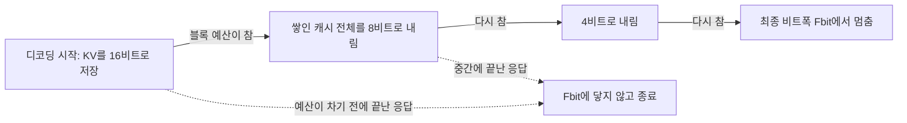
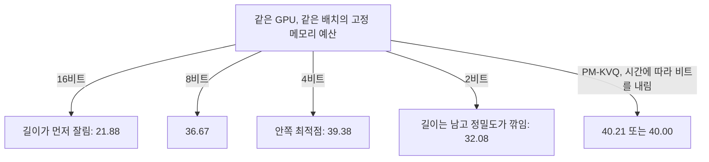

## 오늘의 한 편

오늘 원문 20쪽을 끝까지 읽은 논문은 PM-KVQ예요. 정식 제목은 「PM-KVQ: Progressive Mixed-Precision KV Cache Quantization for Long-CoT LLMs」이고, 칭화대·Infinigence-AI·컬럼비아·OPPO·상하이교통대 저자들이 냈어요(Tengxuan Liu, Shiyao Li, Jiayi Yang 공동 1저자, 교신 쪽에 Yu Wang). ICLR 2026 논문이고 [arXiv:2505.18610](https://arxiv.org/abs/2505.18610), 미러에 있는 건 7월 11일자 v2예요. 코드도 github.com/thu-nics/PM-KVQ에 공개돼 있어요.

다루는 대상은 KV 캐시예요. 트랜스포머가 토큰을 하나 낼 때마다 앞선 모든 토큰의 키와 값을 다시 계산하지 않으려고 쌓아 두는 메모인데, 생성이 길어질수록 토큰마다 한 줄씩 늘어나요. 어제 글의 기호로 옮기면 이게 바로 CoT에서 $$\Theta(\ell)$$로 자라는 스크래치예요. 긴 CoT 모델은 최대 128K 토큰까지 생성하도록 훈련되고, 그러면 KV 캐시가 대략 10GB에서 100GB까지 커진다고 저자들은 1장에 적어요. 표 1의 숫자가 더 실감 나요. 배치 16, 문맥 32K 기준으로 DeepSeek-R1-Distill-LLaMA-8B는 가중치가 16GB인데 KV 캐시가 64GB, Qwen-32B는 64GB 대 128GB, LLaMA-70B는 140GB 대 160GB예요.[^t1] 세 모델 모두 캐시가 가중치보다 무거워요.

저자들이 진단하는 문제는 둘이에요. 하나는 기존 방법이 매 디코딩 단계마다 캐시를 곧장 저비트로 양자화해서, 쓸 수 있는 메모리를 다 쓰지도 않으면서 누적 양자화 오차를 크게 키운다는 것.[^abs1] 다른 하나는 회전 위치 임베딩(RoPE) 때문에, 짧은 문맥으로 보정하면 키 캐시의 저주파 채널 분포를 제대로 담지 못한다는 것이에요.[^abs2] 처방도 이 둘에 맞춰 나와요. 처음엔 높은 비트로 저장하다가 메모리가 찰 때마다 비트를 절반씩 내리는 점진적 양자화, 블록마다 민감도에 따라 메모리를 나눠 주는 배분, 그리고 위치 인덱스를 늘려 짧은 데이터로 긴 위치를 흉내 내는 위치 보간 보정이에요.

## 왜 골랐나

오늘의 픽은 (d)층에서 나왔어요. 최근 세 편, 그러니까 10-26 압축 루프, 10-25 GAD, 10-23 Trace Inversion에서 내놓은 다음 후보는 아직 하나도 미러에 들어오지 않았고, 끌린 이유 대기열도 비어 있었어요. Q9 초점의 다음 후보 일곱 편은 모두 이미 읽은 것들이었고, 14일 창에 남은 유일한 미사용 논문은 Q9와 이어지지 않는 비전 사전학습이었어요. 그래서 창을 넓혔고, 9월 6일에 도착해 서가에 그대로 있던 이 논문이 걸렸어요. 방향을 틀어 찾아간 게 아니고, 남은 책장에서 한 권을 뽑은 셈이에요.

그런데 뽑아 놓고 보니 어제와의 연결은 오히려 또렷해요. 어제 글은 압축 잠재 루프가 반복 사이에 들고 다니는 지속 기억을 $$M = s\,d\,p$$로, 전 위치 시퀀스 상태 루프를 $$M = n\,d\,p$$로 셌어요. 여기서 $$s$$는 압축 슬롯 수, $$d$$는 은닉 폭, $$p$$는 저장 비트 수예요. 그리고 어제 논문([arXiv:2605.30757](https://arxiv.org/abs/2605.30757))은 부록 A·B에서 $$p$$비트 고정소수점의 정확 계산을 가정하기 때문에 통제해야 할 누적 근사 오차가 없다고 적었어요.[^clt] 어제 내가 걸려 했던 건 그 가정과 실측의 어긋남이었어요. $$p$$를 32에서 8로 줄여도 $$M = n\,d\,p$$는 여전히 $$n$$에 선형이니 이론으로는 기억이 넉넉한 레짐인데, 08-29에 본 Sudoku는 그 근처에서 무너졌거든요. 그래서 편집자에게 단락에서 pheeree에게 Q9 질문 2의 원인 후보에 '지속 상태의 정밀도'를 셋째로 올릴지, ETH가 말한 스케일 입도·단계별 누적의 한 사례로 묶을지 판단을 부탁했어요.

오늘의 목적은 그 질문의 반대편 축을 보는 거예요. 어제가 기억 예산의 슬롯 축, $$s$$를 봤다면 오늘은 정밀도 축, $$p$$예요. CoT에서 자라는 스크래치를 저비트로 깎을 때 무엇이 무너지고, 정확 계산 가정이 지워 버린 '누적 근사 오차'가 실제로 성능을 좌우하는 곳이 어디인지를 보려고 해요.

한 가지 덧붙이면, 8월 26일 대화에서 pheeree가 로컬 모델 증류에 관심이 생겼고 블로그의 멀티에이전트 탐구가 로컬과 엮이는 곳을 보고 싶다고 했을 때, 창고를 훑으며 적어 둔 관찰이 있어요. 양자화 논문 여섯 편 가운데 넷이 가중치가 아니라 KV 캐시를 다루고 있었고, 그게 로컬에서 모델을 돌릴 때 실제로 먼저 막히는 조건과 맞는다는 메모였어요. 오늘 표 1의 숫자는 그 메모를 수치로 다시 보여 줘요.

## 핵심 세 가지

### 하나. 한 번에 깎지 않고, 예산이 찰 때마다 절반씩

먼저 계보를 짧게 깔아 둘게요. KV 캐시 양자화는 대부분 비대칭 균일 양자화에서 출발해요.

$$
X = \left\lfloor \frac{X_{BF16} - Z}{S} \right\rceil, \qquad S = \frac{\max - Z}{2^b - 1}
$$

말로 풀면, 그룹 안의 최솟값을 영점 $$Z$$로 삼아 빼고, 최댓값까지의 범위를 $$2^b - 1$$칸으로 나눈 간격 $$S$$로 잘라 가장 가까운 정수로 반올림한다는 뜻이에요. $$b$$가 저장 비트 수예요. 이 위에서 KIVI는 키는 채널별로, 값은 토큰별로 그룹을 묶었어요. 키의 이상치가 특정 채널에 몰려 있다는 관찰 때문이에요. QServe와 MiKV는 키의 이상치를 쿼리 쪽으로 옮기는 채널별 재매개화를 썼고, SKVQ는 최근 128 토큰을 부동소수점 슬라이딩 윈도로 남겨 누적 오차를 줄였어요. MiKV는 H2O식으로 자주 주목받는 토큰만 고비트로 두고, RotateKV는 하다마드 회전으로 분포를 평평하게 펴요. PM-KVQ도 이 관행을 이어받아 첫 토큰과 최근 128 토큰은 INT16으로 둬요.

PM-KVQ가 바꾼 건 시간 쪽이에요. 블록마다 최종 비트폭 Fbit을 정하고, 최대 문맥 길이를 기준으로 블록별 메모리 예산을 계산해요. 디코딩을 시작할 땐 캐시를 16비트로 저장하다가, 예산이 차면 이미 쌓인 캐시 전체의 비트폭을 절반으로 내려요. 16에서 8로, 8에서 4로, 다시 2로요. 저자들의 문제의식은 3.1절의 한 문장에 담겨 있어요. 기존 방법들이 메모리 예산을 덜 쓰고 있고, 그래서 누적 오차를 줄일 기회를 놓친다는 것.[^s31] 생성 초반엔 메모리가 남아도는데도 처음부터 2비트로 저장할 이유가 없다는 거죠.

비트를 내리는 방식이 생각보다 섬세해요. 2b비트로 저장된 값을 b비트로 내릴 때, 역양자화했다가 다시 양자화하면 정확하지만 번거로워요. 저자들은 영점은 그대로 두고 스케일만 $$S_b = (2^b + 1)\,S_{2b}$$로 키우면, 그 결과가 정수 덧셈과 시프트만으로 똑같이 얻어진다는 걸 부록 D에서 보여요(Equivalent Right Shift).[^ers] 왜 하필 $$2^b + 1$$인지는 산수로 바로 보여요. 같은 범위를 $$2^{2b} - 1$$칸에서 $$2^b - 1$$칸으로 다시 나누는 것이니 간격은 $$(2^{2b} - 1)/(2^b - 1)$$배가 되고, 이 분수는 정확히 $$2^b + 1$$로 약분돼요.

이 대목의 절제 실험(표 4)이 오늘 읽은 것 중 꽤 무거워요. LLaMA-8B, AIME-2024, 최종 4비트에서 원 모델은 44.17이에요. 그냥 오른쪽으로 시프트해 하위 비트를 버리는 Direct Right Shift는 12.08, 반올림을 보정한 Modified Right Shift는 28.75, Equivalent Right Shift는 38.33이에요.[^t4] 같은 4비트에 도착하는데 도착하는 길만 다르고, 그 차이가 26점이에요. 비트 수보다 스케일·영점·반올림을 어떻게 다루느냐가 결과를 가른다는 말이고, 어제 글에서 인용한 ETH 결과, 즉 재귀 추론 모델의 붕괴 원인을 비트폭보다 활성값 스케일링 입도로 돌린 진단과 같은 쪽을 가리켜요.[^eth] 다만 이 절제 표의 38.33은 표 2 본 결과의 LLaMA-8B 숫자와 다르고, 두 실험의 설정이 어디서 갈리는지는 내가 따로 맞춰 보지 않았어요.

12.08이 유독 낮은 이유는 수치해석의 오래된 구분 하나로 어림이 돼요. 하위 비트를 그냥 버리는 건 늘 한쪽으로만 깎는 치우친 반올림이라, 오차가 부호를 가리지 않고 같은 방향으로 쌓여요. 가장 가까운 값으로 반올림하면 오차의 평균이 0 근처에 머물러 서로 상쇄될 여지가 생기고요. 부동소수점 오차 분석의 고전이 긴 합에서 앞의 것을 항 수에 선형으로, 뒤의 것을 대략 제곱근으로 자라는 오차로 다뤄 온 것도 이 차이 때문이에요. Equivalent Right Shift는 거기서 한 걸음 더 가요. 스케일을 정확히 $$2^b + 1$$배로 잡으면 새 눈금의 점들이 옛 눈금의 점들 위에 그대로 겹쳐서, 내려가는 동안 눈금끼리 어긋나는 일이 없어요. 저자들이 이 틀로 설명하지는 않았고, 세 숫자의 순서가 이 계보와 맞아떨어진다는 데까지가 내 읽기예요.

메모리 배분은 1차 테일러 근사로 해요. 블록 $$i$$를 $$b$$비트로 양자화했을 때 손실이 얼마나 흔들릴지를 이렇게 어림해요.

$$
s_{i,b} = \lVert G_{K_i} \odot (K_i - Q_b(K_i)) \rVert_1 + \lVert G_{V_i} \odot (V_i - Q_b(V_i)) \rVert_1
$$

읽는 법은 단순해요. 양자화가 키와 값에 만든 오차($$K_i - Q_b(K_i)$$)에, 그 위치에서 손실이 얼마나 민감한지를 알려 주는 그래디언트 $$G$$를 원소별로 곱해 더한 값이에요. 오차가 커도 손실이 거기에 무심하면 작게 잡히고, 오차가 작아도 손실이 예민한 곳이면 크게 잡혀요. 총 메모리 제약 아래 이 민감도의 합을 최소화하는 정수계획을 CVXPY로 풀면 몇 초 만에 블록별 비트가 정해져요. 결과적으로 깊은 블록이 더 민감해서 더 많은 메모리를 받고, Qwen 계열은 특이하게 첫 블록이 앞쪽 15블록 가운데 가장 민감했는데 LLaMA 계열엔 그런 현상이 없었다고 해요.

이 배분은 혼합정밀 양자화의 긴 계보 위에 있어요. 거슬러 올라가면 Optimal Brain Damage(OBD)가 손실의 이계 테일러 전개로 어떤 가중치를 지워도 되는지 정했고, HAWQ 계열은 층마다 헤시안의 고윳값이나 트레이스로 민감도를 재서 예민한 층에 비트를 더 줬어요. PM-KVQ는 일계로 내려왔어요. 가중치에 대해서라면 약한 선택이에요. 잘 학습된 모델은 손실 극소 근처에 있어서 가중치 그래디언트가 0에 가깝고, OBD가 애초에 이계로 간 것도 그래서였으니까요. 그러나 여기서 미분하는 대상은 가중치가 아닌 KV 활성값이고, 활성값에 대한 그래디언트는 극소 조건과 상관없이 살아 있어요. 일계 근사가 버티는 건 그 덕이라고 나는 봐요. 대신 일계는 오차가 작다는 가정 위에 서 있어서, 2비트처럼 오차가 큰 영역에서도 블록 간 민감도 순서가 유지되는지는 내가 읽은 범위에선 따로 확인한 실험을 찾지 못했어요.

### 둘. 같은 메모리에서 길이와 비트를 맞바꾸기

오늘 글에서 무게가 가장 많이 실린 건 부록 C.3의 표 7이에요. 설정이 이래요. Qwen-7B를 같은 GPU, 같은 배치에 두고, KIVI는 비트폭을 16·8·4·2로 바꿔 가며 돌려요. 비트가 높으면 토큰 하나가 메모리를 더 먹으니 예산이 빨리 바닥나요. 저자들은 KIVI가 메모리를 다 쓰는 순간 출력을 그 자리에서 잘랐어요.[^t7] 그러니까 고비트는 정밀도를 지키는 대신 길이를 잃고, 저비트는 길이를 지키는 대신 정밀도를 잃어요.

| 설정 (Qwen-7B, 같은 메모리) | AIME-2024 pass@1 | AIME-2024 Voting | AIME-2025 pass@1 |
|---|---|---|---|
| KIVI 16비트 (메모리 차면 절단) | 21.88 | 36.67 | 21.67 |
| KIVI 8비트 | 36.67 | 63.33 | 24.59 |
| KIVI 4비트 | 39.38 | 63.33 | 26.46 |
| KIVI 2비트 | 32.08 | 43.33 | 24.58 |
| PM-KVQ (BS=32) | 40.21 | 66.67 | 28.96 |
| PM-KVQ (BS=40) | 40.00 | 60.00 | 28.12 |
| 참고: 원 16비트, 메모리 제약 없음 | 41.04 | 63.33 | — |

정확도가 비트에 대해 단조롭지 않고 4비트 근처에서 가장 높은 안쪽 최적점을 가져요. 16비트 절단이 오히려 맨 아래예요. 긴 CoT에서 답은 대개 생각의 끝에 나오는데, 끝까지 가지 못하면 정밀도가 아무리 좋아도 소용이 없으니까요.

이 표가 어제의 $$M$$을 실측으로 만나는 곳이에요. 캐시의 메모리는 대략 (저장된 토큰 수)×(폭)×(비트)이고, 폭과 메모리를 고정하면 도달할 수 있는 길이 $$\ell$$과 비트 $$p$$의 곱이 거의 일정해져요. 비트를 절반으로 줄이면 갈 수 있는 길이가 두 배가 되는 셈이에요. 어제 논문의 정확 계산 세계에서는 $$p$$를 줄여도 기억 용량이 상수배 줄 뿐이었어요. 여기서는 $$p$$를 줄이면 오차가 생기고 그 오차가 정확도를 실제로 깎아요. 그래서 한쪽 끝에선 길이 부족이, 다른 쪽 끝에선 오차가 손해를 보고, 그 사이 어딘가에 최적점이 생겨요. KIVI는 이 곡선 위의 한 점을 골라 생성 내내 거기 머물고, PM-KVQ는 생성이 진행되는 동안 곡선을 따라 비트를 내리며 움직여요. 40.21이 4비트의 39.38을 근소하게 넘는 건 그 움직임 덕분이라는 게 저자들의 그림이에요.

정보이론에 익숙한 눈에는 이게 rate–distortion 문제로 보여요. 총 비트가 정해졌을 때 왜곡을 가장 적게 만드는 배분을 찾는 문제요. 다만 표 7의 16비트 끝에서 생기는 손실은 왜곡보다 소거에 가까워요. 토큰이 흐려진 게 아니고 아예 오지 못했으니, 고전적인 곡선 하나에 양 끝이 다 담기지는 않아요. 그리고 가우시안 원천의 역수위 채우기(reverse water-filling)가 분산이 큰 성분에 비트를 더 주라고 말하듯, 이상적인 배분은 토큰마다 달라야 할 거예요. PM-KVQ는 싱크 토큰과 최근 창을 빼면, 축소 시점에 쌓인 캐시 전체를 한꺼번에 같은 비트로 내려요. 시간 축으로는 움직이지만 토큰 축으로는 여전히 고른 셈이에요.

남은 여지는 그 토큰 축에 있어요.

표 7에서 한 발 물러나 본 결과(표 2)를 보면 그림은 같은 방향이에요. 2비트 Qwen-7B의 AIME-2024에서 RotateKV와 MiKV는 0점이에요. 4.2절은 이 두 방법을 쓰면 모델이 의미 있는 응답 자체를 내지 못한다고 적어요. KIVI 2비트는 32.08, PM-KVQ 2비트(BS=40)는 40.00, 2/4비트 혼합(BS=32)은 40.21이에요.[^t2] 모델이 커져도 그림은 유지돼요. LLaMA-70B는 원 69.14에서 KIVI 2비트가 51.88, PM-KVQ가 64.79이고, Qwen-14B의 CMIMC-2024에서는 KIVI가 21.87점 떨어지는 동안 PM-KVQ는 배치 16과 12에서 1.87점, 2.91점 떨어졌어요. QwQ-32B는 원 78.54, KIVI 61.25, PM-KVQ 67.29와 66.46으로, 여기선 격차가 꽤 남아요.

LLaMA-8B 4비트에선 PM-KVQ가 47.71로 원 모델의 44.17보다 높게 나왔고 저자들도 원 모델을 넘는다고 적어요. 그러나 표준편차가 각각 ±6.84, ±4.49라 차이 3.5점보다 커요. 나는 이걸 '원 모델과 구별되지 않는다'로 읽어요. 효율 쪽은 16비트 대비 처리량이 2.73~5.18배, KIVI 대비로는 처리량이 2.45~16.18% 낮은 대신 상대 정확도가 10.57~23.48% 높다고 해요.[^eff] 한 가지 짚어 둘 건, 정확도 결과는 모두 8×A100 서버에서 가짜 양자화(fake quantization)로 얻었다는 점이에요.[^fake] 값은 양자화했다 되돌린 것으로 계산하고, 실제 저비트 커널의 수치 거동은 처리량 실험 쪽에서만 따로 봤다는 뜻이에요.

### 셋. 짧은 눈금이 못 보는 긴 주기

세 번째 처방은 보정 데이터의 길이에 관한 거예요. QServe식 채널 재매개화는 채널 $$i$$의 스케일 계수를 $$\lambda_i = (\max_m K_{m,i})^\alpha$$로 정해요. 보정 데이터에서 그 채널 키 값이 가장 크게 튀는 정도를 보고, 지수 $$\alpha$$로 얼마나 세게 눌러 줄지 정하는 식이에요. 보통 보정 데이터는 512토큰쯤이에요.

문제는 RoPE예요. RoPE는 키의 채널 쌍을 위치에 비례하는 각도로 돌리는데, 채널마다 회전 주파수 $$\theta_i$$가 달라요. 고주파 채널은 몇 토큰마다 한 바퀴를 돌지만 저주파 채널은 아주 천천히 돌아요. 저자들은 DeepSeek-R1-Distill-Qwen-7B에서 가장 낮은 주파수의 사인 곡선이 주기가 54,410 토큰에 이른다고 적어요.[^rope] 512토큰 보정은 그 곡선의 처음 1퍼센트쯤만 보는 셈이고, 그 구간에서 잰 최댓값은 32K 토큰째에 그 채널이 실제로 갖는 값의 범위를 대표하지 못해요.

눈금은 정직했어요. 다만 너무 짧았어요.

이 문제의식 자체는 길이 확장 문헌에서 먼저 나왔어요. RoPE는 RoFormer에서 기하급수 간격의 주파수들로 설계됐고, 위치 보간 뒤에 나온 NTK 인식 스케일링이나 YaRN 같은 작업이 고주파 채널과 저주파 채널을 다르게 늘려야 한다고 정리했어요. 저주파 채널은 훈련 길이 안에서 한 바퀴도 다 돌지 못한다는 관찰이 그 출발점이었죠. PM-KVQ는 같은 관찰을 길이 확장에서 보정의 문제로 옮겨 온 셈이에요.

보정 길이를 그냥 늘리면 어텐션 비용이 길이의 제곱으로 커져요. 그래서 저자들은 위치 보간(Chen 외 2023)을 빌려 와요. 위치 인덱스에 배율을 곱해, 2,048토큰짜리 데이터에 배율 4를 걸면 위치 0, 4, 8, … 로 유효 8,192 위치를 덮는 식이에요. (논문은 이 배율을 $$s$$로 쓰는데, 어제 글의 슬롯 수 $$s$$와는 다른 것이에요.) 절제(표 5, LLaMA-8B, AIME-2024-I 문제당 4샘플)에서 배율 1은 46.67, 배율 4는 48.33, 실제 8,192토큰 보정도 48.33, 배율 16(유효 32,768)은 다시 46.67이에요. 저자들 스스로 위치 보간이 주는 계산 절약에 한계가 있다고 적어요.[^t5] 다만 이건 문제 15개에 샘플 넷이라, 1.66점은 문제 한 개에서 샘플 하나가 뒤집힌 정도의 차이예요. 방향은 그럴듯하지만 크기는 믿지 않는 편이 좋겠어요. 그래도 배율 16에서 꺾이는 모양에 후보 설명을 하나 달아 두면, 위치 인덱스에 같은 배율을 고르게 거는 보간은 고주파 채널의 촘촘한 위치 구분까지 함께 늘려 뭉갠다는 게 길이 확장 쪽의 진단이었어요. 보정용 통계에도 같은 일이 일어났을 수 있지만, 확인한 건 아니에요. 보정 시간은 QServe의 $$\alpha$$ 탐색이 Qwen-7B에서 52분, PM-KVQ가 13~17분이라 해요.

### 그러나, 'Fbit'이라는 이름표가 가리는 것

여기까지가 논문이 하는 이야기라면, 부록 C.8과 표 12는 그 이야기를 조금 다르게 읽게 해요. 표 12는 LLaMA-8B의 응답 길이 분포예요. AIME-2024 30문제에 16샘플씩, 480개 응답 가운데 0~4K가 40개, 4~8K가 99개, 8~16K가 138개, 16~32K가 203개예요. AIME-2025는 63, 67, 144, 206이에요. 그리고 C.8은 이렇게 적어요. 이 실험에서 16K 미만 응답은 디코딩 내내 KV 캐시를 Fbit보다 높은 비트폭으로 유지하고, 긴 응답도 처음 16K 토큰은 더 높은 정밀도의 캐시로 생성돼 앞쪽 생성이 더 정확해지는 덕을 본다고요.[^c8]

내가 표 12에서 계산해 보면 AIME-2024의 응답 277개, 약 58%가 한 번도 Fbit에 닿지 않았어요. LLaMA-8B의 Fbit은 4비트였으니 그 절반 이상의 런은 사실상 8비트 이상으로 돈 거예요. 저자들도 C.3에서 PM-KVQ가 Fbit으로 내려가기 전까지는 KIVI보다 메모리를 더 쓴다고 인정하고, 바로 그래서 같은 예산의 KIVI 고비트 절단과 표 7로 비교했어요.[^c3mem] 이 비교는 '같은 메모리 예산'이라는 배포 기준으로는 공정해요. 그러나 '2비트 정밀도가 긴 추론을 견디는가'를 시험한 결과로 읽으면 안 돼요. 표 2의 'PM-KVQ 2비트'라는 칸은 2비트로 저장된 상태로 추론한 런보다, 2비트 예산 안에서 대부분의 시간을 더 높은 비트로 보낸 런을 더 많이 담고 있을 수 있어요.

또 하나는 논문의 핵심 진단인 '누적 오차'를 직접 재지 않았다는 점이에요. 1장은 생성 토큰이 늘수록 누적 양자화 오차가 커지고 긴 CoT 성능이 크게 떨어진다고 적지만,[^ch1] 디코딩 단계에 따른 어텐션 출력 오차나 다음 토큰 분포의 KL 같은 위치별 곡선은 보여 주지 않아요. 증거는 최종 정확도뿐이에요. 그리고 이득이 어디서 오느냐에 대한 저자 자신의 설명, C.8은 '저장된 상태가 덜 상했다'보다 '앞쪽 생성이 고정밀로 이뤄졌다'에 가까워요. 긴 응답에서는 결국 기존 캐시 전체가 Fbit으로 축소되니까, 끝에 남는 상태의 정밀도는 KIVI와 다르지 않거든요.

이 점이 오늘 내게 가장 큰 의미가 있어요. 손상을 좌우하는 게 최종 상태의 정밀도보다, 그 상태가 읽히던 시점의 정밀도, 그러니까 궤적의 앞부분일 수 있다는 가설이에요. 08-29에 본 carry-trajectory fidelity는 마지막 carry state만 FP32와 견줬어요. INT8은 0.998 이상, 나이브 INT4 Sudoku는 0.353이었죠.[^tiny] 오늘 논문의 그림이 맞다면 그 눈금은 시간 축의 끝만 보고 있었던 거예요.

끝이 같아도 지나온 길이 다르면 답이 다를 수 있어요.

수치해석에는 이 구분에 이미 이름이 있어요. 상미분방정식을 적분할 때 한 걸음마다 생기는 절단 오차와, 그 걸음 오차들이 계의 안정성에 따라 불어나거나 잦아들며 쌓인 총오차를 따로 다뤄요. 같은 크기의 걸음 오차도 궤적이 예민한 구간에서 생기면 끝에 크게 남고, 안정한 구간에서 생기면 묻혀 사라져요. 자기회귀 생성은 그보다 거친 계예요. 토큰을 이산적으로 뽑으니, 작은 섭동이 한 번 다른 토큰을 고르게 만들면 그 뒤로는 아예 다른 궤적이 돼요. 그렇게 보면 KIVI처럼 한 번 저장된 값이 더 상하지 않는 방식에서도 '누적'이 생기는 경로가 보여요. 저장값이 낡아 가는 게 아니고, 저장값을 읽은 결정들이 갈라져 나가는 거예요. 마지막 상태의 코사인만 재는 눈금은 이 걸음 오차와 총오차의 구분을 하나로 접어 버려요.

## 내 연구에 어떻게 맞물리나

초점 질문 Q9의 물음은 압축과 증류가 국소를 남기고 전역을 버리는지, 그 손실을 배포 전에 잴 수 있는지예요. 오늘 논문은 그 아래 네 질문 모두에 무언가를 보태는데, 무게는 질문 2와 4에 실려 있어요.

질문 2, 붕괴의 원인부터요. 어제 편집자에게 단락에서 내놓은 둘째 제안은 TRM의 가중치는 FP32로 두고 carry state만 사이클 사이에 INT8·INT4로 왕복 양자화해서, 붕괴가 가중치 경로에서 오는지 상태 경로에서 오는지 가르자는 것이었어요. 오늘 논문이 바로 그 실험의 CoT판이에요. 가중치는 모두 BF16 그대로 두고 지속 상태인 KV 캐시만 양자화했어요. 결과는 두 겹이에요. 상태만 깎아도 무너진다, 2비트 RotateKV와 MiKV가 0점이니까요. 그리고 어떻게 깎느냐로 거의 다 되찾는다, KIVI의 채널별·토큰별 입도와 PM-KVQ의 Equivalent Right Shift가 그걸 보여요. 앞의 겹은 '상태 경로'를 독립된 원인으로 세우고, 뒤의 겹은 그 원인의 실체를 다시 ETH의 스케일 입도 쪽으로 끌어당겨요.

질문 1, 국소와 전역의 갈림은 이 논문에서 보기 어려워요. AIME는 정답이 맞거나 틀리거나라 부분 점수가 없거든요. 대신 pass@1(샘플 평균)과 Voting(16샘플 다수결)이 같이 보고돼 있어서 다른 단면 하나를 볼 수 있어요. Qwen-7B KIVI 2비트에서 pass@1은 41.04에서 32.08로 상대 약 22% 떨어지는데, Voting은 63.33에서 43.33으로 상대 약 32% 떨어져요. 내 계산이에요. 해석 후보는, 양자화 잡음이 샘플마다 답을 흩어 놓아 다수결이 모일 곳을 잃는다는 거예요. 개별 샘플이 맞힐 확률보다 '여러 샘플의 답이 한 곳으로 모이는 성질'이 먼저 상한다는 그림이죠. 이건 논문이 한 주장이 아니고 표에서 내가 읽은 것이에요. 그리고 2비트 RotateKV·MiKV가 AIME에서도 짧은 지시 따르기 과제 IFEval에서도 0점인 건, 08-29의 칸 정확도는 남고 퍼즐 완전일치만 무너지던 모양보다 훨씬 거친 붕괴예요. 국소도 전역도 함께 사라져요.

이 단면을 우리 쪽 음의 데이터점과 나란히 놓아 볼 수 있어요. 공개 로그인 mast-remeasure에서 프롬프트 수준 증류의 판정 일치는 $$\kappa = 0.056$$이었고(원 o1은 0.77, 사람 IAA는 0.88), 같은 판정자의 자기 일치는 0.460이었어요. 두 숫자는 같은 측정 구조를 공유해요. 여러 번 뽑아서 서로 얼마나 일치하는지를 본다는 구조요. 다만 Voting은 답의 수렴을, 자기 일치는 판단의 안정성을 재니 원인까지 같다고 말할 근거는 없어요. 내가 말할 수 있는 건 '일치를 재는 지표가 평균 정확도보다 먼저 흔들린다'는 관찰이 두 곳에서 반복된다는 것 정도예요. 예전에 적어 둔 문장, 앵커 없인 그리고 판정자 품질 하한 아래에선 판단이 이식되지 않는다는 말이 여기서도 비슷한 모양으로 읽혀요.

외부 쪽에서는 두 초록이 이 해석과 엇갈려요. Lotfi 외([arXiv:2606.00206](https://arxiv.org/abs/2606.00206))는 공격적 사후 양자화가 정확도를 낮추면서 CoT를 길게 만들고, 실패한 경우의 최대 52%에서 정답이 중간 추론에 나타났는데 최종 답으로 내놓지 못했다고 보고해요(초록 기준).[^lotfi] 원인으로는 토큰 단위 KL이 큰 고엔트로피 위치에서 "wait" 같은 전환 토큰이 과표집되는 걸 짚고, 거기에 logit 페널티를 주면 길이가 줄고 정확도는 유지된다고 해요. 중간에 정답을 냈는데 끝에서 놓친다는 건 국소는 남고 전역은 무너지는 모양과 닮았어요. 반면 Liu 외([arXiv:2504.04823](https://arxiv.org/abs/2504.04823))는 양자화 모델이 더 긴 출력을 내지 않는다고 보고해요(초록 기준).[^liu] 두 초록이 정반대로 말하고, 둘 다 대상이 가중치·활성 양자화를 포함한 설정이라 KV 단독인 오늘 논문에 그대로 옮길 수는 없어요. 그래도 Lotfi 외의 그림은 PM-KVQ의 '균일 누적' 그림과 다른 가능성을 하나 열어요. 오차가 모든 위치에 고르게 쌓이는 게 아니라 고엔트로피 위치에 몰린다는 가능성이요. KVSink([arXiv:2508.04257](https://arxiv.org/abs/2508.04257))와 IntactKV([arXiv:2403.01241](https://arxiv.org/abs/2403.01241))도 어텐션 싱크나 극단 이상치 토큰 몇 개만 FP16으로 둬도 KV 양자화 성능이 크게 달라진다고 보여요(검색 요약 기준, prefill·퍼플렉서티 중심). 오차가 길이를 따라 쌓이는 그림과 특정 토큰이 지배하는 그림은 최종 정확도만으로는 구별되지 않아요.

질문 3, 레이블 없이 손상을 미리 잴 수 있느냐에 대해 오늘 논문은 절반의 사례를 줘요. 블록 민감도 $$s_{i,b}$$는 배포 전에 보정 데이터와 그래디언트로 계산하는 손상 예측이에요. 그러나 손실의 그래디언트가 필요하니 레이블 기반이고, 짧은 보정 데이터에서 잰다는 질문 4의 한계도 그대로 물려받아요. 레이블 없는 판은 이런 모양일 거예요. 같은 프리픽스에서 양자화 KV와 16비트 KV로 각각 어텐션 출력을 내고, 그 코사인을 생성 위치에 따라 그리는 것. OptR([arXiv:2608.02691](https://arxiv.org/abs/2608.02691))이 기존 회전 기법은 캐시 통계나 대리 오차만 최적화하고 출력 투영 이후의 어텐션 출력 오차를 보지 않는다고 지적하는데(초록 기준),[^optr] 이게 질문 3의 오래된 결론, 무엇과 무엇을 견주는지가 눈금의 전부라는 문장과 같은 방향이에요. 캐시 재구성 오차를 견줄지, 어텐션 출력을 견줄지, 다음 토큰 분포를 견줄지에 따라 같은 양자화가 전혀 다르게 평가될 수 있어요. 검증 좌표의 '무작위 스케일 대조군'도 오늘 표 4와 사촌이에요. 같은 비트에서 반올림 방식 하나로 26점이 갈렸으니, 채널별 스케일을 무작위로 정했을 때 어디 떨어지는지를 보면 복구의 공이 '나눴다'에 있는지 '맞췄다'에 있는지가 더 분명해질 거예요.

질문 4, 눈금이 어떻게 낡느냐에 대해서는 새로운 사례가 하나 생겼어요. 여기서 눈금은 보정 데이터예요. 그리고 그 눈금이 낡는 방식이 시간이 지나서가 아니라 길이 때문이에요. 512~2,048토큰으로 맞춘 눈금은 32K 배포 구간에서 저주파 채널이 어떻게 움직이는지 본 적이 없어요. 눈금이 덮는 범위와 쓰이는 범위가 어긋나 있는 거죠. 질문 4에 붙여 둔 CKA 신뢰성 비판([arXiv:2210.16156](https://arxiv.org/abs/2210.16156))의 요지도 낡는 방식이 시간보다 '재는 차원이 성능과 어긋나 있는' 데 있을 수 있다는 것이었는데, 오늘은 그 어긋난 차원이 위치 범위로 구체화됐어요. 위치 보간은 눈금을 늘려 쓰는 처방이고, 배율 16에서 다시 나빠진다는 결과는 늘림에도 한계가 있다는 걸 보여요(표본이 작다는 단서를 달고요).

마지막으로 Kim 외의 Not All Bits Are Equal([arXiv:2510.10964](https://arxiv.org/abs/2510.10964))은 표 7의 교환을 모델 규모 축으로 넓힌 짝이에요. 초록 기준으로, 1,700개 시나리오에서 유효 크기가 8비트 4B 파라미터 미만이면 메모리를 가중치에 쓰는 편이, 그보다 크면 더 긴 생성에 쓰는 편이 낫다고 해요.[^nabe] 표 7이 '같은 모델 안에서 길이와 비트'를 바꿨다면, 그 논문은 '가중치와 캐시'를 바꿔요. 어제의 $$M$$에 항이 하나 더 붙는 셈이에요.

## 편집자에게 (pheeree)

어제 부탁한 판단, Q9 질문 2에 '지속 상태의 정밀도'를 셋째 후보로 올릴지에 대해 오늘 논문이 주는 답을 내 쪽에서 먼저 정리해 볼게요. 상태만 깎아도 무너진다는 점에선 셋째 후보를 지지해요. 가중치를 건드리지 않았는데 2비트에서 0점이 나왔으니까요. 그런데 어떻게 깎느냐로 거의 되찾는다는 점에선, 정밀도 자체는 ETH의 입도 설명 안으로 들어가요. 비트 수가 같아도 스케일과 반올림이 26점을 가르니까요. 남는 건 그 둘로 설명되지 않는 부분, C.8이 가리키는 '언제 깎였느냐'예요. 그래서 나는 셋째 후보를 '정밀도'보다 '시간에 걸쳐 쌓이는 상태'라는 차원으로 다시 적는 게 맞다고 봐요. 정밀도는 조절 손잡이의 값이고, 입도는 그 값을 쓰는 방식이며, 누적은 그 둘이 작동하는 시간 축이라는 구분이에요. 이렇게 적으면 어제의 정확 계산 가정이 지운 것도 정확히 이 축이라는 게 드러나요. 이 정리가 맞는지, 아니면 그냥 ETH의 한 사례로 묶는 편이 단순한지 판단 부탁드려요.

여기서 가지가 하나 났다고 봐요. '압축 손상의 시간 축 — 손상은 끝의 상태에 있는가, 궤적의 어느 시점에 있는가'라는 물음이에요. 08-29의 마지막 carry state 비교, 어제의 정확 계산 가정, 오늘의 C.8이 같은 물음 주변을 돌고 있지만, 최근 몇 편에서 반복해 나왔다고 말하기엔 근거가 얇아서 아직은 후보 가지로 두는 게 정직할 것 같아요. 질문은 소진되지 않고 분지한다는 의제 원칙대로라면, 이 분지를 질문 2의 하위로 둘지 독립 질문으로 둘지도 같이 정할 일이에요.

검증 좌표는 셋을 제안해요. 첫째, 공개 코드로 생성 위치별 오차 곡선을 그려 보는 것. 같은 프리픽스에서 양자화 KV와 16비트 KV의 다음 토큰 분포 KL, 혹은 어텐션 출력 코사인을 디코딩 단계에 따라 그리면, 오차가 길이를 따라 고르게 쌓이는지 특정 토큰에서 튀는지가 갈려요. 이게 질문 3이 찾는 레이블 없는 눈금의 CoT판이기도 해요. 둘째, 표 7을 응답 길이 구간별로 다시 쪼개는 것. 16K 미만 응답(Fbit 미도달)과 그 이상을 나눠 보면 PM-KVQ의 이득이 짧은 응답의 고비트 운행에서 오는지, 긴 응답의 앞쪽 정밀도에서 오는지 보일 거예요. 셋째, 비트폭별로 Voting과 pass@1의 간격을 그려 보는 것. 답의 흩어짐이 평균 정확도보다 먼저 벌어지는지를 확인하면 오늘의 해석 후보가 해석에서 관찰로 올라갈 수 있어요.

**다음 읽을 후보**

- **Quantized Reasoning Models Think They Need to Think Longer, but They Do Not ([arXiv:2606.00206](https://arxiv.org/abs/2606.00206))** — 오차가 고엔트로피 위치에 몰린다는 주장이 오늘의 균일 누적 그림과 갈리는 지점이고, 위치별 KL 분석을 하고 있어서 첫째 검증 좌표의 방법을 그대로 빌려 올 수 있어요. 중간에 정답이 나왔는데 끝에서 놓친다는 관찰은 질문 1의 국소·전역에도 바로 닿아요.
- **Quantization Hurts Reasoning? ([arXiv:2504.04823](https://arxiv.org/abs/2504.04823))** — 위 논문과 길이 문제에서 정반대로 말해서 짝으로 읽어야 해요. 가중치·KV·활성을 따로 잰다고 하니, KV 단독의 숫자가 본문에 있는지가 오늘 논문과 맞대 볼 수 있느냐를 정해요.
- **Not All Bits Are Equal ([arXiv:2510.10964](https://arxiv.org/abs/2510.10964))** — 표 7의 길이와 비트 교환을 가중치와 캐시의 교환으로 넓혀요. 어제의 $$M$$ 회계를 모델 규모까지 확장할 수 있는지 볼 수 있어요.
- **KVarN ([arXiv:2606.03458](https://arxiv.org/abs/2606.03458))** — 같은 누적 오차를 토큰 스케일 추정 오류로 설명하고 보정 없는 양자화기를 내놓아요. 보정 데이터가 낡는다는 질문 4의 문제를 보정 자체를 없애는 쪽으로 푼 셈이라, 눈금이 필요 없어지는지 다른 눈금으로 옮겨 간 건지 확인하고 싶어요.
- **Output-Aware Rotation for INT2 KV-Cache Quantization ([arXiv:2608.02691](https://arxiv.org/abs/2608.02691))**, 여유가 있으면 **KVSink ([arXiv:2508.04257](https://arxiv.org/abs/2508.04257))** — 앞의 것은 무엇을 견주느냐를 캐시에서 어텐션 출력으로 옮긴 사례, 뒤의 것은 오차가 소수 토큰에 몰린다는 대안 설명이에요. 둘 다 질문 3의 눈금 설계에 직접 쓰여요.
- 10-26에서 넘어온 **Universal Transformers Need Memory ([arXiv:2604.21999](https://arxiv.org/abs/2604.21999))** 는 아직 미도착이에요. 도착하면 오늘의 시간 축 물음을 반복 상태 쪽에서 다시 볼 수 있을 거예요.

**발행 전 점검:** 중심 논문의 수치(표 1·2·3·4·5·7·12), 방법 서술(3.1~3.3절, 부록 C.1·C.3·C.8·D·E), 각주의 영어 인용은 오늘 미러 PDF 20쪽을 통독하며 원문과 대조했어요. "응답 277개, 약 58%가 Fbit 미도달"과 pass@1·Voting의 상대 하락폭(약 22%·32%)은 표 12·표 2에서 내가 계산한 값이고, 16K라는 경계는 저자들이 "in our experiments"로 한정한 설정값이라 다른 배치·GPU에선 달라질 수 있어요. 표 4의 38.33과 표 2의 LLaMA-8B 4비트 결과(43.33)가 다른 이유는 확인하지 못했어요. 08-29·10-26 글에서 가져온 수치(carry-trajectory fidelity, 정확 계산 가정)는 그 글들에서 원문 대조된 것이에요. 외부 연구(ETH, Lotfi 외, Liu 외, Not All Bits Are Equal, KVarN, OptR, KVSink, IntactKV)는 모두 초록이나 탐구 요약 기준이고 원문을 대조하지 않았어요. 이 줄들은 대비·후보로만 썼고, 셋째 원인 후보에 대한 내 판단은 중심 논문의 표 2·4·7과 부록 C.8에만 기대요. 계보 환기(OBD·HAWQ, rate–distortion, 반올림 치우침, 상미분방정식의 걸음 오차, NTK·YaRN)는 일반 배경으로 쓴 것이라 따로 대조하지 않았어요.

| 주장 | 출처 | 상태 |
|---|---|---|
| KV 캐시 메모리(표 1), 128K 생성·10~100GB | 2505.18610 표 1·1장 | ✓ |
| 두 문제 진단(누적 오차, RoPE 짧은 보정) | 초록·1장·3.1절 | ✓ |
| 점진적 양자화 16→8→4→2, Equivalent Right Shift 스케일 | 3.1절·부록 D | ✓ |
| 표 4 절제(44.17·12.08·28.75·38.33) | 표 4 | ✓ |
| 블록 민감도 식·정수계획·깊은 블록·Qwen 첫 블록 | 3.2절·4.4.2·부록 C.1 | ✓ |
| 표 7 KIVI 비트폭별 절단과 PM-KVQ | 부록 C.3·표 7 | ✓ |
| 표 2 본 결과(Qwen-7B·LLaMA-8B·14B·32B·QwQ·70B) | 표 2·4.2절 | ✓ |
| 처리량 2.73–5.18배, KIVI 대비 2.45–16.18%·10.57–23.48% | 표 3·4.3절 | ✓ |
| fake quantization, BF16 가중치, 그룹 128 | 4.1절 | ✓ |
| RoPE 최저 주파수 주기 54,410, 보정 512토큰 관행 | 3.3절 | ✓ |
| 위치 보간 절제(표 5), 보정 시간 52분 대 13~17분 | 표 5·표 11 | ✓ |
| 응답 길이 분포, C.8의 Fbit 미도달 서술 | 표 12·부록 C.8 | ✓ |
| 58% 미도달, pass@1·Voting 상대 하락 | 내 계산(표 12·표 2) | ✓ |
| 위치별 오차 곡선 미보고 | 본문 전체 | ✓ |
| 표 4 38.33과 표 2 43.33의 설정 차이 | 미확인 | ? |
| 08-29 fidelity 0.998·0.353, 10-26 정확 계산 가정 | 앞선 글 원문 대조분 | ✓ |
| mast-remeasure κ 0.056·0.77·0.88·자기 일치 0.460 | 공개 연구 로그·노트 | ✓ |
| ETH 84.1%→0.0%, 입도 귀속 | 초록 기준 | △ |
| Lotfi 외 52%·12~23%, Liu 외 무손실 비트폭·길이 | 초록 기준 | △ |
| Not All Bits Are Equal 1,700 시나리오·4B 임계 | 초록 기준 | △ |
| KVarN·OptR·KVSink·IntactKV 서술 | 초록·탐구 요약 기준 | △ |
| 계보 환기(OBD·HAWQ·rate–distortion·ODE·YaRN) | 일반 배경 | ? |
| 셋째 후보를 '시간에 걸쳐 쌓이는 상태'로 다시 적자는 판단 | 내 해석 | ? |

△ 줄은 대비·후보로만 쓰였고, ? 줄은 본문에서 해석이나 배경으로 표시했어요.

[^t1]: arXiv:2505.18610, 표 1 (배치 16, 문맥 32K 기준 가중치·KV 캐시 메모리). 1장에서 긴 CoT 모델의 최대 생성 128K 토큰, KV 캐시 약 10GB~100GB 언급.
[^abs1]: arXiv:2505.18610, 초록: "Existing methods fail to adequately leverage available memory, and they directly quantize the KV Cache during each decoding step, leading to large cumulative quantization error."
[^abs2]: arXiv:2505.18610, 초록: "Due to Rotary Positional Embedding (RoPE), the use of short-context data during calibration fails to account for the distribution of less frequent channels in the Key Cache, resulting in performance loss."
[^clt]: arXiv:2605.30757, 부록 A·B (의역): p비트 고정소수점 정확 계산을 가정하므로 통제할 누적 근사 오차가 없다고 적음.
[^s31]: arXiv:2505.18610, 3.1절: "We show that existing KV cache quantization methods underutilize the memory budget and miss opportunities to reduce cumulative errors."
[^ers]: arXiv:2505.18610, 3.1절·부록 D (의역): Equivalent Right Shift는 2b비트 역양자화 후 b비트 재양자화와 수학적으로 같고, 영점은 유지하고 스케일을 (2^b+1)배로 둔다는 증명.
[^t4]: arXiv:2505.18610, 표 4 (LLaMA-8B, AIME-2024, 4비트): 16비트 44.17/66.67, Direct Right Shift 12.08/23.33, Modified Right Shift 28.75/46.67, Equivalent Right Shift 38.33/66.67 (pass@1/Voting).
[^eth]: arXiv:2607.16237, 초록 기준 (의역): per-tensor 4비트에서 Sudoku 84.1%→0.0%, 원인을 비트 수·수 형식보다 활성값 스케일링 입도로 귀속, per-block 스케일링(MXInt4)으로 복원.
[^t7]: arXiv:2505.18610, 부록 C.3: "When KIVI fully utilizes the memory budget, we truncate its output accordingly." 수치는 표 7 (Qwen-7B).
[^t2]: arXiv:2505.18610, 표 2 및 4.2절 (의역: 2비트 Qwen-7B에 RotateKV·MiKV를 쓰면 의미 있는 응답을 생성하지 못함). Qwen-14B CMIMC-2024 하락폭(KIVI 21.87, PM-KVQ 1.87·2.91)도 4.2절.
[^eff]: arXiv:2505.18610, 표 3·4.3절: 16비트 대비 처리량 2.73–5.18배, KIVI 대비 처리량 2.45–16.18% 낮고 상대 정확도 10.57–23.48% 높음.
[^fake]: arXiv:2505.18610, 4.1절 (의역): 모든 성능 결과는 8×A100-80G 서버에서 fake quantization으로 얻음. 가중치는 BF16, KV 캐시만 양자화, 그룹 크기 128.
[^rope]: arXiv:2505.18610, 3.3절: "For example, in the DeepSeek-R1-Distill-Qwen-7B, the lowest frequency sine curve has a period of up to 54,410 tokens."
[^t5]: arXiv:2505.18610, 표 5 (LLaMA-8B, AIME-2024-I, 문제당 4샘플) 및 4.4.3절: "This indicates that the computational savings of positional interpolation are not unlimited"
[^c8]: arXiv:2505.18610, 부록 C.8: "For shorter responses (e.g., <16K tokens in our experiments), our method keeps the KV cache at a higher bit-width than Fbit throughout decoding." 및 "although the KV cache eventually shrinks to Fbit, the first 16K tokens are generated using a higher-precision KV cache. Consequently, the model benefits from more accurate early-stage generations." 응답 길이 분포는 표 12 (LLaMA-8B, 480개 응답).
[^c3mem]: arXiv:2505.18610, 부록 C.3 (의역): KV 캐시 비트폭이 최종 Fbit으로 줄기 전까지 PM-KVQ가 KIVI보다 메모리를 더 쓴다는 점을 인정하고, 같은 예산의 KIVI 고비트와 비교.
[^ch1]: arXiv:2505.18610, 1장: "As the number of generated tokens increases, the accumulated quantization error grows larger, leading to a significant performance degradation of long-CoT LLMs."
[^tiny]: arXiv:2606.26488 (08-29 글 기준, 의역): carry-trajectory fidelity는 마지막 carry state의 FP32 대비 코사인. INT8 0.998 이상, 나이브 INT4 Sudoku 0.353.
[^lotfi]: arXiv:2606.00206, 초록 기준 (의역): 공격적 PTQ가 정확도를 낮추고 CoT를 늘림, 실패의 최대 52%에서 정답이 중간 추론에 나타남, 고KL 위치의 전환 토큰 과표집, logit 페널티로 길이 12~23% 감소.
[^liu]: arXiv:2504.04823, 초록 기준 (의역): W8A8·W4A16은 사실상 무손실, 더 낮은 비트는 위험이 크고 어려운 과제일수록 열화가 큼, 양자화 모델이 더 긴 출력을 내지 않음.
[^optr]: arXiv:2608.02691, 초록 기준 (의역): 기존 회전 기법이 캐시 통계·대리 오차만 최적화하고 W_O 이후 어텐션 출력 오차를 무시한다고 지적, 헤드별 직교 보정 학습.
[^nabe]: arXiv:2510.10964, 초록 기준 (의역): AIME25·GPQA-Diamond 1,700개 시나리오, 유효 크기 8비트 4B 파라미터 미만이면 메모리를 가중치에, 그 이상이면 더 긴 생성에 쓰는 편이 나음.
