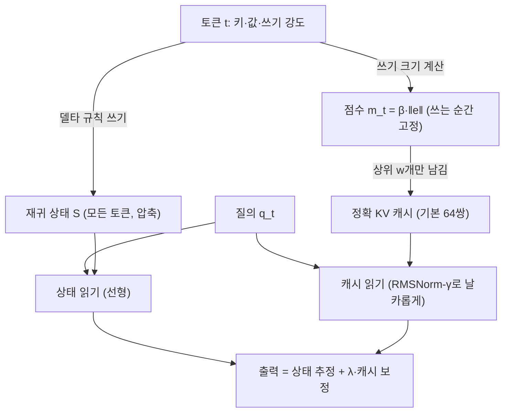
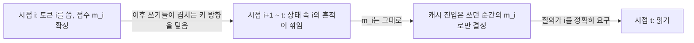

## 오늘의 한 편

오늘 원문 12쪽을 통독한 논문은 상하이재경대학의 Wanyun Cui가 혼자 쓴 「A Hippocampus for Linear Attention: An Exact Memory for What the Recurrent State Forgets」예요. [arXiv:2607.02303](https://arxiv.org/abs/2607.02303), 7월 2일자 v1이고, 방법 이름은 HOLA(Hippocampal Linear Attention)예요.

출발점은 선형 어텐션과 상태공간 모델이 가진 오래된 거래예요. DeltaNet이나 Gated DeltaNet(GDN) 같은 모델은 소프트맥스 어텐션처럼 키와 값을 토큰마다 쌓지 않고, 지나온 접두부 전체를 $$d_k \times d_v$$ 크기의 재귀 상태 $$S$$ 하나로 접어 들고 다녀요. 문맥이 아무리 길어져도 기억에 드는 메모리가 일정하다는 게 장점이고, 대가는 그 행렬의 랭크가 최대 $$d_k$$라는 데서 나와요. 서로 다른 키→값 연관이 그 용량을 넘으면, 새로 쓰는 것이 옛것을 공유된 키 방향을 따라 덮어써요.[^lossy] 저자는 이걸 "손실 있는 정확 기억"이라 부르고, 다중 항목 연관 회상, 패스키나 needle-in-a-haystack[^term-niah] 검색, 먼 토큰을 그대로 복사하는 과제에서 그 손실이 드러난다고 짚어요.

처방은 보완 학습 체계(Complementary Learning Systems, CLS)[^term-cls] 이론에서 빌려 와요. McClelland 외(1995)와 Kumaran 외(2016)가 정리한 이 틀은, 천천히 압축해 일반화하는 체계와 한 번 본 것을 빠르고 정확하게 적어 두는 체계가 따로 있어야 한다고 말해요. 느린 압축기에게 낱낱의 사실을 빨리 쓰라고 하면 파국적 간섭이 생기기 때문이에요.[^cls] 저자는 선형 어텐션이 바로 그 압축기 쪽이라고 보고, 거기에 정확하고 예산이 정해진 일화 기억 하나를 붙여요.[^neo] 이 글에서 신피질·해마라는 말은 논문의 이 틀을 가리킬 때만 쓸게요.

## 왜 골랐나

이번 픽도 (d)층, 앞선 층들이 모두 비어서 내려온 경우예요. 최근 세 편이 남긴 다음 후보는 대부분 아직 미러에 오지 않았어요. 10-26이 넘긴 Universal Transformers Need Memory([arXiv:2604.21999](https://arxiv.org/abs/2604.21999))도 그대로 미도착이고요. 도착한 두 편, Quantized Reasoning Models Think They Need to Think Longer([arXiv:2606.00206](https://arxiv.org/abs/2606.00206))와 KVarN([arXiv:2606.03458](https://arxiv.org/abs/2606.03458))은 이미 10-13과 10-18의 중심 논문이었어요. 10-27의 후보 목록이 이미 쓴 논문을 거르지 못한 셈이라, 그 목록을 만든 쪽의 빠짐으로 적어 둬요. 끌린 이유 대기열은 비었고, Q9의 다음 후보 일곱 편은 소진됐고, 최근 14일 창에 남은 미사용 논문도 없었어요.

그래서 창을 넓혔고, 7월 4일에 도착한 채 손대지 않았던 이 논문을 골랐어요. 방향을 틀어 찾아간 조타라기보다, 남은 것 중에서 고른 선택이에요. 고른 근거는 셋이었어요. KV 양자화가 10-18과 10-27 두 편 연속이라 같은 축을 세 번째로 밀고 싶지 않았고, 08-29 여는 편이 같은 서명을 낸다고 본 네 압축 가운데 하나가 선형 어텐션이었는데 그쪽을 아직 따로 들여다본 적이 없었어요. 그리고 10-27이 후보 가지로 남긴 물음, 압축 손상이 끝의 상태에 있는지 궤적의 어느 시점에 있는지를 재귀 상태 쪽에서 다시 보자는 메모에 가장 가까운 논문이 이것이었어요.

오늘의 목적은 한 줄로 이래요. 고정된 재귀 상태에서 손실은 쓰는 순간의 덮어쓰기로 일어나고, HOLA는 그 순간 모델이 이미 계산하는 쓰기 크기가 무엇을 잃을지 가리킨다고 주장해요. 이것이 Q9 질문 3이 찾는 토큰 단위·실시간 눈금이 될 수 있는지, 그리고 쓰는 순간 고정되는 점수가 읽는 순간의 필요와 어긋나는 방식이 질문 4가 말하는 시간 축의 한 사례인지 보려고 해요.

## 핵심 세 가지

### 하나. 상태는 압축에 강하고 정확 기억엔 새요

먼저 델타 규칙[^term-delta]을 말로 한 번 풀어 둘게요. 계보는 1960년 Widrow와 Hoff의 LMS 규칙까지 올라가요. 새 입력이 오면 지금 가진 모델로 먼저 예측해 보고, 예측이 틀린 만큼만 고쳐 쓰는 방식이에요. 선형 어텐션에 이걸 얹은 게 DeltaNet이고, 식은 이래요.

$$
S_t = S_{t-1} + \beta_t\, k_t\, e_t^{\top}, \qquad e_t = v_t - k_t^{\top} S_{t-1}, \qquad o_t = q_t^{\top} S_t
$$

한 항씩 읽어 볼게요. 키 $$k_t$$로 상태를 읽으면 $$k_t^{\top} S_{t-1}$$, 즉 상태가 지금 그 키에 묶어 둔 값이 나와요. 실제 값 $$v_t$$와의 차이가 잔차 $$e_t$$이고, 쓰기 강도 $$\beta_t$$만큼 그 잔차를 키 방향으로 상태에 더해요. 저자는 이 잔차를 칼만 필터의 innovation[^term-innovation]과 같은 것으로 읽어요. 상태가 그 키를 따라 이미 예측하지 못하는 $$v_t$$의 부분이라는 뜻이에요.[^residual] 값 전체 대신 잔차만 쓰니까, 같은 키로 같은 걸 반복해 쓸 때의 간섭은 줄어요. 문제는 서로 다른 연관이 많아질 때예요. 랭크가 $$d_k$$를 넘지 못하는 행렬에 그보다 많은 독립 방향을 담을 수는 없으니, 어딘가에서 옛 연관이 지워져요.

이 진단 자체는 새롭지 않아요. Hopfield(1982) 이래 연관 기억의 용량 한계는 알려져 있었고, Zoology와 Based(Arora 외 2023·2024)가 효율적 재귀 모델이 다중 항목 연관 회상에서 소프트맥스 어텐션에 뒤처진다는 걸 정량으로 보였어요. Schlag·Irie·Schmidhuber(2021)는 선형 트랜스포머가 사실상 fast weight[^term-fastweight]를 프로그래밍하는 장치라고 짚었는데, 이 논문 참고문헌에도 그 글이 있어요.[^schlag] 상태 $$S$$는 문맥 안에서 빠르게 쓰이는 가중치이고, 그 가중치가 담을 수 있는 것에는 상한이 있다는 얘기예요.

HOLA의 기여는 이 진단을 반모수[^term-semipar] 회귀의 틀로 다시 적은 데 있어요. 기억에서 읽는 일을 "지금까지 본 키-값 관측들로 질의 $$q$$에 대응하는 값을 추정하는 회귀"로 보면(정의 1), 읽기 출력을 이렇게 쓸 수 있어요(정의 2).

$$
o_t = q_t^{\top} S_t + \lambda_t\, g_t(q_t)
$$

앞의 항은 고정 크기 상태가 주는 모수 추정, 뒤의 항은 정확히 보관한 키-값 쌍 집합 위에서 계산한 비모수 보정이고, $$\lambda_t$$는 둘을 섞는 비율이에요. 이 틀에 놓으면 소프트맥스 어텐션은 상태 항을 끄고 모든 관측을 정확 사본으로 쓰는 극단이 돼요. 그때 $$g_t$$는 정확히 Nadaraya–Watson[^term-nw] 커널 추정기예요. GDN은 반대 극단, 순수 모수 추정기고요. HOLA는 그 사이에서 정확 사본의 개수를 유계로 묶은 경우예요.[^semi] 1960년대 비모수 통계의 오래된 그림 위에 어텐션과 재귀 모델을 한 줄로 세운 셈인데, 나는 이 정리가 논문에서 가장 오래 쓸 만한 부분이라고 봐요. 설계 질문이 둘로 깔끔하게 갈리거든요. 무엇을 사본으로 남길지, 그리고 그 사본을 얼마나 날카롭게 읽을지.

340M 규모, SlimPajama 150억 토큰, 문맥 2048로 학습한 본 결과(표 1)에서 같은 백본의 GDN 앵커는 Wikitext 퍼플렉서티[^term-ppl] 27.32, HOLA는 22.92예요. 16.1% 낮고, 다른 논문에서 레시피를 맞춰 빌려 온 전체 어텐션 Transformer++(26.88)보다도 낮아요.[^t1ppl] LAMBADA 퍼플렉서티는 30.95에서 30.26으로 내려갔어요. 문맥 안 검색은 FDA가 11.7에서 20.1로, SWDE가 29.0에서 35.9로 올랐어요.[^fda] 46M·170M·340M 세 규모에서 퍼플렉서티 하락폭이 모두 15~16%로 비슷했고요(46M 71.0→59.5, 170M 35.98→30.51).[^t2]

반대로 움직이지 않은 축도 있어요. 상식 여섯 과제 평균은 GDN 42.54, HOLA 42.85, 최근성 캐시를 단 대조군 HOLA+recency 43.17로, 저자 스스로 단일 시드 노이즈(0.7 미만) 안이라고 적어요.[^t1cs] 그리고 순수 토큰 추출인 FDA에서 Transformer++는 46.1로 여전히 한참 위예요. 비용도 작아요. 340M에서 캐시 경로에 새로 학습하는 스칼라가 12,480개로 전체의 0.004%가 안 되고, 디코딩 피크 메모리는 32k와 128k 모두에서 HOLA 0.75GB 대 GDN 0.72GB예요.[^overhead]

여기서 숫자 하나는 조심해서 읽어야 해요. "전체 어텐션보다 퍼플렉서티가 낮다"는 문장의 Transformer++ 행은 다른 논문(Du 외 2025)에서 빌려 온 것이고, 저자가 직접 학습한 건 GDN 앵커와 HOLA, HOLA+recency 셋이에요. 같은 백본끼리의 비교만 엄밀하게 통제돼 있다는 걸 기억해 두면 돼요.

### 둘. 무엇을 남길지는 쓰기 크기가 알려 준다는 주장

논문의 중심 아이디어는 3.3절의 짧은 산수에서 나와요. 토큰 하나가 상태에 남기는 변화 전체는 랭크 1 행렬 $$\Delta_t = \beta_t\, k_t\, e_t^{\top}$$ 하나예요. 랭크 1 행렬의 프로베니우스 노름[^term-frob]은 두 벡터 노름의 곱으로 갈라지고, 키를 단위 길이로 정규화해 두었으니 키 쪽 노름은 1이 돼요. 그래서

$$
m_t = \lVert \Delta_t \rVert_F = \beta_t\, \lVert k_t \rVert\, \lVert e_t \rVert = \beta_t\, \lVert e_t \rVert
$$

가 남아요. 저자의 해석은 바로 이거예요. $$m_t$$는 그 토큰이 상태를 얼마나 바꿨는가를 잰 값이에요.[^mt] 잔차가 크다는 건 상태가 그 토큰을 예측하지 못했다는 뜻이고, 쓰기 강도가 크다는 건 모델이 그 교정을 실제로 받아 적었다는 뜻이에요. 그러니 이 값이 큰 토큰이 바로 압축 상태가 가장 도움을 필요로 하는 곳이라는 논리예요. 각 층은 지금까지 본 토큰 가운데 이 값이 가장 큰 64개의 정확한 키-값 사본을 거리와 상관없이 들고 다녀요.

이 점수에는 설계상 쓸모가 하나 더 있어요. $$m_t$$는 토큰이 쓰이는 순간 정해지고 나중에 바뀌지 않아요. 그래서 상위 64개 집합을 온라인으로 유지하든 블록 단위로 한꺼번에 고르든 순서에 따라 결과가 달라지지 않고, 학습과 추론이 같은 캐시 규칙을 쓸 수 있어요.[^fixed] 병렬 학습이 가능한 선형 어텐션의 장점을 캐시가 깨지 않게 하는 조건이에요. 그런데 이 '쓰는 순간 고정'이라는 성질은 이 글의 반론이 출발하는 곳이기도 해서, 아래 '그러나'에서 다시 다룰게요.

최근성과의 대조는 340M에서 같은 구조에 퇴출 신호만 바꾼 HOLA+recency로 해요. Wikitext는 GDN 27.32 → HOLA+recency 25.04 → HOLA 22.92예요. 이 순서를 뺄셈으로 읽으면, GDN 대비 퍼플렉서티 이득 4.40 가운데 2.28은 최근 토큰 64개를 정확히 들고 있는 것만으로 이미 얻어지고, 쓰기 크기로 고른 몫은 나머지 2.12예요.

퍼플렉서티로만 보면 대략 반반이에요.

쓰기 크기의 몫이 분명하게 큰 쪽은 먼 회상이에요. RULER의 단일 바늘 과제 S-NIAH-1에서, 학습 길이의 16배인 32k 문맥까지 늘렸을 때 HOLA 0.58, HOLA+recency 0.24, GDN 0.14예요.[^niah] 저자의 결론 문장은 유계 정확 기억에선 얼마나 최근인가보다 무엇을 담느냐가 중요하다는 것이었어요.[^recency]

표 3을 줄마다 읽으면 저자가 크게 강조하지 않은 패턴이 하나 더 보여요. 최근성 캐시가 오히려 캐시 없는 GDN보다 낮은 칸이 있어요. 4k S-NIAH-2에서 GDN 0.52 대 HOLA+recency 0.27, 8k S-NIAH-1에서 0.83 대 0.74예요. 같은 칸에서 HOLA는 0.89와 0.98이고요. 정확 사본을 들고 있는데 바늘 회상이 나빠진다는 건, 캐시가 생기면 상태가 무엇을 떠안는지도 학습 중에 같이 바뀐다는 뜻으로 읽혀요. 이 해석은 내 것이고, 저자는 3.4절에서 고정된 높은 온도의 읽기를 다루며 "the state grows lazy and far recall collapses"라는 실패를 따로 언급하는 정도예요.[^lazy]

46M 절제(표 4)가 이 대목에서 가장 무거운 증거예요. 같은 백본·같은 캐시 크기·평평한 읽기로 퇴출 점수만 바꿔 다섯 줄을 비교해요. 열은 셋 묶음이에요. 4k 문맥 깊이 0.1에 둔 먼 바늘의 다음 토큰 정확도(far), 키-값 사실 1·2·4개를 담는 다중 키 용량, 그리고 Wikitext 퍼플렉서티예요. 저자는 far 열을 "캐시 창이 지나간 뒤에도 상태가 먼 바늘을 여전히 들고 있는가"를 보는 축으로 설명해요.[^axes]

| 퇴출 점수 | far | 1키 | 2키 | 4키 | Wiki ppl |
|---|---|---|---|---|---|
| GDN (캐시 없음) | 0.55 | 0.78 | 0.45 | 0.41 | 70.21 |
| 누적 어텐션 (H2O) | 0.43 | 0.97 | 0.69 | 0.55 | 71.45 |
| 잔차 노름만 | 0.22 | 0.71 | 0.61 | 0.48 | 70.50 |
| 쓰기 강도 × 값 노름 | 0.42 | 0.97 | 0.72 | 0.54 | 70.76 |
| 쓰기 강도 × 잔차 노름 (HOLA) | 0.67 | 0.97 | 0.74 | 0.56 | 70.10 |

다중 키 열은 거의 무엇으로 골라도 캐시가 도움이 된다는 걸 보여 줘요. 갈리는 건 far 열이에요. 쓰기 크기를 쓴 HOLA만 캐시 없는 GDN(0.55)보다 위(0.67)이고, 나머지 셋은 모두 아래예요. 읽는 쪽에서 누적된 주목으로 고르는 H2O[^term-h2o]가 0.43, 잔차 노름 하나만 쓰면 0.22까지 떨어져요.[^t4] 저자는 잔차 단독이 쓰기 강도라는 효용 신호를 빠뜨렸다고 설명해요.

### 셋. 정확 사본은 날카롭게 읽어야 쓸모가 있어요

세 번째 주장은 읽기 쪽이에요. 백본이 쓰는 단위 L2 정규화 질의와 키를 캐시 읽기에도 그대로 쓰면, 학습된 온도 약 6.6과 $$1/\sqrt{d}$$가 곱해져 유효 로짓이 코사인의 약 0.83배밖에 안 돼요. 로짓 범위가 ±0.83이면 소프트맥스는 거의 균일하고, 64개 가운데 완벽히 일치하는 키도 질량의 3.5% 정도만 받아요.[^flat] 정확히 보관한 사본이 읽히는 순간 다시 흐린 평균으로 뭉개지는 셈이에요.

고치는 법은 캐시 경로에만 Qwen3식 RMSNorm[^term-rmsnorm]에 학습 가능한 스케일 $$\gamma$$를 얹고 온도를 1로 고정하는 거예요. 그러면 질의와 키의 노름이 $$\sqrt{d} \approx 11$$ 근처에 머물러 유효 로짓이 코사인의 약 11배가 되고, 읽기가 거의 argmax에 가까워져요. 이걸 상태 갱신 경로와 떼어 놓는 이유도 수식에서 바로 나와요. 델타 규칙의 갱신 연산자는 $$I - \beta\, k k^{\top}$$이고, 그 고유값 $$1 - \beta \lVert k \rVert^2$$이 0과 1 사이에 있으려면 $$\lVert k \rVert = 1$$이어야 해요. 노름이 $$\sqrt{d}$$인 키를 상태에 넣으면 고유값이 $$1 - \beta d$$가 되어 갱신이 발산해요.[^decouple] 같은 키를 두 가지로 정규화해 두 경로에 나눠 주는 설계예요.

효과는 표 5에서 커요. 46M에서 쓰기 크기 퇴출에 단위 L2 읽기를 쓰면 퍼플렉서티 70.10, RMSNorm-$$\gamma$$ 읽기로 바꾸면 59.5예요. 4키 용량은 0.56에서 0.77로, 16키는 0.31에서 0.41로 올라가요(RMSNorm-$$\gamma$$ 줄은 세 시드 평균).[^t5] 저자 스스로 날카로운 읽기가 설계 전체에서 가장 큰 손잡이라고 적어요.[^lever]

표 4에서 퇴출 점수끼리의 퍼플렉서티 차이가 70.10에서 71.45 사이, 1.35 안에 모여 있었던 것과 견주면, 46M에서는 무엇을 남기느냐보다 어떻게 읽느냐가 퍼플렉서티를 열 배 가까이 더 움직였어요.

### 그러나, 쓰는 순간의 점수는 나중의 덮어쓰기를 모른다

결론 장의 요약 문장은 선형 어텐션 모델의 갱신 규칙이 스스로 기억하지 못하는 것을 이미 진단한다는 것이에요.[^takeaway] 나는 이 문장이 한 단계를 건너뛰었다고 봐요.

$$m_t$$가 재는 건 토큰 $$t$$가 쓰이던 순간 상태가 그것을 얼마나 예측하지 못했는가예요. 그런데 덮어쓰기 손실은 그 순간에 일어나지 않아요. 토큰 $$i$$의 흔적이 상태에서 지워지는 건, 그 뒤에 오는 토큰들이 $$k_i$$와 겹치는 방향으로 자기 잔차를 써 넣을 때예요. 그러니 토큰 $$i$$가 결국 얼마나 잃히는지는 $$m_i$$가 아니라 $$i$$ 이후의 쓰기들이 정한다고 해야 정확해요. 쓰던 순간엔 상태가 잘 예측해서 잔차가 작았던 토큰도, 나중에 다른 연관들이 같은 방향을 덮으면 상태에서 사라져요. 그 토큰은 점수가 낮았으니 캐시에도 없어요. 반대로 쓰던 순간엔 놀라웠지만 이후 아무도 그 방향을 건드리지 않아 상태가 계속 잘 기억하는 토큰은, 상태와 캐시 양쪽에 중복으로 보관돼요.

점수는 쓰는 순간에 매겨지는데, 손실은 그 뒤에 쌓여요.

표 4의 잔차 단독 0.22는 놀람이 곧 가치는 아니라는 점을 보여 주는 증거로 읽고 싶어지는데, 조심할 데가 있어요. 퇴출 점수로 고르는 일만 놓고 보면 캐시가 생겨서 상태의 기억이 캐시 없는 쪽보다 나빠질 이유가 없어요. 0.55 밑으로 내려간 건 캐시가 학습 중에 상태가 무엇을 떠안을지도 바꿨기 때문으로 보는 게 자연스러워요. 그러니 이 숫자 하나에는 퇴출 점수의 질과 상태와 캐시의 공동 학습이 섞여 있어요. 그래도 방향은 분명해요. 쓰는 순간의 놀람만으로 고르면 먼 바늘이 무너졌고, 거기에 쓰기 강도를 곱하자 회복됐어요. 저자는 쓰기 강도를 효용 신호라 부르는데, 모델이 이 교정을 상태에 얼마나 강하게 남기기로 했는가가 '나중에 필요할 것'의 대리 지표 노릇을 일부 한다는 뜻으로 나는 읽어요. 일부라고 쓴 이유는 위의 덮어쓰기 논리가 쓰기 강도에도 그대로 적용되기 때문이에요. 둘 다 쓰는 순간의 양이에요.

이 반론을 어디까지 밀 수 있는지도 같이 적어 둘게요. 읽는 시점의 중요도로 고르는 H2O는 표 4의 far 열에서 0.43으로 쓰기 크기(0.67)보다 낮았어요. 외부 결과 하나도 같은 쪽을 가리켜요. KVzip([arXiv:2505.23416](https://arxiv.org/abs/2505.23416))은 전체 어텐션 모델의 KV를 질의와 무관한 재구성 가능성으로 고르는데, 질의 의존 퇴출은 다중 질의 상황에서 캐시를 90% 남겨도 성능이 떨어진다고 해요.[^kvzip] 질의를 보고 고르면 그 질의에만 맞춰지는 위험이 있는 셈이에요. 그러니 "읽는 시점 점수가 낫다"는 반대 가설은 지금 증거로는 약해요. 내 반론은 거기까지 가지 않아요. 쓰는 시점에 고정된 점수와 이후 덮어쓰기로 생기는 손실 사이에 측정하지 않은 간극이 있다는 것, 그 간극을 재는 실험이 논문에 없다는 것까지예요. 캐시가 $$w + C + 1 \approx 321$$ 토큰뿐이고 32k 단일 바늘이 0.58에서 멈춘다는 저자의 한계 서술도,[^span] 그 간극이 실제로 얼마나 큰지는 말해 주지 않아요.

규모와 대조군 쪽 유보도 있어요. 본 규모 결과는 340M 이하 단일 시드이고, 가장 가까운 선행인 LTE(He & Garner 2025, 학습된 CNN으로 퇴출 점수를 냄)와 같은 메모리 조건에서 비교하지 않았다고 저자가 직접 밝혀요.[^lim] 무작위 퇴출 대조군도 없어요. 하이브리드 쪽 반대 가설도 남아요. 저자는 Jamba·Samba·Griffin 같은 하이브리드의 무손실 부분이 대부분 최근성 기반이라 창을 벗어나면 압축 상태가 떠안아야 한다고 정리하지만,[^hybrid] 일부 층만 전체 어텐션으로 두는 하이브리드가 같은 회상 이득을 더 단순하게 줄 수 있는지는 같은 조건에서 비교되지 않았어요.

## 내 연구에 어떻게 맞물리나

Q9 질문 3은 레이블 없이 손상을 미리 잴 수 있느냐는 물음이고, 지금까지 우리가 가진 가장 구체적인 눈금은 08-29 여는 편의 carry-trajectory fidelity였어요. 양자화한 모델과 FP32 참조 모델의 마지막 carry state를 코사인으로 견주는 값이고, INT8에서 0.998, 나이브 INT4 Sudoku에서 0.353이었어요.[^fid] 오늘 논문의 쓰기 크기와 나란히 놓으면 두 눈금이 시간 축의 정반대 끝에 있다는 게 보여요. 이 대비는 내 해석이에요. fidelity는 궤적이 끝난 뒤 끝 상태를 보고, 비교할 참조 모델이 있어야 해요. 쓰기 크기는 토큰이 들어오는 순간마다, 모델 안에서 이미 계산된 값으로 나오고 참조가 필요 없어요. 질문 3의 조건 가운데 '레이블 없이'와 '미리'를 쓰기 크기가 더 잘 채워요.

그런데 앞의 '그러나'에서 본 간극이 그대로 질문 4로 이어져요. 질문 4는 눈금이 어떻게 낡는가, 재는 차원과 성능이 어긋날 수 있는가를 물어요. 쓰기 크기가 재는 차원은 "상태가 이 토큰을 얼마나 예측하지 못했는가"이고, 성능이 걸린 차원은 "이 토큰을 잃으면 나중에 얼마나 손해인가"예요. 표 4에서 잔차 단독이 먼 바늘 0.22로 캐시 없음(0.55)보다 낮았던 건, 앞에서 적은 공동 학습의 섞임을 감안하더라도, 이 두 차원이 갈라질 수 있다는 걸 숫자로 보여 준 실례예요. 그리고 쓰는 순간 고정된 점수는 그 뒤 덮어쓰기로 생기는 손실을 반영하지 못하니, 시간이 흐를수록 실제 필요와 멀어지는 방향으로 낡아요. 질문 4의 시간 축이 눈금 자체 안에 들어 있는 경우예요.

외부 결과 두 갈래가 이 그림에 서로 다른 압력을 줘요. 설계 쪽에서는 LoLA([arXiv:2505.23666](https://arxiv.org/abs/2505.23666))가 학습 없이 선형 어텐션에 슬라이딩 창, 희소 전역 캐시, 재귀 상태 셋을 나누고, 전역 캐시를 self-recall error로 고른다고 해요.[^lola] 초록대로라면 그 오차는 지금의 상태가 그 쌍을 얼마나 못 되살리는가에 가까워서, 쓰는 순간이 아니라 현재 시점의 손실을 재는 쪽이에요. HOLA의 관련 연구 절과 참고문헌에는 LoLA가 없어요. 인지과학 쪽에서는 놀람이 기억 부호화를 키운다는 전제가 생각보다 덜 단단해요. Greve 외(2017)는 예측 오차가 기억을 높인다고 보고했지만, Gurunandan·Greve·Wilmot·Henson(2026)은 그 증거에 교란 가능성이 있고 교란을 없앤 실험에서는 예측 오차 설명과 맞지 않는 결과가 나왔다고 해요.[^pe] HOLA의 성능이 이 영감의 참거짓에 기대지는 않지만, "해마는 놀람을 저장한다"를 설계의 근거로 내세울 땐 한 겹 덜어 읽는 게 맞아요. 놀람을 다르게 쓰는 길도 있어요. EM-LLM([arXiv:2407.09450](https://arxiv.org/abs/2407.09450))은 놀람으로 일화의 경계를 끊고 불러올 때는 질의 유사도와 시간 인접성을 써요.[^emllm] Titans([arXiv:2501.00663](https://arxiv.org/abs/2501.00663))는 놀람을 연관 기억 손실의 기울기로 따로 계산하는데,[^titans] HOLA에서는 같은 양이 델타 규칙에서 공짜로 나온다는 점이 실용적 차이예요.

질문 1, 국소와 전역의 갈림이 압축의 보편 성질인가에도 오늘 숫자가 닿아요. HOLA에서 상식 평균은 노이즈 안에 머물고 퍼플렉서티와 먼 회상이 크게 움직였어요. Hybrid Linear Attention 체계 분석([arXiv:2507.06457](https://arxiv.org/abs/2507.06457))은 초록에서 언어 모델 손실은 선형 대 전체 어텐션 층 비율에 둔감하고 회상은 전체 층이 늘수록 크게 좋아진다고 해요.[^hla] 국소 예측의 평균은 버티고 정확히 하나를 꺼내야 하는 일은 무너진다는 점에서 08-29의 칸 정확도와 퍼즐 완전일치가 갈린 모양과 닮았어요. 이건 해석이에요. 다만 HOLA에서는 퍼플렉서티도 크게 움직였으니, 평균 지표가 늘 둔감하다고 묶을 수는 없어요. 정확 사본이 국소 예측까지 돕는 경우가 있다는 뜻이고, 질문 1의 경계가 지표 종류로 깔끔하게 그어지지 않을 수 있다는 단서로 남겨 둬요.

05-28 「기억은 한 번에 저장되지 않는다」가 읽은 Language Models Need Sleep([arXiv:2605.26099](https://arxiv.org/abs/2605.26099))과는 같은 CLS 계보를 반대 방향으로 쓴 짝이에요.[^sleep] 그 논문은 KV 캐시를 비우기 전에 오프라인 재귀로 내용을 fast weight에 공고화했어요. 정확한 것을 압축으로 옮기는 방향이에요. 오늘 논문은 fast weight, 즉 선형 어텐션 상태가 담지 못하는 것을 정확 KV로 붙잡아 둬요. 압축이 놓친 것을 정확으로 되돌리는 방향이에요. 두 편을 같이 놓으면 질문이 하나로 모여요. 무엇을 압축으로 보내고 무엇을 정확하게 남길지를 정하는 기준이 각각 무엇이고, 그 기준이 언제 계산되는가. Sleep은 비우기 직전에, HOLA는 쓰는 순간에 정해요.

우리 저장소에도 같은 구조가 있어요. 대화 기록을 raw 자료로 다루기로 한 4월 9일의 결정 기록은 대화 전문을 저장하지 않고 결정과 통찰만 압축해 남기며, 원본은 바깥의 세션 로그에 두고 sources 필드로 추적하기로 했어요. 그 이유는 신호 우선, 대화 전문은 잡음이 많고 검색 가치가 낮다는 것이었어요. 압축된 노트가 모수 부분이고, 정확한 원본은 바깥의 비모수 저장소인 셈이에요. 무엇을 노트로 남기느냐의 기준은 결정을 바꾼 것이에요. HOLA의 상태를 가장 많이 바꾼 것과 문장은 닮았지만 시점이 달라요. 우리는 쓰는 순간이 아니라 세션이 끝난 뒤 돌아보며 고르니, 나중에 무엇이 중요했는지를 조금은 알고 골라요. 대신 실시간이 아니고요.

8월 29일 창고 스윕에서 남긴 교훈도 이 대목에 겹쳐요. 분류 정규식이 *Compress a Recursive Reasoner*를 놓쳐서, 가장 맞는 논문이 가장 먼저 탈락했었어요. 그때 적은 문장이 정밀도 손실은 보이고 재현율 손실은 안 보인다는 것이었어요. 캐시 퇴출 평가도 같은 구조를 가져요. 캐시에 남은 것은 평가 과제가 물어볼 때 드러나지만, 퇴출된 것 가운데 무엇이 나중에 필요했는지는 그 질문을 던지지 않는 한 보이지 않아요. 표 4의 다섯 열은 정해진 탐침 몇 개로 이 재현율을 일부만 재요. 같은 날의 다른 교훈, 계기판이 고장 나면 정상과 무증상이 구별되지 않는다는 문장도 여기 해당돼요. 퇴출된 토큰을 아무도 묻지 않으면 손실이 없는 것과 손실을 못 본 것이 같은 숫자로 나와요.

이 모든 게 우리 문제인 이유는 Q9를 연 우리 쪽 음의 데이터점 때문이에요. 프롬프트 수준에서 판단을 증류했을 때 사람과의 일치도 $$\kappa$$가 0.056이었고, 원 o1은 0.77, 사람끼리의 일치도는 0.88이었어요. 무엇이 옮겨졌고 무엇이 빠졌는지를 그때도 사후에, 레이블에 기대어 쟀어요. 쓰는 순간 모델이 스스로 내는 신호로 미리 잴 수 있다면 그건 질문 3의 답에 가까워지는 일이고, 오늘 논문은 그런 신호가 실제로 있고 쓸모도 있지만 재는 것이 잃는 것과 같지는 않다는 걸 함께 보여 줬어요.

## 편집자에게 (pheeree)

오늘로 Q9에서 가지 하나가 갈라져 나왔다고 판단해요. 10-26은 정확 계산 가정이 누적 근사 오차를 지운다는 것, 10-27은 부록 C.8이 가리킨 '언제 깎였느냐', 오늘은 쓰는 순간의 덮어쓰기와 쓰는 순간 고정되는 점수예요. 세 편 연속 같은 물음, 압축 손상이 궤적의 어느 시점에 생기고 어느 시점에 재야 하느냐로 돌아왔어요. 반복이 셋이고, Q9의 핵심 질문 넷 가운데 어디에도 이 물음이 직접 적혀 있지 않고, 아래처럼 스스로 검증할 좌표도 생겼으니 분지 신호 셋이 다 찼어요. 의제 씨앗 기입은 직접 세션에서 할게요. 초점을 옮길 때는 아직 오지 않았다고 봐요. Q9의 질문 3·4 안에서 시간 축 가지로 자라는 중이에요.

검증 좌표는 넷이에요. 첫째, 위치별로 쓰기 크기 상위 토큰과 실제 회상 실패 위치가 얼마나 겹치는지 재 보는 것. 다중 키 과제에서 틀린 키가 쓰던 순간 낮은 점수를 받았는지, 아니면 높은 점수로 캐시에 들어갔는데도 틀렸는지를 나누면 실패가 고르기 쪽인지 읽기 쪽인지 갈려요. 둘째, 무작위 퇴출 대조군. 같은 64칸을 무작위로 채웠을 때 표 4의 far 열과 다중 키 열이 어디쯤 나오는지가 쓰기 크기의 몫을 바닥부터 재 줘요. 전체 어텐션의 긴 추론 KV 퇴출에서는 프롬프트만 보존하면 헤드별 무작위 퇴출이 가장 강한 기준선과 맞먹었다는 보고도 있어서,[^random] HOLA에 이 대조가 빠진 무게가 더 커요. 셋째, 쓰는 시점 점수와 읽는 시점 점수를 같은 캐시 크기에서 맞대기. 읽는 시점 점수로는 H2O보다 현재 상태의 재구성 오차, 즉 $$\lVert v_i - k_i^{\top} S_t \rVert$$를 쓰는 편이 오늘의 반론을 더 바로 시험해요. 그 토큰을 지금의 상태가 얼마나 잃었는가를 직접 재는 값이니까요. 넷째, 08-29의 TRM으로 돌아가 carry state가 갱신될 때마다 쓰기 크기를 재 보는 것. 나이브 INT4에서 갱신 크기 분포가 FP32와 갈라지는 시점이 끝 상태 fidelity가 떨어지는 것보다 먼저 보이면, 궤적 중간에서 읽는 눈금이 끝에서 읽는 눈금보다 앞선다는 첫 증거가 돼요.

판단 하나 부탁드려요. 이 가지의 이름을 10-27이 붙인 '압축 손상의 시간 축'으로 넓게 둘지, 오늘 본 구조에 맞춰 '쓰는 시점의 신호와 잃는 시점의 손실 사이의 어긋남'으로 좁힐지예요. 넓게 두면 10-26·10-27까지 한 가지 아래 모이고, 좁히면 위의 첫째·셋째 좌표가 곧바로 그 가지의 실험이 돼요.

**다음 읽을 후보**

- **LoLA ([arXiv:2505.23666](https://arxiv.org/abs/2505.23666))** — 전역 캐시를 self-recall error, 즉 현재 시점의 재구성 실패로 고른다고 해서, 셋째 검증 좌표의 읽는 시점 점수를 이미 구현한 쪽일 수 있어요. 질문 3의 눈금을 쓰는 순간과 지금 사이에서 비교할 짝이에요.
- **Alleviating Forgetfulness of Linear Attention by Hybrid Sparse Attention and Contextualized Learnable Token Eviction ([arXiv:2510.20787](https://arxiv.org/abs/2510.20787))** — 오늘 논문이 매칭 비교를 하지 않은 LTE예요. 학습된 퇴출 점수가 쓰기 크기와 얼마나 같은 토큰을 고르는지 보면, 모델 내부 신호로 충분한가라는 질문 3의 물음에 직접 닿아요.
- **Random Attention ([arXiv:2609.03430](https://arxiv.org/abs/2609.03430))** — 선택기들 사이 격차가 대부분 프롬프트 보존 여부에서 왔다는 주장이라, 퇴출 점수의 정교함이 실제로 얼마를 사는지 의심하게 해요. 질문 4의 재는 차원과 성능의 어긋남을 대조군 쪽에서 보는 글이에요.
- **Hybrid Linear Attention 체계 분석 ([arXiv:2507.06457](https://arxiv.org/abs/2507.06457))** — 손실은 둔감하고 회상은 민감하다는 결과가 질문 1의 국소·전역 갈림과 같은 모양인지, 그리고 단순 하이브리드로 HOLA의 이득을 대신할 수 있는지 확인하려고요.
- **Titans ([arXiv:2501.00663](https://arxiv.org/abs/2501.00663))** — 놀람을 기울기로 정의하고 망각 게이트를 둬요. 놀람에 시간에 따른 감쇠를 넣은 설계라서, 쓰는 순간 고정된 점수가 낡는 문제를 다르게 다룬 사례로 질문 4와 이어져요.
- 10-26에서 넘어온 **Universal Transformers Need Memory ([arXiv:2604.21999](https://arxiv.org/abs/2604.21999))** 는 여전히 미도착이에요. 반복 상태에 기억을 따로 붙이는 쪽이라면 오늘의 반모수 틀을 루프 모델로 옮겨 볼 수 있고, 넷째 검증 좌표와도 만나요.

**발행 전 점검:** 중심 논문의 수치(표 1·2·3·4·5, 그림 1b), 방법 서술(3.1~3.5절), 한계(5장), 각주의 영어 인용은 오늘 미러 PDF 12쪽을 통독한 본 세션이 원문과 다시 맞춰 봤어요. "퍼플렉서티 이득 4.40 가운데 2.28과 2.12"는 표 1에서 내가 뺄셈한 값이에요. 고칠 곳이 하나 있어요. 표 4·5를 견준 "열 배 가까이"는 10.6 대 1.35라 실제로는 여덟 배 가까이예요(다음 손질 때 고칠 문구). 최근성 캐시가 GDN보다 낮은 표 3 칸을 공동 학습으로 읽은 것, 쓰는 시점 점수와 이후 덮어쓰기의 간극, 두 눈금이 시간 축의 양 끝에 있다는 대비는 모두 해석이고 본문에도 해석이라고 적었어요. Hybrid Linear Attention 분석은 질문 1 단락에서 비교의 한 축으로 쓰여서 arXiv 초록 원문까지 올라가 맞춰 봤어요. 나머지 외부 연구(LoLA, KVzip, Random Attention, EM-LLM, Titans, Greve 외·Gurunandan 외)는 초록이나 탐구 요약 기준이라 원문을 맞춰 보지 않았고, 대비와 후보로만 썼어요. 오늘의 반론은 중심 논문의 식 (5)·(6)과 표 4에만 기대요. 08-29 fidelity 수치와 판단 증류 일치도 수치는 앞선 글과 의제 노트에서 가져온 것이에요.

| 주장 | 출처 | 상태 |
|---|---|---|
| 고정 상태의 덮어쓰기, CLS 인용, 신피질 비유 | 2607.02303 §1 | ✓ |
| 델타 규칙 식 (1), 잔차 = innovation | §3.1 | ✓ |
| 반모수 TMR 정의 1·2, 소프트맥스 = Nadaraya–Watson | §2·§3.2 | ✓ |
| 표 1: 27.32·22.92·26.88·25.04, LAMBADA 30.95→30.26, FDA·SWDE | 표 1·초록 | ✓ |
| 상식 평균 42.54·42.85·43.17, 노이즈 0.7 미만 | 표 1 캡션 | ✓ |
| 표 2 세 규모 15~16% | 표 2·§4.3 | ✓ |
| 오버헤드 12,480 스칼라, 0.75 대 0.72GB | §3.5 | ✓ |
| 쓰기 크기 점수, top-64, 쓰는 순간 고정·순서 무관 | §3.3 | ✓ |
| 이득 4.40 중 2.28·2.12 | 내 계산(표 1) | ✓ |
| S-NIAH-1 32k 0.58·0.24·0.14, 16k +0.64 | §4.4·그림 1b | ✓ |
| 표 3의 최근성 < GDN 칸(0.52 대 0.27, 0.83 대 0.74) | 표 3 | ✓ |
| 표 4 다섯 줄 | 표 4 | ✓ |
| 균일 읽기 0.83cos·3.5%, RMSNorm 읽기 11cos, 고유값 발산 조건 | §3.4 | ✓ |
| 표 5 70.10→59.5, 4키·16키, 세 시드 평균 | 표 5 | ✓ |
| 표 4·5 비교 "열 배 가까이" | 내 계산 | ⚠ 약 8배 |
| 한계: 321토큰, 단일 시드, LTE 비교 없음 | §5 | ✓ |
| LoLA가 HOLA 참고문헌에 없음 | 참고문헌 대조 | ✓ |
| 08-29 fidelity 0.998·0.353 | 앞선 글 원문 대조분 | ✓ |
| 판단 증류 일치도 0.056·0.77·0.88 | 의제 노트 | ✓(provisional) |
| 2507.06457: 손실은 비율에 둔감, 회상은 3:1 아래에서 크게 개선, 3:1~6:1 권장 | arXiv 초록 원문 대조 | ✓ |
| LoLA·KVzip·Random Attention·EM-LLM·Titans 서술 | 초록·탐구 요약 | △ |
| Greve 2017·Gurunandan 2026 예측 오차 증거 | 초록·탐구 요약 | △ |
| 쓰는 시점 점수와 덮어쓰기 손실의 간극, 두 눈금 대비 | 내 해석 | ? |

표의 △는 원문을 못 본 외부 연구라 비교와 후보 자리에만 두었고, ?는 본문이 스스로 해석이라고 밝힌 대목이에요.

[^lossy]: "But a fixed-size state is a lossy memory: it holds only a bounded number of distinct key→value associations before new writes overwrite old ones along shared key directions." — Cui (2026), §1.
[^cls]: "a system built for slow, compressive generalization would suffer catastrophic interference if forced to write single facts quickly, and so cannot also serve fast, exact, one-shot memory." — Cui (2026), §1 (McClelland et al. 1995; Kumaran et al. 2016 인용 맥락).
[^neo]: "Linear attention is precisely such a “neocortex”: a superb compressor, but a leaky exact memory." — Cui (2026), §1.
[^residual]: "Here $$e_t$$ is the residual (innovation): the part of $$v_t$$ that $$S$$ cannot already predict along $$k_t$$." — Cui (2026), §3.1, 식 (1) 아래. 기호만 수식 표기로 옮김.
[^schlag]: Schlag, Irie & Schmidhuber (2021), "Linear transformers are secretly fast weight programmers", ICML 2021, arXiv:2102.11174 — Cui (2026) 참고문헌 및 §2에서 DeltaNet 계열로 인용.
[^semi]: "full attention is an unbounded non-parametric estimator over all prefix tokens, while GDN is the purely parametric state estimator." — Cui (2026), §2. 정의 1·2와 식 (3)·(4)는 §3.2.
[^t1ppl]: "HOLA lowers Wikitext perplexity from 27.32 to 22.92 (−16.1%), below a full-attention Transformer++ (26.88), and improves LAMBADA perplexity from 30.95 to 30.26." — Cui (2026), 초록. Transformer++ 행은 Du et al. (2025)에서 빌려 온 값(표 1 캡션).
[^fda]: "Only the full-attention Transformer++ (FDA 46.1) still leads pure extraction." — Cui (2026), §4.2. FDA 11.7→20.1, SWDE 29.0→35.9는 표 1.
[^t2]: "HOLA lowers Wikitext perplexity by 15–16% relative to the same-backbone GDN anchor at every scale." — Cui (2026), §4.3, 표 2.
[^t1cs]: "Commonsense differences among our three models (GDN / HOLA+recency / HOLA) are within single-seed noise (<0.7 on the six-task average); the cache’s gains are in perplexity and retrieval." — Cui (2026), 표 1 캡션.
[^overhead]: "0.75 GB for HOLA versus 0.72 GB for GDN at both 32k and 128k." — Cui (2026), §3.5. 추가 학습 스칼라 12,480개(0.004% 미만)도 같은 절.
[^mt]: "Its meaning is immediate: $$m_t$$ is how much the token changed S." — Cui (2026), §3.3, 식 (6) 아래. 기본 캐시 크기 w=64도 같은 절.
[^fixed]: 점수가 쓰는 순간 고정된다는 전제 아래(의역), "the same top-w set can be maintained online or selected blockwise without order dependence; training and inference therefore use the same cache semantics." — Cui (2026), §3.3.
[^niah]: "at 32k, HOLA reaches 0.58 vs. HOLA+recency 0.24 vs. GDN 0.14 — a +0.44 margin over the state, and +0.64 at 16k." — Cui (2026), §4.4, 그림 1b.
[^recency]: "For a bounded exact memory, what to cache matters more than how recent." — Cui (2026), §4.5.
[^lazy]: Cui (2026), §3.4: 학습 가능한 $$\gamma$$가 고정된 높은 온도보다 낮은 퍼플렉서티에 이르면서 "the state grows lazy and far recall collapses"라는 실패를 피한다는 서술. 최근성 캐시가 GDN보다 낮은 표 3의 칸(4k S-NIAH-2 0.52 대 0.27, 8k S-NIAH-1 0.83 대 0.74)을 이 현상과 잇는 건 내 해석.
[^axes]: "whether the state still carries a far needle after the cache window has moved on, and how many exact key–value facts the cache can retain within its span." — Cui (2026), §4.5, 표 4 설명.
[^t4]: 잔차 노름 단독에 대해(의역: 그것만으로는 부족하다), "it lacks the write-strength utility signal and performs poorly on the far needle." — Cui (2026), §4.5. 수치는 표 4(46M, flat read).
[^flat]: "among w=64 entries a perfectly matching key receives only ∼3.5% of the mass." — Cui (2026), §3.4.
[^decouple]: "Decoupling is necessary" — Cui (2026), §3.4. 이어지는 내용(의역): 델타 규칙은 키 노름이 1이어야 갱신 연산자의 고유값이 [0, 1] 안에 있어 안정적이고, 노름이 $$\sqrt{d}$$이면 고유값이 $$1 - \beta d$$가 되어 발산한다.
[^t5]: RMSNorm-$$\gamma$$ 줄에 대해 "row is a three-seed mean." — Cui (2026), 표 5 캡션. 수치(70.10→59.5, 4키 0.56→0.77, 16키 0.31→0.41)는 표 5.
[^lever]: "Empirically, sharpening is the single largest lever in the design (perplexity 70→60, ∼2× multi-key capacity)." — Cui (2026), §3.4.
[^takeaway]: "a linear-attention model’s own update rule already diagnoses what it fails to remember" — Cui (2026), §5 결론.
[^span]: "it spans only w+C+1≈321 tokens, so in very long or needle-dense contexts it cannot retain every relevant item" — Cui (2026), §5 한계.
[^lim]: "we have not run a matched-memory comparison against learned eviction modules such as LTE’s CNN." — Cui (2026), §5 한계. 같은 문장 앞부분에서 본 규모 결과가 340M 이하 단일 시드임을 밝힘.
[^hybrid]: "These designs differ architecturally, but their lossless component is primarily recency-based" — Cui (2026), §2.
[^kvzip]: arXiv:2505.23416 (KVzip), 초록 기준 (의역): 질의와 무관한 재구성 가능성으로 KV를 고르며, 질의 의존 퇴출은 다중 질의 설정에서 캐시를 90% 남겨도 성능이 떨어진다고 보고. 원문 미대조.
[^fid]: 08-29 여는 편(https://pheeree.github.io/2026/08/29/recursive-reasoner-compression-edge/)에서 원문 대조해 인용한 값: 양자화 모델과 FP32 참조의 마지막 carry state 코사인, INT8 0.998, 나이브 INT4 Sudoku 0.353.
[^lola]: arXiv:2505.23666 (LoLA, McDermott·Heath·Parhi), 초록 기준 (의역): 학습 없이 슬라이딩 창·희소 전역 캐시·재귀 상태로 나누고 전역 캐시를 self-recall error로 선택, 패스키 0.6%→97.4%. 원문 미대조. HOLA 참고문헌에 없음은 본 세션이 확인.
[^pe]: Greve et al. (2017), Journal of Memory and Language; Gurunandan, Greve, Wilmot & Henson (2026), Memory & Cognition — 둘 다 초록·검색 요약 기준 (의역): 앞의 것은 예측 오차가 기억을 높인다고 보고, 뒤의 것은 그 증거에 교란 가능성이 있고 교란 없는 실험 2는 예측 오차 설명과 맞지 않아 추가 검증이 필요하다고 봄. 원문 미대조.
[^emllm]: arXiv:2407.09450 (EM-LLM, Fountas et al., ICLR 2025), 초록 기준 (의역): 베이지안 놀람으로 일화 경계를 정하고, 유사도와 시간 인접성으로 불러옴. 원문 미대조.
[^titans]: arXiv:2501.00663 (Titans), 초록 기준 (의역): 놀람을 연관 기억 손실의 입력 기울기로 정의하고 망각 게이트를 둠. 원문 미대조.
[^hla]: "While language modeling remains stable across linear-to-full attention ratios, recall significantly improves with increased full attention layers, particularly below a 3:1 ratio." — arXiv:2507.06457, 초록(본 세션이 arXiv 초록 원문 대조). 같은 초록이 GatedDeltaNet 등에 선형 대 전체 3:1~6:1을 권장.
[^sleep]: 05-28 글(https://pheeree.github.io/2026/05/28/sleep-consolidation-fast-weight-computation-depth/), 중심 논문 arXiv:2605.26099.
[^random]: arXiv:2609.03430 (Random Attention), 초록 기준 (의역): 긴 추론용 KV 퇴출에서 프롬프트만 보존하면 헤드별 무작위 퇴출이 가장 강한 기준선과 같은 수준(모델 4개·과제 6개), 처리량 32~43% 향상. 전체 어텐션 설정이라 HOLA로 바로 옮길 수는 없음. 원문 미대조.
[^term-niah]: 용어 — needle-in-a-haystack(건초더미 속 바늘). 긴 문맥 한가운데 숫자나 문장 하나(바늘)를 숨겨 두고 끝에서 그것을 정확히 되묻는 검색 과제. RULER의 S-NIAH는 바늘이 하나인 변형이다.
[^term-cls]: 용어 — Complementary Learning Systems(보완 학습 체계). 새 일화를 빠르게 정확히 적는 해마 중심 체계와, 여러 경험에서 천천히 일반 구조를 뽑는 신피질 중심 체계가 서로 보완하며 따로 있어야 한다는 학습 이론.
[^term-delta]: 용어 — 델타 규칙(delta rule). 현재 모델로 먼저 예측하고, 실제 값과의 차이(잔차)에 비례해서만 가중치를 고치는 갱신 규칙. Widrow–Hoff의 LMS 규칙과 같은 꼴이다.
[^term-innovation]: 용어 — innovation(혁신항). 칼만 필터에서 새 관측값과, 그 관측 직전까지의 정보로 한 예측값의 차이. 관측이 새로 가져온 정보의 몫을 뜻한다.
[^term-fastweight]: 용어 — fast weight(빠른 가중치). 학습으로 천천히 바뀌는 보통 가중치와 달리, 입력이 들어올 때마다 문맥 안에서 즉석으로 쓰이고 지워지는 가중치. 선형 어텐션의 상태 행렬이 그 예다.
[^term-semipar]: 용어 — 반모수(semiparametric). 정해진 개수의 파라미터로 요약하는 모수 부분과, 관측 자체를 들고 다니는 비모수 부분을 함께 쓰는 추정 방식.
[^term-nw]: 용어 — Nadaraya–Watson 커널 추정기. 질의와 각 관측의 유사도를 커널로 재서, 그 가중치로 관측된 값들을 가중평균하는 비모수 회귀. 소프트맥스 어텐션은 지수 커널을 쓰는 경우다.
[^term-ppl]: 용어 — perplexity(당혹도). 정답 토큰에 준 확률의 음의 로그 평균을 지수로 되돌린 값. 낮을수록 텍스트를 덜 놀라며 읽는다는 뜻이다.
[^term-frob]: 용어 — 프로베니우스 노름. 행렬의 모든 원소를 제곱해 더한 뒤 제곱근을 취한 크기. 랭크 1 행렬 $$a b^{\top}$$에서는 두 벡터 길이의 곱과 같다.
[^term-h2o]: 용어 — H2O(Heavy-Hitter Oracle). KV 캐시에서 지금까지 받은 어텐션 질량의 누적합이 큰 토큰을 남기는 퇴출 방법. 읽히는 쪽에서 쌓인 중요도로 고른다.
[^term-rmsnorm]: 용어 — RMSNorm. 벡터를 원소 제곱평균의 제곱근으로 나눠 크기를 맞추는 정규화. 학습 가능한 스케일 $$\gamma$$를 곱하면 정규화 뒤의 크기를 모델이 조절할 수 있다. 단위 L2 정규화와 달리 결과 노름이 대략 $$\sqrt{d}$$가 된다.
