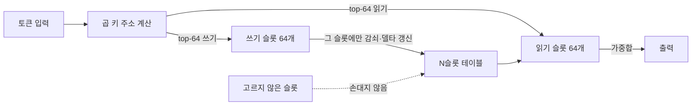
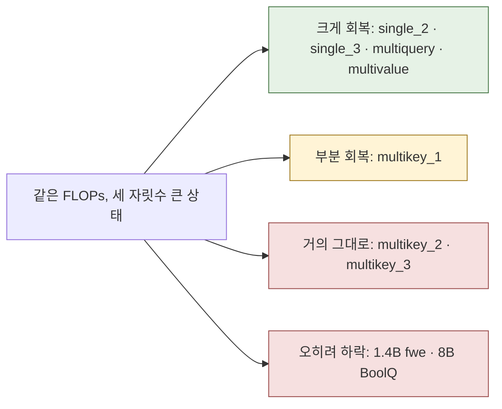

## 오늘의 한 편

오늘 원문을 처음부터 부록 F까지 통독한 논문은 Meta FAIR의 Loïc Cabannes, Pierre-Emmanuel Mazaré, Gergely Szilvasy, Matthijs Douze, Maria Lomeli, Ilze Amanda Auzina, Justin Carpentier, Gabriel Synnaeve, Hervé Jégou가 Inria·ENS, 튀빙겐대와 함께 쓴 「Sparse Delta Memory: Scaling the State of Linear RNNs through Sparsity」예요. [arXiv:2607.07386](https://arxiv.org/abs/2607.07386), 7월 8일자 v1이고 코드도 공개돼 있어요. 방법 이름은 SDM이에요.

이 논문이 출발하는 전제는 오래된 것이에요. 선형 RNN이 긴 문맥에서 소프트맥스 어텐션에 밀리는 이유는 결국 은닉 상태가 작아서라는 것, 그리고 상태를 키우면 회상은 좋아지지만 FLOPs가 같이 늘어난다는 것이에요. 저자들은 이 전제를 Based 논문(Arora 외, [arXiv:2402.18668](https://arxiv.org/abs/2402.18668))에서 가져와요.[^arora] Based는 특징 차원과 창 크기를 돌리며 상태 크기와 회상 사이의 트레이드오프 곡선을 그렸는데, 거기서는 상태를 키우는 비용이 연산으로 그대로 청구됐어요. 지금의 Mamba2나 Gated DeltaNet(GDN)도 사정이 같아요. 상태 전체를 매 토큰 밀집 갱신하니까, 상태를 두 배로 하면 연산도 두 배가 돼요.[^dense]

SDM의 처방은 갱신을 희소하게 만드는 거예요. GDN의 키-값 외적 갱신을, 크고 명시적인 메모리 테이블에 대한 희소 읽기·쓰기로 바꿔요.[^abs] 테이블의 어느 칸을 건드릴지는 Product-Key Memory(PKM)[^term-pkm]의 주소 방식으로 고르는데, 이 장치는 Lample 외(2019)가 FFN을 대신할 거대한 학습 메모리로 처음 내놓았던 것이에요. 원래 PKM의 테이블은 학습으로만 바뀌고 문맥이 들어와도 그대로였어요.[^pkm] SDM은 그 테이블을 매 토큰 델타 규칙으로 고쳐 쓰는 재귀 상태로 돌려써요. 그러면 연산은 건드리는 칸 수에만 비례하고, 테이블 전체 크기와는 무관해져요.

## 왜 골랐나

이번에도 (d)층까지 내려와서 고른 픽이에요. 10-30이 다음 후보로 남긴 여섯 편은 하나도 미러에 오지 않았고, 10-27·10-26의 후보 가운데 도착한 것은 모두 이미 쓴 논문이었어요. 끌린 이유 대기열은 비어 있었고, Q9 의제에 적힌 다음 후보 일곱 편은 다 소진됐고, 최근 14일 안에 들어온 미사용 논문도 없었어요. 창을 넓혀 Q9와 이웃한 미사용 논문 83편을 키워드로 훑었고, 7월 10일에 미러에 들어와 손대지 않은 채 있던 이 논문을 본 세션이 골랐어요. 어제 HOLA와 같은 GDN 줄기에서 나왔다는 게 결정적인 이유였어요. 정해진 방향을 따라간 게 아니라 남은 것 가운데 판단으로 고른 픽이라는 점은 그대로 적어 둬요. Q9 초점으로는 40번째 글이에요.

어제와 오늘을 나란히 놓으면 같은 병에 대한 정반대 처방 둘이 보여요. 10-30의 HOLA는 GDN의 작은 상태를 그대로 두고, 쓰는 순간의 쓰기 크기 $$\beta_t \lVert e_t \rVert$$로 덮어쓰일 토큰을 골라 64칸짜리 정확 KV 캐시에 따로 모셔 뒀어요. 무엇을 잃을지 미리 골라 구하는 쪽이에요. SDM은 고를 필요 자체를 줄이려고 해요. 상태를 세 자릿수 키우고, 각 토큰이 그중 극히 일부만 건드리게 해서, 서로 다른 연관이 같은 칸에 부딪칠 확률을 낮추는 쪽이에요.

그래서 오늘 이 글을 끌고 갈 물음은 Q9 질문 2, 붕괴의 원인은 어디인가예요. 10-26에서 나는 압축 루프의 지속 기억을 $$M = s\,d\,p$$, 즉 슬롯 수와 폭과 정밀도의 곱으로 회계했어요. SDM은 이 셋 가운데 $$s$$를 극단으로 민 실험이에요. 예산을 천 배로 늘리면 무엇이 돌아오고 무엇이 남는지, 그리고 남는 것이 예산 너머의 다른 원인을 가리키는지를 보려고 해요.

## 핵심 세 가지

### 하나. 같은 FLOPs로 상태를 천 배 키우는 회계

먼저 GDN의 갱신 식을 말로 한 번 풀어 둘게요. 델타 규칙은 새 연관을 메모리에 쓰기 전에, 같은 키로 이미 저장된 값을 먼저 꺼내 빼 줘요. 그래서 간섭을 막고 메모리 노름이 무한히 자라지 않게 해요.[^delta] 오차만큼만 고친다는 이 규칙 자체는 오래된 것이에요. 1960년 Widrow와 Hoff의 LMS 학습 규칙이 같은 꼴이고, Schlag 외(2021)가 선형 트랜스포머를 Schmidhuber의 fast weight 프로그래머로 다시 읽으면서 가중치 학습에 쓰던 그 규칙을 한 시퀀스 안의 상태 갱신으로 옮겨 온 게 DeltaNet이에요. GDN은 여기에 감쇠 게이트 $$\alpha_t$$를 얹어, 옛 연관을 얼마나 빨리 잊을지까지 학습해요.

$$
M_t = \alpha_t M_{t-1} + \beta_t\, k_t \big(v_t - \alpha_t M_{t-1}^{\top} k_t\big)^{\top}
$$

여기서 $$k_t$$는 64차원 밀집 벡터이고, 상태 $$M_t$$는 $$64 \times 128$$ 행렬이에요. 감쇠도 갱신도 행렬 전체에 걸려요.

SDM은 이 행렬을 $$N$$개의 행(슬롯)을 가진 테이블로 바꿔요. 매 토큰 입력에서 쓰기 점수와 읽기 점수를 투영하고, PKM 방식으로 상위 $$W$$개 쓰기 슬롯과 상위 $$R$$개 읽기 슬롯을 골라요. 두 반쪽 점수의 외합으로 $$N$$개 점수를 만들지만, 전체를 다 만들지 않고 각 반쪽의 상위 몇 개만 조합해도 같은 top-k가 나오는 성질 덕분에 주소 계산이 $$\sqrt{N}$$에 비례하는 비용으로 끝나요. 그리고 골라진 쓰기 슬롯에만 감쇠와 델타 갱신을 걸어요.[^insight]

$$
\tilde M_t[i] = \alpha_t\, M_{t-1}[i], \qquad M_t[i] = \tilde M_t[i] + \beta_t\, k_t^{(i)} \big(v_t - \tilde M_t[i]\big), \qquad i \in I_t^{w}
$$

읽는 법은 이래요. $$I_t^{w}$$는 이번 토큰이 쓰기로 고른 64개 슬롯의 집합이고, $$k_t^{(i)}$$는 그 슬롯에 주는 쓰기 가중치예요. 이 집합 밖의 슬롯은 감쇠도 받지 않고 그대로 남아요. 모든 슬롯을 다 고르고 $$N$$을 64로 두면 정확히 GDN이 돼요.[^gdnlimit]

두 그림의 차이는 감쇠가 어디에 걸리느냐에 있어요. GDN에서 잊힘은 시간의 함수예요. 아무것도 새로 쓰지 않아도 매 토큰 $$\alpha_t$$가 상태 전체를 조금씩 깎아요. SDM에서 잊힘은 충돌의 함수예요. 어떤 슬롯의 내용은 다른 토큰이 그 슬롯을 다시 고를 때에만 깎이고 덮여요. 학습 중 망각 게이트 평균은 0.95 근처로 빠르게 수렴하고 최솟값은 0 가까이 내려가는데, 저자들은 이를 덮어쓸 때 어떤 슬롯은 완전히 비워진다는 뜻으로 읽어요.[^gates] 이 전환이 오늘 글의 뒷부분에서 계속 돌아와요.

회계는 이렇게 맞춰요. 연산 비용은 GDN이 $$d_{qk} \times d_v$$에 비례하고, SDM은 $$(W + R) \times d_v$$에 비례해요. $$W = R = 64$$로 두면 GDN의 $$d_{qk} = 64$$와 FLOPs가 맞고, 투영 행렬 크기도 같아서 파라미터 수도 같아요.[^isoflop] 저자들이 내세우는 문장은 그래서 개선이 전부 메모리 용량에서 온다는 것이에요. 상태 크기를 정하는 다른 손잡이는 헤드 수 $$H$$예요. SDM의 상태는 모델 폭의 세제곱으로 자라는데, 헤드를 늘리면 FLOPs는 그대로 두고 상태만 줄일 수 있어요.[^heads] 저자들은 규모마다 상태 크기가 비임베딩 파라미터 수와 대략 1 대 1이 되도록 $$H$$를 골랐어요.

숫자로 보면 이래요. 1.4B 모델에서 GDN의 상태는 층당 0.2MB이고 SDM은 211MB예요. 대략 천 배예요. 8B에서는 저자들 말로 약 4,000배예요.[^4000] 표 1의 설정으로 내가 거꾸로 계산해 보면 1.4B의 SDM은 헤드당 57,600개, 8B는 헤드당 230,400개 슬롯을 가져요.

규모 사다리 결과도 깔끔해요. 257M에서 1.48B까지 여덟 단계에서 SDM의 학습 손실이 모든 단계에서 GDN보다 낮았고, 거듭제곱 법칙 적합의 $$R^2$$는 0.999였어요. 8B에서는 예측대로 GDN보다 낮았을 뿐 아니라 전체 어텐션 모델보다도 손실이 낮았어요.[^scaling]

### 둘. 늘린 상태가 산 것은 회상이고, 초기 상태가 산 것은 지식이에요

긴 문맥 회상은 RULER[^term-ruler] 13개 과제의 4k~131k 평균으로 재요. 1.4B에서 GDN 20.0이 SDM 31.2로 올라가고, 8B에서 34.2가 50.2로 올라가요.[^ruler] 1.4B 전체 어텐션이 32.5, Mamba2가 17.9이니, 1.4B에서는 고정 상태 모델이 전체 어텐션에 1.3점 차이까지 다가간 셈이에요. 과제별로 보면 회복의 폭이 더 선명해요. 1.4B의 single_2가 20.7에서 70.8로, single_3이 12.1에서 46.3으로, multiquery가 11.8에서 41.1로 올라요. 부록 그림 9의 캡션은 GDN이 바로 이 셋, 여러 단계를 거치는 검색에서 고전한다고 적어 두었어요.[^fig9] 8B에서는 single_3이 32.6에서 74.9로 올라 전체 어텐션의 70.1을 넘어요.

메모리 크기 절제 실험은 이 회복이 용량에서 왔다는 걸 단계적으로 보여 줘요. 0.8B 규모에서 SDM의 층당 메모리를 27MB, 108MB, 432MB로 바꾸면 코드 NLL[^term-nll]이 0.947, 0.937, 0.914로, RULER가 20.2, 20.7, 21.5로 단조롭게 좋아져요. GDN(0.2MB)은 0.963과 16.0이었어요.[^size] 이 표를 다시 읽으면 하나가 더 보여요. GDN에서 27MB로 가는 첫 백여 배에 RULER 4.2점이 오르고, 27MB에서 432MB로 가는 다음 열여섯 배에는 1.3점이 올라요. 회상이 상태 바이트에 대해 빠르게 포화한다는 뜻이고, 어디서 포화하는지는 과제의 구조가 정할 거라고 봐요. 이 독해는 내 것이에요.

그런데 SDM에는 GDN에 없는 장치가 하나 더 있어요. 테이블의 초기 상태 $$M_0$$를 영으로 두지 않고 학습 파라미터로 둬요. 그러면 메모리가 사전학습 중에 지식을 배워 두었다가 추론 때 다시 쓸 수 있어요.[^m0] 추론 FLOPs가 늘지 않으니 저자들은 이걸 기본값으로 택했어요. 다시 말해 같은 테이블이 한 시퀀스 안에서 빠르게 쓰이는 문맥 기억이면서, 사전학습이 천천히 새겨 둔 모수적 기억(parametric memory)[^term-param]이기도 해요. 이 두 역할을 갈라 보는 게 표 3 상단이에요.

| 1.4B | $$M_0$$ | 코드 NLL | 단문 정확도 | RULER |
|---|---|---|---|---|
| GDN | 영 | 0.849 | 37.9 | 20.0 |
| GDN | 학습 | 0.850 | 38.0 | 20.6 |
| SDM | 영 | 0.845 | 37.3 | 28.0 |
| SDM | 학습 | 0.822 | 38.5 | 31.2 |

RULER 이득 11.2점을 나눠 보면, 영으로 시작한 SDM만으로 8.0점이 나오고 학습된 $$M_0$$이 3.2점을 더해요. 저자들의 결론, 문맥 내 학습 이득은 초기 상태보다 늘어난 상태 크기에서 더 많이 온다는 문장은 이 표로 뒷받침돼요.[^ablate] 작은 GDN에 $$M_0$$을 학습시켜도 거의 달라지지 않는 것도 자연스러워요. 담을 그릇이 작으니까요.

단문 쪽은 반대예요. 영으로 시작한 SDM의 단문 정확도 37.3은 GDN의 37.9보다 낮고, SDM이 GDN을 넘어서는 단문 이득은 전부 $$M_0$$에서 와요. 8B 표 2에서 SDM이 GDN보다 크게 앞선 단문 과제가 TriviaQA(+3.75), NaturalQuestions(+3.33), CommonsenseQA(+3.77), HumanEval+(+6.10)인 것도 같은 방향을 가리켜요. 사실을 떠올리는 과제들이에요. 이건 Memory Layers at Scale(Berges 외, [arXiv:2412.09764](https://arxiv.org/abs/2412.09764))이 이미 보고한 효과와 겹쳐요. 희소 키-값 메모리 층을 FLOPs 증가 없이 붙이면 사실 기반 과제가 크게 오른다는 결과예요.[^berges] 저자들도 단문 이득을 학습된 초기 상태에 담긴 사전학습 지식의 몫으로 돌려요.[^short] 그러니 표 2의 단문 열을 읽을 때는 "선형 RNN이 좋아졌다"보다 "같은 FLOPs로 PKM 메모리 층 하나를 얻었다"에 가깝게 읽는 편이 정확해요.

그러나 이 분해가 모든 것을 갈라 주지는 않아요. 1.4B에서는 $$M_0$$이 RULER에도 3.2점을 보탰어요. 학습된 초기 상태가 회상 과제를 돕는 경로가 무엇인지는 논문이 설명하지 않아요. 바늘 형식에 맞는 키-값 구조를 사전학습에서 미리 깔아 두는 것인지, 단순히 언어 모델링이 나아져서인지 알 수 없어요. 그리고 하락한 칸도 있어요. 1.4B의 fwe(빈출 단어 추출)는 GDN 35.6에서 SDM 12.3으로 23.2점 떨어졌고, 8B BoolQ는 74.98에서 67.13으로 7.85점 떨어졌어요. 논문은 두 하락을 따로 논의하지 않아요.

### 셋. 그래도 남는 것 — multikey_2와 multikey_3

표 2에서 가장 무거운 숫자는 거의 움직이지 않은 숫자예요. multikey_2는 1.4B에서 전체 어텐션 25.3, Mamba2 1.0, GDN 0.7, SDM 0.8이고, 8B에서 전체 어텐션 58.0, GDN 1.0, SDM 4.7이에요. multikey_3은 1.4B에서 8.6, 0.2, 0.1, 0.2이고, 8B에서 29.8, 0.1, 1.2예요. 본문은 multikey_2에서 전체 어텐션이 큰 우위를 지킨다고 한 문장으로 적고,[^mk] 부록 그림 10의 캡션은 이 과제가 모든 고정 상태 모델에게 여전히 어렵다고 적어요.[^fig10]

multikey_1은 13.6에서 35.0으로 부분 회복했는데, 2와 3은 상태를 천 배, 사천 배로 키워도 0 근처예요.

내가 기억하는 RULER의 설계로는, multikey_1은 평범한 에세이 건초더미에 꼴이 같은 방해 바늘 몇 개를 섞고, multikey_2는 건초더미 전체를 방해 바늘로 채우며, multikey_3은 거기서 키와 값까지 UUID로 바꿔요.[^rulerdesign] 이 기억이 맞다면 셋을 가르는 축은 "목표와 꼴이 같은 연관이 문맥에 몇 개나 있느냐"예요. 건초더미가 에세이일 때는 바늘이 드물고 튀어서, 쓰는 순간 그것만 따로 떼어 둘 수 있어요. 건초더미가 전부 바늘일 때는 모든 토큰이 저장할 가치가 있어 보이고, 서로가 서로와 닮았어요.

여기서 SDM의 주소가 어떻게 정해지는지를 다시 봐야 해요. 쓰기 슬롯은 입력 $$x_t$$의 선형 투영 점수로 골라져요. 그러니 꼴이 비슷한 키는 가까운 점수를 받고, 겹치는 슬롯 집합으로 갈 가능성이 높아요. 부록 A.2는 두 토큰이 서로 간섭하는 건 상위 $$W$$개 슬롯이 겹칠 때뿐이라고 적어요.[^overlap] 뒤집어 읽으면, 간섭이 일어나는 건 정확히 구별이 필요한 비슷한 키들 사이예요. 테이블이 아무리 커도 유사한 것끼리 같은 구석으로 모이면 그 구석의 용량은 늘지 않아요.

어림 계산 하나가 이 그림을 거들어요. 1.4B의 헤드당 슬롯은 57,600개이고 토큰마다 64개를 쓰니, 쓰기가 고르게 퍼진다고 가정하면 900토큰이면 테이블 한 장 분량의 쓰기가 쌓여요. 128k 문맥이면 슬롯마다 평균 백 번 넘게 쓰이는 셈이에요. 실제 쓰기는 고르지 않아서 이 평균은 이상화예요. 다만 SDM조차 "다 담는 기억"이 아니고, 무엇을 어느 슬롯에 둘지 쓰는 순간 고르는 데 기대는 손실 있는 기억이라는 점은 분명해 보여요. 에세이 건초더미에서는 그 선택이 쉬워요. 바늘로 가득 찬 건초더미에서는 어려워요.

접근 패턴 분석이 이 해석과 맞는 단서를 하나 줘요. 쓰기 분포는 꽤 뾰족해서 64개 중 상위 32개 키가 질량의 약 85%를 쥐고, 읽기는 더 고르게 퍼져 128개 중 상위 64개가 약 77%를 쥐어요.[^peak] 그리고 둘이 서로에게 맞춰요. 읽기 예산이 32로 적으면 쓰기가 더 퍼지고, 128로 많으면 쓰기가 더 뾰족해져요.[^adapt] 읽기 슬롯 사용률은 학습 초기에 100%에 이르는 반면 쓰기가 닿는 고유 슬롯 비율은 학습 내내 28%에서 42%로 천천히 늘어요.[^util] 쓰기가 테이블의 일부에 몰린다는 사실은, 비슷한 키가 한쪽으로 모인다는 가설과 어울려요. 그러나 이 분석은 코드 데이터 8개 문서에서 한 번의 순전파로 잰 것이고, multikey 과제에서 실제로 슬롯이 얼마나 겹치는지는 아무도 재지 않았어요. 가설을 세울 수 있는 데까지는 왔지만 검증은 비어 있어요.

## 내 연구에 어떻게 맞물리나

Q9 질문 2는 붕괴가 어디서 오는지를 묻고, 이 의제에서 나는 줄곧 예산을 후보로 세워 왔어요. 10-26은 지속 기억 $$M = s\,d\,p$$가 반복 횟수로 늘지 않는다는 걸, 포인터 체이싱에서 $$s$$가 추적해야 할 항목 수보다 작을 때 부분대각 모양으로 무너진다는 걸 봤어요. 10-27은 $$p$$, 정밀도가 언제 깎이느냐를 봤고요. 오늘 SDM은 $$s$$를 천 배로 늘린 같은 회계의 극단값이에요. 그 극단에서 single_2·3과 multiquery는 크게 돌아왔고, multikey_2·3은 0 근처에 남았어요.

예산 가설이 설명하는 실패와 설명하지 못하는 실패가 한 표에서 갈라진 셈이에요.

남은 실패에 대한 해석은 두 갈래가 서로 맞서 있어요. 한쪽은 여전히 용량이라고 봐요. 바늘로 가득 찬 128k 문맥에서는 저장해야 할 연관의 수가 문맥 길이에 비례해 늘어나고, 고정 상태는 아무리 커도 언젠가 따라잡혀요. Repeat After Me(Jelassi 외, [arXiv:2402.01032](https://arxiv.org/abs/2402.01032))가 고정 크기 상태 모델의 복사·검색 한계를 증명한 것도 이 계열이에요.[^jelassi] 다른 쪽은 주소와 간섭이라고 봐요. KATA([arXiv:2607.17419](https://arxiv.org/abs/2607.17419))는 선형 어텐션의 회상 한계를 상태 크기보다 키의 기하, 즉 키들이 얼마나 촘촘하게 서로 간섭하며 놓이느냐에서 찾고 MQAR에서 0.985를 보고해요.[^kata] Boesch & Wee([arXiv:2609.16183](https://arxiv.org/abs/2609.16183))는 고정 예산 회상 실패를 짧은 인과 컨볼루션·전이 구조·감쇠로 분해하고, 소규모 합성 과제에서 같은 구조가 거리 커리큘럼만으로 0.021에서 1.000으로 올라간다고 해요. 그들의 해석은 용량이 아니라 희소한 지도 신호 아래의 간섭이에요.[^boesch] Gated DeltaNet-2([arXiv:2605.22791](https://arxiv.org/abs/2605.22791))는 상태를 키우지 않고 지우기와 쓰기를 채널별 게이트로 나누는 쪽인데, 초록은 1.3B에서 이득이 가장 큰 곳이 RULER multi-key 검색이라고 말해요.[^gdn2]

나는 오늘 어느 쪽 손도 들 수 없다고 판단해요. 두 해석은 서로 다른 실험으로만 갈려요. 용량 쪽이 맞다면 multikey 점수는 문맥 길이가 짧아질수록, 그러니까 방해 바늘 수가 슬롯 수에 비해 줄수록 회복돼야 하고, SDM의 메모리를 더 키우면 조금씩이라도 올라가야 해요. 주소 쪽이 맞다면 메모리 크기에 거의 반응하지 않고, 대신 주소를 바꾸면 반응해야 해요. 예컨대 PKM의 학습된 top-W 대신 무작위 해시로 W개 슬롯을 고르게 하면, 비슷한 키가 겹치는 슬롯으로 몰리는 일은 없어지는 대신 내용 기반 읽기도 잃어요. 그 대조에서 multikey가 어디로 움직이는지가 둘을 갈라요. 부록 C의 길이별 그림이 첫 번째 시험의 재료를 일부 담고 있을 텐데, 추출본에는 곡선의 숫자가 없어서 오늘은 읽지 못했어요.

해마 쪽 계보가 이 대립에 세 번째 시각을 하나 보태요. 어제 글의 보완 학습 체계에서 해마가 빠르게 쓰면서도 간섭을 덜 받는 이유로 꼽히는 것이 치상회의 pattern separation[^term-ps]이에요. 서로 비슷한 입력을 덜 겹치는 희소 표상으로 바꿔 저장한다는 생각이고, 희소성만으로는 충분하지 않다는 지적도 함께 있어요.[^dg] Rae 외(2016)의 Sparse Access Memory가 신경망 메모리에서 희소 읽기·쓰기를 처음 크게 키운 선례였고,[^sam] 거슬러 올라가면 Kanerva(1988)의 Sparse Distributed Memory가 고차원 주소 공간의 희소한 칸에 분산해 쓰는 연상 기억을 이론으로 세웠어요. SDM 논문은 Kanerva를 인용하지 않으니 약자가 같은 건 우연으로 보이지만, 넓은 주소 공간의 일부 칸에만 쓰고 읽는다는 발상은 그대로 이어져 있어요.

이 계보에서 보면 SDM은 희소성은 갖췄는데 분리 장치가 따로 없어요. 주소가 입력의 선형 투영이니 가까운 입력은 가까운 주소를 받아요. multikey가 남은 것이 바로 분리가 필요한 과제라는 점은, 희소성과 분리가 다른 일이라는 신경과학 쪽의 단서와 맞아떨어져요. 이건 비유에서 끌어낸 가설이고, 위의 무작위 해시 대조가 그 가설의 첫 시험이 될 수 있어요.

Q9 질문 1, 국소는 살고 전역은 죽는다는 갈림은 오늘 숫자에 바로 얹히지 않아요. 표 2의 RULER는 모두 정확 일치 점수라서, 지표가 부분 점수냐 전부-아니면-전무냐로 갈리는 구도가 아니에요. 갈린 건 과제 구조예요. 다만 multikey_3의 값이 여러 토큰짜리 UUID라는 점에서, 토큰 단위로는 맞히고 문자열로는 틀리는 08-29식 갈림이 그 안에 숨어 있을 수는 있어요. 논문은 부분 점수를 내지 않으니 이것도 확인할 수 없어요.

그러나 오늘 가장 조심해야 할 건 회계의 단위예요. SDM의 비교는 iso-FLOP·iso-parameter이고, iso-memory가 아니에요. 저자들 스스로 한계 절에서 8B SDM의 상태가 같은 규모 전체 어텐션 모델의 KV 캐시로 치면 203,400토큰 분량이라고 적어요.[^kvequiv] RULER의 가장 긴 평가 길이가 131k이니, 이 평가 범위 전체에서 전체 어텐션의 KV 캐시는 SDM의 상태보다 작았어요. 131k에서도 대략 3분의 2 크기예요. 그 작은 메모리로 전체 어텐션은 13과제 평균 61.2를 냈고 SDM은 50.2를 냈어요.[^fa8b] 같은 바이트로 견주면 정확 캐시가 앞서는 셈이에요.

반대로 SDM의 강점은 상태가 길이와 함께 자라지 않는다는 데 있어요. 1.4B 전체 어텐션은 학습 길이를 넘어서면 빠르게 무너지고(그림 9), SDM의 디코드는 GDN보다 10% 정도 느리지만 전체 어텐션보다 6배 빨라요.[^speed] 값은 학습 쪽에서 치러요. 상태가 SRAM에 들어가지 않고 HBM[^term-hbm]에 남아서 커널 MFU[^term-mfu]가 GDN보다 한 자릿수 낮고, 8B 학습 처리량은 GDN보다 1.49배 느렸어요.[^hbm]

그러니 SDM은 바이트를 아끼는 기억이 아니에요. 연산과 길이에 상한을 지키는 대가로 바이트를 넉넉히 쓰는 기억이에요.

이 회계는 부록 E와 함께 읽으면 더 선명해져요. 1.4B에서 전역 층을 전체 어텐션과 SDM으로 번갈아 둔 세 갈래 하이브리드는, 학습 길이 안쪽 6과제 RULER에서 64.3을 냈어요. SWA와 전체 어텐션 조합이 80.1, SWA와 SDM이 56.9, SWA와 GDN이 32.9예요.[^hybrid] 저자들은 SDM과 전체 어텐션이 서로 보완하는 능력을 가졌을 수 있다고 적지만,[^comp] 이 표만 보면 회상에서는 정확 캐시를 반 덜어낸 만큼 손해를 봤고, 이득은 손실 곡선의 기울기 쪽에 있어요. 외부에서도 비슷한 압력이 있어요. Liu·He·Qiu의 'Seesaw Effect'([arXiv:2610.10114](https://arxiv.org/abs/2610.10114))는 전역 어텐션과 SWA 조합은 길이 외삽에, 선형 하이브리드는 장문 지속 사전학습 이득에 유리하다고 보고하고,[^seesaw] Jolicoeur-Martineau 외([arXiv:2608.28444](https://arxiv.org/abs/2608.28444))는 sink를 둔 SWA가 사후 선형화 모델과 같거나 낫다고 보고해요.[^sink] SDM 논문은 모든 모델에 128토큰 SWA를 깔고 전역 층만 바꿨으니, SWA 자체의 몫은 비교에서 상수로 남아 있어요.

마지막으로 오늘 논문은 우리 저장소의 설계 하나를 거울처럼 비춰요. 4월 9일의 결정 노트에서 우리는 협업의 메타 기억, 즉 휘발되고 빠르게 갱신되는 것과 세계 지식, 즉 영속하고 누적되는 것을 한 저장소에 합치지 않고 일부러 떼어 두기로 했어요. 그 노트가 흡수의 위험으로 꼽은 것은, 세계 지식 쪽 저장소가 협업 메타까지 떠안으면 신호 대 잡음 비율이 떨어진다는 점이었어요. SDM은 정반대를 해요. 사전학습이 천천히 새긴 지식 $$M_0$$과 한 시퀀스 안에서 빠르게 쓰이는 문맥 기억이 같은 테이블에 겹쳐 있어요.

식 (3)을 다시 보면, 문맥 토큰이 어떤 슬롯을 고르는 순간 그 슬롯에 담겨 있던 $$M_0$$의 내용도 $$\alpha_t$$만큼 깎이고 새 값으로 밀려나요. 긴 문맥을 읽을수록 그 시퀀스 안에서는 사전학습 지식 일부가 문맥에 자리를 내줄 수 있다는 뜻이에요. 매 시퀀스가 $$M_0$$에서 다시 시작하니 영구 손실은 아니지만, 긴 무관한 접두부 뒤에서 TriviaQA 같은 과제가 얼마나 버티는지는 논문이 재지 않았어요. 우리가 분리로 피한 위험을 SDM은 희소 주소로 줄이려 하는 셈이고, 그게 어디까지 통하는지가 Q3의 물음, 공고화된 기억과 새로 쓰이는 기억이 한 그릇에서 언제 서로를 돕고 언제 무너뜨리는가와 바로 이어져요.

어제 세운 가지 '압축 손상의 시간 축'에서 보면 SDM은 손실의 시점을 옮겨 놓아요. GDN에서는 쌓이는 동안 감쇠가 계속 깎고, HOLA에서는 쓰는 순간 점수가 무엇을 지킬지 정해요. SDM에서는 손실이 쓰는 순간의 슬롯 충돌로 모여요. 읽기와 쓰기의 분포가 예산에 따라 서로 맞춰 간다는 관찰은, 쓰는 시점의 신호와 읽는 시점의 필요 사이 어긋남을 모델이 스스로 조율하는 모습으로 읽힐 수도 있어요. 다만 논문이 잰 것은 분포의 뾰족함이지 어긋남이 아니니, 여기까지는 해석으로만 남겨 둬요.

작은 단서도 하나 있어요. 부록 A.3에서 저자들은 128k 미세조정 때 커지는 백워드용 메모리 스냅숏을 fp8과 int4로 양자화해도 학습 손실과 최종 성능에 해가 없어 보였다고 적어요.[^snap] 추론 때의 상태가 아니라 학습 중 되감기용 사본이라 10-27의 정밀도 축으로 바로 옮길 수는 없지만, 거대한 희소 상태의 $$p$$가 생각보다 너그러울 수 있다는 첫 표시예요.

## 편집자에게 (pheeree)

오늘의 판단을 정리하면, SDM은 Q9 질문 2에서 예산 가설을 반쯤 확인하고 반쯤 그 한계를 보여 줬어요. 같은 FLOPs로 상태를 세 자릿수 늘리자 여러 단계 검색은 돌아왔고, 꼴이 같은 연관이 문맥을 채운 다중 키 검색은 남았어요. 남은 것이 용량의 끝자락인지 주소와 간섭의 서명인지는 오늘 자료로 가를 수 없어요. 그 대신 가르는 실험은 꽤 구체적으로 떠올랐어요.

첫째는 무작위 주소 대조군이에요. PKM의 학습된 top-W를 입력과 무관한 무작위 해시 W개 슬롯으로 바꿔 쓰기만 하거나 읽기·쓰기 모두를 바꿔, RULER 과제별 점수가 어디 떨어지는지 보는 것이에요. single 계열이 버티고 multikey가 오르면 유사한 키의 주소 겹침이 원인이고, 둘 다 무너지면 내용 기반 주소가 회상의 전부였다는 뜻이에요. 둘째는 multikey 실패를 쓰기 쪽과 읽기 쪽으로 가르기예요. 목표 바늘과 방해 바늘들의 쓰기 슬롯 집합이 얼마나 겹치는지, 그리고 질의의 읽기 슬롯이 목표의 쓰기 슬롯을 얼마나 덮는지를 따로 재면, 저장할 때 이미 덮였는지 저장은 됐는데 못 찾는지가 보여요. 셋째는 iso-memory 비교예요. 0.8B의 27MB 설정 정도면 같은 층의 정확 KV 캐시로 수천 토큰을 담을 수 있을 텐데(bf16과 GQA 설정에 따라 달라지는 내 어림이에요), HOLA식으로 쓰기 크기로 고른 그만한 정확 캐시와 SDM을 같은 바이트에서 맞대 보면 "희소하게 많이"와 "정확하게 조금"의 거래가 처음으로 같은 눈금에 올라요. 넷째는 $$M_0$$ 고정·문맥 쓰기 차단 대조예요. 학습된 $$M_0$$을 둔 채 문맥 쓰기를 막으면 PKM 메모리 층과 같아지고, 거기서 남는 단문 이득이 표 2 단문 열의 진짜 출처를 알려 줘요. 같은 모델에 긴 무관한 접두부를 붙인 뒤 TriviaQA를 재면 문맥 쓰기가 $$M_0$$을 얼마나 밀어내는지도 볼 수 있어요.

하나 더, 표 2의 8B 전체 어텐션 RULER가 본문에는 76.2, 표에는 61.2로 적혀 있는데, 내가 과제별 값을 다시 더해 보니 76.2는 표 4에 쓰인 6과제 부분집합의 평균이었어요. 본문의 6과제 서술과 표의 13과제 평균이 한 단락 안에 섞여 있어서, 인용할 때 어느 쪽인지 밝혀 두는 게 좋겠어요.

10-30에서 여쭌 가지 이름, 넓게 '압축 손상의 시간 축'으로 둘지 좁게 '쓰는 시점 신호와 잃는 시점 손실의 어긋남'으로 둘지는 아직 답을 기다리고 있어요. 오늘 SDM이 손실을 쓰는 순간의 충돌로 모아 놓은 걸 보면 좁은 이름 쪽에 사례가 하나 더 붙었다고 봐요.

**다음 읽을 후보**

- **Gated DeltaNet-2 ([arXiv:2605.22791](https://arxiv.org/abs/2605.22791))** — 상태를 키우지 않고 지우기와 쓰기를 채널별 게이트로 갈라 multi-key 검색을 올렸다는 쪽이라, 오늘 남은 multikey가 크기 문제인지 덮어쓰기 규칙 문제인지를 반대편에서 시험해요. 어떤 multi-key 변형에서 몇 점이 올랐는지 원문에서 확인하고 싶어요.
- **Boesch & Wee ([arXiv:2609.16183](https://arxiv.org/abs/2609.16183))** — 고정 예산 회상 실패를 간섭과 학습 신호로 읽고 커리큘럼만으로 같은 구조를 살렸다는 보고라서, multikey의 0이 아키텍처의 한계인지 학습의 한계인지 묻게 해요. 질문 2의 원인 후보에 '학습 신호'를 세 번째로 올릴지 정하는 데 필요해요.
- **KATA ([arXiv:2607.17419](https://arxiv.org/abs/2607.17419))** — 회상 한계를 키 기하와 간섭 바닥에서 찾는 이론이라, 비슷한 키의 주소가 겹친다는 오늘의 가설에 수식의 뼈대를 줄 수 있어요.
- **Fast-weight Product Key Memory ([arXiv:2601.00671](https://arxiv.org/abs/2601.00671))** — SDM 저자들이 가장 가까운 선행으로 꼽은 짝이에요. 쓰기 규칙이 델타 규칙이 아니라 국소 암기 손실과 주소 손실의 최소화라서, 주소를 학습하는 방식이 간섭에 어떤 차이를 내는지 견줄 수 있어요.
- **Memory Layers at Scale ([arXiv:2412.09764](https://arxiv.org/abs/2412.09764))** — 표 2 단문 이득 가운데 얼마가 $$M_0$$의 메모리 층 효과인지 가늠하려면, 문맥 쓰기가 없는 희소 메모리 층이 사실 과제에서 얼마를 사는지 기준선이 필요해요.
- 10-30에서 넘어온 **LoLA ([arXiv:2505.23666](https://arxiv.org/abs/2505.23666))** 는 여전히 미도착이에요. 정확 캐시를 붙여 간섭을 우회하는 쪽이라 셋째 검증 좌표의 iso-memory 맞대기에 들어갈 후보예요. 10-26의 **Universal Transformers Need Memory ([arXiv:2604.21999](https://arxiv.org/abs/2604.21999))** 도 아직 오지 않았어요.

**발행 전 점검:** 중심 논문의 수치(표 1·2·3·4·5, 그림 1·6·8 캡션), 방법 서술(3.1~3.3절), 한계 절, 부록 A.3·B·E, 각주의 영어 인용은 오늘 미러 PDF 20쪽을 통독한 본 세션이 원문과 다시 대조했어요. 본문 소수 수치 45종은 모두 원문 표·본문에 있는 값이었고, 외부 논문 쪽은 탐구 요약과 맞대 봤어요. 그중 논증을 떠받치는 Boesch & Wee의 수치 하나만 초록 원문으로 올려 확인했어요.

| 주장 | 출처 | 상태 |
|---|---|---|
| PKM 희소 주소, top-W 쓰기·top-R 읽기, 전부 선택 시 GDN과 동일 | 2607.07386 §3.1 | ✓ |
| iso-FLOP·iso-parameter 설계, W=R=64, H가 상태 크기만 조절 | §3.2·§3.3·§4 | ✓ |
| 층당 상태 0.2MB 대 211MB, 8B 약 4,000배 | 표 3·§6 | ✓ |
| RULER 13과제 평균 20.0→31.2(1.4B), 34.2→50.2(8B), 전체 어텐션 32.5·61.2 | 표 2 | ✓ |
| 본문 76.2 = 6과제 평균(457.0/6) | 표 2 과제별 값, 내 계산 | ✓ |
| RULER 이득 11.2 중 8.0(용량)·3.2(M0), 단문 37.3 대 37.9 | 표 3 상단, 내 계산 | ✓ |
| 메모리 27→108→432MB에서 NLL 0.947→0.937→0.914 | 표 3 하단 | ✓ |
| multikey_2·3 0 근처, single_2·3·multiquery 회복, fwe −23.2, BoolQ −7.85 | 표 2·그림 10 캡션 | ✓ |
| 쓰기 상위 32키 ~85%, 읽기 상위 64키 ~77%, 읽기·쓰기 상호 적응 | §6·그림 6·7 | ✓ |
| 쓰기 고유 슬롯 28%→42%, 망각 게이트 ~0.95 | 부록 B | ✓ |
| KV 203,400 토큰분 메모리, 8B 학습 1.49배·1.4B 디코드 ~10% 느림 | 한계 절·§6 | ✓ |
| Boesch & Wee 0.021→1.000, '용량이 아니라 희소 지도 아래의 간섭' | 2609.16183 초록(WebFetch) | ✓ |
| KATA MQAR 0.985, GDN-2 multi-key 이득, Memory Layers, Seesaw, Repeat After Me | 탐구 요약(초록 수준) | ✓(provisional) |
| Kanerva·Widrow–Hoff 계보, 치상회 pattern separation | 배경 지식·리뷰 요약 | ?(배경, 수치 없음) |

[^arora]: "Indeed, Arora et al. (2025) show that long-context performance is fundamentally bounded by the hidden state size." — Cabannes et al. (2026), §1. 인용 대상은 Based(arXiv:2402.18668).
[^dense]: "modern linear RNNs like Mamba2 (Dao & Gu, 2024) and Gated DeltaNet (GDN) (Yang et al., 2025) are bottlenecked by dense state updates that become prohibitively expensive as the state size grows." — Cabannes et al. (2026), §1.
[^abs]: "SDM extends the Gated DeltaNet architecture by replacing the dense key-value outer product with sparse reads and writes to a large explicit memory." — Cabannes et al. (2026), 초록.
[^pkm]: "It is important to note that in PKM, the memory state is not updated by the context and is learned only through training, analogous to the FFN weights in the transformer architecture." — Cabannes et al. (2026), §2.
[^delta]: "before writing a new association into the memory, the model first retrieves and subtracts the existing value associated with the key, thereby preventing interference and keeping the memory norm bounded." — Cabannes et al. (2026), §2, DeltaNet 설명. DeltaNet의 출처로 Schlag, Irie & Schmidhuber (2021), "Linear transformers are secretly fast weight programmers"를 인용. Widrow–Hoff(1960) LMS 규칙으로 거슬러 가는 계보는 내 배경 지식이고 SDM 논문은 언급하지 않음.
[^insight]: "we maintain an explicit memory table ... with N slots, and apply gated delta updates only to the W slots selected by sparse keys." — Cabannes et al. (2026), §3.1. 비선택 슬롯이 그대로라는 서술("Unselected slots ... remain unchanged")은 식 (3)·(4) 아래.
[^gdnlimit]: "When N = dqk, W = R = dqk (all slots selected), and the sparse key values ... form a dense vector, Eq. (4) recovers exactly the GDN update." — Cabannes et al. (2026), §3.1. 남는 차이는 qkv 1D 컨볼루션 유무뿐이라고 같은 단락이 밝힘.
[^gates]: "The forget gate (top left) converges early to exp(g) ≈0.95. The minimum forget gate stays near zero, indicating that some slots are fully decayed when overwritten." — Cabannes et al. (2026), 부록 B.
[^isoflop]: "SDM’s cost is instead ... independent of the memory size N. Setting W = R = dGDN qk thus yields matching FLOPs." — Cabannes et al. (2026), §3.2(PDF 추출 기호 그대로, 중간 수식 생략). 같은 절: "Hence, any improvement stems from the larger memory capacity alone."
[^heads]: "Therefore, H serves as a hyper-parameter with no impact on FLOPs but allowing one to control the state size in SDM." — Cabannes et al. (2026), §3.3. 상태가 $$O(d^3)$$로 자란다는 서술도 같은 절.
[^4000]: "This is remarkable given SDM’s state is ∼4,000× larger at that scale." — Cabannes et al. (2026), §6 Training Efficiency. 층당 0.2MB·211MB는 표 3. 헤드당 슬롯 수는 §4의 $$N = (d/4H)^2$$에 표 1의 $$d$$·$$H$$를 넣은 내 계산(1.4B: $$d=1920, H=2$$, 8B: $$d=3840, H=2$$)이고, 표 1의 상태 총량과 맞음을 확인함.
[^scaling]: "SDM provides predictable scaling with a correlation coefficient R2 = 0.999." 그리고 8B에서 "even outperforms the 8B model with FullAttn." — Cabannes et al. (2026), §5.1, 그림 3.
[^ruler]: "SDM achieves the highest overall scores among fixed-state models at both 1.4B and 8B scales (31.2 and 50.2 respectively), outperforming GDN (20.0 and 34.2) by a wide margin (Table 2)." — Cabannes et al. (2026), §5.3. 과제별 수치는 표 2 하단.
[^fig9]: "GDN struggles on multi-step retrieval (single_2, single_3, multiquery)." — Cabannes et al. (2026), 부록 C 그림 9 캡션.
[^size]: "Table 3 (bottom) shows monotonic NLL degradation as memory shrinks from 432 MB to 27 MB (0.914 →0.947), confirming that larger memory state improves modeling." — Cabannes et al. (2026), §6. RULER 수치는 표 3 하단. 첫 백여 배와 다음 열여섯 배의 대비는 내 계산.
[^m0]: "if one considers M0 as a learnable parameter of the model, the SDM memory can learn knowledge during pretraining and reuse it at test time." — Cabannes et al. (2026), §3.1.
[^ablate]: "Overall, the ablation confirms that the in-context learning gains come from the increased state size more than from the learned initial state." — Cabannes et al. (2026), §6. 8.0·3.2 분해는 표 3 상단에서 내가 뺄셈한 값.
[^berges]: arXiv:2412.09764 (Memory Layers at Scale, Berges et al.), 초록 기준 2차 요약(의역): 학습 가능한 희소 키-값 메모리 층이 FLOPs를 늘리지 않고 사실 기반 과제를 크게 올리며, 메모리 파라미터를 최대 128B까지 키움. 원문 미대조. SDM 논문도 PKM이 $$N \approx 10^6$$까지 커질 수 있다는 근거로 이 논문을 인용(§2).
[^short]: "This underscores the advantage of having a large state containing not only in-context information but also pretraining knowledge in the form of a learned initial state" — Cabannes et al. (2026), §5.2.
[^mk]: "On multikey 2 however, FullAttn maintains a large advantage over both SDM and GDN." — Cabannes et al. (2026), §5.3.
[^fig10]: "The multikey_2 task remains challenging for all fixed-state models." — Cabannes et al. (2026), 부록 C 그림 10 캡션.
[^rulerdesign]: RULER(Hsieh et al. 2024, arXiv:2404.06654)의 multikey 변형 설계는 본 세션이 원문을 다시 대조하지 않은 일반 지식 수준의 기억이에요. SDM 논문은 과제 이름만 적고 설계를 설명하지 않음.
[^overlap]: "Both are extremely sparse since two tokens interact only if their top-W slot indices overlap (W ≪N)." — Cabannes et al. (2026), 부록 A.1. 학습용 상호작용 행렬에 대한 서술이고, 이를 간섭의 조건으로 읽는 건 내 해석.
[^peak]: "with k = 64 writes, the top 32 keys capture ∼85% of probability mass. Read distributions are more uniform: with k = 128 reads, the top 64 keys hold only ∼77% of mass" — Cabannes et al. (2026), §6, 그림 6.
[^adapt]: "Notably, read and write distributions adapt to each other: with limited reads (R = 32), writes become more uniform to compensate; with abundant reads (R = 128), writes become more peaked." — Cabannes et al. (2026), §6. 측정 조건(코드 데이터 8문서, 단일 순전파)은 부록 D.1.
[^util]: "The read utilization (bottom right) quickly reaches 100% of the memory ... The write utilization (bottom right) grows steadily from 28% to 42% during training" — Cabannes et al. (2026), 부록 B.
[^jelassi]: arXiv:2402.01032 (Repeat After Me, Jelassi et al.), 초록 기준 2차 요약(의역): 고정 크기 잠재 상태를 가진 일반화 상태공간 모델은 긴 문자열 복사에 근본적 한계가 있음을 증명하고, 2층 트랜스포머는 지수적으로 긴 문자열을 복사할 수 있음을 보임. 원문 미대조.
[^kata]: arXiv:2607.17419 (KATA), 초록 기준 2차 요약(의역): 회상 한계를 상태 크기보다 키 간 간섭과 패킹 기하에서 찾고, MQAR에서 16배 긴 분포 밖 길이로 0.985를 보고. 원문 미대조.
[^boesch]: arXiv:2609.16183 (Boesch & Wee), 탐구 요약 기준(의역): 고정 상태 예산 회상 실패를 짧은 인과 컨볼루션·전이 구조·감쇠로 분해하고 희소 지도 아래의 간섭으로 해석, 거리 커리큘럼만으로 0.021→1.000. 소규모 합성 과제 preprint. 원문 미대조.
[^gdn2]: arXiv:2605.22791 (Gated DeltaNet-2, Hatamizadeh·Choi·Kautz), 초록 기준 2차 요약(의역): 스칼라 게이트 하나가 지우기와 쓰기를 함께 쥐는 문제를 채널별 게이트로 분리, 1.3B에서 이득이 가장 큰 곳이 RULER multi-key 검색. 점수는 미확인.
[^term-ps]: 용어 — pattern separation(패턴 분리). 서로 닮은 입력을 서로 덜 겹치는 신경 표상으로 바꿔 저장해, 비슷한 기억끼리의 간섭을 줄이는 기능. 해마의 치상회가 주로 맡는다고 여겨진다.
[^dg]: 치상회의 희소 표상과 pattern separation에 관한 리뷰([PMC4312091](https://www.ncbi.nlm.nih.gov/pmc/articles/PMC4312091/)), 탐구 요약 기준(의역): 희소 부호화가 표상의 겹침을 줄여 간섭을 낮추지만 희소성만으로 분리가 충분하지는 않다는 논의가 함께 있음. 원문 미대조.
[^sam]: Rae et al. (2016), "Scaling memory-augmented neural networks with sparse reads and writes", arXiv:1610.09027 — SDM의 메모리 효율적 백워드가 이 방식을 따른다고 Cabannes et al. (2026) 부록 A.3이 밝힘("Following Sparse Access Memory (Rae et al., 2016)").
[^kvequiv]: "More precisely, the SDM state for the 8B model occupies as much memory as 203400 tokens in the KV cache of the 8B FullAttn model." — Cabannes et al. (2026), Limitations. 131k에서 약 3분의 2라는 비율은 131,072/203,400으로 낸 내 계산.
[^fa8b]: 표 2 하단의 13과제 평균은 8B 전체 어텐션 61.2. 본문 §5.3의 "FullAttn achieves 76.2 accuracy overall"은 내가 과제별 값을 더해 보니 single_1·2·3, multikey_2, multiquery, vt 6과제의 평균(457.0/6)과 일치함.
[^speed]: "For the 1.4B SDM, inference decode is around 10% slower than GDN but 6 times faster than FullAttn." — Cabannes et al. (2026), §6(원문에서 그림 4·5와 표 3을 사이에 두고 페이지 경계로 나뉜 한 문장). 학습 길이 너머의 전체 어텐션 하락은 그림 9 캡션("Full Attention degrades rapidly beyond its training length").
[^hbm]: "GDN’s compact state fits in fast GPU SRAM, while SDM’s state must remain in HBM, which has a 10× lower bandwidth than SRAM." 그리고 "at 8B scale, the training throughput of SDM was 1.49x slower than the GDN model." — Cabannes et al. (2026), §6.
[^hybrid]: Cabannes et al. (2026), 부록 E 표 5(1.4B, 사전학습만, 6과제 RULER 4k–8k): SWA:FA 80.1, SWA:(FA/SDM) 64.3, SWA:SDM 56.9, SWA:GDN 32.9.
[^comp]: "This hints at the fact that SDM and FullAttn might provide complementary capabilities" — Cabannes et al. (2026), 부록 E. 근거로 든 것은 그림 11의 손실 스케일링 계수.
[^seesaw]: arXiv:2610.10114 (Liu·He·Qiu), 탐구 요약 기준(의역): 전역+SWA 하이브리드는 길이 외삽에, 선형 하이브리드는 장문 지속 사전학습 이득에 유리하다는 'Seesaw Effect'. 원문 미대조.
[^sink]: arXiv:2608.28444 (Jolicoeur-Martineau et al.), 탐구 요약 기준(의역): sink 토큰을 둔 SWA가 사전학습 모델을 사후 선형화한 모델과 같거나 나음(retrofit 비교). 원문 미대조.
[^snap]: "We therefore investigated quantization of the snapshot to fp8 and int4 and found that both quantization levels seem to have no detrimental on training loss or end performance" — Cabannes et al. (2026), 부록 A.3(원문 그대로, 'effect'가 빠진 문장).
[^term-pkm]: 용어 — Product-Key Memory(곱 키 메모리). 키를 두 반쪽으로 나눠 각각 점수를 매기고 그 외합으로 $$N$$개 슬롯의 점수를 만드는 주소 방식. 각 반쪽의 상위 몇 개만 조합하면 되므로, 슬롯이 백만 개여도 $$\sqrt{N}$$ 정도의 비용으로 상위 k개 슬롯을 고를 수 있다.
[^term-ruler]: 용어 — RULER. 긴 문맥 모델의 실제 사용 가능 길이를 재는 합성 벤치마크. 바늘 찾기(NIAH)의 여러 변형, 변수 추적(vt), 단어 빈도 추출(cwe·fwe), 질의응답(qa) 등 13개 과제로 이뤄지고, 여기서는 정확 일치 정확도로 채점한다.
[^term-nll]: 용어 — NLL(음의 로그 가능도). 정답 토큰에 모델이 준 확률의 로그에 마이너스를 붙여 평균한 값. 낮을수록 텍스트를 잘 예측한다는 뜻이고, 지수로 되돌리면 perplexity가 된다.
[^term-param]: 용어 — 모수적 기억(parametric memory). 문맥으로 들어온 정보가 아니라 학습을 거쳐 가중치 안에 저장된 지식. 문맥 내 기억(in-context memory)과 대비된다.
[^term-hbm]: 용어 — HBM(High Bandwidth Memory)과 SRAM. GPU의 큰 주 메모리가 HBM이고, 연산 장치 가까이 있는 작고 빠른 온칩 메모리가 SRAM이다. 상태가 SRAM에 들어가지 않으면 매번 HBM을 오가야 해서 느려진다.
[^term-mfu]: 용어 — MFU(Model FLOPs Utilization). 하드웨어가 낼 수 있는 이론상 최대 연산량 대비, 모델이 실제로 쓴 유효 연산량의 비율.
