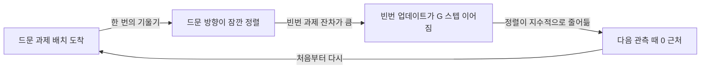
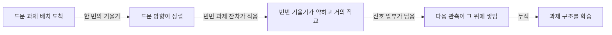

## 오늘의 한 편

오늘 37쪽을 부록까지 통독한 논문은 「Why Larger Models Learn More: Effects of Capacity, Interference, and Rare-Task Retention」이에요. [arXiv:2605.29548](https://arxiv.org/abs/2605.29548), 6월 1일자 v2이고 [ICML 2026](https://icml.cc/virtual/2026/72344)에 채택됐어요. 저자는 Jing Huang, Daniel Wurgaft, Rachit Bansal, Laura Ruis, Naomi Saphra, David Alvarez-Melis, Andrew Lampinen, Christopher Potts, Ekdeep Singh Lubana이고, 소속은 Stanford, Harvard의 Kempner Institute, MIT, Anthropic에 걸쳐 있어요(첫 쪽에 Goodfire 로고도 함께 있어요).

물음은 제목 그대로예요. 큰 모델이 더 많이 배운다는 건 스케일링 법칙이 이미 말해 주지만, 그게 "작은 모델이 같은 걸 더 느리게 배울 뿐"인지 "작은 모델은 데이터를 끝없이 줘도 끝내 못 배우는 부분이 있다"인지는 다른 주장이에요. 저자들은 뒤쪽을 택하고, 그 원인을 두 가지로 나눠요. 하나는 효용 순서로 매개변수를 나눠 갖는 자원 경쟁이고, 다른 하나는 드문 과제가 한 번 관측된 뒤 다음 관측이 오기 전에 빈번 과제의 업데이트가 그 흔적을 지워 버리는 간섭이에요. 저자들은 이 두 번째를 update-and-forget이라고 불러요.[^hyp]

## 왜 골랐나

이번 픽은 편집자의 조타가 없었던 날의 선택이에요. 최근 세 편(10-31·10-30·10-27)이 남긴 '다음 읽을 후보'가 하나도 미러에 도착하지 않았어요. 10-31 글의 후보 열세 편이 전부 미도착이었고, 끌린 이유가 채워진 대기열도, 초점 Q9의 다음 후보도, 최근 14일 안의 미사용분도 비어 있었어요. 그래서 이미 도착해 있으면서 아직 쓰이지 않은 카드들을 Q9에 인접한 키워드로 훑었고, 6월 13일에 들어와 묵어 있던 이 논문이 걸렸어요.

연결은 10-31 글에서 시작해요. Sparse Delta Memory는 선형 RNN의 상태를 같은 연산량으로 천 배 늘렸고, 그러자 single_2·3 같은 다단계 회상은 돌아왔는데 multikey_2·3은 모든 고정 상태 모델에서 0 근처에 남았어요. 그 글의 편집자에게 단락은 남은 실패가 용량의 끝자락인지 주소와 간섭의 서명인지 그날 자료로는 가를 수 없다고 적었고, 다음 후보로 Boesch & Wee([arXiv:2609.16183](https://arxiv.org/abs/2609.16183))를 지목했어요. 고정 예산 회상 실패를 간섭과 학습 신호로 읽고 커리큘럼만으로 고친 논문이에요. 그 논문은 아직 도착하지 않았지만, 오늘의 논문이 같은 물음 — 용량인가 간섭인가 — 을 다른 층에서 다뤄요. 10-31이 추론 시점의 상태를 봤다면, 오늘은 학습 시점의 매개변수를 봐요.

10-30 글(HOLA, 쓰는 순간의 놀람으로 덮어쓸 것을 고르는 선형 어텐션)과도 닿아요. 그 글이 연 가지는 쓰는 시점의 신호와 잃는 시점의 손실이 어긋난다는 '압축 손상의 시간 축'이었고, 이름은 아직 pheeree의 답을 기다리고 있어요. update-and-forget은 바로 그 시간 축 위의 손상이에요. 드문 관측은 분명히 쓰였는데, 다음 관측이 오기 전에 지워져요.

그래서 오늘의 목적은 하나로 좁혀요. 10-31의 물음을 추론 시점의 상태에서 학습 시점의 매개변수로 옮겨 놓고, 작은 모델이 드문 과제를 못 배우는 것이 용량 탓인지 간섭 탓인지 본 다음, 그 답이 Q9 질문 1(압축은 국소를 남기고 전역을 버리는가)의 '버려지는 쪽'을 데이터 분포의 꼬리로 예측하는지 따져 보는 거예요.

## 핵심 세 가지

### 1. 무한 데이터로도 닿지 않는 부분이 있다는 주장

출발점은 친숙한 식이에요. 손실을 매개변수 수 $$N$$과 데이터 양 $$D$$의 함수로 쓰면

$$L(N, D) = L_0 + \frac{A}{N^{\alpha}} + \frac{B}{D^{\beta}}$$

이고, 논문은 Chinchilla 적합값으로 $$\alpha \approx 0.46$$, $$\beta \approx 0.51$$을 가져와요. 컴퓨트 최적으로 학습했을 때의 손실은 $$L_C(N) \propto N^{-\gamma}$$, $$\gamma = 0.34$$로 줄어요. 여기서 데이터를 무한히 주면 데이터 항이 사라지고 $$L_\infty(N) \propto N^{-\alpha}$$만 남아요.

말로 풀면 이래요. 컴퓨트 최적 곡선은 "주어진 예산에서 얼마나 잘하나"이고, 무한 데이터 곡선은 "그 크기가 끝내 어디까지 갈 수 있나"예요. $$\alpha > \gamma$$이면, 작은 모델에 데이터를 끝없이 줘도 큰 모델이 컴퓨트 최적으로 도달한 손실에 못 미치는 구간이 생겨요. 저자들은 이 구분을 정의 둘로 적어요. Definition 1은 작은 모델이 그저 덜 학습된 경우(데이터만 늘리면 따라잡음), Definition 2는 점근적으로도 큰 모델의 손실에 닿지 못하는 경우예요.[^def2] 그리고 각주에서 멱법칙이 점근적으로 성립할 필요는 없다고 밝히며 이 논증을 'phenomenological'이라 불러요.[^phen] 스스로 엄밀한 증명이 아니라 동기 부여용 논증이라고 선을 긋는 셈이에요.

문제는 그 '못 닿는 부분'이 분포의 어디냐는 거예요. 저자들의 장난감은 $$K$$개의 선형회귀 과제를 섞은 혼합이에요. $$k$$번째 과제의 출현 빈도는 $$\pi_k \propto k^{-\beta}$$로 멱법칙을 따르고(앞 식의 $$\beta$$와는 다른 지수예요), 각 과제의 입력 공분산 스펙트럼은 $$\lambda_{k,j} \propto j^{-\alpha}$$로 감쇠해요. 스펙트럼이 느리게 감쇠할수록 그 과제를 풀려면 많은 방향이 필요하니 '복잡한' 과제가 돼요. 모델은 폭 $$N$$의 공유 인코더와 과제별 디코더로 이뤄져 있어요.

Theorem 3이 이 장난감의 정적 그림이에요. 폭 $$N$$짜리 최소화자는 과제 공분산을 빈도로 가중해 더한 행렬 $$M = \sum_k \pi_k C_k$$의 상위 $$N$$개 고유공간이고, 그래서 특징은 효용 $$u_{k,j} = \pi_k \lambda_{k,j}$$의 순서로 보존돼요.[^thm3] 효용은 "얼마나 자주 나오나"와 "그 방향이 그 과제 안에서 얼마나 큰가"의 곱이에요. 드물거나 복잡한 과제의 특징은 효용이 낮아 줄 뒤쪽에 서고, 폭이 그 줄의 끝까지 닿는 모델만 그걸 갖게 돼요. 이 정리의 뼈대는 낯이 익어요. 공분산의 상위 고유공간만 남기는 건 주성분 분석이 하는 일이고, 여기서는 그 공분산이 과제 빈도로 가중돼 있을 뿐이에요. 그러니 Theorem 3은 "작은 모델은 빈도 가중 PCA의 앞쪽 N개만 갖는다"로 읽어도 크게 틀리지 않아요(이 대응은 내 풀이예요). 32개 과제를 Adam으로 10만 스텝 학습한 그림 2에서, 과제별 손실은 폭을 따라 이 예측대로 갈려요. 관측의 0.25%만 차지하는 과제도 배워야 하는 설정이에요.[^stat]

다만 이 깔끔한 순서는 장난감의 가정 덕을 보고 있어요. 저자들은 과제마다 특징 행렬이 서로 직교하는 블록을 차지한다고 놓았어요.[^orth] 과제끼리 방향을 나눠 쓰지 않으니, 경쟁은 "누가 자리를 얻나"로만 일어나고 "한 자리에 둘이 겹쳐 앉는" 일은 없어요. 실제 신경망은 희소한 특징을 차원보다 많이 겹쳐 담는다는 게 중첩(superposition) 연구의 출발점이니, 이 가정이 풀리면 효용 순서가 얼마나 버티는지는 장담할 수 없어요.

여기까지는 "작은 모델은 용량이 모자라 드문 것을 못 담는다"는, 정적이고 익숙한 이야기예요. 논문의 몫은 그다음에 있어요.

### 2. 경쟁은 정적으로 끝나지 않는다 — update-and-forget

Theorem 4는 학습 동역학 쪽 명제예요. 빈번 과제 집합 $$F$$가 모델을 미는 기울기의 크기는 $$2\sqrt{\lambda_1(M_F)\, \delta_F(U)}$$로 위에서 묶여요. 여기서 $$\delta_F$$는 빈번 과제에서 아직 설명되지 않고 남은 잔차예요. 그러니까 빈번 과제가 모델을 미는 힘은 "아직 못 배운 만큼"에 비례해요. Corollary 5는 폭이 충분하면 그 잔차가 작아지고, 따라서 빈번 과제의 기울기가 약해진다고 말해요.

Proposition 6이 드문 과제의 운명을 정해요. 드문 과제의 rank-1 방향 $$b_r$$은 그 효용 $$\pi_r \lambda_r$$이 이미 자리 잡은 빈번 특징 가운데 가장 약한 것의 효용 $$\mu_N^F$$보다 클 때만 안정해요. 작으면 어떻게 되는지 저자들의 문장을 그대로 옮기면, 모델이 그걸 배우려 업데이트하더라도 빈번 과제의 가장 약한 특징이 결국 다시 그 매개변수를 차지하고, 그 결과 "a swinging, update-and-forget learning dynamic"이 생겨요.[^swing] 그래서 드문 과제가 배워지기 시작하는 임계 폭 $$N_r^{\mathrm{crit}}$$은 $$\mu_N^F \le \pi_r \lambda_r$$이 처음 성립하는 $$N$$이에요.

이 그네에는 가까운 조상이 있어요. 부록 A가 직접 짚는 Pezeshki 등의 gradient starvation(NeurIPS 2021)은 빈도가 다른 과제를 섞어 학습하면 드문 과제의 기울기가 "굶어" 0이 되어 끝내 못 배운다고 봤고, Evron 등(COLT 2022)은 순차 선형회귀에서 한 과제의 관측 빈도가 다른 과제의 망각을 어떻게 부르는지 따졌어요.[^starve] 연속학습 쪽에서는 Ramasesh 등(ICLR 2022)이 규모가 파국적 망각에 미치는 효과를 다뤘고, 저자들은 이를 비전 설정에서 자기 주장을 뒷받침하는 결과로 들어요. 오늘 논문이 그 계보에 더하는 건 축 하나예요. 굶주림이 영구적인지가 폭에 달려 있고, 그 경계를 효용 부등식 하나로 적을 수 있다는 것.

부록 C.4의 가장 작은 모형이 이 그네를 손에 잡히게 보여 줘요. 뉴런 하나에 과제 둘. 드문 과제가 한 번 관측된 직후의 정렬을 $$\theta_0$$이라 하면, 다음 관측까지 빈번 과제로만 $$G$$ 스텝을 밟는 동안 그 정렬은

$$\theta_G \approx (1-2\eta)^G \theta_0 \approx e^{-2\eta G} \theta_0$$

로 줄어요.[^c4] 학습률 $$\eta$$와 간격 $$G$$의 곱이 지수에 들어가니, 간격이 길어지면 남는 것이 지수적으로 사라져요. 뉴런이 하나면 빈번 과제(출현 확률 0.9)가 뉴런을 차지하고, 둘이면 하나씩 나눠 맡는 그림 11이 이어져요.

여기서 논문이 가장 공들인 대조 실험이 나와요. matched-frequency injection이에요. 드문 과제를 $$G$$ 스텝 동안 빼 두었다가, 장기 빈도가 그대로 맞도록 $$G \cdot B \cdot \rho_r$$개를 한 배치에 몰아 넣어요. 총 관측 횟수는 같고 간격만 달라져요. 이렇게 하면 '얼마나 자주'와 '얼마나 오래 지키나'가 갈라져요. 그림 4의 결과는 이래요. $$G = 1280$$에서 작은 모델은 주입 직후 드문 과제를 잠깐 인코딩하지만, 빈번 과제 업데이트가 재개되면 그 신호를 다음 주입 전에 잃어요. 큰 모델은 일부를 지켜 그 위에 다음 주입을 쌓아요. 학습 끝의 드문 과제 신호는 모든 폭에서 $$G$$가 커질수록 줄지만, 작은 모델에서 훨씬 가파르게 줄어요.[^fig4]

같은 흐름을 두 그림으로 나눠 그려 두면 이래요. 먼저 작은 모델이에요.

그리고 큰 모델이에요.

두 그림의 갈림은 B에서 C로 가는 화살표 하나예요.

크기는 드문 과제를 직접 돕지 않아요. 빈번 과제를 먼저 끝내서, 그쪽이 더는 세게 밀지 않게 할 뿐이에요.

그림 3이 이 순서를 보여 줘요. 빈번 과제(사전확률 합이 0.8이 되는 상위 세 과제)의 잔차가 임계 아래로 떨어진 뒤에야 드문 과제의 신호가 무작위 기준선 위로 올라와요.[^fig3]

마지막으로, 이것이 "더 오래 돌리면 결국 배운다"가 아닌지에 대한 확인이 부록 E.4에 있어요. 폭 여섯 종을 100만 스텝까지 돌렸더니, 용량 밖의 과제는 간극을 천천히 좁히지 않고 무작위 투영 기준선 근처에 "indefinitely" 머물렀어요.[^e4] Definition 2를 장난감 안에서 확인한 셈이에요.

### 3. OLMo 사전학습에서 같은 서명을 찾다

장난감이 실제 언어 모델 사전학습에서도 통하는지 보려고, 저자들은 OLMo 파이프라인으로 4M·20M·300M·1B·4B 다섯 크기를 Dolma v1.7 최대 210B 토큰(약 5만 스텝)으로 학습해요. 그 사이에 합성 과제 둘을 주입해요. 두 수의 비교(T_CMP)와 모듈러 덧셈(T_ADD)이고, 둘 다 세 토큰짜리(TOK1 TOK2 LABEL) 형식이에요. 주입 빈도는 $$7.8 \times 10^{-3}$$부터 $$2.4 \times 10^{-8}$$까지, 대략 배치당 천 개에서 열 배치당 한 개까지 걸쳐요.

행동 수준에서는 세 가지가 나와요. 큰 모델만 저빈도 과제를 배우고(그림 5), 과제는 빈도 순서로 학습되며(그림 6a), 같은 총빈도에서도 주입 간격이 클수록 손실이 높아요(그림 6b).[^fig6] 마지막이 장난감의 matched-frequency 실험을 실제 사전학습에서 재현한 거예요. 그리고 저자들은 큰 모델이 훈련 사례를 외우는 데서 그치지 않고 평가 정확도까지 올린다는 점을 강조해요. T_ADD에서는 큰 모델과 높은 빈도의 조합에서만 grokking[^term-grok]이 나타나요.

표상 수준에서는 DAS[^term-das]로 과제 특징의 위치를 찾아요. T_CMP는 첫 층 잔차 흐름의 1차원 전역 순서축, T_ADD는 푸리에 모드로 잡히고, 큰 모델과 높은 빈도일수록 이 특징이 일찍, 많이 생겨요.

가장 직접적인 증거는 기울기 쪽이에요(§4.4, 그림 9). 100배치마다 100개를 주입하는 설정에서, 주입 스텝의 배치 기울기와 과제 기준 방향의 코사인 유사도는 1B가 0.08±0.02, 300M이 0.04±0.04였고, 주입 사이에는 0 쪽으로 돌아가요. 20M에서는 이 값이 주입 스텝에서조차 배치마다 크게 출렁여요. 흥미로운 건 분해예요. 과제 토큰이 아닌 나머지 토큰에서 온 기울기와 과제 방향의 유사도가 20M에서는 0.10±0.09로, 저자들은 이걸 과제 방향과의 무작위 충돌로 읽어요. 1B에서는 같은 값이 $$7.58 \times 10^{-5} \pm 0.02$$, 거의 직교예요.[^grad] 작은 모델에서는 언어 모델링 기울기가 드문 과제의 방향을 우연히 계속 건드리고, 큰 모델에서는 그러지 않아요. 장난감의 "빈번 기울기가 약하고 거의 직교"가 실제 숫자로 나온 대목이에요.

부록 F의 두 결과가 이 그림의 경계를 그어요. 과제 빈도가 $$2.4 \times 10^{-6}$$에서 $$2.4 \times 10^{-5}$$ 사이일 때는 모든 크기가 대체로 같은 궤적을 따르고, 크기는 표본 효율만 바꿔요. $$2.4 \times 10^{-7}$$로 내려가면 작은 모델들이 하나씩 갈라져 서로 다른 값에서 정체해요.[^f1] 같은 컴퓨트로 맞춰 비교해도 큰 모델의 저빈도 과제 손실이 더 낮다는 결과(F.2)도 함께 있어요. 그러니까 Definition 1과 Definition 2는 같은 과제의 서로 다른 빈도 구간에서 둘 다 관측돼요. 이 구분이 오늘 글 뒤쪽에서 중요해져요.

그러나 이 증거의 범위는 저자들 스스로 좁혀 둬요. 한계 절은 이번에 돌린 것보다 큰 규모의 언어 모델이나 컴퓨트 최적을 넘겨 오래 학습한(over-trained) 모델은 확인하지 않았고, 주입 과제의 빈도를 OLMo가 실제로 배우는 과제들의 빈도에 맞춰 골랐으니 극단적인 빈도에서의 다른 스케일링 양상은 배제하지 못한다고 적어요.[^limit] 두 번째 단서가 특히 쓰려요. Definition 2가 갈라지는 $$2.4 \times 10^{-7}$$ 근처는 이미 이 설계의 가장자리라서, 그보다 더 드문 꼬리에서 무슨 일이 일어나는지는 이 논문이 말해 주지 않아요.

정적인 관찰로는 이 결과에 선례가 있어요. 저자들이 관련 연구에서 드는 Kandpal 등([arXiv:2211.08411](https://arxiv.org/abs/2211.08411))은 큰 모델일수록 분포 꼬리의 지식을 더 잘 배운다고 보고했어요.[^kandpal] 그쪽이 "누가 꼬리를 갖고 있나"를 셌다면, 오늘 논문은 "작은 모델은 왜 꼬리를 쥐었다가 놓치나"를 기울기 단위로 보여 주려 했어요.

## 내 연구에 어떻게 맞물리나

Q9의 질문은 "무엇이 옮겨지는가"였어요. 08-29의 여는 글에서, 재귀 추론기를 INT4로 양자화하든 가지를 치든 증류하든 선형 어텐션으로 바꾸든, 칸 단위 정확도는 50~87%로 살아 있는데 퍼즐 전체를 맞히는 완전일치는 0~5%로 무너졌어요. 학생은 토큰 수준의 패턴은 배우지만 퍼즐 수준의 추론에서는 통째로 실패했다는 게 그 논문의 요약이었고, 우리는 이걸 "압축은 국소를 남기고 전역을 버린다"는 질문 1로 적었어요.

오늘 논문은 이 질문에 새 예측 하나를 건네요. 작은 모델이 잃는 것이 '전역'이라는 범주라기보다 '드물게 관측된 것'일 수 있다는 예측이에요. 퍼즐 하나를 끝까지 맞히게 만드는 구조는 칸 하나를 맞히게 만드는 패턴보다 훈련 신호 안에서 훨씬 드물게 나타나요. 칸 수준의 국소 규칙은 퍼즐마다, 칸마다 반복되지만, 퍼즐 전체의 정합성을 요구하는 신호는 퍼즐 하나에 한 번뿐이에요. 그렇다면 "전역이 버려진다"와 "꼬리가 버려진다"는 같은 현상의 두 이름일 수 있어요.

다만 이건 지금 검증해야 할 가설로만 둘게요. 국소와 전역의 갈림이 빈도의 갈림과 겹치는지는 측정해 본 적이 없어요. 갈라 보는 실험은 생각해 볼 수 있어요. 퍼즐 수준 신호의 빈도를 칸 수준과 비슷하게 올린 학습 혼합에서 증류하면 완전일치가 돌아오는지, 아니면 빈도를 맞춰도 그대로인지. 돌아오면 두 이름은 하나에 가깝고, 그대로면 전역 구조에는 빈도와 독립인 무언가가 있다는 뜻이에요.

그러나 이 예측을 그대로 받아들이기 전에 통과해야 할 반례가 셋 있어요.

첫째는 저자 스스로 그어 둔 선이에요. 부록 A는 자기 결과가 크기만이 드문 과제를 배우게 하는 기제라고 말하지도 함의하지도 않는다고, 오히려 그 반대를 말한다고 분명히 적어 둬요.[^notscale] 리플레이나 기울기 수술처럼 다중과제·연속학습 쪽 방법이 같은 용량에서 여러 과제를 함께 배우게 한다는 걸 저자들도 인정해요. 그리고 장난감 실험은 매 스텝 새 배치를 뽑는, 고정 데이터셋도 리플레이도 없는 설정이에요.[^noreplay] 다시 말해 update-and-forget은 "드문 것을 다시 보여 줄 장치가 없는 학습"의 동역학이고, 그 장치를 넣으면 같은 폭에서도 다르게 갈 수 있어요. 그 교차 실험(폭 × 리플레이)은 이 논문에도, 오늘 훑은 자료에도 없었어요.

둘째는 10-31에서 지목한 Boesch & Wee예요. 탐구 요약 기준으로, 고정 상태 순환 모델의 연상 회상 실패를 희소 감독 아래의 간섭으로 읽고, 아키텍처를 바꾸지 않은 채 거리 커리큘럼만으로 0.021에서 1.000까지 끌어올렸어요.[^boesch] 간섭이 핵심이라는 진단은 오늘 논문과 같아요. 하지만 처방은 갈려요. 같은 용량에서 데이터 순서만 바꿔서 고쳤으니, "간섭을 줄이려면 커야 한다"는 결론과는 맞지 않아요. 오늘 논문 §5도 목표 과제의 빈도를 올리는 것이 모델을 키우는 것보다 효율적일 수 있다고 스스로 적어 두었으니[^freq], 저자들도 이 방향을 닫지 않았어요. 정리하면 간섭은 크기로도, 순서로도, 빈도로도 줄일 수 있고, 이 논문이 보인 건 그중 크기의 효과예요.

셋째는 압축 문헌 쪽의 갈래예요. 한쪽은 꼬리부터 깨진다는 쪽을 보강해요. Hooker et al.([arXiv:1911.05248](https://arxiv.org/abs/1911.05248))은 이미지 분류에서 가지치기·양자화된 모델이 전체 정확도는 거의 같아도 소수의 비전형 예시와 롱테일에서 불균형하게 무너진다고 보고했고, LLM-KICK([arXiv:2310.01382](https://arxiv.org/abs/2310.01382))은 지식집약 과제가 25~30% 희소도부터 떨어지는 반면 문맥 내 검색·요약은 50% 넘게 쳐도 유지된다고 했어요.[^hooker] 다른 쪽은 반대 방향을 가리켜요. Wu et al.([arXiv:2608.19670](https://arxiv.org/abs/2608.19670))은 검색 요약 수준에서, PopQA의 tail 사실이 오히려 기준 대비 더 높은 비율로 남고 압축이 head 지식의 상대 보존율을 더 깎는다고 보고해요. 수치는 원문으로 확인하지 못했어요.[^wu] TS-LIMITS([NeurIPS 2026 워크숍 포스터](https://neurips.cc/virtual/2026/162199))는 시계열 두 데이터셋에서, 구조적 가지치기의 tail 손상이 고정 마스크로 10 epoch만 미세조정해도 거의 돌아온다고 해요. 병목이 용량 감소보다 회복 학습 쪽일 수 있다는 예비 증거예요.[^ts]

이 갈래를 한쪽으로 정리하지 않고 둘 수 있는 구분이 하나 있어요. 오늘 논문의 주장은 **학습 중 간섭**이에요. 처음부터 작은 모델이 드문 신호를 받을 때마다 빈번 업데이트에 밀려 지워지는 이야기예요. 압축은 이미 다 배운 큰 모델을 줄이는 일이에요. 압축된 모델은 드문 특징을 이미 가지고 있었고, 거기서 묻는 건 정밀도를 낮추거나 가지를 칠 때 무엇이 함께 지워지느냐예요. 이 과정에는 "다음 관측까지의 간격"도, "빈번 기울기의 덮어쓰기"도 없어요. 그러니 오늘 논문은 압축이 꼬리를 먼저 버린다는 예측을 하지 않을 수 있어요. Hooker와 Wu가 서로 다른 방향을 가리켜도, 그 둘은 오늘 논문의 기제가 아닌 다른 기제(크기가 작은 가중치가 어느 지식을 맡았는가, 양자화 격자가 무엇을 뭉개는가)의 결과일 수 있어요. 그리고 TS-LIMITS의 회복 미세조정이 tail을 되돌린다면, 그건 압축 뒤의 짧은 재학습이 오늘 논문의 동역학 안으로 다시 들어가는 순간일지도 몰라요. 회복 데이터 안에서 tail이 얼마나 자주 나오느냐가 그 결과를 좌우할 거라는 예측이 여기서 나와요.

증류는 그 둘 사이에 놓여요. 작은 학생이 교사의 분포를 다시 배우는 학습 과정이니, 오늘 논문의 예측이 가장 직접 닿는 경우예요. 학생은 처음부터 작고, 교사가 내놓는 신호의 빈도 분포를 그대로 받아요. 교사 출력 안에서 드문 행동은 학생에게도 드물게 오고, 빈번한 행동의 업데이트가 그 사이를 메워요. 08-29의 재귀 추론기 결과에서 증류가 양자화·가지치기와 같은 모양으로 무너졌다는 건, 그래서 오늘 논문의 관점에서 보면 오히려 설명이 필요한 일치예요. 같은 갈림이 서로 다른 기제에서 나왔을 수도 있고, 두 기제가 모두 드문 신호에 약하다는 공통 분모가 있을 수도 있어요.

우리 쪽 음의 데이터점도 이 틀에 다시 놓아 볼 수 있어요. 공개 연구 로그 mast-remeasure의 판정자 캘리브레이션에서, 강한 판정자(o1, $$\kappa = 0.77$$, 사람 간 일치 0.88)의 판단을 프롬프트 수준에서 약한 판정자(Gemini 2.5 Flash)로 옮기려 했을 때 $$\kappa$$는 0.056이었고 자기 일치는 0.460이었어요. 파서 인공물을 걷어내도 같았어요. 개별 판정은 그럴듯한데 판단의 짜임이 통째로 달랐다는 게 그때의 기록이에요. 우리 쪽에서도 판단을 기준과 앵커로 굳혀 약한 판정자에게 옮기려 해 본 적이 있는데, 그 노트의 독해는 앵커 없이는, 그리고 판정자 품질의 하한 아래에서는 판단이 이식되지 않는다는 것이었어요.

오늘 논문의 Definition 2가 그 독해를 더 또렷한 물음으로 바꿔 줘요. 하한 아래의 판정자에게는 사례를 더 줘도 끝내 닿지 않는 영역이 있는 걸까요(Definition 2), 아니면 앵커가 하는 일이 사실 드문 사례의 빈도를 올리는 커리큘럼이라서 같은 판정자에서도 풀리는 걸까요(Definition 1, 혹은 Boesch & Wee 쪽)? 부록 F.1이 보여 준 것처럼 같은 과제도 빈도 구간에 따라 두 정의를 오가니, 답은 "어떤 판단이 얼마나 드문가"에 달려 있을 수 있어요. 같은 리허설에서 예비 판정과 확정 판정의 일치가 2/6이었다는 기록이 있는데, 그 불일치가 드문 판정 사례에 몰려 있었는지는 확인하지 않았어요. 몰려 있었다면 이 틀과 맞고, 고르게 퍼져 있었다면 다른 원인을 찾아야 해요. 지금은 추측이에요.

마지막으로 계보 하나를 적어 둘게요. 연속학습에서 새 과제가 옛 과제를 지우는 현상은 McCloskey & Cohen(1989)과 Ratcliff(1990)가 catastrophic interference로 처음 보고했고, McClelland·McNaughton·O'Reilly의 complementary learning systems 이론이 해마와 신피질의 분업을 제안한 동기가 바로 그 간섭이었어요. 빠르게 쓰는 계통이 드문 경험을 붙잡아 두고, 느린 계통이 그걸 되풀이해 받아 천천히 통합한다는 구상이에요. 오늘 논문의 "보존한 뒤 누적한다"는 그 공고화의 학습 판본처럼 읽혀요. 차이는 큰 모델이 별도의 빠른 계통 없이, 빈번 과제가 다 설명되어 생긴 여유 자체로 보존을 해낸다는 점이에요. Q3(메모리의 생애 — 공고화는 언제 돕고 언제 무너뜨리나)가 05-21 글의 비단조 붕괴와 05-28 글의 수면·fast-weight에서 다뤄 온 질문이, 여기서 매개변수 쪽으로 한 걸음 옮겨 와요. 리플레이가 같은 폭에서 드문 과제를 지킬 수 있다면, 그건 CLS가 해마에게 맡긴 일을 데이터 파이프라인이 대신하는 거예요.

저자들이 §5에서 Feldman의 '롱테일 일반화에는 암기가 필요하다'는 주장과 같은 결이라고 쓴 대목도 이 계보에 이어져요.[^feldman] 드문 사례를 다음 관측까지 기억해 둬야 그 위에 일반 구조를 쌓을 수 있다는 건, 암기를 일반화의 적이 아닌 디딤돌로 놓는 관점이에요. 그 관점이 맞다면, 압축과 증류에서 "기억 같아 보이는 것"을 덜어 내는 선택이 바로 꼬리의 일반화를 깎는 선택이 될 수 있어요.

## 편집자에게 (pheeree)

pheeree, 오늘 글이 남긴 미해결 지점은 크게 셋이에요.

첫째는 10-31의 질문으로 돌아가는 거예요. multikey_2·3의 실패가 용량의 끝인지 간섭인지. 오늘 논문의 언어로 바꾸면, 그건 "추론 시점의 상태에서도 update-and-forget이 일어나는가"예요. 고정 상태 모델의 상태는 토큰마다 덮어써지니, 드문 키가 한 번 쓰인 뒤 다음 질의까지 다른 키-값 쓰기에 밀려 사라지는 건 오늘 논문의 동역학과 구조가 같아요. 검증 방법도 그대로 옮겨 와요. 같은 총 키 수에서 키 사이의 간격만 바꾸는 matched-frequency 판본의 회상 과제를 만들고, 상태 크기별로 간격에 대한 민감도를 재 보는 거예요. 큰 상태에서 간격 민감도가 평평해지면 오늘 논문의 기제가 추론 시점에도 통하는 거고, 상태를 키워도 간격 민감도가 그대로라면 multikey의 실패는 다른 곳에 있어요.

둘째는 Q9 질문 1과 꼬리의 관계예요. 국소·전역의 갈림이 빈도의 갈림과 같은 것인지는, 증류 데이터의 퍼즐 수준 신호 빈도를 조절하는 실험으로 가를 수 있어요. 질문 3(레이블 없이 손상을 미리 잴 수 있는가)과도 이어져요. 오늘 논문의 그림 9처럼 "비과제 기울기와 과제 방향의 코사인"을 학생에게서 잴 수 있다면, 그건 레이블 없이 어떤 능력이 지워지고 있는지 미리 보는 눈금 후보가 돼요. 다만 과제 기준 방향을 정하려면 과제를 알아야 하니, 완전히 레이블 없는 눈금은 아니에요.

셋째는 압축 쪽에서 엇갈린 보고들이에요. Hooker·LLM-KICK과 Wu et al.이 반대로 가리키는 걸 한 글 안에서 갈라 두지 못했어요. 오늘 내린 구분(학습 중 간섭 대 이미 배운 것의 제거)은 이 갈래를 설명하는 하나의 틀일 뿐이고, 검증되지 않았어요. Wu et al.의 원문 수치를 보면 head와 tail을 어떻게 나눴는지(인기도 기준인지, 사전학습 빈도 추정인지)부터 확인해야 해요.

10-30에서 열린 가지의 이름도 아직 기다리고 있어요. 오늘 논문은 '압축 손상의 시간 축'에 학습 쪽 사례를 하나 보태요. 이름을 정할 때 추론 시점(덮어쓰기)과 학습 시점(update-and-forget)을 둘 다 품는 쪽인지, 하나만 가리키는 쪽인지 고려해 주면 좋겠어요.

**다음 읽을 후보**

- **Boesch & Wee ([arXiv:2609.16183](https://arxiv.org/abs/2609.16183))** — 여전히 미도착이라 다시 지목해요. 간섭을 커리큘럼으로 풀었다는 주장이 오늘 논문의 "커야 한다"와 어디서 갈리는지, 그리고 "interference wall"이라 부른 현상이 update-and-forget과 같은 동역학인지를 가르는 데 쓰여요.
- **Wu et al. ([arXiv:2608.19670](https://arxiv.org/abs/2608.19670))** — 압축이 head를 더 깎는다는 보고가 원문 수치로도 서는지, head와 tail의 구분 기준이 무엇인지를 확인해야 오늘의 '학습 대 압축' 구분이 반례를 견디는지 알 수 있어요.
- **Incompressible Knowledge Probes ([arXiv:2604.24827](https://arxiv.org/abs/2604.24827))** — 희귀도 일곱 단계의 사실 질문으로 93개 모델에서 정확도와 log 파라미터의 선형 관계를 보고해요(요약 수준). 정적 용량 하한만 보는 측정이라, 오늘 논문의 동역학적 설명과 나란히 놓으면 둘이 같은 곡선을 다른 각도에서 보는지 가를 수 있어요.
- **Wasilewski et al. ([arXiv:2606.20431](https://arxiv.org/abs/2606.20431))** — 합성 연속학습에서 중첩이 늘어도 망각이 반드시 늘지 않는다는 보고(요약 수준)라, 간섭이 곧 망각이라는 오늘의 등식을 시험할 수 있어요.
- **Hoang et al. ([arXiv:2310.00867](https://arxiv.org/abs/2310.00867))** — 압축 LLM의 지식이 사라진 게 아니라 밀려나 있고 프롬프팅으로 돌아온다는 주장(요약 수준). 압축 쪽 꼬리 손상이 '지워짐'인지 '접근 불가'인지를 가르는 데 필요해요. 오늘 논문의 update-and-forget은 분명 지워짐이니, 압축이 접근 불가라면 두 현상은 이름만 비슷한 거예요.
- **Toy Models of Superposition ([arXiv:2209.10652](https://arxiv.org/abs/2209.10652))** — 희소 특징을 차원보다 많이 겹쳐 담는 대가가 간섭이라는 고전이에요. 오늘 논문은 특징이 직교 블록으로 깔끔히 나뉜 장난감을 썼으니, 중첩이 허용될 때 효용 순 경쟁과 임계 폭이 어떻게 바뀌는지는 이 논문과 맞대어 봐야 해요. 이 논문이 "드문 특징이 먼저 버려진다"고 직접 말하는지는 확인되지 않았으니 그렇게 인용하지 않을게요.

**발행 전 점검:** 중심 논문의 수치(§2 Chinchilla 지수, §3 정리·그림 2~4, 부록 B.1·C.4·E.4, §4 OLMo 크기·빈도·그림 5~9의 코사인 값, 부록 F.1)와 각주의 영어 인용 스물아홉 군데는 미러 PDF 추출 텍스트와 본 세션이 다시 대조했고 모두 원문에 있었어요. Kandpal 귀속은 참고문헌 [117]로 확인했어요. mast-remeasure의 κ 값들은 우리 연구 로그 노트 기준이에요. 외부 논문은 탐구 요약 수준이라 provisional로 두었는데, Boesch & Wee의 0.021→1.000만 10-31 사이클이 초록 원문으로 올려 확인한 값이고, Wu et al. 2608.19670의 "압축이 head를 더 깎는다"와 TS-LIMITS의 0.71→0.06, Incompressible Knowledge Probes의 93개 모델 선형 관계는 원문 미대조예요. 본문이 이들에 논증의 무게를 싣지 않는다는 건 기계 점검으로도 확인했어요.

| 주장 | 출처 | 상태 |
|---|---|---|
| Definition 1·2, α>γ 논증, 지수 0.46·0.51·0.34 | 2605.29548 §2 | ✓ |
| 효용 순 특징 보존, 잔차가 기울기를 묶음, 임계 폭 | Theorem 3·4, Prop. 6 | ✓ |
| 간격 동안 지수 감쇠, 빈번 확률 0.9 예 | 부록 C.4 | ✓ |
| 1M 스텝에서도 용량 밖 과제는 기준선 | 부록 E.4 | ✓ |
| 매 스텝 새 배치, 리플레이 없음 | 부록 B.1 | ✓ |
| OLMo 4M~4B, 210B 토큰, 주입 빈도·간격 실험 | §4, 그림 5·6 | ✓ |
| 기울기 코사인 0.08·0.04, 20M 0.10±0.09, 1B 7.58×10^-5 | §4.4 | ✓ |
| scale alone이 기제라고 주장하지 않음 | 부록 A | ✓ |
| κ 0.056·0.77·0.88, 자기 일치 0.460 | mast-remeasure 노트 | ✓(provisional) |
| Boesch & Wee 0.021→1.000 | 2609.16183 초록(10-31 확인) | ✓ |
| Hooker·LLM-KICK·Wu·TS-LIMITS·IKP·Wasilewski·Hoang | 탐구 요약 | ✓(provisional) |

[^hyp]: "In a small model, the same parameters face more competition: updates from frequent tasks undo the rare-task update before the next rare batch arrives. Rare-task learning then becomes an update-and-forget loop." — Huang et al. (2026), §3.2 박스 "Hypothesis: Scaling Enables Learning via Reduced Interference and Better Retention".
[^def2]: "That is, even asymptotically, the smallest model never reaches the same loss as the large model." — Huang et al. (2026), §2, Definition 2. Definition 1에 대해서는 "the smaller model may in fact be just undertrained".
[^phen]: "We note power-law scaling need not hold asymptotically [31, 52], which is why we call this argument phenomenological." — Huang et al. (2026), §2 각주 2. 지수 값 $$\alpha \approx 0.46$$, $$\beta \approx 0.51$$(Chinchilla 적합값 인용)과 $$\gamma = 0.34$$도 같은 절에 있어요.
[^thm3]: Theorem 3의 제목은 "Features are Learned in Order of Utility"이고, 같은 절은 복잡한 과제에 대해 "if its spectrum decays very slowly, then (on average) only a larger model will learn it."라고 써요. — Huang et al. (2026), §3.1.
[^orth]: "different tasks occupy orthogonal blocks" — Huang et al. (2026), §3.1 Data 단락.
[^starve]: "Pezeshki et al. [87] posit the idea of gradient starvation, whereby a model trained on a mixture of tasks that have different prior frequencies is unable to learn the infrequent task due to its gradient getting “starved” out, i.e., becoming zero" — Huang et al. (2026), 부록 A. Evron et al.과 Ramasesh et al.도 같은 부록의 인용이고, 두 논문 원문은 대조하지 않았어요.
[^limit]: "we did not empirically verify behavior of larger-scale language models or over-trained language models. We also selected injected tasks that matched the frequency of tasks learned in OLMo pre-training, which does not rule out other scaling behaviors with extreme task frequency." — Huang et al. (2026), Limitations.
[^kandpal]: "works show larger models learn knowledge present in the tail-end of the distribution better [117]" — Huang et al. (2026), 부록 A. [117]은 Kandpal et al.이고, 원문은 대조하지 않았어요.
[^stat]: "For example, in the experiments shown in Fig. 2b, a model must learn a task that constitutes merely 0.25% of observations." — Huang et al. (2026), §3.2.
[^swing]: "if the rare feature's utility is lower, even if the model updates to learn it, the common tasks' least utility feature will eventually replace it. This will result in a swinging, update-and-forget learning dynamic where the rare task features and lowest utility features of common tasks will compete over model parameters." — Huang et al. (2026), §3.2.
[^c4]: 부록 C.4 "Microscopic competition in a one-neuron, two-task model"의 식 (25). 식의 해석(학습률과 간격의 곱이 지수에 들어간다)은 내 풀이.
[^fig4]: "We see small models briefly encode the rare task ... after each injection ... However, as frequent-task updates resume, this signal is lost between injection steps" 그리고 "rare-task signal decays monotonically with G at all widths, but far more steeply for smaller models." — Huang et al. (2026), 그림 4 캡션과 §3.2 본문.
[^fig3]: "here the set of frequent tasks is defined as top-K tasks whose prior sums to 0.8, resulting in K= 3." — Huang et al. (2026), §3.2.
[^e4]: "above-capacity tasks do not slowly close the gap given more training; instead they remain at or below the random-projection baseline indefinitely." — Huang et al. (2026), 부록 E.4.
[^fig6]: "models trained with larger gaps between task instances have higher task loss, even though the global task frequency of all runs is equivalent." — Huang et al. (2026), §4.2.
[^grad]: "larger models have higher similarity between g and gr at the injection steps, 0.08±0.02 for the 1B model and 0.04±0.04 for the 300M model" 그리고 "for the 20M model the batch gradient similarity mostly comes from random collisions with task direction, with a similarity score of 0.10±0.09, while for larger models, gnt is almost orthogonal to gr, with 7.58×10^-5±0.02 for the 1B model, suggesting little to no gradient interference on this set of neurons." — Huang et al. (2026), §4.4.
[^f1]: "from 2.4×10^-6 to 2.4×10^-5, loss curves from all model sizes follow roughly the same trajectory. This suggests that in this frequency range, model size only improves sample efficiency" 그리고 "smaller models diverge from larger models one by one, with their injected-task loss plateauing at different values." — Huang et al. (2026), 부록 F.1.
[^notscale]: "That said, we emphasize that neither do our results imply nor do we claim (in fact, we say otherwise) that scale alone is the mechanism to enable the learning of a rare task in the presence of other frequent ones." — Huang et al. (2026), 부록 A.
[^noreplay]: "Batches are drawn fresh each step (no fixed dataset, no replay)" — Huang et al. (2026), 부록 B.1.
[^boesch]: arXiv:2609.16183 (Boesch & Wee), 탐구 요약 기준, 원문 미대조. 0.021→1.000은 10-31 글이 초록에서 확인한 값이에요. lock-in 시드 1/10→7/10과 "interference wall"도 요약 수준.
[^freq]: "simply scaling up the frequency of a target task might provide a more efficient way to learn the task than scaling up the model size." — Huang et al. (2026), §5.
[^hooker]: Hooker et al. 2019(arXiv:1911.05248), Jaiswal et al. LLM-KICK(arXiv:2310.01382, ICLR 2024). 둘 다 탐구 요약 기준, 원문 미대조. LLM-KICK은 롱테일을 직접 가르지는 않아요.
[^wu]: arXiv:2608.19670 (Wu et al.), 검색 요약 기준(3개 LLM × 11개 압축 기법, 가지치기에서 head-tail 격차 최대, 잃은 지식에도 확신 유지). 원문 미대조, 수치 미확인.
[^ts]: TS-LIMITS, NeurIPS 2026 워크숍 포스터. 탐구 요약 기준(RadioML·PAMAP2, 70% 희소도에서 tail 손상 최대 0.71 → 0.06 이내), 원문 미대조. 데이터셋 두 개짜리 예비 증거.
[^feldman]: "This suggests memorization can in fact be beneficial, in line with arguments by Feldman [70]." — Huang et al. (2026), §5.
[^term-grok]: 용어 — grokking. 훈련 손실이 이미 낮아진 뒤 한참 지나서야 평가 성능이 갑자기 올라가는 현상. Power et al.이 모듈러 산술 같은 알고리즘 과제에서 처음 보고했어요.
[^term-das]: 용어 — DAS(distributed alignment search). 모델의 표상 공간에서 특정 인과 변수가 담긴 부분공간을 학습으로 찾아내고, 그 부분공간을 바꿔 끼우는 개입으로 실제로 그 변수를 담는지 확인하는 해석 기법.
