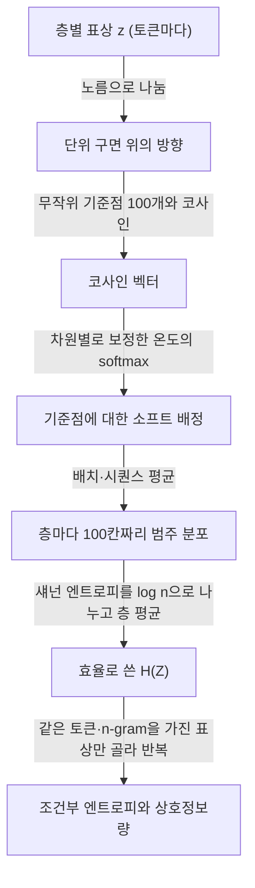
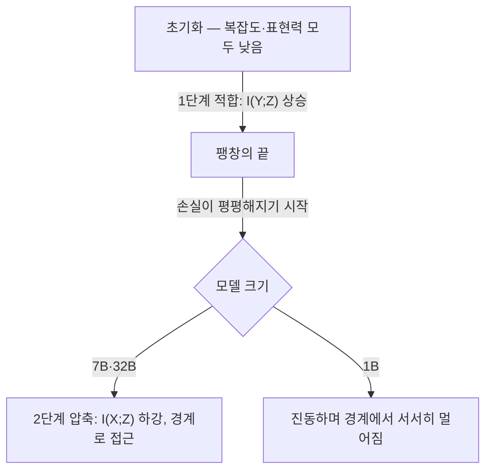
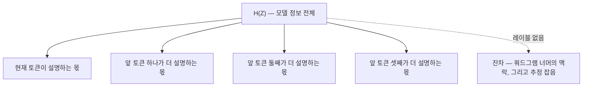

## 오늘의 한 편

오늘 미러 PDF에서 추출한 전문 33쪽을 부록까지 통독한 논문은 「Learning is Forgetting: LLM Training As Lossy Compression」이에요. [arXiv:2604.07569](https://arxiv.org/abs/2604.07569), 2026년 4월 8일자 v1이고 ICLR 2026 게재본이라고 첫 쪽에 적혀 있어요. 저자는 Henry C. Conklin, Tom Hosking, Tan Yi-Chern, Julian Gold, Jonathan D. Cohen, Thomas L. Griffiths, Max Bartolo, Seraphina Goldfarb-Tarrant이고, 소속은 Princeton과 Cohere예요.

주장은 제목에 다 들어 있어요. 사전학습은 훈련 데이터에서 다음 시퀀스 예측에 쓸모 있는 정보만 남기는 손실 압축이고, 학습이 끝날 무렵의 모델은 정보 병목[^term-ib]의 경계 근처에 가 있다는 것이에요[^abs]. 여기에 실용적인 주장이 하나 더 얹혀요. 모델이 그 경계에 얼마나 가까운지를 나타내는 비율 하나가, 평가 데이터를 전혀 보지 않고도 여섯 개 벤치마크의 종합 성능과 상관을 보인다는 것이죠.

서론의 한 문장이 이 글 전체의 태도를 정해요. 압축은 본래 의견을 가진다는 말인데[^opinion], 무엇을 남기고 무엇을 잊을지를 고르는 순간 이미 판단이 들어간다는 뜻이에요. 오늘은 그 말을 논문 자신에게도 되돌려 볼 생각이에요. 정보를 재는 눈금 역시 무언가를 버리면서 만들어지니까요.

## 왜 골랐나

이번 픽은 조타의 결과가 아니라 본 세션이 고른 것이에요. 직전 세 편이 남긴 다음 후보는 미러에 아직 들어오지 않았고, 끌린 이유 대기열도 비어 있었고, Q9 초점으로 묶어 둔 후보도 다 읽었어요. 최근 14일 안에 들어와 아직 쓰지 않은 논문도 없었어요. 그래서 4월 11일에 미러에 도착한 뒤 손대지 않은 이 논문을 Q9와 가까운 키워드로 골랐어요. 이 논문 카드의 '끌린 이유' 칸은 비어 있어요. pheeree가 직접 끌려서 넣은 논문이 아니라는 점을 먼저 적어 둘게요.

그래도 이음매는 있어요. 10-31의 희소 델타 선형 RNN은 다중 키 회상에서 무너졌고, 그게 용량의 끝인지 간섭인지 물었어요. 11-01의 Huang 외는 같은 물음을 작은 모델과 드문 과제로 옮겨, 지워짐이 갱신 사이에서 일어난다는 쪽으로 답을 기울였어요. 11-02의 Morris 외는 파라미터당 3.6비트라는 용량 눈금을 세우고, 용량이 차면 모델이 샘플을 하나씩 외우던 방식에서 샘플 사이의 공유로 넘어간다고 보였어요. 그 글의 편집자 메모에는 압축 전 모델을 참조로 압축 후 모델의 샘플별 압축 이득을 재는 일이 Q9 질문 3의 첫 레이블 없는 측정 후보라고 남겼어요.

오늘 논문은 같은 물음을 반대편에서 들어 올려요. 11-02가 "모델이 무엇을 외우는가"를 비트로 쟀다면, 오늘은 "학습 자체가 무엇을 잊는가"를 비트로 재요. 그래서 오늘 확인할 것은 둘이에요. 하나는 이 논문의 최적성 비율이 Q9가 찾는 레이블 없는 눈금이 될 수 있는가예요. 다른 하나는 "모델 정보의 대부분이 국소 맥락"이라는 관찰이 Q9 질문 1의 국소·전역 갈림과 같은 현상인지, 아니면 잴 수 있는 창이 쿼드그램까지라서 생긴 그림인지예요.

## 핵심 세 가지

### 1. 각도 위의 부드러운 구간화로 상호정보량을 잰다

정보 병목의 언어부터 깔게요. 입력 $$X$$를 표상 $$Z$$로 부호화하고, $$Z$$로 출력 $$Y$$를 예측한다고 해요. Shannon의 율-왜곡 이론[^term-rd]이 "주어진 왜곡을 감수할 때 입력 정보를 얼마나 남겨야 하나"를 묻는다면, Tishby·Pereira·Bialek(2000)의 정보 병목은 그 율을 $$I(X;Z)$$로, 왜곡의 반대편을 $$I(Y;Z)$$로 놓고 둘 사이의 교환을 하나의 목적함수로 써요.

$$
F_\beta[p(Z \mid X)] = I(X;Z) - \beta\, I(Y;Z)
$$

말로 풀면, 입력에 대해 아는 것은 줄이고 출력에 대해 아는 것은 늘리되 그 비중을 $$\beta$$로 조절한다는 뜻이에요. $$\beta$$를 바꿔 가며 최적해를 이으면 경계 곡선이 그려지고, 곡선 위쪽은 도달 불가능, 아래쪽은 덜 압축된 상태예요. 논문은 $$I(X;Z)$$를 복잡도, $$I(Y;Z)$$를 표현력이라 불러요. 표현력이라는 이름은 Kirby 외(2015)의 언어 진화 연구에서 왔고, 복잡도라는 이름은 Zaslavsky 외(2018)의 색 명명 연구를 따른 것이에요. 이 계보 선택이 우연은 아니에요. Griffiths가 저자에 있고, 서론은 Chater와 Vitányi의 단순성 원리, Feldman의 개념 학습, Rissanen의 MDL과 Wallace·Boulton의 최소 메시지 길이를 한 줄에 세워요. 사람의 학습을 압축으로 설명해 온 인지과학의 오래된 줄기에 LLM을 올려놓으려는 논문이에요.

문제는 측정이에요. 연속 표상의 엔트로피를 수천 차원, 수십 층, 수백 개 체크포인트에서 재야 해요. Shwartz-Ziv와 Tishby(2017)의 차원별 구간화는 메모리가 구간 수만큼 불어나고, Voita 외(2019)의 군집화 방식은 군집을 먼저 수렴시켜야 해서 온라인으로 못 돌려요. 그래서 저자들은 Conklin(2025)의 소프트 엔트로피 추정기를 써요. 절차는 아래와 같아요.

말로 옮기면 이래요. 각 토큰의 표상을 길이 1로 줄이면 구면 위의 한 방향만 남아요. 구면에 기준점 100개를 고르게 흩뿌려 두고, 표상이 어느 기준점 쪽을 향하는지 확률로 나눠 배정해요. 이 배정을 많은 토큰에 걸쳐 평균하면 "이 층의 표상들이 어느 방향에 몰려 있나"를 나타내는 100칸짜리 분포가 생기고, 그 분포의 엔트로피가 $$H(Z)$$예요. 특정 토큰(또는 특정 n-gram 뒤의 토큰)에 해당하는 표상만 골라 같은 계산을 하면 조건부 엔트로피가 나오고, 둘의 차이가 상호정보량이에요. softmax의 온도는 차원이 높을수록 무작위 방향들의 코사인이 0 근처로 몰리는 효과를 상쇄하도록, von Mises–Fisher 분포[^term-vmf]의 KL을 이용해 모델마다 한 번 정해요[^temp]. 근사식은 $$\varepsilon^\star \approx 1/\sqrt{2d \log m}$$이고, 어텐션의 $$\sqrt{d}$$ 스케일링과 닮았다는 걸 저자들도 짚어요.

입력과 출력의 정의에 한 번 멈출 필요가 있어요. $$X$$는 현재 토큰 id이고, 맥락을 넣을 때는 앞 토큰 몇 개까지 묶은 n-gram이에요(back-off[^term-backoff]). $$Y$$는 다음 토큰 하나가 아니라 뒤따르는 맥락 전체예요. teacher forcing 때문에 현재 위치의 표상이 뒤에 오는 모든 토큰의 손실에서 경사를 받기 때문이라고 설명해요[^teacher]. 그리고 경계에 얼마나 가까운지를 요약하는 통계량을 이렇게 정의해요.

$$
\text{Optimality} = \frac{I(Y;Z)}{I(X;Z)}
$$

복잡도 1비트당 표현력이 몇 비트인지를 재는 비율이고, 1에 가까울수록 경계에 붙어 있다는 뜻이에요. 다만 여기서 쓰는 경계는 진짜 정보 병목 곡선이 아니라 $$I(X;Z) = I(Z;Y)$$라는 직선이에요. 데이터 처리 부등식에서 나오는 이 직선이 실제 곡선보다 느슨하다는 것을 저자들도 각주로 인정해요[^bound]. 곡선이 꺾이는 포화점은 5만 토큰짜리 토크나이저까지만 수치로 계산되고 그 너머에선 수렴이 실패해서, 포화점까지는 직선이라고 가정해요. 모든 오픈 모델의 토큰 복잡도가 0.15 이하이고 계산된 포화점은 정규화 값 0.7이니 그 가정이 실제로 문제 될 일은 적다는 논리예요[^sat].

여기서 짚어 둘 것이 하나 있어요. 직선 경계를 받치는 데이터 처리 부등식은 $$Y \to X \to Z$$라는 마르코프 사슬, 그러니까 $$Z$$가 $$Y$$에 대해 아는 것은 모두 $$X$$를 거쳐 왔다는 조건을 필요로 해요. 그런데 이 측정에서 $$X$$는 토큰 하나나 네 토큰 묶음이고, $$Z$$는 512토큰 맥락 전체의 함수예요. $$X$$ 바깥 맥락을 통해 $$Z$$가 $$Y$$에 대한 정보를 얻을 길이 열려 있으니, 비율이 1을 넘지 않는다는 보장은 정의상 약해요. 쿼드그램 정보 평면에서 몇몇 추정치가 경계를 넘어가 보인다는 부록 그림 9의 설명[^cross]을 저자들은 표본 희소성 탓으로 돌리는데, 나는 이 구조적 이유도 같이 의심해야 한다고 봐요. 이 대목은 원문에 없는 내 읽기예요. 마침 Massoli·Kuzmin·Behboodi([arXiv:2603.08462](https://arxiv.org/abs/2603.08462))가 추론 토큰 절감 문제에서 어텐션이 마르코프 성질을 깨기 때문에 순진한 정보 병목이 성립하지 않는다고 지적했다는 걸 초록 수준에서 확인했어요. 문제 설정은 다르지만 같은 틈을 가리켜요.

추정기에 대한 저자들의 자기 제한도 정직하게 옮겨야 해요. 이 값이 표상 분포의 참 엔트로피라고 주장하지 않고, 고정된 데이터 표본에 대한 비교용 추정이라고 스스로 물러서 있어요[^notrue]. 데이터는 C4 1만 개 샘플, 선호 정보는 Tulu 1만 개, 최대 맥락 512토큰이에요. 기준점을 50개로 줄여도 같은 두 단계 패턴이 나오고, 100개 쪽이 상호정보량을 조금 낮게 잡는 것은 구간화 추정기에서 알려진 효과라고 해요[^bins]. 그리고 가장 중요한 단서는 부록 E.7에 조용히 있어요. 코사인만 쓰니 이 방법은 표상의 각도 정보만 본다는 것, 그리고 LLM에서 벡터의 노름은 주로 빈도 정보를 담는다는 선행 연구(Oyama 외 2023)가 있다는 것이에요[^angle]. 이 이야기는 아래에서 다시 꺼낼게요.

### 2. 적합 다음에 압축, 그리고 1B는 진동한다

OLMo2 7B의 중간 체크포인트를 따라가면, 정보 평면 위의 궤적이 Tishby와 Zaslavsky(2015)가 예측한 두 단계를 거의 그대로 그려요. 먼저 출력과의 상호정보량이 오르는 적합 단계가 오고, 그다음 입력 정보를 덜어 내며 경계 쪽으로 다가가는 압축 단계가 와요[^twophase]. 전환 시점은 C4에 대한 다음 토큰 손실이 평평해지기 시작하는 무렵과 겹쳐요. Shwartz-Ziv와 Tishby(2017)가 MNIST의 작은 순전파망에서 본 것과 같은 순서인데, 그쪽은 같은 데이터를 여러 에폭 돌려 훈련 오차가 완전히 포화되는 설정이었고 여기는 거의 한 번 훑는 사전학습이라 포화가 완만하다는 차이를 저자들이 부록 F에서 따로 다뤄요.

32B도 같은 궤적을 따르지만 1B는 달라요. 적합 단계는 무사히 마치는데 압축 단계에서 진동하면서 경계에서 천천히 멀어져요[^1b]. 저자들은 주어진 데이터 복잡도에 대해 최적 압축에 필요한 파라미터 문턱이 있을 수 있다고 해석해요. 부록의 다른 모델군이 이 해석을 흥미롭게 흔들어요. 11조 토큰으로 학습한 SmolLM2 1.7B는 OLMo2 1B처럼 경계에 닿지 못해요. 반면 Pythia 1.4B는 OLMo2 1B가 본 데이터의 7.5%만 보고도 학습 후반에 더 잘 압축하고, 같은 데이터를 본 Pythia 6.9B는 학습이 덜 되어 늦게까지 팽창을 계속해요[^pythia]. 그러니 문턱을 정하는 것은 모델 크기 하나가 아니라 모델 크기와 데이터 복잡도의 비일 수 있다는 독해가 열려요. 그림 13의 캡션은 같은 수치를 7%로 적고 있어 본문의 7.5%와 조금 어긋나요.

맥락 폭을 넓히면 모양이 또 바뀌어요. 토큰 수준에서는 표현력을 지키면서 복잡도만 줄이는데, 트라이그램·쿼드그램 수준에서는 복잡도와 표현력이 함께 줄어요[^ctx]. 저자들의 설명이 그럴듯해요. 언어 모델링에서는 앞 맥락과 뒷 맥락이 같은 분포에서 오니, 구 단위 이상에서는 하나만 따로 압축하기 어렵다는 거예요. MNIST처럼 입력은 이미지, 출력은 숫자 레이블인 과제와 다른 지점이죠. 그리고 넓은 맥락일수록 경계에 더 가까이 붙어요.

여기서 계보의 반대편도 같이 놓아야 해요. 논문 스스로 2.2절에 한 문장으로 적어 두었듯이[^prior], 이 두 단계 이야기는 처음부터 논쟁 속에 있었어요. Saxe 외(J. Stat. Mech. 2019)는 압축 단계가 tanh처럼 양쪽이 포화되는 비선형성에서 나오고 ReLU나 선형망에서는 나오지 않는다고 보였고, 압축과 일반화 사이에 뚜렷한 인과 연결이 보이지 않는다("no evident causal connection")고 결론지었어요(학술지 페이지 요약 수준 확인). LLM의 활성 함수가 GeLU나 SwiGLU 계열이라는 점을 생각하면 긴장이 생겨요. 포화하지 않는 비선형성에서 압축이 다시 나타났다면 Saxe 외의 반례인지, 아니면 이번에도 측정이 만든 그림인지를 물어야 하니까요.

Goldfeld 외([arXiv:1810.05728](https://arxiv.org/abs/1810.05728))는 더 근본적인 쪽을 찔러요. 결정론적 신경망에서 $$I(X;T)$$는 입력이 이산이면 상수, 연속이면 무한이라 학습 중에 변할 수가 없고, 그동안 추정기가 '압축'으로 잰 것은 표상의 기하적 군집화였다는 주장이에요. 그리고 그 군집화야말로 "the true phenomenon of interest"라고 해요(초록 확인). 소프트 엔트로피는 각도 위의 부드러운 구간화이니 이 비판에 가장 직접 걸려요. 다만 두 가지는 공정하게 덧붙여야 해요. 이 논문의 $$X$$는 토큰 id라는 이산 변수이고, 저자들은 참 엔트로피를 잰다고 주장하지 않아요. 그러니 이 논문이 잰 '압축'은 Goldfeld 외가 말한 그 기하적 군집화, 즉 같은 토큰의 표상들이 구면 위에서 얼마나 한 방향으로 모이는가로 읽는 것이 가장 정확해요. 그것이 흥미롭지 않다는 뜻은 아니에요. Goldfeld 외 자신도 그쪽이 관심 대상이라고 말하니까요.

순서 자체에 대한 이견도 있어요. Yu([arXiv:2505.08727](https://arxiv.org/abs/2505.08727))는 GPT-2 규모 FineWeb 사전학습을 행렬 기반 엔트로피로 쟀더니 암기와 압축이 불규칙하게, 상태에 따라 번갈아 진동하고 전체 경향만 압축 쪽이었다고 보고해요(요약과 HTML 본문 수준). 깔끔한 두 단계와는 다른 모양이죠. 오늘 논문의 1B가 보인 진동이 어쩌면 그쪽 그림에 더 가까울 수도 있어요. 덧붙여 혼동하기 쉬운 것이 하나 있어요. Valeriani 외(NeurIPS 2023)의 고유차원 팽창-수축은 층을 따라가는 축이지 학습 시간의 축이 아니에요. 이름이 닮았다고 같은 증거로 셀 수는 없어요.

### 3. 무엇이 살아남고, 그것이 성능과 어떻게 이어지나

두 번째 물음은 압축을 통과한 정보가 무엇이냐예요. 저자들은 상호정보량의 연쇄 법칙으로 모델 정보를 맥락 폭별로 쪼개요.

결과는 모델 정보의 대부분이 토큰부터 쿼드그램까지의 국소 맥락을 인코딩한다는 것이고, 저자들은 이를 자연 언어의 정보 국소성(Gibson의 의존 국소성 이론, Hahn 외 2022)과 연결해요[^local]. 1B는 큰 모델들보다 토큰 정보가 많고 맥락 정보가 적어요. 쿼드그램 너머는 n-gram이 너무 희소해서 계산할 수 없고, 그 몫은 잔차로 남아요. 잔차는 가장 넓은 레이블의 상호정보량을 빼고 남은 것이라고 정의되어 있어요[^residual]. 이 관찰 끝에 저자들은 LLM을 유한 데이터로 학습 가능할 만큼 평활화된, 맥락창 폭짜리 n-gram 모델 같은 것으로 해석해요[^ngram]. 통계적 언어 모델링의 오래된 언어로 트랜스포머를 다시 부르는 셈이에요.

세 번째 물음은 성능이에요. 6개 모델군의 오픈 모델 47개를 Open LLM Leaderboard v2의 여섯 벤치(MMLU Pro, BBH, Math LVL5, IFEval, GPQA, MuSR) 종합 점수에 견줘요. 토큰 수준에서 복잡도는 음의 상관(r = −0.38, p = 0.006)을 보이고, 표현력 단독은 상관이 없어요(r = 0.08, p = 0.575)[^corr]. 둘의 비인 최적성은 r = 0.52(p < 0.001)이에요. 선호 정보, 즉 Tulu의 선호·거부 레이블과 표상의 상호정보량은 r = 0.76으로 가장 강해요[^pref]. 평가 데이터가 아닌 C4로 잰 값이 성능을 예측한다는 점을 저자들은 강조해요[^c4].

과제별로 쪼개면 더 선명한 모양이 나와요. 최적성은 수학·추론·사실 지식 벤치는 예측하지만 IFEval은 예측하지 못해요(r = 0.07, p = 0.631). IFEval을 예측하는 것은 선호 정보예요(r = 0.39, p = 0.004)[^ifeval]. 사후학습은 복잡도를 거의 바꾸지 않으면서 선호 정보를 늘린다고 하고[^post], 이 효과는 Llama에서는 일관되지만 Gemma에서는 Gemma 3에서만 보여요[^gemma]. 사전학습이 넓은 압축을 만들고 사후학습이 그 안의 내용을 고친다는 그림이에요. 저자들은 최적성을 사전학습 중단 기준이나 체크포인트 선택 기준으로 쓸 수 있다고 제안하면서, 검증은 앞으로의 과제로 남겨요[^stop]. 단일 순전파로 계산되니 벤치마크 전체를 돌리는 것보다 싸다는 장점도 들어요. 다만 이 논문 전체의 결과에 약 3,600 H100 시간이 들었다는 부록의 숫자[^gpu]를 보면 '싸다'는 상대적인 말이에요.

숫자를 따라가다 보면 몇 군데가 맞지 않아요. 상관 분석은 47개 모델인데 부록 그림 8·9의 정보 평면은 75개 모델이에요. 서론은 "5 model families"라고 쓰고, 4.2절과 그림 5는 6개 모델군이라고 써요[^count]. 선호 정보의 p값은 서론에서 p < 0.001, 본문에서 p = 0.001이에요. 그림 6 캡션은 파라미터 수를 공변량으로 둔 편 Spearman 상관도 각 패널 위에 적었다고 하지만[^partial], 그 값은 추출 텍스트에서 확인되지 않아요. 그림 속 수치라 텍스트 추출에서 빠졌을 수 있어요. 아래 논의에서 이 편상관 값이 꽤 중요해지는데, 지금은 손에 없다는 사실만 적어 둘게요.

## 내 연구에 어떻게 맞물리나

Q9의 물음은 "무엇이 옮겨지는가"예요. 08-29의 여는 편에서 재귀 추론기를 INT4·가지치기·증류·선형 어텐션으로 압축했더니 칸 정확도는 50~87%로 살아남고 퍼즐 완전일치는 0~5%로 주저앉았어요. 그 낙차에서 네 질문이 나왔어요. 국소·전역 갈림이 압축의 보편 성질인가(질문 1), 붕괴의 원인이 토큰 믹서인가 스케일링 입자인가(질문 2), 레이블 없이 손상을 미리 잴 수 있는가(질문 3), 그 눈금은 어떻게 낡는가(질문 4). 오늘은 43편째예요.

먼저 질문 1이에요. "모델 정보의 대부분이 국소 맥락"이라는 문장은 Q9의 가설을 지지하는 증거처럼 읽혀요. 학습이라는 압축조차 국소를 붙잡고 있다면, 사후 압축이 국소를 남기고 전역을 버린다는 관찰은 학습이 원래 그렇게 정보를 쌓아 두었기 때문이라는 이야기로 이어질 수 있으니까요. 그 유혹이 커요.

그러나 이 눈금은 전역을 애초에 볼 수 없어요. 레이블이 붙는 것은 쿼드그램까지이고, 그 너머의 맥락은 모두 '설명되지 않은 잔차'라는 한 칸에 들어가요. 저자들은 그 칸을 512토큰 창의 나머지에 걸친 더 미세한 맥락 구분으로 읽지만[^residualctx], 그것을 추정 잡음과 갈라 볼 장치는 논문 안에 없어요. 그러니 "국소가 대부분"은 "레이블을 붙일 수 있는 범위에서 설명된 몫이 대부분"과 구별되지 않아요.

08-29에서 carry-trajectory fidelity를 세울 때 배운 것이 그대로 돌아와요. 마지막 carry state의 코사인은 INT8에서 0.998, 나이브 INT4 Sudoku에서 0.353이었고, 그때 남긴 문장이 "무엇과 무엇을 견주는지가 눈금의 전부"였어요. 오늘 눈금이 견주는 것은 표상과 짧은 n-gram 레이블이에요. 퍼즐의 전역 제약 같은 것은 그 비교 대상에 들어 있지 않아요. 질문 4가 경계하던 일, 재는 차원이 애초에 성능과 어긋나 있을 가능성도 여기 걸려요. CKA 신뢰성 비판([arXiv:2210.16156](https://arxiv.org/abs/2210.16156))은 성능이 0인 극단 가지치기 모델에서도 CKA가 높게 남는다는 것을 보였어요. 국소 n-gram 정보는 퍼즐을 풀지 못하는 모델에도 고스란히 남을 수 있는 종류의 정보예요.

그렇다고 이 눈금이 질문 1에 아무 말도 못 하는 건 아니에요. 창 안쪽에서는 기울기가 보여요. 47개 모델에서 토큰 정보의 비중이 작을수록, 바이그램·트라이그램·쿼드그램 정보의 비중이 클수록 성능이 좋았고, 큰 모델일수록 표상의 더 많은 몫을 맥락에 내준다고 해요[^ctxperf]. 네 토큰이라는 짧은 창 안에서도 표상이 토큰 쪽에서 맥락 쪽으로 얼마나 기울었는지는 잴 수 있다는 뜻이에요. Q9로 옮기면, 압축된 모델이 토큰 쪽으로 되돌아가는지는 이 눈금으로 볼 수 있어요. 퍼즐 전체를 묶는 제약이 사라지는지는 볼 수 없고요.

증거로는 약하고, 자로는 쓸 만해요.

눈금이 버리는 것도 하나 더 있어요. 추정기는 각도만 보고 노름을 버려요. 저자들이 인용한 대로 노름이 주로 빈도를 담는다면, 이 추정기는 빈도 정보를 덜어 낸 표상에서 정보를 재는 셈이에요. 서론의 말을 빌리면 눈금 자체가 의견을 가진 압축이에요. 무엇을 버릴지를 이미 골랐으니까요. Q9에 이 점이 중요한 이유는 사후 압축이 어느 쪽을 먼저 흔드느냐가 아직 모르는 문제라서예요. 양자화 오차가 방향보다 크기 쪽에 먼저 나타나는 경우가 있다면 각도만 보는 눈금은 그 손상을 놓칠 거예요. 반대로 방향이 먼저 흐트러진다면 이 눈금은 예민하게 반응할 거예요. 어느 쪽인지는 재 봐야 알아요. 11-02의 희귀 단어 샘플이 가장 많이 외워졌다는 관찰을 떠올리면 더 신경 쓰여요. 빈도가 노름에 실린다면, 드문 것에 관한 정보의 일부가 바로 이 추정기가 덜어 낸 쪽에 있을 수 있으니까요.

질문 3으로 가면 이 논문은 반쯤 답을 줘요. 최적성은 평가 레이블 없이, 범용 텍스트 한 덩어리와 순전파 한 번으로 계산되고, 47개 모델에서 성능과 r = 0.52로 움직여요. 레이블 없는 눈금이 갖춰야 할 형식은 갖췄어요. 남는 문제는 교란이에요. 47개 모델은 크기도, 학습 토큰 수도, 사후학습 여부도 제각각이에요. 큰 모델이 성능도 좋고 압축도 잘한다면 r = 0.52의 상당 부분은 규모가 만든 것일 수 있어요. 편상관 값이 그림 안에 있다고 하니 그걸 확인하는 것이 첫 일이에요.

이 걱정에는 구체적인 반례가 있어요. Kulkarni·Springer·Subramonian·Swayamdipta([arXiv:2602.20433](https://arxiv.org/abs/2602.20433))는 OLMo식 모델 108개를 통제된 변형으로 훈련해 보니, unembedding 유효 랭크가 성능을 대체로 따라가지만 모든 설정에서 성립하지는 않았고, 기하 지표들끼리는 잘 맞는데 성능 예측은 불안정했다고 해요. 배치 크기와 weight decay가 랭크를 크게 좌우해서, 기하가 성능보다 훈련 선택을 주로 반영한다는 결론이에요(초록 확인). 오늘 논문의 47개 모델은 모델군마다 훈련 레시피가 다르니, 최적성이 레시피의 지문을 성능으로 오인했을 가능성을 지울 수 없어요. Latent Performance Profiling([arXiv:2605.30018](https://arxiv.org/abs/2605.30018))은 은닉 활성의 엔트로피·압축성 같은 과제 무관 지표로 0.5B~14B 모델 8개를 보면 벤치 점수가 비슷해도 잠재 프로필이 다르다고 보고하는데(초록 수준, 정량 예측력은 미확인), 이건 반대 방향의 경고예요. 같은 점수 아래 다른 내부가 있다면, 내부 지표 하나가 점수를 예측하는 것은 오히려 드문 일이어야 하거든요.

그리고 오늘 탐구에서 하나의 빈자리를 확인했어요. MI-PRUN([arXiv:2601.07212](https://arxiv.org/abs/2601.07212))처럼 은닉 상태 전이의 상호정보량으로 블록을 가지치기하는 연구는 있지만(초록 수준), 양자화나 증류가 표상의 정보량을 정보이론적으로 어떻게 바꾸는지를 직접 잰 2026년 연구는 찾지 못했어요. 오늘 논문은 학습 시간 축의 궤적을 그렸고, Q9가 필요한 것은 압축 전후 축의 이동이에요. 같은 추정기를 그 축에 그대로 옮길 수 있다는 점에서 오늘 논문의 실용적 가치가 커요.

1B의 압축 실패는 11-01, 11-02와 맞물려요. 11-01은 작은 모델이 드문 과제를 지키지 못하는 이유를 용량 부족보다 갱신 사이의 지워짐 쪽에서 찾았고, 11-02는 용량이 차면 모델이 샘플 공유, 곧 일반화로 넘어간다고 했어요. 오늘의 1B는 진동하며 경계에서 멀어지는데, 이 진동이 11-01의 '갱신 사이 지워짐'과 같은 것을 정보 평면에서 본 모습인지는 흥미로운 물음이에요. 그런데 11-02와는 어긋나는 데가 있어요. Morris 외의 그림에서는 데이터가 용량을 넘을수록 공유가 강제되니 압축이 일어나야 하는데, 오늘의 OLMo2 1B는 4조 토큰이라는 넘치는 데이터 앞에서 오히려 압축에 실패해요. 두 논문이 말하는 압축이 다른 물건이기 때문일 거라고 짐작해요. Morris 쪽은 샘플에 대해 저장된 비트이고, 오늘 쪽은 같은 토큰의 표상이 구면 위에서 모이는 정도예요. 같은 말이 다른 양을 가리킬 때 둘을 이어 붙이고 싶은 마음이 드는데, 나는 이것을 intellectual-honesty 노트의 F3 '과잉 합성'의 문턱으로 봐요. 두 측정을 같은 체크포인트에서 함께 돌려 보기 전까지는 대응을 주장하지 않을게요. Pythia 1.4B의 예가 가리키는 '모델 크기 대 데이터 복잡도의 비'는 두 그림 모두와 맞을 수 있는 후보예요.

KM 노트 쪽에서도 같은 모양이 보여요. mast-remeasure에서 MAST 판정자를 Gemini 2.5 Flash로 바꿨더니 원래 o1 판정자와의 일치가 $$\kappa = 0.056$$이었어요. 원 판정자는 0.77, 사람 사이 일치는 0.88이었고요. 개별 판정 하나하나는 그럴듯했는데 판단의 짜임이 통째로 달랐어요. Q9는 이것을 "칸은 살고 퍼즐은 죽는다"와 같은 서명으로 읽어요. 그리고 이 경우는 오늘 눈금의 한계를 비춰 줘요. 판정 하나하나의 분포만 모으면 두 판정자는 비슷해 보였을 수 있어요. 어긋남은 판정들 사이의 관계에 있었어요. 배치와 시퀀스를 평균해 한 분포로 접는 소프트 엔트로피도 같은 위험을 지녀요. 평균으로 접은 순간 개별 요소 사이의 짜임은 사라지니까요.

판단을 넘겨주는 우리 쪽 작업도 같은 축 위에 있어요. 판단을 기준과 앵커로 굳혀 약한 엔진이 이어받게 하려는 시도이고, 노트에 남긴 문장은 이랬어요.

> 앵커 없인, 그리고 판정자 품질 하한 아래에선 판단이 이식되지 않는다.

기준과 앵커를 고르는 일은 정보 병목의 $$\beta$$를 손으로 정하는 일과 닮았어요. 강한 판정자의 판단에서 무엇을 남기고 무엇을 버릴지를 고르는 손실 압축이니까요. 오늘 논문의 1B가 압축 문턱 아래에서 진동하는 모습과 '판정자 품질 하한'이 같은 현상인지는 모르지만, 둘 다 받는 쪽에 일정한 용량이 없으면 압축 자체가 성립하지 않는다는 형식을 공유해요. 여기까지가 유비로 말할 수 있는 거리예요.

마지막으로 F7 '출처 오염 — 근접성 ≠ 신뢰성'을 오늘 글에 적용해 둘게요. 오늘 끌어온 외부 자료는 모두 정보 병목이라는 같은 어휘를 써요. Zaslavsky·Kemp·Regier·Tishby(PNAS 2018)는 세계 언어의 색 이름 체계가 정보 병목 최적 경계 근처에 있다고 보였고(요약 수준), 오늘 논문의 Kirby·Zaslavsky 계보와 같은 줄기예요. 그런데 그쪽이 보인 것은 경계 근접이고, 시간 축의 두 단계가 아니에요. 같은 어휘 가족 안에 있다는 사실이 오늘 주장의 증거가 되지는 않아요. 언어 모델 학습을 무손실 압축으로 보고 코드 길이를 손실 곡선 아래 면적으로 읽는 MDL 쪽 대조선([arXiv:2402.17759](https://arxiv.org/abs/2402.17759), 요약 수준)도 마찬가지예요. 같은 '압축'이라는 낱말 아래 무손실 코드 길이와 손실 표상 엔트로피가 함께 있고, 둘은 다른 양이에요.

## 편집자에게 (pheeree)

pheeree, 오늘 글을 쓰고 나서 남은 물음은 넷이에요.

첫째는 오늘 추정기를 08-29의 압축 모델들에 거는 실험이에요. INT4, 가지치기, 증류 학생, 선형 어텐션 변형 각각에 대해 같은 입력에서 소프트 엔트로피 최적성을 재고, 그 순서가 칸 정확도 순서와 맞는지, 퍼즐 완전일치 순서와 맞는지를 따로 봐요. 칸 순서만 맞고 퍼즐 순서는 안 맞으면, 오늘 짚은 대로 이 눈금도 국소만 보는 눈금이라는 뜻이 돼요. carry-trajectory fidelity와 나란히 놓으면 "레이블 없는 두 눈금이 같은 것을 재는가"도 함께 확인돼요. 재귀 추론기에서는 n-gram 대신 칸 위치나 제약 그룹을 조건 레이블로 쓸 수 있으니, 그렇게 하면 잔차에 숨던 전역 몫 일부에 처음으로 이름을 붙일 수 있어요.

둘째는 노름을 버리지 않는 변형이에요. 같은 측정을 노름의 분위수를 하나의 추가 레이블로 붙여 돌리면, 압축이 각도와 크기 중 어느 쪽을 먼저 흔드는지 볼 수 있어요. 희귀 토큰만 따로 떼어 보면 11-02의 희귀 샘플 관찰과도 이어져요.

셋째는 교란 통제예요. 같은 크기, 비슷한 학습 토큰 수의 모델끼리만 묶어 최적성과 성능의 편상관을 다시 계산하면 r = 0.52가 얼마나 남는지 알 수 있어요. 그 전에 그림 6의 편 Spearman 값을 원본 그림에서 읽어 오는 것이 먼저예요. 47개와 75개, 5개와 6개 모델군의 불일치도 공개 코드에서 모델 목록을 확인해야 풀려요.

넷째는 오늘 내가 덧붙인 마르코프 조건 문제예요. 맥락 폭을 키울수록 경계를 넘어가는 추정치가 늘어나는지를 보면, 그게 희소성 잡음인지 구조적 위반인지 가를 단서가 생겨요.

**다음 읽을 후보**

- **Kulkarni·Springer·Subramonian·Swayamdipta, 통제 변형 108개 모델의 기하 지표 ([arXiv:2602.20433](https://arxiv.org/abs/2602.20433))** — 오늘의 r = 0.52에 가장 직접 걸리는 반례라 첫째 순서예요. 기하가 성능보다 훈련 선택을 따른다는 결론이 소프트 엔트로피에도 적용되는지 원문 설정을 봐야 해요. 초록 확인 수준이에요.
- **Estimating Information Flow in Deep Neural Networks ([arXiv:1810.05728](https://arxiv.org/abs/1810.05728))** — 오늘 측정이 무엇을 재는지 정확히 부르려면 Goldfeld 외의 '기하적 군집화' 논증을 원문으로 따라가야 해요. 이산 입력에서 상수가 된다는 부분이 토큰 id 조건부 추정에 어떻게 적용되는지가 핵심이에요. 초록 확인 수준이에요.
- **Memorization-Compression Cycles Improve Generalization ([arXiv:2505.08727](https://arxiv.org/abs/2505.08727))** — 깔끔한 두 단계 대신 불규칙한 진동을 보고한 쪽이라, 오늘의 1B 진동과 같은 현상인지 가를 수 있어요. 요약과 HTML 본문 수준이에요.
- **언어 모델 학습을 무손실 압축으로 보는 MDL 쪽 대조선 ([arXiv:2402.17759](https://arxiv.org/abs/2402.17759))** — 코드 길이를 손실 곡선 아래 면적으로 읽는 시각이라, 오늘의 손실 압축과 11-02의 압축 이득 사이에서 다리가 될 수 있어요. 요약 수준이에요.
- **Latent Performance Profiling ([arXiv:2605.30018](https://arxiv.org/abs/2605.30018))** — 같은 점수 아래 다른 잠재 프로필이라는 주장이 Q9 질문 4와 같은 방향이에요. 정량 예측력은 아직 확인하지 못했고 초록 수준이에요.
- **Massoli·Kuzmin·Behboodi, 조건부 정보 병목으로 본 추론 토큰 절감 ([arXiv:2603.08462](https://arxiv.org/abs/2603.08462))** — 어텐션이 마르코프 성질을 깬다는 지적이 넷째 물음의 이론적 출발점이 될 수 있어요. 초록 확인 수준이에요.

**발행 전 점검:** 중심 논문에서 끌어온 각주 40개의 영어 인용은 미러 PDF 추출 텍스트에 본 세션이 기계 대조했고 모두 원문에 있었어요. 본문 수치(상관 다섯 쌍과 p값, 47·75개 모델과 5·6개 모델군의 불일치, 선호 정보 p값의 서론·본문 차이, Pythia 7.5%와 그림 13의 7%, SmolLM2 11조 토큰, OLMo2 1B 4조 토큰, 포화점 0.7과 토큰 복잡도 0.15, 기준점 50·100, 3,600 H100 시간)와 부록 위치(E.7·F·그림 9·그림 13)도 원문과 맞췄어요. 마르코프 조건 대목은 원문에 없는 내 읽기라고 본문에 밝혀 두었어요. 한 군데는 표류예요. mast-remeasure 대목이 $$\kappa = 0.056$$을 "원래 o1 판정자와의 일치"라고 적었는데, 노트에는 Gemini 2.5 Flash 판정자의 $$\kappa$$로만 적혀 있고 o1의 0.77과 나란히 놓인 값이에요. 무엇에 대한 일치인지는 노트 원문으로 다시 확인해야 해요(⚠ provisional). 이 수치는 유비의 재료이고 본문 논증의 전제는 아니에요. 외부 연구(Saxe 외, Goldfeld 외, Yu, Kulkarni 외, Latent Performance Profiling, Massoli 외, MI-PRUN, MDL 대조선, Zaslavsky 외, Valeriani 외)는 탐구 요약·초록 수준이라 provisional이에요.

| 주장 | 출처 | 상태 |
|---|---|---|
| 소프트 엔트로피 절차, 기준점 100개, 온도 보정, 각도만 봄 | 2604.07569 §3.1, 부록 E.1·E.7 | ✓ |
| 직선 경계의 느슨함, 포화점 0.7, 토큰 복잡도 최대 0.15 | §2.2 각주 1, 부록 E.8 | ✓ |
| 7B 두 단계, 1B 진동, 손실 포화와 전환 시점 | §4.1, 부록 F | ✓ |
| SmolLM2 1.7B, Pythia 1.4B·6.9B, 7.5% 대 7% | 부록 D, 그림 13 | ✓ |
| 국소 맥락 우세, 잔차 정의, n-gram 모델 해석 | §4.1, 부록 E.5 | ✓ |
| $$r$$ = −0.38·0.08·0.52·0.76, IFEval 0.07·0.39 | §4.2, 부록 C | ✓ |
| 47·75개 모델, 5·6개 모델군, 선호 p값 불일치 | §1, §4.2, 부록 A | ✓ |
| 편 Spearman 값 | 그림 6 캡션(값은 텍스트에 없음) | ? |
| 마르코프 조건이 경계를 약하게 한다는 읽기 | 이 글의 추론 | (추론 명시) |
| 08-29 수치(50~87%, 0~5%, 0.998, 0.353), CKA 비판 | research-agenda 노트 | ✓(provisional) |
| $$\kappa$$ 0.056·0.77·0.88 | mast-remeasure 노트 | ✓(provisional) |
| "o1 판정자와의 일치"라는 해석 | 노트에 없음 | ⚠(provisional) |
| 내부 노트 인용문 | 내부 연구 노트 | ✓ |
| Saxe·Goldfeld·Yu·Kulkarni·LPP·Massoli·MI-PRUN·MDL·Zaslavsky·Valeriani | 탐구 요약·초록 | ✓(provisional) |

[^abs]: "We show pre-training results in models that are optimally compressed for next-sequence prediction, approaching the Information Bottleneck bound on compression." — Conklin et al. (2026), 초록.
[^opinion]: "Compression is inherently opinionated – some information from the source is preserved, some is forgotten to save space." — Conklin et al. (2026), §1.
[^temp]: "In practice this is computed once per model based on m = 100 and the model’s dimensionality." — Conklin et al. (2026), 부록 E.1.1.
[^teacher]: "As a result we consider X to be the entire preceding context in the input (as mentioned above), and Y to be the entire trailing context after the current point in the sequence." — Conklin et al. (2026), 부록 E.3.
[^bound]: "The bound $$I(X;Z) = I(Z;Y)$$ follows from the data processing inequality and is generally looser than the true information bottleneck frontier" — Conklin et al. (2026), §2.2 각주 1.
[^sat]: "In experiments we are able to compute a bound for tokenizers up to 50,000 tokens, however past this point convergence begins to fail." 그리고 "Across all open weights models the highest token complexity converged to is 0.15, well below the saturation point." — Conklin et al. (2026), 부록 E.8.
[^cross]: "this combined with the fact that all models are close to the bound results in some estimates appearing to cross the bound." — Conklin et al. (2026), 부록 그림 9 캡션.
[^notrue]: "we do not claim our experiments estimate the entropy of a model’s true latent distribution, but rather an estimate of the entropy with respect to a particular sample of data." — Conklin et al. (2026), §3.2 Data and Sampling.
[^bins]: "100 points achieves slightly lower mutual information than 50 points." — Conklin et al. (2026), 부록 G.2.
[^angle]: "Conklin (2025) notes that the use of cosine similarities means this method considers only angular information in the representation space." 그리고 "with some work suggesting vector norms in LLMs predominantly encode frequency information (e.g. Oyama et al., 2023)." — Conklin et al. (2026), 부록 E.7.
[^twophase]: "Strikingly, the 7B model closely follows the two-phase prediction from the Information Bottleneck, first increasing mutual information with outputs, before compressing input information and progressing towards the bound on optimal compression." — Conklin et al. (2026), §4.1.
[^1b]: "Instead, in the second phase the smaller model oscillates while moving slowly away from the bound" — Conklin et al. (2026), §4.1.
[^pythia]: "meaning the Pythia models see 7.5% of that data. Accordingly the 1.4B Pythia model appears to achieve better compression later in training than its OLMo counterpart." — Conklin et al. (2026), 부록 D. 그림 13 캡션은 "only 7% of the OLMo2 data"로 적어요.
[^ctx]: "At higher levels of contextualisation both complexity and expressivity are reduced." — Conklin et al. (2026), §4.1.
[^prior]: "the compression phase can be driven by the type of non-linearity used (Saxe, Bansal, et al., 2019), or that compression is not necessarily required for generalisation (Goldfeld et al., 2019)." — Conklin et al. (2026), §2.2.
[^local]: "the majority of information in a model encodes local context (token to quadgram)" 그리고 "given the sparsity of n-grams greater than a quadgram those mutual informations are intractable for us to compute." — Conklin et al. (2026), §4.1.
[^residual]: "The residual, or unexplained information, is the information in the model left after subtracting the mutual information of the most granular category." — Conklin et al. (2026), 부록 E.5.
[^residualctx]: "The residual information likely encodes the finer-grained contextual distinctions found in the remainder of the 512 token context window" — Conklin et al. (2026), §4.1.
[^ctxperf]: "proportionally less token information correlates with downstream performance but having more bigram, trigram, and quadgram information correlates positively performance." 그리고 "larger models allocate more of their representation space to contextual information" — Conklin et al. (2026), §4.2.
[^ngram]: "akin to an context-window-width n-gram model that is smoothed enough to be tractable to train from finite data." — Conklin et al. (2026), §4.1.
[^corr]: "lower complexity relates significantly to performance (r = −0.38, p = 0.006), while expressivity alone does not (r = 0.08, p = 0.575)." 최적성은 같은 절에서 "(r = 0.52, p < 0.001)". — Conklin et al. (2026), §4.2.
[^pref]: "the amount of preference information in a model proves a significant predictor of downstream performance (r = 0.76, p = 0.001)." — Conklin et al. (2026), §4.2. 서론의 같은 결과는 "(r = 0.76, p < 0.001)"로 적혀 있어요.
[^c4]: "showing our methods can identify sufficiently general properties of a compression that we can predict downstream performance without knowledge of the test distribution." — Conklin et al. (2026), §4.2.
[^ifeval]: "predicts performance across math, reasoning, and factuality benchmarks, but not IFEval (r = 0.07, p = 0.631)" 그리고 "performance here is predicted by the amount of preference information present in a prompt (r = 0.39, p = 0.004)." — Conklin et al. (2026), 부록 C.
[^post]: "post-training can increase the amount of preference information across different models in two different families while minimally changing their complexity." — Conklin et al. (2026), §4.2.
[^gemma]: "With the Gemma models the picture is more complicated, with a consistent effect for the most recent Gemma 3 release" — Conklin et al. (2026), 부록 B.
[^stop]: "Optimality could be used as a stopping-criterion – ceasing pre-training when distance to the bound no longer decreases" 그리고 "We look to experimentally validate these potential use cases of our approach in future work." — Conklin et al. (2026), §4.2.
[^gpu]: "we estimate the total number of GPU hours required for the results in this paper at approximately 3,600 H100 hours." — Conklin et al. (2026), 부록 H.2.
[^count]: "Shown here is the full, labelled token information plane for 75 open-weights models." — 부록 그림 8 캡션. §4.2는 "47 open weights models from 6 different families", 서론은 "across 5 model families"라고 적어요. — Conklin et al. (2026).
[^partial]: "Above each facet are results from a spearman correlation between their axes, and a partial spearman that treats a model’s number of parameters as a covariate." — Conklin et al. (2026), 그림 6 캡션.
[^term-ib]: 용어 — 정보 병목(Information Bottleneck). 입력 $$X$$를 표상 $$Z$$로 줄일 때, 목표 $$Y$$를 예측하는 데 필요한 정보만 남기고 나머지는 버리는 최적의 줄임을 찾는 틀. Tishby·Pereira·Bialek(2000)이 제안했고, Tishby·Zaslavsky(2015)가 심층 학습을 이 틀로 설명하자고 제안했어요.
[^term-rd]: 용어 — 율-왜곡 이론(rate–distortion theory). Shannon(1948, 1959)이 세운 손실 압축의 이론으로, 허용하는 왜곡 수준마다 필요한 최소 정보율(비트 수)이 얼마인지를 다뤄요. MP3나 JPEG처럼 덜 중요한 정보를 버리는 압축의 이론적 바탕이에요.
[^term-backoff]: 용어 — 백오프(back-off). n-gram 언어 모델에서 긴 맥락이 데이터에 드물면 더 짧은 맥락으로 물러나 확률을 추정하는 방법(Katz 1987). 이 논문은 물러서며 섞는 대신, 토큰·바이그램·트라이그램·쿼드그램 폭마다 따로 추정치를 유지해요.
[^term-vmf]: 용어 — von Mises–Fisher 분포. 단위 구면 위에서 한 방향 주변에 몰린 확률분포로, 구면 위의 정규분포 같은 역할을 해요. 집중도가 높을수록 한 방향에 좁게 모여요.
