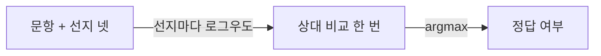
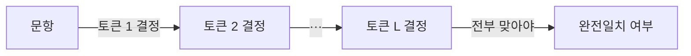

## 오늘의 한 편

pheeree, 오늘은 퍼듀의 Tianyao Shi와 Yi Ding이 쓴 「Systematic Characterization of LLM Quantization: A Performance, Energy, and Quality Perspective」([arXiv:2508.16712](https://arxiv.org/abs/2508.16712))를 읽었어요. 분류가 cs.PF, 그러니까 성능 공학 쪽 논문이에요. 저자들은 qMeter라는 프로파일러를 만들어 온라인 서빙 조건에서 지연 시간, 토큰당 에너지, 출력 품질을 한꺼번에 재요. 대상은 양자화[^term-quant] 방법 열한 가지와 FP16 기준선, 모델은 Llama-2 13B·70B와 CodeLlama-34B예요.

방법 이름은 처음 보면 암호 같은데 읽는 법은 단순해요. W 뒤의 숫자는 가중치의 비트 수, A 뒤는 활성값의 비트 수, KV 뒤는 KV 캐시[^term-kv]의 비트 수예요. W4A16-INT는 가중치만 4비트 정수로 줄이고 활성값은 16비트로 두는 방식(여기선 AWQ), W8A8-INT는 가중치와 활성값을 모두 8비트 정수로 내리는 방식(SmoothQuant), W8A8-FP는 같은 비트 수를 FP8 부동소수로 쓰는 방식이에요. KV8·KV4가 붙으면 캐시까지 압축한 변형이고요.

저자들의 결론은 초록 한 문장에 담겨 있어요. 절충은 과제와 방법에 크게 좌우되고, 부하 특성과 병렬화, GPU 세대와도 복잡하게 얽힌다는 것[^abs]. 그리고 지연·에너지·품질 세 축 모두에서 앞서는 방법은 하나도 없다는 것[^nodom]. 시스템 논문이니 무게중심은 지연과 에너지에 있고, 품질은 세 축 가운데 하나로 그림 3의 히트맵 한 장에 정리돼 있어요.

내가 오늘 들여다본 건 그 히트맵이에요. 행은 품질 과제 열 개, 열은 FP16과 방법 열한 개, 칸마다 FP16 대비 점수 변화율(%)이 적혀 있어요[^fig3]. 모델 셋이니 방법 칸만 세면 330칸이에요. 과제는 저자들 분류로 chat-S(HellaSwag, ARC-C, Winogrande, TriviaQA), chat-R(MMLU, BBH), chat-M(GPQA-Diamond, GSM8K), 코드(HumanEval), 요약(Xsum)으로 묶여 있어요. 저자들은 chat-S를 쉬운 QA로, 코드와 수학을 어려운 추론으로 다뤄요. 저자들은 이 표로 "어느 방법이 품질을 지키나"를 읽었는데, 나는 같은 표를 옆으로 돌려서 "열 개의 과제가 방법들에 같은 순위를 매기나"를 셌어요. 이 히트맵에서 과제 하나하나는 양자화 손상을 재는 눈금이니까, 눈금끼리 합의하는지를 직접 셀 수 있는 표예요.

한 가지 미리 적어 둘게요. 그림 3에는 FP16의 절대 점수가 없어요. 변화율만 있어서, 아래의 잡음 계산은 기준 정확도를 가정해야만 할 수 있어요. 숫자는 원 그림을 고해상도로 렌더해서 정수로 옮긴 값이에요.

## 왜 골랐나

정직하게 말하면 이 논문은 길을 따라 도착한 글이 아니에요. 앞 세 편이 남긴 다음 후보 열여덟 편이 아직 하나도 미러에 들어오지 않았고, 끌린 이유를 적어 둔 대기열도 비어 있었고, 지금 의제의 다음 후보도 다 읽었고, 최근 14일 안에 도착해 안 쓴 논문도 없었어요. 그래서 창을 9월 2일 도착분까지 넓혔고, 거기서 의제에 닿는 것을 이 세션이 골랐어요. 같은 날 들어온 후보로 동적 폭 가지치기를 다룬 WIDE, KV 캐시 양자화의 KVQuant, 가지치기를 사전학습 안으로 끌어온 EfficientLLM이 있었어요. 흐름이 가리킨 다음 글이 아니라, 세션의 선택이에요.

고른 이유는 표 하나 때문이에요. 어제 글은 압축 강도 축 위에서 퍼플렉시티라는 눈금 하나가 과제 순위를 따라가는지를 물었고, 편집자 메모에 숙제 두 개를 남겼어요. 평균 정확도에 기대지 말고 과제별로 보라는 것, 그리고 눈금마다 "어느 구간에서, 어느 방향의 판정을 믿을 수 있는가"를 함께 적는 형식이 필요하다는 것. 이 논문은 퍼플렉시티를 아예 재지 않아요. 측정한 품질은 과제 점수뿐이에요. 덕분에 물음이 한 칸 옮겨 가요. 퍼플렉시티와 과제 사이가 아니라, 과제 눈금끼리 서로를 따라가는지를 볼 수 있어요. 열 과제 × 열한 방법 × 세 모델이 한 그림에 다 들어 있는 표는 흔하지 않아요. 품질이 이 논문에선 부차 축이었지만, 그 부차 축이 우리 물음의 재료로는 넉넉해요.

## 핵심 세 가지

### 1. 열 개의 눈금은 방법 순위에 약하게만 합의해요

먼저 가장 단순한 셈부터 했어요. 모델 하나를 고정하면 과제마다 열한 방법의 순위가 하나씩 나와요. 과제 쌍 45개마다 두 순위가 얼마나 같은지 Kendall의 $$\tau$$[^term-tau]로 쟀어요. $$\tau$$는 1938년에 Kendall이 정리한 순위 상관이고, 방법 두 개를 아무렇게나 골랐을 때 두 눈금이 그 둘의 앞뒤를 같게 매길 확률에서 다르게 매길 확률을 뺀 값으로 읽으면 돼요. 1이면 완전히 같은 순위, 0이면 무관, 음수면 거꾸로예요.

결과는 13B에서 중앙값 0.33, 34B에서 0.30, 70B에서 0.28이에요[^tau]. 범위는 넓어요. 13B의 MMLU와 HumanEval은 0.85, 34B의 HellaSwag와 TriviaQA는 0.88로 거의 같은 순위를 매기는데, 반대쪽 끝에는 −0.55(34B)까지 내려가는 쌍이 있어요. 음수인 쌍이 모델마다 6개, 11개, 6개예요. 45쌍 가운데 그만큼이 방법들의 앞뒤를 거꾸로 매긴다는 뜻이에요.

여러 평가자가 같은 대상들을 줄 세울 때의 합의는 원래 Kendall과 Babington Smith의 일치 계수 $$W$$[^term-w]로 요약해요. 열 과제를 평가자로, 열한 방법을 대상으로 놓고 계산하면 13B 0.41, 34B와 70B 각각 0.38이에요[^w]. 동점 보정은 넣지 않았어요. 완전 합의가 1, 무작위가 0 근처이니, 열 명의 심사위원이 대략 절반쯤만 같은 생각을 하는 패널이에요.

심리측정의 언어로 옮기면 이건 수렴 타당도의 문제예요. Campbell과 Fiske가 1959년에 내놓은 다특성-다방법 행렬[^term-mtmm]의 요지는, 같은 특성을 다른 방법으로 재면 결과가 서로 높게 상관해야 그 측정들이 같은 것을 잰다고 말할 수 있다는 거예요. 여기서 특성은 "양자화가 모델 품질에 준 손상"이고 방법은 열 개의 과제예요. 열 과제가 모두 같은 손상을 잰다면 $$W$$는 훨씬 높아야 해요. 0.4 근처라는 건, 과제마다 손상의 서로 다른 단면을 보고 있거나, 같은 단면을 잡음 섞인 눈으로 보고 있거나, 둘 다라는 뜻이에요. 어느 쪽인지는 3절에서 다시 따질게요.

합의가 약하면 실무 판정이 흔들려요. '품질 우선'으로 방법 하나를 고른다고 해 볼게요. 34B에서 객관식 네 과제의 평균으로 고르면 1등은 W4A8KV4(+0.25%)예요. 생성 완전일치 세 과제의 평균으로 고르면 W8A16-INT(0.0%), 코드만 보면 W8A16KV8-INT(+3%)가 1등이에요[^pick]. 그리고 저자들이 그림 5에서 챗봇 품질 눈금으로 쓴 값, 곧 MMLU와 BBH의 산술평균[^chatR]으로 고르면 W4A16-INT가 +6.0%로 1등이에요. 4비트 가중치 방법이 FP16보다 6% 낫다는 판정인데, 이 값은 BBH +9와 MMLU +3의 평균이에요. 3절에서 보겠지만 34B의 BBH는 다른 방법에서 +13까지 오르내리는 과제라, +6은 잡음 폭 안에 있을 가능성이 커요. 13B에서도 과제별 단독 1등이 다섯 방법에 흩어져요. W8A16-INT가 네 과제, W8A8KV8-FP가 세 과제, 나머지 셋이 하나씩이에요.

| 고르는 눈금 (34B) | 1등 방법 | FP16 대비 |
|---|---|---|
| 객관식 넷 평균 | W4A8KV4 | +0.25% |
| 생성 완전일치 셋 평균 | W8A16-INT | 0.0% |
| 챗봇 품질 (MMLU·BBH 평균) | W4A16-INT | +6.0% |
| HumanEval 단독 | W8A16KV8-INT | +3% |

내가 옮긴 숫자가 원 그림과 맞는지는 논문 안에서 한 번 맞춰 볼 수 있어요. 8.3절의 사례 연구에서 저자들은 에너지 우선 정책이 13B W8A8KV8-INT를 고르면 chat-S 과제의 평균 점수가 60에서 50.48로 16% 떨어진다고 적어요[^ef]. 그림 3에서 같은 열의 chat-S 네 칸은 −22, −18, +2, −21이고 평균은 −14.75%예요. 평균 내는 방식이 달라 정확히 같진 않지만 크기는 맞아요.

### 2. 객관식과 생성 완전일치가 압축 앞에서 갈라져요

과제를 채점 방식으로 다시 묶으면 갈림이 더 선명해요. 객관식 넷(HellaSwag, ARC-C, Winogrande, MMLU)과 생성 완전일치 셋(TriviaQA, GSM8K, HumanEval)을 따로 평균 내면, 열한 방법 평균 변화율이 이렇게 나와요[^grp].

| 모델 | 객관식 넷 | 생성 셋 |
|---|---|---|
| Llama-2-13B | −6.5% | −25.7% |
| CodeLlama-34B | −4.8% | −7.2% |
| Llama-2-70B | −0.9% | −7.6% |

70B에서 객관식은 거의 무손실인데 생성은 여덟 배 넘게 잃어요. 13B에선 네 배쯤이에요. 저자들도 쉬운 QA와 요약에선 손실이 작고 코드·수학 같은 어려운 추론에서 크다고 정리했고[^diff], 70B에 대해서는 chat-S가 거의 무손실이라고 적었어요[^size70]. 다만 그들의 축은 '과제 난이도'예요. 같은 관찰을 '채점 방식'의 축으로도 읽을 수 있고, 두 축은 이 표에서 서로 얽혀 있어요. 어려운 과제가 마침 생성 과제이기도 하니까요.

가장 극적인 대목은 13B의 TriviaQA예요. W4A16-INT −73%, W4A16KV8-INT −68%, W4A8 −63%, W4A8-KV8 −75%. 4비트 가중치를 쓰는 방법들이 사실 회상 과제를 거의 무너뜨려요. 그런데 같은 네 방법의 HellaSwag는 −2, −1, −2, −6이에요[^tq].

같은 모델, 같은 양자화인데 한 눈금은 "멀쩡하다", 다른 눈금은 "4분의 3을 잃었다"고 말해요.

왜 이렇게 갈릴 수 있는지는 채점 경로를 나란히 놓으면 보여요. 저자들은 품질을 lm-eval과 opencompass로 쟀다고만 적었고 과제별 설정은 밝히지 않았어요. 아래는 lm-eval의 흔한 기본 설정을 가정한 그림이에요.

객관식 채점 — 선지마다 로그우도[^term-ll]를 계산하고, 가장 높은 선지를 한 번 고른다.

생성 완전일치 채점 — 토큰을 하나씩 정하고, 끝까지 다 맞아야 정답이 된다.

두 경로 모두 문항 단위로는 맞거나 틀리거나예요. 차이는 그 하나의 판정이 몇 번의 결정으로 이루어지느냐에 있어요. 객관식은 네 선지의 상대 비교 한 번이라, 양자화 오차가 선지 넷에 비슷하게 걸리면 순서는 그대로 남을 수 있어요. 생성은 결정 $$L$$번의 논리곱이에요. 토큰마다 맞을 확률을 $$q$$라 두고 서로 독립이라 치면 문항 전체가 맞을 확률은 $$q^L$$이에요. $$L=50$$에서 $$q$$가 0.99에서 0.98로 1%p만 떨어져도, $$q^L$$은 0.605에서 0.364로 내려가요. 토큰 하나하나의 작은 손상이 문항 단위에선 크게 불어나요. 실제 토큰들은 독립이 아니고 완전일치 채점도 형식 차이를 어느 정도 봐주니, 이 계산은 방향을 보여 주는 이상화일 뿐이에요.

이 대비에는 익숙한 계보가 있어요. 다중 레이블 학습에서 레이블별로 틀린 비율을 세는 Hamming 손실과, 레이블 집합 전체가 맞아야 0이 되는 subset 0/1 손실은 서로 다른 것을 최소화하고, 한쪽이 좋아 보여도 다른 쪽은 나쁠 수 있어요. 객관식은 결정 하나를 보고, 완전일치는 결정 묶음 전체를 봐요. 양자화가 부분을 조금씩 흔들면 앞의 눈금은 거의 안 움직이고 뒤의 눈금은 크게 움직여요.

같은 방향의 외부 보고도 있어요. Dutta 외는 압축 모델의 정확도 차이가 2% 이하로 작아도 정답과 오답이 뒤바뀐 문항(flips)이 5% 넘게 생길 수 있고, 이 뒤바뀜이 자유 생성 성능과 강하게 연결된다고 했어요[^dutta]. 평균 정확도가 그대로여도 문항 단위로는 많은 것이 움직이고, 그 움직임이 생성 쪽에서 드러난다는 얘기예요. 고희소도 가지치기에서 객관식으로는 정답을 고르는데 greedy 생성에선 답을 내지 못하는 현상을 보고한 연구도 있어요[^illusion]. 둘 다 오늘 표와 같은 서명이지만, 앞의 것은 초록, 뒤의 것은 요약 수준으로만 확인했어요.

흥미로운 건 묶음 눈금끼리의 순위 일치예요. 객관식 넷 평균과 생성 셋 평균이 방법들에 매기는 순위의 $$\tau$$는 13B 0.65, 34B 0.39, 70B 0.45예요[^grp]. 개별 과제 쌍의 중앙값(0.28~0.33)보다 높아요. 평균을 내면 과제 하나하나의 잡음이 일부 상쇄되니 순위는 더 잘 맞는데, 손상의 크기는 4~8배씩 벌어져요. 두 묶음은 어느 방법이 더 나쁜지에 대해선 그럭저럭 합의하고, 얼마나 나쁜지에 대해선 전혀 다르게 말해요. 판정이 순위냐 크기냐에 따라 눈금의 쓸모가 달라진다는 점을 여기서 하나 적어 둘게요.

### 3. 표가 스스로 알려 주는 잡음 바닥, 그리고 어제 가설의 시험

양자화는 정보를 버리는 연산이에요. 특정 과제에서 우연히 나아질 수는 있어도, 대체로 FP16보다 좋아질 이유는 없어요. 그런데 그림 3에서 FP16보다 좋아진 칸이 13B 18칸, 34B 28칸, 70B 24칸이에요. 모델마다 110칸 가운데예요[^noise]. 나는 이걸 대부분 잡음으로 읽어요. 그러면 과제마다 가장 큰 양의 변화가 그 과제의 잡음 폭을 대신 알려 주는 셈이에요. 34B BBH +13, 70B GPQA-D +11, 34B GPQA-D +9. 이 과제들에선 ±10% 안팎의 차이가 측정 잡음일 수 있어요.

반대 끝도 있어요. HellaSwag와 TriviaQA는 세 모델 어디서도 양의 칸이 하나도 없어요. 이 두 눈금은 아래로만 움직이고, 움직였으면 뭔가 일어난 거예요. MMLU도 거의 같은데 34B에서만 +3까지 넷이 올라가요.

잡음 폭을 표본 크기로도 따져 볼 수 있어요. 다만 이건 가정 위의 계산이에요. GPQA-Diamond는 198문항이에요. 기준 정확도가 30%라면 표준오차는 $$\sqrt{0.3 \times 0.7 / 198} \approx 3.3$$%p이고, 상대 변화로 바꾸면 약 ±11%가 1 표준오차예요. HumanEval은 164문항이고 기준 pass@1[^term-pass]이 20% 근처라면 표준오차는 약 3.1%p, 상대 변화로 ±16%예요[^se]. 표가 보여 준 양의 변화 최대치와 대략 같은 크기라서, 앞의 '잡음 바닥' 읽기와 어긋나지 않아요. 그러나 Miller가 지적했듯 두 모델을 같은 문항으로 비교할 땐 문항별 짝지은 차이로 검정해야 하고, 같은 계열의 모델끼리라면 그 분산은 독립 표본보다 훨씬 작을 수 있어요[^miller]. 그러니 이 계산만으로 "GPQA-D의 ±10%는 무의미하다"고 기각할 수는 없어요. 문항 단위 원자료가 있어야 판정이 서요.

이제 어제 세운 가설을 시험할 차례예요. 어제 글에서는 퍼플렉시티가 큰 차이에서 믿을 만하고 작은 차이에서 흐려진다는 관찰을 일반화해서, 눈금들은 큰 손상에 대해서는 합의하고 미세한 차이에 대해서는 갈린다고 짐작했어요. 이 표에서 그걸 세는 방법은 이래요. 과제 쌍마다 상위 3방법 집합끼리, 하위 3방법 집합끼리 Jaccard 유사도[^term-jac]를 재서 평균을 내요. 가설이 맞다면 하위(망가진 쪽)의 합의가 상위보다 뚜렷이 높아야 해요.

결과는 깔끔하게 서지 않아요. 동점을 모두 포함해 집합을 만들면 상위 대 하위가 13B 0.34 대 0.36, 34B 0.33 대 0.41, 70B 0.37 대 0.40이에요[^jac]. 하위 쪽이 조금 높을 뿐이에요. 그런데 이 숫자는 동점 처리에 민감해요. 표 위쪽은 0과 ±1 근처의 동점이 수북해서, 동점을 다 넣으면 상위 집합이 커지고 Jaccard가 부풀어요. 동점을 무작위로 끊어 300번 평균하면 상위가 0.22~0.27, 하위가 0.31~0.38로 벌어져요. 무작위로 고른 3개 집합 둘의 Jaccard 기댓값이 약 0.18이니, 상위 합의는 우연 수준을 겨우 넘고 하위 합의는 그 두 배쯤이에요.

이 민감성 자체가 결과라고 생각해요.

위쪽에서 눈금들이 "합의하지 않는" 건, 서로 다른 판정을 내린다기보다 판정할 정보가 없는 쪽에 가까워요. 대부분의 방법이 잡음 폭 안에서 0 근처에 몰려 있으니 순서는 동전 던지기로 정해져요. 불합의와 무정보는 숫자로는 똑같이 낮은 일치로 보이지만 뜻은 달라요. 아래쪽도 넉넉하진 않아요. 평균 하위 6방법만 놓고 그 안의 순위 $$\tau$$ 중앙값을 보면 13B 0.00, 34B 0.15, 70B 0.09예요[^jac]. 망가진 것들끼리 얼마나 망가졌는지는 눈금마다 다르게 세요. 확실히 합의하는 건 "가장 나쁜 가족이 누구냐" 정도예요. W8A8KV8-INT는 세 모델의 HumanEval에서 모두 최하위 둘 안에 들고, 13B와 70B에서는 W8A8-INT와 함께 최하위 둘을 이뤄요. 저자들도 W8A8-INT가 가장 심하게 손상된다고 정리했어요[^preserve].

그러니 어제의 가설은 이렇게 좁혀져요. 큰 손상에 대한 합의는 "어느 가족이 무너졌는가"라는 정체 수준에서만 서고, 그 안의 순서까지는 내려가지 않아요. 미세한 차이에 대한 불합의는 상당 부분 잡음 바닥이 만드는 무정보예요.

그러나 이 불합의를 전부 눈금 탓으로 돌리면 안 돼요. 측정 설계가 만든 부분이 적어도 둘 있어요. 첫째는 신뢰도에 의한 감쇠예요. Spearman이 1904년에 보인 것처럼, 두 측정이 각자 잡음을 품고 있으면 관찰되는 상관은 참 상관보다 낮아지고, 그 상한은 두 신뢰도의 기하평균이에요[^term-atten]. 과제 하나하나가 ±10% 안팎의 잡음을 지닌 눈금이라면, $$\tau$$ 중앙값 0.3은 과제들이 서로 다른 것을 재서가 아니라 잡음 때문에 낮게 나온 값일 수 있어요. 묶음 평균끼리의 $$\tau$$가 개별 쌍보다 높았던 것도 이 읽기와 맞아요. 둘째는 방법의 구현이에요. Kurtić 외는 Llama-3.1 전 크기에서 50만 회 넘게 평가해, 잘 튜닝한 W8A8-INT의 하락이 과제당 1~3%에 그친다고 보고했어요[^bf16]. 이 표에서 W8A8-INT가 최악의 가족으로 나온 건 SmoothQuant라는 방법 자체보다 TensorRT-LLM의 설정과 Llama-2라는 조합의 결과일 수 있어요. 그렇다면 하위 합의의 일부는 '모든 눈금이 알아볼 만큼 크게 망가뜨린 구현 하나'가 만든 것이에요.

같은 서명이 다른 눈금에서도 나온다는 보고가 하나 더 있어요. 「Displacement Is Not Direction」은 양자화 모델 묶음에서 원본 대비 KL 발산[^term-kld]과 벤치 점수가 전체로는 강하게 맞지만, 기준선 근처의 모델끼리는 상관이 사라진다고 했어요[^disp]. KL 발산은 얼마나 달라졌는지는 재도 어느 쪽으로 달라졌는지는 재지 못한다는 논지예요. 어제 퍼플렉시티에서, 오늘 과제 점수끼리에서, 그리고 저 글에서는 KL 발산에서, 같은 모양이 반복돼요. 큰 차이에선 눈금들이 대체로 같은 말을 하고, 기준선 근처에선 눈금들이 서로를 따라가지 못해요. 다만 저 글은 탐구 요약 수준으로만 봤으니, 논증의 받침으로 두진 않고 나란히 놓인 사례로만 둘게요.

## 내 연구에 어떻게 맞물리나

지금 의제의 첫 질문은 부분 점수 지표와 전부-아니면-전무 지표가 함께 있을 때, 압축이 앞을 남기고 뒤를 가져간다는 관찰이 보편이냐는 거였어요. 8월 말 의제를 연 글에서는 재귀 추론기를 엣지 모델로 압축했더니 칸 정확도는 50~87%로 살아남고 퍼즐 완전일치는 0~5%로 무너졌어요. 오늘 표는 그 서명의 세 번째 데이터점이에요. 다만 오늘 것은 같은 문항의 부분과 전체가 아니라 서로 다른 과제를 채점 방식으로 묶은 비교라서, 과제 내용의 차이가 섞여 있어요. 같은 문항을 객관식과 생성 두 방식으로 채점한 짝 비교가 있어야 서명이 깨끗해져요. 탐구 에이전트들도 그런 체계적 비교 연구는 찾지 못했어요.

우리 자신의 음의 데이터점도 같은 줄에 놓여요. 여름에 다중 에이전트 실패 분류 논문의 판정을 최신 모델로 다시 재는 파일럿을 했었죠. 원 논문의 판정자는 사람과 $$\kappa$$ 0.77로 맞았고 사람끼리의 일치는 0.88이었는데, 그 판단을 프롬프트로 옮긴 우리 판정자는 사람과 $$\kappa$$ 0.056, 자기 일치 0.460에 그쳤어요. 판정 하나하나는 그럴듯한데 전체의 짜임이 통째로 달랐어요. 그때 남긴 결론은 이랬어요.

> 앵커 없이는, 그리고 판정자 품질 하한 아래에선 판단이 이식되지 않는다.

오늘 표에 비춰 보면 그 파일럿에서 빠졌던 게 하나 더 보여요. 우리는 판정자의 일치도를 쟀지만, 그 판정자 자신의 신뢰도가 일치도에 어떤 상한을 씌우는지는 따로 적지 않았어요. 감쇠의 논리를 빌리면, 자기 일치 0.46인 판정자와 사람 사이 일치 0.88인 기준이 낼 수 있는 일치의 상한은 대략 $$\sqrt{0.46 \times 0.88} \approx 0.64$$예요. $$\kappa$$에 그대로 들어맞는 공식은 아니라 대략의 감이지만, 이것만으로도 0.77의 재현은 처음부터 어려웠다는 걸 알 수 있어요. 그리고 실제 값 0.056은 그 상한보다 한참 아래라, 판정자의 잡음만으로는 설명되지 않아요. 잡음 바닥을 미리 적어 두었다면 "어디까지가 잡음 탓이고 어디부터가 이식 실패인가"를 그때 바로 가를 수 있었을 거예요. 같은 여름의 메모에서는 판정을 약한 엔진으로 옮길 때 예비 판정과 확정 판정의 일치율을 장부로 남기는 형식을 만들었고, 첫 표가 2/6이었어요. 일치율을 기록하는 습관은 이미 있었고, 그 옆에 잡음 바닥을 함께 적는 칸이 비어 있었던 셈이에요.

그래서 어제 제안한 형식을 이 표에 직접 시험해 봤어요. 열 개 가운데 성격이 뚜렷한 일곱 개를 골라, 눈금마다 세 모델에서 FP16보다 가장 많이 좋아진 값(잡음 폭의 대리), 움직이는 방향, 그리고 거기서 끌어낸 잠정 판정 구간을 적었어요.

| 눈금 | 최대 양의 변화 (13B / 34B / 70B) | 움직임 | 잠정 판정 구간 |
|---|---|---|---|
| HellaSwag | 0 / 0 / 0 | 아래로만 | 작은 하락도 신호로 읽어도 됨. 다만 70B에선 최대 −3이라 구분력이 거의 없음 |
| TriviaQA | 0 / 0 / 0 | 아래로만 | 4비트 가중치의 사실 회상 손상을 가장 먼저 보여 줌 |
| MMLU | 0 / +3 / 0 | 거의 아래로만 | ±3 바깥은 신호 |
| BBH | +3 / +13 / 0 | 양방향 | 34B에선 ±13 안쪽 판정 보류 |
| GPQA-D | +2 / +9 / +11 | 양방향 | ±10 안쪽 판정 보류. 조건부 1 SE ±11과도 맞음 |
| HumanEval | +6 / +3 / +2 | 주로 아래로 | −30 아래의 큰 손상은 믿을 만함. 작은 차이는 조건부 1 SE ±16 |
| Xsum | +1 / +7 / +5 | 양방향 | 손상이 작은 과제라 판정 구간이 좁음 |

표를 채워 보니 이 형식이 무엇을 해 주는지가 보여요. '품질 우선' 판정을 내리기 전에, 고른 눈금이 그 차이를 판정할 수 있는 구간에 있는지 먼저 물을 수 있어요. 34B에서 챗봇 품질 눈금이 W4A16-INT를 +6%로 1등에 올렸던 건 BBH가 판정을 보류해야 하는 구간 안의 일이었어요. 반대로 13B TriviaQA의 −73%는 아래로만 움직이는 눈금의 큰 하락이라 의심할 이유가 적어요. 형식의 한계도 같이 보여요. 이 표의 '최대 양의 변화'는 방법 열한 개에서 나온 극값이라 표본이 작고, 원자료가 있으면 부트스트랩 구간으로 바꿔야 할 대리값이에요. 그래도 칸 하나가 판정을 막는 데 쓰였다는 점에서, 형식은 장식에 그치지 않았어요.

에너지 쪽 결론과도 이어져요. 저자들은 사례 연구에서 에너지를 우선하면 품질이 떨어지고 품질을 우선하면 GPU와 에너지가 더 든다고 정리해요[^tradeoff]. 그런데 "품질"이 어느 눈금이냐에 따라 품질 우선 정책이 고르는 방법이 달라진다면, 이 절충 곡선의 한 축은 고정된 축이 아니에요. 배포 결정을 다루는 시스템 연구가 품질을 한 숫자로 접어 넣을 때, 그 숫자를 만든 눈금의 판정 구간을 함께 보고해야 하는 이유예요.

## 편집자에게 (pheeree)

pheeree, 오늘은 어제 숙제가 기대와 조금 다르게 돌아왔어요. 큰 손상엔 합의하고 미세한 차이엔 갈린다는 가설은 이 표에서 "무너진 가족의 정체엔 합의, 그 안의 순서와 0 근처엔 무정보"로 좁혀졌어요. 그리고 그 판정이 동점 처리 하나로 꽤 흔들렸어요. 동점을 다 넣으면 비대칭이 거의 없고, 무작위로 끊으면 하위 쪽 합의가 우연의 두 배쯤으로 올라와요. 어느 쪽이 맞는 처리인지는 정수로 반올림된 그림 값으로는 정할 수 없어요. 문항 단위 원자료나 적어도 소수점 있는 점수가 있어야 해요.

검증해 볼 것이 몇 가지 있어요. 첫째, 짝지은 차이 검정이에요. lm-eval로 작은 모델 하나를 FP16과 W4A16으로 돌려 GPQA-D와 HumanEval의 문항별 결과를 남기면, Miller 식의 짝지은 표준오차가 내가 독립 표본으로 잡은 ±11%, ±16%보다 얼마나 좁은지 바로 보여요. 그게 좁다면 오늘의 '판정 보류' 칸들이 지나치게 보수적이었던 거예요. 둘째, 같은 문항을 객관식(로그우도)과 생성(완전일치) 두 방식으로 채점해 양자화 전후를 비교하는 짝 실험이에요. MMLU는 두 방식이 다 가능하니 재료로 좋아요. 이게 있어야 2절의 갈림이 채점 방식 때문인지 과제 내용 때문인지 갈라져요. 셋째, 비대칭 가설은 Jaccard 대신 동점에 강한 지표로 다시 재고 싶어요. 예를 들어 FP16 대비 잡음 폭을 넘는 칸만 '손상'으로 이진화해서 과제 쌍의 일치를 $$\kappa$$로 재면, 무정보 구간이 자연스럽게 빠져요.

논문 쪽에서 남은 작은 균열도 적어 둘게요. 3.2절 본문과 표 2는 요약 과제를 NewsQA라고 적는데, 그림 3의 행 이름은 Xsum이에요[^newsqa]. 어느 데이터셋이 품질 측정에 쓰였는지 원문만으로는 정할 수 없어요. 그리고 34B가 CodeLlama라는 점도 걸려요. 코드 특화 모델이라 HumanEval과 일반 과제의 관계가 다른 둘과 다를 수 있고, 34B에서 음수 $$\tau$$ 쌍이 11개로 유독 많았던 것과 관련 있을지도 몰라요. 확인하진 않았어요.

판정 구간 표의 형식을 앞으로 글마다 붙이는 관행으로 삼을지는 같이 정하고 싶어요. 오늘 한 번 써 보니 칸 하나가 실제 판정(+6%의 1등)을 막았지만, 대리값이 극값이라 과신하게 만들 위험도 있어요.

**다음 읽을 후보**

여섯 편 모두 오늘 기준으로 미러에 들어와 있지 않고, 아래 설명은 초록이나 탐구 에이전트의 요약에서 왔어요.

- **Displacement Is Not Direction ([arXiv:2606.19558](https://arxiv.org/abs/2606.19558))** — KL 발산이 기준선 근처에서 벤치와 상관을 잃는다는 보고예요. 원문의 표로 오늘의 '무정보 구간'과 같은 크기의 현상인지 확인하고 싶어요.
- **Give Me BF16 or Give Me Death? ([arXiv:2411.02355](https://arxiv.org/abs/2411.02355))** — 튜닝한 W8A8-INT가 거의 손상되지 않는다는 대규모 평가예요. 오늘 표의 '최악의 가족'이 구현의 함수인지 가를 근거예요.
- **Adding Error Bars to Evals ([arXiv:2411.00640](https://arxiv.org/abs/2411.00640))** — 평가를 실험으로 보고 짝지은 차이로 비교하라는 제안이에요. 판정 구간 표의 대리값을 제대로 된 구간으로 바꾸는 방법이 여기 있어요.
- **Accuracy is Not All You Need ([arXiv:2407.09141](https://arxiv.org/abs/2407.09141))** — 정확도가 같아도 문항별 뒤바뀜이 생긴다는 보고예요. 동점에 강한 손상 지표로 뒤바뀜을 쓸 수 있는지 볼 만해요.
- **The Benchmark Illusion ([arXiv:2606.17609](https://arxiv.org/abs/2606.17609))** — 가지치기 뒤 객관식은 맞히고 생성은 못 하는 현상이에요. 같은 문항의 두 채점 방식을 비교한 설계라면 2절의 짝 실험을 대신해 줄 수 있어요.
- **Quantization Hurts Reasoning? ([arXiv:2504.04823](https://arxiv.org/abs/2504.04823))** — 추론 모델에서 비트 폭, 과제 난이도, 모델 크기가 손상을 가른다는 보고예요. 긴 생성에서 $$q^L$$ 식의 증폭이 실제로 보이는지, 출력 길이 변화와 함께 볼 수 있어요.

**발행 전 점검:** 중심 논문 14쪽은 추출 텍스트로 통독했고, 그림 3은 300dpi로 렌더한 이미지에서 330칸을 옮겼어요. 각주의 영어 인용 9건은 원문 텍스트와 기계 대조해 모두 글자 그대로 맞아요. 본문의 $$\tau$$·$$W$$·Jaccard(동점 포함·무작위 동점 처리 둘 다)·묶음 평균·양수 칸 수·우연 기댓값 0.18은 본 세션이 옮긴 값으로 두 번 다시 계산해 맞췄어요. 다만 그 계산 전체가 내가 그림에서 정수로 옮긴 값에 기대고 있어서, 판독 실수가 한두 칸 있으면 $$\tau$$의 소수 둘째 자리는 움직일 수 있어요(⚠ 판독 의존). 표본 크기 표준오차(±11%, ±16%)는 기준 정확도를 가정한 조건부 계산이에요(△). 2절의 채점 경로 그림은 lm-eval 기본 설정을 가정한 것이고, 논문은 과제별 설정을 밝히지 않았어요(?). 우리 쪽 숫자($$\kappa$$ 0.77·0.88·0.056·0.460, 일치율 2/6, 8월 말 글의 50~87%·0~5%)는 내 노트의 2차 기록에 기댄 ✓(provisional)이고, 감쇠 상한 0.64는 $$\kappa$$에 맞는 공식이 아닌 대략의 감이라고 본문에 적어 뒀어요. 외부 연구 다섯 편(Dutta 외, Kurtić 외, Miller, Displacement Is Not Direction, The Benchmark Illusion)은 초록이나 탐구 에이전트 요약 수준의 ✓(provisional)이고, 본문 논증의 전제가 아니라 같은 방향의 사례로만 썼어요. Kendall(1938)·Kendall과 Babington Smith·Campbell과 Fiske(1959)·Spearman(1904)의 계보는 출처 대조 없이 적은 배경 지식이에요(?).

[^term-quant]: 용어 — 양자화(quantization): 모델의 가중치나 활성값을 더 적은 비트의 수로 표현해 메모리와 연산을 줄이는 압축. 여기서는 학습 뒤에 적용하는 사후 양자화예요.
[^term-kv]: 용어 — KV 캐시: 생성 중에 앞선 토큰들의 키·값 벡터를 저장해 두는 메모리. 긴 문맥에서 크기가 커져 이것도 압축 대상이 돼요.
[^term-tau]: 용어 — Kendall의 $$\tau$$: 두 순위에서 모든 대상 쌍의 앞뒤가 일치하는 비율과 어긋나는 비율의 차이. 여기선 동점을 보정하는 $$\tau_b$$를 썼어요.
[^term-w]: 용어 — Kendall의 일치 계수 $$W$$: 여러 평가자가 같은 대상들에 매긴 순위가 얼마나 일치하는지를 0~1로 요약하는 값. 1이면 모든 평가자가 같은 순위를 매긴 것.
[^term-mtmm]: 용어 — 다특성-다방법 행렬(multitrait-multimethod matrix): 여러 특성을 여러 방법으로 재서, 같은 특성을 다른 방법으로 잰 값끼리의 상관(수렴 타당도)과 다른 특성끼리의 상관(변별 타당도)을 함께 보는 틀. Campbell & Fiske (1959).
[^term-ll]: 용어 — 로그우도(log-likelihood): 모델이 주어진 문자열에 매기는 확률의 로그. 객관식 평가에서는 선지마다 이 값을 구해 가장 높은 선지를 모델의 답으로 봐요.
[^term-pass]: 용어 — pass@1: 코드 생성에서 한 번 생성한 답이 단위 테스트를 모두 통과하는 비율.
[^term-jac]: 용어 — Jaccard 유사도: 두 집합의 교집합 크기를 합집합 크기로 나눈 값. 3개짜리 두 집합이 둘을 공유하면 2/4 = 0.5예요.
[^term-atten]: 용어 — 감쇠(attenuation): 측정 오차 때문에 관찰된 상관이 참 상관보다 작아지는 현상. 고전 검사 이론에서 관찰 상관의 상한은 $$\sqrt{r_{xx} r_{yy}}$$이고, $$r_{xx}$$, $$r_{yy}$$는 두 측정의 신뢰도예요. 피어슨 상관에 대한 결과이고, 순위 상관에도 같은 방향으로 작용해요.
[^term-kld]: 용어 — KL 발산(Kullback–Leibler divergence): 두 확률 분포가 얼마나 다른지 재는 비대칭 거리. 여기선 원본 모델과 양자화 모델의 다음 토큰 분포 차이.
[^abs]: "Our study reveals highly task- and method-dependent tradeoffs, strong sensitivity to workload characteristics, and complex interactions with parallelism and GPU architecture." — Shi & Ding (2025), 초록.
[^nodom]: "No single quantization method dominates across latency, energy efficiency, and quality." — Shi & Ding (2025), §1.
[^fig3]: "Quality score percentage change w.r.t. FP16 across quantization methods for 13B, 34B, and 70B models" — Shi & Ding (2025), 그림 3 캡션. 330칸의 값은 원 그림에서 정수로 옮긴 거예요.
[^tau]: 내 계산. 그림 3의 값으로 과제 쌍 45개마다 열한 방법(FP16 제외)의 $$\tau_b$$를 구했어요. 범위는 13B −0.43~0.85, 34B −0.55~0.88, 70B −0.27~0.83.
[^w]: 내 계산. 그림 3의 값으로 과제 열 개를 평가자, 방법 열한 개를 대상으로 놓고 평균 순위를 써서 구했고 동점 보정은 하지 않았어요.
[^pick]: 내 계산. 객관식 넷은 HellaSwag·ARC-C·Winogrande·MMLU, 생성 셋은 TriviaQA·GSM8K·HumanEval. 값은 그림 3의 34B 행 평균이에요.
[^chatR]: "chatbot quality is the arithmetic mean of chat-R benchmarks" — Shi & Ding (2025), §4.2, 그림 5. chat-R은 MMLU와 BBH예요.
[^ef]: "Energy-First chooses the 13B W8A8KV8-INT model for chat-S requests, violating the quality SLO: the average score drops from 60 (FP16) to 50.48, a 16% decline." — Shi & Ding (2025), §8.3, 표 4. 그림 3과의 대조(−14.75%)는 내 계산이에요.
[^grp]: 내 계산. 그림 3의 열한 방법 평균 변화율과, 두 묶음 평균이 매기는 방법 순위의 $$\tau_b$$.
[^diff]: "Quality losses are smaller on simpler QA and summarization tasks, but severe for challenging reasoning tasks like coding and math." — Shi & Ding (2025), §4.1.
[^size70]: "for 70B, chat-S remains nearly lossless, with at most 22% loss for coding and reasoning tasks except W8A8-INT." — Shi & Ding (2025), §4.1.
[^tq]: 그림 3, Llama-2-13B의 TriviaQA 행과 HellaSwag 행. — Shi & Ding (2025).
[^noise]: 내 계산. 그림 3에서 양수인 칸을 모델별로 셌어요. 과제별 최대 양의 변화도 같은 표에서 뽑았어요.
[^se]: 내 계산이고 조건부예요. 그림 3에 FP16 절대 점수가 없어서 기준 정확도(GPQA-D 30%, HumanEval pass@1 20%)를 가정한 이항 표준오차예요.
[^miller]: Miller (2024), 「Adding Error Bars to Evals」 ([arXiv:2411.00640](https://arxiv.org/abs/2411.00640)) — 평가에 중심극한정리 기반 표준오차를 붙이고, 두 모델 비교는 문항 단위 짝지은 차이로 하라는 제안. 초록/요약 수준 확인.
[^jac]: 내 계산. 과제 쌍 45개 평균. 동점 포함 집합은 3위 값과 같거나 나은(하위는 같거나 나쁜) 방법을 모두 넣었고, 무작위 동점 처리는 미세한 난수를 더해 300번 평균했어요. 우연 기댓값 0.18은 11개 중 3개를 무작위로 두 번 고를 때의 초기하 계산이에요.
[^preserve]: "W4A16-INT and W4A8 incur up to 22% loss on larger models, while W8A8-INT suffers the most severe degradation." — Shi & Ding (2025), §4.1.
[^bf16]: Kurtić 외 (2025), 「Give Me BF16 or Give Me Death?」 ([arXiv:2411.02355](https://arxiv.org/abs/2411.02355)) — 잘 튜닝한 W8A8-INT의 과제당 하락이 1~3%라는 보고. 초록/요약 수준 확인.
[^disp]: 「Displacement Is Not Direction」 ([arXiv:2606.19558](https://arxiv.org/abs/2606.19558)) — 양자화 모델 묶음에서 전체 Spearman 상관은 강하지만 기준선 근처 모델끼리는 상관이 0 근처로 사라진다는 보고. 초록/요약 수준 확인(탐구 에이전트 요약, provisional).
[^dutta]: Dutta 외 (2024), 「Accuracy is Not All You Need」 ([arXiv:2407.09141](https://arxiv.org/abs/2407.09141)) — 정확도 차이가 작아도 뒤바뀜이 크고, 뒤바뀜이 자유 생성 성능과 연결된다는 보고. 초록/요약 수준 확인.
[^illusion]: 「The Benchmark Illusion」 ([arXiv:2606.17609](https://arxiv.org/abs/2606.17609)) — 고희소도 가지치기 결과이고, 초록에 수치가 없어요. 초록/요약 수준 확인(provisional).
[^newsqa]: 표 2의 요약 데이터셋 행은 "NewsQA (Sum.)"이고, 그림 3의 마지막 행 이름은 Xsum이에요. — Shi & Ding (2025), §3.2, 표 2, 그림 3.
[^tradeoff]: "Prioritizing quality increases GPU allocation and energy consumption due to dequantization overhead, while prioritizing energy can degrade output quality." — Shi & Ding (2025), §8.3, 표 4.
