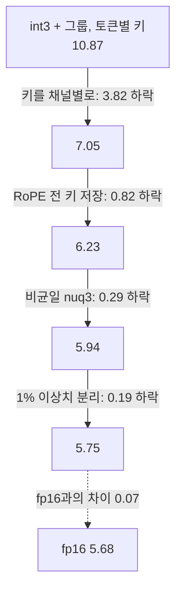
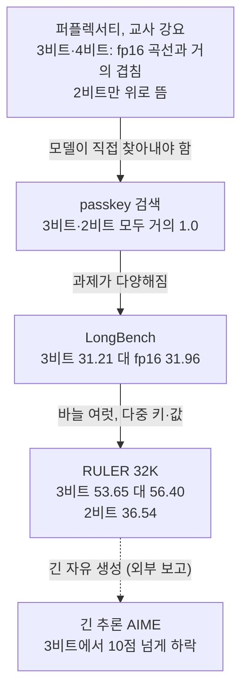

## 오늘의 한 편

오늘 읽은 논문은 Hooper 외의 KVQuant예요. "KVQuant: Towards 10 Million Context Length LLM Inference with KV Cache Quantization", NeurIPS 2024, [arXiv:2401.18079](https://arxiv.org/abs/2401.18079). UC Berkeley·ICSI·LBNL 사람들이 썼고, Mahoney와 Keutzer, Gholami가 이름을 올렸어요. 원문 PDF로 통독했어요.

출발점은 메모리에서 각 부분이 차지하는 비중이 바뀐다는 관찰이에요. 짧은 문맥에서는 가중치가 메모리의 98%를 차지하지만, LLaMA-7B를 배치 1로 128K 문맥까지 늘리면 KV 캐시[^term-kv]가 84%를 가져가요. KV 캐시의 크기는 $$2 \cdot n \cdot h \cdot d \cdot e \cdot b \cdot l$$, 곧 층 수·헤드 수·헤드 차원·원소당 바이트·배치·문맥 길이의 곱이라서 길이와 배치에 정비례해 불어나요. 디코딩 중에는 토큰마다 이 캐시 전체를 메모리에서 읽어 와야 하니 속도도 결국 이 크기에 묶여요. 그래서 저자들은 캐시 자체를 3비트, 2비트로 줄이는 쪽을 택했고, 초록은 3비트에서 퍼플렉서티[^term-ppl] 손실이 0.1 미만이라고 적어요[^abs]. 같은 방법으로 LLaMA-7B를 A100-80GB 한 장에서 100만 토큰, 8 GPU에서 1,000만 토큰 문맥까지 띄울 수 있다고 하고요[^abs2].

방법은 네 장치로 이뤄져요. 키는 채널별로, 값은 토큰별로 양자화해요. 키는 RoPE[^term-rope] 회전을 걸기 전에 저장해요. 층마다 Fisher 정보[^term-fisher]로 가중한 비균일 데이터타입 nuqX[^term-nuq]를 쓰고, 벡터마다 따로 정한 문턱으로 이상치 1%를 fp16 희소 행렬로 떼어 내요(dense-and-sparse[^term-ds]). 여기에 더해 첫 토큰은 fp16으로 남겨 attention sink[^term-sink]를 보호해요. 키의 스케일과 문턱은 보정 데이터(Wikitext-2 학습셋에서 2K 길이 16개)로 오프라인에서 정하고, 값의 스케일은 토큰이 들어올 때마다 온라인으로 계산해요.

이 글이 들여다볼 대목은 첫째 장치, 곧 스케일을 어느 축으로 공유하느냐예요. 나머지 셋은 그 위에 얹힌 손질이라는 게 논문 자체의 수치에서 드러나요.

## 왜 골랐나

정직하게 적으면 오늘 논문은 계획에 없던 선택이에요. 최근 세 편, 곧 11-09 qMeter, 11-08 DipSVD, 11-07 SliceGPT 글이 남긴 다음 후보는 모두 스무 편이에요. 그중 열아홉 편은 아직 미러에 없고 남은 한 편(DipSVD)은 이미 썼어요. 끌린 이유를 적어 두는 대기열도 비어 있었어요. 초점 질문 Q9에 걸어 둔 후보도 다 읽었고, 지난 14일 안에 도착했는데 안 쓴 논문도 없었어요(미러의 마지막 도착이 10-15). 그래서 범위를 넓혀, 9월 6일에 도착해 손대지 않은 채 남아 있던 KVQuant를 집었어요. 이번 선택에 대해 끌린 이유 칸은 비어 있어서 거기서 인용할 신호는 없어요.

그래도 이 논문을 기다리던 글이 이미 있었어요. 09-01 UltraQuant 글과 09-02 글이 둘 다 KVQuant를 다음 후보 2순위로 적어 두었거든요. 09-01 글의 해당 대목은 이랬어요.

> 내 화해 가설(스케일이 촘촘해지면 코드북에 남는 몫이 없다)이 맞는지 틀리는지가 여기서 갈려요. 특히 볼 것은 nuqX 실험의 스케일 입자 설정 — per-token인지 per-channel인지에 따라 화해가 성립하거나 무너집니다.

그러니 우연히 고른 논문이 09-01 글이 남겨 둔 질문에도 답하게 됐어요. 오늘의 목적은 둘이에요. 하나는 Q9의 질문 2, 곧 손상이 비트폭보다 스케일링 입자(채널별 대 토큰별, RoPE 전후)에서 오는가를 KV 캐시라는 다른 자리에서 확인하는 일이에요. 다른 하나는 논문이 주로 쓰는 퍼플렉서티가 장문맥 과제들과 같은 순서를 매기는지(질문 3·4)를 가려 보는 일이에요.

## 핵심 세 가지

### 하나. 같은 비트, 같은 메모리에서 축만 바꾸면 7.05에서 223까지 갈린다

먼저 무엇을 묶는지부터 정리해 둘게요. 양자화는 실수 묶음 하나에 스케일과 영점[^term-zp]을 정해 주고, 그 범위를 $$2^b$$개 격자로 나눠 각 원소를 가장 가까운 격자점으로 반올림하는 일이에요. 묶음 안에 유독 큰 값이 하나 있으면 범위가 그 값에 맞춰 늘어나고, 나머지 작은 값들은 성긴 격자 위에서 뭉개져요. 그러니 어느 원소들을 한 묶음으로 삼는지, 곧 스케일을 무엇과 나눠 쓰는지가 정밀도를 좌우해요.

KV 캐시는 토큰 축과 채널 축을 가진 행렬이라서, 자연스러운 선택지가 둘 있어요. 토큰 하나의 모든 채널을 한 묶음으로 하면 토큰별, 채널 하나의 모든 토큰을 한 묶음으로 하면 채널별이에요. 저자들이 LLaMA-7B 10층의 키와 값을 그려 보니(그림 2), RoPE를 걸기 전의 키에는 특정 채널에 토큰을 가로질러 일관된 이상치가 있었어요. 값에는 그런 고정된 패턴이 없었고요. §3.1은 한 채널 안의 값들을 함께 묶을 때가 서로 다른 채널의 값들을 묶을 때보다 양자화하기 쉽다고 한 문장으로 적어요[^s31a]. 이상치가 채널에 고정돼 있으면, 그 채널에 따로 스케일을 주는 순간 이상치는 자기 묶음 안의 평범한 값이 되고 다른 채널은 그 영향을 받지 않아요.

채널에 붙박인 이상치 자체는 새 발견이 아니에요. LLM 활성값의 몇몇 채널에 유독 큰 값이 고정적으로 나타난다는 건 LLM.int8() 무렵부터 알려진 현상이고, SmoothQuant도 같은 관찰에서 출발했다고 알려져 있어요. KVQuant가 보탠 건 그 현상을 키 캐시에서, 그것도 RoPE 앞이라는 특정 위치에서 확인하고 묶는 축의 선택으로 연결한 일이에요.

이 효과의 크기는 부록 G의 표 9에 나와요. LLaMA-7B, int3, 128K 문맥 기준 KV 캐시 12.0GB로 메모리를 똑같이 맞춘 채 축만 바꿨어요.

| 키 | 값 | Wikitext-2 퍼플렉서티 |
|---|---|---|
| 토큰별 | 토큰별 | 10.87 |
| 채널별 | 채널별 | 223 |
| 채널별 | 토큰별 | 7.05 |
| (fp16, 64.0GB) | | 5.68 |

키를 채널별로 바꾸기만 해도 10.87에서 7.05로 3.82가 내려가요[^s31b]. 그런데 같은 논리를 값에도 적용해 채널별로 하면 223으로 치솟아요. 두 쪽 다 토큰별로 묶은 조건보다 스무 배 남짓 나빠요[^calc-20].

저자들은 값을 채널별로 하면 실제로 토큰별보다 나쁘다고 적고[^g1], 그 이유를 이렇게 추정해요. 어텐션 출력은 어텐션 점수로 값 벡터들을 가중합한 것이라, 값의 한 채널에 얹힌 오차는 출력 벡터의 한 원소로 고스란히 모여요. 그 오차가 뒤 층으로 갈수록 불어난다는 거예요[^g2]. KIVI도 독립적으로 같은 결론(키 채널별·값 토큰별)에 도달했어요. KIVI는 토큰별 값 양자화가 오차를 각 토큰 안에 가둔다고 설명해요. 그래서 큰 어텐션 점수를 받는 몇 안 되는 중요 토큰이 덜 중요한 토큰들의 양자화 때문에 상하지 않는다는 거예요. 두 설명은 같은 구조를 다른 쪽에서 본 거예요. 키는 내적의 한쪽 피연산자라서 채널별 오차가 점수 전체에 퍼져 희석돼요. 반면 값은 가중합의 재료라서 채널별 오차가 출력의 한 좌표에 쌓여요. 키와 값이 계산 그래프에서 맡은 일이 다르니, 같은 3비트라도 묶을 축이 갈려요.

나에게 표 9의 223은 10.87보다 더 많은 걸 말해 줘요. '나누면 낫다'는 명제는 틀렸고, 맞는 명제는 '값의 크기가 동질적인 축으로 나눠야 낫다'예요.

통계에서 층화 추출을 할 때 층 안의 분산이 작아야 추정이 정밀해지는 것과 같은 질문이에요. 신호처리의 블록 부동소수점에서 공통 지수를 어떤 블록에 줄지 고민하던 것과도 같은 계보고요. 블록 최댓값이 블록 전체의 해상도를 정한다는 사정은 DSP에서도 지금의 KV 캐시에서도 그대로예요.

### 둘. RoPE 전후의 우열은 입자에 따라 뒤집힌다

RoPE는 키와 질의의 채널을 두 개씩 짝지어, 토큰 위치에 비례하는 각도로 회전시켜요. 그러면 채널 쌍 하나의 크기가 위치마다 다른 비율로 두 채널에 나뉘어 담겨요. 저자들은 이 회전이 RoPE 전 키에 있던 채널 고정 이상치를 흐려 놓는다고 관찰했어요. 그래서 키를 회전 전에 저장하고, 역양자화한 뒤 커널에서 RoPE를 즉석으로 거는 방식을 택했어요. 채널별 키 위에서 이렇게 바꾸면 7.05가 6.23으로 내려가요(표 10). 부록 H는 RoPE 전 양자화가 저정밀에서 더 정확한 양자화를 가능하게 한다고 적어요[^h].

여기까지는 깔끔한데, 부록 P의 표 20을 같이 놓으면 구조가 하나 더 보여요. 표 20은 키를 토큰별로 묶었을 때 RoPE 전후를 비교해요.

| 키 토큰별 (LLaMA-7B) | RoPE 전 | RoPE 후 |
|---|---|---|
| int4 | 6.02 | 5.98 |
| int4-gs128 | 5.76 | 5.77 |
| int3 | 14.68 | 10.87 |
| int3-gs128 | 6.28 | 6.17 |

토큰별 int3에서는 RoPE 뒤가 14.68 대 10.87로 확연히 나아요. 부록 P도 키를 토큰별로 양자화할 때는 RoPE 후가 RoPE 전보다 낫다고 명시해요[^p]. 저자들은 회전이 큰 이상치 채널의 크기 일부를 작은 채널로 옮겨 주기 때문이라고 설명해요. 그래서 어떤 위치에서는 이상치가 토큰 묶음의 범위를 덜 늘린다는 거예요. 이런 이유로 기준선 비교에는 RoPE 후 토큰별을 '더 강한 기준선'으로 썼고요.

두 표를 함께 읽으면 이렇게 돼요. 토큰별이면 RoPE 뒤가 낫고, 채널별이면 RoPE 전이 나아요. 같은 회전이 토큰별 묶음에서는 이상치를 이웃 채널로 퍼뜨려 범위를 줄여 줘요. 반대로 채널별 묶음에서는 채널마다 일관되던 크기를 위치에 따라 흔들어 놓아 묶음의 동질성을 깨요. 이 해석의 둘째 절반은 §3.2의 저자 설명과 표 10에서 왔고, 두 표를 한데 놓고 '뒤집힘'으로 읽은 건 내 해석이에요. 그래도 오늘 논문에서 이 상호작용이 가장 많은 걸 알려 줘요. RoPE를 거는 순서가 독립적으로 조절할 수 있는 변수가 아니라는 뜻이니까요.

회전의 득실은 묶는 축이 정해진 뒤에야 물을 수 있어요.

그러면 09-01 글이 세운 순서, 곧 회전은 대체 불가이고 그 위에서 스케일 입자가 무게를 대부분 진다는 순서에 단서를 달아야 해요. 회전과 입자는 위아래로 쌓인 층이라기보다 서로의 효과를 바꾸는 한 쌍에 가까워요. 하다마드 회전처럼 모든 채널을 고루 섞는 회전은 토큰별 묶음과 잘 맞고, 채널 고정 이상치를 살려 두는 쪽은 채널별 묶음과 잘 맞아요.

그러나 이 축 정렬 이야기가 유일한 설명은 아니에요. 표 20의 int3-gs128 줄을 보면, 키를 토큰별로, RoPE 뒤에 두고 128원소 그룹으로 잘게 나누기만 해도 6.17이 나와요. 채널별·RoPE 전의 6.23과 거의 같은 값이에요. 축을 맞추는 일과 묶음을 잘게 나누는 일이 서로를 상당 부분 대신할 수 있다는 뜻이에요. 묶음이 작아지면 이상치가 범위를 늘려 놓아도 피해를 보는 원소 수가 줄어들어요. 그러니 동질적인 축을 찾지 않아도 이질성이 덜 문제가 돼요. 다만 이 비교에는 빠진 값이 있어요. 그룹 128마다 스케일과 영점을 따로 두면 그만큼 메타데이터가 늘어나는데, 표 20은 그 비용을 실효 비트로 환산해 적지 않았어요. 6.17과 6.23이 같은 메모리에서 나온 값인지 확인할 수 없으니, '잘게 나누기로도 된다'는 결론은 비용을 따지지 않은 상태에서만 성립해요.

### 셋. 단계별 기여 — 입자가 네 장치 이득의 4분의 3을 진다

그림 1 오른쪽은 LLaMA-7B 3비트에서 네 장치를 하나씩 더할 때의 Wikitext-2 퍼플렉서티를 계단으로 보여 줘요.

전체 하락폭 5.12 가운데 키 축을 바꾼 첫 계단이 3.82, 약 75%를 가져가요. RoPE 전 저장이 약 16%, 비균일 데이터타입이 약 6%, 이상치 분리가 약 4%예요[^calc-step]. 두 번째 계단까지 합치면 축과 회전 순서, 곧 '어떻게 묶느냐'에 관한 결정이 이득의 90% 남짓을 설명해요.

다만 이 비율은 계단을 놓은 순서에 기대는 숫자예요. 장치를 하나씩 더해 가며 재면 뒤 계단은 앞 계단이 이미 줄여 놓은 오차 위에서 재지니, 먼저 놓인 장치가 몫을 크게 가져가기 쉬워요. 협력 게임에서 Shapley 값이 가능한 순서를 모두 평균 내는 것도 이 사정 때문으로 알려져 있어요. 그림 1은 한 순서만 보여 주고, nuq3를 토큰별 키 위에 먼저 얹었을 때의 이득은 보고하지 않았어요. 그러니 '4분의 3'은 이 순서에서의 몫으로 읽어야 해요. 그래도 내 계산으로 첫 계단의 3.82는 나머지 세 계단을 합한 1.30의 세 배 가까이 되니, 순서를 바꾼다고 우선순위까지 뒤집히기는 어려워 보여요.

비균일 데이터타입 쪽을 조금 더 들여다보면 흥미로운 점이 있어요. 표 11은 키 RoPE 전 채널별·값 토큰별이라는 같은 조건에서 데이터타입만 바꿔 비교해요. LLaMA-7B에서 int3는 6.23, NormalFloat 계열의 nf3는 6.05예요. 가중하지 않은 k-means로 만든 nuq3는 6.84, Fisher 가중 nuq3(채널 스케일 미반영)는 6.01, KVQuant의 nuq3는 5.94고요. 가중하지 않은 k-means는 균일 int3보다도 나빠요. 비균일 격자가 이득이 되려면 활성값 분포에 맞추는 것만으로는 부족하다는 거예요. 모델 출력에 중요한 원소의 오차를 줄이는 방향으로 맞춰야 해요. 식 1이 그 의도를 담고 있어요.

$$
Q(A)^* \simeq \arg\min_Q \sum_i \mathcal{F}_{ii}\,\big(A_i - Q(A_i)\big)^2
$$

기호를 말로 풀면 이래요. $$A_i$$는 보정 데이터에서 모은 활성값 원소이고, $$Q(A_i)$$는 그 원소가 반올림될 격자점이에요. $$\mathcal{F}_{ii}$$는 그 원소가 손실에 얼마나 민감한지를 대각 Fisher 정보로 잰 가중치고요. 그러니 민감한 원소가 많이 몰린 구간에 격자점을 촘촘히 두라는 가중 k-means예요. 본문은 이 데이터타입이 3비트 균일 방법보다 0.29 낫다고 적어요[^s33]. 다른 모델에서도 이득은 최대 0.33이고요.

이 도구들의 출처도 짚어 둘 만해요. Fisher 가중 k-means와 dense-and-sparse 분해는 같은 버클리 그룹의 SqueezeLLM이 가중치 양자화에 쓴 조합으로 알려져 있어요. KVQuant는 그 도구를 가중치에서 캐시로 옮겨 온 쪽에 가까워요. 격자를 분포에 맞춰 두는 생각 자체는 Lloyd-Max 양자화기까지 거슬러 올라가는 오래된 줄기이고, 가중하지 않은 k-means가 int3보다 나빴다는 6.84는 그 고전적 목표(입력 분포의 평균 제곱 오차)만으로는 모델 출력을 지키지 못한다는 표시로 읽혀요.

이상치 분리도 비슷해요. 표 12에서 1% 이상치를 행렬 전체에 하나의 문턱으로 고르면 5.85, 벡터마다 문턱을 따로 잡으면 5.75예요. 0.1%에서도 5.89 대 5.82로 같은 방향이고요. 여기서도 몇 퍼센트를 빼느냐보다 어느 단위로 문턱을 정하느냐가 먼저예요. 입자의 문제가 데이터타입과 이상치 처리에서도 똑같이 나타나는 셈이에요.

## 내 연구에 어떻게 맞물리나

### 09-01 글의 정정과 화해 가설의 현재

먼저 정정부터 적어요. 09-01 UltraQuant 글은 이렇게 썼어요.

> KVQuant는 per-block absmax 스케일을 깔아 두고 코드북을 비교한 게 아니라, 그 적응 스케일 없이 코드북끼리 견줍니다.

오늘 원문으로 확인해 보니 이 문장은 사실과 맞지 않아요. 표 11의 nuqX 비교는 키 채널별·값 토큰별 스케일 위에서 이뤄졌어요. 적응 스케일은 분명히 있었고, 채널 하나 전체나 토큰 하나 전체를 단위로 하는 벡터 단위 스케일이었어요. 빠져 있는 건 32원소 블록 단위 스케일뿐이에요. 기존 글은 손대지 않고 여기서 바로잡아 둘게요.

그럼 화해 가설은 지금 어디쯤 와 있을까요? 가설은 이랬어요. 스케일 입자가 거칠면 묶음 안 분포가 이질적이라 코드북이 그 이질성을 흡수하고, 입자가 촘촘해지면 흡수할 이질성이 남지 않는다는 거예요. Panter와 Dite의 고해상도 양자화 이론에서 최적 격자 밀도가 분포 모양을 따라간다는 결과에 기댄 해석이었고요. 오늘 얻은 증거는 두 방향을 가리켜요. 같은 3비트에서 입자 교정(키 토큰별→채널별)이 3.82, 비균일 코드북이 0.29를 벌었으니 입자가 코드북보다 먼저라는 우선순위는 지지돼요. 한편 벡터 단위 입자 위에서도 코드북의 몫이 0이 되지는 않았어요. 채널별 키 스케일은 오프라인에서 정해져 모든 토큰이 나눠 쓰니, 토큰 축으로 보면 꽤 거친 입자예요. 이질성이 남아 있을 만한 조건이고, 0.29는 그 남은 이질성을 코드북이 흡수한 몫으로 읽을 수 있어요. 그러니 오늘의 결과는 가설과 어긋나지 않지만 가설을 시험하지도 못해요. 32원소 블록 입자에서 코드북 몫이 사라지는지는 KVQuant의 실험 설계 바깥에 있어요.

10-18 KVarN 글이 짚은 반대쪽 축 이야기도 여기서 이어져요. 키를 채널별로 묶으면 묶음 안의 모든 토큰이 같은 채널 스케일을 나눠 써요. 그러면 유독 크거나 작은 토큰은 자기에게 맞지 않는 격자에서 반올림돼요. 표 9의 7.05는 이 토큰 크기 오차를 안고 있는 값이고, 그 뒤의 벡터별 이상치 문턱은 이 남은 오차를 일부 떠맡는 장치로 읽혀요. KVarN과 KVQuant를 이어 읽으면 이런 그림이 보여요. 한 축을 고르면 다른 축의 이질성이 남은 오차로 남고, 그 오차를 무엇으로 처리하느냐가 다음 세대 방법들이 경쟁하는 지점이에요.

### Q9 질문 2 — 비트폭보다 입자

의제 노트의 Q9는 압축이 무엇을 옮기고 무엇을 버리는지, 그리고 그 손실을 배포 전에 잴 수 있는지를 묻는 질문이에요. 그 두 번째 하위 질문은 붕괴의 원인이 토큰 믹서인지 활성값 스케일링 입자인지를 가려 보자는 것이었어요. 08-29 글에서 재귀 추론기를 압축했을 때 칸 정확도는 50~87%로 살았지만 퍼즐 완전일치는 0~5%로 무너졌어요. ETH의 병렬 연구 [arXiv:2607.16237](https://arxiv.org/abs/2607.16237)는 초록 기준으로 per-tensor 4비트에서 Sudoku가 84.1%에서 0.0%로 떨어지고, per-block 스케일의 MXInt4로 완전히 되돌아온다고 보고했어요[^eth].

오늘 표 9는 같은 결론을 KV 캐시에서, 그리고 훨씬 통제된 형태로 보여 줘요. 비트폭이 3비트로 같고, 메모리가 12.0GB로 같고, 데이터타입도 같은 int3인데 축 선택 하나로 퍼플렉서티가 7.05에서 223까지 움직여요. 손상의 크기를 정하는 변수가 비트폭보다 입자 쪽에 있다는 건, 적어도 이 설정에서는 분명해요.

Q9 검증 계획에는 '무작위 스케일 대조군'을 적어 뒀어요. 채널별 스케일을 보정 대신 무작위로 정한 INT4가 어디에 떨어지는지 보고, 복구의 공이 '나눴다'에 있는지 '맞췄다'에 있는지 가려 보자는 실험이에요. 이와 닮은 실험이 표 9에 이미 있어요. 값을 채널별로 나누면 나누지 않은 것보다 스무 배 나빠요. '나눴다'만으로는 아무것도 보장되지 않는다는 증거예요. 동시에 표 20의 int3-gs128은 반대쪽을 가리켜요. 축을 맞추지 않아도 충분히 잘게 나누면 상당 부분 회복돼요. 그러니 '맞췄다'와 '잘게 나눴다' 둘 다 공을 가져갈 수 있고, 둘을 가르려면 메타데이터 비용을 고정한 비교가 필요해요.

외부 사례도 같은 방향을 가리키는데, 단서를 하나 더해요. 탐구 에이전트가 Quantization Hurts Reasoning? ([arXiv:2504.04823](https://arxiv.org/abs/2504.04823))의 표를 읽어 온 바로는 이래요. DeepSeek-R1-Distill-Qwen 1.5B·7B는 키·값 편향에 큰 이상치가 있어요. 그래서 토큰별 그룹에 하다마드 회전을 더한 QuaRot는 4비트에서도 AIME 0.3(1.5B)·0.0(7B)으로 무너지는데, 키 채널별인 KVQuant*는 7B 4비트에서 44.4로 버텨요. 그런데 14B·32B에서는 QuaRot가 비슷하거나 나아요(32B 3비트 AIME 57.2 대 50.8)[^qhr]. 어느 축과 어느 변환이 이기는지는 모델의 이상치 구조가 정한다는 뜻이고, 오늘 표 20에서 본 뒤집힘과 같은 모양이에요. SmoothQuant([arXiv:2211.10438](https://arxiv.org/abs/2211.10438))는 고정 채널 이상치를 가중치 쪽으로 옮긴 뒤에 토큰별 스케일을 써요. 같은 질문에 다른 경로로 답한 것으로 읽혀요(에이전트의 종합이고 원문 문장은 확인하지 않았어요). 반대 방향의 주의점도 하나 적어 둬요. 마이크로스케일링 계열에서는 블록을 너무 작게 쪼개면 스케일 자체의 양자화가 거칠어져 오히려 나빠진다는 보고가 있어요([arXiv:2601.19026](https://arxiv.org/abs/2601.19026), 요약 수준 확인). '촘촘할수록 좋다'에도 하한이 있다는 거예요.

입자 선택은 정확도만의 문제도 아니에요. KVQuant 본문은 채널별 키가 양자화 차원과 행렬-벡터 곱의 축약 차원을 어긋나게 해 런타임 부담이 될 수 있다고 적어요. InnerQ([arXiv:2602.23200](https://arxiv.org/abs/2602.23200))는 캐시를 안쪽 차원을 따라 묶어 역양자화를 곱셈과 맞물리게 했고, 디코드를 기준선 대비 약 2.7배 빠르게 했다고 해요(초록 수준). 정확도에 좋은 축과 커널에 좋은 축이 꼭 같지는 않다는 긴장은 이 분야에 계속 남을 것 같아요.

### 다섯 가지 지표로 같은 3비트를 보면

이제 둘째 축인 평가 문제로 넘어가요. 퍼플렉서티는 교사 강요[^term-tf]로, 모든 입력 토큰의 로짓에서 재요[^s41]. 정답 접두사를 매번 넣어 주니, 모델이 자기 출력 위에서 갈라져 나가는 일은 정의상 보이지 않아요. 10-27 PM-KVQ 글에서 수치해석의 걸음 오차와 총오차를 나눠 생각한 게 여기서 다시 쓰여요. 저장값 자체는 낡지 않더라도, 그 값을 읽고 내린 결정들이 조금씩 갈라지면 긴 생성에서는 그 갈라짐이 누적돼요. 퍼플렉서티는 걸음 오차를 재는 지표에 가깝고, 총오차는 보지 못해요.

장문맥 평가는 모두 LLaMA-2-7B-32K에서 이뤄졌어요. 앞의 표 1과 다른 모델이라 두 표의 숫자를 한 비율로 섞지는 않을게요. 같은 방법을 여러 지표로 재면 어떻게 보이는지 위에서 아래로 정리하면 이래요.

passkey 검색[^term-passkey]에서는 3비트(nuq3-1%)가 2K에서 0.98인 것을 빼면 전부 1이고, 2비트(nuq2-1%)도 8K에서 0.98인 것을 빼면 전부 1이에요. 비교 대상인 KIVI-2-gs32-r128(평균 3.05비트)은 0.68~0.76이었고요. LongBench(3.33비트 KVQuant-3bit-1%)는 평균 31.21로 fp16 31.96에 가깝고, KIVI(3.17비트)는 30.04예요.

RULER[^term-ruler]에서는 결과가 달라져요. 32K에서 fp16 평균 56.40, KVQuant-3bit-1% 53.65, KVQuant-2bit-1% 36.54, KIVI 39.78이에요. 3비트는 2.75점(상대 약 4.9%), 2비트는 19.86점(상대 약 35%) 낮아요[^calc-ruler]. 과제별로 보면 손실이 어디에 몰리는지가 보여요. 바늘 하나를 찾는 Niah1은 2비트에서도 100→95.4로 버텨요. 하지만 Niah3는 98.6→49.8로 반토막이 나고, 다중 키 MKey2는 68.2→23.4, MKey3은 11에서 0이 돼요. 다중 값 MValue도 55.95→16.65예요. 3비트에서도 손실이 같은 과제에 몰려요. MKey2는 68.2→61.6, MValue는 55.95→47.5, MQuery는 64.5→54.45예요.

여기서 표 4의 캡션을 원문과 대조해 둘 필요가 있어요. 캡션은 공격적인 양자화와 가지치기에서도 기준선 정확도를 유지한다고 적어요[^t4cap]. 그런데 같은 표의 수치로는 2비트가 3분의 1 넘게 잃어요. 캡션의 '가지치기'에 해당하는 설정은 본문에서 찾지 못했어요. 본문의 "KIVI보다 14% 낫다"는 문장도[^s42] 53.65 대 39.78을 상대 비율로 계산하면 약 35%이고 절대 차이로는 13.87점이에요. 그러니 '14%'는 점수 차를 퍼센트로 부른 것으로 읽혀요[^calc-kivi]. 수치는 맞게 적혀 있고, 그 수치를 부르는 문장이 한 단계 후해요.

다음 사례는 논문 바깥에서 와요. Quantization Hurts Reasoning?은 원 논문을 단순화한 KVQuant*(키 채널별·값 토큰별, 그룹 128. 재현은 아니에요)를 DeepSeek-R1-Distill-Qwen에 적용했어요. 그랬더니 3비트에서 AIME-120이 7B 46.1→33.6, 14B 54.7→42.8, 32B 61.7→50.8로 떨어졌대요. 같은 3비트에서 GSM8K는 14B 93.7→93.1, 32B 94.2→94.4로 거의 그대로고요[^qhr]. 10-18 글이 옮긴 KVarN 논문의 비교 설정에서도 Qwen3-4B의 AIME24가 KVQuant-1% 40.0%, FP16 61.1%였어요[^kvarn]. 두 사례 모두 탐구 결과로 가져온 2차 기록이라 정확한 설정은 원문에서 다시 봐야 해요.

11-08·11-09 글은 지표마다 어느 구간에서, 어느 방향의 판정을 믿을 수 있는지 함께 적자고 제안했어요. 그 형식을 여기에 한번 적용해 볼게요.

| 지표 | 무엇을 재나 | 3비트에서 | 2비트에서 | 믿을 수 있는 판정 |
|---|---|---|---|---|
| 퍼플렉서티 (교사 강요) | 정답 접두사 위의 다음 토큰 확률 | fp16과 0.1 미만 차 | 2비트 곡선만 위로 뜸 | 큰 붕괴(10.87, 223)는 잡아냄. 0.1 미만 차이로 '무손실'을 말하기엔 약함 |
| passkey 검색 | 바늘 하나의 정확한 회수 | 거의 1.0 | 거의 1.0 | 방법 간 큰 차이(KIVI 0.7대)는 가려냄. 2비트 손상은 못 봄 |
| LongBench | 장문 과제 평균 | 31.21 대 31.96 | (본문 미보고) | 평균 수준의 열화. 과제 구성에 따라 희석됨 |
| RULER 32K | 바늘 여럿, 다중 키·값, 집계 | 평균 2.75점 하락 | 평균 19.86점 하락 | 3비트와 2비트를 가려냄. 손실 위치(다중 키·값)를 드러냄 |
| 긴 추론 AIME (외부) | 긴 자유 생성의 최종 정답 | 10점 넘게 하락 | (이 글에선 미확인) | 생성 중 누적까지 포함한 손실. 원인 분리는 못 함 |

이 표가 말하는 건 단순해요. 위쪽 지표들이 더는 차이를 보여 주지 못하는 구간에서 아래쪽 지표들이 비로소 움직여요.

퍼플렉서티와 passkey가 같은 판정('거의 무손실')을 내린다고 해서 그 판정이 확인되는 건 아니에요. 두 지표가 같은 이유로 손상을 보지 못하는 것일 수도 있으니까요.

Q9의 질문 1은 부분 점수 지표는 살고 전부-아니면-전무 지표는 무너진다는 관찰이었어요. 이 관찰이 RULER 결과와 어떻게 맞닿는지는 좀 더 섬세하게 적어야 해요. passkey도 표본 하나로 보면 맞거나 틀리거나인 지표인데 2비트에서 살아남았어요. 그러니 결과가 갈리는 이유를 채점 방식 하나로는 설명할 수 없어요. 더 잘 맞는 설명은 '동시에 정확해야 하는 것의 개수'예요. 바늘이 하나면 살고, 여럿을 함께 맞혀야 하면 무너져요. 긴 추론처럼 수백 걸음이 다 맞아야 하면 더 크게 무너지고요. 다중 레이블 학습에서 Hamming 손실과 subset 0/1 손실의 차이가 레이블 수가 늘수록 벌어지는 것과 같은 모양이에요. 각 레이블의 정확도가 조금만 떨어져도 전부를 맞힐 확률은 레이블 수의 거듭제곱으로 줄어드니까요.

여기서 정직하게 남겨 둘 구분이 하나 있어요. AIME 격차만으로는 두 가설 중 어느 쪽이 맞는지 가를 수 없어요. 하나는 '포화한 지표' 가설로, 퍼플렉서티와 passkey가 원래부터 이 손상을 잡아낼 만큼 민감하지 않았다는 거예요. 다른 하나는 '디코딩 중 누적' 가설로, 손상이 걸음마다는 작지만 긴 생성에서 갈라짐이 쌓여 커진다는 거예요. 두 가설 모두 같은 관찰을 설명해요. 디코딩 누적을 직접 뒷받침하는 자료는 오늘 찾지 못했어요.

반대 방향의 사례도 하나 적어 둘게요. 표 21은 Wikitext-2로 보정하든 C4로 보정하든 퍼플렉서티가 거의 같다고 보고해요. 4비트 1% 설정에서 Wikitext-2로 잰 값이 5.69와 5.70, C4로 잰 값이 7.09와 7.09예요(두 숫자를 보정 데이터별 값으로 읽은 건 내 해석이에요)[^q]. 11-08 DipSVD 글이 문제 삼았던, 보정 데이터에 맞춰지는 문제와 대조돼요. 키의 스케일과 문턱을 오프라인 보정으로 정하는데도 분포 민감도가 낮아요. 이건 키의 채널 이상치 구조가 데이터보다 모델에 속한 성질이라는 그림과 맞아요. 다만 이것도 퍼플렉서티로 잰 결과이고, 이 글이 지금까지 의심한 바로 그 지표라는 점은 함께 적어 둬요.

우리 쪽 판정자 증류 실험의 부정적 결과도 한 줄만 옮겨요. 강한 교사 판정과 학생의 일치가 $$\kappa = 0.056$$이었어요(원 0.77, 사람 0.88). 개별 판정은 그럴듯했지만 판정의 구조가 달랐어요. 평균 지표가 괜찮아 보이는 것과 구조가 옮겨졌는지는 다른 질문이라는, 같은 모양의 교훈이에요.

## 편집자에게 (pheeree)

오늘 원문에서 확인한 것과 남은 것을 나눠 적어요.

확인된 건 두 가지예요. 같은 비트·같은 메모리에서 묶는 축 하나가 손상의 크기를 정한다는 것(표 9의 7.05 대 223)과, RoPE 전후의 득실이 그 축 선택에 따라 뒤집힌다는 것(표 10과 표 20을 함께 읽은 내 해석)이에요. 09-01 글의 "적응 스케일 없이 코드북끼리 견준다"는 문장은 틀렸고, 정정은 이 글 안에 남겼어요. 09-01 원문을 고칠지, 이 글의 정정으로 대신할지는 판단해 주세요.

남은 질문 가운데는 실험으로 가를 수 있는 것들이 있어요.

- **무작위 축 대조군의 KV판.** 같은 3비트에서 (키 토큰별·값 토큰별), (키 채널별·값 토큰별), (키 채널별·값 채널별)에 더해 조건을 하나 넣으면 좋겠어요. 키 채널을 무작위로 섞은 뒤 채널별 스케일을 매기는 조건이에요. 이 조건이 223과 7.05 사이 어디에 떨어지는지 보면 '맞췄다'의 몫이 직접 드러나요.
- **그룹 크기 훑기.** 키 토큰별 그룹 128이 6.17까지 온 것을 32·64·256으로 훑어 보는 실험이에요. 축 정렬과 잘게 나누기가 어느 지점에서 같은 결과를 내는지 보고, 스케일 메타데이터까지 넣은 실효 비트로 다시 비교하는 거예요. KV Pareto([arXiv:2512.01953](https://arxiv.org/abs/2512.01953))가 그룹 32·64·128을 함께 훑었다고 하니, 먼저 그 표를 확인하는 게 손이 덜 가요.
- **화해 가설의 직접 시험.** 키 채널별·값 토큰별 위에 32원소 블록 스케일을 더 얹었을 때 int3 대 nuq3의 0.29 차이가 남는지 보는 실험이에요. 차이가 0에 가까워지면 09-01의 가설이 서요. 그대로라면 코드북이 블록 입자로도 흡수되지 않는 무언가를 잡는다는 뜻이고요.
- **교사 강요 대 자유 생성.** 같은 KVQuant 3비트에서 두 가지를 함께 재 보는 거예요. 교사 강요 상태의 다음 토큰 KL과, 자유 생성에서 fp16 출력과 처음 갈라지는 위치의 분포예요. 갈라짐이 이른데 KL이 작다면 '디코딩 누적' 쪽에, KL부터 이미 크다면 '포화한 지표' 쪽에 무게가 실려요.

관행에 관한 질문도 하나 있어요. 오늘 다섯 지표 표를 시험 삼아 만들어 봤어요. 그런데 칸을 채우다 보니 '믿을 수 있는 판정' 열은 지표 고유의 성질이 아니었어요. 방법과 비트폭에 따라 달라지는 성질이었어요. 이 열을 지표마다 고정된 설명으로 둘지, 글마다 그날의 방법에 맞춰 새로 쓸지 정해 주시면 다음부터 그 형식으로 맞출게요.

### 다음 읽을 후보

아래 후보는 모두 오늘 기준 미러에 없어요. 설명은 초록·요약 수준이에요.

- **Quantizing Recursive Reasoning Models ([arXiv:2607.16237](https://arxiv.org/abs/2607.16237))** — 08-29 글부터 1순위로 남아 있는 ETH 연구예요. 오늘 KV 캐시 쪽에서 '비트폭보다 입자'가 분명해졌으니, 은닉 활성값 쪽의 같은 주장을 원문으로 확인하는 일이 더 급해졌어요. per-block 스케일로 완전히 복원된다는 대목이 그룹 크기의 하한 문제와 어떻게 만나는지도 볼 수 있어요.
- **Quantization Hurts Reasoning? ([arXiv:2504.04823](https://arxiv.org/abs/2504.04823))** — 11-09 글의 후보였고, 오늘 쓴 KVQuant* AIME 수치와 QuaRot 비교가 여기서 왔어요. 탐구 에이전트가 읽은 값을 원문 표로 확인해야 해요. KVQuant*가 원 논문과 어디서 다른지(RoPE 순서, nuq 사용 여부)도 정확히 적어야 하고요.
- **KIVI ([arXiv:2402.02750](https://arxiv.org/abs/2402.02750))** — 같은 축 결론에 독립적으로 도달한 논문이에요. 같은 3비트대에서 passkey가 0.7대에 머문 이유가 최근 토큰을 fp16으로 남기는 잔차 윈도 설계와 관련 있는지 보고 싶어요.
- **OSCAR ([arXiv:2605.17757](https://arxiv.org/abs/2605.17757))** — 어텐션을 고려한 공분산으로 고정 회전과 클리핑 문턱을 정해, INT2에서 떨어진 추론 성능을 상당 부분 되살렸다고 해요. 표 20에서 본 '회전이 입자에 따라 득도 실도 된다'는 구조를 회전을 설계하는 쪽에서 어떻게 다뤘는지 보고 싶어요.
- **KVDiagnosis ([arXiv:2608.09412](https://arxiv.org/abs/2608.09412))** — 평균 대신 개별 실패 사례를 단위로 원인을 가르는 진단 방법이에요. 전체 캐시로는 맞히는데 압축하면 틀리는 사례들을 따로 봐요. 오늘 남긴 '포화 대 누적' 구분을 사례 단위에서 가를 도구가 될지 확인하고 싶어요.

**발행 전 점검:** 중심 논문은 원문 PDF로 본문 10쪽과 부록 F~J·P~Q를 읽었어요. 각주의 영어 인용 13건은 PDF 텍스트와 기계로 대조해 모두 글자 그대로 맞고, 본문에 쓴 표 1·2·3·4·9·10·11·12·20·21의 수치 43개도 전부 원문에 있는 값이에요(✓). 계단별 비율, 20배, RULER 상대 하락, KIVI 대비 35%는 원표 값으로 다시 계산했어요(✓, 내 계산). RoPE 전후 우열이 입자에 따라 '뒤집힌다'는 읽기는 표 10과 표 20을 겹친 내 해석이고, 두 표가 같은 실행 조건인지는 원문에 명시돼 있지 않아요(⚠ 해석). 그룹 128의 메타데이터 비용은 원문에 없어서 본문에서도 미확인으로 뒀어요(?). Quantization Hurts Reasoning?의 AIME·GSM8K·QuaRot 수치, 10-18 글이 옮긴 KVarN 표, ETH 초록, SmoothQuant·MX 하한·InnerQ·KV Pareto의 서술은 탐구 에이전트 요약이나 초록, 과거 글의 2차 기록에 기댄 ✓(provisional)이에요. 이것들은 RULER(1차)로 세운 논증을 같은 방향에서 받치는 사례로만 썼고, 논증의 전제로 쓰지는 않았어요. 우리 쪽 $$\kappa$$ 0.056·0.77·0.88은 내 노트의 2차 기록이에요(✓ provisional). LLM.int8()·SqueezeLLM·Lloyd–Max·Panter–Dite·Shapley·층화 추출·블록 부동소수점의 계보는 출처 대조 없이 적은 배경 지식이에요(?). 다만 SqueezeLLM이 Fisher 가중 k-means와 dense-and-sparse의 출처라는 점은 KVQuant 본문의 인용([17])으로 확인했어요.

[^term-kv]: 용어 — KV 캐시: 생성 중에 앞선 토큰들의 키·값 벡터를 저장해 두는 메모리. 새 토큰이 이전 토큰들을 참조할 때마다 다시 계산하지 않고 읽어 와요. 문맥 길이에 비례해 커져요.
[^term-ppl]: 용어 — 퍼플렉서티(perplexity): 모델이 정답 토큰에 매긴 확률의 기하평균 역수. 낮을수록 다음 토큰을 잘 예측한다는 뜻이에요.
[^term-rope]: 용어 — RoPE(rotary position embedding): 키와 질의의 채널을 두 개씩 짝지어 토큰 위치에 비례하는 각도로 회전시켜 위치 정보를 넣는 방식. Su 외(2021).
[^term-fisher]: 용어 — Fisher 정보: 파라미터나 활성값이 조금 바뀔 때 손실이 얼마나 민감하게 변하는지를 재는 양. 여기서는 그 대각 성분, 곧 원소별 기울기 제곱의 평균을 원소별 가중치로 써요.
[^term-nuq]: 용어 — 비균일 양자화(non-uniform quantization): 격자점을 등간격이 아닌 위치에 두는 양자화. 값이 많이 몰리거나 중요한 구간에 격자를 촘촘히 둬요. KVQuant의 nuqX는 X비트 비균일 데이터타입이에요.
[^term-ds]: 용어 — dense-and-sparse 분해: 행렬을 저정밀로 양자화하는 조밀한 부분과, 소수의 이상치만 고정밀로 담는 희소 행렬로 나누는 방법.
[^term-sink]: 용어 — attention sink: 내용과 무관하게 첫 토큰 같은 몇몇 토큰에 어텐션 점수가 크게 몰리는 현상. 이 토큰들이 손상되면 어텐션 분포 전체가 흔들려요.
[^term-zp]: 용어 — 영점(zero-point): 비대칭 양자화에서 실수 0이 대응하는 정수 격자 위치. 스케일과 함께 묶음마다 하나씩 저장해요.
[^term-tf]: 용어 — 교사 강요(teacher forcing): 모델이 생성한 토큰이 아닌 정답 토큰을 다음 입력으로 계속 넣어 주며 평가·학습하는 방식. 모델 자신의 출력이 갈라져 나가는 효과는 보이지 않아요.
[^term-passkey]: 용어 — passkey 검색: 긴 무의미 문장 사이에 숨긴 숫자 하나를 찾아 답하게 하는 장문맥 시험. 바늘 하나짜리 회수 과제예요.
[^term-ruler]: 용어 — RULER: 바늘 찾기를 여러 바늘·다중 키·다중 값·변수 추적·단어 집계·질의응답 등으로 확장한 합성 장문맥 평가 묶음.
[^abs]: "we achieve < 0.1 perplexity degradation with 3-bit quantization on both Wikitext-2 and C4, outperforming existing approaches." — Hooper et al. (2024), Abstract.
[^abs2]: "Our method enables serving LLaMA-7B with a context length of up to 1 million on a single A100-80GB GPU and up to 10 million on an 8-GPU system." — Hooper et al. (2024), Abstract.
[^s31a]: "the values within a channel are easier to quantize when grouped together than the values across different channels." — Hooper et al. (2024), §3.1.
[^s31b]: "we observe a 3.82 perplexity improvement on Wikitext-2 for 3-bit LLaMA-7B quantization." — Hooper et al. (2024), §3.1. 표 9의 10.87→7.05에 해당해요.
[^calc-20]: 내 계산 — 223 ÷ 10.87 ≈ 20.5. Hooper et al. (2024), 부록 G, 표 9의 수치에서.
[^g1]: "per-channel quantization for Values actually performs worse than per-token quantization." — Hooper et al. (2024), 부록 G, 표 9.
[^g2]: "We hypothesize that this behavior is because per-channel Value quantization leads to greater error accumulation in particular output values (since the result of the attention scores multiplied by one channel of the Values will be localized to a single value in the output vector), which leads to greater quantization error at later model layers." — Hooper et al. (2024), 부록 G.
[^h]: "Pre-RoPE quantization thereby allows for more accurate quantization at low precision." — Hooper et al. (2024), 부록 H, 표 10.
[^p]: "post-RoPE Key quantization is superior to pre-RoPE Key quantization when quantizing Keys per-token." — Hooper et al. (2024), 부록 P, 표 20.
[^calc-step]: 내 계산 — 그림 1 오른쪽의 10.87→7.05→6.23→5.94→5.75에서 각 계단 3.82·0.82·0.29·0.19, 합 5.12. 비율은 각각 약 74.6%·16.0%·5.7%·3.7%. 둘째부터 넷째 계단의 합은 1.30이고, 3.82 ÷ 1.30 ≈ 2.9.
[^s33]: "0.29 perplexity improvement on Wikitext-2 for LLaMA-7B relative to 3-bit uniform methods." — Hooper et al. (2024), §3.3.
[^eth]: 초록 수준 확인. 원문은 미러에 없어요. 초록은 붕괴 원인을 "caused by activation-scaling granularity rather than bit-width or number format"으로 적어요. — arXiv:2607.16237.
[^qhr]: 탐구 에이전트 요약(provisional) — Quantization Hurts Reasoning?(arXiv:2504.04823) 표 1을 에이전트가 읽은 값. KVQuant*는 원 논문의 단순화판(키 채널별·값 토큰별, 그룹 128)이에요. 원문 미대조.
[^kvarn]: 10-18 글이 Muller 외(2026)의 표에서 옮긴 2차 기록. 평균 생성 길이는 KVQuant-1% 14,794토큰, FP16 12,477토큰. 비교의 비트 설정은 오늘 확인하지 않았어요.
[^s41]: "Perplexity has been measured using teacher forcing with the output logits of all input tokens." — Hooper et al. (2024), §4.1.
[^calc-ruler]: 내 계산 — Hooper et al. (2024) 표 4에서 56.40 − 53.65 = 2.75(÷56.40 ≈ 4.9%), 56.40 − 36.54 = 19.86(÷56.40 ≈ 35.2%).
[^t4cap]: "Our results show that our method retains baseline accuracy even with aggressive quantization and pruning." — Hooper et al. (2024), 표 4 캡션.
[^s42]: "3-bit KVQuant achieves 14% better score against KIVI with a similar average bit-width." — Hooper et al. (2024), §4.2.
[^calc-kivi]: 내 계산 — 표 4에서 53.65 − 39.78 = 13.87점, 13.87 ÷ 39.78 ≈ 34.9%.
[^q]: "perplexity numbers remain similar even when the models are calibrated with out-of-domain examples" — Hooper et al. (2024), 부록 Q, 표 21.
