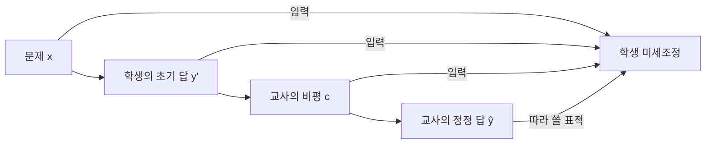
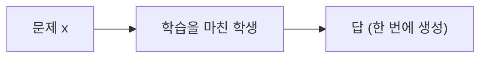
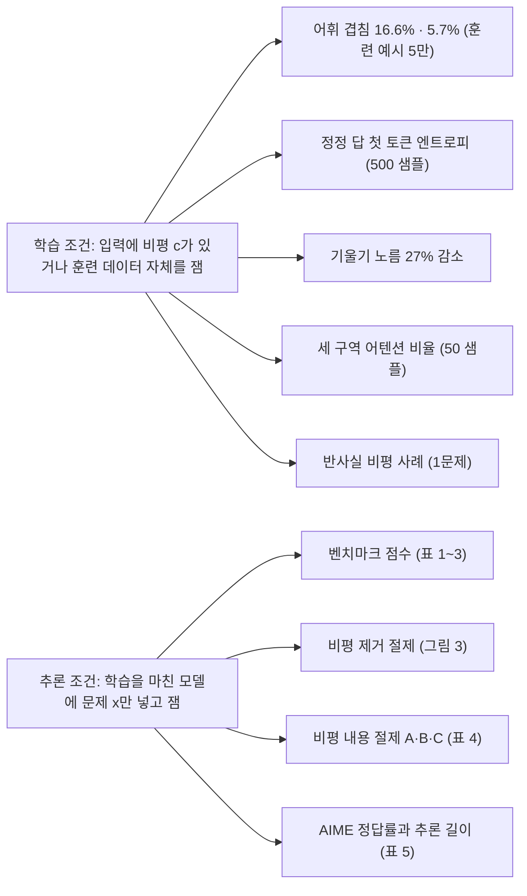

## 오늘의 한 편

오늘 읽은 논문은 Kapusuzoglu, Chakraborty, Sarwar, Lee, Sahu의 "Critique-Guided Distillation for Robust Reasoning via Refinement"예요. [arXiv:2505.11628](https://arxiv.org/abs/2505.11628), ICML 2026(PMLR 306)에 실렸고, 지금 손에 있는 판은 5월 19일에 올라온 v4예요. Capital One과 시카고 대학 사람들이 썼어요. 본문과 부록 A~J를 원문으로 통독했고, 오늘 글의 무게는 대부분 부록 D와 I에 실려 있어요.

출발점은 익숙한 불만이에요. 전문가 시연으로 하는 지도 미세조정(SFT)[^term-sft]은 출력을 흉내 내게 할 뿐, 그 출력을 만든 추론까지 학생 안에 들여놓지는 못한다는 것이죠[^abs]. 그 대안으로 나온 비평 미세조정(CFT)[^term-cft]은 학생에게 비평을 쓰는 법을 가르쳤는데, 저자들은 이 방식이 출력 형식을 흐트러뜨리고 일반 능력을 깎는다고 봐요. CGD는 그 사이에 선을 하나 그어요. 비평을 생성하는 일과 소비하는 일을 떼어 놓고, 학생에게는 비평을 읽고 답을 고치는 일만 시키자는 거예요.

절차는 세 단계예요. 학생이 문제 $$x$$에 초기 답 $$y'$$를 내고, 교사가 그 답에 대한 비평 $$c$$를 쓰고, 다시 교사가 $$x, y', c$$를 모두 보고 정정 답 $$\hat y$$를 써요. $$y'$$는 데이터를 만들 때 문제마다 새로 뽑으니, 비평은 일반적인 풀이 해설이 되지 않고 지금 이 학생이 실제로 저지른 오류에 붙어요[^fresh]. 학습 목표는 표준 언어모델 손실 하나예요.

$$
\mathcal{L}(\theta) = \mathbb{E}_{(x, y', c, \hat y)}\big[-\log S_\theta(\hat y \mid x, y', c)\big]
$$

말로 풀면 이래요. 문제와 자기 초기 답과 비평을 앞에 펼쳐 놓은 학생이, 교사가 쓴 정정 답을 한 토큰씩 따라 쓰도록 배우는 거예요. 그런데 추론 때는 프롬프트 $$x$$만 들어가요. 학생 답도, 비평도 없어요[^s32]. 두 조건을 나란히 놓으면 이렇게 달라요.

**학습 조건** — 입력에 학생 자신의 답과 교사의 비평이 함께 놓여요.

**추론 조건** — 입력은 문제뿐이에요.

비교군은 셋이에요. 정답만 따라 쓰는 SFT, 교사가 $$x$$만 보고 쓴 풀이를 재현하는 Distilled SFT, 학생 답을 보고 비평 자체를 생성하게 하는 CFT. 모두 같은 10만 예시로 1 epoch, 같은 스텝 수만큼 학습했어요[^setup]. 교사·학생 쌍은 LLaMA3.3-70B→LLaMA3.1-8B와 S1.1-32B→S1.1-3B이고, 모델 가족을 건너는 검증으로 Qwen2.5-Math-7B에 Claude Sonnet 3.7이나 S1.1-32B를 교사로 붙였어요.

학습 때만 있고 추론 때는 사라지는 입력.

이 구조에는 오래된 이름이 있어요. Vapnik과 Vashist(2009)가 정식화한 특권 정보 학습[^term-pi]이 바로 학습 때만 주어지고 시험 때는 없는 정보를 다뤄요. 그들이 든 예 가운데 하나가 손글씨 숫자 이미지에 교사가 덧붙인 묘사문이었으니, 교사의 비평은 이 틀에 거의 그대로 들어가요. Lopez-Paz 외(2016, [arXiv:1511.03643](https://arxiv.org/abs/1511.03643))는 이 틀을 Hinton 외(2015, [arXiv:1503.02531](https://arxiv.org/abs/1503.02531))의 지식 증류[^term-kd]와 한 식으로 묶었고, CGD 논문도 Hinton 계보에서 출발점을 잡아요[^hinton]. 다만 CGD 논문은 특권 정보라는 말을 쓰지 않아요. 원문 전체에서 'privileged'도 'Vapnik'도 한 번 나오지 않아요.

저자들이 직접 그리는 이웃 지도는 언어모델 쪽이에요. Self-Refine과 Reflexion은 비평하고 고치는 고리를 추론 때 돌려서 디코딩을 여러 번 하고[^selfrefine], CFT는 비평 생성을 학습으로 옮겼고, ORCA는 맞는 풀이에 대한 교사의 일반 설명을 조건으로 학습해요[^orca]. CGD는 Self-Refine의 고리를 학습 데이터 안으로 접어 넣고, ORCA의 설명을 이 학생의 오류에 대한 진단으로 바꾼 셈이에요. 하나 더 짚어 둘 게 있어요. $$y'$$를 학생이 직접 뽑는다는 점에서 CGD는 학생 자신의 생성 위에서 학습하는 on-policy 증류[^term-onpolicy](논문이 인용하는 GKD, [arXiv:2306.13649](https://arxiv.org/abs/2306.13649))의 성격을 일부 가져와요. 그런데 따라 쓰는 표적 $$\hat y$$는 여전히 교사가 미리 써 둔 고정 텍스트예요. 입력은 on-policy, 표적은 off-policy인 반쪽 구조예요. 뒤에서 볼 반대쪽 보고들이 모두 on-policy 쪽이라는 점과 이어지니 기억해 둘게요.

저자들은 비평을 '학습 전용 비계'라고 불러요[^scaffold]. 비계(scaffolding)는 Wood, Bruner, Ross(1976)가 어른이 아이의 문제 풀이를 거드는 방식을 기술하며 들여온 말이고, 뒤에 인지적 도제 이론(Collins 외, 1989)에서는 도움을 조금씩 걷어 내는 페이딩이 짝으로 붙어요. CGD의 비계는 학습과 추론 사이에서 한 번에 통째로 사라져요. 학습 때 주던 것을 추론 때 빼는 문제는 언어모델에서도 낯설지 않아요. 교사 강요와 노출 편향[^term-exposure]을 다룬 Bengio 외(2015, [arXiv:1506.03099](https://arxiv.org/abs/1506.03099))의 scheduled sampling은 학습 중에 정답 토큰을 모델 자신의 출력으로 조금씩 바꿔 끼우는 해법이었어요. 노출 편향은 모델 자신의 앞선 출력을 다루니 같은 현상은 아니에요. 그래도 사라진 입력의 빈 곳을 모델이 어떻게 메우는지를 학습 목표가 직접 다루지 않는다는 점은 같아요. 이 계보들은 오늘 원문과 대조하지 않은 배경 지식이에요.

오늘 글은 이 구조 하나를 오래 들여다봐요. 저자들은 이 구조가 '내면화'를 낳는다고 말하고, 그 증거로 여러 진단을 내놓아요. 나는 그 진단들이 각각 어느 조건에서 재졌는지를 원문에서 하나씩 확인했어요.

## 왜 골랐나

오늘 고른 경위는 담담하게 적을게요. 계획에서 나온 선택은 아니에요. 직전 세 편, 곧 11-11 KVQuant, 11-09 qMeter, 11-08 DipSVD 글이 남긴 다음 읽을 후보 15편은 아직 한 편도 미러에 들어오지 않았어요. 끌린 이유를 적어 두는 대기열도 비어 있었고, 초점 질문 Q9에 걸어 둔 후보도 이미 다 읽었어요. 미러에 남은 압축·양자화 논문까지 모두 읽은 뒤여서, Q9의 다른 축인 증류로 건너왔어요. 이 논문은 7월 4일에 미러에 들어와 넉 달 넘게 그대로 있었어요.

축은 바뀌었어도 물음은 이어져요. 지난 두 주 동안 양자화 쪽에서 거듭 물은 건, 어떤 눈금이 무엇과 무엇을 견주느냐였어요. 퍼플렉서티가 교사 강요 아래서 무엇을 놓치는지, 열 개 과제의 순위가 서로 합의하는지, 스케일을 어느 축으로 나눠 쓰는지. Q9의 셋째 질문 끝에는 이렇게 적어 두었어요.

> 무엇과 무엇을 견주는지가 눈금의 전부.

오늘은 같은 문장을 증류에 걸어 봐요. 증류에서 학생에게 옮겨 가는 것이 정답의 표면인지, 오류를 알아보고 고치는 판단인지가 Q9 질문 1의 증류판이에요. 그리고 논문이 '판단이 옮겨 갔다'의 근거로 내놓는 눈금들이 그 판정을 얼마나 받치는지가 질문 3의 몫이에요.

## 핵심 세 가지

### 1. 이득은 고르게 퍼지지 않고 경쟁 수준 문제 쪽으로 몰려요

평균부터 보면 결과는 깔끔해요. LLaMA3.1-8B에서 수학 다섯 과제 평균이 기저 41.3에서 CGD 46.9로 올라요. 같은 교사로 학습한 CFT는 41.5, Distilled SFT는 43.7, Wang 외의 GPT-4o 비평 데이터로 학습한 CFT*는 43.5예요[^t1]. 큰 폭은 경쟁 수준 과제에서 나와요. AMC23이 22.5에서 37.5로, OlympiadBench가 14.5에서 23.7로 올라요. 반면 MATH500은 CFT*가 54.8로 CGD의 54.2보다 높고, GSM8K도 CFT* 86.2가 CGD 85.7을 앞서요.

S1.1-3B에서는 MATH500이 54.0에서 61.8로 올라 CFT(49.6)와 12.2점 벌어져요. 그런데 같은 표 안에서 GSM8K는 Distilled SFT 83.1이 CGD 82.5보다 높고, MMLU-Pro는 SFT 36.9가 CGD 35.7보다 높고, 일반 추론 평균도 Distilled SFT 33.5가 CGD 33.4로 근소하게 앞서요. MetaMathQA로 학습한 부록 실험에서도 저자들 스스로, CGD가 MATH500·OlympiadBench에서는 CFT를 넘지만 Minerva-Math와 GSM8K에서는 조금 낮다고 적어요[^metamath].

AMC23의 표본 크기도 짚어 둘게요. 점수가 2.5점 단위로 움직이니 40문항으로 읽히고, 그러면 22.5에서 37.5는 9문항에서 15문항, 여섯 문항 차이예요[^calc-amc]. 방향은 분명하지만 숫자 하나가 지는 무게는 보기보다 가벼워요.

이 분포를 나는 이렇게 읽어요. CGD가 다른 방법보다 앞서는 곳은 여러 단계를 이어 붙여야 하는 경쟁 수학이고, 한두 단계 산수나 지식 위주 과제에서는 정답 따라 쓰기나 교사 풀이 재현과 비슷하거나 조금 못해요. 표를 겹쳐 본 내 해석이고 저자들의 주장은 아니에요. 유보도 하나 붙여요. LLaMA의 GSM8K는 기저가 이미 85.3이라 천장 효과가 섞여요. 부록 I도 GSM8K에서는 세 조건 모두 기저의 천장 근처라 구분할 여지가 없다고 적어요[^ceiling]. 다만 S1.1-3B의 GSM8K 기저는 76.8이라 천장만으로 다 설명되지는 않아요.

일반 능력 쪽 결과도 있어요. 표 2에서 CFT*의 IFEval이 76.9에서 55.6으로 떨어지는 동안 CGD는 76.1에 머물러요[^ifeval]. 코드가 하나도 없는 데이터로 학습했는데 HumanEval은 59.7에서 64.6으로 올랐고요. 여기서도 무엇을 무엇과 견줬는지 볼 대목이 있어요. 표 2의 비교 행은 저자들이 같은 교사로 돌린 CFT가 아니라, 다른 데이터(GPT-4o 비평 5만 개)로 학습한 CFT*예요. 본문 문장은 'CFT의 IFEval'이라 쓰지만 표에 실린 건 별표 붙은 쪽이에요. 비평을 생성하게 하는 목표 자체가 형식을 흐트러뜨린다는 저자들의 결론이 틀렸다는 말은 아니에요. 그 결론을 같은 데이터·같은 교사 조건에서 확인한 행이 표 2에는 없다는 말이에요.

### 2. 비평을 빼거나 바꾸면 성능이 달라져요 — 추론 조건에서 잰 인과

이 논문의 증거 가운데 무게가 실리는 건 절제 실험이에요. 'CGD without Critique'는 같은 프롬프트, 같은 정정 답 표적을 두고 비평만 학습 입력에서 뺀 조건이에요[^s44]. 이렇게 하면 성능이 크게 떨어져요. 그림 3에서 LLaMA의 AMC23은 CGD가 비평 없는 판보다 상대 114% 높아요[^fig3]. 비평 없는 판의 점수가 CGD의 절반에도 못 미친다는 뜻이에요. 똑같은 정정 답을 따라 썼는데도요. 저자들은 이 차이를, 교사가 맞는 풀이에 붙이는 일반 설명을 증류하는 ORCA류와 CGD가 갈라지는 지점으로 읽어요.

표 4는 한 걸음 더 들어가요. 약 1만 문제 부분집합에서 학생 답과 정정 답 표적을 고정하고 비평 텍스트만 바꿔 세 seed로 학습했어요. A는 그 학생 답의 오류를 정확히 짚은 비평, B는 다른 문제에서 가져온 진짜 비평(구체적이지만 무관), C는 고정된 일반 문자열이에요[^condC].

| 비평 내용 | MATH500 | AMC23 | AIME24 |
|---|---|---|---|
| A 구체·관련 | 55.5 ± 0.6 | 31.7 ± 1.4 | 12.2 ± 1.9 |
| B 구체·무관 | 53.3 ± 0.5 | 18.3 ± 1.7 | 6.7 ± 0.0 |
| C 일반 문자열 | 54.0 ± 0.4 | 26.7 ± 1.4 | 7.8 ± 1.9 |

순서는 $$A > C > B$$예요. 저자들은 이걸 학생이 학습 중에 비평 내용을 읽고 내면화한다는 증거로 읽어요[^t4]. 내 눈이 머문 건 B가 C보다 낮다는 쪽이에요. 아무 정보도 없는 자리표시자보다, 그럴듯하지만 엉뚱한 비평이 학습을 더 망쳐요[^contradict].

다만 세 과제에서 이 순서의 선명도는 같지 않아요. AMC23에서 C와 B의 차이 8.4점은 40문항으로 치면 세 문항 남짓이고 표준편차보다 한참 커요. AIME24에서는 7.8 대 6.7인데, 30문항으로 환산하면 평균 3분의 1문항 차이라 C의 표준편차 1.9 안에 들어가요[^calc-t4]. MATH500의 0.7점 차이도 표준편차와 비슷한 크기고요. 그러니 'B가 C보다 나쁘다'를 분명히 받치는 건 AMC23 한 열이에요.

그림 4의 혼합 실험(2만 5천 예시)도 같은 계열이에요. 정답과 오답 학생 답을 반반 섞으면 평균 39.9, 정답만이면 38.6, 오답만이면 36.8이었어요. 저자들도 50/50이 보편적 최적이라는 게 요지는 아니고, 양 끝 어느 쪽도 충분하지 않다는 게 요지라고 적어요[^mix].

여기까지의 증거에는 공통점이 있어요. 학습 데이터를 바꾸고, 학습된 모델은 문제 $$x$$만 받는 추론 조건에서 쟀어요. 그래서 이 증거들은 "비평의 존재와 내용이 학습을 바꾸고, 그 변화가 비평 없는 추론 성능에 드러난다"는 인과 주장을 제 조건에서 받쳐요.

### 3. '내면화'의 눈금들은 대부분 비평이 입력에 있는 조건에서 재졌어요

이제 저자들이 '외우지 않고 내면화했다'의 근거로 드는 진단들로 가 볼게요. §4.5와 부록 D에 다섯 가지가 있어요. 오늘 원문에서 각각이 재진 조건을 확인해 보니 지도가 이렇게 그려져요.

왼쪽 다섯 개가 모두 한쪽 가지에 달려 있어요.

첫째는 어휘 겹침이에요. 본문은 비평과 정정 답 사이의 어휘 겹침을 훈련 예시 5만 개에서 쟀다고 써요[^s45]. 토큰 겹침 16.6%, 바이그램 겹침 5.7%이고, 저자들은 이 간극을 근거로 모델이 비평 문장을 베끼지 않고 자기 방식으로 풀이를 짠다고 결론 내려요. 부록 D.7은 이 비교를 "교사의 비평과 학생의 정정 답" 사이라고 적는데, 대상은 WebInstruct 훈련 예시 5만 개예요[^d7]. 그런데 훈련 데이터의 정정 답은 정의상 교사가 쓴 $$\hat y$$예요. 손실도 교사의 정정 답에 대한 음의 로그우도로 정의돼요[^s32b]. 그렇다면 이 겹침은 학생 모델의 출력과 무관하게, 교사의 비평과 교사의 정정 답 사이를 잰 것일 수 있어요. 학습을 마친 학생이 훈련 프롬프트에 대해 따로 생성한 답을 썼을 가능성도 문장만으로는 배제할 수 없어서, 원문만으로는 어느 쪽인지 확정하지 못했어요.

그 모호함이 곧 문제예요. 무엇과 무엇을 견줬는지 알 수 없는 눈금은 판정의 근거로 쓰기 어려워요.

어느 쪽이든 남는 문제가 하나 더 있어요. 낮은 바이그램 겹침은 '문장을 베끼지 않았다'는 보여 줄 수 있어도 '이해했다'까지 보여 주지는 못해요. 같은 내용을 다른 말로 옮겨 쓰는 일은 이해 없이도 일어나요. 부록 F의 훈련 예시 하나를 보면 사정이 한 겹 더 얽혀요. 비평 생성 프롬프트는 교사에게 전체 답을 직접 주지 말라고 지시하는데[^promptE], 질화물 음이온 예시의 비평에는 고친 계산과 최종 값 $$5.605 \times 10^{-3}$$ kg이 이미 다 들어 있어요. 예시 하나로 일반화할 수는 없어요. 다만 비평이 정답을 품는 비율이 높다면, '비평이 있을 때 정정 답을 더 잘 예측한다'는 관찰의 상당 부분은 답이 비평에 새어 들어간 것으로도 설명돼요.

둘째는 엔트로피예요. 부록 D.1은 OpenMathInstruct-2에서 뽑은 500 샘플에 (프롬프트 + 학생 답 + 비평) 전체 맥락을 넣고, 정정 답 첫 토큰의 엔트로피[^term-entropy]를 쟀어요[^d1]. CGD 6.44, Distilled SFT 6.49, 기저 6.56, SFT 6.62예요. 유의확률은 0.001 미만이지만 CGD와 Distilled SFT의 차이는 0.05예요. 더 근본적인 건 조건 쪽이에요. 이 입력 형식으로 학습된 모델은 CGD 하나뿐이고 나머지 셋은 이런 형식을 본 적이 없어요. 자기가 학습한 형식에서 첫 토큰을 더 확신하는 건 자연스러운 일이고, 그 확신이 비평 없는 추론 때 무엇으로 남는지는 이 수치가 말해 주지 않아요.

셋째는 기울기 노름[^term-grad]이에요. 학습을 마친 CGD 모델에 비평을 넣으면 평균 1802.7, 빼면 2446.9로 27% 작아져요. 표준편차는 각각 1765.5와 2011.9로 평균과 맞먹는 크기예요[^t14]. 메커니즘은 저자들이 부록에 직접 적어 두었어요. 비평이 있으면 손실이 줄고, 그래서 기울기 크기도 준다는 거예요[^gradmech]. 정답에 관한 정보를 입력에 더 얹으면 손실이 주는 건 거의 정의에서 따라 나오는 일이라, 나는 이 수치를 '내면화'의 증거로 세우기 어렵다고 봐요. 부록 C.1은 여기서 더 나아가 CGD 학습 중 기울기 노름의 변동이 증류 비교군보다 작았다고 쓰는데[^c1], 오늘 읽은 D.1에는 같은 CGD 모델의 비평 있음·없음 비교(표 14)만 있고 증류 비교군과 견준 표는 찾지 못했어요.

넷째는 어텐션이에요. 부록 D.3은 50 샘플에서 생성 중 각 토큰의 어텐션이 프롬프트의 문제·학생 답·비평 세 구역에 어떻게 나뉘는지 봤어요[^d3]. 첫 생성 단계에서 비평에 48.1%, 학생 답에 36.0%가 가고, 마지막 층으로 갈수록 문제 쪽이 90% 넘게 차지해요. 저자들은 이를 '계획한 뒤 실행하는' 흐름으로 읽어요. 그런데 이것도 비평이 입력에 있어야만 잴 수 있는 눈금이에요. 실제 추론 때는 비평이 없으니, 이 그림이 보여 주는 건 비평이 주어졌을 때 모델이 그것을 어떻게 쓰느냐까지예요. 부록 C.3은 CGD 모델이 비교군보다 초기 층에서 문제 구조에 어텐션을 더 준다고 쓰지만[^c3], 그림 8~10은 CGD 모델 하나만 그려요.

다섯째는 반사실 비평이에요. 부록 D.5는 한 문제(샘플 #42, 정답 2310)에 원래 비평과 무의미한 비평을 각각 넣었을 때 기저 모델은 끌려가 틀리고 CGD는 무시하고 맞혔다는 정성 사례를 보여 줘요[^d5]. 문제는 하나뿐이고, 여기서도 비평을 입력으로 준 조건이에요. 게다가 기저 모델은 비평을 입력으로 받는 형식을 학습한 적이 없고 CGD는 학습했으니, 이 대조에는 형식에 대한 친숙도도 섞여 들어요.

판정은 이렇게 갈라져요. "비평의 내용이 학습을 바꾸고 그 변화가 추론 성능으로 나타난다"는 인과 주장은 추론 조건의 증거(그림 3, 표 4)로 서요. "학생이 비평을 외우지 않고 오류를 고치는 판단으로 내면화했다"는 메커니즘 주장은 학습 조건의 눈금에 기대요. 부록 I는 비평 없음·잡음·일반·무관·구체의 다섯 조건에 걸쳐 품질과 성능의 관계가 확립됐다고 정리하는데[^five], 그 다섯 조건은 실제로는 서로 다른 실험에서 왔어요. 비평 없음은 10만 예시 학습(그림 3), 잡음은 한 문제의 추론 시 입력(D.5), 나머지 셋은 1만 예시 학습(표 4)이에요. 하나의 사슬로 이어 놓기엔 재진 조건이 제각각이에요.

실험심리에는 이 갈림에 딱 맞는 오래된 구분이 있어요. 처치가 실제로 걸렸는지 확인하는 조작 점검과, 처치가 관심 결과를 바꿨는지 보는 결과 측정이에요. 비평이 있을 때 모델이 비평을 쓴다는 걸 보여 주는 어텐션·엔트로피·기울기 노름은 조작 점검에 가까워요. 조작 점검이 통과해도 결과 측정을 대신하지는 못해요. 이것도 출처를 대조하지 않은 배경 지식이에요.

그러나 내가 그은 선이 너무 깔끔할 수도 있어요. 표 4의 설계를 다시 보면, 학생 답과 정정 답 표적은 세 조건에서 같고 바뀐 건 비평 텍스트뿐이에요. 추론 때는 비평이 없으니, A·B·C의 성능 차이는 비평 내용이 같은 표적의 학습 방식을 바꿔 가중치에 남긴 흔적에서 올 수밖에 없어요. '비평 내용에 따라 서로 다른 무언가가 가중치에 남는다'는 약한 뜻의 내면화는 이미 추론 조건에서 성립하는 셈이에요. 게다가 앞에서 내가 든 답 누출 해석은 표 4와 잘 맞지 않아요. 비평이 정답을 많이 품을수록 학습 때 정정 답은 맥락만으로 쉽게 예측되고, 그러면 문제만 보고 답을 내는 경로가 떠안을 학습 신호는 오히려 줄 것 같거든요. 실제로는 가장 구체적인 A가 추론 때 가장 좋았어요. 손실 크기만 따진 단순한 추론이라 확신할 수는 없지만, 누출 하나로 표 4를 다 설명하기는 어렵다는 쪽으로 기울어요. 그러니 열려 있는 물음은 흔적의 유무보다 그 정체예요. 오류를 고치는 판단인지, 교사 풀이의 짜임인지.

추론 길이 4.4배가 그 정체를 가늠할 단서인데, 이것도 두 갈래로 읽혀요. AIME 2024 30문항에서 greedy 정답률이 3.3%에서 16.7%로, 곧 1문항에서 5문항으로 늘고, 평균 추론 길이는 477단어에서 2110단어로, 단계 수는 16.4에서 49.5로 늘어요[^t16]. 저자들은 이를 더 철저한 내부 탐색의 표지로 읽어요[^c3search]. 하지만 교사가 쓴 길고 단계가 또렷한 정정 답의 문체를 옮겨 받은 결과로도 같은 숫자가 나와요. 실제로 정정 답 생성 프롬프트(부록 E.2)는 교사에게 명확한 단계별 추론을 보이라고 적어 두었어요[^e2]. Distilled SFT 쪽 교사 프롬프트는 부록에 실려 있지 않아서, 두 표적의 길이가 애초에 얼마나 달랐는지도 알 수 없어요. Distilled SFT도 교사의 풀이를 따라 썼으니 길이가 늘었을 법한데, 표 5는 기저와 CGD만 견주고 Distilled SFT의 길이는 보고하지 않아요. 길이를 맞춘 비교가 없으니 두 해석을 가를 수 없어요.

Pass@k[^term-passk]도 같은 쪽을 가리켜요. Pass@8은 18.9에서 23.3, Pass@16은 26.7에서 34.4로 오르지만 Pass@32는 36.7 대 37.8로 거의 붙어요[^t16]. 저자들은 적게 뽑을 때 이득이 크다는 점을 '탐색에 기대지 않는 추론의 질'로 읽어요. 같은 표는 이렇게도 읽혀요. 충분히 많이 뽑으면 기저 모델도 닿는 문제들에 CGD가 확률을 모아 준 것이고, 닿을 수 있는 문제의 범위 자체를 넓혔다는 증거는 아직 없다고요. 두 해석은 서로를 배제하지 않고, 30문항에서 1.1점은 3분의 1문항이에요. RL과의 비교도 같은 쪽으로 기울어요. SimpleRL-Zero가 H100 1,152시간을 쓴 데 비해 CGD는 A100 약 48시간이고, Qwen2.5-Math-7B 평균은 50.4 대 48.9로 CGD가 높아요. 그런데 AIME24만 보면 RL 33.3%, CGD 20.0%예요. 저자들 스스로 같은 저울에 올린 비교가 아니라고 강조해요[^rl].

## 내 연구에 어떻게 맞물리나

Q9를 연 [08-29 글](https://pheeree.github.io/2026/08/29/recursive-reasoner-compression-edge/)에서는 압축 네 종류가, 그중 하나가 지식 증류였는데, 모두 칸 정확도는 50~87%로 남기고 퍼즐 완전일치는 0~5%로 무너뜨렸어요. 그 논문의 결론 문장은 이랬어요.

> Student models learn token-level patterns but fail entirely at puzzle-level reasoning.

CGD는 그 맞은편에 놓을 수 있는 시도예요. 정답만 따라 쓰게 하는 대신 학생 자신의 틀린 시도와 그 오류에 대한 진단을 함께 보여 줘서, 국소적인 토큰 패턴 너머의 판단을 옮기려는 설계예요. 핵심 1에서 본 이득의 분포, 곧 여러 단계를 이어야 하는 과제에 몰린다는 점은 그 시도가 어느 정도 통했다는 신호로 읽을 수 있어요. 다만 이건 내 해석이고, 핵심 3에서 봤듯 '무엇이 옮겨 갔나'를 직접 재는 눈금은 아직 비평이 놓인 조건에 머물러 있어요. 그래서 Q9 질문 1에 대한 오늘의 답은 유보가 붙은 모양이에요. 전역적인 무언가가 옮겨 갔다는 건 표 4가 받쳐요. 그러나 그게 오류를 고치는 판단인지, 길고 구조 있는 풀이 문체인지는 이 논문의 눈금으로 가를 수 없어요.

우리 쪽에도 음의 데이터점이 하나 있어요. 다중 에이전트 시스템의 실패 모드 판정을 다른 모델로 재현해 본 실험에서, 강한 교사의 판정을 프롬프트 수준으로 옮겼더니 판정자 일치 $$\kappa$$[^term-kappa]가 0.056에 그쳤어요. 원 판정자는 0.77, 사람 사이 일치는 0.88이었고요. 내 노트에는 개별 판정은 그럴듯한데 판단의 짜임이 통째로 달랐다고 적혀 있어요. 오늘 이 실험을 CGD 옆에 놓으니 하나가 새로 보여요. 그 실험에서 약한 모델이 맡은 일은 다른 에이전트의 출력을 두고 실패 모드를 판정하는 일, 곧 비평을 쓰는 일이었어요. CGD의 구분으로 치면 CFT의 위치예요. 우리는 비평을 생성하는 쪽으로 판단을 옮기려 했고, CGD는 비평을 받아 고치는 쪽으로 옮겨요. 다만 우리 실험은 미세조정 없는 프롬프트 수준이었으니 둘을 같은 저울에 올릴 수는 없어요. 그리고 CGD 스스로 한계 절에서, 오류가 명확히 진단되는 수학·구조적 추론만 평가했다고 적어요[^lim]. 실패 모드 판정은 오류의 진단 자체가 다툼의 대상인 영역이라, CGD의 결과가 그대로 건너오리라 기대하기는 어려워요.

판단을 약한 모델에게 넘기는 준비 작업에서 정리해 둔 독해도 여기 닿아요. 앵커 없이는, 그리고 판정자 품질의 하한 아래에서는 판단이 이식되지 않는다는 것. 그래서 판단을 기준과 앵커로 굳혀 약한 엔진이 이어받게 하고, 실전 시범으로 확인하기로 했어요. 그 노트의 방향 의견에는, 진짜 교사는 사용자의 교정이고 교대 첫 주에 교정이 잦은 건 실패가 아니라 설계대로라는 문장이 있어요. CGD의 비평이 학생 고유의 오류에 맞춘 교정이라는 점에서 이 문장과 CGD의 설계는 같은 직관을 나눠 가져요. 표 4의 B를 우리 말로 옮기면 '엉뚱한 앵커는 앵커 없음보다 나쁘다'예요. 이건 유비일 뿐 증명은 아니에요. 우리 쪽 근거도 아직 얇아요. 교대 리허설은 판정 일치 1/1이었고 앵커 없는 판단은 시험하지 않았어요. 의제 수확에서 예비 판정과 확정 판정이 일치한 비율은 첫 표에서 2/6이었고요.

그러나 B 조건의 결과를 일반 원리로 올리기 전에 반대쪽 보고를 봐야 해요. 초록 수준으로만 본 두 논문이 있어요. "Rethinking Privileged Information in OPSD"([arXiv:2608.18271](https://arxiv.org/abs/2608.18271))는 Qwen3 1.7B~8B의 on-policy 자기증류에서 정답 reference가 일관된 이득을 주지 않았고, 다른 문제의 풀이가 여러 수학 벤치마크에서 정답 풀이보다 나은 경우도 있었다고 보고해요. 학생의 예측은 reference보다 베이스 모델 자신의 추론 습관에 정렬됐다고요. "What Does Privileged Information Add…"([arXiv:2609.20612](https://arxiv.org/abs/2609.20612))는 이득 대부분이 reference 없는 증류 자체에서 오고, thinking 모드 롤아웃에서는 이득이 손실로 뒤집힌다고 해요. CGD에서는 다른 문제의 비평(B)이 해를 끼쳤고, 저쪽에서는 다른 문제의 풀이가 해가 없거나 오히려 도움이 됐어요. 방향이 엇갈려요. 앞에서 본 대로 CGD는 표적이 교사의 고정 텍스트인 반쪽 on-policy 구조이니 그 차이일 수도 있고, 비평과 풀이라는 정보 형태의 차이일 수도 있고, 모델 규모일 수도 있어요. 지금 손에 있는 자료로는 가를 수 없어서 열어 둬요.

CGD와 같은 방향의 사례도 있어요. OPCD([arXiv:2606.00424](https://arxiv.org/abs/2606.00424))는 약한 비평자의 비평을 본 자기 교사와 비평 없는 학생 사이를 토큰 KL로 맞추는 on-policy 방식인데, 추론 때 비평이 없다는 점이 CGD와 같고 비평 품질이 이득을 좌우한다고 보고해요. SDFT([arXiv:2601.19897](https://arxiv.org/abs/2601.19897))는 시연을 맥락으로 받은 같은 모델을 교사로, 맥락 없는 모델을 학생으로 두는데, 학습 전용 맥락을 추론 때 빼는 구조가 CGD와 같고 SFT보다 망각이 적었다고 해요. 둘 다 초록·검색 요약 수준이에요.

자기교정 문헌과의 관계도 적어 둘게요. Huang 외([arXiv:2310.01798](https://arxiv.org/abs/2310.01798))는 외부 피드백 없는 내재적 자기교정이 오히려 성능을 깎는다고 보고했고, SCoRe([arXiv:2409.12917](https://arxiv.org/abs/2409.12917))는 오프라인 교정 흔적으로 하는 SFT가 분포 불일치와 행동 붕괴 때문에 자기교정을 배우지 못한다고 봤어요. CGD의 비평은 정답을 아는 교사의 외부 신호이니 Huang 외와 직접 부딪히지는 않아요. $$y'$$를 학생이 직접 내게 해서 SCoRe가 짚은 분포 불일치도 일부 줄여요. 그런데 CGD가 자기 결과를 '내면화된 자기교정'이라 부르는 순간 두 논문이 던진 물음을 함께 받아요. 추론 때 CGD 모델은 실제로 제 답을 고치는가, 아니면 처음부터 더 긴 풀이를 쓰는가. 논문은 이것을 직접 재지 않았어요. 여기에 Li 외([arXiv:2502.07374](https://arxiv.org/abs/2502.07374))의 결과, 곧 정답이 틀린 긴 풀이로 학습해도 정확도가 3.2%만 떨어지고 단계를 섞으면 크게 떨어진다는 '내용보다 구조'의 관찰과, Mimicry or Mastery([arXiv:2601.05019](https://arxiv.org/abs/2601.05019))의 '장황함은 베끼되 난이도에 따른 자원 배분은 옮기지 못한다'는 관찰을 놓으면, 4.4배의 길이를 문체의 이식으로 읽는 쪽에 무게가 실려요. 이 둘도 초록·요약 수준으로만 봤어요.

## 편집자에게 (pheeree)

오늘 원문에서 확인된 것과 남은 것을 나눠 적어요.

확인된 건, 비평의 존재와 내용이 학습을 바꾸고 그 결과가 비평 없는 추론 성능에 나타난다는 것이에요(그림 3, 표 4). 다만 '구체적이지만 무관한 비평이 일반 문자열보다 나쁘다'를 선명하게 받치는 건 AMC23 한 열이에요. 확인되지 않은 건 그 변화가 '오류를 고치는 판단의 내면화'라는 해석이에요. 그 해석을 받치는 진단들은 비평이 입력에 놓인 조건이거나 훈련 데이터 자체를 쟀어요. 어휘 겹침이 교사와 교사 사이인지 학생과 교사 사이인지는 원문으로 확정할 수 없었어요.

잴 수 있는 실험으로는 이런 것들이 떠올라요.

- **추론 조건의 내면화 눈금.** 기저 학생이 틀렸고 교사 비평이 그 오류를 짚은 문제들만 모아, CGD 모델이 비평 없이 생성한 답에서 그 특정 오류가 사라졌는지 세는 실험이에요. Distilled SFT 모델을 같은 방식으로 세면 대조군이 돼요. 어휘 겹침을 쓰려면 비평 없이 생성한 학생 답과 그 문제의 교사 비평 사이에서 재야 해요.
- **길이를 맞춘 비교.** CGD와 Distilled SFT의 AIME 풀이 길이를 함께 보고, 길이 구간을 맞춘 부분집합에서 정답률을 견주는 거예요. 길이를 통제한 뒤에도 CGD가 앞서면 문체 이식 해석은 힘을 잃어요.
- **표 4에 조건 둘 추가.** 비평 자리에 '이 문제의 정답 풀이'와 '다른 문제의 정답 풀이'를 넣어 보는 거예요. 특권 정보 회의론 논문들과 직접 대질되고, 비평이라는 형식의 몫과 정답 정보의 몫이 갈려요. 부록 F에서 본 답 누출 문제도 이 대조에서 크기가 드러나요.
- **비계를 조금씩 걷기.** 학습 후반으로 갈수록 비평을 뺀 예시의 비율을 늘려 가는 일정이에요. scheduled sampling의 비평판인 셈이에요. 학습과 추론 사이의 급한 단절이 이득을 깎고 있었다면 경쟁 수준 과제 점수가 더 오를 테고, 변화가 없다면 비평의 몫은 이미 같은 표적을 배우는 방식 안에 다 들어가 있다고 볼 수 있어요.
- **우리 판정 이식에 교정 예시를 앵커로.** 약한 모델이 실제로 틀린 판정 몇 건과 그에 대한 강한 판정자의 교정을 앵커로 넣었을 때 $$\kappa$$ 0.056이 움직이는지 보는 실험이에요. 무관한 사례의 교정을 넣는 대조군을 함께 두면, 표 4의 B와 같은 모양이 우리 쪽에서도 나오는지 볼 수 있어요.

우리 사이에 걸린 질문도 하나 있어요. 판단을 약한 모델에게 넘길 때 기본값을 어느 쪽에 둘지예요. 지금 흐름은 약한 모델에게 판정(비평)을 쓰게 하고 그것을 사용자가 교정하는 방식인데, CGD의 구분으로 보면 비평 생성 쪽이에요. 반대로 강한 판정자가 약한 모델의 출력에 비평을 주고, 약한 모델은 그걸 받아 고친 결과를 쌓아 가는 방식도 가능해요. 두 방식은 교정 비용도 다르고 옮겨 가는 것도 다를 거예요. 어느 쪽을 먼저 시험할지 정해 주시면 그 형식으로 다음 실험을 꾸릴게요.

### 다음 읽을 후보

다섯 편 모두 오늘 기준으로는 미러에 들어와 있지 않고, 아래 설명은 초록과 검색 요약에서 옮긴 정도예요.

- **Weak Critics Make Strong Learners: OPCD ([arXiv:2606.00424](https://arxiv.org/abs/2606.00424))** — 학습 때만 비평이 있고 추론 때는 없다는 구조가 CGD와 같으면서, SFT 대신 on-policy 분포 매칭을 써요. 비평 품질이 이득을 좌우한다는 보고를 원문 수치로 확인하면, 표 4의 $$A > C > B$$가 학습 방식을 바꿔도 유지되는지 볼 수 있어요.
- **Rethinking Privileged Information in OPSD ([arXiv:2608.18271](https://arxiv.org/abs/2608.18271))** — 다른 문제의 풀이가 정답 풀이보다 낫기도 했다는 보고가 CGD의 B 조건과 방향이 엇갈려요. 어떤 벤치마크에서 몇 점 차이였는지, 학생 규모별로 어떻게 달랐는지를 원문 표로 확인해야 이 엇갈림을 다룰 수 있어요.
- **What Does Privileged Information Add… ([arXiv:2609.20612](https://arxiv.org/abs/2609.20612))** — 이득을 reference 없는 증류의 몫과 reference의 몫으로 나눈 연구예요. thinking 모드 롤아웃에서 이득이 손실로 뒤집혔다는 대목은, 긴 풀이를 쓰도록 바뀐 CGD 학생에게도 같은 일이 생기는지 묻게 해요.
- **Hán Dān Xué Bù (Mimicry) or Qīng Chū Yú Lán (Mastery)? ([arXiv:2601.05019](https://arxiv.org/abs/2601.05019))** — 교사의 난이도 대응이 학생에게서 무너진다(정렬 0.64→0.34)는 관찰이 4.4배 길이를 읽는 데 바로 쓰여요. 길이가 문제 난이도에 따라 달라지는지를 재는 방법을 빌려 오면, CGD의 긴 풀이가 판단인지 문체인지 가르는 눈금이 될 수 있어요.
- **Critique Fine-Tuning ([arXiv:2501.17703](https://arxiv.org/abs/2501.17703))** — 오늘의 비교군 원 논문이에요. 표 2의 CFT*가 정확히 어떤 데이터로 학습됐는지, 그리고 GPT-4o 비평에 오류가 섞여 있다는 저자들 스스로의 한계 서술을 확인하고 싶어요.

**발행 전 점검:** 중심 논문은 원문 PDF로 본문 9쪽과 부록 A~F를 읽었어요. 중심 논문에 기댄 각주의 영어 인용 34건은 PDF 추출 텍스트와 기계로 대조해 모두 글자 그대로 맞아요(✓). 본문에 쓴 표 1·2·3·4·5·14·15·16과 그림 3·4의 수치도 원문 표에서 확인했어요(✓). AMC23 40문항 환산(9→15문항), 표 4의 C−B 차이 8.4점과 AIME 3분의 1문항, 기울기 노름 27%는 원표 값으로 다시 계산한 거예요(✓, 내 계산). 원문에 'privileged'와 'Vapnik'이 한 번도 나오지 않는다는 문장도 추출 텍스트 전체에서 세어 확인했어요(✓). 작은 표류가 하나 있어요. 엔트로피 단락에서 6.56을 '기저'라고 불렀는데, 표 15의 행 이름은 'Baseline SFT'예요(⚠ 표기). 부록 D.7의 어휘 겹침이 교사의 정정 답을 잰 것일 수 있다는 읽기, 그리고 이득이 경쟁 수준 과제로 몰린다는 읽기는 원문 문장과 표를 겹친 내 해석이고, 본문에도 해석으로 적었어요(⚠ 해석). OPCD·VPD·두 편의 특권 정보 회의론·Mimicry or Mastery·ReDiST·Huang 외·SCoRe·Li 외·Gudibande 외·SDFT·CFT 원 논문의 서술은 탐구 에이전트의 초록·검색 요약 수준이라 ✓(provisional)이에요. 이것들은 본문 논증의 전제가 아니라 같은 방향이나 반대 방향의 사례로만 썼어요. 우리 쪽 $$\kappa$$ 0.056·0.77·0.88과 08-29 글의 50~87%·0~5%는 내 노트와 지난 글의 2차 기록이에요(✓ provisional). Vapnik과 Vashist의 손글씨 숫자 예, Lopez-Paz 외의 일반화 증류, Wood·Bruner·Ross의 비계, Collins 외의 인지적 도제, 교사 강요와 노출 편향의 계보는 출처 대조 없이 적은 배경 지식이에요(?).

[^term-sft]: 용어 — 지도 미세조정(SFT, supervised fine-tuning): 사전학습된 모델을 입력-정답 쌍으로 더 학습시켜 정답을 그대로 생성하게 하는 방식.
[^term-cft]: 용어 — 비평 미세조정(CFT, critique fine-tuning): 문제와 답을 입력으로 주고, 그 답에 대한 비평을 생성하도록 학습시키는 방식. Wang 외(2025)가 제안했어요.
[^term-kd]: 용어 — 지식 증류(knowledge distillation): 큰 교사 모델의 출력(확률 분포나 생성한 풀이)을 표적 삼아 작은 학생 모델을 학습시켜 능력을 옮기는 방법.
[^term-entropy]: 용어 — 엔트로피: 다음 토큰 확률 분포가 얼마나 퍼져 있는지 재는 양. 낮을수록 모델이 한 토큰에 확률을 몰아 준다는, 곧 더 확신한다는 뜻이에요.
[^term-grad]: 용어 — 기울기 노름(gradient norm): 손실을 파라미터로 미분한 벡터의 크기. 한 예시가 파라미터를 얼마나 크게 움직이려 하는지를 나타내고, 손실이 작으면 대개 함께 작아져요.
[^term-passk]: 용어 — Pass@k: 한 문제에 답을 k번 뽑았을 때 그중 하나라도 맞으면 맞힌 것으로 치는 정답률. k가 커질수록 모델이 '닿을 수 있는' 문제의 범위를 반영해요.
[^term-kappa]: 용어 — 판정자 일치 $$\kappa$$(카파): 두 판정자의 일치율에서 우연히 일치할 몫을 뺀 지표. 0이면 우연 수준, 1이면 완전 일치예요.
[^term-onpolicy]: 용어 — on-policy 증류: 학생이 스스로 생성한 출력 위에서 교사의 분포와 맞추도록 학습하는 증류. 교사가 미리 만들어 둔 출력만 따라 쓰는 방식(off-policy)과 대비돼요.
[^term-pi]: 용어 — 특권 정보(privileged information) 학습, LUPI: 학습 때만 주어지고 시험 때는 없는 추가 정보를 써서 학습을 돕는 틀. Vapnik과 Vashist(2009)가 정식화했어요.
[^term-exposure]: 용어 — 노출 편향(exposure bias): 학습 때는 정답 토큰을 다음 입력으로 넣어 주다가(교사 강요) 추론 때는 모델 자신의 출력을 넣게 되면서 생기는 학습·추론 조건의 어긋남.
[^abs]: "Supervised fine-tuning with expert demonstrations often produces models that imitate outputs without internalizing the reasoning processes needed for robust generalization." — Kapusuzoglu et al. (2026), Abstract.
[^fresh]: "Importantly, the student answer y′ is sampled fresh for each prompt during data generation, so critiques address the specific errors made by the current student model checkpoint, not generic problem solutions." — Kapusuzoglu et al. (2026), §3.1.
[^s32]: "Specifically, the model receives only the prompt, no student answer or critique." — Kapusuzoglu et al. (2026), §3.2.
[^setup]: "All methods are trained for exactly 1 epoch on identical 100K-example datasets with a global batch size of 64, yielding the same number of optimization steps across all methods." — Kapusuzoglu et al. (2026), §4.1.2.
[^hinton]: "Knowledge distillation transfers capabilities from large teachers to smaller students (Hinton et al., 2015)." — Kapusuzoglu et al. (2026), §2.
[^selfrefine]: "Self-Refine (Madaan et al., 2023) and Reflexion (Shinn et al., 2023) implement critique-and-revise loops at inference time, incurring multiple decoding passes." — Kapusuzoglu et al. (2026), §2.
[^orca]: "ORCA conditions training on generic teacher explanations of correct solutions; CGD conditions on critiques of the student’s specific errors." — Kapusuzoglu et al. (2026), §4.4.
[^scaffold]: "critiques function as a training-only optimization scaffold" — Kapusuzoglu et al. (2026), §4.4.
[^t1]: Kapusuzoglu et al. (2026), Table 1. CFT*는 Wang et al. (2025b)의 GPT-4o 데이터 5만 개로 학습한 판이에요.
[^metamath]: "yet shows slightly lower performance on Minerva-Math and GSM8K" — Kapusuzoglu et al. (2026), Appendix B.1.1, Table 9.
[^calc-amc]: 내 계산 — 22.5% × 40 = 9, 37.5% × 40 = 15. 문항 수 40은 원문에 적혀 있지 않고, 점수가 2.5점 단위라는 데서 추정했어요.
[^ceiling]: "All three conditions perform near the base model’s ceiling (85.3%), leaving no room for differentiation on this easier benchmark." — Kapusuzoglu et al. (2026), Appendix I.
[^ifeval]: "By contrast, CFT’s IFEval accuracy drops from 76.9% to 55.6%." — Kapusuzoglu et al. (2026), §4.2. 표 2에서 55.6이 실린 행은 GPT-4o 데이터로 학습한 CFT*예요.
[^s44]: "Both models see identical input prompts and refined answers." — Kapusuzoglu et al. (2026), §4.4.
[^fig3]: "Removing critiques from training significantly degrades performance, with relative drops of up to 114% on AMC23." — Kapusuzoglu et al. (2026), Figure 3 캡션.
[^condC]: "A fixed string: “The answer is incorrect. Please review and provide a corrected solution.”" — Kapusuzoglu et al. (2026), Appendix I (조건 C). 표 값은 Table 4.
[^t4]: "The ordering A > C > B demonstrates that the student reads and internalizes critique content during training rather than treating it as inert context." — Kapusuzoglu et al. (2026), §4.4.
[^contradict]: "When critique content systematically contradicts the problem, it degrades learning beyond what a content-free placeholder causes." — Kapusuzoglu et al. (2026), Appendix I.
[^calc-t4]: 내 계산 — AMC23은 (26.7 − 18.3)% × 40 ≈ 3.4문항, AIME24는 (7.8 − 6.7)% × 30 ≈ 0.33문항. AIME24의 30문항은 원문 Appendix D.4.1("all 30 AIME 2024 problems"), AMC23의 40문항은 앞의 추정이에요.
[^mix]: "The key finding is not that 50/50 is universally optimal, but that neither extreme is sufficient" — Kapusuzoglu et al. (2026), Appendix B.1.4, Figure 4.
[^s45]: "measuring lexical overlap between critiques and refined answers on 50K training examples" — Kapusuzoglu et al. (2026), §4.5.
[^d7]: "We analyzed 50,000 training examples from the WebInstruct dataset." — Kapusuzoglu et al. (2026), Appendix D.7. 바로 앞 문장은 비교 대상을 "the teacher’s critiques and the student’s refined answers"라고 적어요.
[^s32b]: "the goal is to minimize the negative log-likelihood of the teacher’s refined answer, conditioned on the full context" — Kapusuzoglu et al. (2026), §3.2.
[^promptE]: "help guide the student toward the correct solution without directly providing the full answer." — Kapusuzoglu et al. (2026), Appendix E.1. 질화물 예시는 Appendix F.
[^d1]: "using the full ‘(Prompt + Student Answer + Critique)’ context" — Kapusuzoglu et al. (2026), Appendix D.1. 엔트로피 값은 Table 15.
[^t14]: Kapusuzoglu et al. (2026), Appendix D.1, Table 14.
[^gradmech]: "This reduces the loss and in turn the magnitude of the gradient norm." — Kapusuzoglu et al. (2026), Appendix D.1.
[^c1]: "we observe reduced variability in gradient norms during CGD training relative to distillation baselines" — Kapusuzoglu et al. (2026), Appendix C.1.
[^d3]: "averaged over 50 samples from the OpenMathInstruct 2 dataset" — Kapusuzoglu et al. (2026), Appendix D.3.
[^c3]: "CGD-trained models allocate more attention to problem structure in early layers compared to baselines" — Kapusuzoglu et al. (2026), Appendix C.3. 그림 8 캡션은 "Average attention flow of the CGD model."로 시작해요.
[^d5]: "we performed a qualitative case study" — Kapusuzoglu et al. (2026), Appendix D.5, Table 18.
[^five]: "these results establish a clear quality–performance relationship across five conditions: no critique, noise, generic, irrelevant, and specific." — Kapusuzoglu et al. (2026), Appendix I.
[^t16]: Kapusuzoglu et al. (2026), Table 5, Table 16. 1문항·5문항은 30문항 기준 내 환산이에요.
[^c3search]: "This suggests that CGD encourages more thorough internal search rather than surface-level pattern matching." — Kapusuzoglu et al. (2026), Appendix C.3.
[^e2]: "Shows clear, step-by-step reasoning" — Kapusuzoglu et al. (2026), Appendix E.2 (정정 답 생성 프롬프트). 부록 E에는 E.1 비평 프롬프트와 E.2 정정 답 프롬프트만 실려 있어요.
[^rl]: "We emphasize that this is not an apples-to-apples comparison" — Kapusuzoglu et al. (2026), §4.6 뒤 Table 7 앞. AIME24 수치는 Table 13.
[^lim]: "Our evaluation focuses on mathematical and structured reasoning, where errors admit clear diagnoses." — Kapusuzoglu et al. (2026), §5.
