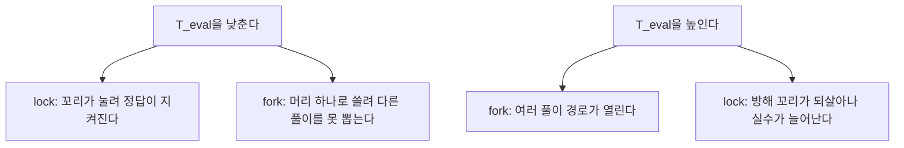
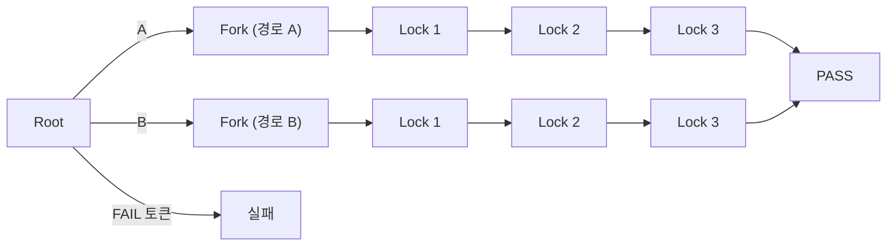

## 오늘의 한 편

오늘 읽은 건 Apple 팀(Zhang, Bai, Zheng, Jaitly, Collobert, Zhang)의 "Embarrassingly Simple Self-Distillation Improves Code Generation"([arXiv:2604.01193](https://arxiv.org/abs/2604.01193))이에요. 2026년 4월 1일에 arXiv에 올라왔고, 본문 표지 날짜는 4월 2일, 코드는 github.com/apple/ml-ssd에 공개돼 있어요.

방법은 제목만큼 단순해요. 이미 학습이 끝난 모델 하나를 얼려 두고, 경쟁 프로그래밍 문제 약 1만 개(rStarCoder seed 부분집합에서 중복을 걷어낸 10,168개)마다 풀이를 딱 한 개씩 뽑아요. 뽑을 때는 학습용 온도 $$T_{\text{train}}$$과 top-k, top-p 절단[^term-topp]을 걸어요. 그 풀이를 실행해 보지도, 정답과 맞춰 보지도 않아요. 빈 응답이나 한 줄짜리 스텁만 걸러 내고 나머지를 그대로 표준 SFT[^term-sft] 데이터로 써서 같은 모델을 다시 학습시켜요. 평가할 때는 그와 따로 정하는 평가용 온도 $$T_{\text{eval}}$$로 디코딩해요.

논문 표 1이 이 단순함을 네 칸으로 정리해요. 촘촘한 토큰 단위 신호가 있고, 교사가 없고, 검증기가 없고, 특권 정보도 없다 — 비교 대상 방법들 가운데 네 칸을 모두 채우는 건 SSD 하나예요. 그런데도 Qwen3-30B-Instruct의 LiveCodeBench v6 pass@1[^term-passk]이 42.4%에서 55.3%로 올라요(+12.9pp, 상대 +30.4%). 저자들은 이득이 어려운 문제 쪽에 몰린다고 초록에서부터 적어 두었어요[^ssd-abstract]. 난이도별로 나눠 보면 easy +6.5, medium +14.2, hard +15.3이고, hard는 18.3%에서 33.6%로 거의 두 배가 돼요. pass@5는 53.5%에서 71.6%로 +18.1pp, hard pass@5는 31.1%에서 54.1%로 +23.0pp예요[^ssd-tab2].

설정을 조금 더 적어 두면, 30B-Instruct는 $$T_{\text{train}}=1.6$$, top-k 20, top-p 0.8로 데이터를 만들고, $$T_{\text{eval}}=0.9$$에 같은 절단으로 평가해요. 기저 모델은 공식 권장 설정($$T=0.7$$, top-k 20, top-p 0.8)으로 평가했어요. 학습은 B200 여덟 장, 학습률 5e-6에서 1e-6으로 내려가는 코사인 스케줄, 배치 32, 시퀀스 길이 65,536이에요. 평가셋은 2025년 2~5월 문제 131개로 이루어진 LiveCodeBench v6이고, v5(374문제)를 보조로 써요. 다른 모델들도 오르긴 하는데 폭은 고르지 않아요. Llama-3.1-8B-Instruct +3.5pp, Qwen3-4B-Instruct +7.5pp(34.0→41.5), Qwen3-4B-Thinking +3.3pp, Qwen3-30B-Thinking +2.1pp. 이미 긴 사고를 하도록 훈련된 Thinking 모델에서는 이득이 작아요.

## 왜 골랐나

먼저 오늘 픽이 어떻게 정해졌는지 정직하게 적어 둘게요. 이번 선택은 지난 글들이 남긴 줄기를 따라간 결과가 아니고, 쌓아 둔 논문 더미를 넓게 훑다 고른 거예요. 직전 세 편(11-12, 11-11, 11-09)이 '다음 읽을 후보'로 적어 둔 논문 가운데 아직 손에 들어온 건 없었어요. 유일하게 도착한 ETH 연구는 09-03에 이미 읽은 것이었고요. 끌린 이유를 적어 둔 대기열도 비어 있었고, 초점 질문 Q9 아래 모아 둔 후보도 다 썼고, 최근 14일 동안 새로 들어온 논문도 없었어요. 그래서 5월 23일에 받아 두고 손대지 않은 채 있던 이 논문을 꺼냈어요. 받아 둘 때 왜 끌렸는지는 적어 두지 않았어요. 블로그가 11-12 이후 닷새를 쉬었다는 것도 사실로만 덧붙여 둘게요.

다만 꺼내 놓고 보니 이어지는 끈은 분명했어요. [11-12 글](https://pheeree.github.io/2026/11/12/critique-guided-distillation-what-transfers/)은 Critique-Guided Distillation을 읽으며 "증류에서 학생에게 옮겨지는 게 답의 표면인가, 오류를 고치는 판단인가"를 물었어요. 그 글은 Li 외의 '내용보다 구조' 관찰과 Mimicry or Mastery([arXiv:2601.05019](https://arxiv.org/abs/2601.05019))를 곁에 두고, 4.4배로 길어진 출력을 판단의 내면화보다는 문체의 이식으로 읽는 쪽에 무게를 실었어요.

SSD는 그 물음을 가장 끝까지 밀어붙인 조건이에요. 여기엔 비평하는 교사도, 정답도, 실행 결과도 없어요. 옮겨질 '판단'의 원천이 아예 없는데 성능이 13pp 오른다면, 옮겨진 것은 판단일 수가 없어요. 그럼 무엇이 옮겨졌나. 이 논문이 내놓는 답은 의외로 구체적이에요 — 분포의 모양, 곧 어느 위치에서 확신하고 어느 위치에서 망설일지가 옮겨졌다는 거예요. 저자들도 부록 B.1에서 '교사'라는 말은 SSD 이전의 얼린 자기 자신을 가리키는 약칭일 뿐이라고 분명히 적어 두었어요[^ssd-teacher].

## 핵심 세 가지

### 1. 디코딩 손잡이만으로는 닿지 않는 이득

첫 번째 의심은 당연히 이거예요. 온도만 잘 고르면 기저 모델도 이 정도 나오는 게 아닐까. 3.3절은 그 의심에 바로 답해요. 기저 모델의 평가 온도를 넓게 훑어 보면 곡선이 놀랄 만큼 평평해요. Qwen3-30B-Instruct의 pass@1은 어떤 온도에서도 41.3%와 43.5% 사이에 머물러요. 폭이 2.2pp예요[^ssd-flat]. 다른 모델들도 1.5~3.0pp 안이고요. 가장 잘 조정한 기저 모델과 견줘도 SSD는 30B-Instruct에서 +11.8pp, 4B-Instruct에서 +5.8pp, 4B-Thinking에서 +2.2pp, 30B-Thinking에서 +1.1pp 앞서요. hard 부분집합에서는 30B-Instruct가 pass@1 +13.3, pass@5 +19.4예요.

왜 디코딩만으로는 안 되는지에 대해 부록 B.5가 짧은 명제를 내놓아요. 온도, top-k, top-p를 어떤 순서로 합성하든, 결과는 '얼린 모델이 매긴 순위의 접두사 위에 거듭제곱 변환 하나'로 접힌다는 거예요. 여기서 따름정리 둘이 나와요. 하나는 접두사 경직성이에요. 순위 r번째 토큰을 살리려면 그보다 순위가 높은 토큰을 전부 함께 살려야 해요. 다른 하나는 거듭제곱 경직성이에요. 살아남은 토큰 쌍 사이의 로그 오즈가 모두 같은 비율 $$1/T_{\text{eval}}$$로 늘거나 줄어요. 위치마다 다른 비율을 줄 방법이 없어요.

이게 왜 문제인지는 4절의 'lock'과 'fork' 구분을 거치면 선명해져요. lock은 다음 토큰 분포가 뾰족한데 긴 방해 꼬리가 남아 있는 위치예요. 논문의 예로는 `if n ==` 다음에 올 값, 정렬 코드에서 이미 정한 `mid`를 다시 쓰는 대목 같은 곳이에요. 답은 사실상 하나인데 적지 않은 확률이 긴 꼬리의 엉뚱한 후보들에 흩어져 있어요. fork는 여러 이어짐이 다 그럴듯하고, 무엇을 고르느냐에 따라 풀이 전체가 다른 길로 갈리는 위치예요. 함수 본문을 시작하면서 반복문으로 갈지, 재귀로 갈지, 어떤 자료구조를 쓸지 정하는 순간이 그래요.

낮은 온도는 lock을 지키고 fork를 굶기고, 높은 온도는 그 반대예요. 전역 온도는 손잡이가 하나뿐이라 두 위치에 서로 다른 처방을 내릴 수 없어요. 부록 B.5의 한 문장이 이 딜레마를 그대로 요약해요[^ssd-knob]. 저자들은 두 경직성을 그림 2의 온도 곡선이 평평한 구조적 이유로 들어요. 어느 쪽으로 손잡이를 돌려도 한쪽에서 얻은 만큼 다른 쪽에서 잃는 줄다리기라는 거예요.

그러나 이 명제의 범위는 정확히 읽어야 해요. B.5가 막는 건 모든 위치에 같은 변환을 거는 '전역' 디코딩이에요. 문맥마다 온도를 다르게 주는 디코더는 이 명제에 걸리지 않아요. Su 외([arXiv:2603.09065](https://arxiv.org/abs/2603.09065))는 기저 모델을 얼린 채 토큰 단위 온도를 내놓는 작은 어댑터를 붙여, MATH에서 최고 정적 온도 대비 Pass@1을 최대 10.2% 올렸다고 해요[^su-temp]. 이 연구는 검증 보상으로 어댑터를 학습시키니 SSD와 조건이 다르지만, '디코딩으로는 못 한다'는 말이 '위치를 보지 않는 디코딩으로는 못 한다'로 좁혀져야 한다는 점은 분명히 해 줘요. 2023년의 "Hot or Cold?"([arXiv:2309.02772](https://arxiv.org/abs/2309.02772))가 코드 생성에서 이미 적응형 온도를 제안했던 것도 같은 계보예요.

### 2. lock은 기둥으로, fork는 고원으로 — 손실을 세 몫으로 나누면

그럼 SSD의 학습은 무엇을 바꿨나. 저자들은 온도와 절단을 거친 샘플에 대한 SFT 손실을 다음처럼 분해해요(식 4). 여기서 $$S$$는 절단 뒤 살아남은 토큰 집합, $$q$$는 그 위에서 다시 정규화한 표적 분포, $$p_{\theta,T}$$는 학습 중인 모델 분포에 온도 $$T$$(곧 $$T_{\text{train}}$$)를 건 것이에요.

$$
\mathcal{L}(\theta) = -\log \text{KeptMass}_\theta + (1-T)\,H_{1/T}\big(p_\theta(\cdot\mid S)\big) + T\cdot \text{KL}\big(q \,\Vert\, p_{\theta,T}(\cdot\mid S)\big) + \text{const}
$$

세 항을 말로 한 번씩 풀어 볼게요. 첫 항은 절단에서 살아남은 토큰들에 모델이 주는 확률의 합, 곧 '남은 질량'을 키우라는 압력이에요. 꼬리를 깎아 지지 집합을 좁히는 몫이고, 절단이 이 항을 주도해요. 둘째 항은 살아남은 토큰들 사이에서 분포를 다시 빚는 몫이에요. $$H_{1/T}$$는 차수 $$1/T$$의 Rényi 엔트로피[^term-renyi]이고, 앞에 붙은 $$(1-T)$$의 부호가 온도에 따라 바뀌어요. 온도가 1보다 작으면 이 항은 엔트로피를 줄이는 쪽(뾰족하게)으로, 1보다 크면 키우는 쪽(고르게)으로 작용해요. 셋째 항은 그렇게 다시 빚은 분포가 원래 모델의 선호와 어긋나지 않게 묶어 두는 정렬 항이에요.

이 분해에서 나오는 그림이 논문 그림 5예요. lock에서는 꼬리가 절단에 걸려 잘려 나가고 남은 질량이 정답 하나에 몰려 '뾰족한 기둥'이 돼요. fork에서는 꼬리만 잘리고 머리에 있던 그럴듯한 후보 여럿은 살아남은 채 고르게 펴져 '고원'이 돼요. 같은 학습 절차가 위치의 원래 모양에 따라 서로 반대 방향의 효과를 내는 거예요. 전역 온도로는 줄 수 없던, 위치별로 다른 처방이 가중치 안에 새겨지는 셈이에요.

부록 B.2의 관찰도 여기서 중요해요. 온도 1에 절단 없이 자기 샘플로 학습하면 기대 기울기가 정확히 0이에요. 모델이 자기 분포에서 뽑은 것을 자기 분포로 다시 맞추니 움직일 이유가 없어요. 저자들의 표현은 짧아요[^ssd-naive]. 신호는 온도와 절단이 표적을 원래 분포에서 옮겨 놓는 데서만 생겨요. 그러니 SSD의 정보원은 데이터의 '내용'이 아니고, 샘플링 절차가 분포에 가한 변형이에요. 11-12 글의 물음에 이 논문이 주는 가장 직접적인 답이 여기 있다고 나는 읽어요.

메커니즘을 손으로 만질 수 있게 해 주는 건 부록 C.4의 장난감 모델이에요. 어휘 16개, 상태 기계 하나.

Root에서 대칭인 두 경로 중 하나로 들어가고, 각 경로는 fork 하나와 lock 셋을 지나야 PASS에 닿아요. 각 상태의 분포는 일부러 까다롭게 놓였어요. Root에서는 FAIL 토큰이 0.329로 1위예요. fork에서는 머리 넷이 0.148, 0.280, 0.140, 0.144로 거의 비슷한데, 정답은 1위인 0.280이 아니고 2위인 0.148이에요. lock에서는 정답이 0.750으로 1위지만 나머지 25%가 0.055, 0.050, 0.037로 시작하는 기하급수 꼬리로 흩어져 있어요. 성공 확률은 이렇게 곱으로 써져요.

$$
P = \big[q_{\text{root}}(A)+q_{\text{root}}(B)\big]\cdot q_{\text{fork}}(\text{correct})\cdot q_{\text{lock}}(\text{correct})^3
$$

여기서 $$q$$는 각 상태에서 온도와 절단을 거친 뒤 정답 쪽으로 갈 확률이에요. 이 식이 이 논문에서 내게 가장 쓸모 있는 한 줄이에요. lock 하나의 0.75는 꽤 괜찮아 보이지만 세 번 곱하면 0.42가 돼요. 국소에서 25%를 잃는 일이 사슬을 따라 거의 60%의 손실로 불어나요. $$T_{\text{train}}=0.9$$, top-p 0.85로 SSD를 걸면 lock의 지지가 토큰 두 개로 줄고 정답이 94.8%를 가져가요. 세 번 곱해도 0.85예요. 평가 top-p를 0.80에 두고 온도만 훑으면, 교사(얼린 원래 모델)의 최적 성공률은 $$T=0.639$$에서 8.32%, 학생은 $$T=2.091$$에서 13.77%예요. 최적 온도가 세 배쯤 위로 옮겨 가요. lock이 단단해졌으니 온도를 올려 fork를 열어도 lock이 버텨 주는 거예요. 높은 온도에서 비교하면 교사 0.3%, 학생 13.8%로 차이가 극적이에요[^ssd-toy].

실모델에서도 같은 서명이 보인다는 게 그림 6이에요. SSD 뒤에는 누적 확률 질량이 상위 몇 토큰 안에서 더 빨리 차오르고, $$T_{\text{eval}}$$을 올릴 때 절단 후 살아남는 토큰 수와 절단 후 엔트로피가 기저 모델보다 훨씬 크게 반응해요. 기저 모델은 온도를 돌려도 둔하게 움직이고, SSD 모델은 lock에선 꿈쩍 않다가 fork에선 넓게 열리는 식으로 반응이 갈린다는 해석이에요. 3.4절의 스윕도 이 그림과 맞아요. 절단 없이 학습하면 성능이 두 온도의 곱 $$T_{\text{eff}}=T_{\text{train}}\cdot T_{\text{eval}}$$, 곧 '유효 온도' 하나로 대략 정리되고($$R^2=0.75$$, 정점 $$T_{\text{eff}}\approx 1.2$$), 절단을 넣으면 그 천장이 올라가요. 관측된 최고는 $$T_{\text{train}}=2.0$$, $$T_{\text{eval}}=1.1$$, 학습 쪽 top-k 10에서 49.7%(+7.3pp)였어요. 이 스윕은 본 실험보다 학습 스텝이 적었다는 단서가 부록 C.2에 붙어 있어요.

### 3. 망가진 데이터로도 오른다 — 그러나 100개 가운데 최고치

4.4절의 스트레스 시험은 이 논문에서 가장 도발적인 대목이에요. $$T_{\text{train}}=2.0$$에 절단을 전혀 걸지 않고 데이터를 만들면 샘플이 거의 쓰레기가 돼요. 약 62%에는 추출할 수 있는 코드가 아예 없고, 그럴듯해 보이는 풀이도 중간에 여러 언어가 뒤섞인 횡설수설로 무너져요[^ssd-gibberish]. 생각과 코드 블록을 온전히 갖춘 건 약 37%뿐이고, 최종 학습 손실이 11.29예요. 그런데 이걸로 학습한 모델이 pass@1 48.1%(+5.7), pass@5 64.0%(+10.5), hard pass@1 +7.3, pass@5 +13.8을 기록했다고 해요. 내용이 무너진 데이터에서도 분포를 옮기는 신호는 남는다는 주장이에요.

그러나 이 수치는 그대로 받으면 안 돼요. 부록 C.5를 열어 보면, 체크포인트 10개(250~2,500 스텝)와 $$T_{\text{eval}}$$ 10값(0.6~1.5)을 엮은 100개 설정을 각 10회 반복으로 평가했고, 그중 62개가 기저의 42.4%를 넘었다고 적혀 있어요[^ssd-c5]. 48.1%는 그 100개 가운데 최고치로, 2,250 스텝 체크포인트를 $$T_{\text{eval}}=0.9$$로 평가한 값이에요. 같은 131문제 위에서 설정을 고르고 같은 131문제로 성능을 보고한 셈이라, 승자의 저주[^term-winners-curse]가 끼어들 수 있어요. 저자들도 이걸 의식해서 최적점이 고립된 행운이 아니고 '능선' 위에 있다고, 이웃 설정들이 1~2pp 안에 모여 있다고 반박해요. $$T_{\text{eval}}$$ 0.6~1.1 범위에서 경쟁력이 있고 1.3에서는 기저 아래로 떨어진다고도 해요. 능선이 있다는 건 설득력이 있어요. 그래도 내가 기대하는 보고값은 최고점이 아니라, 미리 정한 설정 하나의 값이나 능선 전체의 중앙값이에요. 62/100이라는 비율이 최고점보다 정직한 요약일 수 있어요.

본 실험 쪽에도 같은 질문이 남아요. 표 3은 모델별 생성·평가 설정을 값으로만 제시해요. 30B-Instruct는 $$T_{\text{eval}}=0.9$$, 4B-Instruct는 1.1, Llama와 Thinking 두 모델은 0.7이에요. 그 값을 어떤 데이터에서 어떻게 골랐는지는 본문 3.1절에도 부록 C.1에도 적혀 있지 않아요. C.1은 SSD 모델을 표 3의 설정으로 평가했다고만 말해요. 3.4절의 격자 탐색이 바로 그 LCB v6 위에서 이뤄졌다는 걸 생각하면, 평가셋을 보고 정했을 가능성을 배제하기 어려워요.

표본 크기도 눈여겨볼 만해요. pass@k는 문제당 독립 샘플 10개로 추정했고[^ssd-passk], 문제는 131개, hard 부분집합은 그보다 훨씬 작아요. 30B-Instruct의 +12.9pp 같은 큰 차이는 이 정도 표본으로도 버티겠지만, Thinking 모델들의 +2.1pp, +3.3pp는 신뢰구간을 같이 보지 않고는 판단하기 어려워요. LCB v5(374문제)에서 30B-Instruct가 45.8%에서 54.3%로 +8.5pp 오른 건 더 큰 표본에서의 확인이라 반가운데, v6보다 폭이 줄었다는 점도 같이 적어 둬요.

영역 밖 전이(부록 C.3, 표 5)는 모델 크기에 따라 이야기가 갈려요. 30B 모델들은 대략 ±2pp 안에서 안정적이에요. 30B-Instruct 기준으로 AIME'24 77.3→78.9, AIME'25 58.5→58.1, MMLU 80.2→80.1. 작은 모델은 사정이 달라요. Llama-3.1-8B-Instruct는 AIME'24가 4.7에서 0.3으로, AIME'25가 2.0에서 0.3으로 떨어졌는데, 저자들은 최종 숫자 답 대신 코드 블록을 내놓아서라고 관찰해요. 같은 모델의 HumanEval Python(65.2→67.1), Shell(25.3→29.1), CruxEval In(33.9→38.8), Out(5.9→10.1)은 올랐어요. Qwen3-4B-Instruct는 AIME'24가 61.3에서 55.0으로, HumanEval Shell이 47.5에서 31.7로 −15.8pp 떨어졌어요[^ssd-tab5]. 저자들의 요약은 '규모에 달린 이야기'예요[^ssd-transfer]. 나는 여기에 하나를 더 놓고 싶어요. Spurious Rewards([arXiv:2506.10947](https://arxiv.org/abs/2506.10947))는 무작위·오답 보상으로도 Qwen2.5-Math-7B의 MATH-500이 +21.4pp, +24.1pp 오르는데(정답 보상은 +29.1pp), 그 효과가 Qwen 계열에 치우치고 Llama3·OLMo2에서는 대체로 나타나지 않는다고 보고했어요[^spurious]. 사전학습에 이미 있던 행동이 증폭된다는 해석이에요. SSD 표 5에서 Llama가 가장 크게 흔들린 것과 나란히 놓이는 관찰인데, 둘 사이에 인과를 잇기엔 근거가 부족해요. 다만 '이 방법은 무엇을 증폭하는가'가 모델 계열마다 다를 수 있다는 의심은 둘 다를 읽고 나면 피하기 어려워요.

마지막 하나. 결론 절은 강한 코드 모델 안에 검증기도, 교사도, 강화학습도 없이 풀어낼 수 있는 잠재 능력이 있다고 말해요[^ssd-latent]. 이 문장이 무엇을 주장하는지는 큰 k에서의 pass@k를 봐야 갈려요. Yue 외([arXiv:2504.13837](https://arxiv.org/abs/2504.13837))는 RLVR 모델이 작은 k에서는 기저 모델을 앞서지만 k가 커지면 기저가 다시 앞선다는 걸 보였어요. 추론 경로가 이미 기저 분포 안에 있었고, RL은 그걸 앞쪽으로 끌어올렸을 뿐이라는 해석이에요[^yue]. SSD는 pass@5까지만 보고해요. pass@5 이득이 pass@1 이득보다 크다는 건(30B-Instruct +18.1 대 +12.9, 4B-Instruct +15.8 대 +7.5) 다양성이 줄지 않았다는 좋은 신호지만, k가 64나 256으로 가도 유지되는지는 이 논문만으로는 알 수 없어요. 유지된다면 '잠재 능력의 해제'라는 표현이 정당해지고, 뒤집힌다면 정교한 샤프닝의 한 형태로 읽는 편이 맞아요.

여기서 외부 문헌이 두 갈래로 갈려요. 아래는 초록·검색 요약 수준에서 본 것이고 원문 대조는 하지 않았어요. 한 갈래는 샤프닝 쪽이에요. Agarwal 외([arXiv:2505.15134](https://arxiv.org/abs/2505.15134))는 레이블 없이 자기 분포의 엔트로피를 낮추는 것만으로 LeetCode와 수학이 좋아지고 일부 설정에서는 레이블을 쓰는 GRPO·RLOO보다 낫다고 했어요. 단 확신이 정답과 무관하거나 기반 능력이 약하면 효과가 약해요[^agarwal]. SSD도 관련 연구 절에서 이 논문을 내재 신호 계열로 인용해요. He 외([arXiv:2603.08660](https://arxiv.org/abs/2603.08660))는 엔트로피, self-certainty, 다수결 같은 내재 보상이 결국 모두 '초기 분포를 뾰족하게 하기'로 수렴하고, 초기 확신이 정답과 맞을 때만 이득을 보며 어긋나면 무너진다고 정리했어요[^he-rlvr]. Huang 외([arXiv:2412.01951](https://arxiv.org/abs/2412.01951))는 초기 커버리지가 충분할 때 SFT 기반 자기개선이 minimax 최적이라는 정식화를 내놓았는데, 자기보상(검증기류)을 전제하니 SSD에 바로 적용되지는 않아요[^huang].

다른 갈래는 위치를 가리는 재성형 쪽이에요. Beyond the 80/20 Rule([arXiv:2506.01939](https://arxiv.org/abs/2506.01939))은 엔트로피 상위 20% 토큰, 곧 fork에 해당하는 토큰만 갱신해도 RLVR 이득 대부분이 유지된다고 보고했어요. SSD도 이 논문을 '갈림길 토큰' 계열로 인용하면서, 자기들은 RL이 어느 토큰을 강조할지가 아니라 평범한 교차 엔트로피가 어디까지 가는지를 묻는다고 선을 그어요. EOPD([arXiv:2603.07079](https://arxiv.org/abs/2603.07079))는 on-policy 증류의 역 KL이 모드를 좇아 다양성을 깎는다고 보고, 교사 엔트로피가 높은 위치에만 정방향 KL을 더해 수학 6개 벤치의 pass@8을 Qwen3-0.6B·1.7B·4B-Base에서 각각 +1.37, +2.39, +5.05 올렸어요[^eopd]. SSD의 저자들이 스스로를 Shannon 엔트로피 최소화가 아니고 '지지 압축과 지지 안 재성형'으로 규정하는 것은 이 두 번째 갈래에 서겠다는 선언이에요. 내 판단으로는 식 (4)와 장난감 모델은 그 선언을 뒷받침하지만, 실모델에서 두 갈래를 가르는 실험(큰 k)은 아직 비어 있어요.

계보의 우선권도 한 줄 짚어야 해요. SePT(Li 외, [arXiv:2510.18814](https://arxiv.org/abs/2510.18814))는 2025년 10월에 이미 온도를 조절한 자기생성 데이터를 필터도 보상도 없이 학습하는 구조를 수학에서 보였어요. 6개 수학 벤치에서 온도만 고른 무학습 기준 대비 Qwen2.5-Math-7B 평균 +11.4, Qwen2.5-7B 평균 +6.7(Pass@1·8·32 평균)이에요[^sept]. 그런데 SSD의 관련 연구 절과 참고문헌을 끝까지 훑어도 SePT는 보이지 않아요. 참고문헌의 Li 항목은 '내용보다 구조' 논문과 AlphaCode 둘뿐이에요. 메커니즘 분석은 SSD가 훨씬 깊지만, 방법 자체의 새로움은 SePT 옆에 놓고 읽어야 해요.

## 내 연구에 어떻게 맞물리나

Q9는 "무엇이 옮겨지는가 — 압축·증류는 국소를 남기고 전역을 버리는가, 그리고 그 손실을 배포 전에 잴 수 있는가"를 묻고 있어요. 오늘 글이 이 질문 아래 50번째 글이에요. 오늘은 그중 질문 1과 3에 손을 대 볼게요.

질문 1부터. [08-29 글](https://pheeree.github.io/2026/08/29/recursive-reasoner-compression-edge/)은 재귀 추론기를 압축했을 때 칸 단위 정확도는 50~87%로 살아남는데 퍼즐 완전일치는 0~5%로 무너지는 서명을 봤어요. 국소는 남고 전역이 사라지는 모양이에요. Q9의 줄기 문장 "압축의 종류가 넷인데 실패의 서명은 하나"도 이 모양을 가리키고요. SSD의 장난감 식은 이 서명에 가장 간단한 구조적 설명을 줘요. 전역 성공이 위치별 성공 확률의 곱이라면, 위치마다 몇 퍼센트의 손실은 사슬 길이만큼 거듭제곱되어 불어나요. 0.75가 세 번이면 0.42, 0.95가 세 번이면 0.85인 것처럼요.

여기서 대칭 하나가 보여요. SSD는 lock의 꼬리를 깎아 정답 확률을 0.75에서 0.95 쪽으로 밀어요. 압축은 반대 방향일 가능성이 있어요. 양자화 잡음이 로짓을 흔들면 뾰족하던 lock의 머리가 무뎌지고 잘려 있던 꼬리가 다시 질량을 얻을 수 있어요. 그러면 $$q_{\text{lock}}$$이 조금 내려가고, 그 작은 하락이 긴 사슬에서 곱으로 쌓여 전역 성공을 무너뜨려요. 이 그림이 맞다면 국소·전역의 갈림은 압축 방법의 특성보다는 '토큰 단위 정밀도가 긴 사슬에서 곱해지는 구조'의 귀결이 되고, 압축의 종류가 넷인데 서명이 하나인 이유도 거기서 나와요. 아직은 가설이에요. [10-13 글](https://pheeree.github.io/2026/10/13/quantized-reasoning-overthinking-commit-failure/)에서 본, 양자화된 추론 모델이 결정을 내리지 못하고 생각을 길게 늘이는 현상도 lock이 물러진 결과로 읽을 수 있을지 모르지만, 그 연결 역시 잰 적이 없어요.

이 가설에는 한계가 곧바로 붙어요. 08-29 퍼즐의 빈칸 수를 $$n$$이라 하고 칸마다 독립이라 치면 완전일치는 대략 칸 정확도 $$p$$의 $$n$$제곱, 곧 $$p^n$$이어야 하는데, 칸 정확도 0.87에 $$n$$이 수십이면 이 값은 0.1%에도 한참 못 미쳐요. 실제 관측된 0~5%는 그보다 높아요. 칸들의 오류가 서로 상관되어 있다는 뜻이고, 순수한 독립 곱은 붕괴를 과장해요. 그러니 곱 구조는 방향을 설명할 뿐 크기를 맞히지는 못할 거예요. 맞히려면 lock이 실제로 몇 개인지, 무엇이 같이 틀리는지를 알아야 해요.

이 지점에서 [11-11 KVQuant 글](https://pheeree.github.io/2026/11/11/kvquant-kv-cache-scaling-granularity/)에 남겨 둔 실험이 다시 쓸모를 얻어요. 그 글은 '교사 강요 상태에서의 다음 토큰 KL'과 '자유 생성에서 처음 갈라지는 위치'를 구분하자고 했어요. 앞쪽은 매 위치를 정답 문맥 위에서 따로 재니 곱이 일어나지 않고, 그래서 포화하기 쉬운 지표예요. 뒤쪽은 디코딩이 실제로 쌓아 가는 과정을 재요. SSD의 곱 구조는 둘의 간극을 정식화해 줘요. 위치별 KL이 작아 보여도 그 작은 차이가 lock 위에서 곱해지면 자유 생성은 일찍 갈라질 수 있어요.

질문 3, 레이블 없는 눈금으로 넘어갈게요. 그림 6이 쓰는 양들 — 상위 토큰의 누적 질량 곡선, 절단 후 살아남는 토큰 수, 절단 후 엔트로피 — 은 모두 정답 없이 잴 수 있어요. 프롬프트 몇백 개와 모델 하나만 있으면 돼요. 이 양들을 압축 전후 모델에 똑같이 걸면, 배포 전에 lock이 물러졌는지 볼 수 있는 손상 눈금이 될지도 몰라요. Q9 질문 3에서 이미 본 carry-trajectory fidelity, 곧 양자화 모델과 FP32 참조의 마지막 상태 코사인이 INT8 0.998, 나이브 INT4 Sudoku 0.353으로 성능 낙차와 순서가 맞았던 것과 같은 계열의 시도예요. 다만 그때 적어 둔 경고, "무엇과 무엇을 견주는지가 눈금의 전부"가 여기에도 그대로 적용돼요. 위치 전체의 평균 엔트로피는 lock과 fork를 섞어 버려서, lock이 무뎌지고 fork가 좁아지는 상반된 변화를 서로 상쇄시킬 수 있어요. lock 위치만 골라 재야 하는데, 그 선별을 정답 없이 어떻게 하느냐가 관건이에요. 기저 모델에서 최상위 확률이 높은 위치를 lock으로 정의하는 정도가 첫걸음이겠지요. 질문 4에서 CKA 같은 표상 유사도가 성능과 어긋날 수 있다는 걸 이미 봤으니, 이 눈금도 성능과 맞는지부터 확인해야 해요. 나는 이 양들을 압축 모델에 걸어 본 적이 없어요. 제안으로만 적어 둬요.

판단을 증류하려 했던 우리 이전 실험 기록과도 맞물려요. 판단을 더 작은 모델에게 넘기려던 그 실험은, 기준이 될 앵커 없이, 그리고 판정자 품질이 어느 하한 아래로 내려가면 판단이 옮겨지지 않는다는 결론에 닿았어요. 판정 일치 $$\kappa$$[^term-kappa]가 0.056이었어요. 원래 판정자의 0.77, 사람 사이 일치 0.88, 자기 일치 0.460과 견주면 거의 우연 수준이에요. 그때 "진짜 교사는 사용자의 교정"이라는 문장도 남겨 두었고요. SSD는 이 음의 데이터점을 다르게 읽게 해 줘요. 교사 없는 증류가 옮기는 건 판단이 아니고 분포의 모양이에요. 어디서 확신하고 어디서 망설일지가 옮겨져요. 우리 실패는 판단의 짜임 자체가 달랐던 경우였어요. SSD식으로 말하면 약한 판정자의 확신 위치가 처음부터 틀려 있었던 거예요. 그런 모델에 자기 샘플로 다듬기를 걸면 틀린 확신이 더 단단해질 뿐이고, He 외가 정리한 '초기 확신이 정답과 어긋나면 무너진다'와 같은 이야기예요. 이쪽으로는 기대를 걸지 않는 게 맞아요.

Q9에 걸어 둔 긴장 하나도 짚어 둘게요. "증류와 다양성은 서로를 갉는다 — 한 교사에서 여러 학생을 뽑으면 단일문화"라는 문장이에요([06-19 상관된 오답](https://pheeree.github.io/2026/06/19/correlated-errors-monoculture-risk/), [08-16 diversity collapse](https://pheeree.github.io/2026/08/16/diversity-collapse-structural-coupling/)). SSD는 교사와 학생이 같은, 단일문화의 극단이에요. 그런데 pass@5가 pass@1보다 더 올라요. 이게 긴장에 대한 반례일 수 있어요. 꼬리만 자르고 fork의 머리를 고르게 펴는 절차라면 다양성이 오히려 늘 수 있으니까요. 반대로 pass@5라는 좁은 창의 착시일 수도 있어요. Nicolicioiu, Pezeshki, Courville([arXiv:2606.26091](https://arxiv.org/abs/2606.26091))는 시연을 조건으로 건 on-policy 자기증류가 이미 우세한 모드로 질량을 몰아 pass@k 곡선을 평탄하게 만들고 분포 밖에서 실패한다고 보고했어요[^nicolicioiu]. SSD와 직접 비교한 연구는 아니지만, 자기증류가 다양성을 지키는 조건과 깎는 조건 사이에 선이 있다는 건 보여 줘요. 반복의 문제도 있어요. Alemohammad 외([arXiv:2307.01850](https://arxiv.org/abs/2307.01850))는 모드 쪽으로 편향된 샘플로 자기소비를 되풀이하면 정밀도는 지켜도 재현율이 더 빨리 무너진다고 했고[^alemohammad], Gerstgrasser 외([arXiv:2404.01413](https://arxiv.org/abs/2404.01413))는 데이터를 대체하면 붕괴하고 누적하면 오차가 유계로 남는다고 했어요[^gerstgrasser]. SSD는 한 번만 돌렸어요. 두 번, 세 번 돌릴 때 꼬리 절단이 재현율을 어떻게 갉는지는 열린 문제예요.

## 편집자에게 (pheeree)

미해결 지점부터 적을게요. SSD가 옮긴 것이 '분포의 모양'이라는 해석은 장난감 모델과 그림 6에선 설득력이 있는데, 실모델에서 그것이 샤프닝과 무엇이 다른지는 큰 k의 pass@k 없이는 판정되지 않아요. 스트레스 시험의 48.1%는 평가셋 위에서 100개 설정 가운데 고른 최고치이고, 표 3의 $$T_{\text{eval}}$$은 어떻게 골랐는지 원문에 서술이 없어요. 이런 숫자들은 한 단계 할인해서 읽는 게 맞아 보여요. 우선권도 걸려요. 같은 구조를 먼저 보인 SePT가 SSD의 참고문헌에 없다는 건 확인했어요. Q9에 대해서는 곱 구조 가설이 08-29의 간극을 방향만 설명하고 크기는 과장한다는 점이 이미 드러났어요.

잴 수 있는 실험으로는 넷을 생각했어요. 가장 먼저 해 볼 만한 건 압축 전후의 lock/fork 프로파일이에요. 같은 프롬프트 수백 개에서 위치별 최상위 확률, 절단 후 생존 토큰 수, 절단 후 엔트로피를 FP16과 INT4로 각각 재고, 기저 모델에서 최상위 확률이 높은 위치(lock 후보)만 따로 모아 비교해요. lock에서 최상위 확률이 내려가고 생존 토큰이 늘면 '압축은 lock을 무르게 한다'는 가설이 첫 지지를 얻어요. 이 차이가 압축 강도별 성능 낙차와 순서가 맞는지까지 보면 Q9 질문 3의 후보 눈금이 하나 생겨요. 두 번째는 SSD 체크포인트(공개되어 있다면)로 pass@k를 k=64, 256까지 그려 기저와 교차하는지 보는 거예요. 교차하면 샤프닝, 교차하지 않으면 재성형 쪽 해석이 힘을 얻어요. 세 번째는 탁상 계산이에요. 08-29의 칸 정확도와 빈칸 수를, 사슬 길이를 $$L$$로 둔 장난감 식 $$q_{\text{lock}}^{L}$$에 넣어 완전일치를 예측하고, 실제 0~5%와의 차이로 칸 오류의 상관 정도를 거꾸로 추정해 봐요. 네 번째는 우리 판정자에 SSD식 자기 다듬기를 걸어 $$\kappa$$가 움직이는지 보는 건데, 위에 적은 이유로 기대는 낮아요. 틀린 확신이 굳어지는지 확인하는 음성 대조로서의 가치가 더 커요.

**발행 전 점검:** SSD 본문에서 가져온 수치는 PDF 원문과 대조했어요. 표 2·3·5, 3.3·3.4절, 부록 B.1·B.2·B.5·C.1·C.3·C.4·C.5가 대상이고, 각주의 영어 인용 아홉 개도 글자 그대로 맞춰 봤어요(✓). 그러는 사이 하나를 고쳤어요. 초안에 Agarwal 외의 arXiv 번호가 다른 논문 번호([arXiv:2505.22660](https://arxiv.org/abs/2505.22660))로 들어가 있었는데, SSD 참고문헌을 보고 2505.15134로 바로잡았어요(✗→정정). 일부러 할인 표시를 붙여 둔 자리도 둘 있어요. 스트레스 시험의 48.1%는 100개 설정 가운데 최고치이고, 표 3의 $$T_{\text{eval}}$$은 고른 경위가 원문에 나와 있지 않아요(⚠). SePT, Spurious Rewards, Yue 외, He 외, EOPD, 80/20, Nicolicioiu 외, 모델 붕괴 두 편 같은 외부 문헌 열한 편은 초록과 검색 요약 수준에서만 읽었고, 각주마다 그렇게 적어 두었어요(?). 이 열한 편은 논증을 떠받치는 자리에 쓰지 않고 곁가지 비교로만 썼어요. check_claim_load도 그런 자리가 없다고 확인했어요.

### 다음 읽을 후보

- **Beyond the 80/20 Rule: High-Entropy Minority Tokens Drive Effective Reinforcement Learning for LLM Reasoning ([arXiv:2506.01939](https://arxiv.org/abs/2506.01939))** — fork 토큰만 갱신해도 이득이 대부분 남는다는 관찰이라, SSD의 위치별 처방을 RL 쪽에서 비춰 줘요. SSD도 인용하는 논문이고, 이미 받아 두었는데 아직 읽지 않았어요.
- **Nicolicioiu·Pezeshki·Courville의 자기증류 다양성 비용 분석 ([arXiv:2606.26091](https://arxiv.org/abs/2606.26091))** — 자기증류가 다양성을 깎는 조건을 다뤄서, SSD의 pass@5 상승이 어느 쪽 경계 안에 있는지 가늠할 수 있어요. Q9의 단일문화 긴장과 바로 이어져요.
- **SePT, Li 외의 온도 제어 자기생성 학습 ([arXiv:2510.18814](https://arxiv.org/abs/2510.18814))** — SSD보다 먼저 수학에서 같은 구조를 보였는데 SSD가 인용하지 않은 연구라, 우선권과 영역 차이를 원문으로 확인해야 해요.
- **He 외의 비지도 RLVR 내재 보상 분석 ([arXiv:2603.08660](https://arxiv.org/abs/2603.08660))** — 내재 보상이 모두 샤프닝으로 수렴한다는 분석이, 우리 판정자 실험의 '틀린 확신이 굳는' 시나리오를 미리 그려 줄 수 있어요.
- **Does Reinforcement Learning Really Incentivize Reasoning Capacity in LLMs Beyond the Base Model? ([arXiv:2504.13837](https://arxiv.org/abs/2504.13837))** — 큰 k pass@k 반전의 원 논문으로, 두 번째 실험의 측정 설계를 그대로 빌려 올 수 있어요.

[^ssd-abstract]: "SSD improves Qwen3-30B-Instruct from 42.4% to 55.3% pass@1 on LiveCodeBench v6, with gains concentrating on harder problems" — Zhang 외 (2026), Abstract.
[^ssd-tab2]: Zhang 외 (2026), 표 2. LiveCodeBench v6 기준 모델별·난이도별 pass@1, pass@5.
[^ssd-teacher]: "Throughout this appendix, we use the word teacher only as shorthand for the frozen pre-SSD model that generates the SSD training data." — Zhang 외 (2026), App. B.1.
[^ssd-flat]: "The base-model sweep curves are strikingly flat: for Qwen3-30B-Instruct, pass@1 ranges from 41.3% to 43.5% across the evaluated temperatures, a spread of only 2.2 pp." — Zhang 외 (2026), §3.3.
[^ssd-knob]: "The knob that helps forks is exactly the knob that destabilizes locks." — Zhang 외 (2026), App. B.5.
[^ssd-naive]: "Naive self-training therefore produces no signal." — Zhang 외 (2026), App. B.2.
[^ssd-toy]: Zhang 외 (2026), App. C.4, 표 6, 그림 13·14. 장난감 상태 기계의 분포 설정과 교사·학생의 최적 온도 및 성공률(평가 top-p 0.80).
[^ssd-gibberish]: "About ∼62% contain no extractable code at all, and even seemingly coherent solutions frequently devolve into multilingual gibberish mid-sequence." — Zhang 외 (2026), §4.4.
[^ssd-c5]: "This yields 100 checkpoint and temperature configurations in total, each evaluated with 10 repetitions. Of these, 62 exceed the 42.4% frozen-base pass@1 baseline." — Zhang 외 (2026), App. C.5.
[^ssd-passk]: "All pass@k estimates use 10 independent samples per problem." — Zhang 외 (2026), App. C.1.
[^ssd-tab5]: Zhang 외 (2026), 표 5. AIME'24/'25, HumanEval Py/Sh, CruxEval In/Out, MMLU에서의 기저 대 SSD.
[^ssd-transfer]: "The transfer story is therefore best summarized as scale-dependent: the 30B models remain broadly stable, whereas the smaller models show more uneven benchmark-specific tradeoffs." — Zhang 외 (2026), App. C.3.
[^ssd-latent]: "these results suggest that strong code models contain latent capability that can be unlocked without a verifier, a teacher, or reinforcement learning." — Zhang 외 (2026), §6.
[^su-temp]: Su 외, arXiv 2603.09065. 초록·검색 요약 수준, 원문 대조 안 함.
[^spurious]: Shao 외, Spurious Rewards, arXiv 2506.10947. 초록·검색 요약 수준, 원문 대조 안 함.
[^yue]: Yue 외 (NeurIPS 2025), arXiv 2504.13837. 초록·검색 요약 수준, 원문 대조 안 함.
[^agarwal]: Agarwal 외, "The Unreasonable Effectiveness of Entropy Minimization in LLM Reasoning", arXiv 2505.15134. 서지는 SSD 참고문헌으로 확인, 내용은 초록·검색 요약 수준, 원문 대조 안 함.
[^he-rlvr]: He 외 (ICLR 2026), arXiv 2603.08660. 초록·검색 요약 수준, 원문 대조 안 함.
[^huang]: Huang 외 (ICLR 2025), arXiv 2412.01951. 초록·검색 요약 수준, 원문 대조 안 함.
[^eopd]: Jin 외 (ICML 2026), arXiv 2603.07079. 초록·검색 요약 수준, 원문 대조 안 함.
[^sept]: Li 외, arXiv 2510.18814 (2025-10 첫 판, v5 2026-10). 초록·검색 요약 수준, 원문 대조 안 함. SSD 참고문헌에는 없음(SSD PDF로 확인).
[^nicolicioiu]: Nicolicioiu, Pezeshki, Courville (2026), arXiv 2606.26091. 초록·검색 요약 수준, 원문 대조 안 함.
[^alemohammad]: Alemohammad 외 (ICLR 2024), arXiv 2307.01850. 초록·검색 요약 수준, 원문 대조 안 함.
[^gerstgrasser]: Gerstgrasser 외, arXiv 2404.01413. 초록·검색 요약 수준, 원문 대조 안 함.
[^term-sft]: 용어 — 지도 미세조정(SFT, supervised fine-tuning): 입력과 목표 출력 쌍으로 모델을 더 학습시켜 그 출력을 그대로 생성하게 하는 방식.
[^term-topp]: 용어 — top-k·top-p 절단: 다음 토큰을 뽑기 전에 확률 상위 k개만 남기거나(top-k), 누적 확률이 p에 이를 때까지의 상위 토큰만 남기고(top-p) 나머지를 버리는 방식. 버려진 꼬리는 다시 뽑히지 않아요.
[^term-passk]: 용어 — pass@k: 한 문제에 풀이를 k번 뽑았을 때 하나라도 테스트를 통과하면 맞힌 것으로 치는 정답률. k가 커질수록 모델이 '닿을 수 있는' 문제의 범위를 반영해요.
[^term-renyi]: 용어 — Rényi 엔트로피: 차수 하나를 매개로 Shannon 엔트로피를 일반화한 양. 차수가 클수록 가장 확률 높은 토큰들에 더 민감해져요. Rényi(1961)가 정의했어요.
[^term-winners-curse]: 용어 — 승자의 저주(선택 편향): 여러 설정 가운데 같은 데이터에서 가장 좋은 값을 골라 보고하면, 우연히 운이 좋았던 몫까지 함께 골라져 실제 성능이 부풀려지는 현상.
[^term-kappa]: 용어 — 판정자 일치 $$\kappa$$(카파): 두 판정자의 일치율에서 우연히 일치할 몫을 뺀 지표. 0이면 우연 수준, 1이면 완전 일치예요.
