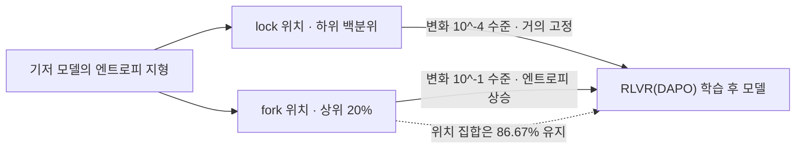
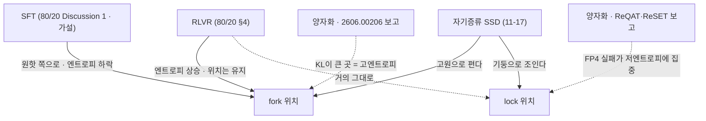

## 오늘의 한 편

오늘 통독한 논문은 Qwen 팀과 칭화대 LeapLab이 함께 낸 "Beyond the 80/20 Rule: High-Entropy Minority Tokens Drive Effective Reinforcement Learning for LLM Reasoning"([arXiv:2506.01939](https://arxiv.org/abs/2506.01939))이에요. Shenzhi Wang이 1저자이고, Gao Huang과 Junyang Lin이 교신저자로 이름을 올렸어요. 첫 판은 2025년 6월 2일에 나왔고, 지금 손에 있는 건 11월 13일 개정판이에요. NeurIPS 2025에 실렸어요.

논문은 세 단계로 진행돼요. 먼저 추론 사슬(CoT)의 토큰마다 엔트로피를 재서 그 분포가 어떻게 생겼는지 봐요. 다음으로 RLVR[^term-rlvr] 학습을 거치며 그 모양이 어떻게 바뀌는지 따라가요. 마지막으로 엔트로피가 높은 상위 20% 위치에만 정책 경사를 흘려보내는 변형을 만들어, 모든 토큰을 쓰는 원래 학습과 견줘요. 기준 알고리즘은 DAPO[^term-dapo]예요.

출발점은 토큰 엔트로피[^term-entropy]예요. 위치 $$t$$에서 모델이 어휘 전체에 매긴 확률 분포를 $$p_t$$라고 하면 이렇게 정의돼요.

$$
H_t = -\sum_{j=1}^{V} p_{t,j}\log p_{t,j}
$$

풀어 말하면, 그 위치에서 다음 토큰을 고를 때 모델이 얼마나 망설이는지를 숫자 하나로 줄인 값이에요. 확률이 후보 하나에 몰려 있으면 0에 가깝고, 여러 후보에 고르게 퍼져 있으면 커져요. 저자들은 2.1절에서 구분 하나를 굵은 글씨로 세워 둬요. 이 값은 그 위치의 생성 분포가 지닌 성질이고, 거기서 실제로 뽑힌 토큰의 성질은 아니라는 거예요[^h-def]. 같은 'however'라도 어디에 나오느냐에 따라 엔트로피가 달라요.

이 구분은 오래된 것이기도 해요. 정보이론에서 실제로 일어난 사건 하나가 얼마나 뜻밖인지는 surprisal, 곧 $$-\log p(o_t)$$로 재요. 엔트로피는 그 surprisal을 분포 전체에 대해 평균한 기댓값이고요. Hale과 Levy의 surprisal 이론이 읽기 시간을 설명할 때 쓰는 건 앞의 양이고, 이 논문이 쓰는 건 뒤의 양이에요. 뽑힌 토큰이 얼마나 뜻밖이었는지 대신, 그 위치가 원래 얼마나 열려 있었는지를 재는 거예요. 이 차이는 나중에 압축 눈금을 설계할 때 다시 쓰여요.

## 왜 골랐나

어제 [11-17 SSD 글](https://pheeree.github.io/2026/11/17/simple-self-distillation-locks-forks/)이 '다음 읽을 후보' 맨 앞에 올려 둔 논문이 바로 이것이었어요. 그 글은 이 논문을 "fork 토큰만 갱신해도 이득이 대부분 남는다는 관찰이라, SSD의 위치별 처방을 RL 쪽에서 비춰 준다"고 소개했고, 받아만 두고 아직 읽지 않았다고 적었어요. 오늘 미러에 PDF가 와 있어서 이 편으로 정했어요.

어제 글이 남긴 실험 가운데 첫째는 '압축 전후의 lock/fork 프로파일'이었어요. 위치별 최상위 확률, 절단 후 남는 토큰 수, 엔트로피를 FP16과 INT4에서 각각 재고, lock 후보 위치는 따로 모아 보자는 제안이었어요. 이 제안에는 빈 곳이 하나 있었어요. 엔트로피 프로파일을 손상 눈금으로 쓰려면, 손상이 아닌 변화(예를 들어 정상적인 학습)가 프로파일의 어디는 그대로 두고 어디를 움직이는지부터 알아야 해요. 그래야 압축 뒤에 보이는 변화가 '학습이라도 이 정도는 움직였을 것'인지, '학습이라면 건드리지 않았을 곳이 움직였다'인지 구별할 수 있어요. 이 논문의 4절이 그 기준선을 줘요. RLVR이라는 큰 학습을 거치는 동안 엔트로피 지형의 어디가 고정되고 어디가 움직였는지를 숫자로 적어 두었거든요.

그래서 오늘은 이 논문을 압축의 거울상으로 읽어 보려고 해요. RLVR은 모델을 더 낫게 만드는 변화이고, 양자화는 모델을 망가뜨리는 변화예요. 두 변화가 같은 지형 위에서 서로 다른 곳을 움직인다면, 그 차이 자체가 레이블 없는 손상 신호가 될 수 있어요.

## 핵심 세 가지

### 1. 엔트로피는 대부분 바닥에 붙어 있고, 소수만 솟아 있다

3절에서는 Qwen3-8B를 thinking 모드, 온도 1.0으로 돌려 AIME'24·'25 문제에 대한 응답을 생성하고, 토큰 백만 개 남짓을 모아 하나하나의 엔트로피를 재요. 결과는 극단적으로 치우친 분포예요. 토큰의 약 50.64%가 엔트로피 $$10^{-2}$$ 미만이고, 0.672를 넘는 토큰은 20%뿐이에요[^pattern1]. 이 0.672가 80번째 백분위예요.

이 숫자에 직관을 하나 보탤게요. 엔트로피에 지수를 씌운 $$e^{H}$$는 '유효 후보 수'로 읽을 수 있어요. 확률이 후보 $$k$$개에 똑같이 나뉘어 있으면 엔트로피는 $$\log k$$이고, 지수를 씌우면 $$k$$가 돌아오니까요. 로그를 자연로그로 보면 $$e^{0.01}\approx 1.01$$이고 $$e^{0.672}\approx 1.96$$이에요. 절반이 넘는 위치에서 모델은 사실상 후보 하나만 보고 있고, 상위 20% 문턱에서도 유효 후보는 둘 남짓이에요. 그림 2(a)에서 가장 높은 꼬리는 엔트로피 4 근처인데, 그래도 $$e^4\approx 55$$개 정도예요.

갈림길이라고 부르는 위치도 대부분은 두세 갈래 중 하나를 고르는 일이에요. 이걸 알고 있으면 '분기점'이라는 개념을 과장하지 않고 다룰 수 있어요.

어떤 토큰이 위쪽과 아래쪽에 오는지도 봐요. 평균 엔트로피가 가장 높은 토큰은 'wait', 'however', 'unless', 'thus', 'since' 같은 논리 연결어, 그리고 'suppose', 'assume', 'given', 'define'처럼 가정이나 정의를 들이는 말이에요. 가장 낮은 쪽은 단어의 접미사, 코드 조각, 수식 구성 요소예요[^pattern2]. 저자들은 앞쪽을 forking token이라고 불러요. 어제 SSD 글의 lock/fork 구분과 같은 곳을 가리키는 이름이에요. 두 논문이 같은 현상을 다른 데이터(코드와 수학)와 다른 개입(자기증류와 RL)에서 보고 있는 셈이에요.

계보를 적어 두면, '추론 사슬에서 결과를 가르는 소수의 위치'라는 생각 자체는 이 논문이 처음은 아니에요. 저자들도 관련 연구에서 Lin 외(2024)와 Vassoyan 외(2025)의 critical token을 들면서 차이를 이렇게 설명해요. 앞선 연구는 출력이 정답인지를 보고 토큰의 중요성을 판정했고, 자기들은 토큰 엔트로피를 기준으로 쓰자고 제안한다는 거예요[^critical]. Q9에는 이 차이가 결정적이에요. 정답으로 찾는 결정 지점은 레이블이 있어야 찾을 수 있지만, 엔트로피로 찾는 결정 지점은 모델 하나만 있으면 찾을 수 있으니까요.

그림 3은 이 구분이 실제로 기능을 한다는 증거로 제시돼요. 엔트로피가 0.672를 넘는 위치에는 온도 $$T_{\text{high}}$$를, 나머지 위치에는 $$T_{\text{low}}$$를 따로 걸어 디코딩한 실험이에요. 두 온도가 모두 1이면 AIME 두 해의 평균이 71.67이에요. $$T_{\text{high}}$$를 0으로 내리면 68.33, $$T_{\text{low}}$$를 0으로 내리면 70.52예요. 반대로 $$T_{\text{high}}$$를 2.0으로 올리면 72.22로 최고치가 나오고, 5.0까지 올려도 62.71을 지켜요. $$T_{\text{low}}$$는 2.0에서 70.76으로 버티다가 3.0에서 20.14, 5.0에서 0.14로 무너져요[^fig3]. fork는 더 열어도 견디는데, 나머지 위치는 일정 이상 흔들면 출력이 의미를 잃는다는 거예요.

수치의 크기는 냉정하게 읽어야 해요. $$T_{\text{high}}$$를 0으로 내렸을 때 잃는 건 3.3점이라, 저자들의 '크게 떨어진다'는 표현보다 온건해요. 이 그림에서 정말 큰 효과는 비대칭 쪽이에요.

같은 크기의 흔들림을 fork는 흡수하고 lock은 흡수하지 못해요.

나는 파란 곡선을 일종의 섭동 실험으로 읽어요. 온도를 올리면 분포가 평평해지는데, 그 섭동이 치명적인 곳은 낮은 엔트로피 쪽이에요. 이 관찰은 뒤에서 압축을 다룰 때 다시 써요.

### 2. RLVR은 지형을 지키고, 높은 곳만 움직인다

오늘 목적에 가장 중요한 건 4절이에요. 저자들은 Qwen3-14B 기저 모델에 DAPO를 걸고, 학습이 끝난 모델로 여섯 벤치마크에서 문제당 16개씩 응답을 생성해요. 그다음 그 고정된 응답 위에서 학습 단계별 체크포인트가 각 위치에 매기는 엔트로피를 재고, 상위 20% 위치 집합끼리 비교해요[^tab1]. 같은 글을 놓고 모델마다 어디서 망설이는지만 견주는 설계라서, 생성 경로가 갈라져 생기는 혼선이 없어요.

표 1을 보면, 기저 모델과의 상위 20% 위치 겹침은 step 0의 100%에서 출발해 98.92%, 98.70%를 거치고, 93% 언저리에 한동안 머물다가 87% 근처로 한 단계 내려가요. 수렴 시점인 step 1360에는 86.67%예요. 학습이 끝난 모델 쪽에서 보면 거꾸로 86.67%에서 100%로 올라가고요. 저자들은 이를 두고, 어느 토큰이 불확실한가에 대한 기저 모델의 패턴을 RLVR이 대체로 유지한다고 요약해요[^tab1].

움직인 쪽도 봐요. 그림 4는 기저 모델의 엔트로피를 5% 백분위 구간으로 나누고, 구간마다 RLVR 뒤 평균 엔트로피가 얼마나 변했는지를 로그 축에 그려요. 가장 낮은 구간에서 $$10^{-4}$$ 남짓이던 변화가 구간이 올라갈수록 거의 단조롭게 커져서, 상위 구간에서는 $$10^{-1}$$대에 이르러요. 세 자릿수 차이예요. 저자들의 문장으로는, 초기 엔트로피가 높은 토큰일수록 RLVR 뒤 엔트로피가 더 크게 늘어나요[^fig4]. 그림 5는 같은 이야기를 학습 과정 전체에 걸쳐 보여 줘요. 100번째 백분위는 크게 출렁이며 올라가고, 0번째 백분위는 눈금이 $$10^{-8}$$인 축 위에서 0에 붙은 채 움직이지 않아요.

방향에는 단서가 하나 붙어요. fork의 엔트로피가 올라간 건 RLVR 일반의 성질이라기보다 DAPO의 성질일 수 있어요. DAPO에 들어 있는 clip-higher[^term-cliphigher]는 원래 엔트로피 붕괴를 늦추려고 고안된 장치이고, 그림 7에서도 전체 엔트로피는 학습 초반에 한 번 떨어졌다가 다시 올라가요. 다른 RLVR 알고리즘에서도 fork가 펴지는지, 아니면 거꾸로 조여지는지는 이 논문만으로는 알 수 없어요. 그래서 내가 가져갈 건 방향보다 장소예요. 어느 알고리즘이든 변화가 상위 백분위에 몰리고 하위 백분위는 거의 고정된다는 모양이요.

이 결과를 압축의 언어로 옮기면 이래요. 큰 학습을 거쳐 AIME 성능이 크게 바뀐 모델에서도 lock은 거의 그대로이고, fork는 장소를 대부분 유지한 채 그 위의 분포만 바뀌었어요. 그렇다면 lock의 최상위 확률이 눈에 띄게 내려가는 변화는 정상적인 학습에서 나오는 변화와 다르다고 말할 근거가 생겨요. 어제 글의 '압축은 lock을 무르게 한다'는 가설에 처음으로 비교 기준이 붙는 셈이에요.

그러나 86.67%라는 숫자를 곧바로 '보존'의 증거로 받기 전에 영가설부터 세워야 해요. 상위 20% 집합 두 개를 무작위로 뽑으면 기대 겹침은 20%예요. 86%는 그보다 훨씬 높지만, 비교해야 할 영가설은 무작위가 아니에요. 연결어는 어떤 모델에서든 연결어 위치에 오고, 'however' 다음에 무엇이 올지는 유능한 언어모델이라면 누구에게나 열려 있어요. 같은 응답 위에서 재는 설계라서 더 그래요. 그 글의 문장 구조가 어디가 갈림길인지를 이미 상당 부분 정해 두니까요. 같은 계열의 다른 크기 모델이나 아예 다른 계열의 모델로 같은 글에서 상위 20% 위치를 뽑았을 때 겹침이 80%를 넘는다면, 86.67%가 RLVR에 대해 말해 주는 건 거의 없어요. 논문에는 이 비교가 없어요. 저자들 스스로도 6절 Discussion 2에서 CoT 토큰 대부분이 낮은 엔트로피인 이유를 사전학습 지식과 가독성 요구로 설명하면서, 대부분의 토큰이 기억된 언어 구조에 맞춰진다고 써요[^disc2]. 그 설명이 맞다면 지형의 상당 부분은 언어가 정한 것이에요.

학습이 보존했다기보다, 학습이 건드릴 수 없었던 부분에 가까워요.

이 영가설은 Q9의 눈금 설계에는 오히려 쓸모가 있어요. 위치 겹침이 언어 구조 때문에 원래 높다면, 그 지표는 움직일 수 있는 범위가 좁아요. 압축 뒤 겹침이 몇 퍼센트포인트 떨어졌을 때 그게 큰 손상인지 작은 손상인지는, '다른 모델 사이의 겹침'이라는 바닥과 '같은 모델을 반복 측정한 겹침'이라는 천장을 먼저 알아야 판정할 수 있어요.

### 3. 상위 20%만 학습해도 이득이 남는다 — 무엇 덕분인가

5절의 실험은 식 (6)으로 정리돼요. DAPO의 목적함수는 그대로 두고, 배치 안에서 엔트로피가 상위 $$\rho$$ 비율에 드는 토큰만 정책 경사 계산에 남기고 나머지의 기울기는 버려요. 정규화 분모도 남은 토큰 수로 바꿔요. 본 실험은 $$\rho=0.2$$예요. 학습률 $$10^{-6}$$, 배치 512, 최대 응답 길이 20,480이고, clip-higher의 상한은 0.28·하한은 0.2이며, KL 항과 엔트로피 항은 쓰지 않아요. 데이터는 DAPO-Math-17K이고, 평가는 문제당 샘플 16개의 평균 정확도인 Acc@16[^term-acc16]이에요.

표 2의 결과는 모델 크기에 따라 달라요. Qwen3-32B에서는 여섯 벤치 평균이 66.59에서 70.69로 +4.10 오르고, AIME'24가 55.83→63.54(+7.71), AIME'25가 45.63→56.67(+11.04)이에요. 14B는 평균 61.40→64.39(+2.99), AIME'24 +5.21, AIME'25 +4.79예요. 8B는 평균 53.71→54.23으로 +0.53에 그치고, AMC'23에서는 −0.625로 오히려 내려가요[^tab2]. 반대로 하위 80% 토큰만으로 학습하면 8B의 AIME'24가 23 안팎에 머물러, 30대 초반까지 가는 다른 설정들과 크게 벌어져요. 학습에 쓴 토큰의 80%를 차지하는데도 그렇다는 점을 저자들이 짚어요[^bottom80]. 분포 밖 과제인 LiveCodeBench에서도 상위 10%나 20%만 쓴 학습이 모든 토큰을 쓴 학습보다 높게 그려지고(그림 9), 32B 모델의 최대 응답 길이를 29,696으로 늘려 이어서 학습하면 AIME'24가 63.54에서 68.12까지 올라가요(그림 10).

여기서 해석이 갈려요. 저자들은 탐색으로 설명해요. $$\rho$$를 20%에서 10%, 50%, 100%로 바꾸면 학습 초반부터 수렴 직전까지 전체 엔트로피가 계속 더 낮게 유지되고, 그래서 20%가 탐색과 안정 사이의 균형점이라는 거예요[^rho]. 엔트로피 보너스로 탐색을 지키는 건 Williams(1992)와 A3C(Mnih 외, 2016) 이래 강화학습의 오래된 관행이고, 이 논문은 그 탐색-활용 문제를 위치 단위로 다시 쓰는 셈이에요.

그런데 이 설명을 받아들이면 두 이야기가 구별되지 않아요. 하나는 '분기점에 추론이 담겨 있어서 거기만 학습하면 된다'는 이야기이고, 다른 하나는 '분기점만 학습하면 엔트로피 붕괴가 늦춰져 탐색이 오래 살아남는다'는 이야기예요. 앞의 것은 정보가 어디에 있는가에 대한 주장이고, 뒤의 것은 정규화 효과에 대한 주장이에요. 둘을 구별하려면 모든 토큰으로 학습하되 다른 수단으로 엔트로피 궤적을 맞춰 준 대조군이 필요한데, 논문에는 그런 대조군이 없어요. Discussion 3은 엔트로피 보너스가 저엔트로피 다수 토큰을 흔들어서 적합하지 않다고 논증하지만[^disc3], 근거는 그림 3의 디코딩 실험과 그림 5예요. 보너스를 걸고 실제로 학습을 돌린 비교는 없어요.

응답 길이도 같은 쪽으로 혼선을 더해요. 상위 20% 학습은 모든 크기에서 응답을 늘려요. 32B는 평균 Len@16이 5,849에서 7,227로 +1,378, 14B는 +2,876이에요[^tab2]. 응답 길이 상한을 늘렸더니 점수가 더 올랐다는 그림 10까지 합치면, 이득의 일부가 '더 길게 생각하게 된 것'에서 왔을 가능성을 배제하기 어려워요. 길이를 고정하거나 길이로 보정한 비교도 논문에는 없어요.

일반화의 경계는 저자들이 직접 그어 두었어요. Llama-3.1-8B는 그대로는 학습 데이터에서 정확도가 1% 남짓이라, Qwen3-32B의 응답 1만 개로 콜드스타트 SFT를 먼저 하고 나서야 비교할 수 있었어요. forking 쪽이 10.21 대 7.92로 앞서지만, 저자들 스스로 Qwen3 결과보다 덜 설득력 있다고 적어요[^llama]. 한계 절에서는 Qwen 계열 위주라는 점, 수학 데이터 위주라는 점, 20%라는 비율이 다른 설정에서는 달라질 수 있다는 점을 들어요[^limits]. 바깥 문헌도 Qwen 쪽에 주의를 줘요. Spurious Rewards([arXiv:2506.10947](https://arxiv.org/abs/2506.10947))는 Qwen2.5-Math-7B가 무작위 보상만으로 MATH-500에서 +21.4를 얻는데(정답 보상은 +29.1) Llama3와 OLMo2에서는 대체로 그렇지 않다고 보고했고, 사전학습에서 익힌 고확률 행동이 증폭된 결과로 해석했어요[^spurious]. Reasoning or Memorization?([arXiv:2507.10532](https://arxiv.org/abs/2507.10532))은 오염 없는 합성 벤치에서는 정확한 보상만 이득을 낸다고 했어요[^rom]. 다만 두 편이 다룬 모델은 Qwen2.5이고 80/20은 Qwen3를 썼으니, 직접적인 반박으로 읽으면 안 돼요. Qwen 계열의 RL 결과를 계열 밖으로 옮길 때 한 단계 할인하라는 경고 정도예요.

그래서 세 주장에 대한 내 판정은 이래요. 첫째(결정은 소수의 고엔트로피 위치에 몰린다)는 그림 2와 그림 3으로 잘 서 있어요. 둘째(RLVR은 지형을 보존하고 fork의 엔트로피를 움직인다)는 그림 4와 5가 장소에 대해서는 강하게 받쳐 줘요. 하지만 위치 겹침 86.67%는 영가설과 비교하지 않고 읽으면 과대평가되고, 엔트로피가 오르는 방향은 DAPO 특유의 것일 수 있어요. 셋째(상위 20%만 학습해도 이득이 남거나 커진다)는 32B와 14B에서는 분명해요. 그러나 그 원인이 위치의 정보량인지, 탐색 정규화인지, 응답 길이인지는 이 논문 안에서 가려지지 않아요.

## 내 연구에 어떻게 맞물리나

Q9의 줄기 질문은 "무엇이 옮겨지는가 — 압축·증류는 국소를 남기고 전역을 버리는가, 그리고 그 손실을 배포 전에 잴 수 있는가"이고, 오늘이 그 아래 51번째 글이에요. 오늘은 질문 3, 곧 레이블 없이 손상을 미리 잴 수 있는가에 집중할게요.

먼저 네 가지 개입을 같은 지형 위에 올려 봐요. lock과 fork라는 두 종류의 위치가 있다고 할 때, 지금까지 읽은 것을 바탕으로 각 개입이 어느 쪽을 어느 방향으로 움직이는지 정리하면 이래요.

RLVR과 SSD의 선은 원문에서 확인한 것이에요. SFT 선은 저자들의 가설이고[^disc1], 양자화 두 줄은 오늘 초록 수준으로만 본 보고예요. 이렇게 놓고 보면 양자화 쪽이 둘로 갈라져 있는 게 눈에 들어와요.

한쪽은 "Quantized Reasoning Models Think They Need to Think Longer, but They Do Not"([arXiv:2606.00206](https://arxiv.org/abs/2606.00206))이에요. 양자화 모델과 원본 사이의 KL[^term-kl]이 큰 위치가 다음 토큰 엔트로피가 높은 위치와 강하게 상관된다고 하고, 실패의 최대 52%는 중간에 정답이 나왔는데 최종 답으로 확정하지 못한 경우라고 보고해요[^qthink]. fork가 흔들린다는 쪽이에요. [10-13 글](https://pheeree.github.io/2026/10/13/quantized-reasoning-overthinking-commit-failure/)에서 다룬, 양자화된 추론 모델의 확정 실패와 같은 계열로 보이지만 같은 논문인지는 오늘 확인하지 못했어요. 다른 쪽은 ReQAT([arXiv:2606.15682](https://arxiv.org/abs/2606.15682))예요. 초록은 FP4의 실패가 숫자나 연산자 같은 정밀 기호, 곧 낮은 엔트로피 토큰에 몰린다고 적어요[^reqat]. ReSET([arXiv:2606.13233](https://arxiv.org/abs/2606.13233))도 NVFP4에서 저엔트로피 기호 토큰을 잘못 뽑는 일이 늘어난다고 보고해요. lock이 무른다는 쪽이고, 어제 세운 가설과 같은 방향이에요.

두 보고가 정말 충돌하는지는 각자 무엇을 쟀는지에 달려 있어요. 2606.00206이 잰 건 분포가 얼마나 움직였는가(KL)이고, ReQAT가 잰 건 어디서 실패가 났는가예요. 둘은 같은 양이 아니에요. 고엔트로피 위치는 분포가 원래 평평해서 로짓에 잡음이 조금만 섞여도 KL이 크게 나오기 쉬워요. 그런데 거기서 다른 후보로 넘어가더라도 여전히 그럴듯한 풀이 경로 위에 있을 수 있어요. 저엔트로피 위치는 KL이 작게 나와도, 최상위 토큰이 한 번 뒤집히면 숫자 하나가 바뀌고 풀이 전체가 틀려요. 그림 3의 비대칭이 바로 이 모양이었어요. 그래서 '압축 잡음은 fork에서 가장 크게 보이고, lock에서 가장 크게 해를 끼친다'는 화해 가설을 세울 수 있어요. 이 가설이 틀릴 수 있는 경로도 분명해요. 양자화 형식(정수 PTQ[^term-ptq]냐 FP4 부동소수냐)에 따라 손상이 생기는 곳 자체가 달라질 수 있어요. 그렇다면 두 보고는 화해의 근거가 아니라 형식 의존성의 증거가 돼요. 이 둘을 판정하는 설계는 편집자 메모에 적을게요.

LESS([arXiv:2512.00908](https://arxiv.org/abs/2512.00908))는 다른 방향에서 같은 지점을 건드려요. 추론 궤적은 대부분 저엔트로피 구간이고, 정답 응답들 사이에서 저엔트로피 구간이 겹치는 정도가 정확도와 강하게 상관된다고 보고해요[^less]. 80/20의 '저엔트로피 다수는 기여가 거의 없다'와 부딪혀 보이지만, 둘이 말하는 기여의 종류가 달라요. 80/20의 기여는 학습 신호로서의 기여예요. 그 위치에 경사를 흘렸을 때 성능이 오르느냐는 거죠. LESS의 기여는 측정 신호로서의 기여예요. 그 구간을 보면 정답인지가 읽히느냐는 거고요. 나는 이 구분이 오늘 글에서 가장 쓸모 있다고 봐요.

lock은 학습이 손댈 필요가 없을 만큼 이미 정답에 맞춰져 있어서 학습 신호로는 조용해요. 하지만 바로 그 이유 때문에 손상을 재는 지점으로는 가장 민감할 수 있어요.

RLVR이 lock을 $$10^{-4}$$ 수준으로만 움직인다는 사실은 그래서 기준선이 돼요. 압축 뒤 lock이 그보다 크게 움직이면 정상 범위를 벗어난 변화라고 볼 수 있으니까요.

그러면 fork 위치는 눈금의 고정 좌표가 될 수 있을까요. 반쯤은 그래요. 위치 집합이 학습을 거치고도 86.67% 남는다는 건, 압축 전후로 같은 글 위에서 상위 20% 위치를 비교하는 지표가 안정적으로 정의된다는 뜻이에요. 기저 모델에서 fork와 lock을 한 번 표시해 두면 압축 모델에서도 그 표시를 옮겨 쓸 수 있어요. 그러나 겹침 지표 자체를 손상 눈금으로 쓰기에는 문제가 둘 있어요. 하나는 앞에서 말한 영가설이에요. 언어 구조 때문에 바닥이 높아서 움직일 수 있는 범위가 좁을 수 있어요. 다른 하나가 더 무거워요. RLVR이 AIME 점수를 크게 바꾸는 동안에도 겹침은 86%대에 머물렀어요. 성능이 크게 움직이는데 겹침은 덜 움직였다면, 그 지표는 성능과 느슨하게만 묶여 있는 거예요. Q9 질문 4에서 CKA 같은 표상 유사도가 기능과 어긋날 수 있다는 비판을 봤는데, 위치 겹침도 같은 위험을 안고 있어요. 지금 내 판단은 이래요. 겹침은 좌표계로 쓰되, 그 좌표 위에서 재는 양은 lock의 최상위 확률 하락이나 최상위 토큰 뒤집힘 같은 다른 양이어야 해요.

오늘의 둘째 물음, 곧 '옮겨지는 것이 소수 위치에 몰리는가'에는 좀 더 긍정적으로 답할 수 있어요. RL 쪽에서는 그렇다는 근거가 쌓이고 있어요. 80/20 말고도 "Rethinking RL for LLM Reasoning: It's Sparse Policy Selection, Not Capability Learning"([arXiv:2605.06241](https://arxiv.org/abs/2605.06241))은 RL의 효과가 토큰 위치의 1~3%에 걸려 있고, 그 위치에서 확률이 올라가는 토큰은 늘 기저 모델의 상위 5개 후보 안에 있었다고 해요[^sparse]. 증류 쪽에서도 같은 위치가 문제로 떠올라요. "Rethinking On-Policy Self-Distillation for Thinking Models"([arXiv:2607.05184](https://arxiv.org/abs/2607.05184))는 특권 정보를 받은 교사가 고엔트로피 분기 위치를 억눌러 thinking 모델을 손상시키고, 정확도가 상대적으로 최대 17%까지 떨어진다고 보고해요[^opsd]. [11-12 글](https://pheeree.github.io/2026/11/12/critique-guided-distillation-what-transfers/)에서 다룬 특권 정보 증류가 실패한다면 어디서 실패하는지에 대한 답의 후보예요. CurioSFT([arXiv:2602.02244](https://arxiv.org/abs/2602.02244))는 80/20의 Discussion 1을 SFT 쪽에서 이어받아, 추론 토큰에서만 탐색을 늘리고 사실 토큰은 안정시키는 방식으로 SFT 뒤 RL 평균을 +5.0 올렸다고 해요[^curio]. 지금까지의 그림은 이런 비대칭이에요. 학습이 무엇을 옮기든 그 일은 대부분 fork에서 일어나고, 압축이 무엇을 망가뜨리든 그 일의 적어도 일부는 lock에서 일어나요.

여기서 우리 쪽 기록 둘을 꺼내 볼게요. 하나는 판단 증류 실험이에요. 강한 모델의 판정을 프롬프트로 약한 판정자에게 옮겼을 때 일치도 $$\kappa$$[^term-kappa]가 0.056이었어요(원 판정자 0.77, 사람 사이 0.88, 자기 일치 0.460). 앵커가 없고 판정자 품질이 하한 아래면 판단이 이식되지 않는다는 교훈이 남았어요. 이 기록을 몇 가지와 나란히 놓아 볼게요. 80/20은 'RL은 이미 있는 지형 위의 소수 지점만 움직인다'고 하고, He 외([arXiv:2603.08660](https://arxiv.org/abs/2603.08660))는 '내재 보상은 모두 초기 분포를 샤프닝하는 쪽으로 수렴하고, 초기 확신이 정답과 어긋나면 파국적으로 실패한다'고 해요[^he]. 2605.06241은 '확률이 올라가는 토큰은 늘 기저 상위 5개 안에 있다'고 하고요. 이것들을 나란히 놓으면 한 문장이 떠올라요. 학습이 옮기거나 강화하는 것은 이미 기저에 있던 것이라는 문장이요. 어제 Yue 외의 큰 k pass@k로 정리했던 샤프닝 대 재성형 논쟁이 위치 차원에서 다시 나타나는 셈이에요.

그러나 이 연결은 한 걸음 지나쳐요. 80/20에서 기저가 정하는 건 어디가 갈림길인가, 곧 위치예요. 그 갈림길에서 어느 쪽으로 기울지는 검증 가능한 보상이라는 바깥 신호가 정해요. He 외의 내재 보상에는 바깥 신호가 없고, 우리 판단 증류에는 앵커가 없었어요. 그러니 정확히 말하면 이래요. 변화가 일어날 수 있는 장소는 기저가 정하고, 변화의 방향은 바깥 신호가 있을 때만 바깥에서 와요. 우리 판정자가 실패한 건 방향을 잡아 줄 앵커가 없었기 때문이고, 그 실패를 80/20의 보존 관찰로 설명하는 건 무리예요. 다만 앞쪽 절반, 곧 변화가 일어나는 장소가 소수로 정해져 있다는 점에서는 세 이야기가 실제로 같은 걸 말한다고 봐요. He 외가 붕괴 시점을 'Model Collapse Step'이라는 지표로 학습 전에 가늠하자고 제안한 것도 Q9 질문 3과 같은 계열의 시도예요.

우리 팀 구성 연구 노트에 있는 $$K^* = \exp(H)$$와의 관계도 정확히 짚어 둘게요. 그쪽은 에이전트 출력 임베딩의 공분산에서 정규화 고유값 분포를 만들고, 그 섀넌 엔트로피에 지수를 씌워 '유효 관점 수'를 레이블 없이 재는 양이에요. Vendi Score와 같은 수학적 대상이기도 하고요. 위에서 쓴 $$e^{H_t}$$도 '유효 후보 수'라서 겉모양은 같아요. 하지만 축이 달라요. $$K^*$$는 여러 출력 사이의 다양성, 곧 샘플 집합 수준의 엔트로피이고, $$H_t$$는 한 위치에서 다음 토큰 분포가 갖는 엔트로피예요. 하나는 이미 생성된 결과들을 비교하고, 다른 하나는 생성 직전의 망설임을 재요. 둘이 공유하는 건 '엔트로피의 지수를 유효 개수로 읽으면 레이블 없이 무언가를 셀 수 있다'는 도구뿐이에요. 그래도 그 도구가 두 축 모두에서 작동한다는 건 반가운 일이에요. 그리고 두 축을 잇는 질문이 하나 생겨요. fork 위치의 $$e^{H_t}$$가 커진 모델은 출력 집합의 $$K^*$$도 커지는가. 이건 우리가 직접 잴 수 있어요.

마지막으로 경고 두 개를 같이 적어 둘게요. "Does Compression Preserve Uncertainty?"([arXiv:2606.01850](https://arxiv.org/abs/2606.01850))는 LLM 12개에서 양자화와 희소화가 정확도와 불확실성의 연동을 자주 끊고, 불확실성이 문턱을 넘는 순간 한꺼번에 부푼다고 보고해요[^cpu]. 엔트로피 기반 눈금이 압축 강도에 선형으로 반응하지 않을 수 있다는 뜻이에요. [08-29 글](https://pheeree.github.io/2026/08/29/recursive-reasoner-compression-edge/)에서 궤적 충실도가 INT8의 0.998에서 나이브 INT4 Sudoku의 0.353으로 단번에 떨어졌던 모양과도 닮았어요. Entropy Sentinel([arXiv:2601.09001](https://arxiv.org/abs/2601.09001))은 top-k 로그확률의 엔트로피 궤적으로 도메인 정확도를 추정해요. 자주 맞지만 모든 모델에서 성립하지는 않고, 추정 분류기를 학습하는 데 레이블이나 판정 점수가 필요해서 완전한 무레이블 방법은 아니라고 해요[^sentinel]. 엔트로피에서 정확도로 건너가는 다리에는 어딘가에서 한 번은 레이블이 필요하다는 걸 정직하게 보여 준 선례예요. 우리 눈금도 배포 시점에는 레이블이 없더라도, 눈금을 보정하는 단계에서는 레이블이 있는 소수의 과제가 필요할 거예요.

## 편집자에게 (pheeree)

확인한 것과 못 한 것부터 나눠 둘게요. 80/20 쪽 판정은 본문 끝에 적은 대로예요. 장소에 대한 주장은 원문 그림으로 섰고, 86.67%의 크기와 fork 엔트로피가 오르는 방향, 상위 20% 학습 이득의 원인은 논문 안에서 열려 있으며, 8B에서는 사실상 이득이 없어요. 압축 쪽에서는 fork가 흔들린다는 보고와 lock이 무른다는 보고가 초록 수준에서 맞서 있고, 오늘 세운 화해 가설(잡음은 fork에서 크게 보이고, 해는 lock에서 크게 난다)은 아직 어떤 데이터로도 확인되지 않았어요. 판단 증류 음성 데이터점과의 연결은 '장소'에 대해서만 성립하고 '방향'에 대해서는 성립하지 않아요.

잴 수 있는 실험은 셋으로 좁혔어요. 첫째는 어제 실험 ①을 80/20의 측정 설계로 다시 짠 거예요. FP16 모델이 생성한 응답 수백 개를 고정해 두고, 같은 글 위에서 FP16 모델과 INT4 모델이 각 위치에 매기는 분포를 계산해요. 거기서 네 가지를 재요. 상위 20% 고엔트로피 위치 집합이 FP16과 INT4 사이에서 얼마나 겹치는지, 기저 엔트로피의 5% 백분위 구간별로 평균 엔트로피가 얼마나 변하는지(그림 4의 재현), 하위 구간(lock 후보)에서 최상위 확률이 얼마나 떨어지고 최상위 토큰이 얼마나 자주 뒤집히는지, 그리고 위치별 KL이에요. 기준선으로 같은 지표를 두 쌍에 더 걸어요. 하나는 RLVR 전후 체크포인트 쌍(공개된 게 있다면)으로, '좋은 변화'의 기준선이에요. 다른 하나는 같은 계열의 다른 크기 모델 쌍으로, 겹침 지표의 바닥이에요. 압축 강도를 INT8, INT4, 3비트로 높여 가며 이 지표들이 성능 낙차와 같은 순서로 움직이는지 보면, Q9 질문 3의 후보 눈금이 하나 생기고 어느 지표가 성능과 어긋나는지도 함께 드러나요.

둘째는 ReQAT 계열과 2606.00206의 엇갈림을 판정하는 설계예요. 같은 모델, 같은 고정 응답을 두고 같은 비트 수의 정수 PTQ 모델과 FP4 모델을 나란히 만들어요. 그리고 엔트로피 구간마다 KL과 최상위 토큰 뒤집힘 비율을 함께 재요. 여기에 '결과를 바꾸는 뒤집힘'을 더해요. 뒤집힘이 일어난 위치에서 압축 모델이 그 토큰으로 이어서 생성하게 하고, 최종 답이 바뀌는지를 보는 거예요. 두 형식 모두에서 KL은 고엔트로피 구간에, 결과를 바꾸는 뒤집힘은 저엔트로피 구간에 몰린다면 화해 가설이 서요. 형식에 따라 결과를 바꾸는 뒤집힘이 일어나는 위치 자체가 옮겨 간다면 형식 의존성이 맞는 거고, 그때는 눈금도 형식마다 따로 보정해야 해요.

셋째는 작은 덧붙임이에요. 첫째 실험의 프롬프트로 압축 전후 모델에서 다시 샘플을 뽑아 출력 임베딩의 $$K^*$$를 재고, fork 위치의 평균 $$e^{H_t}$$ 변화와 같이 움직이는지 봐요. 같이 움직이면 위치 수준 눈금과 집합 수준 눈금이 한 축으로 묶이고, 그렇지 않으면 둘은 서로 다른 차원을 재고 있는 거예요.

**발행 전 점검:** 80/20 본문에서 가져온 수치는 PDF 원문과 맞춰 봤어요. 50.64%와 0.672(§3), 그림 3 곡선 위의 값, 표 1의 겹침 열 개, 표 2의 Acc@16과 Len@16, 하이퍼파라미터, Llama의 10.21 대 7.92가 대상이고 모두 일치했어요(✓). 표류가 둘 있어요. 하나는 그림 4의 크기예요. 본문은 가장 낮은 구간의 변화를 "$$10^{-4}$$ 남짓"이라고 적었는데, 그림의 첫 막대들은 $$10^{-4}$$ 눈금보다 아래(대략 $$2\times10^{-5}$$)에 있어요. 그러니 "세 자릿수 차이"도 네 자릿수에 가깝게 읽는 편이 맞고, lock 기준선을 말한 대목의 $$10^{-4}$$도 같은 만큼 낮춰 읽어야 해요(⚠). 방향과 단조성은 그대로예요. 다른 하나는 본문이 "같은 논문인지는 오늘 확인하지 못했다"고 적은 대목이에요. 확인해 보니 [10-13 글](https://pheeree.github.io/2026/10/13/quantized-reasoning-overthinking-commit-failure/)의 중심 논문이 바로 2606.00206이었어요(⚠→정정). 그 PDF는 미러에 있으니, 이 글이 초록 수준으로 둔 KL·엔트로피 상관과 52% 수치는 원문 대조로 올릴 수 있어요. 외부 문헌 열한 편(2606.00206 포함)은 초록과 검색 요약 수준에서만 읽었고 각주마다 그렇게 밝혀 두었어요(?). 이 문헌들은 화해 가설의 재료와 곁가지 비교로만 썼고, check_claim_load도 미대조 주장이 논증을 떠받치는 자리가 없다고 확인했어요.

### 다음 읽을 후보

- **Quantized Reasoning Models Think They Need to Think Longer, but They Do Not ([arXiv:2606.00206](https://arxiv.org/abs/2606.00206))** — 압축 손상이 고엔트로피 위치에서 보인다는 쪽의 직접 근거라, 둘째 실험의 한쪽 축이에요. KL을 어떤 조건(교사 강요인지 자유 생성인지)에서 쟀는지, 10-13 글에서 다룬 논문과 같은 것인지부터 원문으로 확인해야 해요.
- **ReQAT ([arXiv:2606.15682](https://arxiv.org/abs/2606.15682))와 ReSET ([arXiv:2606.13233](https://arxiv.org/abs/2606.13233))** — 반대쪽 축이에요. FP4 실패가 저엔트로피 기호에 몰린다는 관찰이 어떤 지표로 나왔는지 보면, 오늘의 화해 가설이 애초에 성립하지 않는지 바로 알 수 있어요. ReQAT는 08-29 글에서 재훈련 반례로 이름만 올렸던 논문이기도 해요.
- **Rethinking RL for LLM Reasoning: It's Sparse Policy Selection, Not Capability Learning ([arXiv:2605.06241](https://arxiv.org/abs/2605.06241))** — 80/20의 '상위 20%'를 1~3%로 좁히고, 기저 엔트로피로 위치를 미리 찾아요. 그래서 첫째 실험에서 lock/fork를 표시하는 방법을 빌려 올 수 있어요. '기저 상위 5개 후보 안'이라는 관찰은 판단 증류 연결 가운데 '장소' 절반을 검증할 재료이기도 해요.
- **Rethinking On-Policy Self-Distillation for Thinking Models ([arXiv:2607.05184](https://arxiv.org/abs/2607.05184))** — 증류가 fork를 억누르는 조건을 다뤄서, 11-12의 특권 정보 문제와 오늘의 지형 그림을 하나로 묶을 수 있어요.
- **He 외의 비지도 RLVR 분석 ([arXiv:2603.08660](https://arxiv.org/abs/2603.08660))** — 어제부터 남아 있는 후보예요. 'Model Collapse Step'이 학습 전에 잴 수 있는 지표로 제안된 만큼, 압축 쪽의 사전 눈금과 형식을 견줘 볼 만해요.

[^h-def]: "Throughout our paper, we clarify that the token entropy $$H_t$$ refers to the entropy at index $$t$$, which is determined by the token generation distribution $$\boldsymbol{p}_t$$ rather than by any specific token $$o_t$$ sampled from $$\boldsymbol{p}_t$$." — Wang 외 (2025), §2.1.
[^pattern1]: "Specifically, the entropy of over half the tokens (approximately 50.64%) is below $$10^{-2}$$, while only 20% of tokens have entropy greater than 0.672." — Wang 외 (2025), §3, Entropy Pattern 1. 80번째 백분위 0.672는 그림 2(a)에 표시돼 있음.
[^pattern2]: "Conversely, low-entropy tokens are often word suffixes, source code fragments, or mathematical expression components, all of which exhibit high determinism." — Wang 외 (2025), §3, Entropy Pattern 2. 고엔트로피 쪽 예시('wait', 'however', 'unless', 'suppose', 'assume', 'given', 'define' 등)도 같은 단락에 있음.
[^critical]: "In contrast to prior work, which judges token importance based on correctness of the output, we propose token entropy as a criterion that may more accurately reflect the underlying mechanisms of LLMs." — Wang 외 (2025), §7.
[^fig3]: "lowering $$T_{\text{high}}$$ significantly degrades performance compared to lowering $$T_{\text{low}}$$. In contrast, increasing $$T_{\text{high}}$$ results in substantially better performance than increasing $$T_{\text{low}}$$, which can even cause LLMs generating nonsensical outputs." — Wang 외 (2025), §3, 그림 3. 곡선 위의 수치는 그림에 적힌 값을 읽은 것(Qwen3-8B, AIME'24·'25 평균).
[^tab1]: "the base model's overlap still remains above 86% at convergence (step 1360), suggesting that RLVR largely retains the base model's entropy patterns regarding which tokens exhibit high or low uncertainty." — Wang 외 (2025), §4, 표 1. 측정 설계(학습 후 모델의 응답을 고정하고 단계별 모델로 로짓을 계산)도 같은 단락에 있음.
[^fig4]: "Tokens with higher initial entropy tend to experience greater entropy increases after RLVR." — Wang 외 (2025), 그림 4 캡션. 그림 5(백분위별 엔트로피 변화, Qwen3-14B)를 함께 참조.
[^tab2]: Wang 외 (2025), 표 2. Acc@16·Len@16, 모든 토큰을 쓴 DAPO 대 상위 20% 토큰만 쓴 DAPO, Qwen3-32B·14B·8B.
[^bottom80]: "retaining only the bottom 80% of tokens with low entropy during RLVR leads to a substantial decline in performance, even though these tokens account for 80% of the total token count used in training." — Wang 외 (2025), §5.3, 그림 7(a).
[^rho]: "adjusting the ratio $$\rho$$ from 20% to either 10%, 50%, or 100% leads to persistently lower overall entropy starting from the early training phase and continuing up to the point where performance begins to converge." — Wang 외 (2025), §5.3.
[^disc1]: "In contrast, SFT pushes output logits towards one-hot distributions, leading to reduced entropy in forking tokens and, consequently, a loss of reasoning path flexibility." — Wang 외 (2025), §6 Discussion 1. 저자들이 가설로 제시한 내용.
[^disc2]: "This forces most tokens to align with memorized linguistic structures, yielding low entropy." — Wang 외 (2025), §6 Discussion 2.
[^disc3]: "Increasing entropy across all tokens can degrade performance by disrupting the low-entropy majority, while selectively increasing the entropy of high-entropy minority tokens improves performance (Figure 3)." — Wang 외 (2025), §6 Discussion 3.
[^llama]: "we believe the results on Llama-3.1-8B are less convincing compared to those observed on the Qwen3 models." — Wang 외 (2025), §5.4, 그림 11.
[^limits]: "in a different RLVR setting, the effective proportion of 20% observed in our experiments may need to be adjusted to a different value to achieve optimal results." — Wang 외 (2025), §8 Limitations.
[^spurious]: "can amplify high-prior behaviors learned during pretraining even without informative rewards" — Shao 외, Spurious Rewards, arXiv 2506.10947, 초록. 초록 수준, 원문 대조 안 함.
[^rom]: Reasoning or Memorization?, arXiv 2507.10532. 초록 수준, 원문 대조 안 함. 다룬 모델은 Qwen2.5 계열.
[^qthink]: "Positions with high KL divergence correlate strongly with high next-token entropy." — arXiv 2606.00206, 초록. 52% 수치를 포함해 초록 수준, 원문 대조 안 함.
[^reqat]: "FP4 failures concentrate on low-entropy tokens" — ReQAT, arXiv 2606.15682, 초록. ReSET(arXiv 2606.13233)의 NVFP4 관찰도 초록 수준. 두 편 모두 원문 대조 안 함.
[^less]: "overlap among low-entropy segments in correct responses correlates strongly with accuracy" — LESS, arXiv 2512.00908, 초록. 초록 수준, 원문 대조 안 함.
[^sparse]: "a sparse, predictable correction concentrated at high-entropy decision points" — arXiv 2605.06241, 초록. 1~3%와 상위 5개 후보 관찰도 초록 수준, 원문 대조 안 함.
[^opsd]: "privileged teacher context reshapes learning at high-entropy forking positions." — arXiv 2607.05184, 초록. 최대 17% 상대 하락을 포함해 초록 수준, 원문 대조 안 함.
[^curio]: "encourage exploration at reasoning tokens while keeping factual tokens stable" — CurioSFT, arXiv 2602.02244, 초록. 수치를 포함해 초록 수준, 원문 대조 안 함.
[^he]: "all intrinsic methods converge toward sharpening the model's initial distribution"; "succeeds when initial confidence aligns with correctness but fails catastrophically when misaligned" — He 외 (ICLR 2026), arXiv 2603.08660, 초록. 초록만 읽음, 원문 대조 안 함.
[^cpu]: "accuracy-only evaluation is insufficient" — Does Compression Preserve Uncertainty?, arXiv 2606.01850, 초록. 초록 수준, 원문 대조 안 함.
[^sentinel]: Entropy Sentinel, arXiv 2601.09001. 초록 수준, 원문 대조 안 함.
[^term-rlvr]: 용어 — RLVR(reinforcement learning with verifiable rewards): 정답 대조처럼 자동으로 검증할 수 있는 보상만 쓰는 강화학습. 수학 문제의 최종 답이 맞으면 1, 틀리면 0을 주는 식이에요.
[^term-dapo]: 용어 — DAPO: GRPO 계열의 RLVR 알고리즘(Yu 외, 2025). 가치망 없이 같은 문제에서 뽑은 응답 묶음 안에서 보상을 정규화해 이득을 추정하고, KL 벌점을 빼는 대신 clip-higher, 동적 샘플링, 토큰 단위 손실, 지나치게 긴 응답에 대한 보상 조정을 더했어요.
[^term-entropy]: 용어 — 토큰 엔트로피: 한 위치에서 다음 토큰 확률 분포가 얼마나 퍼져 있는지를 재는 섀넌 엔트로피. 분포의 성질이라서 같은 토큰이라도 위치마다 값이 달라요.
[^term-cliphigher]: 용어 — clip-higher: PPO식 확률비 클리핑의 상한을 하한보다 넓게 잡는 장치(여기서는 1+0.28 대 1−0.2). 확률이 낮던 토큰이 한 번에 더 크게 올라갈 수 있게 해 줘요. 저자들은 이 장치가 고엔트로피 토큰의 엔트로피를 골라서 올린다고 봐요.
[^term-acc16]: 용어 — Acc@16: 문제마다 독립 응답 16개를 뽑아 낸 정확도의 평균. 하나만 맞아도 맞힌 것으로 치는 pass@k와 달리, 샘플 한 개의 기대 정확도를 16개로 추정한 값이에요. Len@16은 같은 방식으로 낸 평균 응답 길이예요.
[^term-kl]: 용어 — KL 발산: 두 확률 분포가 얼마나 다른지 재는 비대칭 거리. 여기서는 같은 위치에서 원본 모델과 양자화 모델의 다음 토큰 분포가 얼마나 다른지를 가리켜요.
[^term-ptq]: 용어 — PTQ(post-training quantization): 학습이 끝난 모델의 가중치(와 활성값)를 재학습 없이 낮은 비트로 바꾸는 양자화. 재학습을 곁들이는 QAT와 구별돼요.
[^term-kappa]: 용어 — 카파($$\kappa$$): 우연히 일치할 몫을 보정한 판정자 간 일치도. 0은 우연과 다르지 않다는 뜻이고, 1은 완전 일치를 뜻해요.
