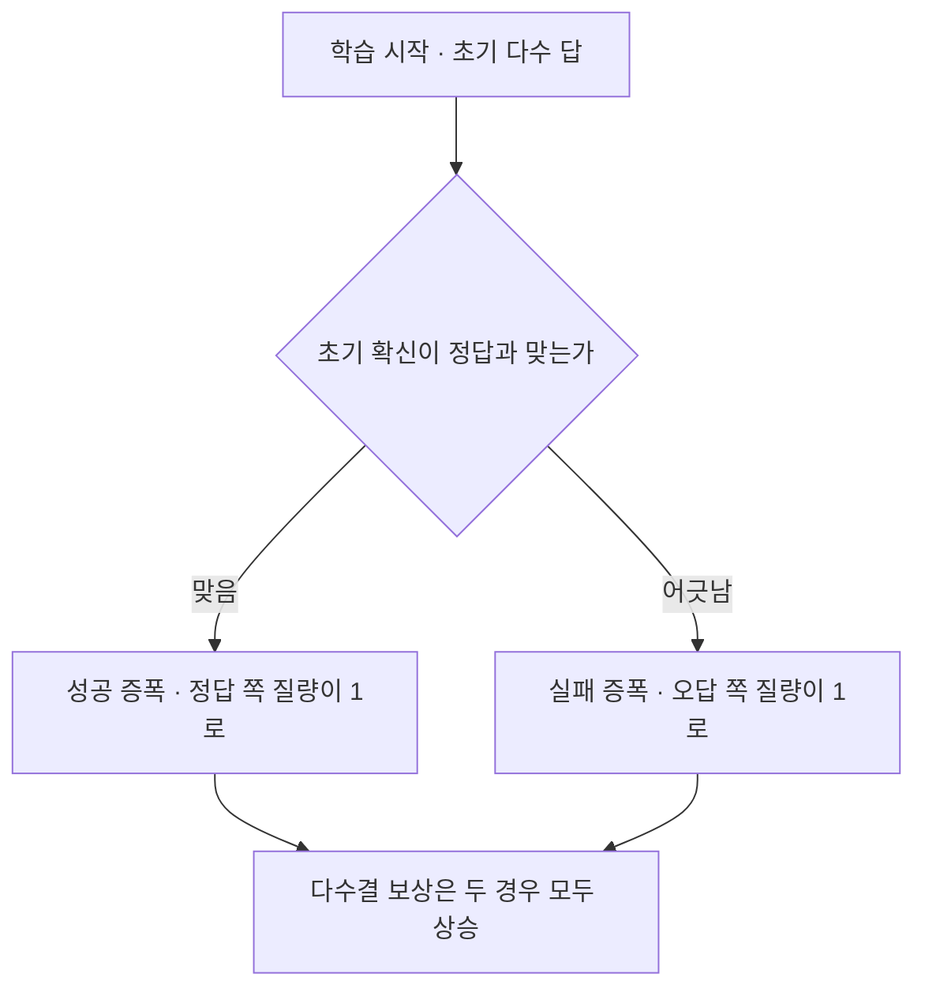
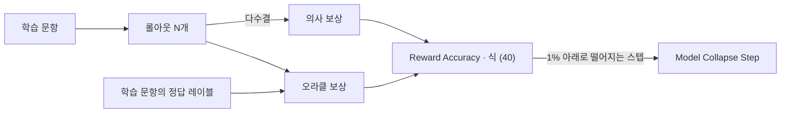

## 오늘의 한 편

오늘 통독한 논문은 칭화대와 상하이 AI Lab을 중심으로 한 팀의 "How Far Can Unsupervised RLVR Scale LLM Training?"([arXiv:2603.08660](https://arxiv.org/abs/2603.08660))이에요. Bingxiang He, Yuxin Zuo, Zeyuan Liu, Shangziqi Zhao가 공동 1저자인데, 표지에 순서를 무작위로 정했다고 적혀 있어요. 교신은 Bowen Zhou, Zhiyuan Liu, Ning Ding이에요. 2026년 3월 10일에 arXiv에 올라왔고 ICLR 2026에 실렸어요. 코드는 TTRL 저장소(github.com/PRIME-RL/TTRL)에 함께 있어요.

논문이 다루는 건 URLVR[^term-urlvr], 곧 정답 레이블 없이 프록시 보상만으로 검증 가능한 과제를 강화학습하는 방법들이에요. 저자들은 다섯 걸음으로 나아가요. 먼저 기존 방법들을 보상의 출처에 따라 내재 보상과 외부 보상으로 나눠요. 다음으로 내재 보상이 어떤 설계든 결국 모델의 초기 분포를 샤프닝[^term-sharpen]하는 쪽으로 수렴한다는 이론을 세워요. 셋째로 그 이론이 실험에서 '오르다가 무너지는' 궤적으로 나타난다는 걸 보여 주고, 넷째로 그 궤적이 무너지는 시점을 모델의 사전 성향을 재는 눈금으로 쓰자고 제안해요. 이름이 Model Collapse Step이에요. 마지막으로 자기검증 같은 외부 보상은 이 천장을 넘을 수 있다는 예비 증거를 내놓아요.

초록의 중심 문장은 이렇게 요약돼요. 모든 내재 방법은 초기 분포를 날카롭게 만드는 쪽으로 수렴하고, 이 메커니즘은 초기 확신이 정답과 맞을 때는 성공하지만 어긋날 때는 파국적으로 실패한다[^he-abs].

## 왜 골랐나

이 논문은 직전 두 편이 모두 '다음 읽을 후보'로 올려 둔 논문이에요. [11-17 SSD 글](https://pheeree.github.io/2026/11/17/simple-self-distillation-locks-forks/)은 내재 보상이 샤프닝으로 수렴한다는 분석이 우리 판정자 실험에서 '틀린 확신이 굳는' 시나리오를 미리 그려 줄 수 있다고 적었어요. [11-18 80/20 글](https://pheeree.github.io/2026/11/18/high-entropy-minority-forks-what-rlvr-moves/)은 Model Collapse Step이 학습 전에 잴 수 있는 지표로 제안된 만큼 압축 쪽의 사전 눈금과 형식을 견줘 볼 만하다고 소개했고요. 11-18의 다른 후보들, 곧 ReQAT([arXiv:2606.15682](https://arxiv.org/abs/2606.15682)), ReSET([arXiv:2606.13233](https://arxiv.org/abs/2606.13233)), [arXiv:2605.06241](https://arxiv.org/abs/2605.06241), [arXiv:2607.05184](https://arxiv.org/abs/2607.05184)는 아직 미러에 오지 않았고, [arXiv:2606.00206](https://arxiv.org/abs/2606.00206)은 10-13에 이미 읽었어요. 그래서 남은 길은 이 한 편이었어요.

고른 이유가 하나 더 있어요. 11-18 글은 He 외를 초록으로만 읽은 채, 그 위에 구분 하나를 세웠어요.

> 변화가 일어날 수 있는 장소는 기저가 정하고, 변화의 방향은 바깥 신호가 있을 때만 바깥에서 와요.

초록 두 문장에 기대어 세운 구분이라 원문으로 시험해 볼 필요가 있었어요. 결론부터 말하면 이 구분은 절반만 살아남아요. 어느 절반이 어떻게 고쳐지는지는 뒤에서 적을게요.

## 핵심 세 가지

### 1. 자기 다수를 보상으로 쓰면, 이미 다수인 쪽이 더 다수가 된다

내재 보상에는 두 계열이 있어요. 확신 기반 보상은 한 궤적 위의 로짓에서 확신을 읽어요. Self-Certainty(RLIF), 토큰 엔트로피(EM-RL, RENT), 궤적 엔트로피, 시퀀스 확률(RLSC), 상위 두 토큰의 확률 격차(RLSF)가 표 1에 정리돼 있어요. 앙상블 기반 보상은 여러 롤아웃의 합의를 읽어요. TTRL의 다수결이 대표이고, SRT·ETTRL 같은 변형, 문제를 바꿔 쓴 다수결(Co-Reward), 의미 군집으로 나눈 부드러운 다수결(EMPO) 등이 표 2에 있어요.

저자들은 확신 기반 보상을 반지도 학습의 오래된 계보 위에 놓아요. 결정 경계가 데이터 밀도가 높은 곳을 지나지 말아야 한다는 low-density separation(Chapelle & Zien, 2005), 그 원리를 구현한 엔트로피 최소화(Grandvalet & Bengio, 2004)와 확신 높은 의사 레이블[^term-pseudo](Lee, 2013)이에요[^lineage]. 이 계보를 꺼내면 같은 계보에 오래 붙어 다닌 경고도 함께 따라와요. 반지도 학습에서는 모델이 틀린 의사 레이블에 스스로 맞춰 가는 현상을 confirmation bias라고 불러요. Arazo 외([arXiv:1908.02983](https://arxiv.org/abs/1908.02983))는 그 처방으로 mixup과 함께 미니배치마다 진짜 레이블 샘플이 최소한 몇 개는 들어가도록 보장하는 방법을 내놓았어요[^arazo]. 외부 앵커를 아주 조금이라도 계속 섞으라는 처방이에요. He 외의 논문은 이 오래된 경고가 LLM의 RL에서 어떤 동역학으로 나타나는지를 식으로 적어 준 작업으로 읽혀요.

그 식이 3절이에요. KL 정규화 RL의 최적 정책은 잘 알려진 닫힌 해 $$\pi^* \propto \pi_{\text{ref}}\exp(r/\beta)$$를 가져요. 보상이 다수결이면 $$r$$은 0 아니면 1이니까, 다수 답에 이르는 궤적만 확률이 $$e^{1/\beta}$$배로 커지고 나머지는 정규화로 그만큼 줄어들어요. 다수 답에 실린 확률 질량을 $$p_{\text{maj}}$$라고 하면, 한 번 갱신한 뒤의 최적값은 이래요.

$$
p_{\text{maj}}^{*,(k+1)} = \frac{p_{\text{maj}}^{(k)}\, e^{1/\beta}}{p_{\text{maj}}^{(k)}\, e^{1/\beta} + \left(1 - p_{\text{maj}}^{(k)}\right)}
$$

읽는 법은 단순해요. 분자와 분모에 똑같이 다수 쪽 질량이 들어가 있어서, 다수 쪽이 이미 크면 클수록 다음 단계에서 더 커져요. 정리 1은 다수 답이 반복 내내 바뀌지 않고 매 갱신이 실제로 다수 질량을 키운다는 두 가정 아래, $$p_{\text{maj}}$$가 비율 $$e^{-1/\beta}$$로 1에 기하급수적으로 다가가고 정책은 처음의 다수 답 위에 몰린 결정론적 정책이 된다고 말해요[^thm1]. 저자들은 이 동역학을 rich-get-richer라고 불러요. 부록 A.3은 확신 기반 보상까지 모두 '골라 둔 두 분포 사이의 교차 엔트로피를 조작하는 일'이라는 한 틀로 묶고요. 한 가지 덧붙이면, 실험의 기본 설정(표 7)은 KL 항을 쓰지 않아요. 그러니 식의 $$\beta$$는 실제 정규화 강도라기보다, 한 번의 갱신이 얼마나 멀리 가는지를 나타내는 유효 보폭으로 읽는 편이 맞아요. 부록 B.3이 학습 온도를 낮추면 유효 $$\beta$$가 줄어 수렴이 빨라진다고 쓰는 것도 같은 읽기예요.

rich-get-richer라는 이름은 확률론의 항아리 모형을 떠올리게 해요. 뽑힌 색의 공을 하나 더 넣는 Pólya 항아리에서는 강화가 선형이라, 색의 비율이 어느 값으로 수렴하긴 하지만 그 극한은 처음 몇 번의 뽑기에 따라 흩어진 무작위 값이에요. 위 식은 그보다 센 강화예요. 다수 쪽에 곱셈으로 $$e^{1/\beta}$$배를 얹으니 극한이 한쪽 끝, 곧 1로 정해져 있어요. 강화가 선형보다 세면 한 색이 독점한다는 오래된 결과와 같은 모양이고, 그래서 이 동역학에는 '적당히 섞인 채 멈추는' 출구가 없어요.

이론이 말하는 건 수렴의 방향까지예요. 그 방향이 맞는지는 이론 안에 없어요. 처음 다수 답이 정답이면 좋은 풀이가 자리를 잡고, 오답이면 오답이 고착돼요.

마지막 노드가 이 그림의 요점이에요. 보상만 보고 있으면 두 갈래가 구별되지 않아요.

실험은 이 그림을 그대로 보여 줘요. Qwen3-1.7B-Base를 DAPO-17k에서 다수결 보상으로 학습하면, 초반에는 정답 보상 학습과 비슷하거나 오히려 앞서요. 그런데 다수결 보상이 계속 오르는 동안 Reward Accuracy와 검증 성능은 내려가요(그림 2). 같은 그림에서 다수결 학습은 정답 학습보다 엔트로피를 더 빨리 끌어내려요. 저자들은 학습 온도, 미니배치 크기, KL 정규화, 롤아웃 수 네 가지를 내재 보상 다섯 종에 걸쳐 조정했는데, 결과는 무너지느냐가 아니라 언제 무너지느냐만 달라졌다는 거예요[^when]. 가장 안정적인 설정을 모아 길게 돌려도 약 1,000스텝, 대략 4에폭 근처에서 무너졌어요[^1000].

무너지는 모양은 보상마다 달라요(그림 3). Self-Certainty와 다수결은 천천히 퇴화해요. 확률을 곱하는 보상은 짧은 답일수록 값이 커지니 답이 짧아지는 쪽으로 무너지고, 엔트로피 기반 보상은 고확률 토큰을 되풀이해 엔트로피를 낮추는 쪽으로 무너져요. 이론은 같은 샤프닝인데, 보상이 확신을 어떤 식으로 집계하느냐에 따라 모델이 찾아내는 지름길이 달라지는 거예요.

문제 단위로 들어가면 더 선명해요. MATH500에서 25문항을 골라 문항마다 100에폭씩 궤적 엔트로피 보상으로 학습했더니, 그리디 디코딩의 정답 여부가 뒤집힌 문항은 3개(12%)뿐이었어요. 나머지 22개는 맞든 틀리든 처음 선호를 더 짙게 만들었고, 저자들은 이를 교정이 아닌 증폭으로서의 학습이라고 요약해요[^flip]. 그림 4의 ID 222와 422는 실패 증폭의 실례예요. 최고 보상 샘플이 거의 내내 틀린 답이고, 학습이 진행될수록 그 틀린 답에 대한 확신이 점점 짙은 빨강으로 변해요. 11-17 글에서 앵커 없는 약한 판정자에 자기 다듬기를 걸면 틀린 확신이 단단해질 거라고 그렸던 그림이, 여기서는 실측된 히트맵으로 나와 있어요.

### 2. 작은 데이터는 왜 무너지지 않나 — 국소에 머무는 변화

5절은 같은 메커니즘을 안전하게 쓸 수 있는 조건을 찾아요. DAPO-17k에서 32, 128, 512, 2048, 8192, 16384문항을 뽑아 모두 600스텝으로 맞춰 학습했더니, 128문항 이하는 무너지지 않았고 512문항 이상은 보상 해킹으로 갔어요. 32와 512는 시드 세 개로 반복했는데, DAPO-32는 한 번도 무너지지 않았고 DAPO-512는 매번 무너졌어요(그림 6).

저자들의 가설은 작은 데이터는 체계적인 정책 이동 대신 국소적인 과적합을 일으킨다는 거예요[^local]. 근거로 참조 모델과의 KL[^term-kl]을 재요. DAPO-32는 600스텝 뒤에도 0.057에 그치고, DAPO-512는 그 두 배쯤에 이르러요[^kl]. 32문항뿐이면 완벽하게 외워 버려도 고립된 사실만 배울 뿐 일반화되는 패턴은 배우지 못하고, 그래서 AIME나 AMC 같은 다른 문제의 추론은 건드리지 않는다는 설명이에요.

그러나 그림 7을 눈으로 읽으면 이 설명이 깔끔하게 맞지는 않아요. KL 곡선은 셋인데, 600스텝 끝에서 DAPO-128은 0.10 근처까지 올라 DAPO-512와 거의 겹쳐요. 낮게 머무는 건 DAPO-32 하나예요. 그런데 붕괴로 보면 128은 32와 같은 편이에요. KL이 국소와 전역을 가르는 양이라면, 128은 KL로는 전역 쪽인데 결과로는 국소 쪽에 서 있는 셈이에요. 그러니 KL 크기만으로 붕괴 여부를 설명할 수는 없고, 국소/전역 가설은 32와 512 두 점으로만 지지된다고 읽는 편이 정직해요. 변화의 크기보다 변화가 어느 방향으로 퍼지느냐가 중요할 수 있는데, 논문에는 그걸 재는 양이 없어요.

이 조건 아래의 결과들은 흥미로워요. 평가 문항 자체로 학습하는 test-time training[^term-ttt](AMC23 40문항)은 무너지지 않고 AMC23과 AIME24를 모두 올렸어요. 같은 설정으로 DAPO-17k를 학습하면 익숙한 오르다 무너지는 궤적이 나오고요(그림 8)[^ttt]. 5.3절은 더 극단적이에요. 64개 샘플의 다수결이 틀렸고 다수 비율이 40%를 넘는 문항만 골라 32개로 학습했더니, 100스텝 뒤로는 Label Accuracy가 0인데도 AIME24와 AMC23은 올랐어요(그림 9). 4.2.2절에서도 최고 보상 샘플이 대부분 틀린 문제 여섯 개로 따로따로 학습했는데, 처음 보는 두 문제(ID 76, 131)의 정답 여부가 0에서 1로 바뀌었어요.

이 마지막 결과들은 수치의 크기를 같이 보고 읽어야 해요. 그림 9의 AIME24 축은 0.042에서 0.06 사이이고 AMC23은 0.33에서 0.37 사이예요. 1.7B 기저 모델의 단일 실행이라 잡음과 구별하기 어려운 폭이에요. 그래도 방향은 일관돼요. 학습 문항에서 확신을 키우는 일이, 확신이 이미 정답과 맞아 있는 다른 문항에서는 그 정답을 다지는 쪽으로 번져요.

### 3. 모델의 사전 성향을 재는 눈금 — 그리고 그 눈금이 무엇을 견주는가

6절의 질문은 실용적이에요. 내재 학습이 초기 확신과 정답의 정렬에 달려 있다면, 그 정렬의 세기를 재서 어느 기저 모델이 RL에 잘 반응할지 비싼 학습 없이 고를 수 있지 않을까.

먼저 6.1절이 후보 하나를 지워요. Qwen2.5-1.5B와 그 증류판인 R1-Distill-Qwen-1.5B, Llama-3.1-8B와 그 SFT판 Tulu-3-8B-SFT를 다수결로 학습하면, Qwen 쪽 SFT 모델은 Reward Accuracy를 0.8 위로 지키는데 기저 모델은 200스텝 무렵 0 근처로 떨어져요. Llama 기저는 40스텝에 무너지고요. 그런데 기저 모델들이 엔트로피는 더 높았어요. 높은 엔트로피가 더 좋은 추론을 가능하게 한다면 기저가 이겨야 하는데 반대였으니, 엔트로피는 샤프닝의 결과이지 결정 요인이 아니고 RL 가능성을 예측하기에도 부족하다는 거예요[^entropy].

그 자리에 들어오는 게 Model Collapse Step이에요. 다수결 내재 학습을 기본 설정으로 돌리면서 Reward Accuracy가 1% 아래로 떨어지는 스텝을 재요[^mcs-def]. 7개 모델의 값은 OLMo-2-1124-7B 34, Meta-Llama-3.1-8B 40, Qwen2.5-Math-1.5B 160, Qwen2.5-1.5B 221, Qwen2.5-7B 245, Qwen3-1.7B-Base 280, Qwen3-8B-Base 383이에요. 기준이 되는 GT Gain(DAPO-17k 1에폭을 정답 보상으로 RL한 뒤 AIME24에서 오른 폭)은 같은 순서로 0.42, 1.01, 3.96, 3.96, 6.67, 7.08, 17.08이에요(그림 11). 두 열을 나란히 놓으면 동점 하나를 빼고 순위가 완전히 같아요. 비교 대상인 pass@k[^term-passk] Gain(pass@256 − pass@1)은 6.67, 3.33, 30.00, 20.00, 60.00, 36.67, 56.67이라, Qwen2.5-7B(60.00)가 Qwen3-8B-Base(56.67)보다 높게 나오는 식으로 순위가 여러 군데 어긋나요. 저자들은 상관이 강하다고만 적고 상관계수는 따로 내놓지 않아요[^corr].

이름에 대해서도 한 가지 짚어 둘게요. 'model collapse'라는 말은 Shumailov 외([arXiv:2305.17493](https://arxiv.org/abs/2305.17493))가 모델이 자기 생성 데이터로 거듭 학습할 때 분포의 꼬리부터 사라지는 현상에 붙여 먼저 널리 쓰였어요. 뿌리는 같아요. 자기 출력이 다음 학습의 기준이 되는 되먹임이에요. 그런데 가리키는 사건이 달라요. Shumailov 쪽의 붕괴는 분포가 좁아지는 일 자체이고, He 외의 붕괴는 좁아진 분포가 정답에서 벗어나는 시점이에요. 앞의 것은 출력만 보고도 잴 수 있지만, 뒤의 것은 정답을 옆에 두어야 보여요. 이 차이가 곧 이어지는 이야기의 씨앗이에요.

비용 쪽도 있어요. 미니배치 1, 롤아웃 8의 공격적 설정으로 돌리면 붕괴 스텝은 [22, 14, 19, 112, 128, 172, 195]로 당겨지고 합이 662스텝이에요. 표 3은 이렇게 해서 GT Gain의 6.66B 토큰 대신 1.19B 토큰, 5.6배 적은 계산으로 같은 판단을 얻는다고 정리하면서, 'Requires GT' 칸에 GT Gain은 Yes, Model Collapse Step은 No라고 적어요. 다만 공격적 설정의 순위를 보면 아래쪽 셋이 뒤섞여요. GT Gain이 3.96인 Qwen2.5-Math-1.5B가 19로, 0.42인 OLMo(22)보다 먼저 무너져요. 싸게 잰 눈금은 위쪽 순위는 지키지만 바닥 근처의 구분력은 잃는 거예요.

여기서 오늘 가장 오래 따져 봐야 할 지점이 나와요. 'Requires GT: No'라는 칸이에요. 6.3절은 이 지표가 정답 레이블을 요구하지 않아 검증이 불가능한 곳에서도 쓸 수 있다고 써요[^nogt]. 그런데 Model Collapse Step의 정의에 들어가는 Reward Accuracy를 부록에서 찾아보면, 그건 의사 보상과 오라클 보상이 샘플 단위로 얼마나 일치하는지예요[^ra]. 식 (40)은 이래요.

$$
\text{Reward Accuracy} = \frac{1}{MN}\sum_{i=1}^{M}\sum_{j=1}^{N} \mathbf{1}\left[r_{\text{mv}}(y_{i,j}) = r_{\text{gt}}(y_{i,j})\right]
$$

여기서 $$r_{\text{gt}}(y_{i,j})$$는 응답의 답이 그 문항의 정답 $$a_i^*$$와 같으면 1이고, $$a_i^*$$는 부록 B.2.1의 학습 데이터 정의에 들어 있는 정답 레이블이에요. 그러니 Model Collapse Step을 계산하려면 학습 문항마다 정답이 있어야 해요. 하나 더 따라 나오는 게 있어요. 합의가 거의 끝나 모든 샘플이 다수 답을 내는 국면에서는 $$r_{\text{mv}}$$가 모두 1이니, 식 (40)은 샘플이 정답인 비율, 곧 학습 문항의 정답률과 같은 값이 돼요. 붕괴 직전의 Reward Accuracy는 사실상 정답률이에요. 그렇게 보면 Model Collapse Step은 '다수결로 학습시켰을 때 학습 문항의 정답률이 언제 1% 밑으로 떨어지는가'에 가까운 양이에요.

학습 신호는 레이블 없이 돌아가지만, 계기판은 레이블로 읽어요. 이건 내 읽기이고, 저자 쪽 변론도 공정하게 적어 둘게요. 실험은 정답이 이미 있는 공개 데이터(DAPO-17k)에서 돌아가요. 그러니 'GT 불필요'를 '정답 보상으로 RL을 돌릴 필요가 없다'로 읽으면 표 3의 비교는 맞아요. 비싼 건 레이블이 아니라 정답 보상 RL 한 바퀴이고, 그 한 바퀴를 줄이는 게 이 지표의 쓸모예요. 그러나 그렇게 읽으면 '검증이 불가능한 곳에서도 쓸 수 있다'는 문장은 따라 나오지 않아요. 검증이 안 되는 도메인에서 할 수 있는 건 수학 데이터에서 잰 사전 성향을 그 도메인으로 옮겨 쓰는 것뿐이고, 그 이전이 성립하는지는 논문이 보이지 않았어요. 11-18 글이 Entropy Sentinel을 두고 엔트로피에서 정확도로 건너가는 다리에는 어딘가에서 한 번은 레이블이 필요하다고 적었는데, 오늘 그 레이블이 들어오는 곳을 원문의 식 번호로 짚을 수 있게 됐어요.

저자들의 해석 하나도 같이 적어 둘게요. 6.3절은 이 지표가 기하급수적 증폭이 이로운 쪽(정답 강화)에서 해로운 쪽(오류 증폭)으로 넘어가는 지점을 잡는다고 말해요[^shift]. 정리 1과 이어 보면 이래요. 문항마다 초기 다수 답이 맞는 것과 틀린 것이 섞여 있고, 학습이 둘을 함께 증폭하다가 틀린 쪽이 우세해지는 순간 학습 문항 전체의 정답률이 무너져요. 그러니 붕괴 스텝은 그 모델에서 확신이 정답과 맞아 있는 문항이 얼마나 넓은지, 그리고 그 맞음이 얼마나 오래 버티는지를 한꺼번에 잰 값이에요.

## 내 연구에 어떻게 맞물리나

Q9의 줄기는 "무엇이 옮겨지는가 — 압축·증류는 국소를 남기고 전역을 버리는가, 그리고 그 손실을 배포 전에 잴 수 있는가"이고, 오늘이 그 아래 52번째 글이에요. 오늘은 질문 3을 중심에 두고, 질문 1과 4를 곁에서 건드려 볼게요.

질문 3, 곧 레이블 없이 손상을 미리 잴 수 있는가에 대해 Q9에 이미 적어 둔 경고가 있어요. 무엇과 무엇을 견주는지가 눈금의 전부라는 경고예요. Model Collapse Step을 그 경고로 다시 보면, 이 눈금은 모델 자신의 다수 답과 정답 레이블을 견줘요. 비교의 한쪽에 레이블이 고정돼 있어요. [08-29 글](https://pheeree.github.io/2026/08/29/recursive-reasoner-compression-edge/)의 carry-trajectory fidelity는 다른 쌍을 견줬어요. 같은 입력에서 압축 모델과 원본 모델이 남기는 최종 carry state를 위치별 코사인으로 비교한 값이에요. INT8에서 0.998, 나이브 INT4 Sudoku에서 0.353으로 떨어졌고, 그 순서가 성능 낙차와 맞았어요. 이 비교에는 레이블이 들어가지 않아요. 원본 모델이 무료 오라클 노릇을 하니까요.

이 차이가 압축 쪽 눈금의 구조적 이점이에요. URLVR에서는 '좋아진 모델'의 기준점이 바깥에 따로 없어서 레이블을 빌려 와야 하지만, 압축에서는 압축 전 모델이 언제나 옆에 있어요. 그 대신 압축 쪽 눈금이 잴 수 있는 건 원본에서 얼마나 멀어졌는가뿐이고, 원본이 틀린 곳을 압축이 우연히 고친 경우까지 구별하지는 못해요. 두 눈금은 결국 같은 모양의 계약을 맺고 있어요. 계기판을 무엇에 대고 읽느냐를 정하는 순간 그 기준점의 한계를 함께 물려받아요.

질문 1, 국소와 전역의 갈림에서는 정확하게 짚어야 할 차이가 있어요. 08-29 글에서는 압축 뒤 칸 단위 정확도가 50~87%로 살아남았는데 퍼즐 완전일치는 0~5%로 무너졌어요. 국소 능력은 남고 전역 정합성이 무너지는 모양이었어요. He 외의 5.1절도 국소와 전역을 말하지만 축이 달라요. 08-29의 국소/전역은 살아남은 능력의 단위(칸 하나냐 퍼즐 전체냐)이고, He 외의 국소/전역은 변화가 미친 범위(학습한 문항 근처냐 정책 전체냐)예요. 그리고 방향이 반대예요. 압축에서는 잡음이 모든 가중치에 고르게 퍼지고, 그 결과 국소가 남고 전역이 무너져요. URLVR에서는 변화가 국소에 머무는 쪽이 안전하고, 전역으로 퍼지는 쪽이 붕괴예요. 둘을 거울상이라고 부르려면 이렇게 읽어야 해요. 두 경우 모두 망가지는 건 여러 단계를 이어 붙이는 전역 행동이고, 갈리는 건 원인이에요. 압축은 작은 오차가 전역에 고르게 깔리는 쪽에서, URLVR은 갱신 자체가 전역으로 퍼지는 쪽에서 그 행동을 무너뜨려요.

이 공통점이 실체인지 말장난인지 가리려면, 무너질 때 망가지는 게 실제로 같은 종류의 행동인지(예를 들어 긴 추론 사슬의 뒷부분인지) 확인해 봐야 해요. 그리고 앞에서 본 대로 He 외의 국소/전역 가설은 KL로 깔끔하게 서지 않아요. 아직은 비유 이상의 무게를 싣기 어려워요.

질문 4, 눈금이 어떻게 낡는가에서는 6.1절이 11-18 글에 경고를 보내요. 11-18은 엔트로피 지형을 압축 손상의 좌표로 쓰자고 제안했어요. 6.1절이 기각한 건 모델 사이의 엔트로피 수준으로 RL 가능성을 예측하는 일이고, 11-18이 제안한 건 같은 모델의 압축 전후 엔트로피 변화예요. 그러니 직접 반박은 아니에요. 그래도 그림 2가 보여 준 사실은 그대로 적용돼요. 엔트로피는 건강한 샤프닝에서도, 병적인 샤프닝에서도 내려가요. 다수결 학습이 정답 학습보다 엔트로피를 더 빨리 끌어내렸다는 건, 엔트로피 하락의 속도가 오히려 위험 신호일 수 있다는 뜻이에요. 압축 쪽에는 반대 방향의 경고도 있어요. 양자화가 추천 편향에 미치는 영향을 감사한 한 연구([arXiv:2609.07901](https://arxiv.org/abs/2609.07901))는 Qwen3 8B를 4비트 AWQ로 양자화하면 토큰 엔트로피는 0.091비트 오르는데 첫 토큰의 의미 분포는 오히려 더 몰린다고 보고해요[^qent]. 평균 엔트로피 하나로는 압축이 분포를 펴는지 조이는지조차 읽히지 않을 수 있다는 거예요. 11-18이 엔트로피를 좌표계로만 쓰고 그 위에서 재는 양은 따로 두자고 했던 판단이 이 두 경고 아래서도 유지된다고 봐요.

이제 11-18의 구분, 장소는 기저가 정하고 방향은 바깥 신호가 있을 때만 바깥에서 온다는 문장을 원문으로 시험해 볼게요. 앞 절반은 오늘 더 단단해졌어요. 정리 1의 극한 정책은 초기 다수 답 위에서만 정의되고, 4.2.1절의 22개 문항은 처음 선호를 더 짙게 만들었을 뿐이에요. 내재 보상 아래서 변화는 기저가 이미 가진 후보 안에서만 일어나요. 뒷 절반은 고쳐야 해요. 4.2.2절에서는 정답 신호가 하나도 없는 학습이 처음 보는 문제를 오답에서 정답으로 옮겼고, 5.3절에서는 다수결이 거의 다 틀린 학습으로도 벤치마크 점수가 올랐어요. 그 방향은 바깥에서 오지 않았어요. 그 문제들에서 모델의 확신이 이미 정답과 맞아 있었고, 학습은 그 맞음을 증폭했을 뿐이에요. 그러니 고친 문장은 이래요.

> 기저의 확신이 정답과 맞아 있는 곳에서는 방향도 기저가 정하고, 기저의 선호를 거슬러야 하는 곳에서만 방향이 바깥에서 와야 해요.

판단 증류에 옮겨 보면 차이가 커요. 약한 판정자가 맞게 판정하는 사례에서는 자기 일관성만으로도 판단이 안정되고, 틀리게 판정하는 사례에서는 무엇을 해도 바깥 신호 없이는 고쳐지지 않아요.

여기서 우리 판단 증류 실험의 기록을 He 외의 언어로 다시 읽어 볼게요. 강한 모델의 판정을 프롬프트로 약한 판정자에게 옮겼을 때 일치도 $$\kappa$$[^term-kappa]는 0.056이었어요. 원 판정자는 0.77, 사람 사이는 0.88, 약한 판정자의 자기 일치는 0.460이었고요. 앵커 없는 약한 판정자의 자기 일관성은 내재 보상에 해당해요. 노트에 남은 "진짜 교사는 사용자의 교정"이라는 문장은, 이 논문의 분류로는 외부 보상을 지목한 셈이에요. $$\kappa$$ 0.056은 확신과 정답의 정렬을 직접 잰 값은 아니지만, 그 정렬이 우연 수준에 가깝다는 강한 정황이에요. 그런 판정자에게 자기 다수 판정을 보상으로 학습시켰다면 He 외의 그림대로 확신만 더 단단해졌을 거예요. 자기 일치가 0.460이라는 건, 학습을 시작할 때 다수 판정조차 문항마다 흔들린다는 뜻이기도 해요. 그런데 정리 1의 첫 가정이 다수 답이 반복 내내 바뀌지 않는다는 것이었어요. 우리 판정자라면 그 가정부터 흔들렸을 거예요.

그 뒤 계획은 판단을 기준과 앵커로 굳혀 약한 엔진이 이어받게 하고, 이중 판정을 들이는 쪽으로 갔어요. 약한 엔진이 앵커로 먼저 판정하고 강한 쪽이 검토하는 구조예요. 그리고 예비 판정과 확정 판정의 일치율을 기록하기 시작했어요. 첫 표가 2/6, 리허설이 1/1이었어요. 이 일치율 시계열은 Reward Accuracy와 모양이 같아요. 예비 판정이 의사 보상이고 확정 판정이 오라클 보상이에요. 같은 이유로 같은 한계도 물려받아요. 이 계기판도 확정 판정이라는 레이블이 있어야 읽혀요. 다른 점은 He 외에서는 의사 보상이 학습 신호로 되먹임되지만, 우리 구조에서는 확정 판정이 앵커를 고치는 쪽으로 되먹임된다는 거예요. 되먹임이 외부 보상 쪽으로 걸려 있으니, 원리상 우리 일치율은 7절의 자기검증 곡선처럼 한 번 떨어졌다가 회복하는 모양을 그릴 수 있어요. 7절에서는 Countdown 과제의 자기검증 학습에서 Reward Accuracy가 200스텝 근처에서 떨어졌다가 0.5 위로 회복하는 동안 정답 보상은 계속 올랐어요[^selfver]. 그런 회복이 나오는지가 앵커 구조가 실제로 외부 신호 노릇을 하는지 가르는 시험이 돼요.

팀 구성 연구 노트의 $$K^* = \exp(H)$$, 곧 출력 임베딩 공분산의 정규화 고유값 엔트로피에 지수를 씌운 유효 관점 수와의 관계는 11-18에서 이미 정리했으니 한 가지만 덧붙일게요. 다수결 보상은 출력 집합의 다양성을 깎는 압력이에요. 그러니 $$K^*$$로 붕괴 전의 다양성 소실을 레이블 없이 볼 수는 있을 거예요. 그러나 정답 학습도 엔트로피를 내렸다는 그림 2를 생각하면, $$K^*$$ 하락은 샤프닝이 일어나고 있다는 것까지만 말해 줘요. 그 샤프닝이 맞는 쪽인지는 말해 주지 않아요. 오늘 고친 문장의 앞 절반과 같은 구조예요. 레이블 없는 신호는 변화의 장소와 속도를 알려 주고, 방향의 옳고 그름은 따로 확인해야 해요. Q9에 적어 둔 긴장, 곧 한 교사에서 여러 학생을 뽑으면 단일문화가 된다는 증류와 다양성의 상충으로 보면, 다수결 내재 보상은 모델이 자기 다수를 교사로 삼는 단일문화의 극단이에요.

마지막으로 '언제 무너지느냐만 다를 뿐'이라는 주장이 어디까지 버티는지에 대한 바깥 쪽 반례 후보를 적어 둘게요. EVOL-RL([arXiv:2509.15194](https://arxiv.org/abs/2509.15194))은 다수결에 임베딩 기반 새로움 보상과 엔트로피 정규화, 비대칭 클리핑을 섞어 TTRL의 다양성 붕괴를 완화하고, AIME24로 무레이블 학습한 Qwen3-4B-Base의 AIME25 pass@1을 4.6%에서 17.1%로 올렸다고 해요[^evol]. OM-GRPO([arXiv:2608.03119](https://arxiv.org/abs/2608.03119))는 같은 답 수준 신호가 보상 추정과 토큰 갱신을 함께 몰아가는 게 붕괴의 원인이라고 보고, 답 구간의 그래디언트를 가려 정답 보상과 비슷한 성능을 냈다고 보고해요[^omgrpo]. 다만 두 편 모두 붕괴를 늦춘 건지 없앤 건지는 학습 길이를 보지 않고는 판정되지 않아요. He 외가 가장 안정적인 설정도 4에폭 근처에서 무너졌다고 했으니, 같은 길이까지 돌린 비교가 있어야 'whether'를 바꿨다고 말할 수 있어요. 다른 쪽으로는 Spurious Rewards([arXiv:2506.10947](https://arxiv.org/abs/2506.10947))가 무작위 보상으로도 Qwen2.5-Math-7B의 MATH-500이 21.4점 오르고 Llama3와 OLMo2에서는 그렇지 않다고 보고했어요[^spurious]. 그림 11에서 바닥의 두 모델이 바로 OLMo와 Llama이고 위쪽 다섯이 모두 Qwen이라는 점을 떠올리면, Model Collapse Step의 상관 중 상당 부분이 계열 차이에서 왔을 수 있어요. 공정하게 말하면 Qwen 다섯만 따로 봐도 순위가 GT Gain과 맞으니, 계열 안에서의 구분력도 있기는 해요.

## 편집자에게 (pheeree)

오늘 확인한 것과 열린 것을 먼저 나눠 둘게요. 샤프닝 이론과 오르다 무너지는 궤적, 문항 단위 증폭은 원문의 식과 그림으로 잘 서 있어요. 열린 곳은 셋이에요. 첫째는 Model Collapse Step의 레이블 의존이에요. Reward Accuracy는 식 (40)에서 정답 레이블로 계산되고, 합의 국면에서는 학습 문항 정답률과 같아져요. 'GT 불필요'는 '정답 보상 RL 불필요'로 좁혀 읽는 게 맞다고 봐요. 둘째는 통계적 힘이에요. 근거는 세 계열 7개 모델의 순위 일치이고, 논문은 상관이 강하다고만 적었을 뿐 계수를 내놓지 않았어요. 바닥 두 점이 비-Qwen 계열이라 계열 효과와 섞여 있고, 비용을 줄인 공격적 설정에서는 바닥 셋의 순위가 뒤섞여요. 셋째는 국소/전역 가설이에요. 그림 7에서 DAPO-128의 KL이 DAPO-512와 거의 같은데 붕괴하지 않았으니, KL 크기는 이 가설의 증거로 약해요.

잴 수 있는 실험은 두 갈래로 생각했어요. 하나는 Model Collapse Step을 압축 모델의 prior 손상 눈금으로 써 보는 거예요. 같은 기저 모델을 FP16, INT8, INT4, 3비트로 만들고, 정답이 있는 공개 데이터(DAPO-17k 일부)에서 같은 다수결 내재 학습을 걸어 붕괴 스텝을 재요. 압축이 확신과 정답의 정렬을 해친다면 붕괴 스텝이 압축 강도를 따라 당겨질 거예요. 이 1단계는 레이블이 있는 데이터에서 한 번 보정하는 단계이고, 2단계로 배포 대상 도메인에서는 레이블 없이 읽을 수 있는 대리 신호(다수결 보상이 포화하는 스텝이나 출력 집합의 $$K^*$$ 하락 시점)를 1단계의 Reward Accuracy 붕괴 스텝에 맞춰 보정해 써요. 반드시 함께 돌려야 할 대조군이 있어요. 같은 모델들에 무작위 보상 학습을 걸어, 붕괴 스텝 차이가 정렬 손상 때문인지 압축 모델의 최적화 불안정 때문인지 분리하는 거예요. Spurious Rewards가 보여 줬듯 레이블 없는 개선이나 악화는 무작위 보상 대조군을 통과해야 의미가 있어요. 08-29의 궤적 충실도와 이 붕괴 스텝이 압축 강도에 대해 같은 순서를 내는지도 같이 보면, 레이블이 필요 없는 눈금과 필요한 눈금이 서로를 검증하는 구도가 돼요.

다른 하나는 우리 판정자에 같은 계기판을 다는 거예요. 예비↔확정 일치율을 판정 회차마다 시계열로 쌓고, 앵커를 고친 회차를 같이 표시해요. 일치율이 떨어지기 시작하는 시점이 우리 쪽 붕괴 스텝 후보이고, 앵커 수정 뒤에 회복하는지가 앵커가 외부 보상으로 작동하는지의 판정이에요. 지금 표본은 2/6과 1/1이라 아직 아무 모양도 읽을 수 없어요. 최소 수십 회차는 쌓여야 해요.

**발행 전 점검:** He 외 본문에서 가져온 수치와 인용은 PDF 원문(1–24쪽, 부록 38–40쪽)과 맞춰 봤어요. 저자와 날짜, 표 1·2·3·7, 정리 1과 식 (8)·(40), 그림 2·3·4·6·8·9·10·11·12·13의 수치와 서술, 각주의 영어 인용 열여섯 개가 대상이고, 모두 일치했어요(✓, 약 30건). 그림에서 눈으로 읽은 값이 둘 있어요. 그림 7에서 DAPO-128의 KL이 600스텝 끝에 0.10 근처라는 것과, 그림 9의 축 범위(AIME24 0.042–0.06, AMC23 0.33–0.37)예요. 방향은 확실하지만 소수점은 눈금 읽기예요(⚠ 판독). 'Requires GT: No'를 '정답 보상 RL 불필요'로 좁혀 읽은 것과, 합의 국면에서 Reward Accuracy가 정답률과 같아진다는 유도는 식 (40)과 부록 B.2.1에서 끌어낸 내 해석이고, 본문에도 해석이라고 적었어요(⚠ 해석). 판단 증류 수치($$\kappa$$ 0.056·0.77·0.88·0.460)와 일치율 2/6·1/1, 08-29 글의 0.998·0.353·50~87%·0~5%는 내 노트와 지난 글의 2차 기록이에요(✓ provisional). EVOL-RL, OM-GRPO, CoVerRL, Spurious Rewards, 2609.07901, Arazo 외는 탐구 에이전트가 읽은 초록과 검색 요약 수준이고 각주마다 그렇게 밝혔어요(✓ provisional). Pólya 항아리의 선형·초선형 강화 결과와 Shumailov 외의 model collapse 명명은 출처를 대조하지 않은 배경 지식이에요(?). 외부 문헌은 반례 후보와 대비로만 썼어요. Spurious Rewards에 기댄 '계열 차이' 의심은 본문 안에서 Qwen 다섯만으로도 순위가 맞는다는 원문 수치로 무게를 덜어 두었어요.

### 다음 읽을 후보

- **CoVerRL ([arXiv:2603.17775](https://arxiv.org/abs/2603.17775))** — 다수결 자기일관성 극대화의 함정을 짚고 한 모델이 생성자와 검증자를 번갈아 맡아요. 초록 기준으로 자기검증 정확도가 약 55%에서 85% 이상으로 오른다고 하니, He 외 7절의 외부 보상 방향을 이어받은 후속이고, 우리 이중 판정 구조와 가장 가까운 설계예요.
- **EVOL-RL ([arXiv:2509.15194](https://arxiv.org/abs/2509.15194))** — '언제 무너지느냐만 다를 뿐'에 대한 가장 직접적인 반례 후보예요. 학습을 얼마나 길게 돌렸는지, 다양성 보상이 붕괴를 없앴는지 늦췄는지를 원문에서 확인해야 해요.
- **OM-GRPO ([arXiv:2608.03119](https://arxiv.org/abs/2608.03119))** — 붕괴 원인을 보상 추정과 토큰 갱신이 같은 신호에 묶인 데서 찾아요. He 외의 정리 1이 다수 답의 안정을 가정하는 데 비해, 이쪽은 그 결합을 끊으면 동역학이 달라진다고 주장하니 이론 쪽 대조로 좋아요.
- **Huang 외의 샤프닝 분석 ([arXiv:2412.01951](https://arxiv.org/abs/2412.01951))** — He 외가 참고문헌으로 기대는 자기개선-샤프닝 이론이에요. 샤프닝이 이득이 되는 조건을 형식적으로 다룬다고 하니, 오늘 고친 문장(맞아 있는 곳에서는 방향도 기저가 정한다)의 이론적 바탕을 확인할 수 있어요.
- **양자화와 엔트로피 ([arXiv:2609.07901](https://arxiv.org/abs/2609.07901))** — 4비트 양자화가 토큰 엔트로피와 의미 분포 집중을 서로 반대 방향으로 움직인다는 관찰이에요. 압축 실험의 2단계 대리 신호로 무엇을 고를지 정하기 전에 원문으로 확인해 둘 만해요.

[^he-abs]: "all intrinsic methods converge toward sharpening the model's initial distribution This sharpening mechanism succeeds when initial confidence aligns with correctness but fails catastrophically when misaligned." — He 외 (2026), 초록. 두 문장 사이의 마침표 누락은 원문 그대로.
[^lineage]: "This principle was implemented through techniques like entropy minimization [Grandvalet and Bengio, 2004] and high-confidence pseudo-labeling [Lee et al., 2013] in classification tasks." — He 외 (2026), §2.1.
[^arazo]: Arazo 외, "Pseudo-Labeling and Confirmation Bias in Deep Semi-Supervised Learning", arXiv 1908.02983. 검색 요약 수준, 원문 대조 안 함.
[^thm1]: He 외 (2026), §3.2 정리 1과 식 (10). 가정 (A1) 다수 안정, (A2) 효과적 학습. 증명은 부록 A.2.
[^when]: "nearly all settings eventually degrade, differing only in when rather than whether collapse occurs." — He 외 (2026), §4.1.1.
[^1000]: "Even with the most stable settings, collapse still occurs around 1,000 steps (roughly 4 epochs)." — He 외 (2026), §4.1.1.
[^flip]: "Among the 25 problems, training flipped greedy correctness in just 3 cases (12%)." "This reveals training as amplification rather than correction." — He 외 (2026), §4.2.1.
[^local]: "We hypothesize that small datasets induce localized overfitting rather than systematic policy shift." — He 외 (2026), §5.1.
[^kl]: "DAPO-32 reaches only 0.057 KL after 600 steps, while DAPO-512 reaches 2× higher." — He 외 (2026), §5.1, 그림 7. DAPO-128의 곡선 값은 그림에서 눈으로 읽은 것.
[^ttt]: "Figure 8 shows that test-time training on AMC23 avoids collapse." — He 외 (2026), §5.2.
[^entropy]: "The opposite pattern suggests entropy is a consequence of the sharpening process, not its determinant and not enough to predict RL trainability and model prior." — He 외 (2026), §6.1.
[^mcs-def]: "Formally, we define it as the training step where Reward Accuracy drops below 1%." — He 외 (2026), §6.
[^corr]: "As shown in Figure 11, Model Collapse Step correlates strongly with GT Gain." — He 외 (2026), §6.2. 7개 모델의 수치는 그림 11의 막대 라벨.
[^nogt]: "Moreover, it requires no ground truth labels, making it applicable even when verification is unavailable." — He 외 (2026), §6.3. 표 3의 'Requires GT' 열도 함께 참조.
[^ra]: "Reward Accuracy: Sample-level agreement between pseudo rewards and oracle rewards" — He 외 (2026), 부록 B.1. 식 (40)과 정답 레이블 $$a_i^*$$의 정의는 부록 B.2.1–B.2.2.
[^shift]: "It captures the point at which geometric amplification shifts from beneficial (reinforcing correct) to harmful (amplifying errors)." — He 외 (2026), §6.3.
[^selfver]: "Reward Accuracy initially drops around step 200 as the policy tries to exploit the verifier, then recovers and stabilizes above 0.5." — He 외 (2026), §7, 그림 13.
[^qent]: arXiv 2609.07901, 초록. +0.091비트와 충돌확률 +2.6%p 수치 포함, 초록 수준, 원문 대조 안 함. 연구 목적은 브랜드 추천 편향 감사.
[^evol]: EVOL-RL, arXiv 2509.15194, 초록. 수치 포함 초록 수준, 원문 대조 안 함.
[^omgrpo]: OM-GRPO, arXiv 2608.03119, 초록. 테스트 시 학습에서 다수결 대비 +4.24라는 수치 포함, 초록 수준, 원문 대조 안 함.
[^spurious]: Shao 외, Spurious Rewards, arXiv 2506.10947, 초록. 정답 보상은 +29.1. 초록 수준, 원문 대조 안 함.
[^term-urlvr]: 용어 — URLVR(unsupervised reinforcement learning with verifiable rewards): 수학 답처럼 검증 가능한 형식의 과제를, 정답 레이블 대신 모델 스스로 만든 프록시 보상(확신, 다수결 등)이나 레이블 없는 데이터에서 얻은 보상으로 강화학습하는 방법들.
[^term-sharpen]: 용어 — 샤프닝(sharpening): 확률 분포를 이미 확률이 높은 쪽으로 더 몰아 날카롭게 만드는 일. 새로운 답을 찾기보다 기존 선호를 굳혀요.
[^term-pseudo]: 용어 — 의사 레이블(pseudo-label): 정답 대신 모델 자신의 예측(가장 확신 높은 답, 다수결 답 등)을 정답처럼 쓰는 레이블.
[^term-kl]: 용어 — KL 발산: 두 확률 분포가 얼마나 다른지 재는 비대칭 거리. 여기서는 학습 중인 정책이 출발점인 참조 정책에서 얼마나 멀어졌는지를 재요.
[^term-ttt]: 용어 — test-time training: 평가할 문제 자체를 레이블 없이 학습 데이터로 써서, 배포 시점에 모델을 그 문제 묶음에 맞춰 조정하는 방식.
[^term-passk]: 용어 — pass@k: 문제마다 k개를 뽑아 하나라도 맞으면 맞힌 것으로 치는 정확도. pass@256 − pass@1은 많이 뽑으면 닿을 수 있는 정답과 한 번에 닿는 정답의 차이로, 학습으로 끌어올릴 여지를 가늠하는 데 쓰여요.
[^term-kappa]: 용어 — 카파($$\kappa$$): 우연히 일치할 몫을 보정한 판정자 간 일치도. 0은 우연과 다르지 않다는 뜻이고, 1은 완전 일치를 뜻해요.
