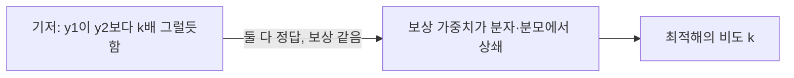
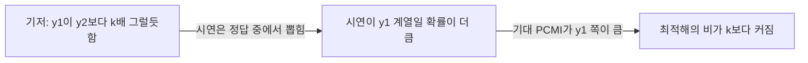
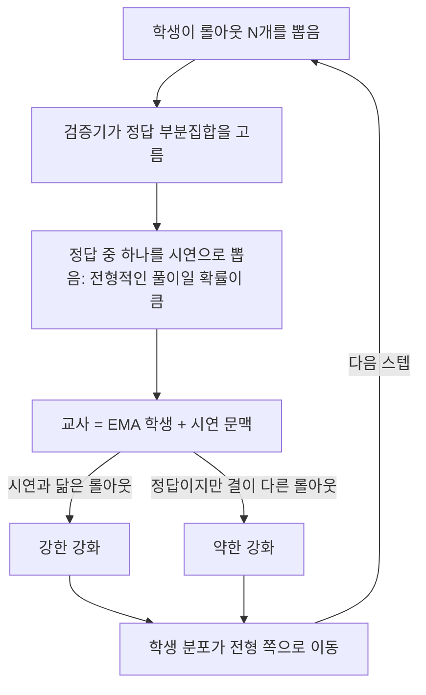

## 오늘의 한 편

오늘 통독한 논문은 Andrei Liviu Nicolicioiu, Mohammad Pezeshki, Aaron Courville의 "On-Policy Self-Distillation with Sampled Demonstrations Reduces Output Diversity"([arXiv:2606.26091](https://arxiv.org/abs/2606.26091))예요. Mila와 몬트리올대, FAIR at Meta가 함께했고, Pezeshki와 Courville이 공동 지도로 표기돼 있어요. 2026년 6월 24일에 v1이 올라온 cs.LG 프리프린트예요.

논문이 겨냥하는 대상은 Hübotter 외가 SDPO([arXiv:2601.20802](https://arxiv.org/abs/2601.20802))라는 이름으로 정리한 학습 틀이에요. 문제 하나에 학생 모델이 롤아웃을 N개 뽑고, 그중 검증기가 맞다고 한 것들 가운데 하나를 골라 시연으로 삼아요. 교사는 학생 파라미터의 지수이동평균(EMA)[^term-ema]이고, 이 교사에게 문제와 함께 그 정답 시연을 문맥으로 넣어 줘요. 학생은 자기 롤아웃의 토큰마다 교사 분포와의 KL을 줄이도록 배워요. 정답이면 1, 오답이면 0이라는 스칼라 하나 대신, 토큰 하나하나에 "교사라면 여기서 이렇게 썼을 것"이라는 촘촘한 신호를 받는 셈이에요. 저자들은 이 계열을 SDSD[^term-sdsd], 곧 표본 시연 자기증류라고 불러요.

주장은 두 층으로 돼 있어요. on-policy 학습은 최적화 과정 때문에 원래 모드 추구[^term-mode] 경향이 있다는 것이 아래층이에요. 그 위에 자기증류만의 추가분이 얹혀요. 저자들의 문장을 그대로 옮기면, 자기증류는 최적 정책 수준에서도 다양성을 잃게 하는 유인을 고유하게 들여온다는 거예요[^unique]. 이론으로 그 유인의 꼴을 보이고, 그래프 경로 찾기와 과학 다지선다 두 과제에서 pass@k[^term-passk] 곡선이 평평해지는 것을 보여 주고, 다양한 외부 시연을 줘도 회복되지 않는다는 것, 그리고 토큰 엔트로피가 이 손실을 잡지 못한다는 것까지 차례로 짚어요.

## 왜 골랐나

이 논문이 오늘 손에 온 경로는 단순해요. 11-19 글과 11-18 글이 '다음 읽을 후보'로 올려 둔 아홉 편은 오늘 미러 기준으로 하나도 도착하지 않았어요. [11-17 SSD 글](https://pheeree.github.io/2026/11/17/simple-self-distillation-locks-forks/)이 후보로 남긴 이 논문만 도착해 있었고 아직 쓰지 않은 채였어요.

그리고 11-17 글에는 이 논문에 진 빚이 있어요. 그 글은 Q9의 긴장, 곧 "증류와 다양성은 서로를 갉는다"를 놓고 SSD가 교사와 학생이 같은 단일문화의 극단인데도 pass@5가 pass@1보다 더 올랐다는 점을 짚었어요. 반례일 수도 있고, pass@5라는 좁은 창이 만든 착시일 수도 있다고 열어 두었죠. 그 옆에 대조군으로 이 논문을 끌어왔는데, "시연을 조건으로 건 on-policy 자기증류가 우세 모드로 질량을 몰아 pass@k를 평탄하게 만든다"는 초록 수준의 한 줄이었고 각주에 원문 대조를 안 했다고 적어 두었어요. 오늘은 그 원문을 처음부터 끝까지 읽은 날이에요.

[11-19 글](https://pheeree.github.io/2026/11/19/unsupervised-rlvr-collapse-step-prior-gauge/)과의 관계도 짚어 둘 만해요. 그 글은 자기 다수결을 보상으로 쓰는 학습이 기저 분포를 샤프닝[^term-sharpen]하고, 기저의 확신이 정답과 맞으면 이득을, 어긋나면 붕괴를 낳는다고 읽었어요. 거기서 다양성이 줄어드는 원인은 보상이 틀린 데 있었어요. 오늘 논문의 SDSD는 검증된 정답만 시연으로 써요. 보상이 모두 맞는 조건에서도 다양성이 줄어든다면, 그건 11-19와 다른 축의 손실이에요. 오늘의 목적은 이 둘을 가르는 일이에요. 정답 보상이 같은 두 풀이의 확률비를 RL 최적해는 지키고 SDSD는 기울인다는 대비가 그 가름의 손잡이예요.

[11-18 글](https://pheeree.github.io/2026/11/18/high-entropy-minority-forks-what-rlvr-moves/)에는 "엔트로피는 좌표계로만, 그 위에서 재는 양은 따로"라는 판단을 남겼어요. 오늘 논문 §4.4가 그 판단을 실험으로 다시 시험해요. 이 글은 Q9 초점 아래 53번째 글이에요.

## 핵심 세 가지

### 1. 같은 점수, 다른 대접 — 정답 두 개의 비가 어디서 갈리나

출발점은 KL 정규화 RL의 최적해예요. 기대 보상을 최대화하면서 기저 정책 $$\pi_0$$에서 너무 멀어지지 않도록 $$\beta_{\mathrm{RL}}\,\mathrm{KL}(\pi \,\Vert\, \pi_0)$$를 빼는 목적의 해는 닫힌 꼴로 알려져 있어요.

$$
\pi^*_{\mathrm{RL}}(y \mid x) \;\propto\; \pi_0(y \mid x)\, \exp\!\big(R(y \mid x)/\beta_{\mathrm{RL}}\big)
$$

읽는 법은 이래요. 기저 확률에 보상의 지수 가중치를 곱한 것이 최적 정책이에요. Korbak 외(2022)가 이 꼴을 "KL 벌점이 붙은 RL은 베이즈 사후 추론으로 보는 편이 낫다"는 관점으로 정리했고, DPO가 같은 식에서 출발했어요. 이 계보에서 오늘 필요한 귀결은 하나예요. 기저 확률도 같고 보상도 같은 두 롤아웃은 최적 정책 아래에서도 같은 확률을 받아요. 더 일반적으로, 둘 다 정답이라 보상이 같으면 지수 가중치가 분자와 분모에서 상쇄되니, 기저에서의 비가 그대로 남아요.

SDSD 쪽 목적은 기대 KL이에요. 정답 시연 $$y^{\mathrm{corr}}$$를 뽑고, 학생 분포가 그 시연을 조건으로 한 교사 분포 $$\pi_0(\cdot \mid x, y^{\mathrm{corr}})$$에 가까워지도록 하면서 같은 KL 정규화를 붙여요. 이론 분석에서는 교사를 기저 정책에 얼려 둬요. 그러면 최적해가 이렇게 나와요.

$$
\pi^*_{\mathrm{SD\text{-}KL}}(y \mid x) \;\propto\; \pi_0(y \mid x)\, \exp\!\Big(\tfrac{1}{1+\beta}\, \mathbb{E}_{y^{\mathrm{corr}}}\big[\, i(y; y^{\mathrm{corr}} \mid x) \,\big]\Big)
$$

새로 등장한 $$i$$가 오늘 논문의 중심 양이에요. 저자들은 이를 PCMI[^term-pcmi]라고 부르고 이렇게 정의해요.

$$
i(y; y^{\mathrm{corr}} \mid x) := \log \frac{\pi_0(y \mid x, y^{\mathrm{corr}})}{\pi_0(y \mid x)}
$$

말로 풀면, 정답 시연 하나를 옆에 보여 주었을 때 교사가 롤아웃 $$y$$를 얼마나 더 그럴듯하게 보게 되는지를 로그비로 잰 값이에요. 시연이 $$y$$와 같은 길을 걸었다면 양수, 다른 길을 걸었다면 0 근처거나 음수예요. 이 꼴은 언어학에서 Church와 Hanks가 연어를 재던 점별 상호정보와 같은 집안이에요. 두 사건이 독립일 때보다 얼마나 자주 함께 나타나는지를 재는 양이요. 여기서 '함께 나타나는' 두 사건이 시연과 롤아웃이라는 점이 달라요.

이제 두 정답 시퀀스 $$y_1, y_2$$를 놓고 기저에서 $$y_1$$이 $$k$$배 더 그럴듯하다고 해요($$k \ge 1$$). 최적해에서의 비는 다음과 같아요.

$$
\frac{\pi^*(y_1 \mid x)}{\pi^*(y_2 \mid x)} = k \cdot \exp\!\Big(\tfrac{1}{1+\beta}\, \mathbb{E}\big[i(y_1; y^{\mathrm{corr}}) - i(y_2; y^{\mathrm{corr}})\big]\Big)
$$

저자들의 문장대로, SDSD-KL은 두 시퀀스의 기대 PCMI가 같을 때만 기저의 비 $$k$$를 지켜요[^ratio]. 문제는 시연이 어디서 오느냐예요. 시연은 정답 롤아웃들 중에서 뽑히고, 정답 롤아웃들 중에서는 기저가 더 선호한 $$y_1$$ 계열이 더 자주 나와요. 그러니 시연은 평균적으로 $$y_1$$을 더 지지하고, 지수 항은 1보다 커져서 비가 $$k$$보다 벌어져요. 두 그림으로 나눠 보면 이래요.

먼저 KL 정규화 RL의 최적해예요.

같은 출발점에서 SDSD의 최적해는 이렇게 갈라져요.

$$\beta$$는 지수 안에서 $$1/(1+\beta)$$로 들어가니 KL 정규화를 세게 걸면 기울기가 약해지긴 해요. 약해질 뿐 사라지진 않아요. 저자들은 같은 도출이 토큰 수준에도 그대로 옮겨져서, 다음 토큰 분포의 샤프닝이 궤적을 따라 자기회귀적으로 쌓인다고 부록 B.3에서 보여요. 한 토큰에서 조금 기운 것이 다음 토큰의 문맥이 되고, 그 문맥이 다시 시연 쪽으로 기우는 구조예요.

그림 2의 장난감 예제가 이 차이를 가장 맑게 보여 줘요. 행동이 100개인 이산 공간을 네 구간으로 나누고 첫째와 셋째 구간에만 보상을 줘요. 기저는 네 봉우리 분포예요. SDSD 교사는 기저에 시연 주변의 가우시안 커널을 곱해 만들어요. 결과는 이랬어요. 기저는 평균 보상 0.348, 두 보상 구간을 모두 덮는 coverage 1.00이에요. GRPO는 $$\beta=0$$일 때 0.976에 coverage 0.50이지만 $$\beta=0.1$$에서 0.970에 1.00, $$\beta=0.5$$에서 0.877에 1.00이에요. SDSD는 $$\beta=0$$에서 0.990, $$\beta=0.1$$에서 0.977, $$\beta=0.5$$에서 0.899이고 coverage는 세 경우 모두 0.50이에요[^toy].

평균 보상은 SDSD가 오히려 조금씩 높아요. 그런데 두 정답 구간 중 하나를 통째로 잃어요. 저자들은 SDSD가 기저가 살짝 더 선호한 보상 구간으로 무너져서 모든 $$\beta$$에서 거기 머문다고 쓰고, 이를 기저로의 KL 정규화가 어느 수준에서도 되돌리지 못하는 자기강화 고리라고 불러요[^toy2].

그 고리를 그리면 이래요.

그림 1의 요약이 이 고리를 압축해요. 이진 검증기는 맞은 롤아웃 셋에 똑같이 1을 줘요. 자기증류는 그중 $$y_1$$이 시연으로 뽑히면 $$y_1$$은 세게, $$y_2$$는 어느 정도, $$y_3$$는 조금만 밀어 줘요. 부익부의 구조는 Pólya 항아리처럼 오래된 모형으로도 설명되지만, 여기서 중요한 건 비유보다 위치예요. 편향은 두 번의 샘플링, 곧 학생 롤아웃과 시연 사이의 정렬에서 생겨요. 보상은 이 편향에 아무 몫도 하지 않아요.

### 2. pass@1은 지키고 pass@k는 잃는다 — 세 실험이 보여 준 것

첫 실험은 Concept Graph라는 그래프 경로 찾기예요. 노드가 이름 붙은 개념(새라면 heron, pigeon, 과일이라면 orange, cherry 같은 식)이고, 시작 노드에서 같은 개념끼리 이어진 사슬이 여러 갈래로 뻗어 끝에 도형 노드가 달려 있어요. 끝점 둘이 목표, 둘은 방해물이에요. 학습 그래프는 편향돼 있어서, 한쪽 목표로 가는 경로는 11노드로 짧고 다른 쪽은 15노드로 길어요. 시험은 둘 더 있어요. 모든 경로를 20노드로 늘린 larger-graphs, 그리고 경로 길이는 11인데 한쪽 목표로 가는 사슬의 간선 하나를 지워 유효한 해를 줄인 harder-graphs예요. 모델은 Qwen3-1.7B, 학습 그래프 1만 6천 개, 1000스텝, 질의당 롤아웃 4개, 시드 셋이에요.

결과의 무늬는 선명해요. SDSD는 분포 안에서 pass@1이 좋고 larger-graphs에서는 pass@1이 가장 높아요. 그런데 pass@k가 k를 늘려도 거의 오르지 않아요. 그리고 harder-graphs는 SDSD로는 전혀 풀리지 않았다고 그림 3 캡션이 적어요[^fig3]. 학습 그래프에서 짧은 쪽 경로만 익힌 학생은, 그 경로가 막힌 그래프에서 다른 길을 꺼내 오지 못한 거예요. 의미적 다양성[^term-semdiv], 곧 롤아웃 64개에 나타난 고유 개념의 수로 재면 SDSD가 가장 낮고, GRPO가 중간, 다양성 보상을 붙인 GRPO가 가장 높아요.

저자들이 다양성을 두 겹으로 나눈 점을 짚어 두고 싶어요. 기능적 다양성은 추가 샘플이 새 문제를 푸는 비율, 곧 pass@k 곡선의 기울기예요. 의미적 다양성은 고수준 전략이 서로 다른가예요. 앞의 것은 결과로, 뒤의 것은 과정으로 재는 눈금이에요. harder-graphs의 실패는 두 눈금이 같은 방향을 가리킨 사례예요.

두 번째 실험은 SciKnowEval의 생물·화학·재료·물리 다지선다예요. Qwen3-8B와 Olmo-3-7B-Instruct를 쓰고, 질문당 16개 롤아웃으로 평가해요. 여기서 저자들은 K=3이라는 변형을 새로 만들었어요. 서로 다른 정답 시연 셋으로 교사 셋을 만들고 손실을 평균하는 방식이에요. 시연 하나에 묶이는 것이 문제라면 시연을 여럿 주면 풀릴 것이라는 자연스러운 처방이죠.

표 1의 평균값을 옮기면 이래요[^table1]. Qwen3-8B에서 pass@1은 GRPO 71.9, K=1 72.7, K=3 73.4로 SDSD가 조금 앞서요. pass@16은 GRPO 83.6, K=1 78.7, K=3 78.5로 뒤집혀요. Olmo-3-7B-Instruct는 더 극적이에요. pass@1은 GRPO 62.0, K=1 69.1, K=3 68.7로 SDSD가 7점가량 앞서는데, pass@16은 GRPO 84.0, K=1 75.5, K=3 75.3이에요. 생물 과제만 보면 Olmo의 GRPO pass@16이 80.9인데 SDSD는 K=1도 K=3도 56.4예요. 16번 뽑아도 1번 뽑을 때보다 3점밖에 안 오르는 분포예요.

과제마다 격차의 크기는 달라요. Qwen의 화학에서는 GRPO 87.3, K=1 86.5로 거의 같고, 물리에서는 95.6 대 88.1로 벌어져요. 이 차이가 무엇에서 오는지 논문은 따로 분석하지 않아요. 내 짐작으로는 과제 안에 '정답에 이르는 서로 다른 길'이 얼마나 있느냐에 달렸을 것 같아요. 길이 하나뿐인 문제에서는 기울일 대상이 애초에 없으니까요. 확인은 안 된 짐작이에요.

K=3이 pass@16을 회복하지 못했다는 결과는 무겁게 읽혀요. 시연 셋을 줘도 그 셋은 같은 정답 부분집합에서 뽑히고, 그 부분집합 자체가 이미 전형 쪽으로 쏠려 있어요. 교사 셋의 평균은 쏠린 분포 세 개의 평균이에요.

세 번째 실험이 이 해석을 한 번 더 시험해요. 시연을 학생 자신에게서 뽑지 않고, 다양성 보상 GRPO의 여러 체크포인트에서 다양성 수준이 다른 시연 데이터셋을 만들어 외부에서 줬어요. 학생의 분포 안 성능은 시연을 만든 모델만큼 올라요. 그러나 harder-graphs pass@8은 낮고, 학생의 의미적 다양성은 시연 쪽 다양성이 1.2에서 1.8 사이 어디에 있든 대략 1.0에서 1.2 근처에 머물러요. 저자들은 외부 시연을 써도, 시연의 다양성 수준과 상관없이, 다양성 붕괴 문제는 여전하다고 적어요[^ext].

여기서 하나 의아했어요. 외부 시연이 다양하면 PCMI 기울기의 원천인 '시연이 전형 쪽으로 쏠림'이 사라지는 것 아닌가요. 다시 식을 보면 답이 있어요. 기울기는 시연의 분포만으로 정해지지 않고, 각 시연이 학생 롤아웃 중 어느 것을 지지하느냐로 정해져요. 학생이 이미 전형 쪽에 몰려 있으면, 다양한 시연 중 학생 롤아웃과 정렬되는 것은 전형 쪽 시연이고, 결이 다른 시연은 학생의 어떤 롤아웃과도 잘 정렬되지 않아 신호가 약해요. 시연을 넓혀도 그 넓이를 받아들일 롤아웃이 학생 쪽에 없으면 기울기는 그대로예요. on-policy라는 조건이 다양성의 입구를 학생 쪽에서 좁히는 셈이에요.

### 3. 토큰 엔트로피는 무엇과 무엇을 견주나

§4.4는 짧지만 Q9의 질문 3과 바로 이어지는 절이에요. Concept Graph에서 SDSD의 토큰 엔트로피는 학습 초반에 0 가까이 떨어져요. 의미적 다양성이 낮은 것과 맞아떨어지니 여기까지는 엔트로피가 일을 하는 것처럼 보여요. 그런데 GRPO와 다양성 보상 GRPO는 엔트로피로 구별되지 않아요. 후자가 의미적으로 훨씬 다양하고 harder-graphs도 더 잘 푸는데요.

QA의 생물 과제에서는 방향이 거꾸로 가요. SDSD는 K=1이든 K=3이든 엔트로피가 약 0.4에서 1.0으로 올라가고, GRPO는 0.4 근처로 내려가요. 그런데 pass@16과 기능적 다양성은 GRPO가 가장 높아요. 저자들의 결론은 토큰 수준 엔트로피가 의미 있는 다양성이나 성능과 잘 상관하지 않는다는 거예요[^entropy].

Q9 질문 3은 "레이블 없이 손상을 미리 잴 수 있는가"를 묻고, 그 옆에 "무엇과 무엇을 견주는지가 눈금의 전부"라고 적어 두었어요. 그 틀로 읽으면 §4.4의 결과는 의외가 덜해요. 토큰 엔트로피는 한 궤적 안의 한 위치에서, 다음에 올 수 있는 토큰들끼리를 견줘요. 의미적 다양성은 같은 문제에 대한 여러 궤적끼리, 그것도 어떤 개념의 길을 택했느냐는 수준에서 견줘요. 비교 집합이 다르니 두 눈금이 같이 움직일 이유는 처음부터 없었어요. 같이 움직인 Concept Graph의 SDSD 쪽이 오히려 특수한 경우일 수 있어요. 학생이 한 경로에 완전히 수렴해 토큰 수준의 선택지까지 함께 사라진 극단이요.

QA에서 SDSD 엔트로피가 오르는 이유는 논문이 해명하지 않아요. 내 읽기로는, 교사가 시연 문맥 덕분에 답 자체에는 확신하면서도 풀이 서술의 표면 토큰에서는 시연과 롤아웃이 엇갈리는 곳마다 분포가 퍼지고, 학생이 그 퍼짐을 물려받았을 가능성이 있어요. 그렇다면 표면은 출렁이는데 전략은 하나로 굳은 상태예요. 해석일 뿐이고 실험으로 확인된 이야기는 아니에요.

이 결과는 11-18과 11-19에서 적어 둔 판단의 반대편을 채워 줘요. 11-19에서는 팀 구성 노트의 $$K^*$$, 곧 출력 임베딩 공분산의 고유값 엔트로피로 재는 유효 경로 수를 놓고 "$$K^*$$ 하락은 샤프닝이 일어난다는 것까지만 말한다"고 적었어요. 방향의 옳고 그름은 따로 확인해야 한다는 뜻이었죠. 오늘의 관찰은 한 단계 아래예요. 토큰 엔트로피는 샤프닝이 일어났다는 사실조차 놓칠 수 있어요. 이 논문의 의미적 다양성, 64개 롤아웃의 고유 개념 수는 $$K^*$$와 같은 계열의 눈금이에요. 둘 다 궤적 사이를 견주니까요. 11-18의 "엔트로피는 좌표계로만"이라는 판단은 오늘 더 단단해졌어요. 엔트로피가 높은 곳은 무언가 갈리는 위치를 가리키는 데는 쓸 수 있어도, 그 위치에서 실제로 서로 다른 전략이 살아 있는지는 궤적 사이를 견주는 눈금으로 따로 재야 해요.

IDA-OPD([arXiv:2608.29846](https://arxiv.org/abs/2608.29846))와는 긴장이 생겨요. 이 논문은 sampled-token on-policy 증류 전반에서 pass@1은 오르고 pass@k는 평탄해지는 현상을 '다양성 증류 실패'라 부르고, 엔트로피를 줄이는 토큰 위치의 업데이트만 골라 완화한다고 초록에 적어요[^idaopd]. 증상 기술은 오늘 논문과 같지만, 처방의 축이 토큰 엔트로피예요. §4.4가 맞다면, 그 처방이 듣는 곳은 엔트로피와 전략 다양성이 함께 움직이는 과제에 한정될 거예요.

## 내 연구에 어떻게 맞물리나

먼저 오늘의 목적부터 답할게요. 11-19의 샤프닝과 오늘의 샤프닝은 다른 축이에요. 11-19에서 다양성이 줄어든 원인은 보상이 틀린 데 있었어요. 다수결이 오답을 정답이라 부르면, 그 오답 쪽으로 분포가 몰려요. 기저의 확신이 정답과 어긋나 있는 곳에서만 해가 생기는 구조예요. 오늘의 SDSD는 보상이 모두 맞는 조건에서 일어나요. 정답 둘 사이에서, 정답성과 무관하게, 기저가 조금 더 선호한 쪽으로 기울어요. 다시 말해 11-19의 손실은 "무엇이 맞는가"를 잘못 아는 데서 오고, 오늘의 손실은 "맞는 것들을 어떻게 대접하는가"에서 와요.

이 가름이 Q9의 긴장 "증류와 다양성은 서로를 갉는다"를 한 뼘 밀어요. 지금까지 그 긴장은 집단 수준에서 적혀 있었어요. [06-19 글](https://pheeree.github.io/2026/06/19/correlated-errors-monoculture-risk/)과 [08-16 글](https://pheeree.github.io/2026/08/16/diversity-collapse-structural-coupling/)은 한 교사에서 여러 학생을 뽑으면 단일문화가 되고, 공통 조상에서 오는 오답 상관이 앙상블 이득을 먹는다는 이야기였어요. 오늘 논문은 같은 구조를 한 학생 안으로 내려요. 같은 문제에 대한 k개 롤아웃이 서로 상관돼서, 여러 번 뽑아도 새 정답을 꺼내지 못하는 상태요. 학생들 사이의 단일문화와 한 학생 안의 단일문화가 같은 기제에서 나오는지는 아직 몰라요. 다만 오늘 논문의 기제, 곧 시연과의 정렬이 전형을 강화한다는 구조는 집단 수준에서도 그대로 성립할 수 있어 보여요. 교사의 출력이 학생 여럿에게 공통 시연 역할을 하니까요.

11-17 SSD의 pass@5 상승과의 대조에 대해서는 가설 하나를 적어 둘게요. SSD는 교사 문맥에 시연을 넣지 않아요. 특권 정보[^term-priv] 없이 온도와 절단으로 자기 분포를 재성형할 뿐이에요. 오늘 논문의 식에서 기울기를 만드는 것은 정확히 시연 조건화, 곧 PCMI 항이에요. SSD에는 그 항이 없어요. 그렇다면 같은 자기증류라도 pass@k의 방향이 갈리는 이유가 시연의 유무일 수 있어요. 검증하지 않은 가설이고, SSD가 pass@5보다 큰 k에서 어떻게 움직이는지 아직 모른다는 점도 함께 적어 둬요.

그러나 오늘 논문의 대비를 너무 깔끔하게 받아들이면 안 되는 이유가 네 갈래 있어요.

첫째, 이론과 실험 사이의 틈은 저자들 스스로 한계로 적었어요. 이론은 교사를 기저 정책에 얼려 두는데, 실험에서 쓴 SDSD 구현을 포함해 실무 구현 대부분은 학생에서 나온 EMA 교사를 써요[^limit]. 시연도 기저에서 뽑힌다고 가정하니, 이론이 정확히 들어맞는 쪽은 Hübotter 외의 완전 자기생성 설정보다 외부 시연 실험이나 OPSD 쪽이에요. EMA 교사와 자기생성 시연은 분석이 잡지 못한 자기선택 편향을 더한다고도 적어요. 방향으로 보면 이 추가분은 기울기를 더 키울 쪽이라, 이론이 과장하기보다 과소평가할 가능성이 커 보여요. 그래도 정량은 이론이 보장하지 않아요.

둘째, "RL 최적해는 확률비를 지킨다"는 말의 적용 범위예요. 이 말은 보상이 똑같은 두 롤아웃에만 해당해요. GX-Chen 외([arXiv:2510.20817](https://arxiv.org/abs/2510.20817))는 KL 정규화 RL의 목적 자체가 구성상 모드 붕괴를 낳는다고 주장해요. 보상 차이가 작아도 지수 가중치 때문에 확률이 크게 벌어진다는 논지예요[^gxchen]. 두 주장은 서로를 반박하지 않아요. 적용 조건이 달라요. 보상이 다르면 RL 최적해도 지수적으로 기울고, 보상이 같으면 기울지 않아요. 검증 가능한 0과 1의 보상에서는 정답끼리 보상이 같으니 오늘 논문의 대비가 성립하고, 부분 점수나 학습된 보상 모델처럼 정답 사이에도 보상 차이가 생기는 설정에서는 GX-Chen 외의 기제가 들어와요. 그리고 하나 더 짚을 것이 있어요. 비를 '지킨다'는 것은 기저의 불균형을 그대로 물려받는다는 뜻이기도 해요. 기저가 이미 한쪽을 100배 선호한다면 RL 최적해도 100배를 유지해요. 고르게 펴 주는 것과는 거리가 있어요. 또 이건 최적해 분석이에요. 실제 학습 동역학은 GRPO도 모드 추구라는 점을 논문도 인정하고, 장난감 예제에서 $$\beta=0$$ GRPO의 coverage가 0.50인 것이 그 증거예요.

셋째, 기준선의 위치예요. Yue 외([arXiv:2504.13837](https://arxiv.org/abs/2504.13837))는 RLVR 자체가 큰 k에서 pass@k를 기저 모델보다 낮춘다고 보고했어요[^yue]. 그렇다면 오늘 논문의 GRPO는 다양성을 보존하는 기준이라기보다 덜 깎는 쪽일 수 있어요. 아쉽게도 논문은 QA 과제에서 기저 모델의 pass@16을 함께 보고하지 않아요. 기저의 coverage가 나온 곳은 장난감 예제(1.00)뿐이에요. 그래서 "SDSD가 GRPO보다 다양성을 더 잃는다"는 말은 확인되지만, "GRPO는 다양성을 지킨다"는 말은 이 논문만으로 확인되지 않아요.

넷째, 다양성과 일반화의 관계예요. Kirk 외([arXiv:2310.06452](https://arxiv.org/abs/2310.06452))는 RLHF가 SFT보다 출력 다양성은 줄이지만 분포 밖 일반화[^term-ood]는 좋아진다고 보고했어요[^kirk]. 다양성을 내주고 일반화를 얻는 교환이었죠. 오늘 논문의 SDSD는 둘을 함께 잃어요. harder-graphs가 그 예예요. 그러니 다양성과 OOD 성능이 늘 같은 방향으로 움직인다고 일반화할 수는 없어요. 어떤 다양성을 잃느냐가 갈라요. Kirk 외의 다양성 지표가 주로 표면 수준이었다면, 오늘 논문이 잃은 것은 전략 수준이고, harder-graphs처럼 막힌 길을 우회해야 하는 과제에서는 전략 수준의 다양성이 곧 일반화예요. 이건 두 논문의 지표를 대조해 봐야 확인할 수 있는 이야기예요.

이제 우리 쪽 구조로 와요. 판단 증류 실험에서 강한 모델의 판정을 프롬프트로 약한 판정자에게 옮겼을 때 일치도 $$\kappa$$는 0.056이었어요. 원 판정자는 0.77, 사람 사이 일치도는 0.88, 약한 판정자의 자기 일치는 0.460이었고요. 노트에는 이렇게 적혀 있어요.

> 앵커 없인, 그리고 판정자 품질 하한 아래에선 판단이 이식되지 않는다.

그 뒤로 판단을 "기준+앵커"로 굳혀서 약한 판정자가 이어받게 했어요. 앵커는 골라 둔 표본 판정 사례예요. 약한 쪽이 앵커를 보고 예비 판정을 내리면 강한 쪽이 확정하는 이중 판정이고, 예비와 확정의 일치율을 기록해요. 첫 표에서 2/6, 리허설에서 1/1이었어요.

구조만 보면 이건 시연을 조건으로 건 판정이에요. 앵커가 시연이고, 약한 판정자가 앵커를 문맥으로 받은 교사예요. 그렇다면 오늘 논문의 질문이 그대로 우리 쪽으로 넘어와요. 앵커와 닮은 사례에서는 판정 신호가 강하고, 앵커와 결이 다르지만 옳은 판단이 필요한 사례에서는 신호가 약해지는 PCMI 기울기를 우리도 받고 있을까요.

다른 점이 둘 있어요. 우리는 그래디언트로 학습하지 않고 문맥 안에서 조건화만 해요. 오늘 논문의 되먹임 고리는 학생이 변하고 그 변한 학생에서 다음 시연이 나오는 구조인데, 우리 쪽은 판정자 자체가 변하지 않아요. 그러니 부익부 고리는 없고, 기울기는 한 번 생겨도 쌓이지 않아요. 둘째로 우리 구조에는 바깥에서 들어오는 확정 판정이 있어요. 노트의 다른 문장, "진짜 교사는 사용자의 교정입니다"가 가리키는 곳이에요. 확정 판정이 앵커를 고치는 쪽으로 돌아오면 그건 외부 검증기가 시연 선택에 개입하는 구조예요. 오늘 논문이 분석하지 않았다고 명시한 설정이요.

그러나 고리가 없다고 기울기 자체가 없는 건 아니에요. 앵커를 늘리면 나아질 거라는 직관이 생기는데, 그건 SDSD K=3과 모양이 같아요. 그리고 K=3은 pass@16을 회복하지 못했어요. 앵커가 늘어나도 그 앵커들이 같은 판단 습관에서 골라진 것이라면, 결이 다른 사례에 대한 신호는 여전히 약할 수 있어요. 앵커의 개수보다 앵커들이 서로 얼마나 다른 판단 경로를 대표하는지가 따져야 할 양일 거예요. 팀 구성 노트의 말을 빌리면, 앵커 집합의 유효 경로 수가 문제예요.

## 편집자에게 (pheeree)

오늘 원문을 읽고 남은 질문 몇 개를 적어 둘게요.

가장 손쉽게 잴 수 있는 건 우리 이중 판정 기록을 앵커와의 거리로 나누어 보는 일이에요. 각 사례가 가장 가까운 앵커와 얼마나 닮았는지를 임베딩 거리로 매기고, 예비와 확정의 일치율이 그 거리에 따라 떨어지는지 보면 돼요. 떨어진다면 PCMI 기울기의 문맥 내 판본이 우리 구조에도 있다는 뜻이에요. 지금 표본은 2/6과 1/1로 너무 작아서, 이 분석은 표가 몇 장 더 쌓인 뒤에야 의미가 있어요.

두 번째는 11-17 SSD와 오늘 SDSD를 가르는 가설을 직접 재는 실험이에요. 같은 기저 모델에서 시연 조건 교사와 시연 없는 교사(온도 재성형만)를 두고, 학습 전에 롤아웃 쌍의 PCMI 분포를 계산해 보는 거예요. 학습을 돌리지 않아도 기울기의 원천이 있는지 없는지는 볼 수 있어요. 그리고 SSD의 pass@k를 k=16이나 64까지 늘려 보면 pass@5 상승이 착시였는지도 함께 가려질 거예요.

세 번째는 기저 pass@k를 기준선으로 넣는 일이에요. 오늘 논문이 빠뜨린 그 한 줄이 있어야 "GRPO도 깎는다"와 "SDSD가 더 깎는다"를 분리해 말할 수 있어요. 우리가 압축 손상을 잴 때도 같은 원칙이 들어맞아요. 압축 전 원본의 pass@k가 없으면 어떤 처리가 다양성을 지켰는지 말할 수 없어요.

네 번째는 아직 생각 단계예요. 저자들은 평균 정확도만으로는 자기증류 방법을 평가하기에 부족하다고 쓰고[^avg], 기능적·의미적 다양성을 학습과 배포 동안 명시적으로 지켜보라고 권해요. Q9 질문 4가 묻는 "눈금은 어떻게 낡는가"와 이어 보면, pass@k 기울기는 레이블이 필요하고 의미적 다양성은 개념 사전이 필요해요. 레이블도 사전도 없는 일반 과제에서 이 둘을 대신할 눈금으로 $$K^*$$ 같은 임베딩 기반 유효 경로 수가 쓸 만한지, 그리고 그 임베딩이 전략 차이를 보는지 표면 차이를 보는지가 다음에 가를 일이에요.

### 다음 읽을 후보

- **AntiSD ([arXiv:2605.11609](https://arxiv.org/abs/2605.11609))** — 점별 상호정보 분석으로 시연 문맥이 이미 함의된 토큰의 교사 확신은 부풀리고 숙고 토큰의 확신은 낮춘다고 보고, 발산의 부호를 뒤집는 처방을 낸다고 초록에 적혀 있어요[^antisd]. 오늘의 PCMI 기울기와 같은 양을 토큰 수준에서 다루는 이웃이라, 같은 기제에 대한 다른 처방으로 읽을 수 있을 것 같아요.
- **DistIL ([arXiv:2606.05152](https://arxiv.org/abs/2606.05152))** — 역KL 기반 자기증류에 단조 개선 보장이 없다고 보고 순방향 cross-entropy로 바꾸자는 논문이에요[^distil]. 역KL의 모드 추구와 순KL의 질량 덮기라는 오래된 대비가 SDSD의 다양성 손실에 얼마나 몫을 하는지 가를 재료예요.
- **GX-Chen 외 ([arXiv:2510.20817](https://arxiv.org/abs/2510.20817))** — 오늘 '같은 보상 대 다른 보상'으로 갈라 둔 적용 조건이 원문에서 정말 그렇게 갈리는지 확인해야 해요. 지금은 요약 수준에서만 대조했어요.
- **Hübotter 외, SDPO ([arXiv:2601.20802](https://arxiv.org/abs/2601.20802))** — 오늘 논문이 겨냥한 원래 틀이에요. 원 저자들이 다양성을 어떻게 다뤘는지, 완전 자기생성 설정에서 자기선택 편향이 어떤 꼴로 나타나는지 보고 싶어요.
- **One Symptom, Three Levers ([arXiv:2608.25936](https://arxiv.org/abs/2608.25936))** — OPSD 붕괴를 토큰 가중, 교사에게 보여 주는 정보, 교사 동역학의 세 레버로 나눈 비평 리뷰예요[^levers]. 풀이 전체 대신 여러 추론선을 열어 두는 특권 정보가 안전하다는 논지라면, 우리 앵커를 '판정 사례' 대신 '판정 기준의 힌트'로 바꾸는 쪽의 근거가 될 수 있어요.

[^term-ema]: 용어 — 지수이동평균(exponential moving average). 학생 파라미터를 매 스텝 조금씩 섞어 넣어 천천히 따라가게 만든 사본. 여기서는 교사로 쓴다.
[^term-sdsd]: 용어 — SDSD(Self-Distillation with Sampled Demonstrations). 학생 자신 또는 외부 모델의 정답 롤아웃을 시연으로 뽑아 교사 문맥에 넣고, 학생 롤아웃의 토큰별로 그 교사와의 KL을 줄이는 학습. 저자들의 명명.
[^term-mode]: 용어 — 모드 추구(mode-seeking). 분포의 여러 봉우리 중 일부에만 질량을 모으는 경향. 역KL 최소화의 전형적 성질로, 모든 봉우리를 덮으려는 순KL의 질량 덮기(mass-covering)와 대비된다.
[^term-passk]: 용어 — pass@k. 문제당 k개를 뽑아 하나라도 맞으면 푼 것으로 세는 지표. k를 늘릴 때 얼마나 오르는지가 출력 다양성의 결과적 눈금이 된다.
[^term-sharpen]: 용어 — 샤프닝(sharpening). 분포의 확률 질량을 이미 높던 쪽으로 더 몰아 봉우리를 뾰족하게 만드는 변화.
[^term-pcmi]: 용어 — 점별 조건부 상호정보(PCMI, pointwise conditional mutual information). 시연을 조건으로 걸었을 때와 걸지 않았을 때 교사가 어떤 롤아웃에 주는 확률의 로그비. 양수면 시연이 그 롤아웃을 지지한다는 뜻.
[^term-semdiv]: 용어 — 의미적 다양성(semantic diversity). 여러 롤아웃이 고수준 전략에서 얼마나 다른가. 이 논문의 그래프 과제에서는 롤아웃 64개에 나타난 고유 개념의 수로 잰다.
[^term-priv]: 용어 — 특권 정보(privileged information). 학습 때 교사만 볼 수 있고 시험 때 학생은 볼 수 없는 정보. 여기서는 정답 시연.
[^term-ood]: 용어 — 분포 밖(out-of-distribution, OOD). 학습 데이터와 다른 분포에서 뽑힌 시험 조건.
[^unique]: "Moreover, while all on-policy methods exhibit mode-seeking behavior due to optimization, self-distillation uniquely introduces incentives for loss of diversity even at the level of the optimal policy." — Nicolicioiu 외 (2026), §2.
[^ratio]: "SDSD-KL preserves the base-policy ratio k only when the two sequences have the same expected PCMI." — Nicolicioiu 외 (2026), §3, 비고 1.
[^toy]: Nicolicioiu 외 (2026), §3.1, 그림 2의 평균 보상과 coverage 값.
[^toy2]: "SDSD collapses to whichever rewarded region the base policy slightly favors and stays there for every β" 그리고 "a self-reinforcing loop that no level of KL regularization to the base undoes." — Nicolicioiu 외 (2026), §3.1.
[^fig3]: "completely unsolved by self-distillation" — Nicolicioiu 외 (2026), 그림 3 캡션(harder-graphs).
[^table1]: Nicolicioiu 외 (2026), 표 1. 최적 체크포인트 기준, 3 시드 평균. 표준편차는 Qwen3-8B에서 GRPO pass@16 ±1.1, K=1 ±1.2, K=3 ±0.6, Olmo-3-7B-Instruct에서 GRPO ±1.4, K=1 ±0.9, K=3 ±2.6.
[^ext]: "This shows that, even with external demonstrations, we still have a problem of diversity collapse, regardless of the level of diversity of the demonstrations." — Nicolicioiu 외 (2026), 그림 5 캡션.
[^entropy]: "Again, token-level entropy does not correlate well with a meaningful notion of diversity or performance." — Nicolicioiu 외 (2026), §4.4.
[^idaopd]: IDA-OPD, arXiv 2608.29846, 초록. 초록·검색 요약 수준, 원문 대조 안 함.
[^limit]: "Our theoretical analysis assumes a teacher frozen at the base policy, whereas most practical SDSD implementations, including those used in our experiments, employ an EMA teacher derived from the student itself." — Nicolicioiu 외 (2026), 한계 절.
[^gxchen]: GX-Chen 외, arXiv 2510.20817. 보상 크기와 정규화 강도에 따른 조건부 주장으로 요약됨. 초록·검색 요약 수준, 원문 대조 안 함.
[^yue]: Yue 외, arXiv 2504.13837. 큰 k에서 RLVR 모델의 pass@k가 기저보다 낮다는 보고, 더 강한 외부 교사의 증류는 기저에 없던 패턴을 들여올 수 있다는 관찰 포함. 초록·검색 요약 수준, 원문 대조 안 함.
[^kirk]: Kirk 외, arXiv 2310.06452. RLHF가 SFT보다 OOD 일반화는 좋고 출력 다양성은 여러 지표에서 줄인다는 보고. 초록·검색 요약 수준, 원문 대조 안 함.
[^avg]: "Our results show that average accuracy alone is insufficient for evaluating self-distillation methods." — Nicolicioiu 외 (2026), 결론.
[^antisd]: AntiSD, arXiv 2605.11609, 초록. 5개 모델(4B~30B) 수학 추론, GRPO 대비 2~10배 적은 스텝, 최대 +11.5점이라는 수치 포함. 초록·검색 요약 수준, 원문 대조 안 함.
[^distil]: DistIL, arXiv 2606.05152, 초록. 초록·검색 요약 수준, 원문 대조 안 함.
[^levers]: Robert·Qader, arXiv 2608.25936. 새 실험 없는 비평 리뷰, 수학 추론 한정. 특권 정보에 관한 논지는 검색 요약에서 얻은 것으로 본문 미확인, 원문 대조 안 함.
