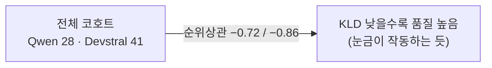
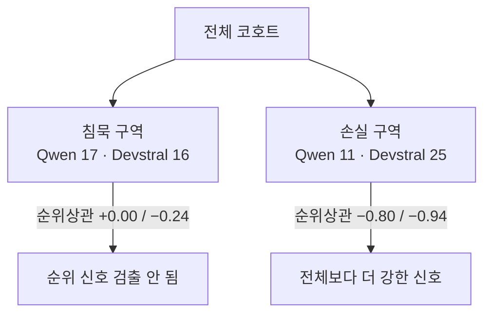
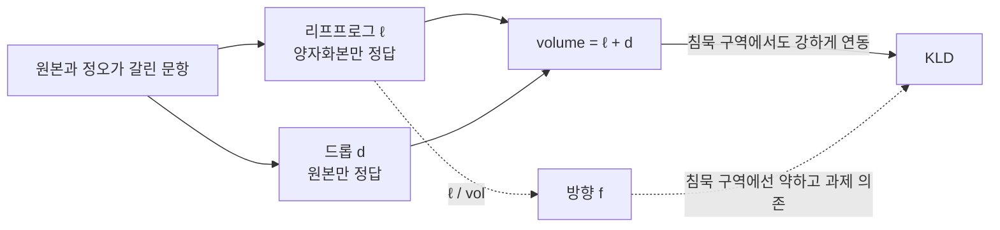

## 오늘의 한 편

오늘 원문을 통독한 논문은 ByteShape·토론토대·Vector Institute의 Miloš Nikolić, Ali Hadi Zadeh, Enrique Torres Sanchez, Andreas Moshovos가 쓴 "Displacement Is Not Direction: Evaluating Fidelity Metrics for Quantized LLM Deployment"([arXiv:2606.19558](https://arxiv.org/abs/2606.19558))예요. 물음은 실무에서 아주 흔한 관행 하나를 시험해요. 같은 모델의 양자화본이 수십 개 올라와 있을 때, 사람들은 벤치마크를 다 돌리는 대신 BF16 원본과의 KLD[^term-kld]나 퍼플렉시티[^term-ppl]를 재서 낮은 쪽을 고르곤 해요. 그 값싼 눈금이 정말 하류 품질의 순위를 대신해 주는가.

재료는 두 코호트예요. 하나는 Qwen3.6-35B-A3B의 GGUF[^term-gguf] 양자화본 28개로, 발행처 다섯 곳에서 나왔고 2.17~6.14 bpw[^term-bpw]에 걸쳐 있어요. 전문가 혼합(MoE)[^term-moe] 구조이고 활성 파라미터는 3B예요. 다른 하나는 코드 특화 dense 모델 Devstral-Small-2-24B의 양자화본 41개로, 발행처 세 곳, 1.88~9.84 bpw예요.[^nik-setup] 벤치마크는 HumanEval·LiveCodeBench v6·IFEval·BFCL v3·GSM8K·GSM8K-v·MMLU이고, Devstral에는 MATH-500이 더해져요. 모두 비사고 모드로 돌렸고 Qwen의 GSM8K-v만 사고 모드도 함께 쟀어요. 합성 점수는 정규화한 점수의 비가중 평균이에요. 한 가지 눈여겨볼 처리가 있어요. Qwen의 MMLU는 합성에서 뺐는데, 답만 내라는 5-shot 형식에서 모델이 BF16 원본부터 추론을 늘어놓기 시작해 답 추출이 실패했기 때문이에요. 양자화 효과가 아닌 형식 인공물이라 코호트 전체에 같은 크기로 얹히는 오프셋이 된다는 판단이에요.[^nik-mmlu]

KLD는 $$\mathrm{KL}(p_{\text{BF16}} \parallel p_{\text{quant}})$$, 곧 원본의 다음 토큰 분포를 기준으로 양자화본이 확률 질량을 얼마나 옮겼는지를 WikiText 512토큰 문맥에서 평균한 값이에요. 기대값이 원본 분포 아래에서 잡히니, 원본이 확신하는 토큰에서 어긋날수록 크게 벌점을 받아요.

결론부터 적으면 이래요. 전체 코호트에서 KLD와 합성 점수의 스피어만 상관[^term-spearman]은 Qwen $$\rho=-0.72$$, Devstral $$\rho=-0.86$$으로 둘 다 $$p<0.001$$이에요. 그런데 원본에 가까운 후보들만 모은 "침묵 구역"에서는 이 상관이 Qwen $$+0.00$$, Devstral $$-0.24$$($$p=0.36$$)로 사라져요.[^nik-abs] 저자들은 그 이유를 점수 차이를 두 성분으로 쪼개는 분해로 설명해요. KLD는 원본과 *얼마나 자주* 다르게 답하는지(volume)는 잘 따라가지만, 그 차이가 *개선인지 퇴보인지*(방향)는 잘 보지 못한다는 거예요. 제목의 displacement와 direction이 이 두 성분이에요.

## 왜 골랐나

먼저 픽 경로를 정직하게 적어 둘게요. 최근 세 글(11-22·11-21·11-19)이 '다음 읽을 후보'로 올린 열여섯 편은 아직 미러에 들어오지 않았어요. 관심 표시 대기열은 비어 있었고, 초점 질문 Q9 아래 걸어 둔 다음 후보 일곱 편은 이미 다 읽었어요. 그래서 최근 14일 안에 받았지만 쓰지 않은 서른 편 가운데 오늘 목적에 가장 가까운 한 편을 골랐어요. 줄기를 따라 손을 뻗었다기보다 목록에서 우연히 맞는 것을 찾아낸 쪽에 가까워요.

다만 목적은 분명했어요. 바로 오늘 아침 글([특권 정보 자기증류](https://pheeree.github.io/2026/11/22/privileged-information-opsd-what-reference-adds/))이 마지막에 남긴 마디가 있었어요. 그 논문에서는 토큰 수준 교사 프로파일과 손실을 바꿔도 학생의 행동은 거의 그대로였어요. 분포를 견주는 눈금이 행동을 약하게만 대리한 셈이에요. 반면 에이전트 과제를 다룬 다른 연구(Zou 외 [arXiv:2610.22512](https://arxiv.org/abs/2610.22512))는 KL 기반 지표가 사후 성능을 더 잘 예측했다고 보고했어요. 두 결과를 나란히 놓고 나는 "분포를 견주는 눈금이 언제 행동을 대리하고 언제 놓치는가"가 Q9 눈금 질문의 다음 마디라고 적었어요. 오늘 논문은 그 물음에 양자화 쪽에서 구체적인 답을 내놓아요. 언제 대리하는가: 손상이 큰 구간에서. 언제 놓치는가: 원본 근처에서 후보끼리 견줄 때.

이 픽은 줄기를 한 번 되돌리는 의미도 있어요. 열흘 넘게 글이 증류 쪽에 머물렀어요. 11-12 CGD, 11-17 SSD, 11-18의 80/20 엔트로피 지형, 11-19 Model Collapse Step, 11-21 SDSD, 오늘 아침의 특권 정보까지요. Q9는 원래 "무엇이 옮겨지는가 — 압축·증류는 국소를 남기고 전역을 버리는가, 그리고 그 손실을 배포 전에 잴 수 있는가"를 묻는 초점이고, 압축은 그 질문의 절반이에요. 오늘은 그 절반으로 돌아가서 눈금 문제를 다시 봐요. Q9 초점 아래 쉰다섯 번째 글이에요.

## 핵심 세 가지

### 1. 전체 상관은 손실 구역이 새어 들어온 값이다

저자들은 코호트마다 KLD 문턱 $$\tau$$를 하나 정해 두 구역으로 나눠요. Qwen은 KLD 0.064 이하 17개, Devstral은 0.027 이하 16개가 침묵 구역이고 나머지가 손실 구역이에요. 이 문턱은 "구역 안 상관이 유의하지 않게 되는 지점"으로 기술적으로 잡은 값이라, 저자들 스스로 일반 결정 규칙으로 쓰지 말라고 해요.

두 그림을 나란히 보면 무슨 일이 일어나는지 보여요. 먼저 실무자가 보통 보는 그림이에요.

같은 코호트를 둘로 나누면 그림이 달라져요.

손실 구역 안의 상관($$-0.80$$, $$p=0.003$$과 $$-0.94$$)은 전체 코호트보다 오히려 강해요. 그러니 우리가 흔히 보는 전체 상관은, 2~3비트의 눈에 띄게 손상된 모델들이 평균에 섞여 들어와 만든 값이라는 게 저자들의 읽기예요.[^nik-leak] 벤치마크별로 쪼개도 같고, 침묵 구역에서 $$p<0.05$$로 신호가 남은 건 Qwen GSM8K-v 사고 모드 하나뿐이었어요.

이게 측정 방식의 우연인지도 시험했어요. KLD 평균·중앙값·p90·p99, 로그 퍼플렉시티 차, 퍼플렉시티 비와 차, top-1 일치율, 8K 문맥, 내부 검증셋, 응답 토큰만 잰 top-k KLD까지 열네 가지 변형 모두 전체 코호트에서는 신호를 유지하고 침묵 구역에서는 절댓값 0.25 이하로 무너져요. 과제에 맞춘 검증셋에서 응답 부분만 잰 KLD도 같은 꼴이라, WikiText나 문맥 길이 탓으로 돌리기 어려워요.[^nik-invariant]

문턱을 KLD로 정한 것 자체가 순환이라는 의심도 남아요. 부록 C는 KLD를 쓰지 않고 품질로만 구역을 정의해요. BF16 합성 점수의 99% 이상을 유지한 후보를 원본 근처로 보면 Qwen 18개, Devstral 22개가 들어오고, 상관은 $$\rho=-0.07$$($$p=0.80$$), $$\rho=-0.23$$($$p=0.31$$)이에요.[^nik-quality] 허용 낙폭 $$\delta$$를 늘려 가는 표 7이 흥미로워요. 1.5%까지는 비유의하다가, 2.0%(Devstral $$\rho=-0.41$$)와 2.5%(Qwen $$\rho=-0.55$$)에서 다시 유의해져요.[^nik-delta] 손상된 모델이 비교 집합에 들어오는 순간 상관이 돌아오는 거예요. 상관의 존재 여부가 모델 쪽 성질이 아니라 *비교 집합을 어디까지 잡았느냐*에 달려 있다는 걸 이보다 깔끔하게 보여 주긴 어려워요.

구체적인 숫자 몇 개를 보면 감이 더 잡혀요. Qwen 침묵 구역의 양 끝과 가운데 몇 줄이에요.[^nik-t11]

| 발행처·양자화 | bpw | KLD | 합성 점수 |
|---|---|---|---|
| unsloth UD-Q5_K_XL | 6.14 | 0.0082 | 0.724 |
| AesSedai Q5_K_M | 6.06 | 0.0083 | 0.718 |
| unsloth UD-Q4_K_XL | 5.16 | 0.0135 | 0.728 |
| mudler APEX-Compact | 3.99 | 0.0451 | 0.707 |
| ByteShape IQ4_XS-4.15bpw | 4.15 | 0.0504 | 0.731 |

KLD가 여섯 배 차이 나는 두 후보(0.0082와 0.0504)에서 점수 순서는 거꾸로예요. 그리고 침묵 구역 열일곱 개의 합성 점수가 전부 0.707~0.731 사이, 폭 0.024 안에 들어 있어요.

눈금의 폭은 여섯 배인데, 결과의 폭은 0.024예요.

문항 단위로 내려가도 사정은 비슷해요. LiveCodeBench에서 침묵 구역 Qwen 다섯 개의 문항별 KLD를 재 보면, 실패한 문항의 기하평균 KLD가 통과한 문항보다 1.08~1.22배, 평균 13% 높아요. 신호가 아주 없지는 않지만 선별에 쓰기엔 턱없이 작다고 저자들은 봐요.[^nik-perprompt] 더 날카로운 시험은 라우터예요. ByteShape IQ4_XS-3.93bpw(KLD 0.069)를 모델 B로 두고 깨끗한 후보 다섯과 짝지어, 한쪽만 통과한 문항(짝마다 163~190개)에서 문항별 KLD가 낮은 쪽을 고르면 통과한 쪽을 맞히는지 봤어요. 맞힌 비율은 42.3~49.4%로 한 번도 동전 던지기에 닿지 못했고, BF16도 틀린 문항(양자화본이 원본을 앞지를 기회가 있는 문항)에서는 40.8%로 더 떨어져요.[^nik-router] 원본에서 멀어진 쪽이 오히려 맞히는 문항이 있다는 뜻이고, 이건 다음 항목의 분해로 바로 이어져요.

### 2. 점수 차이는 volume과 방향의 곱이다

분해는 단순해요. N개 문항에서 원본(BF16)과 양자화본의 정오를 짝지어 보면, 양자화본만 맞힌 문항(리프프로그 $$\ell$$)과 원본만 맞힌 문항(드롭 $$d$$)이 있어요. 둘의 합이 volume, 곧 갈린 문항 수이고, 그중 개선의 비율이 방향 $$f=\ell/\text{vol}$$이에요. 그러면 이 항등식이 성립해요.

$$
\text{score}_q = \text{score}_{\text{ref}} + \frac{\text{vol}\cdot(2f-1)}{N}
$$

식을 말로 풀면 이래요. $$2f-1$$은 갈린 문항 가운데 개선이 퇴보보다 얼마나 많은지를 −1에서 +1 사이로 나타낸 값이에요. volume이 크기를 정하고, 방향이 부호를 정해요.[^nik-decomp] 정오가 문항마다 이진인 벤치마크(HumanEval, LCB, IFEval, GSM8K, GSM8K-v, MATH-500)에서는 정확한 항등식이고, 하위 범주를 매크로 평균하는 BFCL과 MMLU에서는 근사예요.

이 분해는 계보가 분명해요. Dutta 외(NeurIPS 2024, [arXiv:2407.09141](https://arxiv.org/abs/2407.09141))가 정답 여부가 뒤집힌 문항의 비율, 곧 flips[^term-flips]를 제안했어요. 정확도 차이는 작아도 뒤집힌 문항은 많을 수 있다는 관찰이었죠. 뿌리를 더 거슬러 가면 모델 업데이트 쪽 문헌이 있어요. Yan 외의 positive-congruent training(CVPR 2021)은 새 모델이 옛 모델의 정답을 틀리게 되는 negative flip을 따로 세어, 평균 정확도가 올라도 사용자가 겪는 회귀는 늘 수 있다는 점을 문제로 세웠어요. 오늘의 드롭이 그 negative flip이고, 리프프로그는 반대편 짝이에요. 오늘 논문은 그 flips를 리프프로그와 드롭으로 둘로 쪼갠 확장이에요.[^nik-dutta] 퍼플렉시티 중심 평가가 압축 손상을 놓친다는 지적은 Jaiswal 외의 LLM-KICK([arXiv:2310.01382](https://arxiv.org/abs/2310.01382))이 먼저 했고, 퍼플렉시티 대신 생성 쪽에 민감한 divergent token metrics를 제안한 Deiseroth 외(2024)도 같은 줄기예요. 오늘 논문이 새로 보탠 건 이 비판들을 "모델 선택"이라는 좁은 결정 문제로 좁혔다는 점, 그리고 왜 실패하는지를 산술 수준에서 보여 줬다는 점이에요.

분해를 놓고 KLD와의 상관을 따로 보면 그림이 선명해져요(표 5). 침묵 구역에서 KLD와 volume의 상관은 Qwen 벤치마크별로 $$+0.38$$~$$+0.91$$, 합성 기준 $$+0.94$$($$p<0.001$$)예요. Devstral은 합성 $$+0.55$$($$p=0.03$$)로 약하지만 양수예요.[^nik-volume] 반면 방향과의 상관은 침묵 구역에서 약하고 과제마다 부호가 흔들리다가, 손실 구역에서는 강한 음으로 바뀌어요. 큰 이동이 대개 해로운 이동이기 때문이에요. volume을 통제한 편상관[^term-partial]은 Qwen $$-0.35$$($$p=0.17$$), Devstral $$-0.20$$($$p=0.46$$)으로 유의하지 않아요.[^nik-partial]

그러니 전체 코호트의 강한 상관은 이렇게 다시 읽혀요. 손실 구역에서는 KLD가 "얼마나 움직였나"와 "그 움직임이 대개 나쁜 쪽이었다"를 함께 담아요. 침묵 구역에서는 앞의 것만 남아요. 저자들의 요약 문장이 이 대목을 잘 담고 있어요. KLD는 양자화본이 원본에서 얼마나 멀어졌는지를 재고, 점수는 그 움직임이 쓸모 있는 쪽으로 갔는지에 달려 있다.[^nik-short]

이 구조는 임상시험의 대리 종점[^term-surrogate] 문제와 같은 모양이에요. 1989년 CAST 시험에서 엔카이니드와 플레카이니드는 심근경색 뒤의 부정맥을 눈금상으로는 잘 억제했지만, 사망률은 위약군보다 높아서 시험이 일찍 멈췄어요. 부정맥 억제라는 눈금은 약이 심장 리듬을 *움직였다*는 건 정확히 잡았고, 그 움직임이 생존 쪽이었는지는 잡지 못했어요. 같은 해 Prentice가 정리한 대리 종점 기준도 요지는 하나예요. 대리 변수가 개입이 참 결과에 미치는 효과를 *통째로* 실어 나를 때만 대리가 성립한다. KLD는 volume을 실어 나르고 방향을 흘려요. 손실 구역에서 대리가 잘 듣는 건 그 구간에서 방향이 거의 상수이기 때문이에요.

### 3. 왜 과제마다 다른가 — 수학, 코드, 그리고 코드 특화 모델

방향 신호가 과제마다 다른 이유에 대한 저자들의 해석이 짧지만 쓸 만해요. 수학 추론은 국소적인 토큰 선택이 풀이 전체로 누적되는 경우가 많아서, 작은 이탈이 불어나요. 코드는 구조적이에요. 토큰 수준에서 서로 다른 여러 프로그램이 같은 명세를 구현할 수 있으니, BF16 토큰 분포에서 멀어진다고 곧 실패는 아니에요. 그런데 코드 특화 모델에서는 BF16 분포 자체가 과제에 더 정렬되어 있어서, 표류가 더 일관되게 해로워질 수 있어요.[^nik-task]

이 해석은 Q9의 "국소와 전역" 구분과 바로 이어져요. KLD는 토큰 하나하나의 분포를 견주는 국소 눈금이고, 코드의 정오는 프로그램 전체가 명세를 만족하느냐는 전역 판정이에요. 국소에서의 차이가 전역의 정오로 옮겨지는 비율이 과제의 구조에 따라 달라지니, 같은 KLD가 과제마다 다른 손해로 번역돼요. 수학에서는 그 번역률이 높고, 범용 모델의 코드에서는 낮고, 코드 특화 모델의 코드에서는 다시 높아지는 셈이에요. 그러나 이 번역률 이야기는 두 모델 계열에서 나온 사후 해석이고, 저자들이 과제 구조를 바꿔 가며 따로 시험한 건 없어요. 모델이 둘뿐이라 "코드 특화"와 "dense 구조"의 효과도 서로 갈라지지 않아요. 나는 이 대목을 결론보다는 가설로 들고 가요.

곁가지로 함께 본 Sathyanarayanan의 "Perplexity Cost Understates What Activation Quantisation Breaks"([arXiv:2609.23125](https://arxiv.org/abs/2609.23125))는 같은 구분을 표상 쪽에서 보여 줘요. 이 논문도 집계 신호로서의 퍼플렉시티는 믿을 만하다고 인정해요. 12개 모델, 780개 모델 내 비교에서 퍼플렉시티가 고른 쪽이 귀납과 검색도 더 잘 보존했고, 예외는 각각 2.1%와 4.0%였어요. 그런데 퍼플렉시티가 1.2~1.5배만 오른 구간에서 귀납은 원래 정확도의 0.959를 유지하는 반면 검색은 이미 0.554로 떨어져 있어요.[^ppl-gap] 더 중요한 건 대조군이에요. 채널별 크기를 똑같이 맞춘 가우시안 잡음, 그리고 양자화 오차의 크기는 그대로 두고 부호만 무작위로 바꾼 조건은 거의 무해했어요. 크기만으로는 손상이 설명되지 않는다는 거예요.[^ppl-mag] 회전된 기저에서 양자화하면, 오차 크기는 그대로인데 어느 좌표에 오차가 실리는지만 바뀌고, 3비트에서 귀납이 0.001에서 0.980으로 돌아와요.[^ppl-rot]

같은 크기의 이동이라도 *어느 좌표로* 가느냐가 어떤 계산이 살아남는지를 가른다. 오늘 중심 논문의 displacement/direction 구분과 같은 모양의 결론이에요. 다만 이쪽은 잔차 스트림 활성 하나에 전방 훅을 걸어 바꿔치기한 좁은 설정이고, 저자 스스로 배포되는 W4A4 방식이 건드리는 선형층 입력이나 KV 캐시와는 다르다고 밝혀요.[^ppl-narrow] 두 논문의 "방향"도 같은 뜻은 아니에요. 중심 논문의 방향은 갈린 문항이 개선이냐 퇴보냐는 출력 쪽 부호이고, 곁가지의 방향은 활성 공간에서 오차가 실린 좌표예요. 앞의 것이 뒤의 것의 결과일 수 있다는 정도까지만 말할 수 있어요.

## 내 연구에 어떻게 맞물리나

### Q9 질문 3·4에 대해 오늘 생긴 답

Q9의 핵심 질문 3은 "레이블 없이 손상을 미리 잴 수 있는가 — … 무엇과 무엇을 견주는지가 눈금의 전부"였어요. 오늘 논문은 이 질문에 조건부 답을 줘요. 잴 수 있어요, 손상이 클 때는. 원본 근처의 후보 둘을 견줄 때는 이 눈금으로 순위를 정할 수 없어요. 그리고 "무엇과 무엇을 견주는지"에는 오늘 층위가 하나 더 붙어요. 원본 분포와 양자화본 분포를 견주는 건 같아도, *어떤 후보 집합 안에서* 견주느냐에 따라 같은 눈금이 쓸모 있기도 하고 침묵하기도 해요. 오늘 아침 글에서 참조의 몫이 기저 대비 3점에서 참조 없는 대조군 대비 1점 남짓으로 줄었던 것과 구조가 닮았어요. 거기서는 *대조군*을 바꾸니 효과 크기가 바뀌었고, 여기서는 *비교 집합의 범위*를 바꾸니 상관의 존재가 바뀌어요.

핵심 질문 4는 "이 눈금은 어떻게 낡는가 — … 낡는 방식이 시간이 아니라 애초에 재는 차원이 성능과 어긋나 있을 가능성 쪽"이었어요. 오늘의 분해는 그 어긋남을 산술로 적어 줘요. 성능 차이는 volume×방향인데 KLD는 volume 축만 잰다. 시간이 지나며 낡는 것과는 다른 문제예요. 처음부터 한 축이 빠져 있는 상태예요. 손실 구역에서는 방향이 거의 늘 음이라 빠진 축이 상수처럼 굴어서 티가 나지 않을 뿐이에요.

### 08-29 여는 편의 눈금을 다시 보면

Q9를 연 [08-29 글](https://pheeree.github.io/2026/08/29/recursive-reasoner-compression-edge/)에서 나는 carry-trajectory fidelity, 곧 양자화 모델과 FP32 참조의 마지막 carry state 사이 코사인을 눈금으로 썼어요. INT8에서 0.998, 나이브 INT4 Sudoku에서 0.353으로 성능 낙차와 순서가 맞았고, 대조군으로 본 연속 사이클 간 유사도는 정밀도에 0.04 이하로만 반응했어요. 그때는 이걸 눈금이 작동한 사례로 적었어요.

오늘 논문의 언어로 다시 읽으면 그 성공은 손실 구역의 성공이에요. INT8과 나이브 INT4의 비교는 거의 무손실인 것과 크게 무너진 것 사이의 비교였어요. 원본 근처의 두 후보를 견준 적은 없었죠. 코사인도 결국 참조에서 얼마나 떨어졌는지를 재는 displacement 눈금이에요. 침묵 구역에서도 그 눈금이 순서를 맞출지는 시험한 적이 없어요. 그때 같이 본 결과, 압축 네 종류가 칸 정확도 50~87%는 살리고 퍼즐 완전일치는 0~5%로 무너뜨렸다는 "국소는 살고 전역은 무너진다"는 관찰도 오늘 분해에 겹쳐 보여요. 칸 단위로는 갈린 칸이 적어도(작은 volume), 퍼즐 단위로는 칸 하나만 틀려도 실패라서 방향이 거의 늘 음으로 고정돼요. 전역 판정이 엄격할수록 국소 volume이 손해로 번역되는 비율이 높아진다는 앞 절의 해석과 같은 그림이에요.

### 판단 증류의 일치율 장부에 칸 하나

맞물림이 가장 직접적인 곳은 판단 증류 쪽이에요. 강한 판정자의 판단을 기준과 앵커로 굳혀 다른 모델이 이어받게 하는 작업에서, 우리는 주간 판정의 예비↔확정 일치율을 재고 있고 첫 표가 2/6이었어요. 다른 모델에 맡긴 교대 리허설은 1/1이었고요.

일치율이나 $$\kappa$$는 본질적으로 volume 쪽 눈금이에요. 2/6은 여섯 건 중 네 건이 갈렸다는 걸 말해 주지만, 그 네 건에서 예비 판정이 사후에 더 나았는지(리프프로그), 확정 판정이 옳았는지(드롭)는 말하지 않아요. 지금 장부로는 $$\text{vol}=4$$만 보이고 $$f$$는 비어 있는 셈이에요. 그래서 일치율 장부에 '갈린 건의 방향', 곧 어느 쪽이 사후에 옳았나를 적는 칸이 하나 더 있어야 한다고 봐요. 그러면 오늘의 $$\text{vol}\cdot(2f-1)$$ 분해를 우리 쪽에 그대로 들일 수 있어요. 사후 정답이 끝내 없는 건도 생길 테니, 그 칸이 비는 건 '판단 불가'로 따로 세야 해요. 그 비율 자체가 또 하나의 정보가 될 거예요.

MAST 재측정의 음의 데이터점도 이 틀에 놓아 보면 위치가 분명해져요. 다른 판정자 모델(Gemini 2.5 Flash)로 원 판정 파이프라인을 재현했을 때 $$\kappa=0.056$$이었고(원래 o1은 0.77, 사람 간 일치 0.88), 자기 일치는 0.460이었어요. 거기서 얻은 교훈은 "앵커 없인, 그리고 판정자 품질 하한 아래에선 판단이 이식되지 않는다"였어요. 이 낙차는 손실 구역의 판정이었어요. 차이가 커서 volume 눈금만으로도 "이건 안 된다"를 말할 수 있었죠. 앞으로 비슷한 수준의 판정자 후보 둘 가운데 하나를 고를 때는 사정이 달라져요. 둘 다 0.7대 일치율을 보이는 후보 사이에서 일치율 높은 쪽을 고르는 건, 오늘 논문이 침묵 구역에서 KLD 낮은 쪽을 고르는 것과 같은 위험을 지녀요.

### 그러나 — 침묵은 지표의 실패인가, 표본의 한계인가

여기까지 쓰고 나면 반론을 하나 세워야 해요. 침묵 구역의 n은 16~17이에요. 부록 E의 부트스트랩[^term-bootstrap] 95% 구간은 Qwen $$+0.00$$ $$[-0.53, +0.54]$$, Devstral $$-0.24$$ $$[-0.63, +0.33]$$로 넓어요. 저자들도 이 결과를 "검출 가능한 신호의 부재"로 읽으라고 선을 긋고, 참 상관이 정확히 0이라는 추정으로 읽지 말라고 해요.[^nik-boot] 게다가 Qwen 침묵 구역 합성 점수의 폭은 0.024밖에 안 돼요. 결과 변수의 범위가 이렇게 좁으면 상관은 범위 제한[^term-range]만으로도 깎여요. 이건 오래된 문제예요. 인사 선발 연구에서 합격자만 놓고 입사 시험과 근무 평정의 상관을 재면 시험의 타당도가 낮게 나오는 현상으로 일찍부터 알려졌고, Thorndike 계열의 보정 공식이 그래서 나왔어요. 침묵 구역은 말하자면 "이미 합격한 후보들"이에요. 여기에 벤치마크 문항 표본의 잡음이 얹혀요. Miller의 "Adding Error Bars to Evals"([arXiv:2411.00640](https://arxiv.org/abs/2411.00640))는 평가 문항을 모집단에서 뽑은 표본으로 보고 신뢰구간을 붙이라고 권하는데,[^miller] 그 관점에서 보면 0.007 차이의 합성 점수 두 개는 순위를 가를 만큼 다르지 않을 수 있어요. 그렇다면 침묵은 지표의 실패가 아니라 "이 표본으로는 누구도 순위를 가를 수 없다"는 진술일 수도 있어요.

반론의 반론도 같은 표 안에 있어요. 범위 제한이 문제의 전부라면, 같은 좁은 구역에서 KLD와 volume의 상관도 함께 깎였어야 해요. 그런데 Qwen에서 그 상관은 $$+0.94$$이고 부트스트랩 구간도 $$[+0.75, +1.00]$$로 단단해요. KLD는 이 구역에서도 해상도를 잃지 않았어요. 후보들이 원본과 갈린 문항 수를 정확하게 줄 세워요. 잃은 건 그 갈림이 어느 쪽으로 기울었는지를 보는 능력이에요.

그래도 한 겹이 더 남아요. 원본 근처의 후보들에서 방향 $$f$$가 0.5 근처라면, 그 작은 기울기 자체가 어떤 문항이 우연히 뒤집혔느냐에 좌우되는 표본 잡음일 수 있어요. 그 경우는 KLD 혼자 방향을 못 보는 데서 그치지 않아요. 기대값 수준에서 후보들이 사실상 동등하고 보이는 점수 차이는 잡음뿐이라는 뜻이 돼요. 편상관 $$-0.35$$의 구간 $$[-0.75, +0.32]$$은 이 가능성도, 약한 방향 신호가 숨어 있을 가능성도 열어 둬요. 내 판단은 이래요. "KLD가 순위를 못 정한다"는 결론은 이 표본에서 지지되지만, "침묵 구역의 후보들 사이에 실제 품질 차이가 있다"는 전제는 아직 검증되지 않았어요. 둘을 가르려면 문항 단위 paired 비교로 후보 간 차이의 신뢰구간부터 그려 봐야 해요. Miller가 권한 바로 그 방식이고, 리프프로그와 드롭을 세는 오늘 논문의 장부가 이미 그 재료예요.

Dutta 외와의 관계도 이 범위 문제로 정리돼요. Dutta 외는 정확도 차이가 2% 이하인데 flips는 5% 이상(최대 13.6%)인 경우를 보였고, KL과 flips가 잘 상관하며 flips가 큰 모델이 MT-Bench에서 나빴다고 보고했어요.[^dutta] 언뜻 "충실도 지표 옹호"로 읽히지만, 오늘의 분해로 보면 둘은 충돌하지 않아요. KL과 flips의 상관은 KLD와 volume의 상관이고, 오늘 논문도 그것을 확인해요. flips가 큰 모델이 나빴다는 건 전체 범위에서 큰 volume이 음의 방향과 묶인다는 손실 구역의 관찰이에요. 침묵 구역 안을 따로 보지 않았으니 반증도 지지도 아니에요. 증류 쪽에서도 같은 결론이 오래전에 있었어요. Stanton 외([arXiv:2106.05945](https://arxiv.org/abs/2106.05945))는 학생과 교사의 일치(fidelity)와 일반화가 따로 움직인다고 보고했어요.[^stanton] 이 블로그가 열흘간 지나온 증류 쪽 결과와 오늘의 양자화 결과가 같은 지점에서 만나요. 원본을 얼마나 닮았는지는 얼마나 잘하는지의 한 성분일 뿐이에요.

### 설계 쪽에서 본 침묵 구역

침묵 구역이 존재한다는 사실 자체는 설계 쪽 연구와도 맞아요. Helcig·Kurtic·Alistarh의 Statistically-Lossless Quantization([arXiv:2605.02404](https://arxiv.org/abs/2605.02404))은 과제 무손실과 분포 무손실을 구분하고, 과제 무손실은 약 3.3 bit/param, 분포 무손실은 평균 5~6 bit가 필요하다고 보고해요.[^sl] 그 사이의 간격, 곧 분포는 아직 원본과 다른데 과제 점수는 이미 원본 수준인 구간이 오늘 말하는 침묵 구역에 해당할 거예요. 그 구간 안에서 분포 거리를 줄이는 건 과제 점수에 대해서는 거의 공짜 개선이거나, 아무 개선도 아닌 셈이에요.

실천으로 옮기면 저자들의 마지막 문장이 그대로 쓸 만해요. 충실도 지표는 손상된 후보를 걸러 내는 데 쓰고, 원본 근처 후보의 순위를 정하는 데 쓰지 말 것.[^nik-practice] 우리 쪽 판정자 선택에도 그대로 옮길 수 있어요. 일치율은 하한 아래 판정자를 걸러 내는 문턱으로 쓰고, 문턱을 넘은 후보 사이의 선택은 갈린 건의 방향을 보고 정한다.

## 편집자에게 (pheeree)

pheeree, 오늘 글의 미결 두 가지와 다음에 확인할 것들을 적어 둘게요.

첫째, 침묵 구역의 침묵이 지표의 한계인지 후보들의 실제 동등성인지는 오늘 원문으로 가를 수 없어요. 문항 단위 paired 차이로 침묵 구역 후보 간 점수 차의 신뢰구간을 그려 보면, 0을 포함하는 쌍이 대부분일 것 같아요. 그렇다면 "KLD가 못 가른다"보다 "가를 게 없다"가 더 정확한 서술이 돼요. 저자들의 문항별 결과가 공개되면 해 볼 만한 계산이에요.

둘째, 판단 증류의 일치율 장부에 '갈린 건의 방향' 칸을 두자는 제안은 오늘 글에서 처음 나온 거라, 실제로 넣을지는 당신의 판단에 맡길게요. 넣는다면 사후 정답이 없는 건을 '판단 불가'로 따로 세는 규칙이 같이 필요해요. 그리고 2/6처럼 n이 작은 동안에는 방향 칸도 오늘 논문의 침묵 구역처럼 아무것도 말하지 못할 가능성이 커요. 칸을 먼저 만들어 두고 몇 주 쌓인 다음에 읽는 게 맞아 보여요.

셋째, 검증 포인트 하나. 08-29 글의 carry-trajectory fidelity를 INT8 근처의 여러 변형(예: 채널별·그룹별 INT8, INT6 계열)끼리만 놓고 성능과 순서를 맞춰 보면, 그 눈금이 침묵 구역에서도 쓸모 있는지 우리 쪽에서 바로 시험할 수 있어요. 오늘 논문이 맞다면 그 눈금도 그 구간에서는 조용해질 거예요.

**발행 전 점검:** 중심 논문의 수치와 인용 약 35건(표 1·2·3·5·7·10·11, 그림 1, §4~7, 부록 A·C·E)은 미러 PDF 원문과 대조했고 모두 맞았어요(✓). 표 다섯 행, "여섯 배"(0.0504/0.0082), 침묵 구역 점수 폭 0.024, 0.007 차이도 표 11에서 직접 셈한 값이에요. 곁가지 Sathyanarayanan의 수치(0.959·0.554·2.1%·4.0%·0.001→0.980)는 원문 1~2쪽과 대조했어요(✓). 외부 연구(Dutta·Stanton·Miller·Helcig 외의 3.3비트와 5~6비트)는 탐구 요약에만 기대고 있어서 ✓(provisional)이에요. 우리 쪽 수치($$\kappa$$ 0.056·0.77·0.88·자기 일치 0.460, 일치율 2/6, 리허설 1/1)는 노트 기준 ✓(provisional)이에요. 해석으로 표시해 둘 곳은 네 군데예요(⚠해석). 08-29 눈금의 성공을 손실 구역의 성공으로 다시 읽은 것, 과제별 '번역률' 가설, 판정자 선택을 침묵 구역에 견준 것, 분포 무손실과 과제 무손실 사이의 간격을 침묵 구역에 대응시킨 것이에요. self-critique 단계에서 들어간 계보 환기(CAST 시험, Prentice의 대리 종점 기준, Yan 외의 positive-congruent training, Thorndike의 범위 제한 보정)는 원문을 대조하지 않았어요(?). 다만 논증을 떠받치지는 않고 배경으로만 쓰였어요.

다음 읽을 후보예요.

- **Accuracy is Not All You Need ([arXiv:2407.09141](https://arxiv.org/abs/2407.09141))** — 미러에 있는데 아직 중심으로 쓰지 않았어요. 오늘 논문이 확장한 flips의 원전이고, KL·flips·MT-Bench의 관계를 전체 범위에서 본 결과를 원문으로 확인해, 침묵 구역 안 데이터가 있는지 찾아볼 만해요.
- **Adding Error Bars to Evals ([arXiv:2411.00640](https://arxiv.org/abs/2411.00640))** — 미러에 있어요. "침묵은 검정력 부족"이라는 반대 가설을 제대로 세우려면 paired 문항 차이로 분산을 줄이는 방법을 정확히 알아야 해요.
- **Predicting LLM Compression Degradation from Spectral Statistics ([arXiv:2604.18085](https://arxiv.org/abs/2604.18085))** — 미러에 있어요. 레이블 없이 사전에 손상을 예측하는 Q9 질문 3의 다른 접근이고, 그 예측이 손실 구역의 성공인지 침묵 구역까지 가는지를 오늘의 잣대로 다시 읽어 볼 수 있어요.
- **Statistically-Lossless Quantization ([arXiv:2605.02404](https://arxiv.org/abs/2605.02404))** — 과제 무손실과 분포 무손실 사이의 비트 간격이 침묵 구역의 설계 쪽 대응물인지 원문으로 확인할 대상이에요. 토큰 일치 확률(EAR)이 volume 눈금인지도요.
- **The Illusion of Equivalency ([arXiv:2607.08734](https://arxiv.org/abs/2607.08734))** — 정답 일치(Correctness Agreement)를 제안한다는데, 그게 volume만 보는지 방향까지 보는지가 궁금해요. Q·K 투영이 V·O보다 민감하다는 결과는 곁가지 논문의 좌표 이야기와도 이어질 수 있어요.

[^term-kld]: KLD (Kullback–Leibler divergence) — 기준 분포 p 아래에서 다른 분포 q가 확률 질량을 얼마나 옮겼는지를 재는 비대칭 거리. 여기서는 BF16 원본의 다음 토큰 분포를 p, 양자화본을 q로 두고 위치마다 계산해 평균한다.
[^term-ppl]: 퍼플렉시티 (perplexity) — 정답 다음 토큰에 모델이 준 확률의 기하평균 역수. 낮을수록 텍스트를 잘 예측한다는 뜻이고, 양자화 품질 점검에서는 원본 대비 비나 차로 본다.
[^term-gguf]: GGUF — llama.cpp가 쓰는 모델 파일 형식. 같은 모델을 여러 양자화 방식(Q4_K_M, IQ4_XS 등)으로 담아 배포하는 데 널리 쓰인다.
[^term-bpw]: bpw (bits per weight) — 가중치 하나에 평균적으로 쓰인 비트 수. 혼합 정밀도 양자화에서는 정수가 아니다. 이 논문은 메모리 크기의 대리값으로만 쓰고 품질 지표로 보지 않는다.
[^term-moe]: 전문가 혼합 (Mixture of Experts, MoE) — 토큰마다 일부 전문가 하위망만 활성화하는 구조. Qwen3.6-35B-A3B는 전체 35B 중 약 3B가 활성화된다.
[^term-spearman]: 스피어만 상관 (Spearman correlation) — 두 변수의 순위끼리 잰 상관. 값의 크기는 버리고 순서가 얼마나 일치하는지만 본다. −1은 완전히 반대 순서, 0은 순서 관계 없음.
[^term-flips]: flips — 같은 문항에서 원본과 압축본의 정오가 뒤바뀐 경우(원본만 맞힘 또는 압축본만 맞힘)의 비율. 정확도 차이가 0이어도 flips는 클 수 있다.
[^term-partial]: 편상관 (partial correlation) — 제3 변수의 영향을 제거한 뒤 남는 두 변수 사이의 상관. 여기서는 volume을 통제한 뒤 KLD와 점수 사이에 남는 관계를 본다.
[^term-bootstrap]: 부트스트랩 (bootstrap) — 관측 표본에서 복원 추출로 표본을 여러 번 다시 뽑아 통계량의 분포를 근사하는 방법. 여기서는 양자화 모델을 1만 번 다시 뽑아 상관의 95% 구간을 냈다.
[^term-range]: 범위 제한 (range restriction) — 한 변수의 값 범위가 좁게 잘린 표본에서는 실제 관계가 있어도 상관계수가 작게 나오는 현상.
[^term-surrogate]: 대리 종점 (surrogate endpoint) — 사망·회복 같은 참 결과 대신 더 빨리·싸게 잴 수 있는 중간 지표(혈압, 부정맥 빈도 등)로 효과를 판단하는 것. 중간 지표가 참 결과로 가는 경로를 일부만 담으면 판단이 어긋난다.

[^nik-setup]: Nikolić 외 (2026), §3, 표 1. "We evaluate two quantized-model cohorts with deliberately different architectures (Table 1): 28 GGUF quantizations of Qwen3.6-35B-A3B (Qwen, 2026), a mixture-of-experts model, and 41 quantizations of the dense, code-specialized Devstral-Small-2-24B-Instruct-2512 (Mistral AI, 2025)."
[^nik-mmlu]: Nikolić 외 (2026), 부록 A. "On this prompt, Qwen3.6 strangely does not follow the instruction: rather than emitting the answer-only format shown by the few-shot exemplars, it begins to reason in its response."
[^nik-abs]: Nikolić 외 (2026), 초록. "However, this relationship collapses to non-significance in the near-baseline silent zone (ρ = +0.00 on Qwen and ρ = −0.24, p = 0.36, on Devstral)."
[^nik-leak]: Nikolić 외 (2026), §4.1. "What we usually see as the full-cohort KLD-vs-quality correlation is the lossy zone leaking into the cohort average through the inclusion of 2–3-bit models that have noticeably degraded quality."
[^nik-invariant]: Nikolić 외 (2026), §4.2, 표 3. "Even response-only KLD on a task-aligned validation set shows the same pattern, suggesting that the collapse is not an artifact of WikiText, context length, or aggregation choice."
[^nik-quality]: Nikolić 외 (2026), 부록 C.2, 표 6. "Within this quality-defined zone, the KLD–quality correlation remains non-significant: ρ = −0.07 (p = 0.80) on Qwen and ρ = −0.23 (p = 0.31) on Devstral, compared with full-cohort correlations of −0.72 and −0.86 (both p < 0.001)."
[^nik-delta]: Nikolić 외 (2026), 부록 C.3, 표 7. "As the bar is relaxed further, degraded quants enter the near-baseline set and the expected negative correlation re-emerges, reaching significance at δ = 2.0% on Devstral (ρ = −0.41, p = 0.04) and δ = 2.5% on Qwen (ρ = −0.55, p < 0.01)."
[^nik-t11]: Nikolić 외 (2026), 부록 F, 표 11 (Qwen3.6-35B-A3B 코호트 전체 목록, KLD 순). 표에서 다섯 행을 골라 옮김.
[^nik-perprompt]: Nikolić 외 (2026), §4.3, 그림 2. "There is a small failure-prediction signal, with the geometric-mean per-prompt KLD ranging between 1.08 and 1.22 (13% average increase). However, this ratio is far below what is needed for routing or screening."
[^nik-router]: Nikolić 외 (2026), §4.3, 표 4. "Lower-KLD-wins accuracy is in [42.3%, 49.4%] across the five pairings, never reaching coin toss chance." BF16 실패 문항에 대해: "On the BF16-fail slice (the prompts where a quant could leapfrog the reference), accuracy drops further to 40.8%."
[^nik-decomp]: Nikolić 외 (2026), §5, 식 (1). "That is: the volume controls magnitude, and the direction controls the sign."
[^nik-dutta]: Nikolić 외 (2026), §1 기여 2. "We build on the work of (Dutta et al., 2024) by extending the observed flips into leapfrogs (quantized model is correct where the reference is not) and drops (the reverse)"
[^nik-volume]: Nikolić 외 (2026), §5, 표 5·그림 3. "In both Qwen and Devstral, KLD consistently tracks disagreement volume: in the silent zone, ρ(KLD, volume) is positive on almost every benchmark, with Qwen spanning ρ ∈ [+0.38, +0.91] and a composite ρ = +0.94 (p < 0.001)."
[^nik-partial]: Nikolić 외 (2026), §5. "Once we control for volume, the residual KLD signal on composite score does not reach significance in either cohort: partial ρ = −0.35 (p = 0.17) for Qwen and ρ = −0.20 (p = 0.46) for Devstral."
[^nik-short]: Nikolić 외 (2026), §5. "In short, KLD measures how far the quantized model moves from the reference. Score depends on whether that movement goes in a useful direction."
[^nik-task]: Nikolić 외 (2026), §5 "Why task matters". "Math reasoning often depends on locally determined token choices, where small deviations can compound through the solution. Code correctness is more structural: many token-level-different programs can implement the same specification, so moving away from the BF16 token distribution doesn't necessarily imply failure. On code-specialized models, where the BF16 distribution is more task-aligned, drift can become more consistently harmful."
[^nik-boot]: Nikolić 외 (2026), 부록 E, 표 10. "Thus, the silent-zone result should be read as an absence of detectable KLD–quality ranking signal in the near-baseline region, not as a precise estimate that the true correlation is exactly zero."
[^nik-practice]: Nikolić 외 (2026), §7. "For deployment, fidelity metrics should filter damaged candidates, not rank near-baseline ones." 한계에 대해서는 §6: "Our analysis is limited to two model families and a LiveCodeBench-focused routing study."

[^ppl-gap]: Sathyanarayanan (2026), 초록. "But where perplexity has risen by only a factor of 1.2 to 1.5, induction still keeps 0.959 of its intact accuracy while retrieval has already fallen to 0.554, a gap the aggregate number does not surface."
[^ppl-mag]: Sathyanarayanan (2026), §1. "Magnitude alone does not explain which computations survive."
[^ppl-rot]: Sathyanarayanan (2026), §1. "Quantising in a rotated frame restores induction from 0.001 to 0.980 at three average bits per token (Section 8), supporting a coordinate-dependent account, though a repair is not by itself a complete explanation of the mechanism"
[^ppl-narrow]: Sathyanarayanan (2026), §1. "We study a specific, narrower setting throughout: quantising this residual-stream activation itself, via a forward hook at one block (Section 3), not the linear-layer inputs or KV-cache entries that deployed W4A4 activation-quantisation methods target."

[^miller]: Miller (2024), arXiv:2411.00640. 평가 문항을 모집단의 표본으로 보고 신뢰구간을 보고할 것, 두 모델 비교에는 문항 단위 paired 차이로 분산을 줄일 것을 권고. 초록·검색 요약 수준, 원문 대조 안 함.
[^dutta]: Dutta 외 (NeurIPS 2024), arXiv:2407.09141. 정확도 차 2% 이하에서 flips 5% 이상(최대 13.6%), KL과 flips의 상관, flips가 큰 모델의 MT-Bench 하락 보고. 전체 범위 기준. 초록·검색 요약 수준, 원문 대조 안 함.
[^stanton]: Stanton 외 (NeurIPS 2021), arXiv:2106.05945. 지식 증류에서 학생-교사 일치(fidelity)와 일반화가 분리되며, 가장 높은 fidelity 설정에서도 일치율이 85% 안팎에 머문다는 보고. 초록·포스터 요약 수준, 원문 대조 안 함.
[^sl]: Helcig·Kurtic·Alistarh (2026), arXiv:2605.02404. 과제 무손실과 분포 무손실(최적 결합 아래 토큰 일치 확률 EAR ≥ 0.99)을 구분, 과제 무손실 약 3.3 bit/param, 분포 무손실 평균 5~6 bit. 초록·검색 요약 수준, 원문 대조 안 함.
