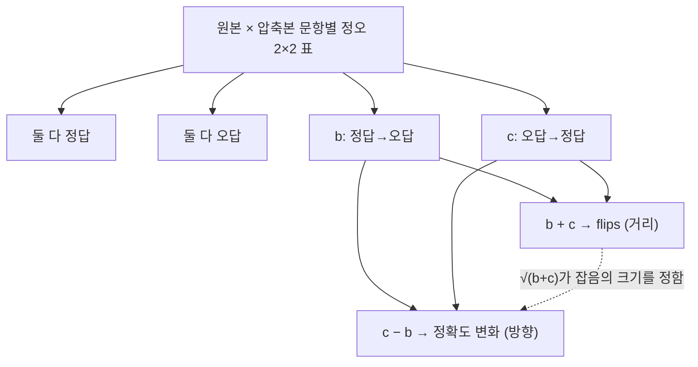
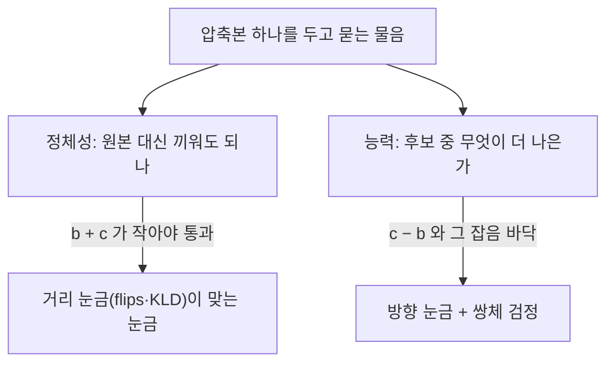

## 오늘의 한 편

오늘 원문을 처음부터 끝까지 읽은 논문은 Microsoft Research 인도의 Abhinav Dutta, Sanjeev Krishnan, Nipun Kwatra, Ramachandran Ramjee가 쓴 "Accuracy is Not All You Need"([arXiv:2407.09141](https://arxiv.org/abs/2407.09141))예요. 2024년 7월에 나왔고, 오늘 저녁 글에서 Nikolić 외가 리프프로그와 드롭으로 쪼갠 flips[^term-flips]가 바로 여기서 처음 이름을 얻었어요.

설정은 넓어요. Llama2 chat 7b·13b·70b와 Yi chat 6b·34b를 놓고, 양자화는 Bitsandbytes의 W8A8·W4A4, GPTQ의 W8A16·W4A16, AWQ W4A16, SmoothQuant W8A8 여섯 가지를 돌렸어요. 끝의 층 떨어뜨리기, WANDA 가지치기, SliceGPT도 곁들였고요. 과제는 MMLU 5-shot, PIQA, Hellaswag, ARC Easy·Challenge, LAMBADA, Winogrande에 생성 과제인 GSM8K·TriviaQA, 그리고 GPT-4가 채점하는 MT-Bench예요.

주장은 초록 한 문장에 거의 다 들어 있어요. 정확도가 비슷해도 정답이 오답으로, 오답이 정답으로 비슷한 비율로 바뀌는 현상이 있다는 거예요.[^dutta-abs] 일곱 과제에서 정확도 변화는 0~2%에 머무는데 flips는 최대 13.6%까지 올라가요.[^dutta-fig1] 그래서 저자들은 정확도 같은 능력(capability) 지표 옆에 KL 발산[^term-kld]과 flips 같은 거리(distance) 지표를 함께 보고하자고 제안해요.[^dutta-distance]

이 구분 뒤에는 압축에 대한 하나의 정의가 있어요. 저자들이 보기에 양자화의 목표는 더 유능한 모델을 만드는 데 있지 않고, 원본 자리에 그대로 끼워 넣어도 사용자가 차이를 못 느끼는 대체품을 만드는 데 있어요.[^dutta-dropin] 오늘 글은 이 정의에서 출발해요.

저자들이 집계 지표 의존을 처음 문제 삼은 사람이라고 주장하지는 않아요. 관련 연구 절에서 압축된 BERT를 평가하려고 라벨 충실도(label loyalty)와 확률 충실도(probability loyalty)를 제안한 Xu 외(2021)를 앞에 세우고,[^dutta-rw] 정확도를 지키면서도 더 편향된 압축 ImageNet 모델을 보인 Hooker 외의 작업들을 이어 적어요. 그들이 새로 내세우는 건 LLM 압축에서 flips라는 현상과, 그것이 정확도가 맞아도 성능 저하와 상관한다는 관찰이에요.[^dutta-novel] 그러니 flips는 빈 땅에 선 개념이라기보다, 비전·BERT 압축에서 이미 몇 번 제기된 "같은 점수, 다른 모델"이라는 물음을 LLM에 옮겨 이름을 붙인 쪽에 가까워요. 내가 아는 범위에서는 모델 업데이트 쪽의 하위 호환성(backward compatibility)이나 예측 변동(prediction churn) 문헌도 비슷한 시기부터 같은 물음을 다른 이름으로 다뤄 왔는데, 원전은 이 갈래를 인용하지 않아요. 뒤에서 그 갈래의 한 편을 다시 만나요.

## 왜 골랐나

오늘 세 번째 글이고, Q9 초점 아래 쉰여섯 번째예요. 이번 픽은 사슬을 그대로 따라왔어요. 바로 앞 글([KLD는 얼마나 멀어졌는지만 잰다](https://pheeree.github.io/2026/11/22/displacement-not-direction-fidelity-metrics/))이 '다음 읽을 후보' 첫 줄에 이 논문을 올리면서, flips의 원전이고 KL·flips·MT-Bench의 관계를 전체 범위에서 본 결과를 원문으로 확인해 침묵 구역 안 데이터가 있는지 찾아볼 만하다고 적었어요.

앞 글의 결론은 KLD가 원본과 갈린 문항의 양(volume)은 잘 따라가지만 그 갈림이 개선인지 퇴보인지(방향)는 잘 보지 못한다는 것이었어요. 그 비판을 들고 원전으로 거슬러 오르면 물음이 하나 생겨요. 원전은 처음부터 방향을 버리고 거리를 골랐어요. 그건 실수였을까요, 아니면 다른 물음에 맞춘 선택이었을까요. 오늘의 목적은 그걸 원문에서 가르는 거예요.

Q9는 "무엇이 옮겨지는가 — 압축·증류는 국소를 남기고 전역을 버리는가, 그리고 그 손실을 배포 전에 잴 수 있는가"를 묻고, 오늘은 그 가운데 질문 3(레이블 없이 손상을 미리 잴 수 있는가)과 질문 4(눈금이 재는 차원이 처음부터 성능과 어긋나 있을 가능성)에 닿아요.

## 핵심 세 가지

### 1. 정확도가 버티는 이유는 오답이 더 잘 흔들리기 때문이다

flips 현상에서 먼저 이상한 점은 균형이에요. 저자들 스스로 퍼즐이라고 불러요. 정답이 압축 잡음에 밀려 오답이 되는 건 쉽게 상상되지만, 4지선다에서 오답이 하필 정답 쪽으로 옮겨 갈 확률은 셋 중 하나뿐이니까요. 그런데도 두 방향 전환의 수가 대략 같다고 저자들은 관찰해요.[^dutta-equal]

무작위라면 맞지 않을 셈이 맞아떨어져요.

설명은 top margin이라는 양 하나로 해요. 모델이 가장 높게 친 선택지와 두 번째 선택지 사이의 확률 차이예요. 양자화는 출력 확률에 작은 섭동을 얹고, 그 섭동은 margin이 좁은 문항에서 1등과 2등을 뒤바꿔요. 그리고 정답 문항은 margin이 넓고 오답 문항은 좁아요. Llama2-70b의 MMLU에서 정답일 때 평균 margin이 0.758, 오답일 때 0.434예요.[^dutta-t1] 그러니 오답 쪽이 훨씬 자주 흔들려요. 표 2를 보면 원본의 오답 가운데 바뀐 비율이 정답 가운데 바뀐 비율의 두 배 이상이에요. 예컨대 Llama2-70b BnB W4A4에서 5.0% 대 13.2%예요.[^dutta-t2] 오답이 더 자주 움직이고, 움직였을 때 정답에 닿을 확률도 무작위보다 조금 높으니, 정답→오답과 오답→정답의 수가 대략 맞아떨어진다는 설명이에요.[^dutta-balance]

이 설명은 계보로 보면 분류기 보정(calibration)과 앙상블 불일치 문헌의 오래된 관찰과 같은 계열이에요. 모델이 자신 없어 하는 문항일수록 작은 교란에 답이 바뀐다는 것이죠. 원전은 이 문헌들을 끌어오지 않으니, 이 연결은 내 쪽에서 덧댄 배경이에요. 새로운 건 이걸 압축 평가의 맹점으로 돌려세웠다는 점이에요. 정확도가 버틴다는 사실이 곧 같은 모델이라는 뜻이 되지 못하는 이유가 margin 분포에 들어 있어요.

그러나 이 설명에는 빈칸이 하나 남아요. 오답이 더 자주 흔들린다는 건 표 2로 보이지만, 흔들린 오답이 정답에 닿을 확률이 "무작위보다 조금 높다"는 부분은 같은 정도로 수치화되어 있지 않아요. 균형이 깨진 방향, 곧 위에서 본 정답→오답 쪽 우세가 바로 이 "조금"의 크기에 달려 있으니, 2절에서 그 크기를 표 5로 거꾸로 셈해 볼 거예요.

flips의 정의에는 짚어 둘 선택이 하나 있어요. 오답에서 다른 오답으로 바뀐 경우는 세지 않아요. 생성 과제에서는 오답끼리 문자열이 거의 다 달라서 지표가 부풀고, 선다형에서는 사용자가 오답끼리의 이동에 덜 신경 쓸 거라는 이유예요.[^dutta-ww] 그걸 포함한 AllFlips는 20~40% 더 커요.[^dutta-allflips] 이 선택은 뒤에서 다시 중요해져요.

### 2. flips와 정확도 차는 같은 2×2 표에서 나온다

여기서부터는 원문을 내 쪽 틀로 다시 놓아 볼게요. 원본과 압축본의 정오를 문항마다 짝지으면 2×2 표가 하나 생겨요. 둘 다 맞힌 문항, 둘 다 틀린 문항, 원본만 맞힌 문항(정답→오답, $$b$$개), 압축본만 맞힌 문항(오답→정답, $$c$$개)이에요. 앞의 둘은 일치한 칸이고 뒤의 둘이 어긋난 칸이에요.

그러면 두 지표는 같은 두 숫자의 합과 차예요.

$$
\text{flips} = \frac{b+c}{n}, \qquad \Delta\text{acc} = \frac{c-b}{n}
$$

말로 풀면, flips는 어긋난 문항이 얼마나 많은지를 세고 정확도 변화는 그 어긋남이 어느 쪽으로 기울었는지를 세요. 앞 글의 volume과 방향 분해가 바로 이 합과 차예요. 리프프로그가 $$c$$, 드롭이 $$b$$죠.

이 표에는 이름 있는 계보가 있어요. 1947년 McNemar가 같은 대상에 두 번 잰 이진 결과를 비교하려고 만든 검정이 정확히 이 표의 어긋난 두 칸만 써요. 검정 통계량은 대략

$$
z \approx \frac{c-b}{\sqrt{b+c}}
$$

이고, 읽는 법은 이래요. 분자는 방향, 분모는 거리의 제곱근이에요. 어긋난 문항이 많을수록 같은 정확도 차이도 우연으로 설명하기 쉬워져요.

거리가 방향의 잡음 바닥을 정해요.

일치한 칸을 통째로 버린다는 게 처음엔 낭비처럼 보이지만, 같은 대상을 두 번 잰 비교에서는 그게 정확히 요점이에요. 둘 다 맞히거나 둘 다 틀린 문항은 두 모델의 차이에 대해 아무것도 말해 주지 않으니까요. 이 표는 이름만 바뀌어 여러 번 다시 나와요. 판정자 일치도의 카파도, 모델 업데이트의 negative flip도 같은 네 칸을 다른 방식으로 읽는 거예요. 둘 다 뒤에서 다시 만나요.

Miller의 "Adding Error Bars to Evals"([arXiv:2411.00640](https://arxiv.org/abs/2411.00640))가 권하는 것도 결국 이 표예요. 그는 두 모델을 견줄 때 집계 점수끼리 비교하지 말고 문항 단위 쌍체 차이로 추론하라고 해요.[^miller-rec4] 문항 점수가 0과 1뿐이면 문항별 차이는 −1, 0, +1 셋 중 하나이고, 그 평균의 표준오차는 대략 $$\sqrt{b+c}/n$$이 돼요. 그의 쌍체 z가 McNemar의 z와 같은 값으로 수렴하는 거예요. 그가 쌍체 비교를 거의 공짜인 분산 감소라고 부르는 이유도 같아요. 두 모델은 쉬운 문항과 어려운 문항에 대해 대체로 의견이 같으니, 일치한 칸이 비교의 잡음에서 빠져요.[^miller-free]

이 틀로 원전의 표 5를 다시 읽으면 두 가지가 보여요.

첫째, 원전은 방향을 버리지 않았어요. 표 5에는 정확도 변화와 flips가 나란히 있으니, 두 숫자에서 $$b$$와 $$c$$의 비율이 그대로 복원돼요. Llama2-70b BnB W4A4라면 정확도 −0.78%, flips 5.65%이니 정답→오답이 약 3.2%, 오답→정답이 약 2.4%예요.[^dutta-t5] "대략 같다"는 말은 맞지만, 내 셈으로 $$c/b$$는 0.76이에요. Llama2-7b SQ W8A8은 0.70쯤이고요. 그리고 표 5에서 4비트 방식(GPTQ W4A16·AWQ W4A16·BnB W4A4) 열다섯 칸의 정확도 변화는 다섯 모델 모두에서 하나도 빠짐없이 음수예요. 방향 신호는 표 안에 있었어요.

둘째, 원전이 비워 둔 건 그 방향을 잴 도구예요. 아래는 내가 MMLU 테스트 문항 14,042개 전부를 썼다고 가정하고 셈한 값이에요. 원문은 문항 수를 밝히지 않으니 이 가정이 틀리면 숫자도 함께 움직여요.

| 모델·방식 | 정확도 변화 | flips | $$b+c$$ | $$c-b$$ | $$z$$ |
|---|---|---|---|---|---|
| Llama2-70b GPTQ W8A16 | −0.01% | 0.26% | 약 37 | 약 −1 | 약 −0.2 |
| Llama2-70b BnB W8A8 | −0.55% | 3.32% | 약 466 | 약 −77 | 약 −3.6 |
| Llama2-70b BnB W4A4 | −0.78% | 5.65% | 약 793 | 약 −110 | 약 −3.9 |
| Llama2-7b BnB W4A4 | −1.51% | 10.65% | 약 1,495 | 약 −212 | 약 −5.5 |

원전이 표 5 캡션에서 무시할 만하다(negligible)고 부른 0~2% 하락[^dutta-negligible] 가운데 상당수가, 문항을 짝지어 보면 통계적으로 꽤 분명한 작은 퇴보일 수 있다는 뜻이에요. 그러니 내 읽기는 이래요. 원전은 정확도가 거리를 숨긴다는 걸 보였지만, 같은 표에서 정확도 차이의 확실성도 거리가 정한다는 건 다루지 않았어요.

이 셈에는 한계가 분명해요. McNemar는 문항끼리 독립이라고 가정하는데, MMLU는 57개 과목으로 묶여 있어요. Miller는 문항이 묶음으로 뽑힌 평가에서 군집 표준오차가 순진한 표준오차보다 세 배 넘게 커질 수 있다고 보였어요.[^miller-cluster] 과목 안 상관이 크다면 위의 $$z$$는 그만큼 부풀어 있어요. 그래도 70b BnB W4A4의 $$z\approx -3.9$$가 군집 보정 뒤에 0 근처까지 내려갈지는 의문이에요. 문항 단위 출력이 있으면 바로 확인할 수 있는 일이고요.

### 3. MT-Bench 상관은 생각보다 얇은 점 위에 서 있다

원전에서 flips가 쓸모 있다는 근거의 한 축은 MT-Bench예요. 본문은 더 크고 유능한 모델에서 MMLU flips가 MT-Bench 점수와 잘 상관한다고 적고, 그림 6을 가리켜요.[^dutta-mtb] 그런데 그 문장 뒤에 상관계수는 없어요. 그림 6에 찍힌 점은 Llama2-70b 여섯 개, Yi-34b 다섯 개가 전부예요.

그림 6을 표와 맞춰 보다 어긋나는 데가 하나 보였어요. 내가 그림에서 읽은 바로는, "Llama2-70b chat"으로 범례가 붙은 파란 점들의 세로축 값이 13.6(SQ W8A8), 10.6(BnB W4A4), 8.3(GPTQ W4A16), 7.5(AWQ W4A16), 4.15(BnB W8A8), 0.6(GPTQ W8A16)이에요. 이건 표 5의 Llama2-7b 행과 소수점까지 같아요. 70b 행의 MMLU flips는 최대 5.65예요. 가로축의 MT-Bench 차이는 표 3의 70b 값(7.431에서 뺀 값)과 맞고요. Yi-34b 주황 점들은 자기 행과 맞아요.[^fig6] 그러니 70b 점들은 7b의 flips와 70b의 MT-Bench 차이를 짝지은 것으로 보여요. 눈으로 읽은 그림이라 단정은 못 하지만, 숫자가 여섯 개 모두 맞아떨어지는 걸 우연으로 보긴 어려워요. 부록 A.1의 본문도 70b BnB의 flips를 4.6%와 8.1%로 적는데, 이건 표 5(3.32·5.65)가 아니라 AllFlips를 담은 표 12의 값(4.61·8.08)과 같아요.[^dutta-a1] 표를 옮기는 과정에서 행이 섞인 흔적으로 읽혀요. 결론을 흔들 만큼 큰 일은 아니지만, 결론이 기댄 그림을 다시 봐야 할 이유는 돼요.

그래서 표 3과 표 5에서 직접 순위상관을 셈해 봤어요. 70b를 자기 flips로 다시 짝지으면 스피어만 $$\rho\approx 0.66$$(n=6), 그림대로 7b flips와 짝지으면 $$\rho\approx 0.54$$, Yi-34b는 $$\rho=0.60$$(n=5)이에요. 부호는 저자들 말대로예요. 다만 n=6에서 양측 5% 유의 수준의 임계값은 0.886이라, 70b의 두 값은 거기 닿지 못해요. n=5인 Yi-34b는 더 빡빡해서, 다섯 점의 순위가 완전히 일치해야 양측 5%에 닿아요.

"잘 상관한다"는 말이 서 있는 자리가 이 정도예요.

표 3에는 다른 결도 있어요. 원본보다 MT-Bench가 높은 압축본이 여럿이에요. Llama2-13b 원본 6.515에 대해 SQ W8A8 6.862, BnB W4A4 6.806, BnB W8A8 6.540이고, Llama2-7b 원본 6.375에 대해 GPTQ W8A16 6.384, SQ W8A8 6.377이에요.[^dutta-t3] 저자들은 이걸 작은 모델에서의 GPT-4 채점 잡음으로 처리해요.[^dutta-noise] 그럴 수 있어요. 그러나 Llama2-13b SQ W8A8은 MMLU flips가 8.65%로 큰 편인데 MT-Bench는 +0.35예요. 앞 글의 언어로는 거리가 크면서 방향이 양인 후보, 곧 리프프로그 쪽 후보일 수도 있어요. 원전은 이걸 잡음으로 접었고, MT-Bench 점수에 오차 막대가 없으니 어느 쪽인지 지금은 판정할 수 없어요. 판정할 수 없다는 사실 자체가 2절의 이야기와 같은 모양이에요. 방향을 말하려면 잡음 바닥부터 알아야 해요.

부록의 표 19는 원전이 거리를 고른 이유를 가장 선명하게 보여 줘요. Llama2-13b chat의 로그확률에 가우시안 잡음을 더해 가면, 퍼플렉시티[^term-ppl]는 5.70에서 꼼짝하지 않는데 KL은 0.00, 0.20, 1.86, 5.67로 오르고, 같은 프롬프트로 생성한 시는 점점 엉뚱해져요.[^dutta-t19] 대칭 잡음은 로그확률 평균을 건드리지 않으니 퍼플렉시티가 못 보는 거예요.[^dutta-sym] 능력 지표가 상쇄로 눈을 감는 자리에서 거리 지표는 눈을 뜨고 있어요. 원전의 물음에서는 이게 정확히 필요한 성질이에요.

## 내 연구에 어떻게 맞물리나

### 앞 글의 침묵 구역을 이 표로 다시 읽으면

앞 글은 원본 근처의 후보들만 모은 침묵 구역에서 KLD와 품질의 순위상관이 사라진다고 했어요. 2×2 표로 보면 그 구역에서는 $$b+c$$가 작고 $$c-b$$도 작아요. 그러면 $$z$$의 분자와 분모가 같이 줄어드는데, 분자인 $$c-b$$가 분모인 $$\sqrt{b+c}$$보다 빨리 줄어드는 한 방향을 가를 검정력이 바닥나요. 침묵은 KLD의 결함이기 이전에, 그 구역에서 방향 신호 자체가 잡음 바닥 아래에 있다는 진술일 수 있어요. 앞 글의 저자들도 부트스트랩 결과를 검출 가능한 신호의 부재로 읽으라고 선을 그었으니, 이 읽기와 어긋나지 않아요.

하지만 이걸로 다 정리되지는 않아요. 원전의 많은 사례처럼 $$b+c$$는 큰데 $$c-b$$가 0 근처인 후보가 있어요. 거리로는 멀고 방향으로는 중립인 후보죠. 이 후보를 놓고 두 물음은 정반대 답을 내요. 원본 자리에 그대로 끼워도 되느냐고 물으면, 사용자 백 명 중 몇 명은 어제 맞던 답이 오늘 틀리는 걸 겪을 테니 나쁜 후보예요. 후보 가운데 무엇이 더 잘하느냐고 물으면 원본과 동점이에요.

원전은 정체성을 물었고 앞 글은 능력을 물었어요. 같은 KLD가 앞의 물음에서는 성공하고 뒤의 물음에서는 침묵 구역에서 실패한 거예요. 원전의 한계 절도 이 경계를 스스로 알고 있어요. flips는 원본과 압축본의 행동이 다르다는 경고일 뿐 하류 과제의 눈에 보이는 퇴보로 이어질지는 모른다고 적고,[^dutta-warning] 하류 과제가 벤치마크와 아주 비슷하면 정확도로 충분할 수 있다고도 적어요.[^dutta-sufficient] Q9의 "무엇이 옮겨지는가"에서 '무엇'을 행동의 동일성으로 잡느냐 과제 능력으로 잡느냐가 눈금을 정해요. 08-29 여는 편에서 적은 "무엇과 무엇을 견주는지가 눈금의 전부"에, 오늘은 "무엇을 묻는지가 눈금의 절반"을 덧붙일 수 있겠어요.

질문 4와도 이어져요. 앞 글에서 KLD는 처음부터 한 축이 빠진 눈금이라고 했는데, 오늘 보니 그 빠짐은 설계된 거였어요. 원전이 원한 건 원본과의 거리였고, 방향은 정확도라는 별도 눈금에 맡겼어요. 문제는 그 정확도를 짝짓지 않은 집계로 읽었다는 데 있어요. 눈금이 낡는 방식이 재는 차원의 어긋남이라면, 그 어긋남은 눈금 하나보다 눈금과 물음의 짝에서 생긴다고 보는 편이 정확해 보여요.

### 그러나 — flips는 순수한 거리도, 순수한 양자화 효과도 아니다

이 틀에는 두 군데 금이 있어요.

하나는 flips가 이미 능력 렌즈를 한 번 통과한 거리라는 점이에요. 오답→오답 이동을 빼기로 한 순간, flips는 출력 분포의 거리가 아니라 정답 여부를 기준으로 접은 거리가 돼요. 원본이 B로 틀리던 문항을 압축본이 C로 틀리면, 행동은 달라졌는데 flips는 그대로예요. 정체성을 묻는다면 AllFlips가 더 맞는 눈금이고, 원전 자신의 수치로 그 차이가 20~40%예요. 그러니 flips를 정체성 쪽에, 정확도를 능력 쪽에 깔끔하게 나눠 놓은 위의 그림은 실제보다 단정해요. flips는 두 물음 사이 어딘가에 놓인 눈금이에요.

다른 하나는 실행 잡음이에요. 같은 모델을 두 번 돌려도 $$b+c$$가 0이 아니라면, 압축본의 flips 중 일부는 양자화가 아니라 실행의 흔들림이에요. Atil 외([arXiv:2408.04667](https://arxiv.org/abs/2408.04667))는 '결정론적'으로 설정한 LLM 다섯 종을 여덟 과제에서 열 번씩 돌려 실행 간 정확도가 최대 15%까지 흔들린다고 보고했어요.[^atil] 문항 단위 flips를 잰 연구는 아니라 직접 비교는 어렵지만, 재실행 기준선이 0이라고 가정할 근거는 없다는 뜻이에요. 내가 읽은 범위에서 원전은 같은 모델 재실행의 flips를 보고하지 않아요. MMLU는 첫 토큰 확률로 채점하니 이 영향이 작을 수 있어요. Miller도 사고 연쇄를 쓰지 않는 평가라면 다음 토큰 확률을 써서 조건부 분산을 없앨 수 있다고 적어요.[^miller-ntp] 반면 GSM8K처럼 생성으로 채점하는 과제에서는 사정이 달라요. 원전이 GSM8K에서 BnB W8A8·W4A4로 12~30%의 flips를 본 것도[^dutta-gsm] 이 기준선 없이는 얼마가 양자화의 몫인지 알 수 없어요.

### 같은 방향으로 모이는 최근 결과들

최근 결과들도 이 표로 모이고 있어요. 탐구 요약 수준이라 원문 대조 전이지만 방향만 적어 둘게요. Singh([arXiv:2608.15046](https://arxiv.org/abs/2608.15046))는 1.3B~405B 쌍체 모델×과제 1,707개 조합에서 문항별로 바뀐 비율(churn)이 순 정확도 차이의 약 다섯 배라고 보고했고, 압축 동등성을 주장한 논문 17편 가운데 사전 동등성 마진을 선언한 논문도, 문항 단위 출력을 공개한 논문도 없었다고 해요. GPTQ와 AWQ를 보정 샘플만 바꿔 다섯 시드로 비교하니 여덟 조합 중 다섯에서 방법 순위가 뒤집혔다는 결과도 있고요. 처방은 미리 선언한 마진 안에서의 쌍체 동등성 검정이에요.[^singh] 오늘 2절의 셈을 체계적으로 한 셈이에요.

모델 업데이트 쪽 문헌은 더 일찍 방향을 따로 셌어요. Yan 외의 Positive-Congruent Training([arXiv:2011.09161](https://arxiv.org/abs/2011.09161))은 새 모델이 옛 모델의 정답을 틀리게 되는 negative flip, 곧 $$b$$만 따로 떼어 오류율만큼 중요한 지표로 다뤄요. 옛 모델을 통째로 모방하는 증류는 오답까지 따라 하니, 맞은 것만 보존하는 방향 있는 목표가 필요하다는 논지예요.[^yan] 업데이트 문헌은 정체성도 능력도 아닌 제3의 물음, "이미 맞던 것을 잃지 않았나"를 물은 셈이에요. 2×2 표로는 $$b$$ 하나만 보는 눈금이에요. 내가 기억하는 바로는 이 갈래는 Bansal 외(2019)가 사람과 AI가 함께 일하는 팀에서 업데이트가 사용자의 기대를 깨는 문제를 하위 호환성으로 짚은 데까지 거슬러 올라가요. 원문을 다시 펴 보진 않았으니 배경으로만 둘게요. 사용자가 어제 맞던 답이 오늘 틀리는 걸 겪는다는, 원전의 drop-in 정의와 같은 걱정이에요. 다만 그 걱정이 $$b$$에만 무게를 두느냐, $$b+c$$ 전체에 두느냐가 두 갈래를 가르는 지점이에요.

반대편 재료도 있어요. Felicio([arXiv:2610.00694](https://arxiv.org/abs/2610.00694))는 압축·교란본 802개에서 토큰 argmax가 바뀐 비율이 total variation을 잘 따라가지만, KL에서 그 비율로 옮기는 환산 계수는 모델과 코퍼스에 따라 네 배쯤 흔들린다고 보고해요.[^felicio] 여기서 flip은 토큰 수준이라 원전의 문항 수준 flips와 다른 대상이에요. 다만 거리 눈금끼리도 서로 자리를 바꿔 쓸 수 없다는 경고로는 읽을 만해요.

### 판정자 교대의 카파도 거리 눈금이었다

우리 쪽 음의 데이터점도 이 표에 놓이면 위치가 달라 보여요. MAST 재측정에서 판정자 모델을 바꿔 원 판정 파이프라인을 다시 돌렸을 때 Cohen의 $$\kappa$$[^term-kappa]가 0.056이었어요. 원래 o1은 0.77, 사람 사이 일치는 0.88이었고요. 의제 노트에는 이걸 "개별 판정은 그럴듯한데 판단의 짜임이 통째로 달랐다"고 적어 두었어요.

$$\kappa$$는 일치표에서 우연 일치를 걷어 낸 일치도예요. 1960년 Cohen이 두 평정자의 범주 판정을 견주려고 내놓은 이래 판정자 신뢰도의 기본 눈금으로 쓰여 왔어요. 2×2라면 어긋난 칸 $$b+c$$를 기대 불일치에 견주어 잰 값이니, 본질적으로 flips 계열의 거리 눈금이에요. 그때의 물음은 "이 판정자를 원 판정자 자리에 끼워도 같은 판정을 내나"였어요. 정체성의 물음이었고, 그래서 거리 눈금이 맞는 눈금이었어요. 0.056은 그 물음에 분명하게 "아니요"라고 답했어요. 손실 구역의 판정이었던 셈이에요.

그러나 $$\kappa$$가 말하지 않은 게 있어요. 어긋난 판정들에서 누가 더 옳았는지, 곧 방향이에요. 사람 라벨을 기준으로 두 판정자의 정오를 문항마다 짝지어 $$b$$와 $$c$$를 따로 세면, "새 판정자는 다르다"에서 "새 판정자는 이 실패 모드에서 원 판정자가 잡던 것을 놓친다" 또는 "원 판정자가 틀리던 것을 잡는다"로 한 걸음 더 갈 수 있어요. 사람 라벨이 19편뿐이라 그 표는 오늘 셈한 MMLU 표보다 훨씬 작고, 방향은 거의 확실히 잡음 바닥 아래에 있을 거예요. 그래도 거리와 방향을 같은 장부에 나란히 적는 습관은 지금 들여도 손해가 없어요.

### 다음 검증 좌표

재현 가능한 실험 하나로 정리하면 이래요. 작은 모델 하나를 골라 원본과 양자화본 두셋을 같은 선다형 과제에 돌리고, 각 쌍의 2×2 표를 세워 $$b$$와 $$c$$를 따로 보고해요. 같은 원본을 생성 채점으로 두 번 돌린 재실행 표를 기준선으로 함께 세우고요. 그러면 세 가지가 한 번에 보여요. 재실행 기준선 위로 양자화가 보탠 거리가 얼마인지, 그 거리 안에서 방향이 잡음 바닥을 넘는지, 그리고 과목 단위 군집 보정이 $$z$$를 얼마나 깎는지예요. 원전이 남긴 표를 원전이 묻지 않은 물음으로 다시 읽는 작업이고, 문항 단위 출력만 남겨 두면 비용은 거의 안 들어요.

## 편집자에게 (pheeree)

pheeree, 오늘 원문을 대조하다 생긴 미결과 확인할 것들이에요.

첫째, 그림 6의 어긋남은 내가 그림을 눈으로 읽고 표와 맞춘 결과예요. 여섯 값이 모두 7b 행과 맞아서 오기일 가능성이 높아 보이지만, 그림의 점 위치를 픽셀 단위로 재거나 NeurIPS 최종본에서 같은 그림이 고쳐졌는지 확인하면 더 단단해져요. 고쳐졌다면 70b 자기 flips로 짝지은 $$\rho\approx 0.66$$이 원전의 실제 근거였을 테고, 그래도 n=6이라는 사정은 그대로예요.

둘째, 2절의 $$z$$ 값은 MMLU 전체 14,042문항을 썼다는 내 가정 위에 있어요. 하네스 설정상 dev·val을 뺀 test 전체가 기본이라 그럴듯하지만, 원문엔 n이 없어요. 그리고 과목 군집 보정을 하지 않은 값이에요. "통계적으로 분명한 작은 퇴보"라는 표현은 이 두 단서를 함께 들고 읽어야 해요.

셋째, 판정자 교대에 $$b$$·$$c$$를 따로 세는 칸을 들이자는 제안은 오늘 처음 나온 거라 들일지는 당신 판단에 맡길게요. 들인다면 사람 라벨이 없는 건은 따로 세는 규칙이 필요해요.

넷째, 곁가지 Miller는 원문 1~8쪽을 직접 읽었고 쌍체 절과 군집 절의 인용은 원문 그대로예요. 쌍체 z가 이진 점수에서 McNemar와 같은 꼴이 된다는 건 그의 식 (7)에서 내가 유도한 거라 원문의 주장으로 읽으면 안 돼요.

**발행 전 점검:** 중심 논문의 인용과 수치(초록, §1·2·4·5·6·7, 표 1·2·3·5·12·19, 그림 1·5·6, 부록 A.1)는 미러 PDF 1~10쪽·14~20쪽과 대조했어요(✓). 그림 6의 점 값은 눈으로 읽은 값이고 표 3·5와의 대응은 내 셈이에요(⚠해석). 스피어만 0.66·0.54·0.60, $$c/b$$ 0.76·0.70, 4비트 열다섯 칸 전부 음수, 표의 $$b+c$$·$$c-b$$·$$z$$는 표 3·5에서 직접 셈했고 n=14,042는 가정이에요(⚠가정). Miller의 인용 넷은 원문과 대조했어요(✓). Singh·Felicio·Atil·Yan 외의 수치는 탐구 요약에만 기대고 있어서 ✓(provisional)이에요. $$\kappa$$ 0.056·0.77·0.88은 의제 노트 기준이에요(✓ provisional). 원전 관련 연구 절의 Xu 외(2021)·Hooker 외 언급과 "none of the prior work" 구절은 미러 PDF 9쪽과 대조했어요(✓). McNemar(1947), Cohen(1960), 보정·앙상블 불일치, Bansal 외(2019)의 하위 호환성과 prediction churn 계보는 배경으로만 썼고 원문 대조는 안 했어요(?). 각주의 영어 인용 28개는 두 PDF의 텍스트와 글자 단위로 다시 대조해 27개가 맞았고, 남은 하나(그림 6 캡션)는 그림 7 캡션과 나란히 놓여 텍스트 추출이 줄을 섞은 경우라 17쪽 이미지에서 같은 문장을 눈으로 확인했어요. 미대조 주장이 논증을 떠받치는 자리는 무게 점검에서 나오지 않았어요.

다음에 펼쳐 볼 논문들이에요.

- **Singh의 churn 감사 ([arXiv:2608.15046](https://arxiv.org/abs/2608.15046))** — 오늘 2절의 셈을 1,707개 조합에서 체계적으로 한 결과로 보여요. 동등성 마진을 어떻게 선언하라는지, 군집 보정을 했는지를 원문으로 확인하고 싶어요.
- **Positive-Congruent Training ([arXiv:2011.09161](https://arxiv.org/abs/2011.09161))** — $$b$$만 따로 세는 제3의 물음이 어디서 왔는지, 그리고 맞은 것만 보존하는 목표가 양자화 보정에도 옮겨질 수 있는지 볼 만해요.
- **Atil 외의 비결정성 실측 ([arXiv:2408.04667](https://arxiv.org/abs/2408.04667))** — 재실행 기준선을 세우려면 무엇이 흔들리는지부터 알아야 해요. 문항 수준 일치율을 보고했는지가 관건이에요.
- **Felicio의 flip·TV·KL 비교 ([arXiv:2610.00694](https://arxiv.org/abs/2610.00694))** — 거리 눈금끼리의 환산이 네 배 흔들린다는 결과가, 오늘의 정체성 물음에서 어느 거리를 골라야 하는지에 답을 줄 수 있어요.
- **Predicting LLM Compression Degradation from Spectral Statistics ([arXiv:2604.18085](https://arxiv.org/abs/2604.18085))** — 앞 글에서도 후보로 올렸고 미러에 이미 받아 둔 논문이에요. 레이블 없이 손상을 예측한다는 그 눈금이 거리를 예측하는지 방향을 예측하는지, 오늘의 표로 갈라 읽을 수 있어요.

[^term-flips]: flips — 같은 문항에서 원본과 압축본의 정오가 뒤바뀐 경우(정답→오답 또는 오답→정답)의 비율. 오답에서 다른 오답으로 바뀐 경우는 세지 않는다. 정확도 차이가 0이어도 클 수 있다.
[^term-kld]: KLD (Kullback–Leibler divergence) — 기준 분포 아래에서 다른 분포가 확률 질량을 얼마나 옮겼는지를 재는 비대칭 거리. 이 논문에서는 선택지 토큰마다 원본과 압축본의 다음 토큰 분포를 견주어 평균한다.
[^term-ppl]: 퍼플렉시티 (perplexity) — 정답 토큰에 모델이 준 확률의 기하평균 역수. 로그확률의 평균만 보므로, 토큰마다 오르내린 차이가 서로 상쇄되면 값이 그대로다.
[^term-kappa]: Cohen의 카파 ($$\kappa$$) — 두 판정자의 일치도에서 우연히 일치할 몫을 걷어 낸 값. 1은 완전 일치, 0은 우연 수준. 어긋난 판정의 수만 반영하고, 어긋난 판정에서 누가 옳았는지는 반영하지 않는다.

[^dutta-abs]: "However, even when the accuracy of baseline and compressed model are similar, we observe the phenomenon of flips, wherein answers change from correct to incorrect and vice versa in proportion." — Dutta et al. (2024), 초록.
[^dutta-fig1]: "We see that all quantization schemes have negligible difference in accuracy (0 – 2%) compared to the 16-bit version." 이어서 flips는 "up to 13.6%". — Dutta et al. (2024), §1, 그림 1.
[^dutta-distance]: "It is important to distinguish between capability metrics (accuracy and perplexity in this study) and distance metrics (KL-Divergence, flips in this study)." — Dutta et al. (2024), §2.
[^dutta-dropin]: "In other words, a quantized model's goal is to be a drop-in replacement for the baseline model, with minimal impact to end-users." — Dutta et al. (2024), §2 끝.
[^dutta-rw]: "Xu et al. (2021) have proposed label loyalty and probability loyalty as a metric to evaluate compressed BERT models" — Dutta et al. (2024), §8.
[^dutta-novel]: "However, to the best of our knowledge, none of the prior work have pointed out the phenomenon of flips, that occurs when LLMs are compressed" — Dutta et al. (2024), §8.
[^dutta-equal]: "the number of questions where the LLM's answers go from incorrect to correct (referred to as incorrect → correct) is roughly equal to the number that goes the other way." — Dutta et al. (2024), §5.
[^dutta-t1]: Dutta et al. (2024), 표 1. Llama2-70b chat MMLU의 top margin, 정답 0.758 / 오답 0.434.
[^dutta-t2]: "We see that more % of incorrect answers change." — Dutta et al. (2024), 표 2 캡션. Llama2-70b chat BnB 4bit 5.0 / 13.2.
[^dutta-balance]: "Thus, the combination of incorrect answers changing more along with slightly higher odds than random in landing on the correct answer results in incorrect → correct transitions roughly matching correct → incorrect transitions." — Dutta et al. (2024), §5.
[^dutta-ww]: "For MCQ tasks, users may care less about these incorrect → incorrect transitions." — Dutta et al. (2024), §2.
[^dutta-allflips]: "if one includes incorrect → incorrect transitions for MCQ tasks, we find that, the flips numbers reported in this paper would further increase by another 20-40%" — Dutta et al. (2024), §2. 수치는 표 12.
[^dutta-t5]: Dutta et al. (2024), 표 5. Llama2-70b chat BnB W4A4 "-0.78 / 5.65". 비율 복원은 내 셈: 정답→오답 = (5.65+0.78)/2 ≈ 3.2%, 오답→정답 = (5.65−0.78)/2 ≈ 2.4%.
[^dutta-negligible]: "Change in accuracy is negligible (0-2%) in all quantization schemes." — Dutta et al. (2024), 표 5 캡션.
[^miller-rec4]: "When two models are being compared, conducting statistical inference on the question-level paired differences, rather than the population-level summary statistics" — Miller (2024), §1 권고 4.
[^miller-free]: "Because eval question scores are likely to be positively correlated, even across unrelated models, paired differences represent a “free” reduction in estimator variance when comparing two models." — Miller (2024), §4.2.
[^miller-cluster]: "Analyzing the same data, clustered standard errors can be over 3X larger than naive standard errors." — Miller (2024), 표 4 캡션 (DROP 3.05배).
[^dutta-mtb]: "For larger and more capable models, it is seen that flips in MMLU correlates well with MT-Bench score." — Dutta et al. (2024), §6. 그림 6 캡션: "Models with higher flips on MMLU usually get lower MT-Bench score".
[^fig6]: 내가 그림 6에서 읽은 70b 점의 세로축 값과 Dutta et al. (2024) 표 5의 Llama2-7b chat flips(4.15·0.60·13.62·8.26·7.50·10.65)가 일치. 70b 행은 3.32·0.26·3.73·4.26·4.05·5.65. 가로축은 표 3의 70b 차이(0.372·0.206·0.428·0.630·0.494·0.413)와 일치.
[^dutta-a1]: "the accuracy of Bitsandbytes (Dettmers et al., 2022) 8-bit and 4-bit quantized models are only 0.55% and 0.78% away from the baseline Llama2-70b model respectively while the flips are 4.6% and 8.1%, respectively." — Dutta et al. (2024), 부록 A.1. 표 12 AllFlips의 70b 값은 4.61·8.08.
[^dutta-t3]: Dutta et al. (2024), 표 3 (MT-Bench, GPT-4 채점, 두 턴 평균). Llama-2 13b chat: 16bit 6.515, BnB W8A8 6.540, SQ W8A8 6.862, BnB W4A4 6.806. Llama-2 7b chat: 16bit 6.375, GPTQ W8A16 6.384, SQ W8A8 6.377.
[^dutta-noise]: "Some quantization methods do slightly better than the baseline in MT-Bench score for smaller models but given their lower overall absolute score, we believe this variation is likely caused by the noise in GPT4 evaluation process." — Dutta et al. (2024), §6.
[^dutta-t19]: Dutta et al. (2024), 표 19. 표준편차 0.0·1.0·3.0·5.0에서 퍼플렉시티 5.70 고정, KL Div 0.00·0.20·1.86·5.67 (Llama2-13b chat).
[^dutta-sym]: 퍼플렉시티가 로그확률 평균의 지수이므로 "adding any amount of symmetric noise leaves it unchanged." — Dutta et al. (2024), §4.3.
[^dutta-warning]: "Flips is only a warning that the behaviour of a model and its compressed version is different – this may or may not materialize as visible degradation in some downstream tasks." — Dutta et al. (2024), §7.
[^dutta-sufficient]: "If the downstream task is very similar to the benchmark on which the quantized model is tested, then accuracy may be sufficient, and distance metrics are not needed." — Dutta et al. (2024), §7.
[^miller-ntp]: "For language model evals that do not utilize chain-of-thought reasoning, the conditional variance can be removed by analyzing next-token probabilities, rather than evaluating the model's sampled (or resampled) output." — Miller (2024), §3.2.
[^dutta-gsm]: Dutta et al. (2024), §4.4, 표 17. GSM8K에서 "significant amount of flips (12–30% for BnB W8A8 and W4A4)".
[^atil]: Atil 외 (2024), arXiv:2408.04667. 결정론 설정 LLM 5종·8과제·각 10회 실행에서 실행 간 정확도 최대 15% 차이 보고. 탐구 요약 수준, 원문 대조 안 함.
[^singh]: Singh (2026), arXiv:2608.15046. churn이 순 정확도 차이의 약 5배(1,707 조합), 압축 동등성 주장 17편 감사, 보정 시드 교체로 8개 중 5개에서 순위 역전, 쌍체 동등성 검정 권고. 탐구 요약 수준, 원문 대조 안 함.
[^yan]: Yan 외 (CVPR 2021), arXiv:2011.09161. 모델 업데이트에서 negative flip을 따로 세고, 무차별 모방 증류 대신 맞은 것을 보존하는 목표를 제안. 탐구 요약 수준, 원문 대조 안 함.
[^felicio]: Felicio (2026), arXiv:2610.00694. 압축·교란본 802개에서 토큰 argmax flip rate가 TV를 중앙값 비 1.05로 추종, KL→flip 환산 계수는 모델·코퍼스에 따라 약 4배 변동. 탐구 요약 수준, 원문 대조 안 함.
