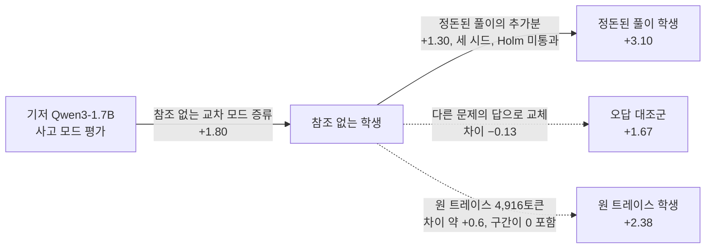
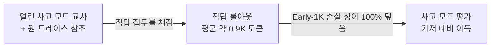
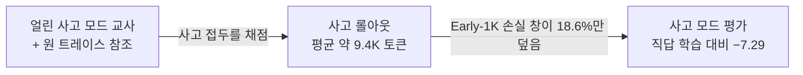

## 오늘의 한 편

오늘 읽은 논문은 싱가포르국립대의 XiuYu Zhang, Wei Chow, Junfeng Fang, Xingyu Zhu, Zhenkai Liang, Tat-Seng Chua가 쓴 "What Does Privileged Information Add to On-Policy Self-Distillation?"([arXiv:2609.20612](https://arxiv.org/abs/2609.20612))이에요. 제목에 담긴 물음이 곧 연구 설계예요. on-policy 자기증류(OPSD)[^term-opsd]에서는 얼린 자기 사본이 답이나 풀이를 보고 교사 노릇을 해요. 이 논문은 그렇게 덧붙인 정보, 곧 특권 정보[^term-pi]가 증류 자체를 넘어 얼마를 더 주는지를 재려 했어요.

계보를 먼저 짚어 둘게요. 학습 때만 보이는 정보로 학생을 가르친다는 생각은 Vapnik과 Vashist의 LUPI(2009)로 거슬러 올라가요. Lopez-Paz 외(2016)는 이 생각을 증류와 묶어 '일반화 증류'로 정리했어요. 학생이 스스로 만든 응답 위에서 교사의 점수를 받는 on-policy 증류는 Agarwal 외(2024)에서 내려오는 흐름이에요. 따로 교사를 두지 않고 정보를 더 본 자기 사본을 교사로 쓰는 OPSD의 원형은 Zhao 외(2026a), 곧 Self-Distilled Reasoner([arXiv:2601.18734](https://arxiv.org/abs/2601.18734))예요. 오늘 논문은 그 위에서 아주 기초적인 대조군 하나를 채워요. 이 계열이 그동안 비워 두었던 대조군이에요. 참조를 빼면 무엇이 남는가를 묻는 거죠.

그 대조군이 생각만큼 단순하지 않다는 데서 읽기가 시작돼요. 프롬프트, 사고 모드, 초기 파라미터, 채점 온도가 모두 같으면 참조 없는 교사는 학생과 똑같은 분포를 내요. 그러면 초기 손실은 0이에요[^zhang-zero]. 이대로라면 참조 없는 증류는 헛도는 바퀴여야 해요. 그런데 이 논문의 주 구성에서 교사는 늘 사고 모드를 켠 얼린 백본이고, 학생은 사고를 끈 채 직답으로 롤아웃[^term-rollout]을 만들어요. 그래서 참조를 뺀 대조군에도 신호가 남아요. 사고 모드 교사가 직답 학생의 접두를 채점할 때 생기는 차이고, 저자들은 이를 교차 모드 자기증류라고 불러요[^zhang-control]. 논문의 결론 대부분은 이 남은 신호가 얼마나 큰지에서 나와요.

초록의 마지막 문장은 특권 참조의 가치가 이 교차 모드 전이[^term-crossmode]에 보태는 몫에 있고, 풀이를 얼마나 많이 드러내느냐에 있지 않다고 요약해요[^zhang-abs]. 오늘은 이 문장의 어디까지가 실험으로 받쳐지고 어디부터가 해석인지 가려 보려 해요.

## 왜 골랐나

오늘의 픽은 앞선 글들이 이어 준 것이 아니라서 경로를 그대로 적어 둘게요. 최근 세 글(11-21, 11-19, 11-18)이 '다음 읽을 후보'로 올린 열네 편은 오늘 미러에 한 편도 들어오지 않았어요. 관심 표시 대기열은 비어 있었고, 현재 초점 질문 Q9의 다음 후보 일곱 편은 이미 다 읽은 상태였어요. 그래서 최근 14일 안에 내려받았지만 아직 글로 쓰지 않은 31편을 펼쳐 놓고, 오늘의 목적에 가장 가까운 한 편을 골랐어요.

목적은 이래요. Q9 "무엇이 옮겨지는가"를 특권 정보 쪽에서 한 뼘 더 밀어 보는 거예요. 자기증류 이득 가운데 참조의 몫과 참조 없는 증류 자체의 몫을 나누고, 학생 롤아웃의 형태만 바뀌어도 같은 참조가 이득을 손실로 뒤집는 대목을 최근 글들과 나란히 놓아 보려 해요.

연결고리가 없지는 않아요. [11-12 글](https://pheeree.github.io/2026/11/12/critique-guided-distillation-what-transfers/)은 Critique-Guided Distillation(CGD)을 읽으면서 이 논문과 곁가지인 Shrestha·Tessier 논문을 초록 수준으로만 보고 다음 후보에 올려 두었어요. 그 글은 사고 모드 롤아웃에서 이득이 손실로 뒤집혔다는 대목을 보고, 긴 풀이를 쓰도록 바뀐 CGD 학생에게도 같은 일이 생기는지 물었어요. 엇갈림도 하나 열어 두었어요. CGD에서는 다른 문제의 비평(B 조건)이 해를 끼쳤는데, 이쪽에서는 다른 문제의 풀이가 해가 없거나 오히려 도움이 됐다는 점이에요. 그때 손에 있던 자료로는 둘을 가를 수 없었어요. 오늘은 두 논문을 원문으로 읽었어요. 중심 논문은 본문 1~9쪽을 통독했고, 곁가지는 1~8쪽을 정독했어요. Q9 초점 아래 54번째 글이에요.

## 핵심 세 가지

### 하나. 참조를 빼도 이득 대부분이 남았다

설정부터 볼게요. 저자들은 AMPLE-Math라는 데이터셋을 만들었어요. OpenThoughts-114k에서 5,319문제를 뽑고, 문제마다 답은 같지만 드러내는 양이 다른 '뷰' 여섯 가지를 붙였어요. 답만(평균 13토큰), 요지(76), 핵심 단계(284), 정돈된 풀이(526), 요약(841), 원 트레이스 전체(4,916)예요. 요지·핵심 단계·요약은 다른 모델이 원 트레이스를 보고 생성한 뒤 검수했어요. 여섯 뷰는 '풀이를 얼마나 드러내는가'라는 축 하나 위에 늘어선 눈금인 셈이에요.

학습은 Qwen3-1.7B를 LoRA[^term-lora]($$r=64$$, $$\alpha=128$$)로 100 옵티마이저 스텝 돌렸고, SmolLM3-3B를 교차 확인용 모델군으로 두었어요. 손실은 감독 위치마다 교사에서 학생으로 가는 순방향 KL[^term-kl]이에요. 어휘 항마다 0.05에서 자른 뒤 합산해요. 평가는 사고 모드로 했어요. 도메인 안에서는 Avg@4, 외부 벤치마크(AIME 2024·2025, HMMT Feb 2025)에서는 Avg@12[^term-avgk]로 쟀어요. 쌍 비교 구간은 문제 군집 부트스트랩[^term-bootstrap] 1만 회로 만들었고, 여섯 대조에 Holm 보정[^term-holm]을 걸었어요.

Qwen의 step 100 도메인 내 변화를 늘어놓으면 이래요. 참조 없음 +1.80, 다른 문제의 답을 준 오답 대조군 +1.67, 답만 +2.41, 요지 +2.15, 핵심 단계 +2.80, 정돈된 풀이 +3.10, 요약 +2.54, 원 트레이스 +2.38[^zhang-t1]. 두 가지가 눈에 들어와요. 하나는 참조 없는 학생이 이미 기저보다 1.8점 올라 있고 구간 [0.20, 3.47]이 0을 비켜 간다는 점이에요. 오답 대조군도 함께 올라요. 다른 하나는 드러내는 풀이가 길어져도 이득이 따라 늘지 않는다는 점이에요. 13토큰짜리 답만과 4,916토큰짜리 원 트레이스는 둘 다 참조 없는 학생보다 0.6점쯤 위에 있고, 두 구간 모두 0을 품어요.

외부 벤치마크의 step 50 합산은 더 흥미로워요. 참조 없음 +4.07, 오답 +4.14, 정돈된 풀이 +4.91이고, 원 트레이스는 +2.29로 오히려 낮은 쪽이에요. 참조 없음의 AIME 2024만 따로 떼면 +8.24예요. 가장 많이 드러낸 참조가 바깥 문제에서는 가장 적게 보탠 셈이에요.

참조가 무언가를 보탠 흔적이 가장 짙은 뷰는 정돈된 풀이예요. 구성마다 시드 세 개를 돌려 참조 없음 대비 step 100 우위를 재면 1.30 [0.20, 2.41]이 나와요. 보정 전에는 구간이 0을 비켜 가지만, 여섯 뷰에 걸친 Holm 보정은 통과하지 못해요[^zhang-clean]. 나는 이 숫자를 '없음'으로 읽지는 않으려 해요. 있을 법하지만 이 표본 크기로는 확정할 수 없는 1점 남짓으로 읽는 게 맞다고 봐요.

그러면 참조 없는 학생은 무엇을 배웠을까요. 그림 2c의 난이도 밴드에 실마리가 있어요. 이득이 가장 큰 문제는 기저가 직답 네 번으로는 한 번도 못 풀지만 사고 모드로는 62%를 푸는 문제예요. 밴드별 사고 모드 기저 정확도는 61.9%, 84.0%, 94.7%예요. 생각하게 하면 풀지만 바로 답하게 하면 못 푸는 문제에서 교차 모드 신호가 제일 크게 작동했다는 뜻이에요. 저자들은 직답 접두 위에서 사고 모드 교사의 점수를 배우면 학생의 사고 모드 추론까지 좋아질 수 있다는 가설로 이를 적어요[^zhang-fig2c]. 내 말로 옮기면, 학생이 얻은 것은 새 지식이라기보다 자기 안에 이미 있던 사고 모드의 판단 쪽으로 직답 경로가 조금 더 다가간 일에 가까워요.

SmolLM3에서는 그림이 조금 달라요. step 50에서 원 트레이스가 참조 없음보다 2.0점 높아요. step 100에서는 세 구성이 모두 기저 아래로 떨어지지만, 원 트레이스가 덜 떨어져요[^zhang-smol]. 저자들이 짚듯이, 같은 참조가 초기 학생을 돕는 일과 뒤에 오는 열화를 누그러뜨리는 일은 서로 다른 기여예요. 기저 대비 이득 하나만 보면 이 둘이 섞여서 보여요.

평가 모드가 순위를 뒤집기도 해요. 직답으로 평가하면 step 100의 Qwen에서 답만 학생과 참조 없는 학생이 원 트레이스를 각각 5.32점, 10.81점 앞서요. SmolLM3의 step 50 원 트레이스 우위 +2.00은 직답 평가에서 −10.63이 돼요[^zhang-mode]. 직답 평가에서 이긴 쪽들은 응답이 더 길어서, 앞 4K 토큰만 채점하면 순서가 다시 바뀌어요. 어느 참조가 낫다는 판정은 어느 모드로, 어떤 길이 예산 안에서 쟀느냐와 따로 떼어 말할 수 없어요.

곁가지 논문인 Shrestha·Tessier([arXiv:2608.18271](https://arxiv.org/abs/2608.18271))는 다른 설정에서 비슷한 쪽으로 기울어요. 이 논문은 Qwen3 8B·4B·1.7B 학생을 비사고 모드로 고정하고 300스텝을 학습했어요. 8B의 NuminaMath 결과(MATH-500·AIME24·AIME25·HMMT25 평균)는 기저 35.6, 비사고 교사+정답 참조 59.5, 비사고 교사+다른 문제 참조 67.6, 사고 교사+정답 참조 59.4, 사고 교사+참조 없음 60.3이에요[^shrestha-t1]. MegaScience에서는 비사고 교사 구성이 기저 52.8에서 거의 움직이지 않고(53.3, 53.7), 사고 교사 구성만 60.7, 60.8로 올라요. 사고 교사에 정답 참조를 더해도 일관된 이득은 없었고, 다른 문제의 풀이가 정답 풀이를 이긴 경우도 있었어요[^shrestha-abs].

이 논문은 방향 분해도 해요. 참조가 교사 예측을 옮기는 방향을 $$D_{\text{ref}}$$, 사고 모드를 켠 기저 쪽으로 가는 방향을 $$D_{\text{think}}$$라고 해요. 그리고 다른 문제 맥락으로 대조 방향 $$D^{*}_{\text{ref}}$$를 만들어요. 그러면 모든 조건에서 $$D_{\text{ref}}$$와 $$D_{\text{think}}$$의 코사인이 $$D^{*}_{\text{ref}}$$와 $$D_{\text{think}}$$의 코사인보다 낮았어요[^shrestha-fig2]. 정답 참조가 다른 문제의 참조보다 학생을 '생각하는 자기' 쪽으로 더 밀지 않는다는 뜻이에요. 그래도 저자들은 성능 이득과 분포 정렬만으로는 참조가 어떻게 기여하는지 정할 수 없다고 스스로 선을 그어요.

### 둘. 같은 교사와 같은 참조가 반대 부호를 냈다

오늘 가장 무게가 실린 실험은 두 번째예요. 문제, 참조, 평가는 그대로 두고 학습 롤아웃만 직답에서 사고 모드로 바꿨어요. 그러자 step 50에서 세 뷰 모두 기저 대비 이득이 손실로 바뀌었고, 이 벌점은 이후 체크포인트에서도 이어졌어요. 그림 3a의 격차 아홉 개가 전부 음수이고, 그중 여덟 개가 유의해요[^zhang-flip]. step 50의 격차(사고 모드 학습 − 직답 학습)는 Qwen 도메인 내 −7.60이에요. 뷰별로는 답만 −8.40, 정돈된 풀이 −7.10, 원 트레이스 −7.29예요. SmolLM3 원 트레이스는 −6.84, Qwen 원 트레이스의 외부 합산은 −9.44예요. 외부를 쪼개 보면 AIME 2024 −13.06, AIME 2025 −12.78, HMMT 2025 −2.50이에요.

저자들이 붙인 소제목이 상황을 정확히 적어요. 참조는 그대로인데, 그 감독이 이제 다른 종류의 학생 시도 위에 얹힌다는 거예요[^zhang-ref-unchanged]. 두 경우를 다이어그램 두 개로 나눠 놓을게요.

그러나 이 뒤집힘을 "사고 모드 롤아웃은 해롭다"로 줄여 읽으면 안 돼요. 사고 롤아웃은 직답에서 물려받은 앞 1,024토큰짜리 손실 창을 넘어가기 때문에, 실제로는 세 가지가 함께 바뀌었어요. 추론 모드, 응답의 지평, 그리고 응답 가운데 손실이 실제로 보는 비율이에요. 그림 5a의 커버리지를 보면 직답 원 트레이스(평균 0.9K)는 손실 창 안에 100% 들어가요. 사고 롤아웃에서는 원 트레이스가 18.6%(평균 9.4K), 정돈된 풀이가 14.8%(11.2K), 답만이 11.4%(13.2K)만 들어가요. 손실이 사고의 끝까지 닿는 롤아웃은 많아야 1.4%예요[^zhang-window]. 사고 모드 학생은 자기 시도의 첫머리만 교정받고, 나머지 대부분은 감독 없이 남는 셈이에요. 그래서 이 실험은 "모드가 바뀌면 뒤집힌다"와 "감독 범위가 10%대로 줄면 뒤집힌다"를 아직 떼어 놓지 못해요. 이 둘을 떼어 놓는 데 가장 가까운 시도가 셋째 항목의 손실 창 확장 실험인데, 그 실험도 정지 시점 문제에 걸려요.

정답성 정렬이라는 교사 프로파일도 이 뒤집힘과 같은 방향으로 움직여요. 저자들은 응답 하나에 대한 교사·학생 이동을 대략 다음처럼 정의해요. 응답 토큰마다 교사의 로그확률에서 학생의 로그확률을 빼고 평균을 내요.

$$
\Delta_v(y) = \frac{1}{T}\sum_{t=1}^{T}\Big[\log p_{\text{T}}(y_t \mid x, z_v(x), y_{\lt t}) - \log p_{\text{S}}(y_t \mid x, y_{\lt t})\Big]
$$

말로 풀면, $$\Delta_v(y)$$가 크면 뷰 $$v$$의 참조를 본 교사가 학생보다 이 응답을 더 그럴듯하게 본다는 뜻이고, 손실이 학생을 이 응답 쪽으로 끌어당겨요. 정답성 정렬 $$C_v$$는 같은 문제 안에서 정답 응답들의 평균 이동에서 오답 응답들의 평균 이동을 뺀 값이에요. 정답과 오답이 함께 나온 문제들에 걸쳐 이를 평균해요. 양수면 교사가 맞는 시도를 더 세게 끌어당긴다는 뜻이에요. 원 트레이스에서 직답 접두를 채점할 때는 정답 응답이 더 큰 이동을 받지만, 사고 모드 접두에서는 순서가 뒤집혀요. 그래서 저자들은 정렬이 참조에 고정된 품질이 아니라, 특정 응답 분포와 특정 구간 위에서의 감독을 묘사하는 값이라고 적어요[^zhang-align]. 같은 풀이가 어떤 시도 앞에서는 맞는 쪽을 가리키고, 다른 시도 앞에서는 틀린 쪽을 더 끌어당겨요.

### 셋. 토큰 감독을 바꿔도 행동은 그대로였고, 겉보기 개선은 대부분 정지 시점이 만든 것이었다

세 번째 묶음은 메커니즘을 직접 건드려 본 개입들이에요. 결과는 대체로 '움직이지 않음'이에요.

먼저 교정 압력 $$F_v$$예요. wait, but, check 같은 재고 마커[^term-marker]에서 교사가 확률을 얼마나 옮기는지를 재는 값이고, 음수면 마커 확률을 낮춘다는 뜻이에요. 모든 뷰가 두 접두 모드 모두에서 샘플된 재고 마커의 확률을 평균적으로 낮췄어요. 학생 쪽 값은 사고 모드 −0.61, 직답 −1.18 nats예요. 부호가 양쪽에서 같기 때문에, 전이 결과가 정반대로 갈린 두 구성을 이 값으로는 구분할 수 없어요[^zhang-marker]. 마커 손실을 빼거나 가중을 줄여도 step 100에서 정확도 이득이 없었고, 마커 사용도 거의 그대로였어요. 저자들은 샘플된 마커에 대한 벌점을 풀어 주는 일과 학생이 다시 생각하도록 북돋는 일은 다르다고 적어요[^zhang-relax].

반면 참조의 내용은 의미가 있었어요. 표 2에서 진짜 뷰를 다른 문제의 길이 맞춘 뷰로 바꾸면 사고 모드 정확도가 2점쯤 떨어져요. 정돈된 풀이 −1.95 [−3.78, −0.20], 핵심 단계 −2.15 [−3.97, −0.39]이고, 둘 다 Holm 보정을 통과해요[^zhang-t2]. 참조 없는 이득이 크다고 해서 참조 내용이 상관없어지는 것은 아니라는 거예요. 길이를 맞춰도 다른 문제에 관한 글이면 효과가 남지 않아요. 원 트레이스를 다른 뷰 길이만큼 앞부분만 남기고 자르는 실험에서는 사고 모드 이득이 뚜렷하지 않았고, 직답 정확도는 좋아졌어요.

오늘 내게 가장 쓸모 있었던 대목은 손실 창 확장 실험이에요. 앞 4K까지 보는 창(First-4K)과 응답 전체에 1K를 흩어 보는 창(Distributed-1K)은 개발셋으로 고른 Early-1K보다 4점쯤 높아 보였어요. 그런데 체크포인트 선택[^term-checkpoint]을 들여다보면 대안들은 step 25에서, Early-1K는 step 50에서 멈춘 것이었어요. 같은 step 25끼리 비교하면 우위는 1점이 채 안 되고, 맞춘 체크포인트마다 구간이 0을 포함해요. 그림 5b의 분해는 이래요. Early-1K step 50의 75.13에서 체크포인트 차이로 +3.13, 손실 지지 범위 차이로 +0.98이 더해져 First-4K step 25의 79.23이 돼요. 개선분의 76%가 체크포인트 몫이에요[^zhang-stop]. 개입의 효과처럼 보였던 것 대부분이 어디서 멈췄느냐였던 거예요.

이건 오래된 교훈이 다시 나타난 것이기도 해요. Dodge 외(2020)와 Bouthillier 외(2021)는 파인튜닝 결과의 분산이 시드, 데이터 순서, 조기 종료에 크게 좌우된다는 것을 보였어요. Stanton 외(2021)는 증류에서 학생이 교사를 더 닮는다고 일반화가 좋아지지는 않는다는 것을 보였어요. 오늘 논문의 진단 KL이 응답 앞부분에 몰려 있다는 관찰도 같은 결로 읽혀요. 첫 사분위가 차지하는 몫이 42.9%, 32.8%로, 균등할 때의 25%보다 커요. 토큰 수준의 감독 신호가 어디에 얼마나 쏠리는지와 학생 행동이 어떻게 바뀌는지는 따로 움직일 수 있어요. 저자들의 결론도 그쪽이에요. 증류가 성공하는 것과 참조가 쓸모 있는 것은 다른 결과이고, 특권 정보는 교사에게 얼마나 완전한 풀이를 주느냐보다 학생에게 무엇을 보태느냐로 판단해야 한다는 거예요[^zhang-concl].

### 갈리는 채로 둘 것

여기서 한쪽으로 결론을 몰고 싶지 않아요. 주변 문헌이 두 방향으로 갈리기 때문이에요. 아래 항목들은 대부분 초록이나 검색 요약 수준에서 본 것이라는 점을 먼저 밝혀 둘게요.

한쪽은 오늘 논문과 같은 쪽으로 모여요. 참조가 보태는 것은 작고, 이득은 교차 모드 전이나 자기 행동의 회복에서 온다는 쪽이에요. OP²SD([arXiv:2608.09228](https://arxiv.org/abs/2608.09228))는 참조가 하는 일을 '답을 알려 주는 일'과 '교사의 맥락을 바꾸는 일'로 나누고, 다른 예시의 문제·풀이 짝을 쓰고도 OPSD와 대등했다고 보고해요. 직답 학습의 이득이 사고 모드로 일관되게 옮겨 가지 않는다는 결론도 함께 내요[^dossier-op2sd]. U-OPSD([arXiv:2608.06296](https://arxiv.org/abs/2608.06296))는 정답 없이 다수결 의사 풀이만으로 지도 OPSD와 같거나 나은 결과를 냈다고 해요[^dossier-uopsd]. Adhinarta 외([arXiv:2610.18613](https://arxiv.org/abs/2610.18613))는 코드·과학·도구·수학에서 OPSD 계열을 다시 검증하고, 이득이 처음 보는 문제로는 잘 옮겨 가지 않으며 과적합이나 기존 추론 행동의 전이에서 온다고 봐요[^dossier-adhinarta].

다른 쪽은 두 가지 이야기를 해요. 하나는 참조가 무언가를 지운다는 주장이에요. Kaur 외([arXiv:2607.05184](https://arxiv.org/abs/2607.05184))는 사고 모델 다섯 종에서 특권 문맥 증류가 AIME·HMMT 성적을 상대적으로 최대 17%까지 떨어뜨리고, 특권 없는 on-policy 증류는 같은 모델을 개선한다고 보고해요. 메커니즘으로는 고엔트로피 분기점에서 검증·되돌아가기·헤징 표지가 줄어드는 '억눌린 재고'를 들어요[^dossier-kaur]. [arXiv:2607.10805](https://arxiv.org/abs/2607.10805)도 고엔트로피 결정 지점에서 교사 그래디언트가 인식적 토큰을 밀어낸다는 'thinking collapse'를 말해요. Kim 외([arXiv:2603.24472](https://arxiv.org/abs/2603.24472))는 교사 정보가 풍부할수록 불확실성 표현이 줄어 OOD 성능이 떨어진다고 해요[^dossier-kim]. 다른 하나는 에이전트 과제의 반대 보고예요. Zou 외([arXiv:2610.22512](https://arxiv.org/abs/2610.22512))는 다중 턴 과제 16개의 PI 구성에서 밀도 높은 궤적과 강한 생성기가 대체로 유리했다고 보고해요. PI의 품질이 효과를 가른다는 거예요. 또 원시 효용 지표는 정보 누출로 부풀 수 있고, KL 기반 지표 두 개가 사후 성능을 더 잘 예측했다고 해요[^dossier-zou].

이 갈림을 정리할 때 구분해야 할 것이 있어요. "참조가 보태는 것이 작다"와 "참조가 무언가를 지운다"는 서로 다른 주장이에요. 오늘 논문의 둘째 실험, 그러니까 긴 사고 롤아웃에서 부호가 뒤집힌 결과는 겉보기에는 Kaur 쪽 그림과 닮았어요. 그런데 오늘 논문의 교정 마커 개입은 행동을 거의 바꾸지 못했어요. 이것을 Kaur 가설의 기각으로 읽을지, 개입이 표적을 빗나간 것으로 읽을지는 아직 가를 수 없어요. 빗나갔다고 볼 근거가 구체적으로 있어요. 개입은 손실 창 안에서 샘플된 마커의 벌점만 조절했는데, 그 창은 사고의 끝에 1.4% 이하로만 닿아요. 재고가 일어나는 곳 대부분이 창 밖에 있다면, 마커 벌점을 풀어 주는 개입은 처음부터 그 행동에 손이 닿지 않았을 수 있어요.

이 논문 자체의 한계도 함께 놓아야 공정해요. 저자들이 스스로 적듯이 근거는 두 모델군의 수학 과제, 짧은 LoRA 학습에서 나왔어요[^zhang-concl]. 표 2의 17개 비교는 전부 단일 시드이고, 손실 창 실험도 시드 하나예요. 정돈된 풀이의 1.30점은 시드 세 개로도 Holm 보정을 넘지 못했어요. 그러니 "참조의 몫은 작다"는 이 설정에서 정확도 평균으로 잰 결론이에요. Zou 외처럼 궤적이 길고 정보가 행동을 직접 바꾸는 에이전트 과제에서는 이 결론이 서지 않을 수 있어요. 나는 그 보고를 오늘 논문과 맞부딪히는 결과라기보다 도메인의 경계를 보여 주는 사례로 분류해 둘게요.

## 내 연구에 어떻게 맞물리나

먼저 11-12 글이 열어 둔 엇갈림부터 볼게요. CGD에서는 다른 문제의 비평이 해로웠는데, 여기서는 다른 문제의 답(오답 대조군 +1.67)이 참조 없음(+1.80)과 거의 같았어요. Shrestha 쪽에서는 다른 문제의 풀이가 정답을 이기기도 했고요. 오늘 원문을 읽고 나니 한 가지 해석 후보가 생겨요. 감독 경로가 참조 내용을 학생의 표적에 얼마나 직접 들여보내느냐에 따라 엉뚱한 내용의 해가 달라진다는 거예요. CGD는 표적이 교사의 고정 텍스트라서 반쪽만 on-policy인 구조예요. 다른 문제의 비평이 들어가면 그 글이 그대로 모방 대상이 돼요. OPSD에서 교사는 학생 자신의 접두를 다시 채점할 뿐이에요. 그래서 엉뚱한 참조는 토큰 점수를 조금 흔드는 데 그치고, 신호의 대부분은 교차 모드 차이가 대요. 이 해석은 표 2와도 어긋나지 않아요. 길이를 맞춘 다른 문제의 뷰가 진짜 뷰보다 2점 낮았으니, 내용은 몫이 작을 뿐 의미가 없지는 않아요. 아직 가설이에요. 표적이 고정 텍스트인 구성과 학생 접두인 구성을 같은 비평 위에서 나란히 돌린 실험은 내가 아는 한 없어요.

11-12 글의 다른 물음, 긴 풀이를 쓰도록 바뀐 CGD 학생에게도 부호 뒤집힘이 생기느냐에 대해서는 오늘 답 대신 점검표 하나를 얻었어요. 학생의 출력이 길어질 때, 손실이 그 출력의 몇 퍼센트를 실제로 보는지 먼저 재야 해요. 오늘 논문의 뒤집힘은 모드 변화와 감독 범위 축소가 섞인 결과였어요. CGD 학생에게 같은 일이 생겼는지 판단하려면 적어도 이 두 가지를 떼어 놓아야 해요.

[11-21 글](https://pheeree.github.io/2026/11/21/sampled-demo-self-distillation-pcmi-diversity/)과는 모순처럼 보이는 지점이 있어요. 거기서는 시연을 조건으로 건 자기증류가 정답 보상이 같은 두 풀이의 확률비를 PCMI 차이만큼 기울여서, 시연이 학생을 시연 쪽으로 기운다고 읽었어요. 오늘은 참조가 보태는 것이 작다고 읽었어요. 나는 두 결과가 다른 양을 잰다고 봐요. 11-21은 분포의 모양, 곧 다양성을 봤고, 오늘 논문은 Avg@k라는 평균 정확도를 봤어요. 참조가 평균 정답률에는 1점 남짓만 보태면서 같은 점수의 풀이들 사이 비율은 기울일 수 있어요. 오늘 논문은 pass@k나 의미 다양성을 재지 않았으니, 이 논문의 "작다"가 11-21의 "기운다"를 반박하지는 않아요. 둘을 함께 놓으면 오히려 질문이 날카로워져요. 정확도로는 거의 안 보이는 참조의 몫이 분포의 모양에는 남는지 물을 수 있어요.

우리 '판단 증류' 쪽으로 옮기면 오늘 논문의 마지막 문장이 꽤 구체적인 설계 지침이 돼요. 강한 판정자의 판단을 기준과 앵커(표본 판정 사례)로 굳혀 다른 모델이 이어받게 하는 일에서도, 앵커의 가치를 '얼마나 완전한 판정 예시를 주느냐'로 재면 안 될 수 있어요. 받는 모델이 이미 가진 판단 능력에 다가가는 길을 앵커가 얼마나 열어 주느냐로 재야 할 수 있어요. 그렇다면 앵커 없는 대조군을 반드시 함께 돌려야 앵커의 몫을 잴 수 있어요. 다른 모델이 앵커를 받아 같은 판정을 낸 리허설 기록(1/1)이 있지만, 그 일치가 앵커 덕인지 받는 모델 자신의 판단 덕인지는 아직 나눌 수 없어요. 앵커 없는 판단은 아직 시험하지 않았으니까요.

값싼 대조군도 하나 더 보여요. 표 2의 −2점과 Shrestha의 67.6 > 59.5가 가리키는 '다른 문제의 참조'를 우리 쪽에 옮기면 '다른 사례의 앵커'가 돼요. 판정 대상과 무관한 사례의 판정 기록을 앵커로 주고 일치율을 재면, 앵커가 내용으로 기여하는지 '판정하는 맥락'을 만들어 주는 것으로 기여하는지를 대략 가를 수 있어요. 무관한 앵커도 맞는 앵커만큼 효과가 있다면, 우리가 앵커에 공들여 담은 판정 내용은 생각보다 적게 일하고 있는 거예요.

MAST 재측정의 음의 데이터점도 다시 읽게 돼요. Gemini 2.5 Flash 판정자의 $$\kappa=0.056$$(원 o1 0.77, 사람 IAA 0.88)은 프롬프트 수준 증류에서 판단의 짜임이 통째로 달랐던 사례였고, 그 노트는 "앵커 없인, 그리고 판정자 품질 하한 아래에선 판단이 이식되지 않는다"고 읽었어요. 오늘 논문에서 이 하한과 닮은 그림을 찾는다면 SmolLM3예요. 참조 없는 교차 모드 전이가 약하게 서거나 빨리 무너지는 모델군에서 참조의 몫이 더 뚜렷했어요. 받는 쪽이 이미 가진 판단에 다가가는 경로가 약할수록 앵커가 더 많이 일한다는 그림과 맞아요. 다만 모델군이 둘뿐이라 방향을 시사하는 정도로만 적어 둘게요.

정지 시점 76%는 우리 일치율 비교에 대한 경고로 읽어요. 주간 판정에서 예비 판정과 확정 판정의 일치율이 첫 표에서 2/6이었는데, 앞으로 앵커를 바꿔 가며 일치율을 견줄 때 '언제 쟀나'를 맞추지 않으면 개입의 효과와 시점의 효과가 섞여요. 평가 모드가 순위를 뒤집은 결과도 같은 쪽을 가리켜요. 앵커를 시험한 형식과 실제로 쓰는 형식이 다르면 순위가 그대로 유지된다고 가정할 수 없어요.

끝으로 Q9의 눈금 문제예요. 핵심 질문 3은 레이블 없이 손상을 미리 잴 수 있느냐였고, 거기서 "무엇과 무엇을 견주는지가 눈금의 전부"라고 적었어요. 오늘 논문은 그 문장의 사례 그대로예요. 기저와 견주면 참조가 3점을 보탠 것처럼 보이지만, 참조 없는 교차 모드 학생과 견주면 1점 남짓으로 줄어요. 핵심 질문 4, 곧 눈금이 어떻게 낡는가에는 반대편 증거가 와요. 교사 프로파일과 토큰 수준의 손실을 바꿔도 학생 행동은 거의 그대로였으니, 토큰 수준의 분포 이동으로 행동을 대리하는 눈금은 이 설정에서는 약했어요. 그런데 Zou 외는 KL 기반 지표가 사후 성능을 더 잘 예측했다고 해요. 두 보고는 도메인과 지표 정의가 달라서 지금은 맞대어 볼 수 없어요. 그래도 분포를 견주는 눈금이 언제 행동을 대리하고 언제 놓치는지가 Q9의 눈금 질문에서 다음으로 좁혀야 할 마디라는 점은 분명해졌어요.

## 편집자에게 (pheeree)

본문에서 미결로 남은 것부터 적을게요. 둘째 실험의 부호 뒤집힘은 모드 변화와 감독 범위 축소가 섞여 있어요. 둘을 떼어 놓을 손실 창 확장 실험은 정지 시점을 맞추고 나면 차이가 0 근처로 줄었어요. 그래서 "긴 롤아웃에서 왜 손실이 되나"는 오늘 논문 안에서는 답이 없어요. 사고 롤아웃 전체에 감독이 닿게 하고 체크포인트를 맞춘 비교가 하나 있으면 가를 수 있을 것 같아요. 교정 마커 개입이 Kaur 가설을 기각하는지도 열려 있어요. 개입이 손실 창 안의 샘플된 마커에만 작용했다는 점을 감안하면, 창 밖 재고 행동을 따로 측정한 결과가 필요해요.

검증해 볼 만한 것도 두 가지 있어요. 하나는 우리 판단 증류에서 앵커 없음 / 맞는 앵커 / 다른 사례의 앵커, 이렇게 세 갈래를 같은 시점에 재는 거예요. 비용이 크지 않고, 리허설 1/1이 누구의 몫인지 처음으로 가를 수 있어요. 다른 하나는 11-21의 PCMI 기울기를 오늘 설정에 얹어 보는 거예요. 정확도 평균으로는 1점 남짓인 참조의 몫이 pass@k나 풀이 다양성에서는 더 크게 보이는지 확인하는 거예요. 이건 문헌에서 먼저 찾아보고, 없으면 우리 쪽 질문으로 남겨 둘게요.

**발행 전 점검:** 중심 논문(표 1·2, 그림 2c·3·5, 본문 인용)과 곁가지 Shrestha·Tessier(표 1·2, 그림 2)의 수치·인용 약 40건은 미러 PDF 원문과 대조해 모두 맞았어요(✓). OP²SD·U-OPSD·Adhinarta·Kaur·AD-OPSD·Kim·Zou의 수치는 탐구 요약에만 기대고 있어서 ✓(provisional)이고, 각주에도 그렇게 밝혀 두었어요. 우리 쪽 수치(κ 0.056·0.77·0.88, 리허설 1/1, 일치율 2/6)는 노트 기준 ✓(provisional)이에요. 해석으로 표시해 둘 곳은 세 군데예요(⚠해석). CGD와 OPSD의 엇갈림을 감독 경로 차이로 읽은 것, 마커 개입이 표적을 빗나갔을 가능성, SmolLM3를 판정자 품질 하한에 견준 것이에요. Dodge·Bouthillier·Stanton의 계보 환기는 원문 대조를 하지 않았어요(?). 미대조 주장이 본문 논증을 떠받치는 곳은 없었어요.

다음 읽을 후보예요.

- **Rethinking On-Policy Self-Distillation for Thinking Models ([arXiv:2607.05184](https://arxiv.org/abs/2607.05184))** — Kaur 외. 오늘 논문이 사고 모델 열화를 설명할 때 인용한 '억눌린 재고' 가설의 원전이에요. 오늘 논문의 마커 개입이 표적을 빗나갔는지 판단하려면 그쪽이 재고를 어디서, 어떤 길이 예산에서 쟀는지 원문으로 봐야 해요.
- **OP²SD ([arXiv:2608.09228](https://arxiv.org/abs/2608.09228))** — 참조의 일을 '답 알려 주기'와 '교사 맥락 바꾸기'로 나눈 연구예요. 내가 우리 쪽에 제안한 '다른 사례의 앵커' 대조군과 설계가 가장 가까워서, 그 대조가 무엇을 재고 무엇을 놓치는지 미리 볼 수 있어요.
- **Zou 외 ([arXiv:2610.22512](https://arxiv.org/abs/2610.22512))** — 에이전트 과제에서 PI의 품질이 효과를 가른다는 보고예요. 오늘 결론이 어디까지 서는지 그 경계를 확인할 수 있고, KL 지표가 사후 성능을 예측했다는 주장은 Q9 핵심 질문 4와 맞물려요.
- **Adhinarta 외 ([arXiv:2610.18613](https://arxiv.org/abs/2610.18613))** — OPSD 이득이 처음 보는 문제로 옮겨 가는지를 여러 도메인에서 다시 잰 연구예요. 오늘 논문의 외부 벤치마크 결과(원 트레이스가 바깥에서 가장 적게 보탬)와 나란히 놓을 수 있어요.
- **Kim 외 ([arXiv:2603.24472](https://arxiv.org/abs/2603.24472))** — 교사 정보가 풍부할수록 불확실성 표현이 줄어든다는 보고예요. 판정자에게 앵커를 풍부하게 줄수록 '모르겠다'는 판정이 사라지는지 묻게 하는 연구라서, 원문 확인이 먼저예요.
- **One Symptom, Three Levers ([arXiv:2608.25936](https://arxiv.org/abs/2608.25936))** — 11-21이 올렸지만 아직 도착하지 않은 논문이에요. 오늘 논문이 바꿔 본 레버(토큰 가중, 교사에게 보여 주는 정보)가 그쪽 분류와 그대로 겹쳐서, 세 번째 레버인 교사 동역학이 오늘 남은 빈칸을 채우는지 보고 싶어요.

[^zhang-zero]: Zhang 외 (2026), §2. "With the same prompt, thinking mode, initial parameters, and scoring temperature, a reference-free teacher would match the student and give zero initial loss. PI then supplies the initial discrepancy, while later updates also separate the student's parameters from the frozen teacher."

[^zhang-control]: Zhang 외 (2026), §2. "The reference-free control omits the PI section but retains the thinking-enabled teacher scoring direct-response student prefixes. It is therefore cross-mode self-distillation, not a comparison of identical teacher and student distributions."

[^zhang-abs]: Zhang 외 (2026), 초록. "The value of a privileged reference is what it adds to this cross-mode transfer, not how much of the solution it reveals." 초록의 관련 문장: "With a thinking-enabled teacher supervising direct-response rollouts, reference-free distillation accounts for much of Qwen3-1.7B's improvement under thinking-enabled evaluation, both in domain and on external benchmarks."

[^zhang-t1]: Zhang 외 (2026), §3.1, 표 1·그림 2a. "In Qwen, much of the improvement attributed to privileged supervision is already present without a reference (Figure 2a, Table 1). The reference-free student improves both in domain and on external benchmarks, and even the wrong-answer control improves over the base. More reasoning brings no consistent increase in gains. At step 100, ANSWER ONLY and FULL TRACE sit about 0.6 points above the reference-free student, with both intervals including zero."
    수치는 표 1의 step 100 도메인 내 Avg@4 변화와 step 50 외부 합산 Avg@12 변화.

[^zhang-clean]: Zhang 외 (2026), §3.1. 정돈된 풀이(Clean Solution)에 대해: "Across three seeds per configuration, its step-100 advantage over reference-free training is 1.30 [0.20, 2.41] points. The interval excludes zero before adjustment, but the effect does not survive Holm correction across six views."

[^zhang-fig2c]: Zhang 외 (2026), §3.1, 그림 2c. "Learning from thinking-enabled teacher scores on direct-response prefixes may also improve the student's thinking-enabled reasoning."

[^zhang-smol]: Zhang 외 (2026), §3.1, 그림 2b. "The reference makes a clearer contribution in SmolLM3, where FULL TRACE adds 2.0 points over reference-free training at step 50 with thinking enabled (Figure 2b). By step 100 all three configurations have fallen below the base, but FULL TRACE loses less than the reference-free and ANSWER ONLY students. The same reference helps the earlier student and softens the later deterioration, two different contributions that a gain over the base alone would not distinguish."

[^zhang-mode]: Zhang 외 (2026), §3.1. "At step 100, Qwen's ANSWER ONLY and reference-free students exceed FULL TRACE by 5.32 and 10.81 points under direct-response evaluation. SmolLM3's step-50 FULL TRACE advantage likewise changes from +2.00 points with thinking enabled to −10.63 when answering directly."

[^zhang-flip]: Zhang 외 (2026), §3.2, 그림 3. "At step 50 the thinking-enabled training configuration turns gains over the base into losses for all three views, with a penalty that persists across checkpoints (Figure 3a)." 그림 3a 부제: "all nine gaps negative, eight significant".
    격차 수치는 그림 3b의 step 50 값.

[^zhang-ref-unchanged]: Zhang 외 (2026), §3.2 소제목과 본문. "The same teacher and reference now accompany opposite transfer outcomes." / "The reference is unchanged, but its supervision is now applied to a different kind of student attempt."

[^zhang-window]: Zhang 외 (2026), §5, 그림 5a. "The loss sees only the opening of reasoning. It reaches the end of thinking in at most 1.4% of rollouts."

[^zhang-align]: Zhang 외 (2026), §4. "Alignment thus describes supervision on a particular response distribution and span, not a fixed quality of the reference."

[^zhang-marker]: Zhang 외 (2026), §4, 그림 4b. "This shared sign does not distinguish the configurations with opposing transfer outcomes"

[^zhang-relax]: Zhang 외 (2026), §5. "Relaxing a penalty on sampled markers is distinct from encouraging the student to reconsider." 초록의 관련 문장: "Teacher profiles and matched loss interventions in Qwen further show that changing token-level supervision can leave student behavior largely unchanged."

[^zhang-t2]: Zhang 외 (2026), §5, 표 2(단일 시드 17개 비교). "Reference-free gains do not make reference content irrelevant." / "Matching the reference's length does not preserve its effect when the text concerns a different problem."

[^zhang-stop]: Zhang 외 (2026), §5, 그림 5b. "76% of the gain is the checkpoint." 본문: "leaving stopping time as the main source of the apparent improvement".

[^zhang-concl]: Zhang 외 (2026), §6. "Successful distillation and a useful reference are different outcomes." / "The central lesson is to judge privileged information by what it adds to the student, not by how complete a solution it gives the teacher." / 한계: "Our evidence comes from short-run LoRA training on mathematics in two model families."

[^shrestha-abs]: Shrestha·Tessier (2026), 초록. "The correct reference does not provide a consistent performance benefit across teacher generation modes, model sizes, and training datasets. Students can improve without the correct reference, and a solution from another problem can outperform the correct solution on several mathematical reasoning benchmarks." 그리고 "Performance gains and distributional alignment alone therefore cannot determine how privileged reference information contributes to student learning in OPSD."

[^shrestha-t1]: Shrestha·Tessier (2026), 표 1(Qwen3-8B, 비사고 평가, 평균)과 §4.2. "Adding the reference to a thinking teacher provides no consistent advantage at 8B."

[^shrestha-fig2]: Shrestha·Tessier (2026), 그림 2. "In every condition, the cosine similarity between `D_ref` and `D_think` is lower than the cosine similarity between `D*_ref` and `D_think`." 초록: "The student's predictions align more strongly with the base model's thinking behavior than with the supervision induced by the reference, but controls constructed from other problems reproduce much of both alignments."

[^dossier-op2sd]: arXiv:2608.09228 (OP²SD). 초록·검색 요약 수준, 원문 대조 안 함.

[^dossier-uopsd]: arXiv:2608.06296 (U-OPSD). Qwen3 8B 직답에서 기저 대비 +10.7%, OPSD 대비 +2.3%(수학 5종 평균). 초록·검색 요약 수준, 원문 대조 안 함.

[^dossier-adhinarta]: Adhinarta 외, arXiv:2610.18613. Qwen3 1.7B~14B, OLMo-3-7B. 초록·검색 요약 수준, 원문 대조 안 함.

[^dossier-kaur]: Kaur 외, arXiv:2607.05184 (NeurIPS 2026). 사고 모델 5종(Qwen3·OLMo), AIME24/25·HMMT25 avg@16 기준 상대 최대 17% 하락, 긴 롤아웃 예산에서 가장 큼. arXiv:2607.10805의 AD-OPSD는 최대 4.1%p 개선 보고. 둘 다 초록·검색 요약 수준, 원문 대조 안 함.

[^dossier-kim]: Kim 외, arXiv:2603.24472. OOD 최대 40% 하락 보고. 초록·검색 요약 수준, 원문 대조 안 함.

[^dossier-zou]: Zou 외, arXiv:2610.22512. 에이전트 다중 턴 과제 16개의 PI 구성, 사고 모델에서는 덜 일관. 초록·검색 요약 수준, 원문 대조 안 함.

[^term-opsd]: 용어 — OPSD(on-policy self-distillation). 학생이 스스로 생성한 응답 위에서, 추가 정보를 본 얼린 자기 사본(교사)의 토큰 분포를 따라가도록 학습하는 방식. 교사가 따로 없고 정보의 차이가 교사와 학생을 가른다.

[^term-pi]: 용어 — 특권 정보(privileged information). 학습 때만 주어지고 시험 때는 주어지지 않는 정보. 여기서는 정답이나 풀이. Vapnik·Vashist의 LUPI(learning using privileged information)에서 온 말.

[^term-crossmode]: 용어 — 교차 모드 전이(cross-mode transfer). 한 추론 모드(사고 모드 교사)의 점수로 다른 모드(직답 학생)를 학습시켰을 때, 그 효과가 학습에 쓰지 않은 모드의 평가에서 나타나는 것.

[^term-rollout]: 용어 — 롤아웃(rollout). 학습 중 학생이 프롬프트를 받아 실제로 끝까지 생성해 본 응답 하나. on-policy 학습은 이 롤아웃 위에서 신호를 계산한다.

[^term-lora]: 용어 — LoRA(low-rank adaptation). 원래 가중치는 얼려 두고 작은 저차원 행렬 두 개만 학습해 가중치 변화를 근사하는 파인튜닝 방식. 랭크와 스케일 계수가 주요 설정이다.

[^term-kl]: 용어 — 순방향 KL. 교사 분포를 기준으로 학생 분포가 얼마나 벗어났는지 재는 발산. 교사가 확률을 두는 토큰을 학생이 놓치면 크게 벌한다.

[^term-avgk]: 용어 — Avg@k. 문제마다 k번 샘플해 정답률을 낸 뒤 문제들에 걸쳐 평균한 값. 한 번 샘플한 정확도보다 분산이 작다.

[^term-bootstrap]: 용어 — 문제 군집 부트스트랩. 개별 샘플이 아니라 문제 단위로 재표집해 신뢰구간을 만드는 방법. 같은 문제의 여러 샘플이 서로 독립이 아니라는 점을 반영한다.

[^term-holm]: 용어 — Holm 보정. 여러 비교를 동시에 할 때 우연한 유의를 막기 위해 p값을 작은 것부터 차례로 더 엄격한 기준에 대는 다중비교 보정법. Bonferroni보다 덜 보수적이다.

[^term-marker]: 용어 — 재고 마커(reconsideration marker). wait, but, check처럼 추론 중 되돌아보거나 검증하는 행동을 알리는 토큰.

[^term-checkpoint]: 용어 — 체크포인트 선택(정지 시점). 학습 중 저장한 여러 시점 가운데 어느 것을 최종 모델로 쓸지 고르는 일. 개발셋 성적으로 고르면 비교하는 방법끼리 서로 다른 시점에서 멈출 수 있다.
