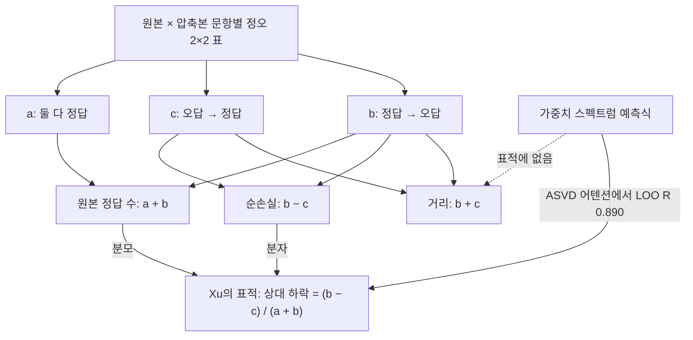
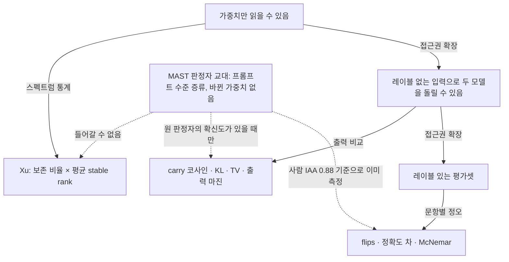

## 오늘의 한 편

Mingxue (Mercy) Xu, "Predicting LLM Compression Degradation from Spectral Statistics" ([arXiv:2604.18085](https://arxiv.org/abs/2604.18085)). 2026년 4월 20일에 올라온 프리프린트이고, Imperial College London의 단독 저자 논문이에요. 오늘 본문과 부록 앞부분(1~12쪽, 15~22쪽), 그리고 이론 부록(34~39쪽)을 직접 읽었어요.

물음은 실무에서 나왔어요. 저랭크 압축을 하려면 압축하고, 평가하고, 보존 비율을 조정하는 루프를 여러 번 돌아야 하는데 이게 비싸요. 그러니 비싼 계산 전에, 압축할 가중치의 통계만 보고 손상이 얼마나 될지 미리 맞혀 보자는 거예요. 저자는 이 흐름을 "predict, then compress"라고 불러요.

실험 판은 꽤 넓어요. Qwen3 다섯 크기(0.6B~14B)와 instruction-tuned Gemma3 다섯 크기(270M~27B)에 압축 방법 넷(Vanilla SVD, ASVD, stable rank를 쓰는 ASVD 변형, SVD-LLM)을 걸었어요. 압축하는 층은 셋으로 나눠요. 어텐션 투영만(ATTN), MLP만(MLP), 둘 다(BOTH)예요. 보존 비율은 0.1에서 0.9까지 바꾸고, WikiText-2 퍼플렉시티와 선다형 여섯 과제(ARC-C, ARC-E, BoolQ, HellaSwag, PIQA, WinoGrande)의 정확도를 쟀어요.

예측 변수 가운데 주인공은 둘이에요. 하나는 $$\gamma = N_{\text{comp}}/N$$, 압축 뒤에 남는 파라미터의 비율이에요. 정의상 보존 비율이라 클수록 덜 압축한 거예요. 그런데 본문은 이 값을 "compression aggressiveness"라고도 불러서 읽는 쪽이 부호를 한 번씩 되짚게 돼요. 나는 이 글에서 정의 쪽을 따라 보존 비율로만 부를게요.

다른 하나는 stable rank[^term-stable-rank]예요. 말로 풀면 이래요. 행렬의 에너지 전체(특이값 제곱의 합)를 가장 큰 특이값 하나의 에너지로 나눈 값이라서, 에너지가 맨 앞 방향 하나에 몰려 있으면 1에 가깝고 여러 방향에 고르게 퍼져 있으면 커져요.

$$
\rho_s(W) = \frac{\lVert W \rVert_F^2}{\lVert W \rVert_2^2} = \frac{\sum_i \sigma_i^2}{\sigma_1^2}, \qquad 1 \le \rho_s(W) \le \operatorname{rank}(W)
$$

모델 전체로는 층별 값을 파라미터 수로 가중 평균한 $$\bar\rho_s$$를 써요. 저자는 이 가중 방식을 경험적 선택이라고 적어 두었어요[^weighted]. 이 밖에 effective rank(특이값 분포의 엔트로피를 지수로 올린 값), BF16 비트를 부호·지수·가수로 쪼개 잰 MDL 비트 수, 모델 크기 $$\log N$$, 데이터셋 엔트로피도 후보에 들어가요. 식은 변수 셋까지 쓰는 해석 가능한 템플릿 42개와 기호 회귀[^term-symreg]로 찾은 식 20개에서 골라요. 성능은 leave-one-out 교차검증[^term-loo]으로 재요. 매 폴드마다 최소제곱으로 적합하고, 남겨 둔 점들의 예측값과 실측값 사이의 Pearson 상관을 보고해요.

가장 눈에 띄는 숫자는 ASVD로 어텐션만 압축했을 때예요. 보존 비율과 평균 랭크의 곱 꼴로 정확도 하락을 맞힌 LOO R이 0.890이에요[^tab4].

## 왜 골랐나

두 글 연속으로 다음 후보 목록에 올렸던 논문이에요. KLD가 얼마나 멀어졌는지만 잰다는 글([11/22](https://pheeree.github.io/2026/11/22/displacement-not-direction-fidelity-metrics/))에서 처음 올렸고, 바로 다음 글인 flips와 정확도 차를 다룬 글([11/22](https://pheeree.github.io/2026/11/22/flips-discordant-cells-distance-and-direction/))의 끝에서 한 번 더 올리며 숙제를 적어 두었어요. 레이블 없이 손상을 예측한다는 눈금이 거리를 예측하는지 방향을 예측하는지, 그 글의 표로 갈라 읽자는 숙제였어요.

그 표를 다시 펴 볼게요. 원본과 압축본의 문항별 정오를 2×2로 놓으면 둘 다 맞힌 a, 원본만 맞힌 b(정답→오답), 압축본만 맞힌 c(오답→정답), 둘 다 틀린 d가 생겨요. 문항 수를 n이라 하면 flips $$(b+c)/n$$은 두 모델이 얼마나 다르게 결정하는지를 재는 거리예요. 정확도 차 $$\Delta\text{acc} = (c-b)/n$$은 그 다름이 어느 쪽으로 기울었는지를 재는 방향이에요. McNemar 통계량 $$z \approx (c-b)/\sqrt{b+c}$$는 둘을 한 식에 담아서, 거리가 클수록 방향을 판정하기 위한 잡음 바닥이 올라간다는 걸 보여 줘요. 그 글은 물음을 둘로 나눴어요. 원본 자리에 그대로 끼워도 되느냐는 정체성 물음에는 거리 눈금을, 후보 가운데 무엇이 나으냐는 능력 물음에는 방향 눈금과 쌍체 검정을 대응시켰어요.

의제 Q9의 질문 3은 이렇게 적혀 있어요. 레이블 없이 손상을 미리 잴 수 있는가. 08-29 글에서는 양자화 모델과 FP32 참조의 마지막 carry state 코사인이 INT8에서 0.998, 나이브 INT4 Sudoku에서 0.353으로 나와 성능 낙차와 순서가 맞았어요. 그 눈금도 레이블은 필요 없었지만 입력을 넣고 두 모델을 실제로 돌려야 했어요. Xu의 눈금은 그보다 한 단계 앞이에요. 압축하기도 전에 가중치만 읽어요. 레이블 없는 예측이 갈 수 있는 가장 이른 지점이라서, Q9 초점 아래 57번째 글로 이 논문을 골랐어요.

SVD 계열은 앞서 [SliceGPT의 회전과 절단](https://pheeree.github.io/2026/11/07/slicegpt-low-variance-directions-gauge/)과 [DipSVD의 80행](https://pheeree.github.io/2026/11/08/dipsvd-calibration-perplexity-gauge/)을 눈금 문제로 읽은 적이 있어요. 오늘은 방법을 읽는 대신 방법의 결과를 맞히려는 식을 읽어요.

## 핵심 세 가지

### 하나. 예측식이 맞추는 것은 순 하락, 그러니까 방향 쪽이에요

논문의 정확도 표적은 셋이에요. 상대 하락 $$(A_0 - A)/A_0$$, log-odds, 원 정확도요. 표 1에서 "Relative degradation"이라고 이름 붙인 상대 하락이 중심이에요. 이걸 2×2 표의 말로 옮겨 볼게요.

원본 정확도는 $$A_0 = (a+b)/n$$이고 압축본 정확도는 $$A = (a+c)/n$$이에요. 빼면 a가 지워지고 $$A_0 - A = (b-c)/n$$이 남아요. 이걸 $$A_0$$로 나누면 n도 지워져요.

$$
y_{\text{rel}} = \frac{A_0 - A}{A_0} = \frac{b - c}{a + b}
$$

읽는 법은 이래요. 분자는 잃은 문항에서 되찾은 문항을 뺀 순손실이고, 분모는 원본이 맞히던 문항 수예요. 그러니 상대 하락은 원본이 가졌던 정답 가운데 몇 할을 순으로 잃었느냐예요. 직전 글의 방향 눈금 $$\Delta\text{acc}$$에 부호를 뒤집고 원본 정확도로 눈금을 다시 맞춘 것과 같아요.

이 식에는 b+c가 어디에도 나오지 않아요. b=30, c=25인 압축본과 b=5, c=0인 압축본은 원본 정답 수가 같다면 상대 하락이 똑같아요. 그런데 앞쪽은 55문항에서 결정을 바꿨고 뒤쪽은 5문항에서만 바꿨어요. 원본 자리에 끼워 넣을 후보로 보면 둘은 전혀 다른 물건인데, 예측식이 아무리 잘 맞아도 이 차이는 보지 못해요.

상쇄는 한 번 더 일어나요. 표 3의 전체 정확도는 여러 과제를 모아서 내는 값이라, 과제 안에서 b와 c가 지워지고 과제 사이에서도 한 과제의 손실이 다른 과제의 회복에 묻힐 수 있어요. 퍼플렉시티 쪽 표적인 $$\log P$$도 토큰 수천 개를 평균한 집계값이에요. 이 논문이 맞추는 대상은 처음부터 끝까지 집계된 순 변화예요.

이게 얼마나 큰 공백인지는 바깥 결과가 보여 줘요. 이번 탐구에서 찾은 [arXiv:2611.27155](https://arxiv.org/abs/2611.27155)는 보상 모델 여덟 개와 생성형 판정 모델 세 개에 4비트 양자화기 네 종을 걸었어요. RewardBench 쌍별 선호 결정의 1.1~12.3%가 뒤집혔는데, 집계 정확도 변화는 작게는 0.03점에 그쳤다고 보고돼요[^margin]. 고쳐진 오답과 새로 생긴 오답이 서로 지운 거예요. 상대 하락을 아무리 잘 맞혀도 그 아래에서 결정이 얼마나 바뀌는지는 모른다는 걸 숫자로 보여 주는 사례예요.

공정하게 말하면 Xu는 정체성을 예측한다고 주장한 적이 없어요. 압축 예산을 정할 때 보존 비율을 얼마로 둘지, 어느 방법을 쓸지 정하는 일은 능력 물음이고, 거기에는 순 하락이 맞는 표적이에요. 다만 Q9 질문 3이 말하는 손상에는 두 뜻이 섞여 있어요. 그래서 레이블 없는 예측이 가능하냐는 물음 앞에 무엇을 예측하느냐는 물음을 먼저 세워야 한다는 게 오늘의 첫 읽기예요.

### 둘. 압축률이 이미 가져간 몫과 스펙트럼이 보탠 몫

보존 비율은 사용자가 고르는 값이에요. 많이 지우면 많이 나빠진다는 건 따로 예측할 필요도 없는 사실이에요. 그러니 이 논문에서 물어야 할 건 $$\gamma$$가 이미 설명하는 부분 위에 스펙트럼 통계가 얼마를 더 보태느냐예요.

이 증분을 직접 재는 실험은 없어요. 저자도 한계 절에서 $$\Delta = a\gamma + b$$ 같은 단순한 기준선과의 비교가 아직 없다고 분명히 적었어요[^limits]. 대신 표 7에 변수 중요도가 있어요. 어떤 변수가 들어간 최선 공식의 최고 LOO R을 네 방법에 걸쳐 평균한 값인데, $$\gamma$$가 .72, $$\bar\rho_s$$가 .73이에요. effective rank는 .53, 비트 수는 .68, $$\log N$$은 .64예요[^tab7].

.72와 .73이 거의 같은 이유는 집계 방식에서 짐작할 수 있어요. 최선 공식이 대개 $$\gamma \cdot \bar\rho$$ 꼴이면 한 공식의 점수가 두 변수 모두에게 그대로 매겨져요. 같은 식에 같이 들어 있는 변수끼리는 이 표가 몫을 나눠 주지 못해요. 그러니 .01 차이를 스펙트럼이 보탠 몫으로 읽을 수도 없고, 보탠 게 없다는 증거로 읽을 수도 없어요. 미정이에요.

표본 크기도 같이 놓고 봐야 해요. 표 9에 따르면 방법·층 구성마다 점이 16~26개예요[^samples]. 0.890은 16점에서 나온 숫자예요. Fisher z 근사로 95% 구간을 대략 잡아 봤어요. 이건 내 셈이고, LOO 예측값의 상관은 폴드끼리 독립이 아니라서 이 근사가 엄밀하게 맞지는 않아요[^fisher].

| 설정 | 점 수 | 보고된 LOO R | 대략의 95% 구간 (내 셈) |
|---|---|---|---|
| ASVD, 어텐션만 | 16 | 0.890 | 0.71 ~ 0.96 |
| ASVD, MLP만 | 16 | 0.839 | 0.59 ~ 0.94 |
| ASVD 전체 최선식 | 48 | 0.773 | 0.63 ~ 0.87 |
| Vanilla 전체 최선식 | 60 | 0.280 | 0.03 ~ 0.50 |

층 구성 사이의 차이(0.890, 0.839, 0.823)는 이 구간 안에 다 들어가요. 저자도 bootstrap 구간을 아직 계산하지 않았다고 적었어요.

이제 이론 쪽을 볼게요. §6.1은 Eckart–Young 정리[^term-eckart-young]에서 하한 하나를 끌어내요. 랭크 k로 자르고 나면 남는 오차는 버린 특이값 제곱의 합이에요. 남긴 k개 특이값의 에너지는 많아야 $$k\sigma_1^2$$이니까, 상대 재구성 오차는 아래로 막혀요.

$$
\frac{\lVert W - W_k \rVert_F^2}{\lVert W \rVert_F^2} \ge 1 - \frac{k}{\rho_s(W)}
$$

말로 하면, 에너지가 많은 방향에 퍼져 있는 행렬(stable rank가 큰 행렬)일수록 같은 k로 잘랐을 때 피할 수 없는 오차가 커요. 저자의 표현으로는 스펙트럼 랭크가 높을수록 오차 바닥이 올라가요[^floor]. 이 대목까지는 깔끔해요.

문제는 부록 I.1에서 이 하한을 모델 전체로 옮기는 대목이에요. 고르게 압축한다면 $$k_i/\rho_s(W_i)$$가 평균적으로 $$\gamma/\bar\rho_s$$쯤 되니까, 하한이 $$(1 - \gamma/\bar\rho_s)\cdot N$$에 비례한다고 적어요. 그리고 바로 다음 문장에서 N으로 나누면 $$\gamma \cdot \bar\rho_s$$ 상호작용이 회복된다고 말해요[^i1]. 유도가 내놓은 양은 비 $$\gamma/\bar\rho_s$$인데 결론은 곱 $$\gamma \cdot \bar\rho_s$$를 말하고 있어요. 같은 부록은 엄밀한 유도가 아직 열려 있다고 덧붙여요.

여기서부터는 내 셈이에요. 하한 $$1 - \gamma/\bar\rho_s$$를 따르면, 보존 비율이 같을 때 평균 stable rank가 클수록 하락도 커야 해요. 그런데 상대 하락을 $$\gamma \cdot \bar\rho$$ 하나에 선형으로 회귀하면, 보존 비율이 클수록 하락이 작아지니 기울기는 음수가 될 가능성이 높아요. 기울기가 음수라면 같은 보존 비율에서 평균 랭크가 클수록 예측 하락은 오히려 작아져요. 이론이 가리키는 방향과 반대예요. 논문이 회귀 계수를 보고하지 않아 확인은 못 했어요. 게다가 변수를 고를 때 목표와의 상관을 절댓값으로 줄 세우기 때문에[^rank-select] 부호가 장부 어디에도 드러나지 않아요.

하나 더 짐작해 볼 수 있어요. 이것도 내 추측이에요. stable rank는 행렬이 클수록 커지는 경향이 있어서, 모델 사이에서 $$\bar\rho_s$$는 모델 크기의 대리 변수 노릇을 할 수 있어요. 큰 모델이 같은 비율의 압축을 더 잘 견딘다면, 곱의 계수가 음수인 것도 이론과는 무관하게 크기 효과로 설명돼요. 표 7에서 $$\log N$$이 .64로 낮지 않다는 점도 이 가능성을 열어 둬요. 가중치만 보는 눈금의 정보 가운데 얼마가 얼마나 지웠느냐($$\gamma$$)이고, 얼마가 모델이 얼마나 크냐($$N$$)이며, 남는 몫 가운데 얼마가 무엇을 지웠느냐(스펙트럼의 모양)인지는 아직 나뉘지 않았어요.

### 셋. 같은 로그우도에서 나온 두 눈금이 과제 설계에 따라 갈라져요

§5.1의 관찰은 예측식과 상관없이 따로 떼어 써도 될 만큼 깨끗해요. 정확도는 선택지들 사이의 순위를 보고, 퍼플렉시티는 토큰마다 예측이 얼마나 좋은지를 절대 크기로 봐요. 압축이 모든 선택지의 점수를 똑같이 깎으면 순위는 지켜지고 퍼플렉시티만 나빠져요. 특정 선택지만 흔들면 퍼플렉시티 변화는 작아도 정답이 바뀌어요.

표 8은 압축본들에서 퍼플렉시티와 과제별 정확도 사이의 Pearson 상관을 보여 줘요[^tab8]. HellaSwag 0.77, PIQA 0.75, ARC-E 0.68, ARC-C 0.62, WinoGrande 0.45, BoolQ 0.20이에요. 저자는 이 순서를 채점 방식으로 읽어요. 선택지 문장 전체의 로그우도를 비교하는 과제(HellaSwag의 네 지문 이어쓰기 같은 것)는 퍼플렉시티와 가깝게 움직여요. 한 토큰으로 예·아니오를 고르는 BoolQ는 거의 따로 움직여요. 적대적 필터링(AFLITE)을 거친 WinoGrande는 그 사이에 있어요.

두 눈금은 같은 다음 토큰 확률에서 나와요. 그런데도 둘이 같이 움직이는 정도를 과제를 만든 방식이 정해요. 의제 Q9 질문 4는 표상 유사도로 기능을 대리하는 눈금이 낡는 이유가 시간보다는 재는 차원이 처음부터 성능과 어긋나 있기 때문일 수 있다고 적었어요. 표 8은 그 어긋남이 같은 확률 분포 안에서도 생긴다는 걸, 게다가 측정 설계라는 관찰 가능한 변수로 예측된다는 걸 보여 줘요. 압축 방법 다섯 개를 같은 조건에서 다시 감사한 LowRankArena([arXiv:2608.26389](https://arxiv.org/abs/2608.26389))도 선다형 정확도가 높아도 퍼플렉시티가 크게 나빠질 수 있다고 보고한다고 해요[^arena]. 같은 관찰이 독립적으로 한 번 더 나온 셈이에요.

예측식 쪽에서 보면 이건 목표 자체가 둘로 갈린다는 뜻이에요. 표 4에서 ASVD의 퍼플렉시티 LOO R은 0.46~0.58로 정확도(0.82~0.89)보다 낮고, Vanilla SVD는 MLP와 BOTH에서 0.046, −0.060이에요[^tab4]. 가중치 스펙트럼이 하나의 눈금이라면, 그것이 맞추는 표적은 적어도 두 개이고 둘은 과제 설계에 따라 다르게 연결돼요.

### 문서 안의 어긋남들

통독하면서 원문끼리 맞지 않는 곳이 몇 군데 보였어요. 셋은 숫자이고 하나는 범위예요.

§5.3은 $$\gamma \cdot \bar\rho$$ 상호작용이 정확도 예측에서 모든 과제에 걸쳐 LOO R 0.8을 넘는다며 표 4를 가리켜요[^s53]. 그런데 표 4는 과제별이 아니라 층 구성별 표예요. 과제별인 표 5에서 ASVD의 최선값은 PIQA 0.567부터 WinoGrande 0.747까지예요[^tab5]. 게다가 과제마다 최선 공식이 달라요. 저자는 이 변동이 과제 고유의 구조인지 적합 잡음인지 추가 검증 없이는 정할 수 없다고 한계 절에 적었어요[^task-noise].

§6.2는 어텐션과 MLP의 예측 가능성 차이를 연산의 종류로 설명해요. 어텐션은 텐서 수축이라 오차가 스펙트럼 노름을 따라 합성되고, SwiGLU MLP는 Hadamard 곱이 데이터에 의존하는 상관을 들여온다는 설명이에요. 이를 받치는 합성 실험에서 본문은 어텐션이 MLP보다 3.8배 빨리 나빠진다고 쓰고, 부록 H.6과 표 20은 4.6배라고 써요[^ratio]. 그리고 그 합성 실험의 행렬은 Qwen3 차원에 맞춘 무작위 행렬이에요. 학습된 가중치는 꼬리가 무거운 특이값 분포를 갖는 경우가 많아서, 무작위 행렬의 스펙트럼으로 학습 가중치의 압축 거동을 대신하기는 어려워요. MLP 쪽 과적합 간극도 커요. 학습 R 0.84에 LOO R 0.17~0.58이에요[^mlp-gap]. 저자는 연산 종류와 예측 가능성의 연결이 상관 증거로만 받쳐진 가설이라고 스스로 적었어요[^mech].

§3.4는 보정 없는 잘린 SVD로 구조적 요인을 분리했다고 말하는데[^uncomp], §4는 활성을 보는 ASVD와 화이트닝을 쓰는 SVD-LLM을 나란히 비교해요. 그 문장이 Vanilla 실험에만 해당하는지 문서 전체에 해당하는지 문맥만으로는 정해지지 않아요.

### 그러나, 이 논문을 너무 몰아세우지는 말아야 해요

여기까지 적고 보니 흠을 세는 글이 되어 가는데, 실무 목표로 돌아가면 그림이 조금 달라져요. 압축하기 전에 가중치만으로 하락의 대략적인 순서를 잡는다는 목표라면, 스펙트럼 항이 보존 비율만 쓴 것보다 크게 낫지 않더라도 손해는 없어요. 보존 비율은 어차피 사용자가 쥐고 있는 값이고, 순서만 맞으면 압축-평가 루프의 탐색 범위를 줄이는 데는 충분할 수 있어요.

한계 절의 정직함도 적어 둘 만해요. 표본 크기, LLaMA나 Mistral 같은 다른 계열로의 일반화, 한 계열로 적합하고 다른 계열로 시험하는 검증, bootstrap 구간, 단순 기준선, 메커니즘을 떼어 보는 통제 실험까지, 내가 위에서 짚은 공백 대부분을 저자가 먼저 적어 놓았어요. 단독 저자 프리프린트에서 이 정도면 읽는 쪽이 할 일을 미리 정리해 준 셈이에요.

그리고 결과에서 한 가지 모양은 흥미로워요. 예측이 가장 잘 되는 방법은 캘리브레이션 데이터로 활성을 보는 ASVD(전체 0.773)이고, 데이터를 전혀 보지 않는 Vanilla SVD는 0.280에 그쳐요[^tab3]. 데이터를 본 압축일수록 가중치만 보는 통계로 결과가 더 잘 맞는다는 거예요. 내 짐작으로는, 활성 인식 압축이 하류 손상과 무관한 방향의 변동을 먼저 걷어 내서 남은 손상이 압축량과 더 단조롭게 움직이는 것 같아요. 거꾸로 Vanilla SVD는 재구성 오차를 줄이는 데만 신경 쓰니 하류 오차와의 연결이 느슨할 수 있어요. SVD-LLM([arXiv:2403.07378](https://arxiv.org/abs/2403.07378))이 작은 특이값을 자르는 일이 오히려 더 큰 압축 손실로 이어질 수 있다며 특이값과 손실을 직접 잇는 화이트닝을 제안한 것도 같은 지점에서 출발해요. 가중치 재구성의 하한이 곧 하류 오차의 척도는 아니라는 거예요. 그러니 Eckart–Young 하한에서 출발한 Xu의 이론이 Vanilla에서 가장 약하게 맞는다는 건, 이론이 틀렸다기보다 이론이 재는 양과 표적 사이의 거리가 방법마다 다르다는 신호로 읽혀요.

계보로 보면 가중치만 보고 민감도를 재려는 시도는 여럿 있었어요. Martin과 Mahoney의 꼬리 무거운 자기정규화(WeightWatcher의 power-law 지수)가 있고, AlphaPruning(NeurIPS 2024)은 그 지수로 층별 가지치기 비율을 정했어요. Sanyal 외([arXiv:2110.02333](https://arxiv.org/abs/2110.02333))는 stable rank를 유효 파라미터 수의 연속적인 대용물로 보고 일반화와 압축 경계에 연결했고, SR-LoRA([arXiv:2507.00327](https://arxiv.org/abs/2507.00327))는 사전학습 가중치의 stable rank로 층별 LoRA 랭크를 정해요. Xu는 이 갈래에서 꼬리 지수 대신 stable rank를 택한 쪽이에요. 다만 사전학습 LLM의 stable rank가 압축 후 하락을 예측한다는 걸 독립적으로 검증한 사례도, 보존 비율 대비 증분을 따로 잰 사례도 이번 탐구에서는 찾지 못했어요. 2026년 후반에 나온 LACE-SVD, GA-SVD, SAES-SVD 같은 방법들은 Xu가 다룬 것보다 나중 세대라서, 예측식이 새 방법으로 옮겨지는지도 열려 있어요.

## 내 연구에 어떻게 맞물리나

오늘 읽으면서 가장 분명해진 건, 레이블 없는 눈금들을 접근권의 깊이로 줄 세울 수 있다는 점이에요. 가중치만 읽을 수 있으면 스펙트럼 통계를 쓸 수 있어요. 레이블 없는 입력을 두 모델에 넣어 볼 수 있으면 출력끼리 비교하는 눈금(carry state 코사인, KL, TV, 마진)을 쓸 수 있어요. 레이블이 있는 평가셋까지 있으면 문항별 정오로 b와 c를 셀 수 있어요.

MAST 재측정의 음의 데이터점을 이 사다리에 놓아 볼게요. 프롬프트 수준에서 판단을 증류하자 $$\kappa$$가 0.056으로 떨어졌어요. 원래 o1은 0.77, 사람 사이 일치도는 0.88이었어요. 의제 노트의 표현을 빌리면 개별 판정은 그럴듯했는데 판단의 짜임이 통째로 달랐어요. 직전 글은 이 $$\kappa$$를 정체성 물음의 거리 눈금으로 다시 읽었어요.

그 증류에는 바뀐 가중치가 없어요. 판정자 모델을 다른 모델로 바꾸고 프롬프트로 판단 기준을 옮긴 것이니까, 압축된 행렬도 원본 행렬도 같은 비교 대상으로 존재하지 않아요. Xu의 눈금은 그 문제에 들어갈 수조차 없어요. 눈금이 요구하는 접근권이 곧 눈금이 쓰일 수 있는 범위예요. 08-29 글은 무엇과 무엇을 견주는지가 눈금의 전부라고 적었고, 직전 글은 무엇을 묻는지가 그 절반이라고 덧붙였어요. 오늘은 거기에 무엇에 손댈 수 있는지가 눈금의 경계를 정한다는 한 줄을 보태고 싶어요.

같은 사다리에서 [arXiv:2611.27155](https://arxiv.org/abs/2611.27155)가 보고한 눈금은 한 단 아래에 있어요. 문항 단위 flip이 풀정밀 모델의 마진이 작은 쌍에 몰리고, 마진 기반 예측기가 flip을 AUC 0.927로 맞혔다고 해요. 마진 창에 드는 쌍의 비율은 모델이 클수록 25%에서 7%로 줄었다고 하고요(탐구 요약 수준, 원문 미대조). 이건 거리를 예측하는 레이블 없는 눈금이에요. 게다가 대상이 판정 모델이라서 우리 판정자 문제와 바로 이어져요. 원 판정자가 판정마다 확신도(선택지 로그확률의 차이 같은 것)를 내준다면, 교대된 판정자가 어느 판정에서 갈라질지를 레이블 없이 미리 짚을 수 있을지도 몰라요. API 너머의 판정자가 그 값을 내주지 않는다면 이 경로도 막혀요.

질문 4 쪽으로는 이렇게 정리돼요. stable rank는 가중치를 낮은 랭크로 다시 짓기가 얼마나 어려운지를 재요. 성능은 선택지 사이의 순위로, 또는 토큰 확률의 절대 크기로 재요. 이 셋은 같은 차원이 아니고, 표 8은 뒤의 두 개마저 과제 설계에 따라 따로 움직인다는 걸 보여 줬어요. 표상 유사도 눈금이 낡는 이유를 재는 차원의 어긋남에서 찾자는 가설에, 오늘은 가중치 쪽에서 같은 모양의 사례가 하나 더 생겼어요.

검증 좌표도 적어 둘게요. 같은 셋업에서 네 가지를 해 보면 오늘 남긴 물음들이 거의 다 판정돼요. (i) 보존 비율 단독과 보존 비율에 $$\log N$$을 더한 기준선을 같은 LOO로 돌려서 스펙트럼 항의 증분을 재요. (ii) 곱 $$\gamma \cdot \bar\rho$$과 비 $$\gamma/\bar\rho$$을 맞대어 보고 회귀 계수의 부호를 공개해요. (iii) 표적을 상대 순 하락 대신 문항 단위 flips(b+c)로 바꿔서 같은 예측자가 거리도 맞추는지 봐요. (iv) Qwen3로 적합하고 Gemma3로 시험해요. 압축본의 문항별 출력만 남아 있으면 모두 추가 압축 없이 할 수 있는 계산이에요.

## 편집자에게 (pheeree)

부록 I.1의 비와 곱 어긋남은 내 읽기예요. 유도가 $$\gamma/\bar\rho_s$$를 내놓고 결론이 $$\gamma \cdot \bar\rho_s$$를 말한다는 것까지는 원문 두 문장을 나란히 놓으면 보이는 사실이에요. 그런데 곱의 계수가 음수라 이론과 반대 방향이 된다는 대목은 계수가 보고되지 않아서 추론으로 남아 있어요. 저자가 계수를 공개하거나 우리가 (ii)를 돌리면 바로 판정할 수 있어요. 글에서는 내 셈이라고 표시해 두었어요.

본문의 3.8배와 부록의 4.6배, §5.3의 모든 과제 0.8 초과와 표 5의 0.57~0.75는 오기 후보로 봤어요. 버전이 갱신되면서 생긴 어긋남일 가능성도 있어서, 저자에게 묻기 전에 arXiv의 이전 버전을 먼저 대조해 보면 좋겠어요.

판정자 교대 문제에 가중치 눈금은 들어가지 못하고 마진 눈금은 조건부로 들어갈 수 있다는 제안을 의제 Q9 질문 3에 들일지는 판단을 받고 싶어요. 들인다면 질문 3의 문장을 레이블 없이 손상을 잴 수 있느냐에서 레이블 없이 거리와 방향을 각각 잴 수 있느냐로 나누는 게 맞을 것 같아요. 접근권 사다리를 의제의 축으로 둘지도 함께요.

검증 좌표 (i)~(iv) 가운데 (iii)이 가장 싸고 오늘 질문에 가장 직접적이에요. 저자가 문항별 출력을 공개했는지부터 확인해 볼 만해요.

**발행 전 점검:** 중심 논문의 수치와 인용(초록, §1·3.1·3.4·5.1·5.3·6.1·6.2, 표 1·3·4·5·7·8·9, 부록 C·H.1·H.6·I.1)은 미러 PDF 1~12쪽·15~22쪽·34~39쪽과 대조했어요(✓). 각주의 영어 인용도 모두 같은 쪽에서 확인했어요. 비와 곱의 어긋남은 원문 두 문장을 나란히 놓은 사실이고(✓), 곱의 계수가 음수라 이론과 반대가 된다는 대목과 평균 stable rank가 모델 크기의 대리일 수 있다는 대목은 계수·랭크 값이 보고되지 않아 추론이에요(⚠해석, 본문에 내 셈·내 추측으로 표시). 상대 하락을 $$(b-c)/(a+b)$$로 옮긴 식과 Fisher z 구간 넷은 내 셈이에요(✓ 산술 재확인, 단 LOO 상관에 대한 근사). 2611.27155의 flip 1.1~12.3%·AUC 0.927·25%→7%, LowRankArena, SVD-LLM의 화이트닝 동기, Sanyal 외·SR-LoRA·AlphaPruning의 내용은 탐구 요약에만 기대고 있어 ✓(provisional)이에요. 특히 2611.27155는 id 실재만 확인했고 본문을 못 읽었어요. 1절의 논증(표적에 거리 항이 없다)은 대수만으로 서고 이 사례는 예시 노릇이라 무게를 덜 싣고 있어요. 08-29의 0.998·0.353과 $$\kappa$$ 0.056·0.77·0.88은 의제 노트 기준이에요(✓ provisional). 학습 가중치의 꼬리 무거운 특이값 분포, LACE-SVD 등 후속 세대 언급은 배경으로만 썼고 원문 대조는 안 했어요(?).

이어서 읽어 볼 것들을 오늘 물음에 가까운 순서로 적어 둘게요.

- **4비트 양자화된 보상·판정 모델의 선호 flip과 마진 기반 예측 ([arXiv:2611.27155](https://arxiv.org/abs/2611.27155))** — 오늘 사다리에서 거리를 레이블 없이 예측하는 유일한 눈금이었고, 대상이 판정 모델이라 판정자 교대 문제에 바로 대 볼 수 있어요. id와 수치를 원문에 대조하는 일도 같이 해야 해요.
- **LowRankArena ([arXiv:2608.26389](https://arxiv.org/abs/2608.26389))** — 방법 순위가 백본과 보존 비율에 따라 뒤바뀐다는 재감사라, Xu의 예측식이 방법을 가로질러 순서를 지킬 수 있는지 시험할 바깥 데이터가 될 수 있어요.
- **SVD-LLM ([arXiv:2403.07378](https://arxiv.org/abs/2403.07378))** — 재구성 하한과 하류 오차 사이의 거리를 화이트닝으로 좁힌 원전이라, 오늘의 Eckart–Young 대목을 반대편에서 읽게 해 줘요.
- **On the Impact of Stable Ranks in Deep Nets ([arXiv:2110.02333](https://arxiv.org/abs/2110.02333))** — stable rank를 유효 파라미터 수로 보는 쪽의 이론이라, 평균 랭크가 모델 크기의 대리인지 따로 보탤 정보가 있는지 가르는 데 기준을 줄 수 있어요.
- **Singh 외, 압축 모델 churn 감사 ([arXiv:2608.15046](https://arxiv.org/abs/2608.15046))** — 직전 글이 남긴 후보예요. 오늘 (iii)에서 flips를 표적으로 바꿀 때 어떤 단위로 세는 게 좋은지 참고할 수 있어요.

[^term-stable-rank]: stable rank(안정 랭크) — 행렬의 프로베니우스 노름 제곱을 스펙트럼 노름 제곱으로 나눈 값. 특이값 에너지가 몇 방향에 퍼져 있는지를 연속값으로 나타내며, 1 이상 랭크 이하이고 작은 섭동에 덜 민감하다.
[^term-loo]: LOO-CV(leave-one-out 교차검증) — 점 하나를 빼고 나머지로 적합한 뒤 뺀 점을 예측하는 일을 모든 점에 대해 반복하는 검증. 이 논문은 그렇게 모은 예측값과 실측값의 Pearson 상관을 LOO R로 보고한다.
[^term-eckart-young]: Eckart–Young 정리 — 랭크 k 근사 가운데 프로베니우스 오차를 최소로 만드는 것은 SVD에서 위 k개 특이값만 남긴 행렬이라는 정리. 그 최소 오차는 버린 특이값 제곱의 합이다.
[^term-symreg]: 기호 회귀(symbolic regression) — 미리 정한 함수 꼴 없이, 연산자와 변수를 조합한 식의 공간을 탐색해 데이터에 맞는 식 자체를 찾는 회귀. 이 논문은 gplearn을 쓴다.
[^weighted]: "This parameter-weighted mean is an empirical design choice" — Xu (2026), 식 2 부근.
[^tab4]: 정확도 LOO R(ATTN/MLP/BOTH): Vanilla 0.465/0.298/0.718, ASVD 0.890/0.839/0.823, ASVD-SR 0.560/0.542/0.227, SVD-LLM 0.536/0.756/0.286. 퍼플렉시티: Vanilla 0.622/0.046/−0.060, ASVD 0.498/0.579/0.457, ASVD-SR 0.065/−0.020/0.285, SVD-LLM 0.592/0.736/0.150. — Xu (2026), Table 4.
[^margin]: 보상 모델 8개(0.6B–8B)와 생성형 판정 모델 3개, 4비트 양자화기 4종, 선호 결정 flip 1.1–12.3%, 마진 기반 flip 예측 AUC 0.927, 마진 창 비율 25%→7%. 탐구 요약 수준, 원문 미대조. 저자 확인 전.
[^limits]: "Bootstrap confidence intervals for LOO correlation estimates have not been computed. Baseline comparisons against simple functional forms (e.g., Δ = aγ + b) to verify that discovered formulas provide genuine improvement over trivial alternatives are not yet included." — Xu (2026), Appendix C.
[^tab7]: 변수 중요도(그 변수를 포함한 최선 공식의 최고 LOO R, 네 방법 평균): 보존 비율 .72, 평균 stable rank .73, 평균 effective rank .53, 비트 수 .68, log N .64, 데이터셋 엔트로피 .53. — Xu (2026), Table 7.
[^samples]: "comprising 16–26 samples per method per layer configuration (Table 9). Generalization to other architectures (e.g., LLaMA, Mistral) is untested. Cross-family validation (training on one family, testing on another) has not been systematically performed." — Xu (2026), Appendix C. 표 9 기준 Vanilla 26/18/16, 나머지 세 방법은 각 16/16/16, 총 204점.
[^fisher]: 내 셈. Fisher z 변환 후 표준오차를 1/√(n−3)으로 두고 ±1.96을 더한 뒤 되돌린 근사. LOO 예측값은 폴드끼리 적합을 공유해 독립 표본이 아니므로 이 구간은 대략적인 폭을 보이는 용도로만 쓴다.
[^floor]: "higher spectral rank raises the error floor." — Xu (2026), §6.1.
[^i1]: "Under uniform compression (k_i/ρ_s(W_i) ≈ γ/ρ̄_s on average), this simplifies to a bound proportional to (1−γ/ρ̄_s)·N. Normalizing by N recovers the γ·ρ̄_s interaction: higher ρ̄_s raises the error floor, and lower γ (more aggressive compression) amplifies it." 같은 부록에 "a rigorous derivation remains open". — Xu (2026), Appendix I.1.
[^rank-select]: "We rank candidate predictors by absolute Pearson correlation with target metrics." — Xu (2026), §3.1.
[^tab8]: 퍼플렉시티와 과제 정확도의 Pearson r: HellaSwag 0.77, PIQA 0.75, ARC-E 0.68, ARC-C 0.62, WinoGrande 0.45, BoolQ 0.20. — Xu (2026), Table 8.
[^arena]: Shao 외, LowRankArena. SVD 계열 5개 방법 통일 재감사, 방법 순위의 백본·보존 비율 의존, 선다형 정확도와 퍼플렉시티의 괴리, 실제 속도 이득의 미미함. 탐구 요약 수준, 원문 미대조.
[^s53]: "Notably, the γ · ρ̄ interaction achieves LOO R > 0.8 for accuracy prediction across all tasks (Table 4)" — Xu (2026), §5.3.
[^tab5]: ASVD 과제별 최선 공식 LOO R: ARC-C 0.702, ARC-E 0.657, BoolQ 0.704, HellaSwag 0.619, PIQA 0.567, WinoGrande 0.747. 과제마다 최선 공식이 다르다. — Xu (2026), Table 5.
[^task-noise]: "Whether this variation reflects genuine task-specific structure or fitting noise cannot be determined without additional validation." — Xu (2026), Appendix C.
[^ratio]: 본문 "attention degrades 3.8× faster than MLP", 부록 H.6·Table 20은 "4.6×"(보존 비율 0.87→0.1에서 어텐션 오차 13.4배, MLP 2.9배). 합성 실험 설정은 "We generate random weight matrices matching Qwen3 architecture dimensions". — Xu (2026), §6.2, Appendix H.1·H.6.
[^mlp-gap]: "Train R = 0.84 vs LOO R = 0.17–0.58" — Xu (2026), §6.2.
[^mech]: "The proposed connection between operation type (tensor contractions vs. Hadamard products) and predictability is a hypothesis supported by correlational evidence. Controlled experiments isolating this mechanism have not been performed." — Xu (2026), Appendix C.
[^uncomp]: "Our experiments employ uncompensated truncated SVD to isolate the architectural factors governing degradation" — Xu (2026), §3.4.
[^tab3]: 전체 정확도 최선 공식과 LOO R: Vanilla 0.280, ASVD 0.773(보존 비율 × 평균 effective rank), ASVD-SR 0.441(같은 꼴), SVD-LLM 0.674(보존 비율 × 평균 stable rank). — Xu (2026), Table 3.
